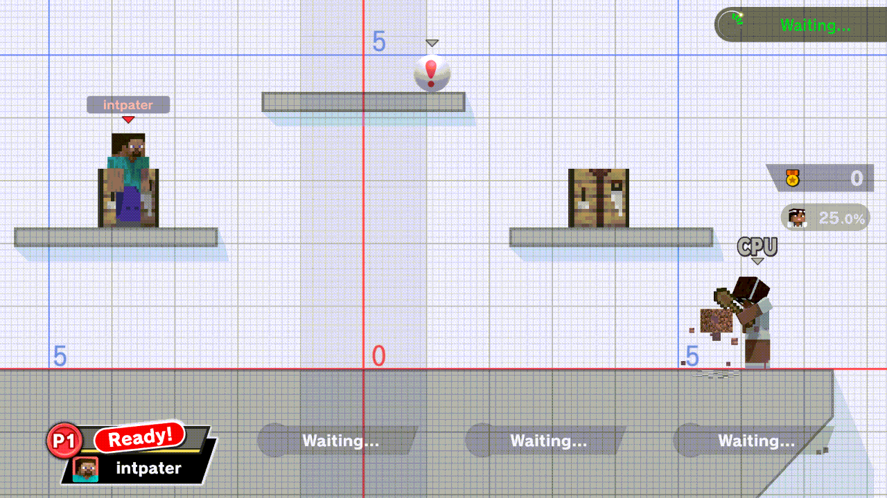

# TrainingRoomsForUltimate

A Skyline plugin for Super Smash Bros. Ultimate 13.0.5 that adds practice
tools to Training mode and to the online waiting rooms.

**This is a clean-room implementation inspired by the Training Modpack.**
The Training Modpack ([jugeeya/UltimateTrainingModpack](https://github.com/jugeeya/UltimateTrainingModpack))
publishes no license, so none of its code, layouts or artwork is used here.
Features that originate in the Training Modpack were re-specified from their
observable behaviour by spec writers, and then implemented by people and agents
who worked from those specifications only and did not read the Training
Modpack's source. The hot-swap engine, Mii tools, CPU-as-Player-1 handoff,
cycle preloading, JSON saves, practice stages, lobby practice and the seam
guards were written for the earlier fork by this project's authors and are
carried over as they are.

This project's code is licensed under the [MIT License](LICENSE). Dependency
and carried-code origins are recorded in [PROVENANCE.md](PROVENANCE.md) and
[CARRY-OVER.md](CARRY-OVER.md).

This project was developed with the assistance of AI.

## Status

The release candidate is being narrowed to the functional regression rows that
fork M5q passed, the already-working new UI, and one replay/online smoke.
The final candidate has not completed its gates; there is no approved release
or installation artifact yet.

See [HANDOFF.md](HANDOFF.md) for the current acceptance state and
[NEXT-VERSION.md](NEXT-VERSION.md) for deferred work. The larger specification
inventory remains a development backlog. Historical results under [eden/](eden/)
identify their tested build and do not validate a later candidate.

## Practice tools

The retained scope includes the demonstrated Training and waiting-room menu,
CPU options, input delay, save states, numbered recording/playback, supported
named operations, fighter cycling, existing Mii/hat behavior and practice stages.
The opt-in Developer page has passing hidden and visible Eden observations.
Unproven Setup workflows, hurtboxes, expanded hot-slot budgets, F9 promotion,
advanced preview extensions, native Mii creation and further latency work are deferred.
Their RC entry points are closed; ordinary saved Mii selection remains. Final
candidate validation is pending.

## Known limitations under review

- CPU count increases retain M5q behavior, including its wrong-CPU limitation;
  the unfinished promotion/cutover feature is being excluded.
- Cold fighter switches can hitch, as in M5q. Its own cold20ms target failed;
  this RC does not promise that latency target.
- Recording after swaps, large-fighter first-frame hitbox refusals and
  power-loss partial writes remain known limitations. The final handoff will
  distinguish retained M5q behavior from specific demonstrated improvements.
- A TR timer-recording run truncated at3600frames, and input-log frame text had
  poor contrast on a light Training background. Their M5q equivalence has not
  been established; they are not being presented as proven inherited bugs.

These are current development limitations, not a completed parity verdict.
The empty/unpublished fighter-cell access fix and existing zero-allocation
improvements are retained independently of deferred features.

## Waiting-menu development preview



Recorded 2026-11-03 in Eden with development build `758cee5` (r16,
NRO `88abde8e`). The 9.5-second clip shows Solo waiting, opening the menu
with B+Up, and changing page with R. This demonstrates the waiting-menu text
fix; it does not establish release or online-regression acceptance.
[Recording provenance and limits](docs/UI-DEMO-PROVENANCE.md).

## Architecture and saved data

The plugin follows the workspace playbook layout: a `cdylib` only; pure logic in
`model`-side crates with host tests; hooks in a `runtime` module compiled only
for the Switch; a game-version guard and a 64-byte guard on every hooked site;
a `diag` feature for Eden diagnostics that the shipped NRO does not carry; one
install line in `sd:/ultimate/TrainingRooms/events.log` and a size-capped
diagnostics file.

Settings and saved data live under `sd:/ultimate/TrainingRooms/`. On its
first boot on a card that has the earlier fork's `sd:/ultimate/TrainingModpack/`
folder, it imports the menu settings, save states and setups, Mii presets and
named macro library once, by copying; the originals are left untouched
(`specs/SPEC-core-08-storage-root-and-migration.md`).

## Build

The host toolchain is pinned by `rust-toolchain.toml`. Switch builds use
`cargo-skyline` and its separate `skyline-v3` toolchain. Follow
[docs/BUILD.md](docs/BUILD.md) for the verified toolchain setup and layout recipe.
From a configured checkout, run each gate separately:

```powershell
cargo test --all-targets
cargo clippy --all-targets -- -D warnings
cargo build --no-default-features
cargo test --manifest-path crates/smash-match-data/Cargo.toml
cargo test --manifest-path crates/hos-lock/Cargo.toml
cargo test --locked --manifest-path tools/layout-builder/Cargo.toml
cargo skyline build --release
cargo skyline build --release --features diag
```

The layout builder uses your own stock game archives; generated target archives stay
private. Its archive and expanded-pane fixture tests require the owned input setup
and are ignored by default. A default host test run does not validate those fixtures.
Regenerate both layout recipes when changing the shared pane table, as described in
[docs/BUILD.md](docs/BUILD.md#layout-archive-recipe-package-5-host-tool).

The Switch artifact is
`target/aarch64-skyline-switch/release/libtraining_rooms.nro`, or the same
relative path under `CARGO_TARGET_DIR`. Release and diagnostic builds use the
same output filename: archive and hash each artifact before building the next.
The diagnostic build is for validation. The final handoff must state the exact
release hash and resident memory size.

## Installation layout

The plugin targets Super Smash Bros. Ultimate **13.0.5** with Skyline. Its NRO
belongs at:

```text
atmosphere/contents/01006A800016E000/romfs/skyline/plugins/libtraining_rooms.nro
```

Installation awaits the approved candidate and operator sign-off. The
[card-swap plan](docs/CARD-SWAP-PLAN.md) records coexistence and rollback steps.
Do not treat a diagnostic or intermediate stream build as the release.

This is an unofficial fan project, not affiliated with or endorsed by Nintendo.
