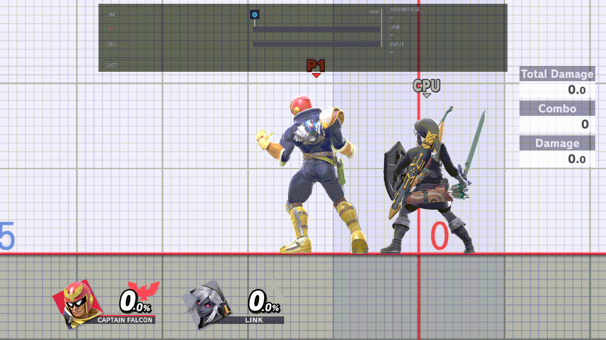
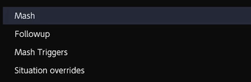
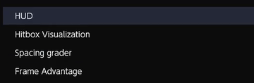
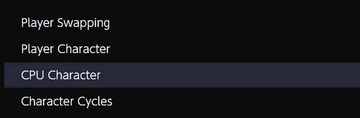
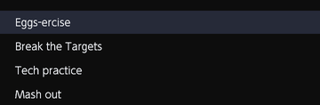
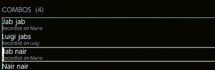
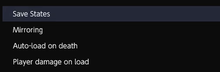

# TrainingRooms for Ultimate
Practise matchups, edit recordings and play training games in Super Smash Bros. Ultimate. 
[Download a published release](https://git.syntaxbyexample.com/intpa/TrainingRoomsForUltimate/releases) · [Player guide](docs/README.md) · [rc.15 status](docs/CURRENT-RELEASE.md)

## Notable features

### Practice games

<video src="https://git.syntaxbyexample.com/intpa/TrainingRoomsForUltimate/media/blob/3609165db1d1675f019de9a7f3b7d1b6f7b8ebf0" autoplay muted loop playsinline controls></video>

*Guard the Edge counts one secured attempt out of three.* [Open the clip](docs/media/tut-guard-edge-setup-and-score.mp4)

Pick a spot offstage and practise denying the recovery; [Guard the Edge](docs/guide/guard-the-edge.md) keeps score when you make it back, too.

### Recordings you can drill

<video src="https://git.syntaxbyexample.com/intpa/TrainingRoomsForUltimate/media/blob/b635893c4df02daaae5535f19b5b3f5c2346245b" autoplay muted loop playsinline controls></video>

*Kirby's recording becomes a drill in the library.* [Open the clip](docs/media/tut-input-drill-record.mp4)

Record a dash-back or a string of short hops, then [try to match your timing](docs/guide/recording.md#input-drills) without needing to hit an opponent.

### Replay clip editor

<video src="https://git.syntaxbyexample.com/intpa/TrainingRoomsForUltimate/media/blob/7c00d97bf3abf99b2191b84d54bf130ffe0620ed" autoplay muted loop playsinline controls></video>

*Snap to the aerial's start, then preview it on the CPU.* [Open the clip](docs/media/tut-clip-snap.mp4)

[Scrub through a take](docs/guide/recording.md#crop) to see a matching fighter's recorded pose, then snap the start or end of the clip to a move.

### Match recordings in practice

With Replay capture on, save the replay and [choose a fighter's recorded inputs](docs/menu/recording.md#recordings) to practise against.

### Fighter swaps and cycles

<video src="https://git.syntaxbyexample.com/intpa/TrainingRoomsForUltimate/media/blob/6d08f7457ab8d11ca30c8d7ed1140dd4611397e9" autoplay muted loop playsinline controls></video>

*Donkey Kong takes Mario's place on stage.* [Open the clip](docs/media/tut-fighter-cycle.mp4)

Stay on stage between matchups: pick a different fighter or [set a rotation](docs/guide/fighter-cycles.md) for yourself and your opponent.

### Waiting-room practice

While you wait in Quickplay or local wireless, [practise against the first partner](docs/guide/waiting-rooms.md) with your training settings.

### Stage changes and rotations

<video src="https://git.syntaxbyexample.com/intpa/TrainingRoomsForUltimate/media/blob/e0de6dbeba09dd60aa5dc2ec3c5fbde73470d79a" autoplay muted loop playsinline controls></video>

*The fighters move to the Omega form of Battlefield.* [Open the clip](docs/media/tut-stage-change.mp4)

Try the same matchup on a different stage without leaving Training, or [choose a rotation](docs/guide/stages.md) for future visits.

### Choose Kirby's hat lineup

<video src="https://git.syntaxbyexample.com/intpa/TrainingRoomsForUltimate/media/blob/0858b8e26cf6db1c8d16f3d935c486380ffa303f" autoplay muted loop playsinline controls></video>

*Kirby puts on Mario's cap without inhaling Mario.* [Open the clip](docs/media/tut-kirby-hat.mp4)

Give Kirby a [lineup of copy abilities](docs/guide/fighter-cycles.md#kirby-hats) to practise without changing the opposing fighter.

### Saved Mii fighters

<video src="https://git.syntaxbyexample.com/intpa/TrainingRoomsForUltimate/media/blob/cc2afdd8e4395fc04dd9a9d05b72a78b3f3462d8" autoplay muted loop playsinline controls></video>

*A saved Mii Brawler cycles into Player 1's spot.* [Open the clip](docs/media/tut-mii-pick.mp4)

[Choose the saved Mii](docs/guide/mii.md) you want for either side instead of settling for a default Brawler, Swordfighter or Gunner.

### Items on demand

[Choose an item for Player 1](docs/menu/fighters-and-stages.md#give-item) and close the menu to use it, without loading a save.

## About TrainingRooms

| In the menu | Where to go |
| --- | --- |
|  | [CPU](docs/menu/cpu.md) · Choose what your opponent does between hits. |
|  | [Display & Controls](docs/menu/display-and-controls.md) · See hitboxes, read frame timing or change a chord. |
|  | [Fighters & Stages](docs/menu/fighters-and-stages.md) · Pick both sides of a matchup and where to play. |
|  | [Practice games](docs/menu/practice-games.md) · Open a game inside Fighters & Stages and set a challenge. |
|  | [Recording](docs/menu/recording.md) · Keep a combo, edit a take or practise a sequence. |
|  | [Saves](docs/menu/saves.md) · Set the damage and positions you return to. |

Smash Ultimate 13.0.5 on Switch or emulator: [Downloads](https://git.syntaxbyexample.com/intpa/TrainingRoomsForUltimate/releases) · [Install guide](docs/guide/getting-started.md#installing) · [Release notes](docs/RELEASE-NOTES.md#release-notes-rc15) 
[MIT License](LICENSE) · Made with the assistance of AI · [Technical notes](docs/TECHNICAL.md) · [Build from source](docs/BUILD.md) (`cargo skyline build --release`)
