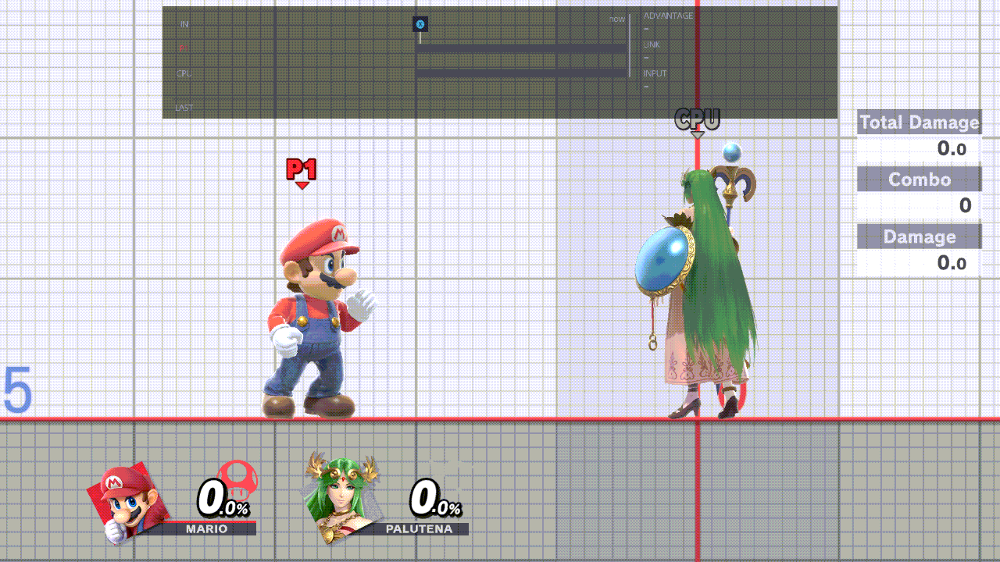
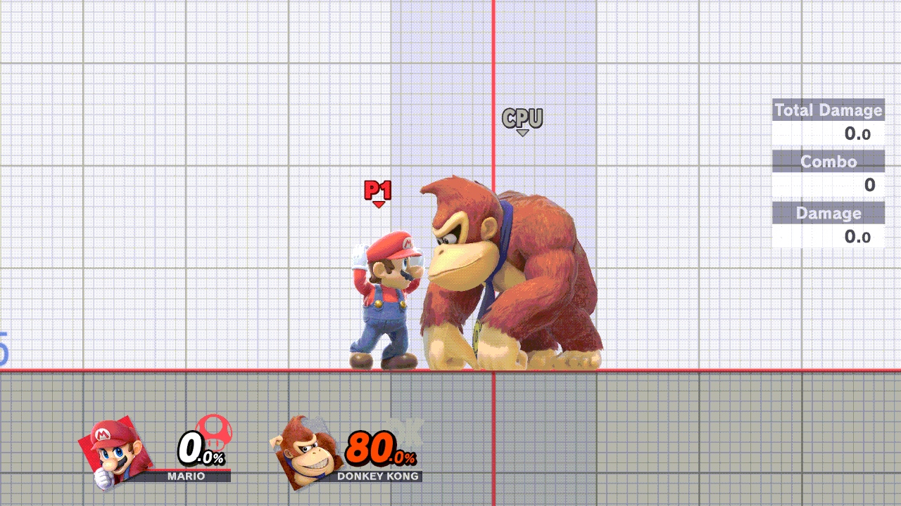
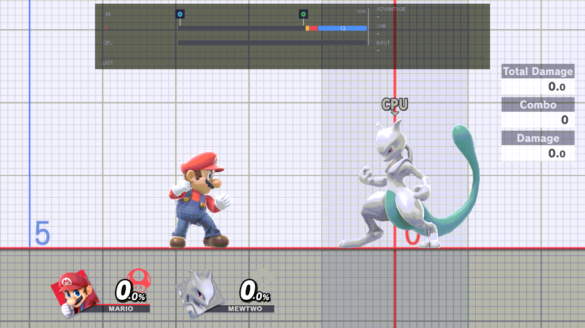
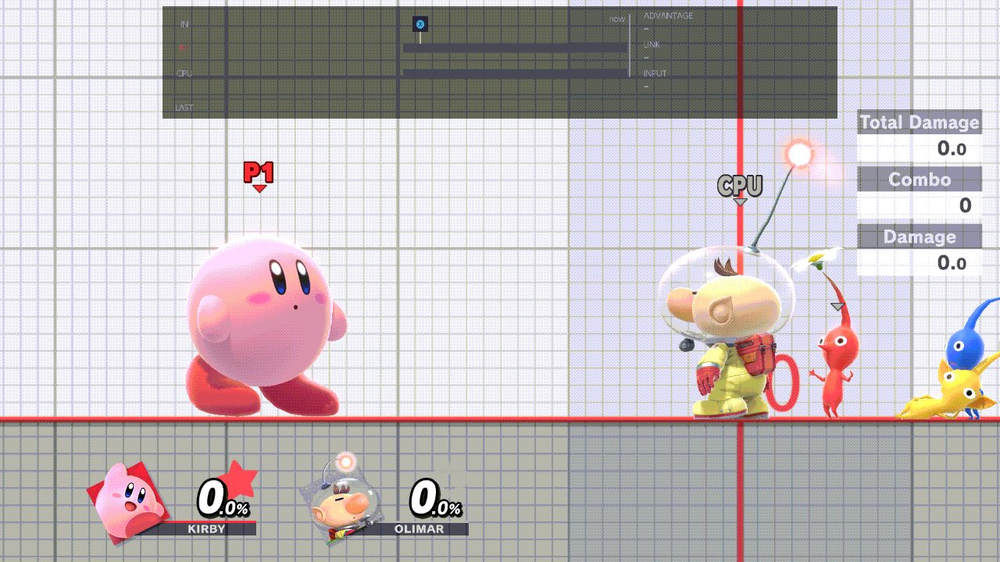
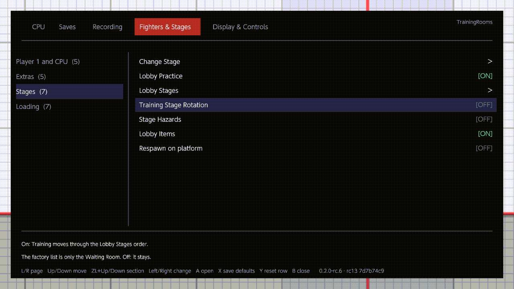
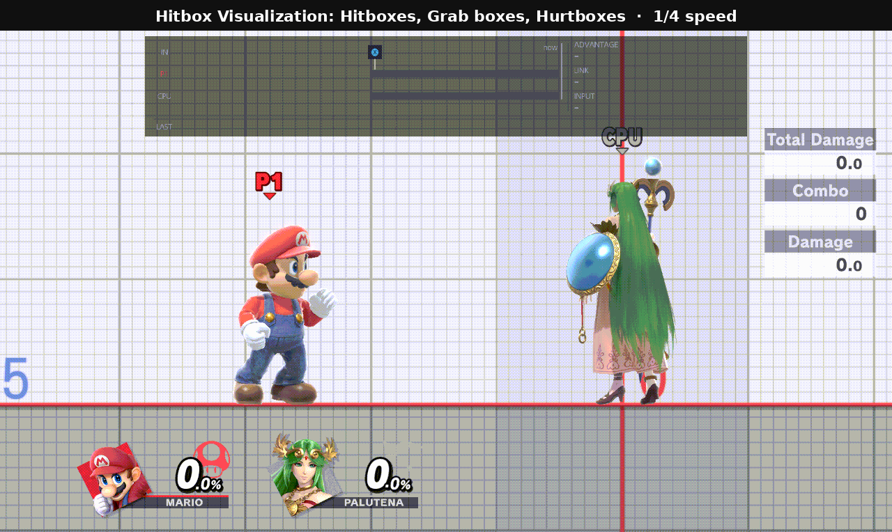
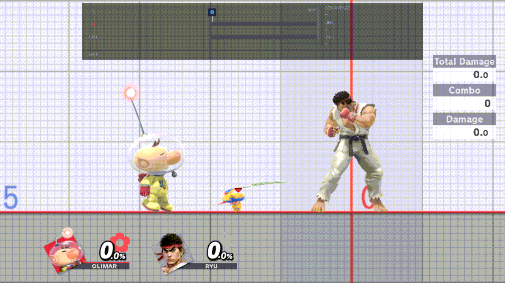
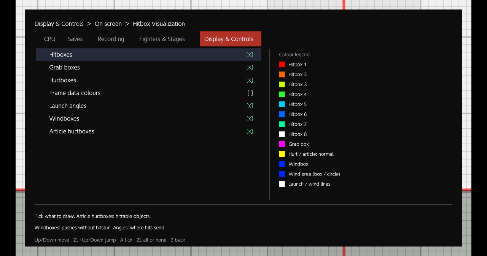
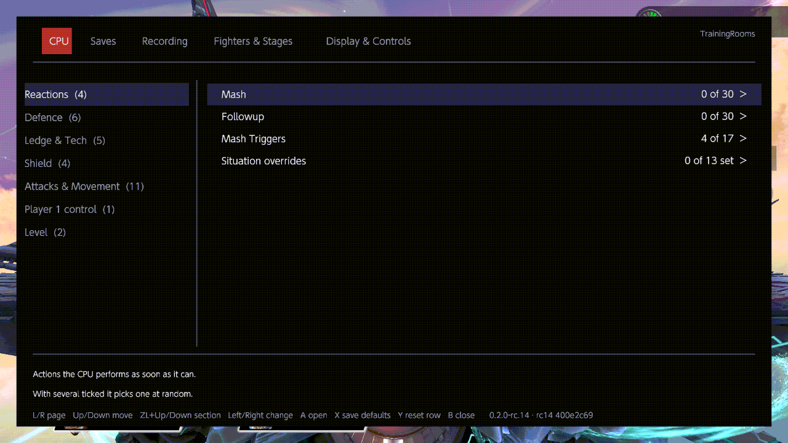

# TrainingRooms for Ultimate

TrainingRooms adds practice tools to Super Smash Bros. Ultimate's Training mode and to the waiting rooms of online and
local play: hitboxes, save states, recordings, combo drills, game speed and more, all from one menu.

**Current release: [rc.15](docs/CURRENT-RELEASE.md).** Its newest build, install 5 (`b7a382e4`, 2026-11-25), is
installed and tested in Eden in part; one report from the console is on record. What's new, how to install it and what is known not to work
are on that page; each build's changes are in the [release notes](docs/RELEASE-NOTES-rc15.md). New here? Start with [Getting started](docs/guide/getting-started.md). Something not
working? See [Troubleshooting](docs/guide/troubleshooting.md).

<br>
*The menu's five pages, then Hitbox Visualization: A ticks Hitboxes, Grab boxes and Hurtboxes, and both fighters are drawn as hurtbox pills (yellow in this clip; grey in the current colours). Eden, rc.14 (untested on hardware).*

[Stage tech practice](docs/menu/fighters-and-stages.md#stage-tech-practice): pick a spot and practise techs with launch settings, grades and sessions.

Every option is documented in the [docs](docs/README.md), one page per menu page.

## Install

Tested on: Super Smash Bros. Ultimate 13.0.5 · Switch firmware 23.5.0 · Atmosphère 1.12.2

1. Set up Skyline for Smash Ultimate 13.0.5 on your Switch.
2. Copy `libtraining_rooms.nro`, `libnro_hook.nro` and `libparam_hook.nro` into
   `atmosphere/contents/01006A800016E000/romfs/skyline/plugins/` on the SD card.
3. If `libtraining_modpack.nro` is there, remove it: the two can't run together.
4. Start the game and open Training. Settings from the Training Modpack are copied over the first time.
5. Press B + D-pad Up (or Minus) to open the menu.

## Controls

| Button | What it does |
| --- | --- |
| B + D-pad Up, or Minus | Open the menu |
| ZL + D-pad Down / Up | Save / load a state |
| ZR + D-pad Down | Record |
| ZR + D-pad Up / Left | Play the recording on the CPU / on yourself |
| ZR + D-pad Right | Recording pop-up (B closes it) |
| ZL + D-pad Left / Right | Switch the CPU's / your fighter |
| R + D-pad Down | Input display on / off |
| Hold R + D-pad Up, then Left / Right | Game speed |
| Hold B, click the left / right stick | Kirby hat: yours / the CPU's (left stick at rest) |
| L + R + A | Reset positions |

Change the chords and the menu shortcuts at Display & Controls › Button chords. B + D-pad Up, the Kirby hat clicks and
L + R + A stay fixed. Switching your own fighter needs Fighters & Stages › Player Swapping On (it's Off at first).
GameCube controllers, Online Deluxe and the CPU pilot change some chords: see [the controls guide](docs/guide/controls.md).

### Game speed

Slow a move down: hold R + D-pad Up, then press Left to step slower or Right to step quicker (1/4, 1/2, 2/3, x1, x1.5).
A stopwatch on the HUD shows any speed but x1.

<br>*The same smash at x1, then at 1/4*

More: [the game speed guide](docs/guide/game-speed.md).

## The menu

L and R turn the pages, ZL + Up/Down jumps between sections, A changes a row, Y resets it, and B closes the menu. Left or
Right flips an On/Off row too. Changes apply when it closes. More: [using the menu](docs/guide/using-the-menu.md).

<br>*Left / Right flip an On/Off row. Eden, rc.13 (untested on hardware).*

### CPU

Teach the CPU to DI, tech, shield, mash and follow up, and set its level. Choose how it escapes your attacks: **B +
D-pad Up → CPU → DI Direction**, then **A** to pick a direction.

<br>*DI Down, then DI Up from the menu. Eden, rc.13 (untested on hardware).*

Make it dodge again and again: in **CPU → Mash** tick Spot Dodge or Roll Forwards, and in **Mash Triggers** tick
**Always**.

<br>*Mash a dodge, Always. Eden, rc.13 (untested on hardware).*

All the options: [the CPU page](docs/menu/cpu.md).

### Saves

Save where you stand with ZL + D-pad Down and go back with ZL + D-pad Up. Choose the damage, mirroring and buffs on
load, and keep whole setups in a library.

<br>*Save, move, load: back where you saved*

All the options: [the Saves page](docs/menu/saves.md).

### Recording

Record yourself with ZR + D-pad Down and let the CPU play it back with ZR + D-pad Up.

<br>*Record, then the CPU plays it back*

Save a combo you landed and drill it: **B + D-pad Up → Recording → Combos & Sequences → + Save last combo…**, and the link cells under the frame strip grade each try. The card on the right shows the drill, result and streak.
For sequences, it stacks three combos and marks the current one. The strip and card fade together when a fighter moves
behind either one.

<br>*Grading a combo*

Turn **Display & Controls → Link history** off to make the strip shorter. The **LINK** readout then shows the newest
move pair with its verdict, for example **TRUE · Jab > Jab**. During a drill, its link cells use the LAST row’s space.

Cut failed attempts out of a macro, combo or input drill: open its **Crop** row with **A**, use **L/R** and **Left/Right** to pick what stays, then **A** saves a new named copy.

<br>
*Macro Crop range selection. Eden, 2026-11-15, rc.15 `d520d325`; this clip shows the handles, with preview and save checked separately.*

Practise movement without landing a hit: choose **Recording → Combos & Sequences → COMBOS → DRILLS > → + Record drill…**, press **A**, then use **ZR + D-pad Down** to start and stop; **Make combo** on a no-hit macro makes a drill too.

<br>
*A drill's Crop selects whole steps (L/R, then Left/Right). Eden, 2026-11-15, rc.15 `2eb3903e`; this early build shows a helper overlap fixed before release. This clip shows cropping; recording and no-hit conversion have no GIF yet.*

More: [Input drills](docs/guide/recording.md#input-drills), [Crop](docs/guide/recording.md#crop) and [the Recording page](docs/menu/recording.md).

### Fighters & Stages

Give Kirby the next hat: hold **B** with the left stick at rest, then click the left stick.

<br>*Changing Kirby's hat*

Rotate the practice stage: set **Fighters & Stages → Training Stage Rotation → On**, then go back through the character
select for the next stage.

<br>*Training Stage Rotation. Eden, rc.13 (untested on hardware).*

The page also switches fighters without leaving Training, makes Mii fighters and changes the stage right now.

<br>*Player Swapping gates the Cycle Player chord. Eden, rc.13 (untested on hardware).*

All the options: [the Fighters & Stages page](docs/menu/fighters-and-stages.md).

### Display & Controls

See attack, hurt and grab boxes: in **Display & Controls → Hitbox Visualization**, tick Hitboxes, Grab boxes and Hurtboxes. There is one colour scheme: attacks red (the strongest part) and pink (weaker or later parts), grabs purple, normal hurtboxes grey, hurtboxes that can't be hit yellow, hurtboxes that take no damage green, windboxes sky blue, wind areas olive, and launch and wind directions white.

<br>
*Hitboxes, Grab boxes and Hurtboxes ticked: the hurtbox pills, and at 1/4 speed Mario's neutral air shows its red hitbox. This rc.14 clip predates the current colours: its normal hurtboxes are yellow, which are grey now. Eden, rc.14 (untested on hardware).*

See where summoned objects and items can be hit: **Display & Controls → Hitbox Visualization → Article hurtboxes**, then **A** ticks it.

<br>
*Article hurtboxes Off → hurtbox pills → status colours → Off. This earlier rc.15 clip draws normal pills yellow; the current colours are grey for normal, yellow for can't be hit and green for no damage. Eden, 2026-11-15, rc.15 `6def8553`; Pikmin shown.*

Read what each colour means beside the checklist: press **A** on **Hitbox Visualization** to see the **Colour legend** for what you ticked.

<br>
*Earlier two-scheme build, before the single-palette update; [the Frame data colours view](docs/media/rc15-colour-legend-frame-data.png). Eden, 2026-11-15, rc.15 `35268287`. Stills only; no legend GIF yet.*

The grab boxes are purple:

<br>*Grab boxes, purple in the current colours; this rc.13 clip predates them and shows magenta grab boxes and yellow hurtboxes. Eden, rc.13 (untested on hardware).*

Tick **Windboxes** to see the pushes that cause no hitstun, such as F.L.U.D.D.'s water, in sky blue; their wind areas are olive.

<!-- CAPTURE-REQUEST hb-legend-v03 (README clip): the windbox clip described under hb-legend-v03 in docs/menu/display-and-controls.md, F.L.U.D.D. then Ganondorf's up tilt, one short clip with a one-line caption. -->

The page also has the input display, frame advantage and your own buttons.

All the options: [the Display & Controls page](docs/menu/display-and-controls.md).

## Waiting rooms

Practise while you wait for an online or local match: open the room menu with **B + D-pad Up**. **Fighters & Stages →
Lobby Practice** is On by default; turn it Off to leave the waiting rooms to the game.

<br>
*The menu in a waiting room (B + D-pad Up): Hitbox Visualization with Hurtboxes ticked draws both practice fighters as hurtbox pills (yellow in this clip; grey in the current colours). The first second, the CPU page, is a separate recording cut in before Display & Controls. Eden, rc.14 (untested on hardware).*

More: [the waiting rooms guide](docs/guide/waiting-rooms.md).

## License

MIT License: see [LICENSE](LICENSE).

This project was developed with the assistance of AI. It is an unofficial fan project, not affiliated with or
endorsed by Nintendo.

## More

[The docs](docs/README.md): every menu page and guide. The current release is [rc.15](docs/CURRENT-RELEASE.md),
**installed and tested in Eden in part, with one report from the console on record** (see [Status](docs/TECHNICAL.md#status)): what's new, how
to install it and its known issues.
The rc.15 builds are in [their release notes](docs/RELEASE-NOTES-rc15.md). Release notes for rc.12, rc.13 and rc.14
are on their
[release pages](https://git.syntaxbyexample.com/intpa/TrainingRoomsForUltimate/releases); the ones in the docs folder
(rc.5, rc.6, rc.8 and rc.9) are listed on [the docs page](docs/README.md#reference). [Technical notes](docs/TECHNICAL.md).

## Build

Build the plugin with cargo-skyline; the toolchains and the rest of the gates are in [Building TrainingRooms](docs/BUILD.md).

```powershell
cargo skyline build --release
cargo test
cargo clippy --all-targets -- -D warnings
cargo build --no-default-features
```
