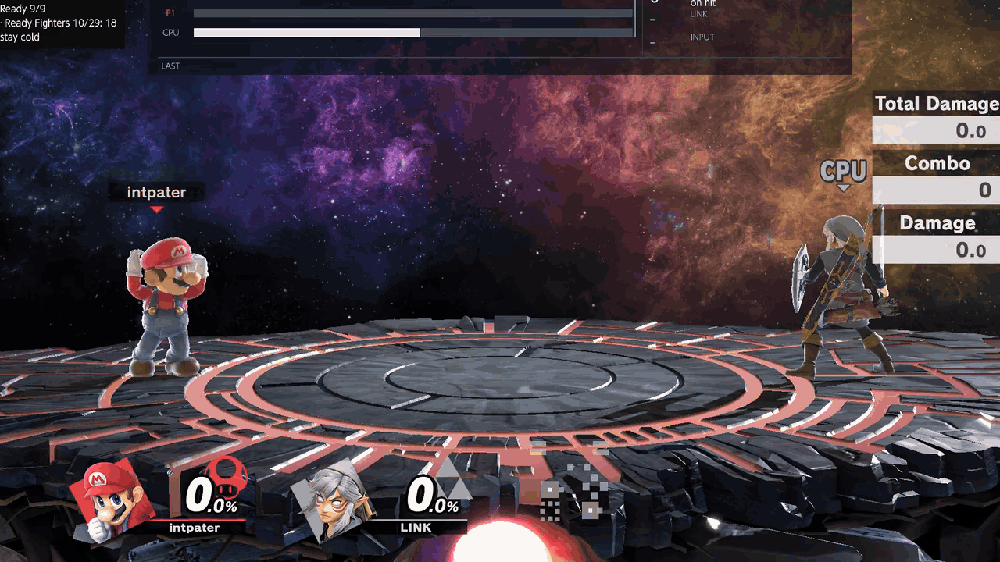

# TrainingRooms for Ultimate

TrainingRooms adds practice tools to Super Smash Bros. Ultimate's Training mode and to the waiting rooms of online and
local play, all from one menu.

<br>
*The menu's five pages, over Training. Eden, rc.15.*

| Start here | |
| --- | --- |
| Current release | [rc.15](docs/CURRENT-RELEASE.md) |
| New to it | [Getting started](docs/guide/getting-started.md) |
| Every page and guide | [The docs](docs/README.md) |
| Something not working | [Troubleshooting](docs/guide/troubleshooting.md) |

## What it does

<video src="https://git.syntaxbyexample.com/intpa/TrainingRoomsForUltimate/media/blob/b5760c58e2de36d18ee1fc677043ffb7c7376dce" autoplay muted loop playsinline controls></video>

*Hitboxes, grab boxes and hurtboxes drawn. Eden, 5df3d9dc.* [Open the clip](docs/media/tut-hitbox-visualization.mp4)

| Menu page | What you get | Guide |
| --- | --- | --- |
| [CPU](docs/menu/cpu.md) | The CPU's reactions: mash, shield, DI, tech and level | [CPU behaviour](docs/guide/cpu-behaviour.md) |
| [Saves](docs/menu/saves.md) | Save and load positions with a chord; a setup library | [Save states](docs/guide/save-states.md) |
| [Recording](docs/menu/recording.md) | Record inputs, play them on either fighter, drill combos | [Recording](docs/guide/recording.md) |
| [Fighters & Stages](docs/menu/fighters-and-stages.md) | Fighter cycles, Kirby hats, Miis, stages and practice games | [Fighter cycles](docs/guide/fighter-cycles.md), [Stages](docs/guide/stages.md) |
| [Display & Controls](docs/menu/display-and-controls.md) | Hitboxes, the frame strip and the button chords | [Frame strip](docs/guide/frame-strip.md), [Controls](docs/guide/controls.md) |
| Waiting rooms | The same menu while you wait for a match | [Waiting rooms](docs/guide/waiting-rooms.md) |

## Install

<video src="https://git.syntaxbyexample.com/intpa/TrainingRoomsForUltimate/media/blob/5c59ac60ffc033815119d657b463e73f2fadb636" autoplay muted loop playsinline controls></video>

*Step 5: B + D-pad Up opens the menu. Eden, c51f4d81.* [Open the clip](docs/media/tut-menu-tour.mp4)

| Step | Do |
| --- | --- |
| Tested on | Smash Ultimate 13.0.5, Switch firmware 23.5.0, Atmosphère 1.12.2 |
| 1 | Set up Skyline for Smash Ultimate 13.0.5 on your Switch |
| 2 | Copy `libtraining_rooms.nro` and `libnro_hook.nro` into `atmosphere/contents/01006A800016E000/romfs/skyline/plugins/` |
| 3 | Remove `libtraining_modpack.nro` if it is there: the two can't run together |
| 4 | Start the game and open Training |
| 5 | Press B + D-pad Up, or Minus, to open the menu |
| First start | [Getting started](docs/guide/getting-started.md) says what to expect |

## Build

Build the plugin with cargo-skyline; the toolchains and the other gates are in [Building TrainingRooms](docs/BUILD.md).

```powershell
cargo skyline build --release
cargo test
cargo clippy --all-targets -- -D warnings
cargo build --no-default-features
```

## License

MIT License: see [LICENSE](LICENSE).

This project was developed with the assistance of AI. It is an unofficial fan project, not affiliated with or
endorsed by Nintendo.
