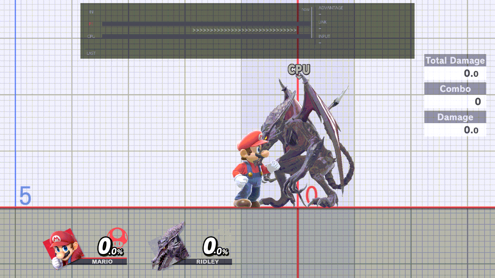
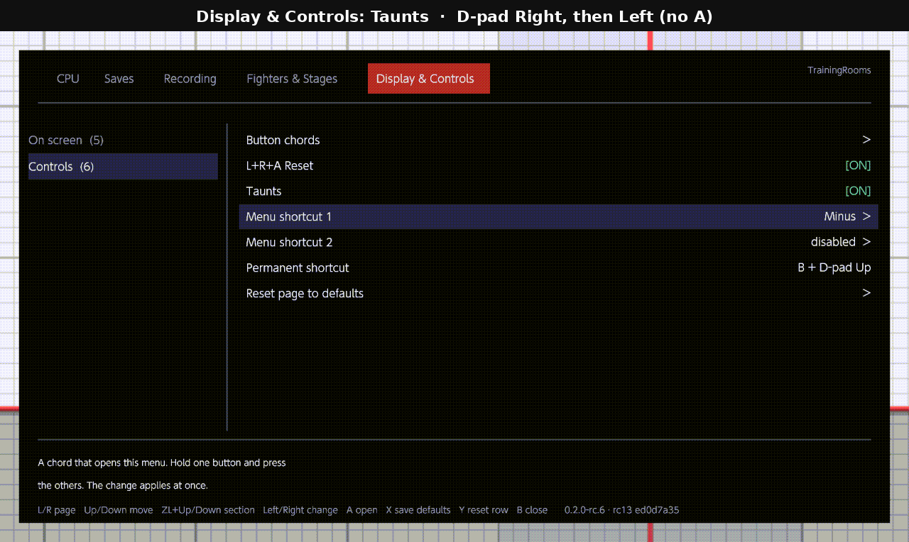
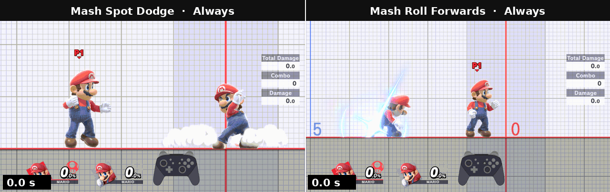
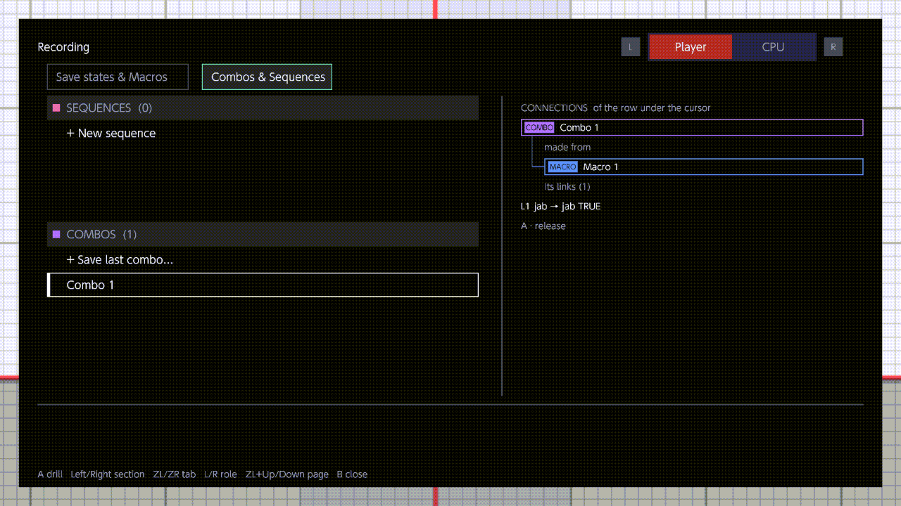
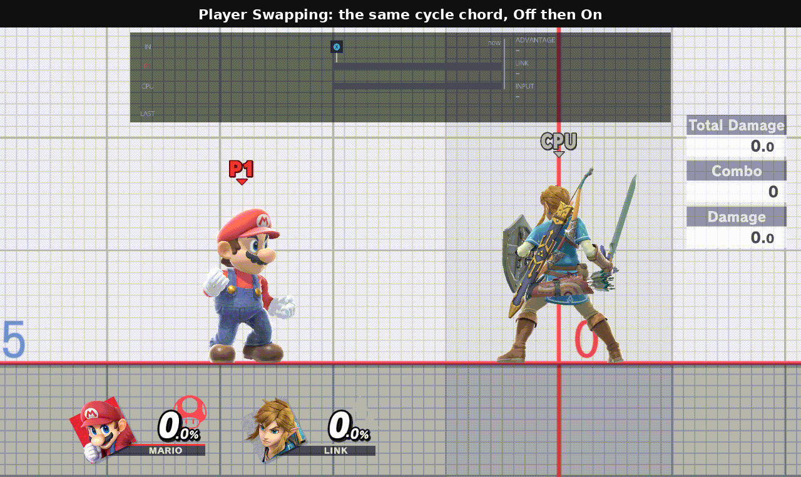
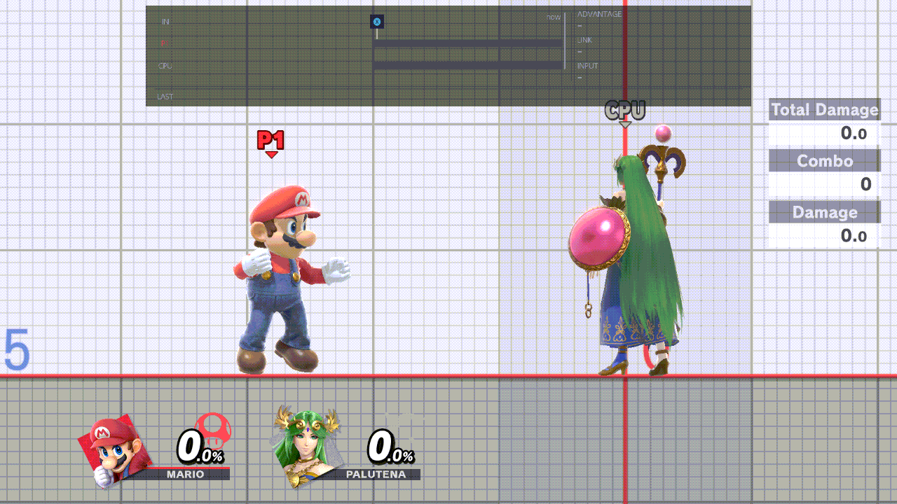
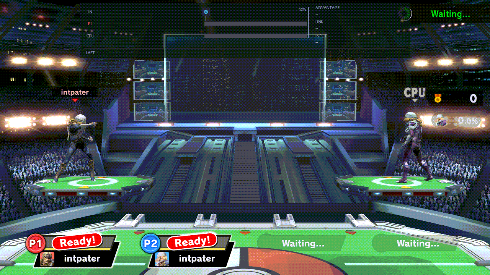

# TrainingRooms for Ultimate

TrainingRooms adds practice tools to Super Smash Bros. Ultimate's Training mode and to the waiting rooms of online and
local play: hitboxes, save states, recordings, combo drills, game speed and more, all from one menu.

<br>*The menu, then hitboxes on*

Every option is documented in the [docs](docs/README.md), one page per menu page.

## Install

1. Set up Skyline for Smash Ultimate 13.0.5 on your Switch.
2. Copy `libtraining_rooms.nro`, `libnro_hook.nro` and `libparam_hook.nro` into
   `atmosphere/contents/01006A800016E000/romfs/skyline/plugins/` on the SD card.
3. If `libtraining_modpack.nro` is there, remove it: the two can't run together.
4. Start the game and open Training. Settings from the Training Modpack are copied over the first time.
5. Press B + D-pad Up (or Minus) to open the menu.

## Controls

| Button | What it does |
| --- | --- |
| B + D-pad Up, or Minus | Open the menu |
| ZL + D-pad Down / Up | Save / load a state |
| ZR + D-pad Down | Record |
| ZR + D-pad Up / Left | Play the recording on the CPU / on yourself |
| ZR + D-pad Right | Recording pop-up (B closes it) |
| ZL + D-pad Left / Right | Switch the CPU's / your fighter |
| R + D-pad Down | Input display on / off |
| Hold R + D-pad Up, then Left / Right | Game speed |
| Hold B, click the left / right stick | Kirby hat: yours / the CPU's (left stick at rest) |
| L + R + A | Reset positions |

Change the chords and the menu shortcuts at Display & Controls › Button chords. B + D-pad Up, the Kirby hat clicks and
L + R + A stay fixed. Switching your own fighter needs Fighters & Stages › Player Swapping On (it's Off at first).
GameCube controllers, Online Deluxe and the CPU pilot change some chords: see [the controls guide](docs/guide/controls.md).

### Game speed

Slow a move down: hold R + D-pad Up, then press Left to step slower or Right to step quicker (1/4, 1/2, 2/3, x1, x1.5).
A stopwatch on the HUD shows any speed but x1.

<br>*The same smash at x1, then at 1/4*

More: [the game speed guide](docs/guide/game-speed.md).

## The menu

L and R turn the pages, ZL + Up/Down jumps between sections, A changes a row, Y resets it, and B closes the menu. Left or
Right flips an On/Off row too. Changes apply when it closes. More: [using the menu](docs/guide/using-the-menu.md).

<br>*Left / Right flip an On/Off row. Eden, rc.13 (untested on hardware).*

### CPU

Teach the CPU to DI, tech, shield, mash and follow up, and set its level. Choose how it escapes your attacks: **B +
D-pad Up → CPU → DI Direction**, then **A** to pick a direction.

<br>*DI Down, then DI Up from the menu. Eden, rc.13 (untested on hardware).*

Make it dodge again and again: in **CPU → Mash** tick Spot Dodge or Roll Forwards, and in **Mash Triggers** tick
**Always**.

<br>*Mash a dodge, Always. Eden, rc.13 (untested on hardware).*

All the options: [the CPU page](docs/menu/cpu.md).

### Saves

Save where you stand with ZL + D-pad Down and go back with ZL + D-pad Up. Choose the damage, mirroring and buffs on
load, and keep whole setups in a library.

<br>*Save, move, load: back where you saved*

All the options: [the Saves page](docs/menu/saves.md).

### Recording

Record yourself with ZR + D-pad Down and let the CPU play it back with ZR + D-pad Up.

<br>*Record, then the CPU plays it back*

Save a combo you landed and drill it: **B + D-pad Up → Recording → Combos & Sequences → + Save last combo…**, and a bar
grades each try.

<br>*Grading a combo*

All the options: [the Recording page](docs/menu/recording.md).

### Fighters & Stages

Give Kirby the next hat: hold **B** with the left stick at rest, then click the left stick.

<br>*Changing Kirby's hat*

Rotate the practice stage: set **Fighters & Stages → Training Stage Rotation → On**, then go back through the character
select for the next stage.

<br>*Training Stage Rotation. Eden, rc.13 (untested on hardware).*

The page also switches fighters without leaving Training, makes Mii fighters and changes the stage right now.

<br>*Player Swapping gates the Cycle Player chord. Eden, rc.13 (untested on hardware).*

All the options: [the Fighters & Stages page](docs/menu/fighters-and-stages.md).

### Display & Controls

See attack, hurt and grab boxes: in **Display & Controls → Hitbox Visualization**, tick Hitboxes, Grab boxes and Hurtboxes.

<br>*Hitboxes and hurtboxes on*

The grab boxes are magenta:

<br>*Grab boxes in magenta. Eden, rc.13 (untested on hardware).*

The page also has the input display, frame advantage and your own buttons.

All the options: [the Display & Controls page](docs/menu/display-and-controls.md).

## Waiting rooms

Practise while you wait for an online or local match: turn on **Fighters & Stages → Lobby Practice** first (it's Off at
first), then open the room menu with **B + D-pad Up**.

<br>*The menu in a waiting room (B + D-pad Up)*

More: [the waiting rooms guide](docs/guide/waiting-rooms.md).

## License

MIT License: see [LICENSE](LICENSE).

This project was developed with the assistance of AI. It is an unofficial fan project, not affiliated with or
endorsed by Nintendo.

## More

[The docs](docs/README.md): every menu page and guide. The newest build is
[rc.13](https://git.syntaxbyexample.com/intpa/TrainingRoomsForUltimate/releases/tag/v0.2.0-rc.13), Eden-tested and
**untested on hardware** (see [Status](docs/TECHNICAL.md#status)). Release notes: rc.12's and rc.13's are on their
[release pages](https://git.syntaxbyexample.com/intpa/TrainingRoomsForUltimate/releases); [rc.9](docs/RELEASE-NOTES-rc9.md)
is the newest written in this folder. [Technical notes](docs/TECHNICAL.md).

## Build

Build the plugin with cargo-skyline; the toolchains and the rest of the gates are in [Building TrainingRooms](docs/BUILD.md).

```powershell
cargo skyline build --release
cargo test
cargo clippy --all-targets -- -D warnings
cargo build --no-default-features
```
