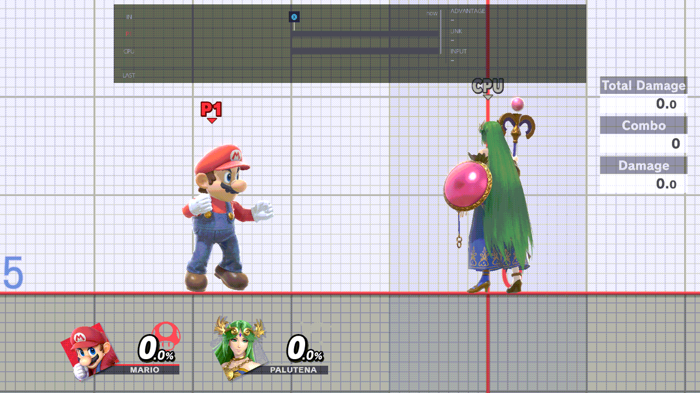
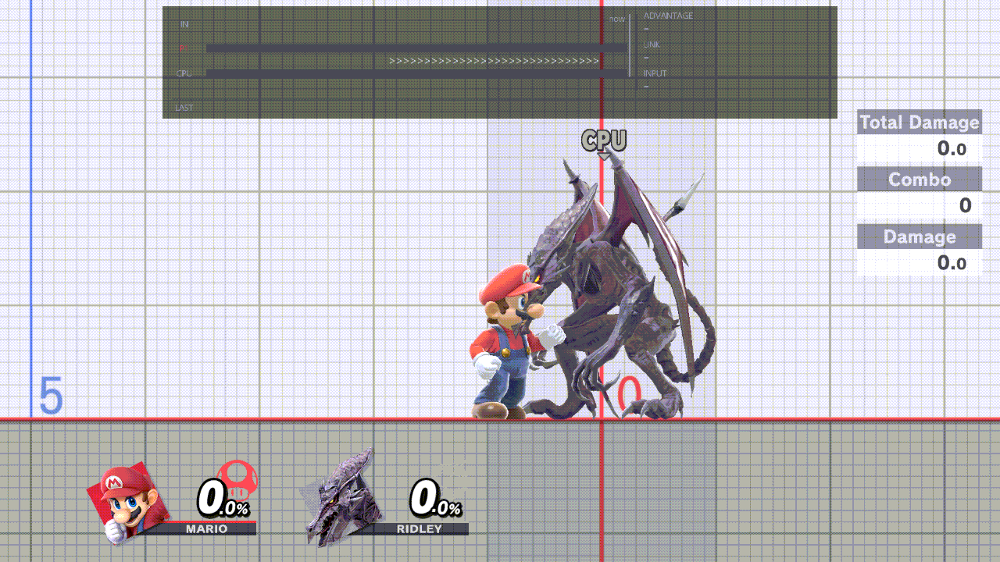
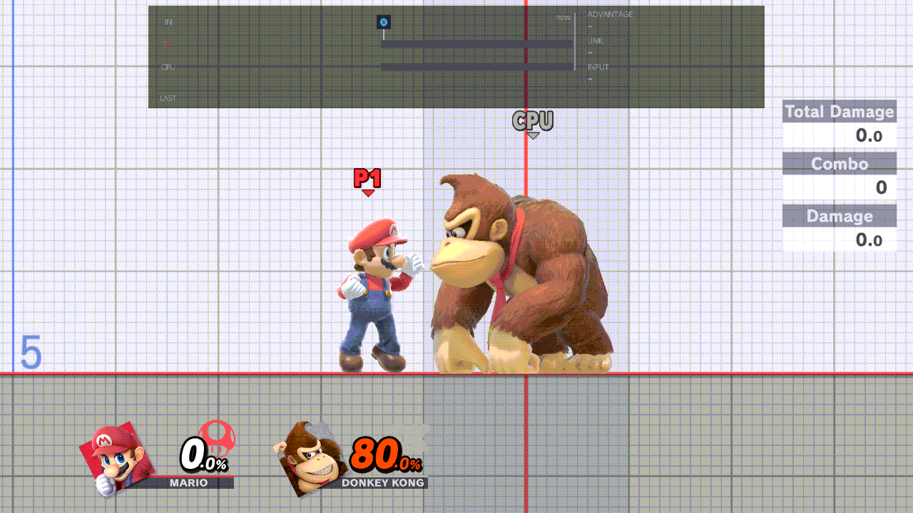
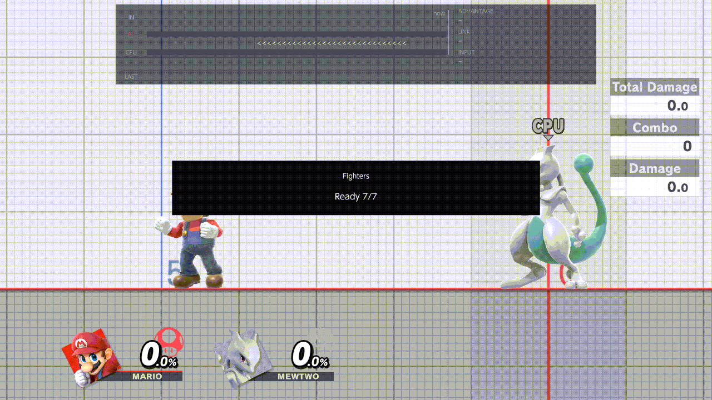
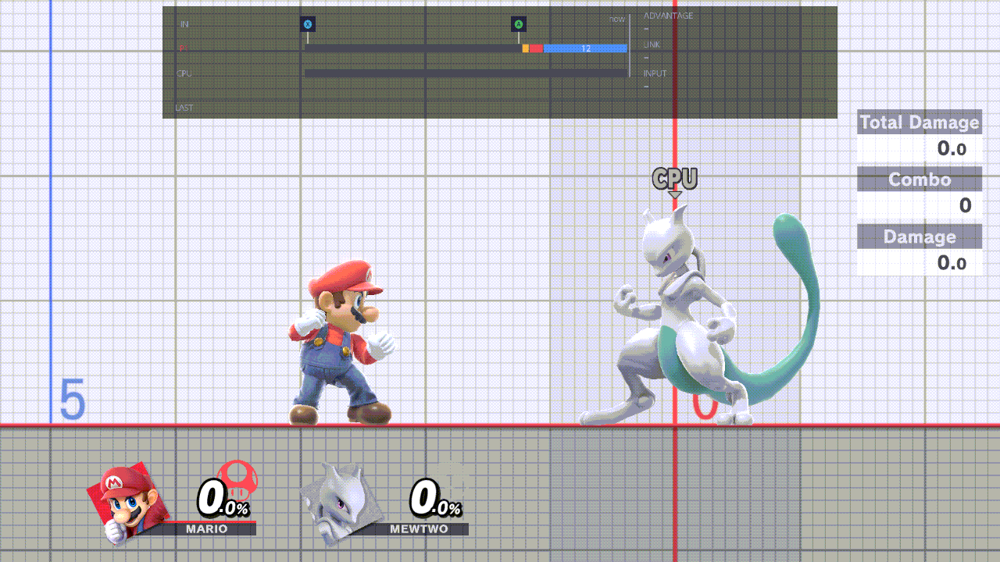
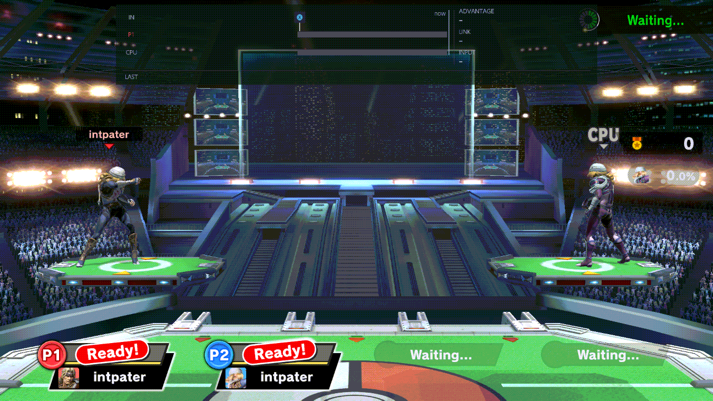

# TrainingRooms for Ultimate

TrainingRooms adds practice tools to Super Smash Bros. Ultimate's Training mode and to the waiting rooms of online and
local play: hitboxes, save states, recordings, combo drills, game speed and more, all from one menu.

<br>*The menu, then hitboxes on*

Every option is documented in the [docs](docs/README.md), one page per menu page.

## Install

1. Set up Skyline for Smash Ultimate 13.0.5 on your Switch.
2. Copy `libtraining_rooms.nro`, `libnro_hook.nro` and `libparam_hook.nro` into
   `atmosphere/contents/01006A800016E000/romfs/skyline/plugins/` on the SD card.
3. If `libtraining_modpack.nro` is there, remove it: the two can't run together.
4. Start the game and open Training. Settings from the Training Modpack are copied over the first time.
5. Press B + D-pad Up (or Minus) to open the menu.

## Controls

| Button | What it does |
| --- | --- |
| B + D-pad Up, or Minus | Open the menu |
| ZL + D-pad Down / Up | Save / load a state |
| ZR + D-pad Down | Record |
| ZR + D-pad Up / Left | Play the recording on the CPU / on yourself |
| ZR + D-pad Right | Recording pop-up |
| ZL + D-pad Left / Right | Switch the CPU's / your fighter |
| R + D-pad Down | Input display on / off |
| Hold R + D-pad Up, then Left / Right | Game speed |
| Hold B, click the left / right stick | Kirby hat: yours / the CPU's (left stick at rest) |
| L + R + A | Reset positions |

You can change the save, load, recording, fighter-cycle, input-display and game-speed buttons, and add up to two menu
shortcuts, in Display & Controls › Controls. B + D-pad Up, the Kirby hat clicks and L + R + A stay fixed. Switching
your own fighter needs Fighters & Stages › Player Swapping On (it's Off at first).

On a GameCube controller, ZL is L, ZR is R and R is Z; it has no Minus, so open the menu with B + D-pad Up. With Online
Deluxe, buttons that use the D-pad do nothing while its window shows a settings page; B + D-pad Up still opens this
menu. While the CPU pilot plays for you, Record, Play on yourself and the waiting-room reset are off.
More: [the controls guide](docs/guide/controls.md).

### Game speed

Hold R + D-pad Up and press Left or Right: 1/4, 1/2, 2/3, x1 or x1.5. A stopwatch on the HUD shows any speed but x1.

<br>*The same smash at x1, then at 1/4*

More: [the game speed guide](docs/guide/game-speed.md).

## The menu

L and R turn the pages, ZL + Up/Down jumps between sections, A changes a row, Y resets it, and B closes the menu.
Changes apply when it closes. More: [using the menu](docs/guide/using-the-menu.md).

### CPU

Teach the CPU to DI, tech, shield, mash and follow up, and set its level.

<br>*DI Down, then DI Up from the menu*

All the options: [the CPU page](docs/menu/cpu.md).

### Saves

Save where you stand with ZL + D-pad Down and go back with ZL + D-pad Up. Choose the damage, mirroring and buffs on
load, and keep whole setups in a library.

<br>*Save, move, load: back where you saved*

All the options: [the Saves page](docs/menu/saves.md).

### Recording

Record yourself with ZR + D-pad Down and let the CPU play it back with ZR + D-pad Up. Save a combo you landed and
drill it: a bar grades each try.

<br>*Record, then the CPU plays it back*<br>
<br>*Grading a combo*

All the options: [the Recording page](docs/menu/recording.md).

### Fighters & Stages

Switch fighters without leaving Training, give Kirby any hat, make Mii fighters, and change the stage.

<br>*Changing Kirby's hat*

All the options: [the Fighters & Stages page](docs/menu/fighters-and-stages.md).

### Display & Controls

Hitboxes, hurtboxes and grab boxes; the input display and frame advantage; your own buttons.

<br>*Hitboxes and hurtboxes on*

All the options: [the Display & Controls page](docs/menu/display-and-controls.md).

## Waiting rooms

Practise while you wait for an online or local match, with the same menu. Turn on Fighters & Stages › Lobby Practice
first (it's Off at first).

<br>*The menu in a waiting room (B + D-pad Up)*

More: [the waiting rooms guide](docs/guide/waiting-rooms.md).

## Build

```powershell
cargo test --all-targets
cargo skyline build --release
```

## License

MIT License: see [LICENSE](LICENSE).

This project was developed with the assistance of AI. It is an unofficial fan project, not affiliated with or
endorsed by Nintendo.

## More

[The docs](docs/README.md): every menu page and guide. Release notes: [rc.9](docs/RELEASE-NOTES-rc9.md) is the newest
written; this build is rc.11 (see [Status](docs/TECHNICAL.md#status)). [Technical notes](docs/TECHNICAL.md).
