# TrainingRooms for Ultimate

Practice tools for Training mode and the online waiting rooms of Super Smash Bros. Ultimate 13.0.5, as a Skyline plugin.

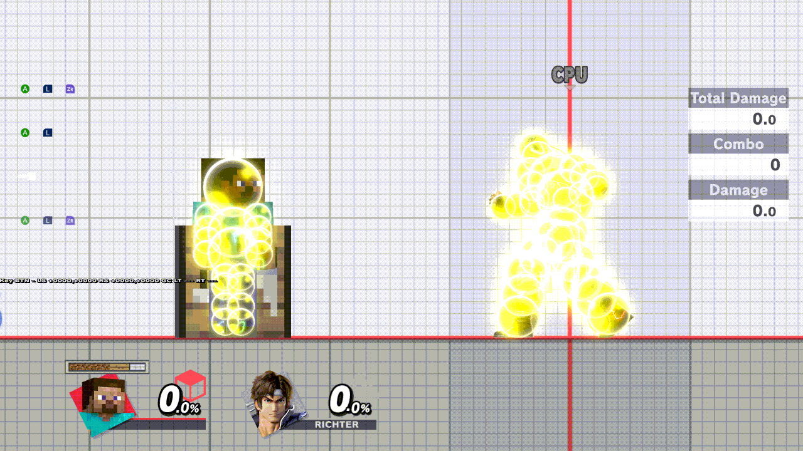

*Eden, 2026-11-05, 0.2.0-rc.1 release NRO `706c993f`: the menu opens, R steps through the five pages, A turns Hitbox
Visualization Off.*

## Install

Put the NRO at `atmosphere/contents/01006A800016E000/romfs/skyline/plugins/libtraining_rooms.nro`, next to
`libnro_hook.nro` and `libparam_hook.nro`, which it needs. **Never install it together with `libtraining_modpack.nro`.**
Settings and saves live in `sd:/ultimate/TrainingRooms/`. On first boot, settings, save states and recordings from the
Training Modpack fork's `sd:/ultimate/TrainingModpack/` are imported once by copying.

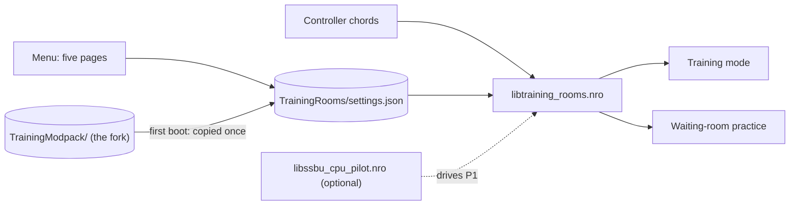

## Controls

| Action | Default chord |
| --- | --- |
| Open the menu | B + D-pad Up (always), or Minus (menu shortcut 1, editable) |
| Save state / load state | ZL + D-pad Down / ZL + D-pad Up |
| Record / Play on CPU | ZR + D-pad Down / ZR + D-pad Up |
| Play on Player 1 / recording pop-up | ZR + D-pad Left / ZR + D-pad Right |
| Cycle the CPU / Player 1 fighter | ZL + D-pad Left / ZL + D-pad Right |
| Kirby hat: Player 1 / CPU | Special + L3 / Special + R3 |
| Reset the training room | L + R + A |

The first time Training opens on a new install, TrainingRooms also shows six reminders: Welcome, Open Menu, Save State, Load State, Input Record and Input Playback. A later launch leaves those reminders off. The chords in the table stay available.

In the menu: L/R change page, ZL + Up/Down jumps to the previous or next section, A edits, Y resets a row, X saves the
current values as defaults, B goes back. Each page ends with *Reset page to defaults*, which asks first. The menu reopens
where you left it. The chords are edited on Display & Controls › Button chords.

## Features

Clips are Eden footage of the 0.2.0-rc.1 release NRO `706c993f`, recorded 2026-11-05, except those marked RC10 or with
their own build; see [docs/MEDIA.md](docs/MEDIA.md).

### Hitboxes and grab boxes

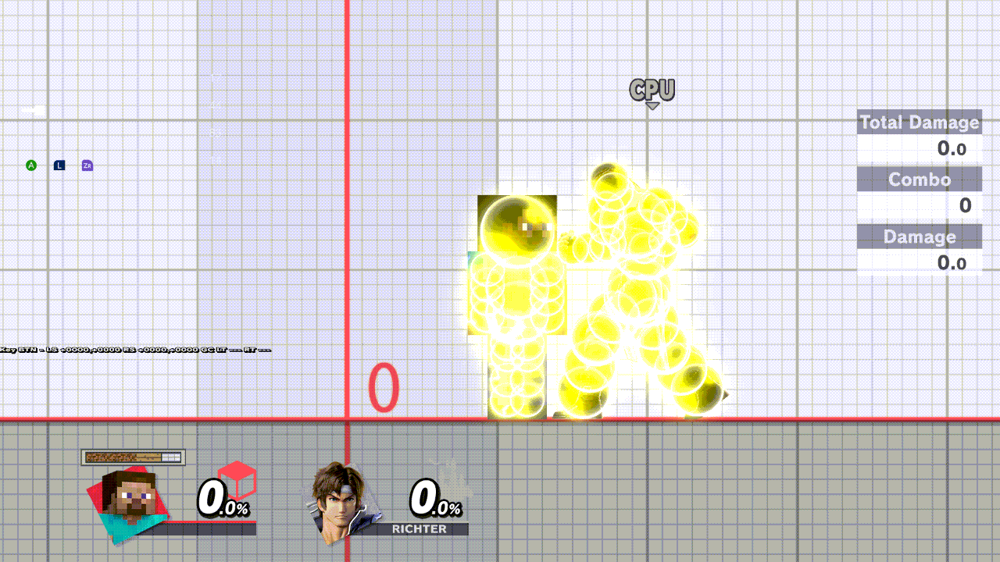

Hitbox Visualization (Display & Controls) draws the fighters' hurtboxes (yellow), hitboxes and grab boxes. Since rc.3
every fighter sphere is the plugin's own disc, so none is ever missing, even with two large fighters; projectiles keep
the game's effect spheres, and the discs trail the camera by one to two frames while it pans. (The clip shows rc.1.)

### Frame strip

The input display (Display & Controls › Input Display) is a strip at the top of the screen: the last second of
Player 1 and the CPU, a chip for each new button, and ADVANTAGE, LINK, and INPUT for the last exchange. ADVANTAGE is
the CPU's first actionable frame minus yours. Plus means you act first. [docs/FRAME-STRIP.md](docs/FRAME-STRIP.md)
is how to read the lanes, the stick row, and the readouts. The rc.5 clips are listed in
[docs/MEDIA.md](docs/MEDIA.md).

### Combos

*+ Save last combo…* (Recording › Combos & Sequences) saves a combo you landed, and the combo helper grades your next
attempts against it, link by link. A sequence of combos is drilled the same way, one combo after another. Each saved
combo is a small JSON file in `sd:/ultimate/TrainingRooms/combos/`. You can edit it, copy it to another card or share
it, and any fighter can practise it; [docs/COMBOS.md](docs/COMBOS.md) describes the format. The clip is under Combos
below.

### CPU reactions

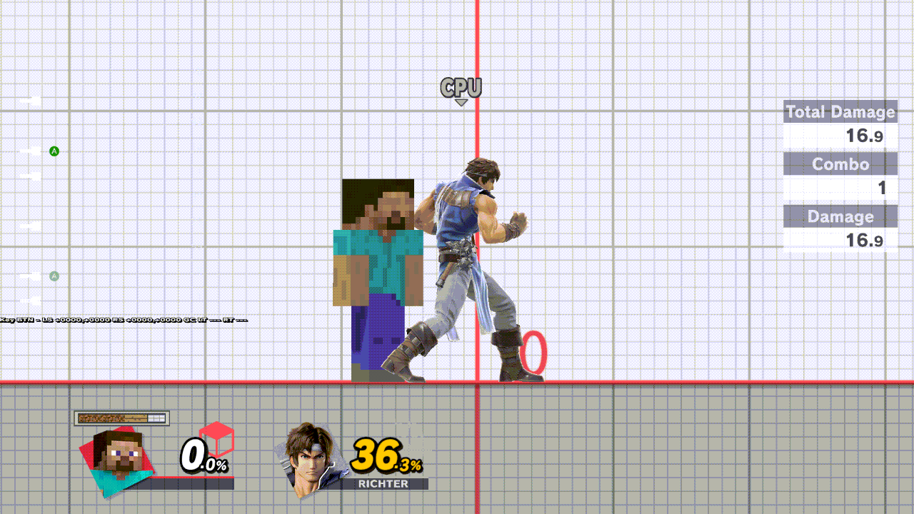

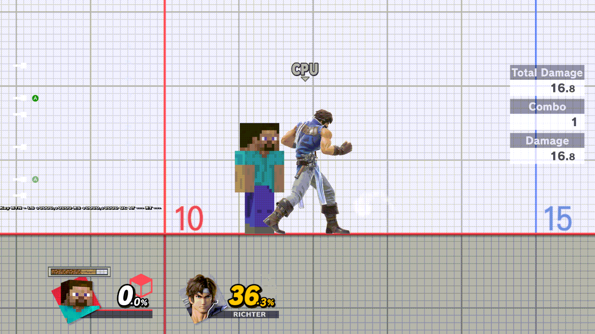

DI, SDI, air dodge, shield tilt, mash, ledge, tech and throw options on the CPU page. Above: the same hits with DI Up
and with no DI.


The direction chips show the game's own DI line and SDI streak; each A adds weight to a chip. *In* and *Out* are
relative to you, on either side of the CPU.

### Save states and respawn

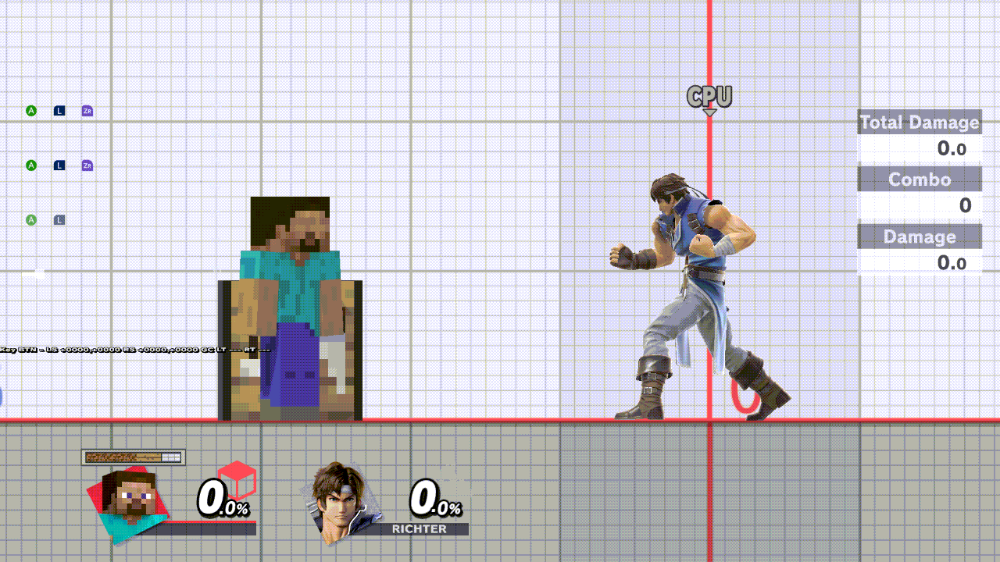

Named save states (one bound to Save and Load at a time), mirroring and damage on load (Saves page). *Respawn on platform* (Fighters & Stages ›
Stages) chooses between the game's respawn platform (above) and the instant respawn.

### Recording and playback

A save state only warps, and Load starts nothing. Each role has one active macro, a recording or a chain, and
that role's Play chord plays it without warping back on later loops. On the Recording page, Y does nothing and
X cycles the loop only while the cursor is in Macros.
[docs/RECORDING.md](docs/RECORDING.md) is how to use it. The pop-up and the Recording page are in that doc.
What rc.6 changes is [docs/RELEASE-NOTES-rc6.md](docs/RELEASE-NOTES-rc6.md).

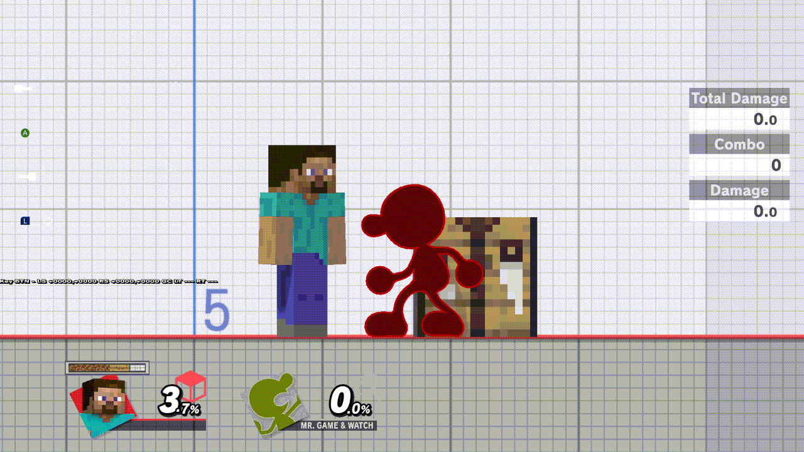

*The earlier slot recording: ZR + Down records, ZR + Up plays that slot. RC10, 2026-11-04, NRO `50d95130`. The
redesign's Play on CPU chord is the same buttons, and it plays the CPU's active macro.*

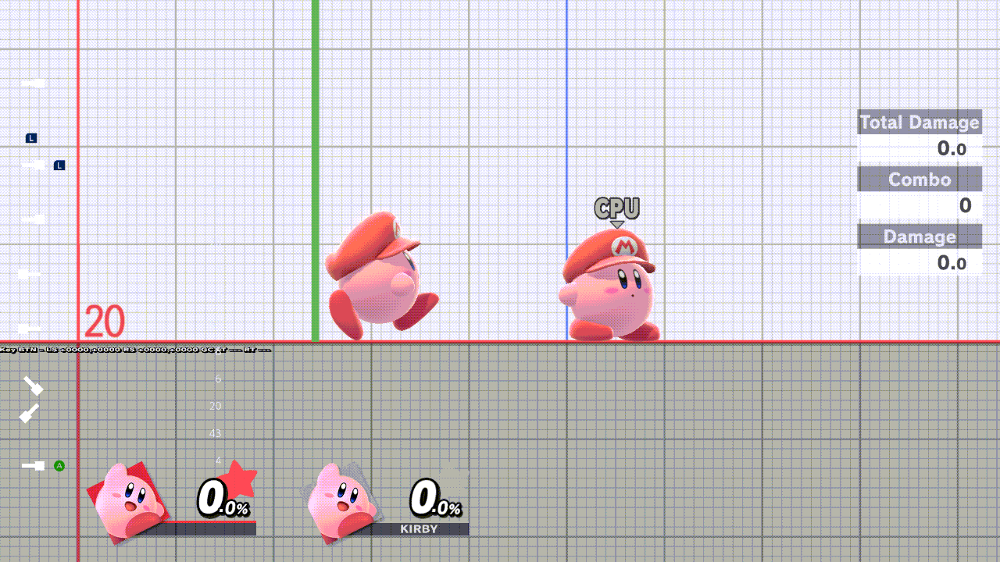

While the CPU pilot plugin plays Player 1, recording is refused with a notice.

### Combos

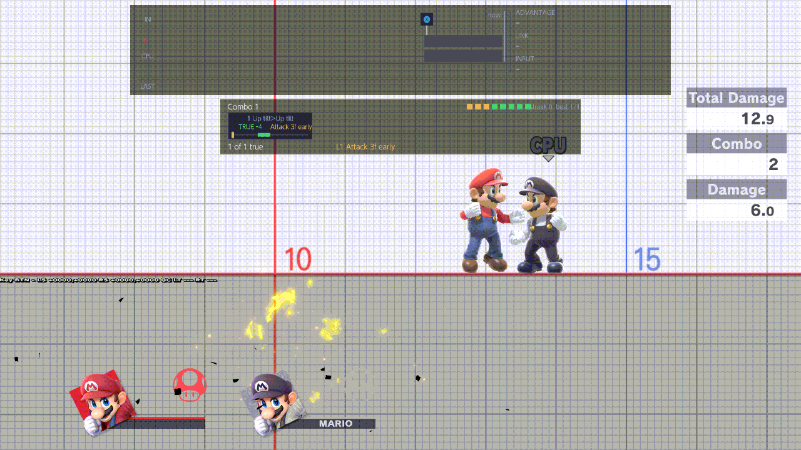

*The combo helper bar under the frame strip: the saved up tilt → up tilt (TRUE −4) attempted on time, then 3 frames
early. Eden, 2026-11-05, `ff69e53` (release `031f1eae…`).*

*+ Save last combo…*, the first row of COMBOS on the Recording page and in the recording pop-up, keeps your last combo
as a file and makes it the drill. With *Combo helper* On, a bar under the frame strip grades each attempt link by link:
whether the recorded inputs came, in order and on time, and whether the same move came out. A true combo is shown,
not required. Drilling a sequence adds a header and a row of its combos to that bar.


*Eden, 2026-11-08, `p23/rc6-seq-drill` `e6ac460` (diag NRO `50c8a5df`, log lines only): combo 1 lands, combo 2
starts, then a wrong move drops the sequence back to combo 1.* See [docs/MEDIA.md](docs/MEDIA.md).

### Fighters, cycles and Kirby hats

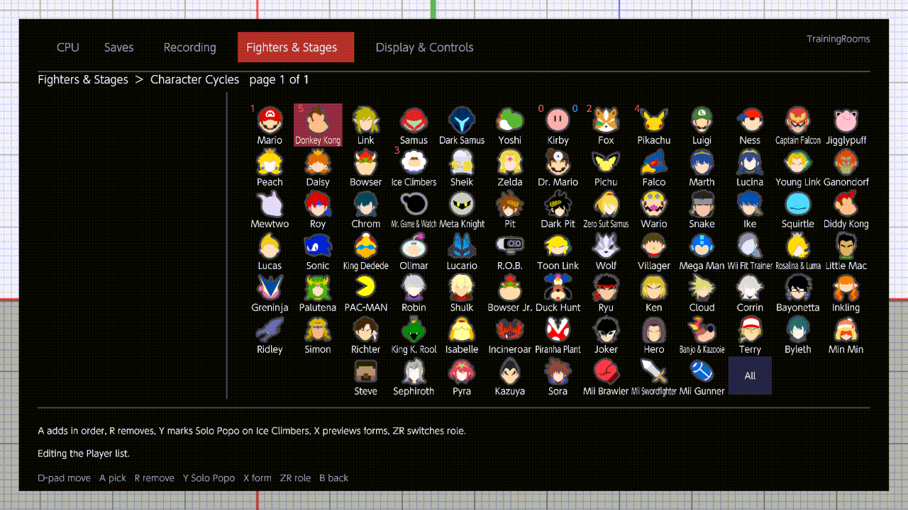

Cycle chords step through your own order of fighters per role (red for Player 1, blue for the CPU), drawn with the
game's stock icons.

The fighters of your cycles load hot. Each role's first window of fighters is ready when Training starts, and the
other groups are built in the background while you play; once the notice reads Ready or All loaded, a switch into a
group took about 50–70 ms in Eden. Changing a cycle in Training builds the new fighters the same way, at once. The
fighters that left it are freed when you next open the pause menu, or right away if the new ones need their room (a
brief pause). Leaving a Mii for the fighters it replaced is a warm switch, not a reload. The background build
waits only while Kirby is on screen, and for a second Mii group while a Mii is on screen
(`background_build_eligible`, `src/model/swap/body_bank.rs:852`; TODO-PROOF: the special groups built in the
background, hot lane and workers A and B, from the final pass's item-3 sessions). Raising No. of CPUs brings in the CPU cycle's next fighters, a saved Mii
included.

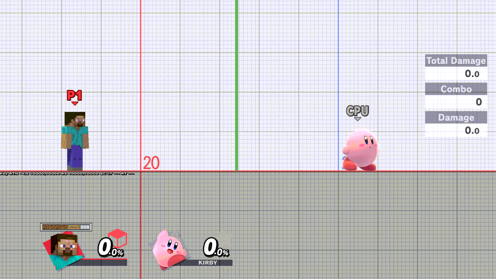

Kirby hats change with a chord, for Player 1 or the CPU.

### Mii fighters

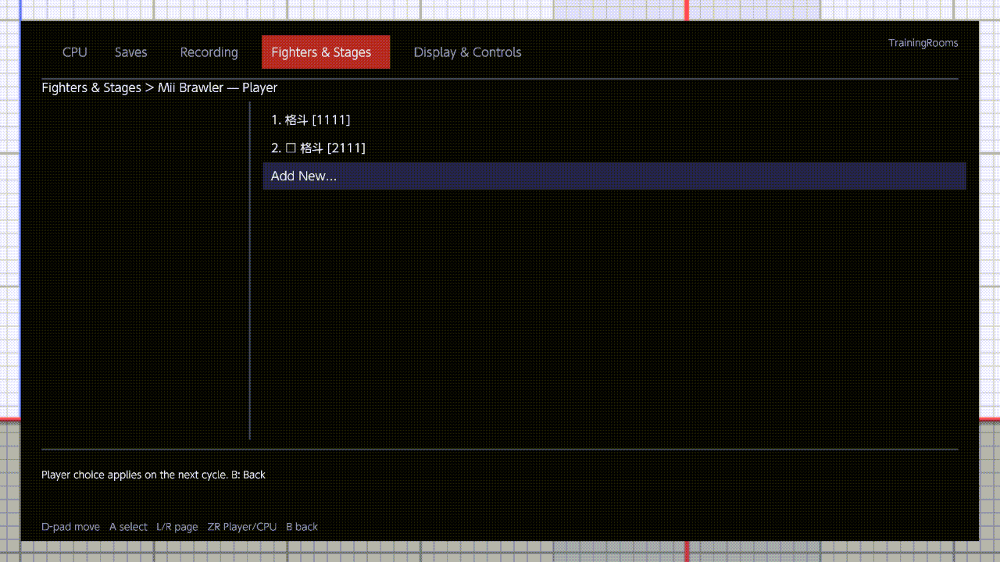

*Add New opens Smash's Mii Fighter editor: Neutral Special 3 picked, OK, Save. Eden, 2026-11-05, `ff69e53` (release
`031f1eae…`).*

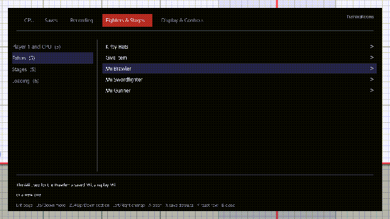

*A new Mii (2. 格斗 [2111]) in the Mii Brawler list, picked as the Player choice. Eden, 2026-11-05, `ff69e53` (release
`031f1eae…`).*

Each Mii class (Fighters & Stages › Mii Brawler, Swordfighter, Gunner) lists your saved Miis per role (ZR switches
Player and CPU). *Add New…* opens Smash's own Mii Fighter editor from Training. Saving creates a new Mii and leaves the
others untouched, and leaving without saving creates nothing. Saving a Mii you already have saves nothing new and says
"Same as ‹saved name›, nothing new saved". See [docs/MII.md](docs/MII.md).

### Stages


Pick the stages and their order for Training rotation and waiting-room practice. *RC10, 2026-11-04, NRO
`50d95130`.*

*Change Stage* (Fighters & Stages › Stages) goes to the stage you pick when the menu closes, in Training and in
waiting-room practice; Y picks its form first. *No clip yet.*

### Waiting rooms


The same menu works while you wait in an online or local room. The Training partners and CPU action you set in the
game's own waiting-room menu are remembered for the next room, and CPU › Level › CPU Level sets the partners' level.

### Menu navigation


ZL + Up/Down jumps between a page's sections (in popup lists, a screenful). The menu reopens on the page and row you
left. ZR no longer resets a page: each page ends with *Reset page to defaults*, which asks first. *Eden, 2026-11-05,
`p23/menu-nav` diag NRO `1273c29f`, the navigation code rc.3 merged.*

### Menu shortcuts and replay capture

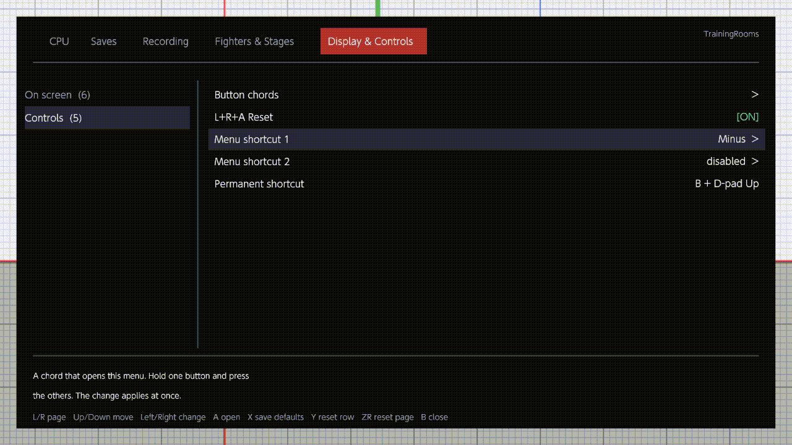

Menu shortcuts are changed in the menu and work at once.

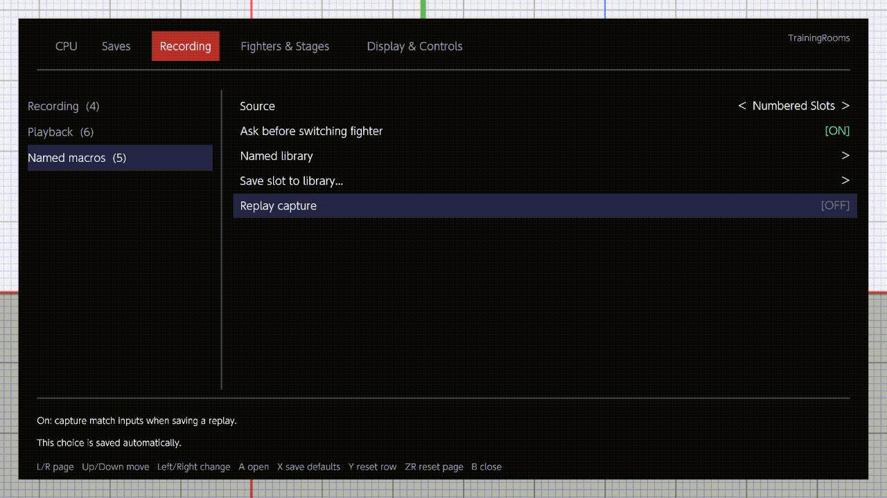

The *Replay capture* row and the Online Deluxe overlay show the same setting.

## Status

**[0.2.0-rc.6](https://git.syntaxbyexample.com/intpa/TrainingRoomsForUltimate/releases/tag/v0.2.0-rc.6)** is the
newest build (the release link resolves once it is published: TODO-FINAL-PASS). It follows 0.2.0-rc.3.1: 0.2.0-rc.5
was withdrawn before players ran it, and there is no separate 0.2.0-rc.4. What it changes is
[docs/RELEASE-NOTES-rc6.md](docs/RELEASE-NOTES-rc6.md), on top of [docs/RELEASE-NOTES-rc5.md](docs/RELEASE-NOTES-rc5.md).

**0.2.0-rc.3** (2026-11-05) is the previous console test build. It adds to rc.2:
- the **frame strip** input display, replacing the 15-row input log;
- **Change Stage**: a row that switches the stage now, in Training and in waiting rooms;
- **menu navigation**: ZL + Up/Down jumps sections, the menu reopens where you left it, ZR no longer resets a page by
  accident, and *Reset page to defaults* asks first;
- **own hitbox discs** for every fighter sphere, never refused (projectiles keep the effect spheres; the discs trail
  the camera by one to two frames, a known limit).

rc.2 added the pause-helper fix, the Solo Popo mark placement and the Kirby hat-request endings. Limitations kept from
the fork are listed in [Differences from the fork](docs/DIFFERENCES-FROM-THE-FORK.md); planned work is in the
[ROADMAP](docs/ROADMAP.md). 0.1.0 crashes at console boot; use the newest build, [0.2.0-rc.6](https://git.syntaxbyexample.com/intpa/TrainingRoomsForUltimate/releases/tag/v0.2.0-rc.6).

## Build

```powershell
cargo test --all-targets
cargo skyline build --release
```

The NRO is `target/aarch64-skyline-switch/release/libtraining_rooms.nro`. Toolchains, the diagnostic build and the
layout recipe: [docs/BUILD.md](docs/BUILD.md). Current acceptance state: [HANDOFF.md](HANDOFF.md).

## License and provenance

MIT ([LICENSE](LICENSE)). This is a clean-room implementation inspired by the Training Modpack
([jugeeya/UltimateTrainingModpack](https://github.com/jugeeya/UltimateTrainingModpack)), which publishes no license:
its features were re-specified from observable behaviour and none of its code, layouts or artwork is used. Code
carried over from this project's own earlier fork and all dependencies are recorded in [PROVENANCE.md](PROVENANCE.md)
and [CARRY-OVER.md](CARRY-OVER.md).

This project was developed with the assistance of AI. It is an unofficial fan project, not affiliated with or
endorsed by Nintendo.
