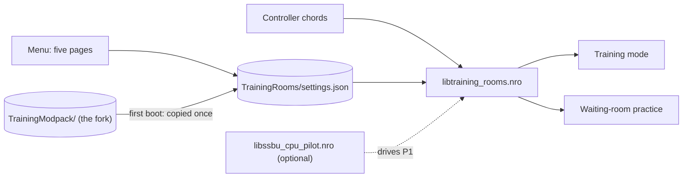

# TrainingRooms for Ultimate

Practice tools for Training mode and the online waiting rooms of Super Smash Bros. Ultimate 13.0.5, as a Skyline plugin.


*Eden, 2026-11-05, 0.2.0-rc.1 release NRO `706c993f`: the menu opens, R steps through the five pages, A turns Hitbox
Visualization Off.*

## Install

Put the NRO at `atmosphere/contents/01006A800016E000/romfs/skyline/plugins/libtraining_rooms.nro`, next to
`libnro_hook.nro` and `libparam_hook.nro`, which it needs. **Never install it together with `libtraining_modpack.nro`.**
Settings and saves live in `sd:/ultimate/TrainingRooms/`. On first boot, settings, save states and recordings from the
Training Modpack fork's `sd:/ultimate/TrainingModpack/` are imported once by copying.



## Controls

| Action | Default chord |
| --- | --- |
| Open the menu | B + D-pad Up (always), or Minus (menu shortcut 1, editable) |
| Save state / load state | ZL + D-pad Down / ZL + D-pad Up |
| Record / play back | ZR + D-pad Down / ZR + D-pad Up |
| Cycle the CPU / Player 1 fighter | ZL + D-pad Left / ZL + D-pad Right |
| Kirby hat: Player 1 / CPU | Special + L3 / Special + R3 |
| Reset the training room | L + R + A |

In the menu: L/R change page, A edits, Y resets a row, X saves the current values as defaults, B goes back. The chords are edited
on Display & Controls › Button chords.

## Features

Clips are Eden footage of the 0.2.0-rc.1 release NRO `706c993f`, recorded 2026-11-05, except the two marked RC10;
see [docs/MEDIA.md](docs/MEDIA.md).

### Hitboxes and grab boxes


Hitbox Visualization (Display & Controls) draws the fighters' hurtboxes (yellow), hitboxes and grab boxes.

### CPU reactions


DI, SDI, air dodge, shield tilt, mash, ledge, tech and throw options on the CPU page. Above: the same hits with DI Up
and with no DI.


The direction chips show the game's own DI line and SDI streak; each A adds weight to a chip. *In* and *Out* are
relative to you, on either side of the CPU.

### Save states and respawn


Save states with slots, mirroring and damage on load (Saves page). *Respawn invincibility* chooses between the game's
respawn platform (above) and the instant respawn.

### Recording and playback


Record Player 1 and play it back on the CPU, with slots, triggers and loop (Recording page). *RC10, 2026-11-04,
NRO `50d95130`.*


While the CPU pilot plugin plays Player 1, recording is refused with a notice.

### Fighters, cycles and Kirby hats


Cycle chords step through your own order of fighters per role (red for Player 1, blue for the CPU), drawn with the
game's stock icons.


Kirby hats change with a chord, for Player 1 or the CPU.

### Stages


Pick the stages and their order for Training rotation and waiting-room practice. *RC10, 2026-11-04, NRO
`50d95130`.*

### Waiting rooms


The same menu works while you wait in an online or local room.

### Menu shortcuts and replay capture


Menu shortcuts are changed in the menu and work at once.


The *Replay capture* row and the Online Deluxe overlay show the same setting.

## Status

**0.2.0-rc.1** (2026-11-05) is the console test build. Known issues: a pause that opens while a preloaded helper
fighter is still loading can crash; the Solo Popo marks' placement and the Kirby hat-request rules change in rc.2
([ROADMAP](docs/ROADMAP.md)). Limitations kept from the fork are listed in
[Differences from the fork](docs/DIFFERENCES-FROM-THE-FORK.md). 0.1.0 crashes at console boot; use 0.2.0-rc.1.

## Build

```powershell
cargo test --all-targets
cargo skyline build --release
```

The NRO is `target/aarch64-skyline-switch/release/libtraining_rooms.nro`. Toolchains, the diagnostic build and the
layout recipe: [docs/BUILD.md](docs/BUILD.md). Current acceptance state: [HANDOFF.md](HANDOFF.md).

## License and provenance

MIT ([LICENSE](LICENSE)). This is a clean-room implementation inspired by the Training Modpack
([jugeeya/UltimateTrainingModpack](https://github.com/jugeeya/UltimateTrainingModpack)), which publishes no license:
its features were re-specified from observable behaviour and none of its code, layouts or artwork is used. Code
carried over from this project's own earlier fork and all dependencies are recorded in [PROVENANCE.md](PROVENANCE.md)
and [CARRY-OVER.md](CARRY-OVER.md).

This project was developed with the assistance of AI. It is an unofficial fan project, not affiliated with or
endorsed by Nintendo.
