# Decisions for the operator

2026-11-01. This page lists every operator decision of the menu proposal, one illustration per decision. In each
picture the recommended option has a **green outline**. The images are in [`decisions/`](decisions/) and are drawn
by `tools/render_decisions.py` in the menu mockup's style. Sources: `MENU-DRAFT.md` §4 (the menu questions keep
their numbers), the specs' *Open questions* sections, `PROVENANCE.md` *Open questions* and `specs/SPEC-core-08` §10.

**Answered 2026-11-01 (late evening ET):** the operator approved the proposal with the answers in the *Decision*
column below, and implementation may begin. Items marked **open** were not answered; their recommendation is the
working default until they are. The new requirements the answers add are collected in
[*New requirements from the answers*](#new-requirements-from-the-answers) at the end, with their mockups.

| # | Decision | Recommendation | Decision (2026-11-01) |
| --- | --- | --- | --- |
| Q1 | Number of pages | five, as drawn | **as recommended** (plus the hidden Developer page, Q8) |
| Q2 | Dropdown input | Left / Right cycle in place; A opens the list | **as recommended** |
| Q3 | Random-among-a-set delays | keep the checklists | **both:** checklist and min–max range; using one disables the other |
| Q4 | Overrides, chords, swap groups | one editor row each | **as recommended** |
| Q5 | First page on open | the last page used | **as recommended** (2026-11-02): the last page used; the first open ever shows CPU |
| Q6 | Item on load (older saves) | keep the row for now | **drop the row;** the import converts older saves once |
| Q7 | Replay capture in the menu | add the toggle | **as recommended** |
| Q8 | Preload Samples | diag build only | **Developer page:** hidden unless an INI enables it (the operator's own INI enables it) |
| Q9 | Menu shortcuts | read-only; the INI is the editor | **B: editable in the menu;** the menu writes `button_config.ini` |
| Q10 | Help text | two-line panel | **as recommended** |
| Q11 | P1 CPU fallback without the pilot | fallback rows, as drawn | **as recommended** |
| Q12 | Direction grid weights | weight digit on the chip | **as recommended** |
| Q14 | Grid paging | 4 × 8 items, 4 × 4 stages (the fork) | **B: denser, items and stages** (stages added 2026-11-02); in handheld mode 4 × 4 pages |
| Q15 | Mii rows | list with the bust where one exists | **as recommended** |
| Q16 | Fighter portraits and mods | read at run time, like stages | **as recommended** |
| Q17 | Which chips show the game's DI / SDI visual | DI and SDI only | **as recommended;** the SDI spark's white streaks drawn longer, closer to a match (×2.0 confirmed 2026-11-02) |
| Q18 | When a CPU setting change takes effect | follow the fork: apply at the next CPU frame | **as recommended (A)** |
| S1 | Five import details | rename to `settings.json`, import both INIs, the rest as proposed | **as recommended, except item 3:** `replay_captures/` is imported in full (it is the Replay Window's crop source) |
| S2 | Corrupt settings file | keep a copy, load field by field | **as recommended** |
| B1 | Plugin name | `training_rooms` | **as recommended** |
| B2 | Panic policy | log it, no pop-up | **as recommended** |
| B3 | Another mod's training HUD layout | inject anyway, document it | **as recommended** |
| B4 | P1 driven by an AI | CPU settings on the CPU only; recording refused | **as recommended** |
| B5 | Input playback and the CPU settings | the recording wins | **the recording wins by default;** an advanced row lets the settings override it (default Off) |
| B6 | Ice Climbers state | one state per fighter | **as recommended** |
| B7 | In / Out for Airdodge and Shield Tilt | toward the opponent, everywhere | **as recommended** |
| B8 | Behaviour changes from the fork | accept the batch | **as recommended, except:** SDI not set means no SDI (the fork's rule stays); the respawn line becomes a toggle |
| B9 | Upstream developer-only code | drop it from the shipped build | **Developer page** (with Q8): shipped, hidden unless the INI enables it |
| B10 | README media | reuse the GIFs that show no menu | **as recommended** |
| B11 | Ledge options changed while the CPU is already on the ledge (fork and clean room) | re-roll on menu change, like SDI | **as recommended** (2026-11-02): re-roll on menu change, in both trees (the fork gets it in its next build) |

## Menu

### Q1 · Number of pages

Five pages, four (Saves and Display & Controls merged) or six (Stages & Lobby split out)?
**Recommendation: five.** Each page has one theme, and no page is very long or nearly empty. Cost: none; the
mockups already show five.

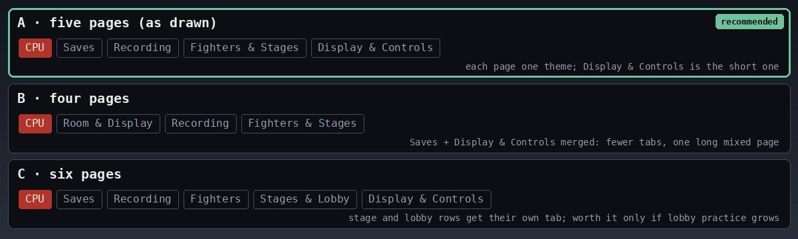

### Q2 · Dropdown input

Should Left / Right change a dropdown's value in place, or must A open the list first?
**Recommendation: in place, as drawn.** A still opens the full list. It is one press per change instead of
three. Cost: a stray Left / Right changes the value.

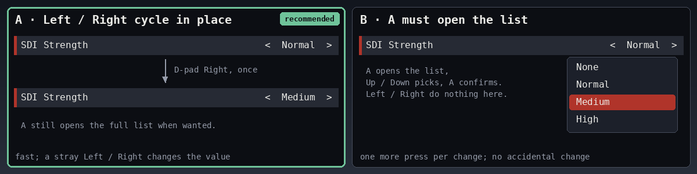

### Q3 · Random-among-a-set delays

Aerial, fast-fall, throw, pummel and ledge delays, OoS offset, reaction time and the slot sets: keep them as
checklists, or use a min–max slider?
**Recommendation: checklists.** They keep today's meaning, so saved files load unchanged. A range slider
cannot express a set like {0, 5, 10}. Cost: a checklist is a longer popup than a slider.

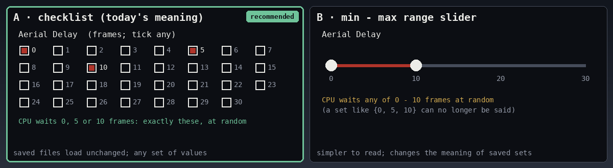

**Decided 2026-11-01: both.** Each delay row offers the checklist and a min–max range; while one holds a value the other is greyed, and Y clears the active one. See *New requirements* N3.

### Q4 · Situation overrides, Button chords, Swap groups

Should these three be sub-screens (one row each), or should all their rows sit on the page?
**Recommendation: sub-screens.** Putting the rows on the page adds 12 rows to CPU, 6 to Fighters & Stages
and 5 to Display & Controls. Cost: one more press (A) to reach them.

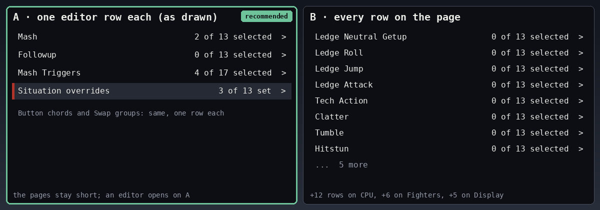

### Q5 · First page on open

Should the menu open on the last page used (today's behaviour) or always on CPU?
**Recommendation: the last page used.** A drill loop (record, test, adjust) comes back to the same page.
Cost: none; this is today's behaviour.

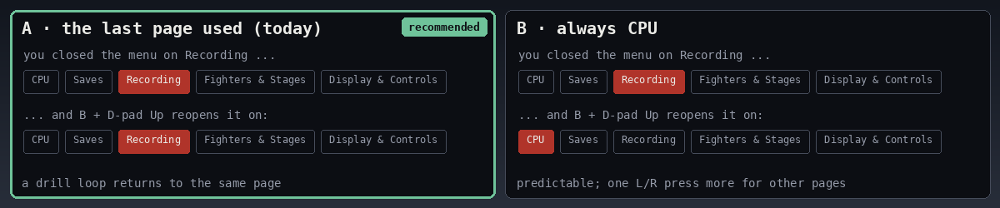

**Decided 2026-11-02: the last page used;** the very first open (no saved page yet) shows CPU.

### Q6 · Item on load (older saves)

Keep this legacy row for saves made before the fork's item snapshot, or convert those saves once at import
and drop the row?
**Recommendation: keep it for now.** It carries no risk, and new saves never use it. Revisit once the import
has been tested on real cards. Cost: one rarely used row on Saves.

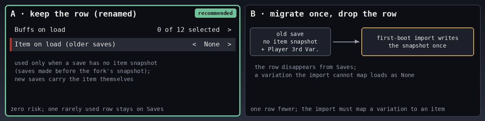

**Decided 2026-11-01: drop the row.** The first-boot import sets an older save's item snapshot from this setting once (N6).

### Q7 · Replay capture in the menu

Should there be a menu toggle that writes `replay_capture.ini` and matches the Deluxe Plugins row, or should
the setting stay INI / Deluxe only?
**Recommendation: add the toggle.** It can then be changed in game, and all three places always agree. Cost:
one row, and one small INI write when the row changes.

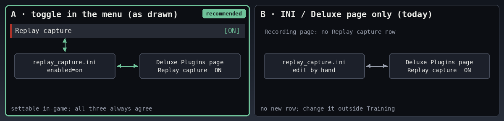

### Q8 · Preload Samples

Ship this diagnostics row under *Loading (advanced)*, or put it in the `diag` build only?
**Recommendation: diag build only.** Players never need it, and the playbook's `diag` feature exists for
exactly this. Cost: measuring on a card then needs the diag build.

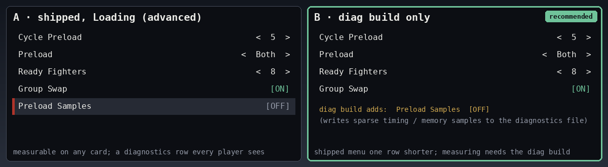

**Decided 2026-11-01: a Developer page** (with B9), hidden unless an INI flag enables it; the operator's own INI enables it, so capture and test rows need no diag build (N1).

### Q9 · Menu shortcuts

Show the INI shortcuts read-only in the menu, or make them editable there with the INI as the file of
record? (This also answers `PROVENANCE.md` open question 5.)
**Recommendation: read-only.** No second chord editor is needed, and the behaviour matches the fork
(restart to apply). Cost: changing a shortcut means editing `button_config.ini`.

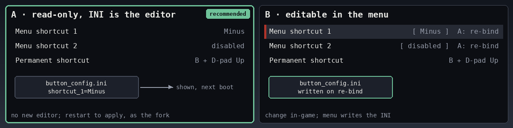

**Decided 2026-11-01: B, editable in the menu.** The two shortcut rows open the chord editor; the menu writes `button_config.ini` and the new chord applies at once (N7).

### Q10 · Help text

Keep one help line at the bottom, or use a two-line panel?
**Recommendation: two lines.** The fork's longer help texts (the group rows, for example) then fit without
being cut. Cost: the item list shows one row fewer.

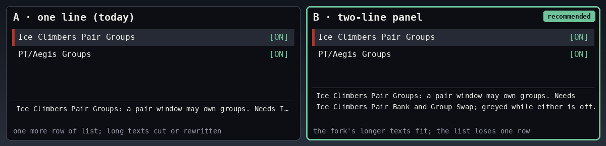

### Q11 · P1 CPU fallback when the pilot plugin is absent

Show the two hidden fallback rows (as proposed), make it INI only, or drop the TM-side control and require
the pilot?
**Recommendation: the fallback rows.** P1 control still works on a card without the pilot. With the pilot
installed, only the info row shows. Cost: two rows, shown only when the pilot is absent.

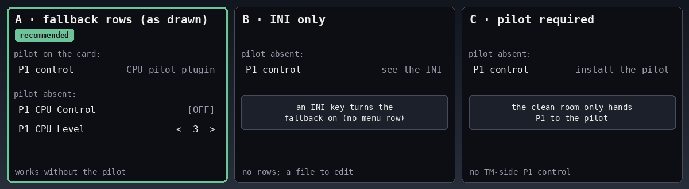

### Q12 · Direction grid weights

Show a weight digit on each selected chip (today's counts), or use plain on/off chips with an even pick?
**Recommendation: weights.** They keep today's semantics, and saved files carry the counts. Cost: a small
badge per chip, and A adds weight instead of only toggling.

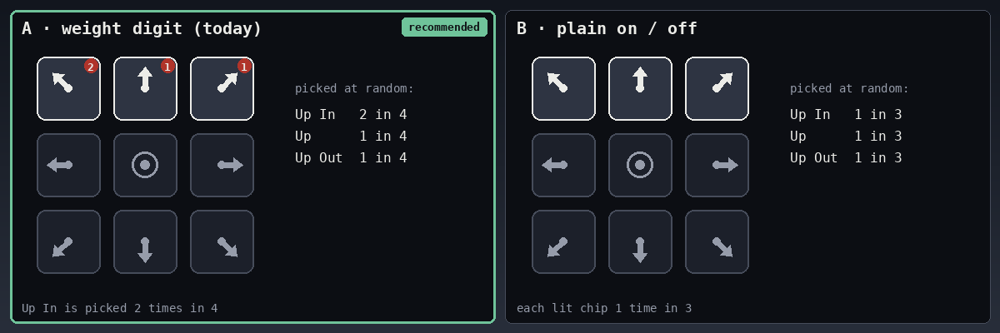

### Q14 · Grid paging

Keep items at 4 × 8 per page (two pages) and stages at 4 × 4 (eight pages), as the fork does, or use denser
pages?
**Recommendation: as the fork.** This layout is tested on the console, and the item names stay readable.
Cost: L / R to reach items 33–38.

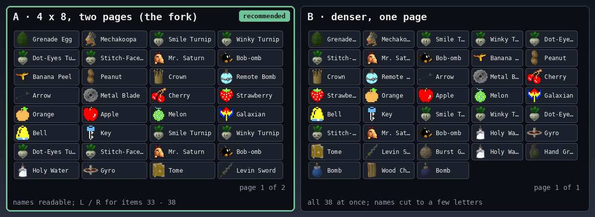

**Decided 2026-11-01: B, denser, with a handheld rule.** Docked: all 38 items on one page. Handheld: three pages. Stages (operator, 2026-11-02): the denser paging applies to the stage grid too (N5).

### Q15 · Mii rows

Lists with the fork's bust thumbnail beside each saved Mii where one exists, or text only?
**Recommendation: busts where they exist.** They make saved Miis easy to tell apart, and the fork already
makes them. Cost: one small texture per visible Mii. (The picture uses a neutral silhouette in place of a
bust.)

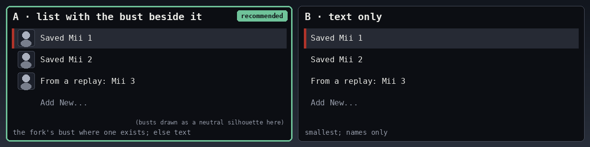

### Q16 · Fighter portraits and mods

Should the portrait grid read each fighter's own UI portrait from the game at run time, as the stage grid
does (so character and costume mods show), or keep fixed stock icons as the fork does?
**Recommendation: read at run time, falling back to a text tile.** This is the same rule as stages and
DI / SDI chips: nothing is baked or committed, and mods show. Cost: the run-time read has the same open
unknowns as the stage thumbnails (`SPEC-core-07` §4.5, U1–U8), plus choosing the right costume, so it needs
one more development probe.

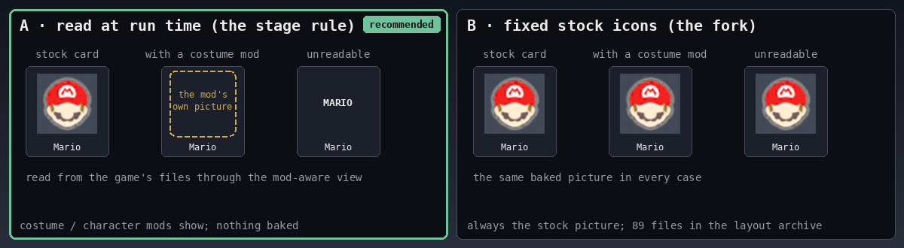

**Answered again 2026-11-04 (operator, Phase 2/3): run-time read stays, nothing baked; E9 amended to what the game does.**
- **The operator asked:** "why would a fallback be needed? At that point we might as well bake the icon in like the fork." Then: "yes record it that way".
- **Icon set:** the grids draw the game's `chara_2` stock-icon set. It is the same image as the fork's baked `fighter-NN.png` (decode check, panel 3).
- **E8 (a mod shows):** PASS on Eden. A mod replacing Mario's `chara_2` icon makes the "5. Mario" tile draw the mod's icon (run `tr-p23-surface-q16n`).
- **E9 (an unreadable icon), amended.** An unreadable mod icon file shows the **stock icon**, and nothing is substituted.
  - Observed on Eden (run `tr-p23-surface-e9c3`): a valid mod icon whose host read was refused after discovery. ARCropolis served the game's own Samus icon.
  - The earlier wording, "an unreadable file keeps the text tile", can't happen through a mod. A malformed icon file crashes the game's own loader whoever asks for it, so it is no test of the plugin.
- **The names-only tile is a safety state, not an icon source.** It shows only when the texture helper refuses to call the game, because its guards found changed game code (for example after a game update).
  - Host tests cover the parts: the guards refuse a changed word (`src/model/seams/native_seams/tests.rs`); every texture-helper entry checks `usable()` first (`tests/capabilities.rs:462-464`); the text-tile carry (`src/model/ui_texture.rs:178`); nothing is baked (`tests/core07_assets.rs`).
  - The grid's gate itself (`thumbs::run` requests nothing unless `texture::usable()`) is runtime code; source citation only.
- **Not baking:** baked icons would not show mods (E8), would add the fork's 89 icons (≈406 KB of PNG) to the plugin, and could not be drawn anyway in the one state where the names-only tile appears.

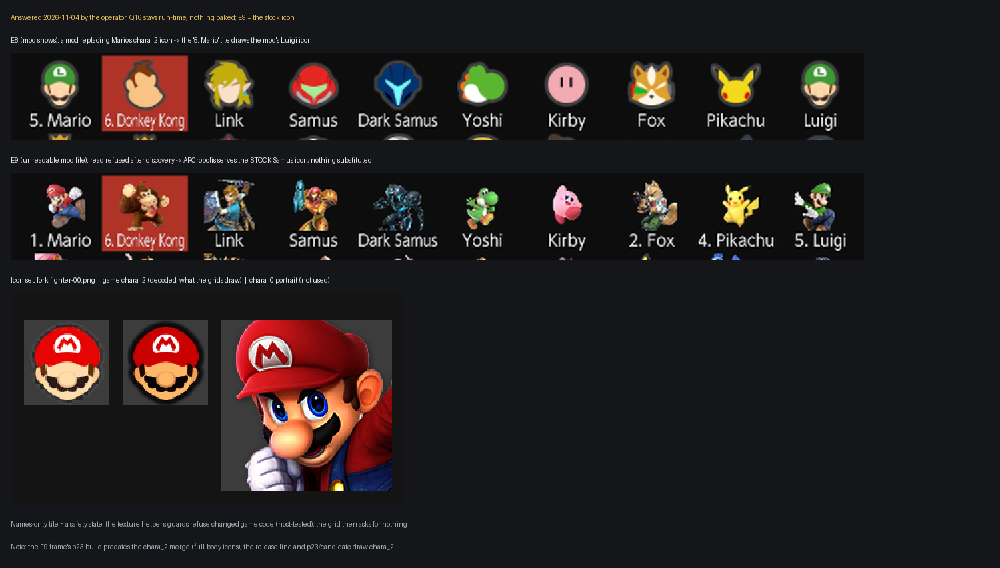

### Q17 · Which chips show the game's DI / SDI visual

Should only the DI and SDI chips show the game's own visual, with Airdodge Direction and Shield Tilt keeping
the clean room's arrows?
**Recommendation: yes, DI and SDI only.** The game's visual shows launch influence; on an air-dodge or shield
chip it would suggest something those options do not do. Cost: none; this is how the mockups are drawn.

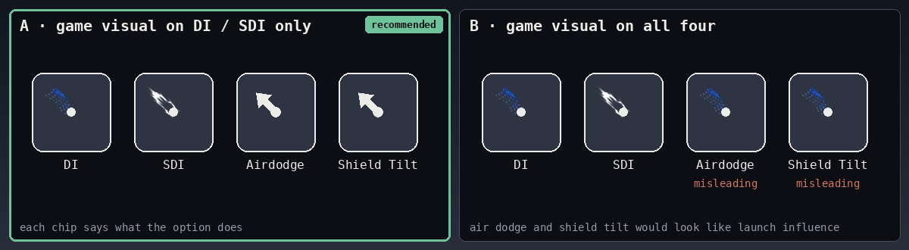

### Q18 · When a CPU setting change takes effect

**The fork (stage M5o):** a changed SDI Direction or Shield Tilt now applies at the next CPU frame, with a
new weighted roll; DI was already read live at each hit. (Before M5o, SDI Direction applied only at the next
Training reset, and the menu did not say so.) **Clean room:** should it follow the fork?
Options: (A) follow the fork: apply at the next CPU frame, one roll that holds until the next reset or the
next change of that row; (B) apply the same way and also roll a new SDI direction every hitlag episode
(`SPEC-cpu-02` questions 1 and 9); (C) keep reset-only and label the row "applies on next reset".
**Recommendation: A, follow the fork.** It is built and was checked in Eden (the SDI Up → In change, and the
Shield Tilt change, applied with no reset). The menu then means the same in both plugins, and Shield Tilt and
the other per-reset rolls follow the same rule. Cost: with two or more directions selected, SDI keeps one
direction until the next reset or change, which upstream's own source marks as a bug. B would vary it every
hit at the price of one roll per hitlag episode and a parity difference from the fork; it stays open if you
want it.

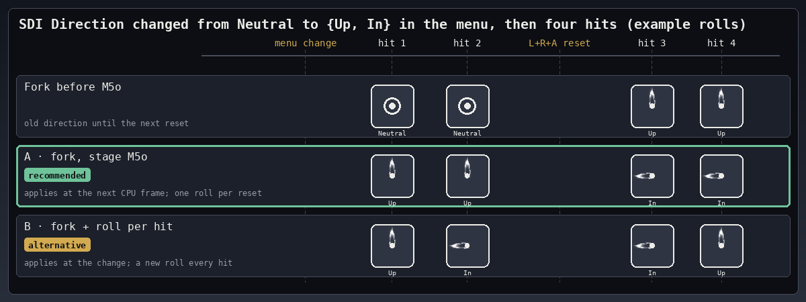

Fork evidence: `artifacts/…/parked-reuse175/refactor/c1162/di-sdi-apply/RESULT.md` (Eden rows R-APPLY1–3
passed on the patch's own builds; `PATCH.patch` is in the same folder); the picture's rolls are examples.

## Files

### S1 · Five import details (`SPEC-core-08` §10)

The storage root and the import are decided. Five details remain; each has a numbered tag in the picture.

- **1 · settings file name:** rename to `settings.json`, or keep the fork's name `training_modpack_menu.conf`?
  *Rename*; the loader also accepts the old name once.
- **2 · the two INIs** (`button_config.ini`, `replay_capture.ini`): import them too? *Yes*, under the same
  rules, so shortcuts and the capture choice survive.
- **3 · `replay_captures/`:** not imported (the Replay Window starts empty), or imported below a size cap
  (for example 64 MiB)? *Not imported*; the README explains how to copy it by hand.
- **4 · TOML-only cards** (the fork before its JSON port): *not converted*; the fork's
  `tools/port_save_states.py` is the documented offline path.
- **5 · re-running the import:** by deleting `migration.json` only, or also from a menu row? *The marker only*;
  no menu row.

Cost: item 2 adds two small files to the copy list. The others cost nothing.

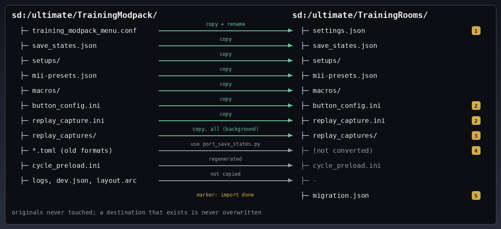

**Decided 2026-11-01: as recommended, except item 3.** `replay_captures/` holds the companions the Replay Window crops macros from (`docs/reference/named-macros.md` in the fork), so it is imported in full, with no size cap (N8).

Corrected 2026-11-02: the source is `training_modpack_menu.conf`; `training_modpack.json` is the updater record and is not imported.

### S2 · Corrupt settings file (`SPEC-core-04` question 2)

Delete the file and start from defaults (upstream), or keep a renamed copy and load it field by field?
**Recommendation: keep a copy, default per field.** One bad field no longer wipes every setting. Cost: one
renamed file on the card until the player deletes it.

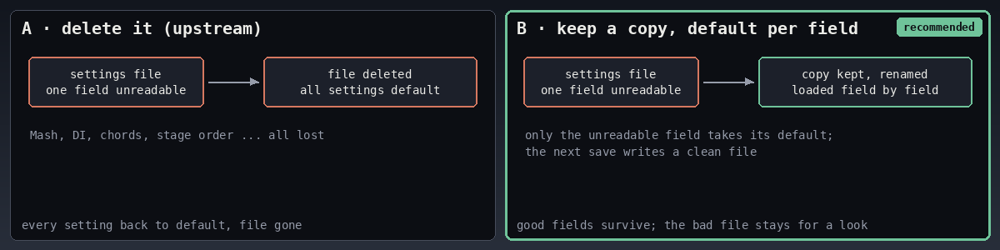

## Behaviour and product

### B1 · Plugin name (`SPEC-core-01` question 6)

Name the plugin `training_rooms` (`libtraining_rooms.nro`), or keep `training_modpack`?
**Recommendation: `training_rooms`.** The two plugins can then be told apart on a card and in logs. They must
never be installed together, because they hook the same sites. Cost: none.

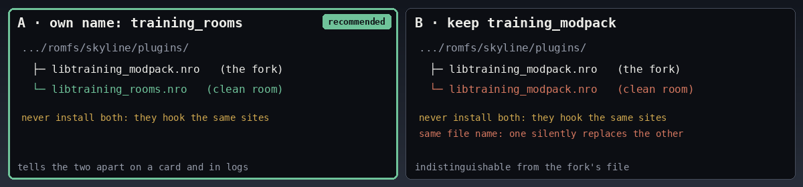

### B2 · Panic policy (`SPEC-core-01` question 1)

Show the error pop-up on a panic (upstream: the game is unusable until it is closed), or write the panic to
the diagnostics file and the Skyline log with no pop-up?
**Recommendation: log it, no pop-up**, as the playbook's plugins do. Cost: the player sees no message on
screen; the reason is in the logs.

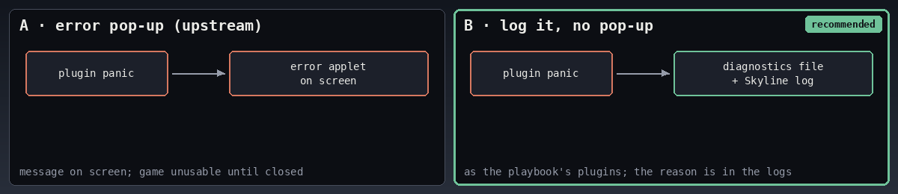

### B3 · Another mod's training HUD layout (`SPEC-core-05` question 2)

When another mod ships its own `info_training` layout, should the plugin inject its layout anyway and
document the conflict, or detect it and skip injection (the other mod's HUD stays and our menu is off)?
**Recommendation: inject anyway, document it.** The install line notes the other layout. Cost: that mod's
training HUD does not show while this plugin is installed.

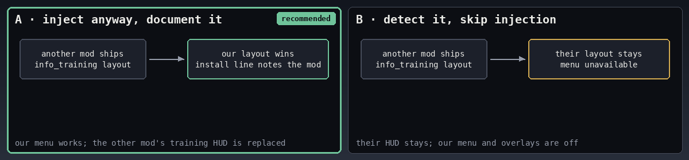

### B4 · P1 driven by an AI (`SPEC-cpu-01` question 7, `SPEC-input-01` question 7)

When the pilot or the fallback drives P1: should the CPU settings (Mash, DI, SDI, ledge, tech, shield …)
apply to P1 too, and what should Record do?
**Recommendation: the CPU settings apply to the CPU role only, and Record is refused with a notice.** Two
drivers never fight over P1, and no new game site is needed. Cost: recording the AI's line would need the
alternative (reading P1's controller slot).

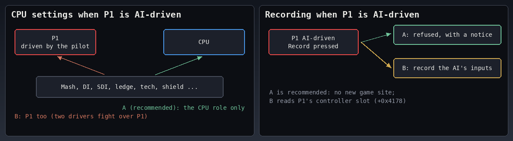

### B5 · Input playback and the CPU settings (`SPEC-cpu-02` question 7, `SPEC-cpu-04` question 6, `SPEC-cpu-06` question 7)

While a recording plays on the CPU, should the DI, SDI, air-dodge, tech and throw settings override it
(upstream), or should the recording win?
**Recommendation: the recording wins**, the same way shield and stick already yield to playback. Cost: none;
the settings apply again when playback ends.

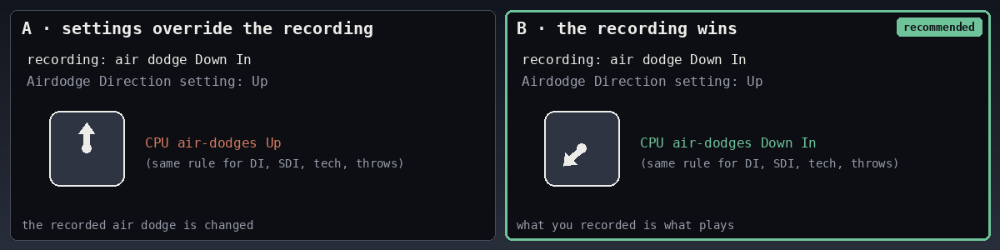

**Decided 2026-11-01: the recording wins by default,** and an advanced row *Settings override playback* (default Off) restores the upstream rule when switched On (N4).

### B6 · Ice Climbers state (cross-cutting; `SPEC-cpu-02` … `-06` question 4 or 5)

Should Popo and Nana share one set of CPU counters and cases (upstream), or have one each?
**Recommendation: one per fighter.** Nana's SDI count, DI case and delays then stop leaking into Popo's.
Cost: a few bytes per CPU fighter.

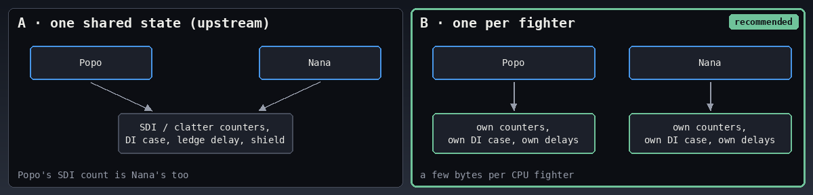

### B7 · In / Out for Airdodge and Shield Tilt (`SPEC-cpu-02` question 2, `SPEC-cpu-05` question 2)

Upstream's air dodge mirrors only when the player is on the CPU's right, and its shield tilt is absolute.
Should both use the opponent-relative rule that DI and SDI use?
**Recommendation: yes, toward the opponent everywhere.** The direction grid labels its chips In and Out, so
they should mean the same on every row and on both sides. Cost: a visible change against the fork when the
player stands on the CPU's left.

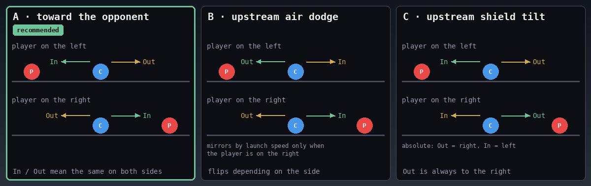

### B8 · Behaviour changes from the fork, as a batch

The specs recommend thirteen small user-visible fixes (top of the picture) and six behaviours to keep as
the fork has them (bottom).
**Recommendation: accept the batch.** Any single line can be reversed by naming it. Each line's spec
question has the details. Cost: each fix is a small parity change against the fork, and the release notes
list them.

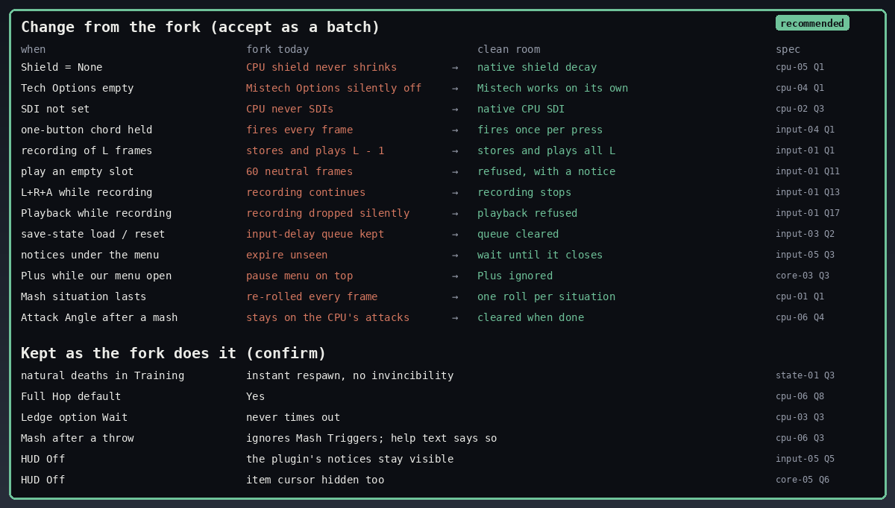

**Decided 2026-11-01: the batch is accepted with two changes.** *SDI not set* keeps the fork's rule: with no SDI Direction selected the CPU does not SDI (the "native CPU SDI" line is withdrawn). *Natural deaths in Training* becomes the toggle *Respawn invincibility* (N2). The other twelve changes and five kept lines stand.

### B9 · Upstream developer-only code (`PROVENANCE.md` questions 3 and 4)

Drop `dev_config`, the debug hooks and `raygun_printer` from the shipped build, or keep them as diag-only
behaviour? Should `training_mod_sync` (36 lines of lock helpers) be kept, or should the code use
`parking_lot` directly?
**Recommendation: drop them, and add a diag version only if a developer asks; use `parking_lot` directly.**
Cost: none for players.

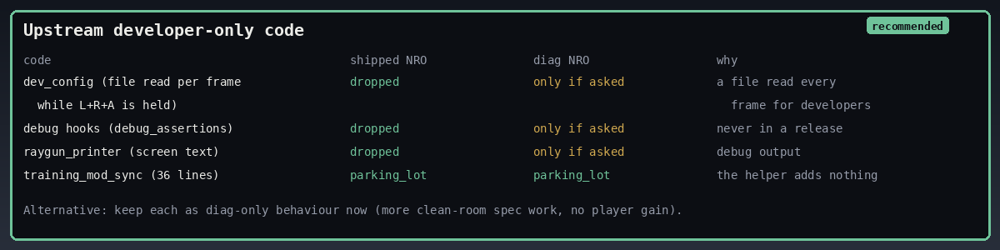

**Decided 2026-11-01: the Developer page** (N1) holds the developer-only rows with Preload Samples; they ship hidden. `parking_lot` is used directly (the helper crate is not kept).

### B10 · README media (`PROVENANCE.md` question 2)

Reuse the fork's walkthrough GIFs now (some show the old menu), reuse only those without the menu, or ship
no media until the new menu is built?
**Recommendation: reuse the GIFs that show no menu now, and re-record the menu GIFs after the build.**
Cost: the README has no menu pictures until then.

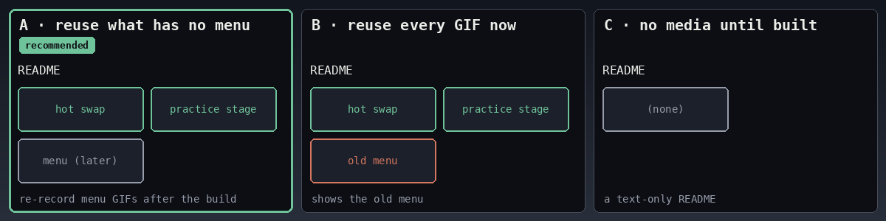

### B11 · Ledge options changed while the CPU is already on the ledge (`SPEC-cpu-03`)

**Applies to both the fork (unchanged there) and the clean room.** Found while checking Q18: a CPU rolls its
ledge option once per hang and holds it until it leaves the ledge; the held roll also survives while the
Ledge Options row is empty. A CPU already parked on the ledge (for example with Wait) therefore ignores a
newly selected option until it leaves the ledge and grabs again. The throw option behaves the same way for a CPU already
holding someone. The fork's SDI and Shield Tilt rolls no longer have this problem (Q18).
Options: (a) re-roll the ledge options (and the throw options) when the menu changes them, like SDI
Direction: the CPU takes the new option during the same hang; (b) apply on the next ledge grab, which is
what the fork does today and what `SPEC-cpu-03` currently says.
**Recommendation: (a).** The menu then does what it says without a second hang, and it follows the same
rule as Q18. Cost: one more roll cleared on a menu change; a CPU already hanging can act differently the
moment the row changes; the fork keeps (b) until it gets the same change. Source: the fork's
`c1162/di-sdi-apply/PROGRESS.md`, "For the primary" item 2.

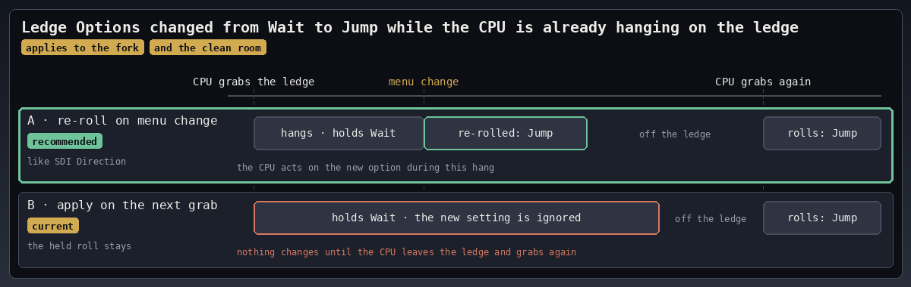

**Decided 2026-11-02: (a), re-roll on menu change,** for the ledge options and the throw options, in both trees. The fork gets it in its next build; the clean room implements it from `SPEC-cpu-03` / `SPEC-cpu-06` in package 2.

## Already answered (not repeated above)

| Item | Answer | Where |
| --- | --- | --- |
| MIT copyright holder | the handle (`Copyright (c) 2026 intpa`) | `LICENSE`; `PROVENANCE.md` question 1; `MENU-DRAFT.md` §4 |
| Storage root and import | `sd:/ultimate/TrainingRooms/`, one-time copy of the fork's data | `specs/SPEC-core-08`; `MENU-DRAFT.md` §4 (also closes `SPEC-core-01` Q2, `SPEC-core-04` Q3, `SPEC-input-01` Q15, `SPEC-state-01` Q9) |
| Q13 grid picture source | stage thumbnails read at run time, never baked; item grid uses the fork's own icons | `MENU-DRAFT.md` draft 5; `SPEC-core-07` §4.5 |
| Placeholder chips (Kirby Hats, Solo Popo, items) | neutral placeholder until the icons are designed | `MENU-DRAFT.md` draft 4 |
| Origin tags on screens | removed | `docs/MENU-PROPOSAL.md` v6 |
| DI / SDI chips | the game's own visual, read at run time | `MENU-DRAFT.md` draft 6; `SPEC-core-07` §4.6 (Q17 asks only whether Airdodge / Shield Tilt keep the arrows) |
| Who drives P1 | the standalone CPU pilot owns P1; only the fallback is open (Q11) | `MENU-DRAFT.md` §2/§3; `specs/INDEX-cpu.md` |
| Menu shortcuts (`PROVENANCE.md` question 5) | merged into Q9 | above |
| Upstream HEAD `077a8e43` inverted reset gate | not adopted | `SPEC-cpu-07` Q5, `SPEC-cpu-01` Q8 |
| Auto-update, Menu Open Start Press | dropped from the menu; old keys read and ignored | `MENU-DRAFT.md` §3; `SPEC-core-02` Q4 |
| Pushing `review/menu-proposal` | docs-only pushes allowed (standing order); any other push, the Forgejo release and the Switch install still need an explicit order | `TRAININGROOMS-HANDOFF.md` |

## Left to the lead

The remaining *Open questions* in `specs/` are technical: site guards, hook placement, measurements, RNG
source, cost-only changes and Eden rows to run. Each has a written recommendation that stands unless the
operator objects; they are not repeated here. The operator-facing ones are pulled into Q18 and S1–B11 above.

## New requirements from the answers

Added 2026-11-01 by the lead from the operator's answers. Each one is folded into `MENU-DRAFT.md` (draft 9), the
affected spec (its *Open questions* answer and §9 test-provenance rows) and the mockups named here
(`docs/menu-mockup/`, the renderer's style).

| # | Requirement | Where | Mockup |
| --- | --- | --- | --- |
| N1 | **Developer page.** A sixth page, *Developer*, after Display & Controls. It is hidden, and its rows do nothing, unless `sd:/ultimate/TrainingRooms/developer.ini` has `developer_page=on` (read at boot; missing file or any other value = hidden). It holds Preload Samples (Q8, moved from *Loading*) and the developer-only rows of B9, rebuilt from `SPEC-core-01`'s description of them. They ship in the normal build, so capturing or testing them needs no diag build; the playbook's `diag` feature keeps only the Eden stand-ins. The operator's card and the Eden test profiles carry `developer_page=on`. | `SPEC-core-01`, `SPEC-core-02`, `SPEC-core-08` | `20-developer.png` |
| N2 | **Respawn invincibility** (toggle, default Off = the fork: instant respawn, no invincibility). On: after a natural death in Training the fighter (P1 or CPU) respawns with the game's own respawn invincibility and, where the game's own respawn path can be used, on the respawn platform as in a match. Greyed while *Auto-load on death* is On (a save state is loaded instead). If the platform cannot be had through the game's own path, that limit goes to the operator before it ships. | Saves › Save states, after *Auto-load on death*; `SPEC-state-01` | `02-saves.png` |
| N3 | **Delay rows: checklist and range** (Q3). Aerial Delay, Fast Fall Delay, Throw Delay, Pummel Delay, Ledge Delay, OoS Offset and Reaction Time open one popup with both controls. A ticked checklist greys the range; a set range (any step value from min to max, uniform) greys the checklist; Y clears the active one. Saved files without a range load as checklists. The three slot sets keep the checklist only (confirmed 2026-11-02). | `SPEC-core-02`, `SPEC-cpu-01`/`-03`/`-05`/`-06` | `19-delay-popup.png` |
| N4 | **Settings override playback** (toggle, *advanced*, default Off). Off: a playing recording wins over DI, SDI, air-dodge, tech and throw settings (B5). On: those settings override the recording, as upstream does. | Recording › Playback; `SPEC-cpu-02`/`-04`/`-06`, `SPEC-input-01` | `03-recording.png` |
| N5 | **Item grid paging** (Q14). Docked: one page, 5 × 8 tiles (38 used), short names. Handheld (the console's operation mode when the grid opens): three pages of 4 × 4 (16, 16, 6) with full names. Stages (2026-11-02): docked 5 × 8 tiles per page (All + 117 = 118 tiles, three pages: 40, 40, 38) with short names; handheld 4 × 4 (eight pages), as the fork. Same tile geometry as the item grid. | `SPEC-core-03`; item grid (carried over) | `11-item-grid.png`, `18-item-grid-handheld.png`, `12-stage-grid.png`, `22-stage-grid-handheld.png` |
| N6 | **Item on load dropped** (Q6). The first-boot import writes the item snapshot of each save that has none, from the old setting, once; the row and its setting are gone. | `SPEC-core-08`, `SPEC-state-04` | `02-saves.png` |
| N7 | **Editable menu shortcuts** (Q9 B). *Menu shortcut 1 / 2* open the chord editor; a change applies at once and is written to `button_config.ini`, the file of record. The permanent `B + D-pad Up` stays fixed. | Display & Controls › Controls; `SPEC-input-04` | `05-display-controls.png` |
| N8 | **Import all replay captures** (S1 item 3). `replay_captures/` is copied in full to the new root on first boot, without blocking the boot; the originals stay. | `SPEC-core-08` | `S1-import-details.png` (as drawn, item 3 changed) |
| N9 | **SDI not set = no SDI** (B8). With no SDI Direction chip selected, the CPU does not SDI, as in the fork. | `SPEC-cpu-02` | – |
| N10 | **SDI chip streaks longer** (Q17). The SDI chips draw the spark's white streaks longer, closer to a match. | `SPEC-core-07` §4.6 | screens `01`, `16`, `17` |

**Answered 2026-11-02 (~02:4xZ):** Q5 and B11 as recommended; the SDI ×2.0 stretch, the Developer page (N1) and the
delay popup (N3, slot sets checklist only) as proposed; N5 extended to the stage grid. Nothing in this list is open.

## Answered 2026-11-02 (~10:4xZ, the operator via the primary)

| # | Decision | Answer |
| --- | --- | --- |
| HB1 | Hitbox Visualization: also draw hurtboxes? (the approved proposal showed them; SPEC-core-06 did not) | **(a) also draw hurtboxes (yellow)**, as the approved proposal shows; the per-frame cost is measured before shipping; SPEC-core-06 and the help text updated |
| U1 | After an undo to the Training Modpack, carry clean-room data back? | **No carry-back** (as recommended); final in `docs/CARD-SWAP-PLAN.md` |
| D-DELAY-REROLL | Ledge / throw / pummel **delays** changed while the CPU hangs or holds a grab | **A, keep**: the delay rolled at the start of the hang / grab stands; the next event uses the new value (both trees; the fork's current behaviour). B11's option re-roll is unchanged |
| L1 | Deluxe plugin SDK licence | **the operator handles the SDK licence himself** (corrected 2026-11-02; nothing was added to the Deluxe repo by agents). Until a licensed SDK commit exists the clean room builds without `deluxe-sdk` and the Deluxe Plugins page row stays "waits for L1"; then it is carried as the fork uses it, licence recorded per crate. Agents do not touch the Deluxe repo |
| FW1 | Ally Eden rigs and the Windows firewall prompt | agents may add an inbound **Block** rule (Windows Defender Firewall) for each rig `eden.exe` path they create (Training rows need no inbound network); never Allow rules; never answer the prompt itself; each rule recorded in the rig notes |
| F6 | First-boot group-build hitch (~0.1 s first-use setup on the game thread; Kirby-first 91–109 ms) | **fix in both trees**: a fork worker root-causes it on M5q and ships M5r; the clean room carries the fix (fix-ledger row F6) |

## Answered 2026-11-04 (~11:5xZ, 06:5x ET, the operator via the primary)

| # | Decision | Answer |
| --- | --- | --- |
| HB1-route | How hitbox and hurtbox spheres are drawn | **Route B** (as recommended): the fork's shared-pool `sys_shield` spheres. This **reverses** the 2026-11-03 Phase 3 default "option A (isolated sphere)", which the option A study could not route safely. Route A stays later research. The Ridley first-frame refusals are counted and logged |
| TRIO-DIRECT (~17:45Z, answered ~17:55Z) | With Player Swapping On, a Player Direct swap's completion check compares the solo `Forms::starting` shape against the entry's trio descriptor (`count=3 … flags=0x4`) and can never complete; `busy()` stays true and every chord refuses (Surface Round 2) | **Option A (the operator, ~17:45Z)**: under trio practice ON, a Player Direct/Cycle swap plans and checks the GROUP forms the entry is actually built with, the same way the cycle path handles grouped fighters; the completion check then matches the regrouped descriptor. Fix on `p23/buildsplit-fix` with a host test for the planned forms under trio ON/OFF (see the section below) |
| MENU-CLOSE (~13:58Z) | Closing the menu published its open-time snapshot and undid rows the game adopted while it was open (D1 write-backs, e.g. a CPU Kirby copy; Ally batch finding 2, `artifacts/phase23/FINDINGS-REPORT.md`) | **Close commits only the rows the player changed in this menu session** (as recommended). Every other row keeps its live value, including write-backs adopted while the menu was open. When the player and the game changed the same row, the player's edit wins. Regression test `tests/findings_menu_close.rs` (branch `p23/findings`) |

The MENU-CLOSE choice as shown to the operator:

```text
open:    cpu=DK   hat=none
while open:
  you set cpu=Kirby
  game sets hat=Pikachu
close ->  cpu=Kirby  hat=Pikachu
          (your edit) (game kept)
```

The alternatives were "game updates win on the same row" and "refresh the open menu on every write-back", which can
overwrite an edit in progress.

### HB1-route · How hitbox and hurtbox spheres are drawn (the question as asked)

HB1 (a) above draws hurtboxes in yellow. On 2026-11-03 (~11:0xZ, Phase 3 scope) the operator asked for an isolated
visualization sphere ("option A") by default. The follow-up study (`OPTION-A-DESIGN.md`, stream/slim-phase3-rc6,
2026-11-03) found **no safe route for option A within its scope**, and that result had not come back to the operator.
The rest of HB1 (the hurtbox reader, its tests, a diag-only part census) is built without depending on this choice.

**Recommendation: route B now, route A as later research.** Route B is how the fork draws spheres: each is a
`sys_shield` effect from the game's own effect pool. It is proven on Eden (hb-03: 23 spheres on Luigi, 19 on Steve,
zero failed requests, idle pass about 12 µs). Its known limit is Ridley: on his first frame he wanted 55 spheres from a
pool of about 56 free slots, and 2 were refused until other effects ended (hb-04). The diag build's census line will
measure Ridley's real part count and the per-frame cost in the combined Phase 2/3 Eden boot.

Route A would give the spheres their own system, so they never take the game's slots. Nothing it needs exists yet:
GPU, allocator and teardown ownership for a second system, draw order, bone following, and an authored sphere asset
(`ef_common.eff` has none). HB1 drawing would stay Off until those are built and proven (one trace boot plus an Eden
screenshot row).

Options:

1. **Route B now, A later** (recommended). Ridley may miss a couple of spheres on his first frame; the drop is counted
   and logged.
2. **Route A only.** HB1 drawing stays disabled in Phase 3 until a separate system and a sphere asset are proven.
3. **Route B now with an on-screen notice** when a sphere is refused; decide on A after the Ridley census.

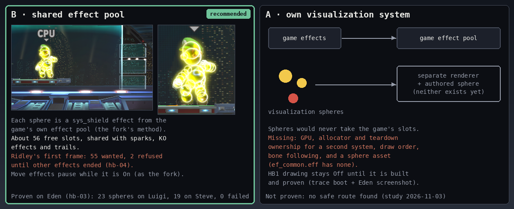

Sources: `docs/HB1-RENDER-ROUTES.md` (branch `p23/hb1`), `OPTION-A-DESIGN.md`, Eden runs hb-03 and hb-04 (stream
`hitbox`). Picture: `tools/render_hb1_route.py`.

### TRIO-DIRECT · Direct swap under Player Swapping: plan the group forms — operator chose A (2026-11-04)

**ANSWERED 2026-11-04 ~17:45Z (the operator, via the primary): option A.** With Player Swapping (trio_practice) ON, a Player Direct/Cycle swap plans and checks the GROUP forms the entry is actually built with, the same way the cycle path handles grouped fighters; the completion check (character_roster.rs:1069-1074) then matches the regrouped descriptor. Root cause only (no guard, skip or timeout); a host test for the planned forms under trio ON/OFF; full gates; the fix lands on `p23/buildsplit-fix` from `p23/integration` with a new diag NRO in a new gates folder. The question as raised:

Raised 2026-11-04 ~17:17Z by the Surface lane's Round-2 root-cause analysis (not yet reproduced live under
tracepoints; the facts below are from the B4 boot's diag log read live plus the source).

**The facts.** With Player Swapping (`trio_practice`, the menu's Player Swapping row) **On**, a Player-role
swap builds (or meets) a **trio-shaped** entry descriptor, but the swap's completion check compares against
the **solo** shape, so the swap can never complete and the roster engine stays busy forever:

- the request: a fixture's `diag_settings_reload` (or a menu change) dispatches
  `Selection::Direct(target)` for `Role::Player`; `active.forms = configured_forms(...) =
  Forms::starting(kind)` — for Mario the **solo** shape (`count=1, kinds=[0, MAX, MAX], flags=0x0`);
- the entry the check reads (`character_roster.rs:1069-1074` → `ready_forms`): the descriptor held
  `count=3, kinds=[0x00, 0x1c, 0x36] (Mario, Chrom, Mii Brawler), flags=0x4`, `installed=3, changing=0` —
  the trio/Player-Swapping group shape;
- `EntryState::ready()` requires `count == forms.count` (3 ≠ 1) and `flags == forms.flags` (0x4 ≠ 0x0) —
  refused on every tick;
- consequence chain (observed on the B4 boot, run `tr-p23-surface-b4`): `state.active` never clears →
  `INSTALL.suspends_practice()` (= `busy()`) stays true forever → every `permitted()`-gated chord refuses
  silently (B4-3: three Kirby-hat chord attempts, zero `[KirbyHats]` lines; B4-4/5 never started); no
  `complete owner=0` line ever; the `[BuildSplit] stall owner=0 … flags=0x4` meter keeps printing the frozen
  shape. A second, related defect is recorded in the same report: on the diag-reload path the Player-side
  dispatch itself is unreliable (a repro boot's push was never dispatched; the menu's `player_character`
  stayed the game-adopted pick), which needs its own bounded look once this shape question is decided.

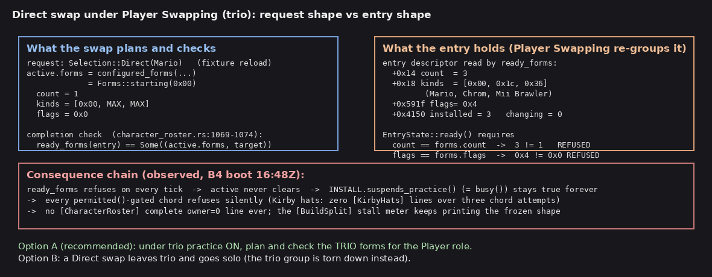

**Options:**

1. **Option A (recommended): under trio practice ON, a Player Direct/Cycle swap plans and checks the trio
   forms.** `requested_forms_at`/`configured_forms` return the trio `Forms` for the Player role when
   `trio_practice == On` (the same grouped-fighter treatment the cycle path already applies), and the
   completion check then matches the re-grouped descriptor. The player keeps the instant-swap group; the
   fixture/menu path behaves like the cycle path.
2. **Option B: a Direct swap leaves trio and goes solo.** A Direct (fixture/menu-set) swap tears the trio
   group down and installs the solo fighter; the trio group is rebuilt only by the cycle path. Simpler check,
   but a fixture push would silently change the Player Swapping experience and every menu-set character
   would drop the group.
3. **Option C: other** (e.g. the completion check accepts the target as the trio group's active member
   without replanning forms). Less explicit than A; the forms the swap promises and the forms the entry ends
   with would still differ.

Sources: Surface lane report `artifacts/phase23/LANE-SURFACE-REPORT.md` ("Round 2"), run
`tr-p23-surface-b4` (diag `c04a316c…`) and the repro `tr-p23-surface-b4b`; source
`src/runtime/roster/character_roster.rs` (`ready_forms`, the completion check, `configured_forms`),
`src/model/swap/character_forms.rs` (`Forms::starting`, `EntryState::ready`),
`src/runtime/roster/build_split.rs` (`tick_any`, the stall meter). Picture: drawn for this decision.

### PAUSE-HELPER · Pausing while a helper entry has no actor — answered (2026-11-05)

**Answered 2026-11-05 ~01:00Z by the operator: option (a), cancel at pause-open** ("go with your recommendations on
all four"). When the game's pause opens while a helper entry has no actor, the plugin retires that entry through the
native path finalize already uses and creates (or reloads) it again after the pause. It needs a host test of the
mid-scene retire and an Eden row: a pause opened inside a creation window, then a resume and a quit, with no unmapped
access. The hat-reload windows get the same treatment if they turn out exposed. **The fork stays as it is** (the
11-03 "no fork work" ruling); no fork action was asked for. Evidence since the entry was written: Eden showed the
same null access with no user pause at Training entry (`tr-p23-primary-finalA3`, exit loop slot-7 call
`main+0x1559118`) and after Quit Training (`tr-lane-yoga-b8`).

Raised 2026-11-04 ~21:42Z by the Ally lane's root cause of the Surface lane's B3 finding. Corrected ~21:51Z, and
measured by the Surface lane ~22:02Z (run `tr-p23-surface-b4t`, diag `3aaa3288`). No fix exists yet. Any guard, skip
or tolerance waits for this decision.

**What is shown, and what is not:**

- **Shown in Eden, on the TrainingRooms build, twice.**
  - `tr-p23-surface-b3`: a quit 60 ms after helper slot 6 was created.
  - `tr-p23-surface-b4t`: a **plain resume** (no quit). There, a trace point on the exit loop's call
    (`main+0x15590d8`) saw it walk slot 6 with `[entry+0x4178] = 0`, and the same 17 null accesses followed.
  - Deliberate tries reproduced it in 1 of 2. The miss was a pause that opened only after the actor was installed.
- **Inferred, not shown: a console fault.** Eden logs these accesses and continues. A console would normally fault on
  the first one, a write near address 0. The operator reports that a similar console quit did not crash. That fits a
  pause that landed outside the windows below; one console report allows no more than that.
- **The fork: by source only.** `UltimateTrainingModpack-lobby-parity` `experiment/cycle-preload` (`2521f5c`) creates
  helpers through the same call (`src/native_source_capacity.rs:705-722`). Its documented release build
  (`README.md:25`) turns that code on. Nothing has been run on the fork for this.

**The windows** (Surface lane, per-frame trace of `[entry+0x4178]`, `LANE-SURFACE-REPORT.md` "Pause-exit null write:
reproduced on a plain RESUME"):

| What opens it | Actor null for | Opens |
| --- | --- | --- |
| A helper's creation (`entry_summon_fighter`) | until its load installs the actor | helpers are created 0.24 s after a resume |
| A Kirby hat reload of helper slot 7 | 59 frames ≈ 1.0 s | 0.66 s after the hat input |
| A Kirby hat reload of helper slot 6 | 329 frames ≈ 5.5 s | 1.41 s after the hat input |

**A pause that opens inside a window freezes it for the whole pause.** In `b4t` the load did not progress during a
≈44 s pause, so the resume found the null actor.

**Open: are the hat-reload windows exposed?** The hat reloads go through the native install `main+0x653240`
(`native_source::install`, the same call in both trees). The fork's own note says that a Reload through it writes outer
phase 3 (`src/native_body_bank.rs:1692`), and the exit loop skips phase 3. Whether the entry stays at phase 3 for the
whole null-actor window of a hat reload was not captured. The creation window is shown exposed. The hat-reload
windows are measured but not shown exposed.

**Item 4: does a plain resume run the exit loop?** **Yes** (`b4t`, trace frame 38112): the resume at 21:53:47Z walked
slot 6 with a null actor.

**The cause** (13.0.5 ELF):

- **The helper.** The plugin creates helper entries through `kiiladarzmanager::entry_summon_fighter`
  (`main+0x1652f40`), which puts an entry into `FighterManager` (slots 5–7) with no actor yet at `+0x4178`.
- **The pause-enter loop** (`main+0x1558540`) only touches entries in phase 6.
- **The pause-exit loop** (`main+0x1558f4c`, in the pause state `main+0x1558720`) skips only phase 3.
  - It calls the AI control-type setter `0x6b82b0([entry+0x4178], 1)` for every other entry 1–7 whose
    `+0x5aa0 == 0x50000000`.
  - With the actor at 0, the setter reads address `0x58`, then writes at `0xc08`, `0xc12`, `0xc4c` and `0xc4d`.
- **Why native code never meets this.** Native Training has only entries 0 and 1, both complete before play. The
  plugin builds a state the game never builds, and the game's pause code walks it on resume and on quit.

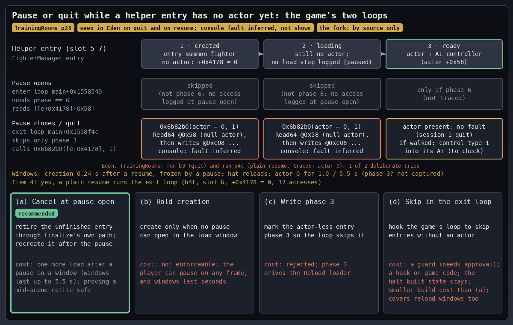

**Options, weighed against windows of up to 5.5 s.** A pause that opens inside a window is an ordinary player action:
the windows open 0.24–1.41 s after a resume or a hat input, and they last seconds.

1. **(a) Cancel at pause-open (recommended).** When the game's pause opens while a helper has no actor, retire that
   entry through the native path finalize already uses, and create (or reload) it again after the pause.
   - This keeps the rule the game relies on: every entry the pause loops can see is complete.
   - Cost to the player: one more helper load after such a pause. With windows of seconds this happens in normal
     play, but only as a later-ready helper.
   - Cost to build: a mid-scene retire must be proved safe (a host test and an Eden row). Hat reloads would need the
     same treatment if the phase-3 question above shows them exposed.
2. **(b) Hold creation** until no pause can open during the window.
   - Cost: the plugin can't enforce this, because the player can pause on any frame. Windows of seconds make it
     weaker still.
3. **(c) Write phase 3** on the actor-less entry, so the exit loop skips it.
   - Cost: rejected. Phase 3 drives the game's Reload loader (`src/model/mii/mii_setup.rs:32-77`), so the write would
     start a load the game did not ask for.
4. **(d) Skip in the exit loop.** Hook the game's loop to skip entries without an actor.
   - Cost: a guard, which needs this approval. It adds a hook on game code, and the half-built state stays for any
     other native path that assumes complete entries.
   - Its build cost is smaller than (a)'s, and it covers creation and reload windows alike.

With windows of seconds, leaving it as is is no longer a reasonable default. The choice is between (a), the root
fix, and (d), the smaller guard.

**The operator's choices for the fork.** The 11-03 ruling is no fork work, so the fork is your call:
- leave it as it is (exposed by source, nothing run);
- port the chosen fix to the fork as well;
- or turn helper creation off in the fork's next build. Creation compiles with `managed-third-source-alpha`, which
  `cycle-preload-extended`, `lobby-preload-extended` and `native-body-bank-alpha` each pull in. Dropping all three
  also drops their features.

Sources: `artifacts/phase23/LANE-ALLY-REPORT.md` ("Round 4" §2) and `LANE-SURFACE-REPORT.md` ("B3 console finding";
"Pause-exit null write: reproduced on a plain RESUME"). Runs `tr-p23-surface-b3` and `tr-p23-surface-b4t`
(`out/trace/b4t-kirby.trace.jsonl`, `out/pause-exit/`). The owned 13.0.5 `main-13.0.5.elf` was read with llvm-objdump.
Picture: drawn for this decision (`tools/render_decisions.py d_pausehelper`).

### HAT-REQUEST-END · A Kirby hat request must always end — answered (2026-11-05)

**Answered 2026-11-05 ~01:00Z by the operator: option A, both rules** (R1: the timeout counts every game frame; R2: a
role that stops being Kirby ends its request). The call-site fix is already in `p23/candidate` (`faa28eb`; B4-3/4/5
pass on Eden). The Eden proof for R2: swap the CPU off Kirby while a hat request is pending, then a hat chord on a
Kirby again works.

Raised 2026-11-04 ~21:53Z by the primary, from the Ally lane's B4-3 root cause (`LANE-ALLY-REPORT.md` "Round 4" §3).
This is source analysis only. Nothing here is implemented, and the call-site fix for B4-3 is separate (branch
`p23/kirby-hat-cpu`). The two rules below change TrainingRooms' behaviour, so they come here as one decision.

**Today's lifecycle** (`src/runtime/roster/kirby_hats.rs`):
- The chord sets a pending request for the role (`:240-250`).
- Each call of `on_frame` on that role's own Kirby body advances its age (`:307`). Once the body stands still, the
  copy is set up and the request is started; once the hat is equipped, it is confirmed.
- A request ends by being confirmed, by "Kirby hat could not be loaded" after 900 counted frames (`:334`), or by being
  cleared when the body's identity changes or the shortcut is no longer permitted (`:302-305`).

**Stuck paths.** In each of these the request never ends, and every later chord for that role is dropped silently
(`:232`):
1. **The role's Kirby never reaches `on_frame`.** This is B4-3: only Player 1's body was passed. It is fixed
   separately, at the call site.
2. **The role stops being Kirby while a request is pending**, for example after a cycle swap. No body matches any
   more, and `fighter_committed` (`:442-447`) resets the hat cycle but keeps the pending request. This is from source;
   it has not been run.
3. **In both cases the timeout can't fire,** because the age only advances after a role match (`:307`). The fork has
   the same placement (`src/kirby_hats.rs:287`, `:314`).

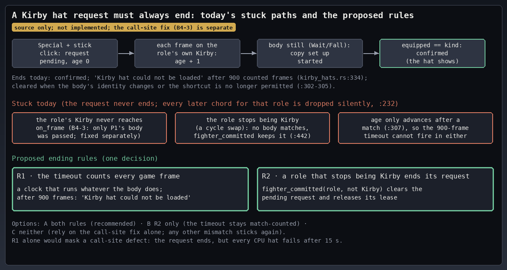

**Proposed ending rules:**
- **R1 · the timeout counts every game frame.** The age runs on a clock that advances whether or not the role's body
  matched, so after 900 frames the request always ends with "Kirby hat could not be loaded".
- **R2 · a role that stops being Kirby ends its request.** `fighter_committed(role, kind)` with a non-Kirby kind clears
  that role's pending request and releases its lease, as `clear_pending` already does.

**Options:**
1. **A: both rules (recommended).** Every request ends, whatever happens to the body. With the call-site fix in place,
   neither rule changes a request that is progressing normally.
2. **B: R2 only.** The swap case ends cleanly, but any other mismatch (a future call-site or accessor change) sticks
   again with no notice.
3. **C: neither.** Rely on the call-site fix alone; the swap case stays stuck.

R1 on its own, without the call-site fix, would only mask B4-3: the request would end, but every CPU hat would fail
after 15 s with "could not be loaded".

Sources: `src/runtime/roster/kirby_hats.rs` (TrainingRooms `p23/b4-pilot-refusal` `0254849`), the fork's
`src/kirby_hats.rs` and `src/training/character_specific/kirby.rs:37`, and `LANE-SURFACE-REPORT.md` "B4-3 root cause".
Picture: drawn for this decision (`tools/render_decisions.py d_hatrequest`).

### SIZE-BUDGET-RC · The Phase 2/3 candidate over the RC size ceiling — answered (2026-11-05)

`p23/candidate` `5023fac` counted 136,105 lines against the RC ceiling 136,069 (`size-budget.toml`, rustfmt-sloc4),
36 over: the rc10 menu merge (+30), the B4-1 pilot refusal (+16), the roster mark names (+8), the Kirby hat call site
(0). The rule is "cut code, or record a raise with approval". The options were a 36-line raise or a cut.

**Answered 2026-11-05 ~01:00Z by the operator: cut.** `p23/size-cut` `164a6c6` removes `src/model/macros/ui_anchor.rs`,
a carried file with no user (`docs/SIZE-PLAN.md` macros row 1, risk L), recorded as not carried in the pkg4 manifest
and ledger: 135,970, 99 under the ceiling. Gates pass with `size_budget`. The NROs are byte-identical to the
candidate's (LTO had dropped the module), so no Eden row re-runs. `size-budget.toml` is unchanged.

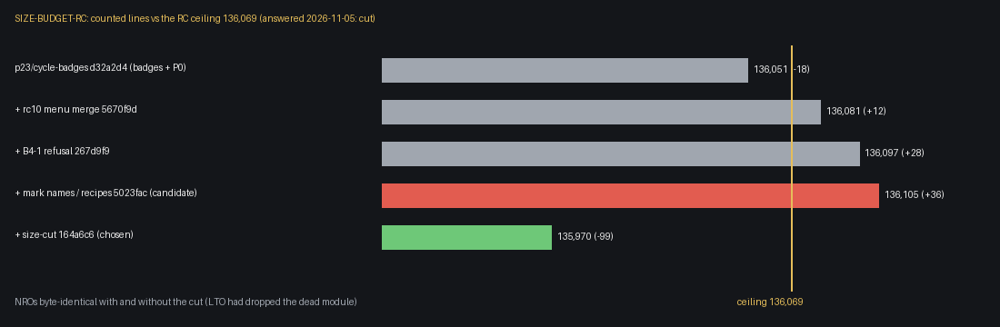

**rc.2, answered 2026-11-05 ~02:59Z by the operator:** "raise the size limit if needed, ship rc.2 when ready". rc.1
left 99 lines; the Solo-S/HAT-REQUEST-END work used 89 of them, and the PAUSE-HELPER (a) fix with its review fixes
(owner reuse, install hold, seam rows) goes over. The raise is appended to `size-budget.toml` as a new entry at the
exact counted size of the final rc.2 tree, with this approval in `approved_by`; earlier entries stay unchanged.

**rc.3, answered 2026-11-05 ~12:55Z by the operator: "Raise as needed".** The features are the frame strip (+484 at
`p23/input-viz` `d27221c`), change stage, menu navigation, the Mii editor bring-over, and the disc orbs if chosen.
- Each feature branch appends a `[[budget]]` entry at its exact counted size with this approval in `approved_by`.
- The rc.3 integration appends one entry at the exact count of the merged tree.
- No allowance or padding; earlier entries stay unchanged.

### SOLO-S-PLACEMENT · Where the Solo Popo "S" marks sit on the roster grid — answered (2026-11-05)

On `p23/candidate` the red P1 "S" (bottom-left) and the blue CPU "S" (bottom-right) on the Ice Climbers tile sit on
the tile's name label (Eden `tr-p23-primary-finalB3`, `04-grid-badges`).

**Answered 2026-11-05 ~01:00Z by the operator:** "for ice climbers the name doesn't show on the icon it instead shows
at the bottom. If we show the name below the icon it should not cover the name just the icon partially." So the marks
may overlap the icon's lower corners, never the name label. The fork shows names at the bottom of the screen, not on
the tiles; TrainingRooms keeps its per-tile names, and the marks move up off the label line.

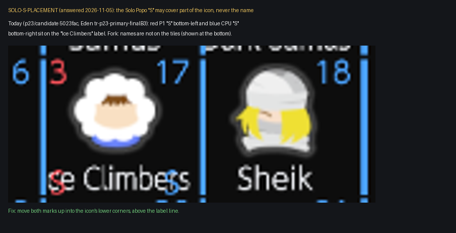

Picture: the Eden frame crop (today) with the rule; the after-fix frame follows on the Eden proof.

**After the fix (rc.2, `p23/rc2-ui-hats` `cc9495b`):** Eden `tr-p23-surface-rc2c` row `08-rc2-ic-solo` (02:52Z) shows
both marks at the icon's lower corners, above the label; "Ice Climbers" is fully readable for the Player and the CPU
list. The host test `the_solo_marks_never_cover_the_tile_name` checks every roster use in both console modes.

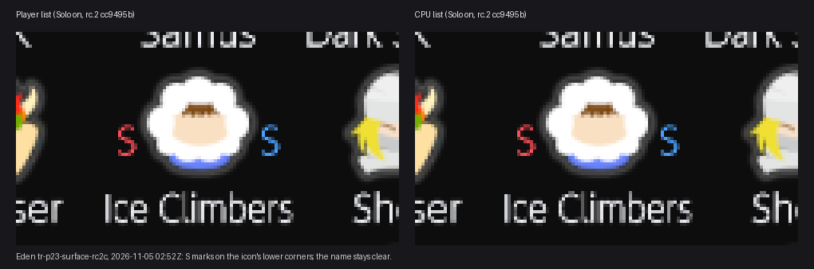

### HB-OWN-ORBS · How TrainingRooms draws its own hitbox orbs (Route A) — answered (2026-11-05)

**Answered 2026-11-05 ~13:4xZ by the operator: "go with discs for all".** This is option 1.
- Every fighter sphere (hurt, hit and grab) is drawn as the plugin's own disc, so none is refused.
- Projectiles (articles) keep Route B for now.
- The A/B picture `decisions/HB-OWN-ORBS-ab.png` shows the benefit: two Ridleys, with 22 of 55 refused every frame
  under Route B against 0 with discs.
- The diag-only prototype on `p23/hitbox-orbs` becomes the release route; the size raise is covered by
  SIZE-BUDGET-RC (rc.3, "Raise as needed").

The operator ordered the Route A research on 2026-11-05 ~03:05Z: "begin the hitbox research where we do our own orbs for
characters like ridley". The work runs in lane `tr-lane-hitbox`, branch `p23/hitbox-orbs`, and the report is
`artifacts/phase23/LANE-HITBOX-REPORT.md`.

**Today (Route B):** every sphere is a game `sys_shield` effect from the one shared effect system. Ridley's first frame
asks for 55 spheres (plus Steve's 19), and hb-04 saw 2 of them refused. The pool is shared with every game effect in the
scene.

**Routes studied (static, the owned 13.0.5 ELF):**
- **A1, a private effect system:** the game builds exactly one, with its own 64 MiB heap. A second one needs new GPU
  memory, draw and fence work on the render thread. Not safe.
- **A2, the game's debug draw:** dead. The shaders load, but no draw code uses them, and `sv_debug_draw` functions are
  `ret` stubs.
- **A3, raising the pool:** changes the game's own effects online. A workaround, rejected.
- **A4, feasible:** the plugin draws its own orbs as translucent discs in its own HUD layout. Each orb is placed from
  the fighter's bones and projected with the game's camera (`world_to_screen`). The orbs are never refused, and no game
  effect is used for fighters.

**The visible change:**
- the orbs are flat discs on top of the scene, with no depth hiding by the stage or the other fighter, instead of 3D
  glowing shield bubbles;
- up to one frame of lag while the camera moves (to be measured).

Tints stay as now.

**Options:**
1. **(recommended)** Own orbs for every fighter sphere: hit, hurt and grab. Projectiles keep Route B.
2. Own orbs for hurtboxes only. Hit and grab boxes stay 3D Route B spheres, a mixed look.
3. Keep Route B, and close Route A.

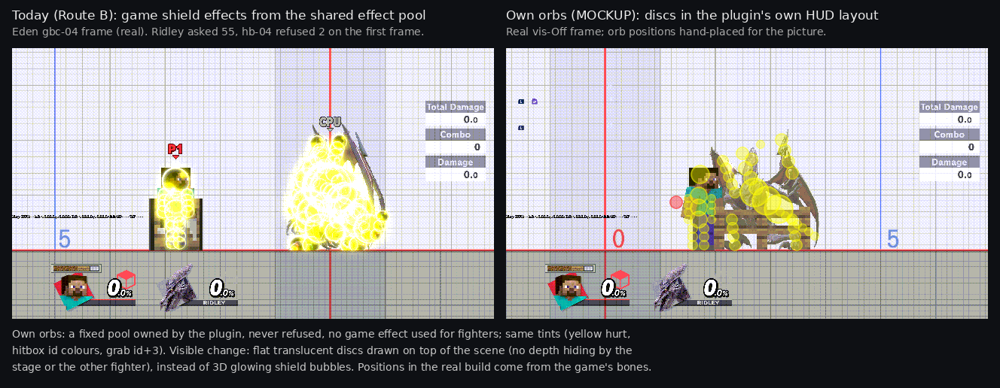

Picture: on the left a real Route B frame (Eden gbc-04); on the right a **mockup** with hand-placed orbs on a real
visualizer-Off frame.

A/B from real data (2026-11-05, Eden run `tr-p23-hitbox-ab2`, diag prototype on `p23/hitbox-orbs`):
[HB-OWN-ORBS-ab.png](decisions/HB-OWN-ORBS-ab.png) replaces the hand-placed mockup above.
Grab row redone on one frame (run `tr-p23-hitbox-ab3`, Training's frame-by-frame speed, both halves pass 17818). The
hurt discs missing in the first grab row were a capture lag, not a prototype bug: at 1 % speed during the side special
the screen trailed the game by ~4 frames, so that "orbs" shot showed a frame from before the switch. No fix needed.
New top section "Where today's spheres go missing" (run `tr-p23-hitbox-ab4`, one frozen frame): with two Ridleys, Route B
refuses 22 of P1 Ridley's 55 spheres on every pass (holds 33); the own orbs draw all 55. With Ridley + Steve (74) Route B
loses Steve's left-knee capsule (`kneel`) only on the first 2 passes after a cold request.

### INPUT-VIZ · A compact input display for combo timing — answered (2026-11-05)

**Answered 2026-11-05 ~11:4xZ by the operator: "go with option A for the input display".** The frame strip replaces
the clean-room port of the input display (SPEC-input-02). It is implemented on its own branch from `main` `36d7f46`,
and nothing ships until it passes gates and an Eden proof.

The operator asked on 2026-11-05: "in addition I'd like a mockup for a more compact, more intuitive version of the input
visualization the modpack has. Something that will help timing combos etc easier to visualize. This would supercede our
clean room port of that functionality".

**Today** (`specs/SPEC-input-02-input-display.md`, `src/model/input_display.rs`): the "Input Display" row (Off / Smash
Inputs / Raw Inputs / Status Only) and the "Group inputs by status" row draw a column of up to 15 rows on the left.
Each row shows stick directions, buttons, the frames held (up to 99) and optionally the status name. The column shows
how long an input was held, but not **when** it landed against what the two fighters were doing.

**Three options.** Each picture is a **mockup** over a real Eden Training frame (`tr-p23-surface-rc2d`, Steve vs Donkey
Kong); the frame numbers are **illustrative**, a plausible Steve jab → up tilt link.
- The words used in all three:
  - **link:** the frame the next hit landed, minus the opponent's first free frame. 0 or less is a true combo; above 0
    the opponent could act first (a drop).
  - **input:** the frame you pressed the follow-up, minus your own first actionable frame. Negative means buffered,
    positive means late.
  - **combo window:** the presses that would still have made a true combo.
- All three use our own shapes and colours: rectangles and the game font, as the log uses today.
- The pictures are drawn by `tools/render_input_viz.py`.

1. **(recommended) A · Frame strip.** A strip about 860 × 145 layout px at the top of the screen.
   - The last 60 frames as two lanes, P1 and the CPU. Each frame is coloured by state: startup, active, recovery,
     actionable, hitlag, hitstun, shieldstun.
   - P1's inputs sit above the lanes at the frame they landed, with the combo window under them.
   - Brackets mark the link gap and the frame advantage.
   - Three readouts: advantage, link and input.
   - A LAST row lists the most recent links.

   It answers "when did it land" directly and keeps a short history.
2. **B · Link cards.** A 320 px panel on the left with one card per exchange, the last four.
   - Each card shows the two inputs and the move names, TRUE or DROP with the link gap, your press against the combo
     window, and the frame advantage after.
   - There are no per-frame lanes. It is the easiest to read at a glance, but you can't see the frames themselves.
3. **C · Link ruler.** A 620 × 125 panel at the top for drilling one link.
   - A LINK ruler (≤ 0 green, > 0 red) and an INPUT ruler (the combo window in green).
   - The latest attempt is a pointer, and the last few are fading dots, so your consistency shows over repeats.
   - It is the most focused, but shows the least context.

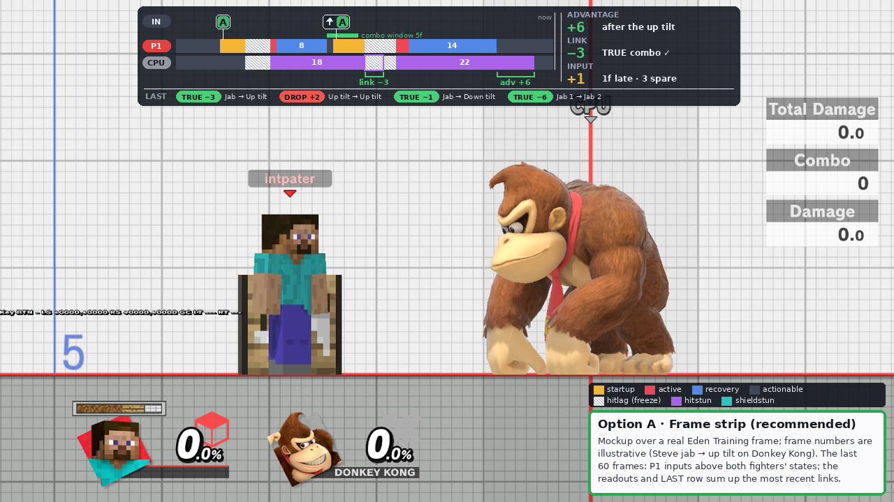

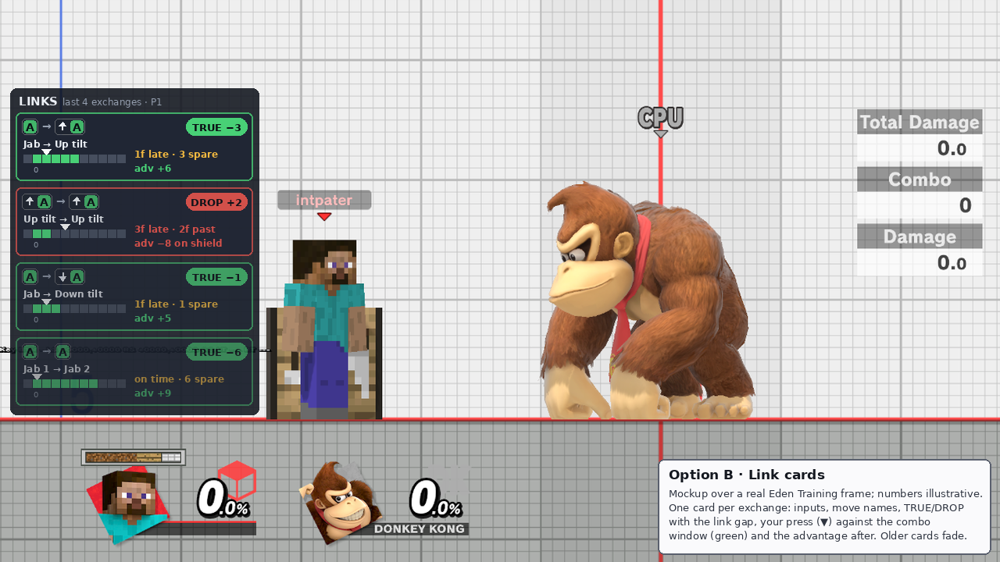

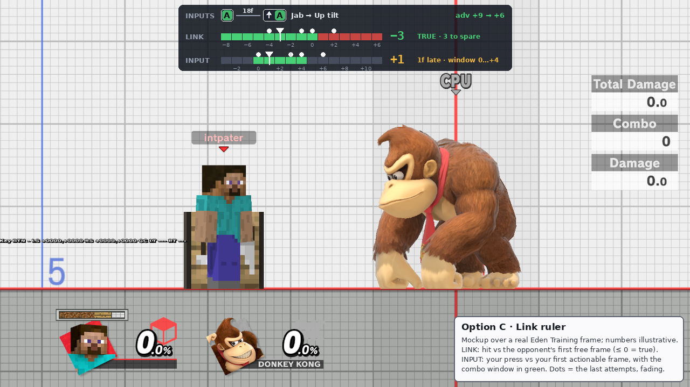

**Feasibility.** Line numbers are at `main` `36d7f46` (v0.2.0-rc.2); addresses are in the owned 13.0.5 `main`.

| Data | Today | Source |
| --- | --- | --- |
| P1 inputs per game frame, after input delay | read (the log) | `runtime/features/input_display.rs:55` `on_p1_poll`, from `input_delay.rs:124`; the stick bins and buttons are SPEC-input-02 §3.3–3.4 |
| Status kind, both fighters | read | `StatusModule::status_kind` `0x2087720` (`model/sites_pkg2.rs:14`, `runtime/game.rs:164`); classes in `model/cpu/status.rs:33` (hitstun), `:53` (shieldstun) |
| Actionable, both fighters | read when Frame Advantage is On | five transition terms (`0x208dd60`) or `CancelModule::is_enable_cancel` `0x2092860`: `runtime/features/cpu.rs:1440-1448`, `sites_pkg2.rs:29,48` |
| Frame advantage | computed, shown as a notice | `model/cpu/advantage.rs:63-112`, `cpu.rs:1451-1476`, `notices.rs:207` |
| Hitlag (freeze) | read for the CPU | `StopModule::is_stop` `0x20891f0` (`sites_pkg4.rs:9`, `game.rs:325`); frames left would be `StopModule::get_hit_stop_real_frame` `0x2089250`, not read today |
| Active frames, P1 (A only) | read by the hitbox lane | `AttackModule::is_attack` `0x1fd01c0` on 8 slots (`sites_hitbox.rs:19`, `model/hitbox.rs:24`, `game.rs:444`) |
| Hitstun left when the next hit lands (the link of a true combo) | **not read** | `WorkModule::get_float` `0x208db50` (`sites_pkg2.rs:35`) with the damage-reaction frame work id: the id isn't in our tree yet (look it up through `lua_const`, `game.rs:114-124`, or the constants crate) |
| Motion frame (startup labels) | read | `MotionModule::frame` `0x205cc70` (`sites_pkg2.rs:19`) |
| Move names (B, C, A's LAST row) | available | the engine-common move families in `model/p1/move_observer.rs:7-22` (Jab, tilts, smashes, aerials, specials); no per-fighter table |

- **Native reads per game frame.** About 24 calls for A: 2 × status, 2 × 6 for actionable, 2 × `is_stop`, and 8 ×
  `is_attack` on P1. B and C need about 16, because a hit is seen as the CPU entering hitlag.
  - Frame Advantage already makes 12 of these when it is On.
  - None of this needs a new hook. The P1 poll and the CPU frame callback already run every frame.
- **HUD.** Today's log is 271 panes (`model/ui/panes.rs:255-275`: 1 + 15 rows + 15 × 5 × 3 slot parts + 30 texts).
  - **A, about 110 panes:** each lane is drawn as runs of one state, one rectangle per run (up to 16 per lane), not one
    per frame. Add up to 8 input chips (glyph, arrow shaft, head and box), the window, 2 brackets, 9 readout texts and
    the 12-pane LAST row.
    - While anything moves, about 70 position, width or colour writes per UI tick.
    - When both fighters have been actionable with no input for a short while, the strip freezes on the last exchange
      and writes nothing.
    - Hitlag would be a light solid colour in game; the hatching is only in the mockup.
  - **B, about 70 panes:** 4 cards. It writes about 70 when an exchange ends and 4 alpha writes a frame while cards
    fade.
  - **C, about 50 panes:** the rulers are static, so it writes only when an exchange ends.
  - All three fit the layout builder's cloned stock panes and need no new textures (rectangles and the game font, as
    the log uses today).
- **What each keeps of today's display:**
  - **Smash inputs:** kept as the input chips in all three.
  - **Raw inputs:** kept as a setting in A only; B and C read moves, not raw buttons.
  - **Status grouping** ("Group inputs by status") and the **Status Only** mode: dropped. The state lanes (A) and move
    names (B, C) replace them.
  - **The 99-frame held count:** dropped. A can draw a hold bar after the chip instead.
  - **Menu:** "Input Display" becomes Off / On, with Raw as a sub-option for A. The 15-row column and its 271 panes go,
    and SPEC-input-02 is replaced by a new spec.
- **Not proven yet:**
  - All frame numbers in the pictures.
  - The hitstun-left read: its work id, and whether it counts through hitlag. Without it, a true combo shows TRUE but
    not its −N. Drops are measured exactly, because the opponent's free frames are seen.
  - Whether `actionable` marks the exact first actionable frame for every move. Frame Advantage relies on it, but it
    hasn't been checked against frame data.
  - Projectile hits are not active cells in A; only the fighter's own attack slots are.
  - With several CPUs or Ice Climbers, only the primary CPU is measured.
  - The pane and write counts are estimates, not measurements.

**Recommendation:** A, the frame strip, with B's history as its LAST row (as drawn). Nothing is implemented until the
operator picks.

### COMBO-HELPER · Record a combo and have a helper grade your attempts — answered (2026-11-05)

**Answered 2026-11-05 ~13:10Z by the operator: "yep those mockups look good. go with A".**
- A is the combo bar under the frame strip, with the Recording page's "Combos" group and the name taken on the Switch
  keyboard, as in the mockups below.
- It is implemented after the frame strip (INPUT-VIZ A) lands, because it reuses the strip's per-link measurements.

The operator asked on 2026-11-05: "also not sure if this is posible but adding a new section under recording where you
can record a combo and give it an optional name and enable "combo helper" which tells you whether you got the combo or
how off you were. for example doing nair loops with pikachu. a mockup for that would be nice as well. not sure how
involved it would be."

**Short answer: it is possible, and it builds on the frame strip (INPUT-VIZ A).** The strip already measures every
link: the hit, the opponent's free frame, your first actionable frame and your press. The helper adds three things:
a saved reference, a matcher that compares each attempt with it link by link, and a small display. It needs no new
hook and no new native site.

**Today** (line numbers at `main` `36d7f46`, v0.2.0-rc.2):
- **Recording page:** the Recording, Playback and Named macros groups (`src/model/menu/table.rs:302-333`).
- **Named recordings:** `Named library` and `Save slot to library...` open the carried named-macro panel
  (`src/runtime/ui/external.rs:20-28`).
  - Its files are `sd:/ultimate/TrainingRooms/macros/<id>.json`, plus `selected.txt` for the selection
    (`src/runtime/macros/named_macros.rs:420-432`).
  - It runs on the generic `model::store::Store`: path-safe ids, atomic writes, a size cap
    (`src/model/macros/library.rs:1-48`). The setup library is a second user of the same store.
- **Names:** the Switch's own keyboard (`runtime::mii::native_keyboard::request`, `named_macros.rs:337`), at most 48
  characters (`MAX_NAME_CHARS`, `src/model/macros/recording.rs:23`).
- **The frame strip** (`SPEC-input-06`, in progress at `c02cbb3`) emits one `frame_strip::Link` per follow-up:
  - fields: verdict, hit, free frame, `A₁`, press, input, window, and the two moves (`src/model/frame_strip.rs:214`);
  - plus every new press as a `Press` (`:187`).

**The words.** These are the strip's own: **link** (≤ 0 is a true combo), **input** and **combo window**. Two more:
- **Reference:** the saved combo, with the recorded inputs and the strip's measurements of each link when it was
  recorded.
- **Offset:** a press's frame from your first actionable frame `A₁`, minus the same press in the reference.
  Positive means later than recorded.

**The menu.** Both pictures are mockups over the real rc.1 Recording page; values are illustrative.
- **New group "Combos" on the Recording page:**
  - *Name (optional)*: A opens the Switch's on-screen keyboard (operator 2026-11-05: "the name would use the
    keyboard"). The typed name is used by the next *Save last combo* and then appears in *Saved combos*. Left empty,
    the combo is saved as "Combo N".
  - *Save last combo...*: keeps the hits since both fighters could last act (the strip's exchange), under that name.
  - *Saved combos*: a list. A sets the target, X renames it with the same keyboard, Y deletes it.
  - *Combo helper*: On / Off.
  - *Target combo*: the saved combo to measure against.
  - *On-time tolerance*: ±0 / ±1 / ±2 frames.
  - *After an attempt*: Keep playing, or Load save state (retry from the same spot and percent).
- Recording a combo needs no arming: do it once, and if it came out right, save it.

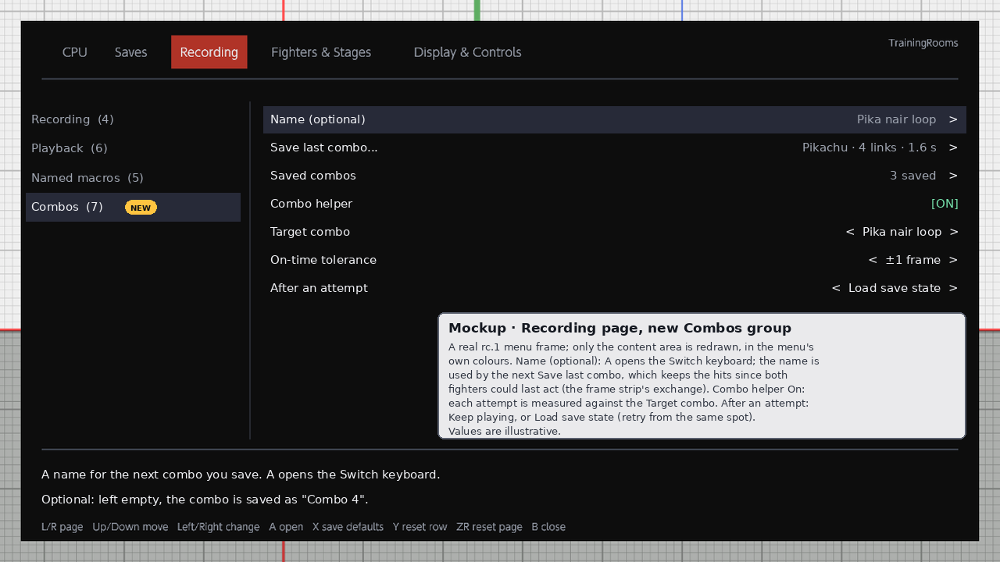

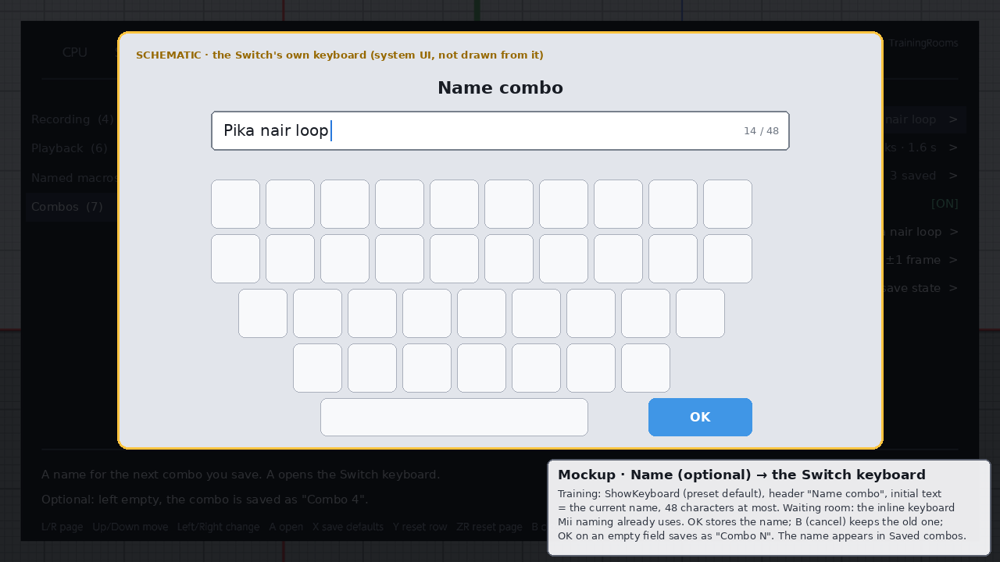

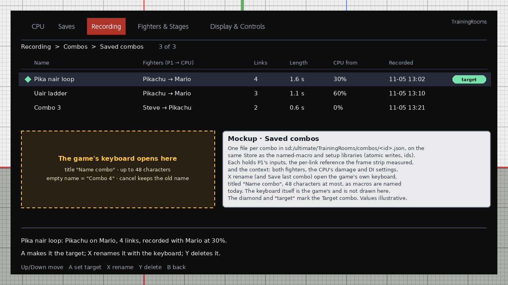

The keyboard picture is a labelled schematic. The keyboard is the Switch's own UI and is not drawn from it; the
picture shows what TrainingRooms passes in (the header "Name combo", the current name, the 48-character limit) and
what comes back.

**Two in-game layouts.** Both are over a real Eden Training frame (`p4zc-rc9`). It is the only Eden frame with Pikachu
on screen, and there Pikachu is the CPU and P1 is Steve. The numbers illustrate a P1 Pikachu short-hop nair loop: five
nairs, four links, with link 3 dropped because the jump came 2 frames late. Per link, each layout shows whether it hit,
TRUE −N or DROP +N, and each press against the recording. Under that, the attempt result ("3 of 4 links true · link 3
dropped by 1f: jump 2f late") and the last 8 attempts.
1. **(recommended) A · Combo bar under the strip.**
   - An 864 × 132 bar right under the frame strip, one cell per link (four at a time).
   - In each cell, a timing ruler shows your jump (▼) against the recorded one (□), with the jumps that still combo in
     green.
   - It reads as part of the strip and keeps your eyes on one place.
   - It needs the strip On, and the two together reach about 290 px from the top. High juggles go behind them.
2. **B · Link ladder.**
   - A 392 px panel on the left, one row per link.
   - Each row has one timeline with both presses of the follow-up (jump and nair), recorded and yours.
   - It shows more detail per press, and it works with the strip Off.
   - It covers the left third of the stage.

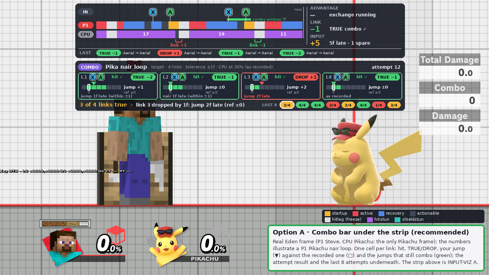

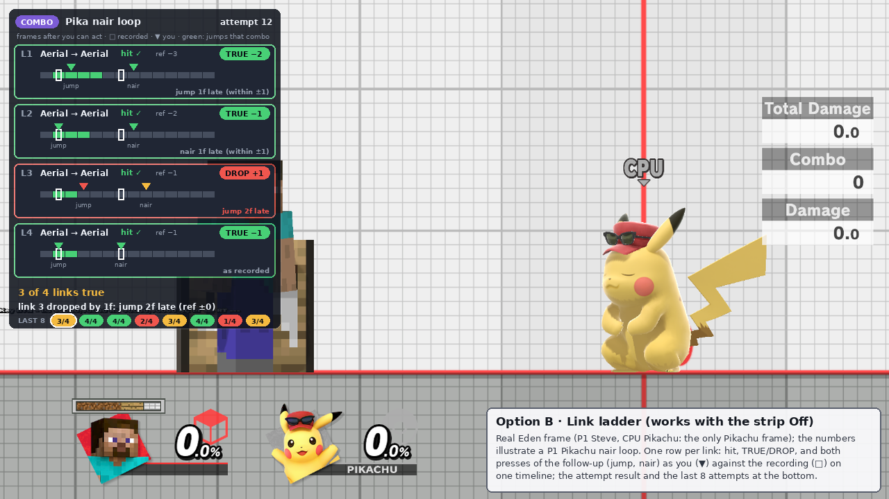

**Feasibility.**
- **The reference** is one record per combo:
  - P1's mapped inputs per frame (the existing `InputFrame`), up to 600 frames;
  - per link, from the strip's `Link`: the moves, the hit frame, `A₁`, the link value and the window;
  - per link, the presses between the two hits, each as button, stick bin and frame from `A₁`;
  - the context: both fighter kinds, the CPU's damage at the first hit, and a fingerprint of the CPU settings that
    move it (DI, SDI, air dodge, mash).
- **Matching an attempt:**
  - **Start:** with the helper On and a target set, an attempt starts on the first hit of a new exchange whose move and
    first press match the reference's first link. With "Load save state" it starts on the first hit after the load.
  - **Each link** ends on the strip's next `Link` event. Hits inside one action are never links (the strip's rule),
    so Pikachu's multi-hit nair counts once.
    - The presses of the follow-up are matched in order with the reference's, by button class and stick bin.
    - An extra or different press is a **wrong move**, e.g. a fair (stick forward) where the reference has a nair.
    - A press that never came is **missing**.
  - **Completed:** all reference links have hit: "N of M links true".
  - **Stopped:** the exchange ends (both fighters actionable, no hit) before the last link: "stopped at link k".
  - **Cleared:** a save-state load, a scene change or a hot swap clears the attempt (the strip's rules).
  - **History:** the last 8 attempts, the clean streak and the best are kept until the target changes.
- **"How off":**
  - each press's offset against the reference (within the tolerance counts as on time);
  - each link's value against the recorded one (TRUE −1 against −3) and the spare;
  - the gap between presses (jump to nair);
  - a wrong move or a missing press.
  - The summary names the first link that was not true, and its largest offset.
- **Storage (recommended): a combo library of its own on the same `Store`.**
  - The files are `sd:/ultimate/TrainingRooms/combos/<id>.json` and `combos/selected.txt`, for the target.
  - Rename and delete work as in the named library.
  - Not inside the named-macro library:
    - Its records are CPU playback macros (placement, Mii identity, the CPU's *Named Library* source would list
      them).
    - A combo field there would need a schema bump, which older readers refuse.
- **The name, on the Switch keyboard.** This reuses the plugin's keyboard path: the one named macros are named with,
  whose inline adapter the Mii editor shares (`src/runtime/mii/native_keyboard.rs`,
  `native_keyboard/inline_keyboard.rs`; lines at `main` `36d7f46`).
  - **Which keyboard:**
    - In Training, `request(id, "Name combo", current name)` opens the full-screen system keyboard: `ShowKeyboard`
      with `make_preset_default`, the header text (64 UTF-16 units at most) and the initial text (`:75`, `:327-373`).
    - In waiting-room practice, `request_inline(id, current name, cursor)` uses the inline keyboard with the
      macro-name limit (`:89`). That is the transport waiting naming already uses there (`:5-6`).
    - Only one keyboard is ever open: one shared lease across both transports and the Mii editor
      (`inline_keyboard.rs:21-29`).
  - **How it opens from our menu:**
    - *Name (optional)* and the list's X are editor rows handled at run time, as *Named library* is
      (`src/runtime/ui/external.rs:20-28`).
    - A queues the request only when `native_keyboard::busy()` is false (`:116`) and no macro naming is pending.
    - The keyboard opens at the UI boundary where `service` already runs (`named_macros::service_keyboard`, called
      from `src/runtime/macros/port.rs:152`).
  - **The result:**
    - `Confirmed(name)`: the name is trimmed and kept.
    - An empty name gives the default "Combo N", the lowest unused number.
    - `Cancelled` (B): the previous name stays, or none.
    - `Failed`: a notice ("The keyboard could not open"), and the name is unchanged.
    - `Interrupted` (a scene change): the name is unchanged.
    - The names are never written to the diagnostics log, as today (`native_keyboard.rs:278`).
  - **Length and storage:**
    - The limit is 48 characters, the same `MAX_NAME_CHARS` as macros, setups and Mii drafts (`native_keyboard.rs:26`,
      `src/model/macros/recording.rs:23`). The keyboard itself is capped at 48 (`write_max_length`).
    - The name is the `name` field of `combos/<id>.json`. The file's id is the store's path-safe stem and never
      changes on a rename, so a rename rewrites only that field (the store's atomic overwrite).
    - Until the next save, the draft name lives in the menu state, not in `settings.json`.
  - **What it needs beyond today's path:**
    - **Routing completions by owner.** `poll()` hands out every completion (`native_keyboard.rs:108`), and today's
      only caller, `named_macros::service_keyboard`, drops one whose id is not its own (`named_macros.rs:567-573`). A
      combo name's result would be lost. The fix is a small dispatcher: ids carry their owner (e.g. the high byte),
      and `service_keyboard` passes the others on, or the poll moves into a shared keyboard service.
    - **An owner for the combo-name job:** its id, what it names (the draft or a saved combo's id), and a check that
      the combo still exists when the result arrives.
    - **The menu while the keyboard is up:** in Training `ShowKeyboard` is synchronous and full screen, so the menu
      simply waits. In the waiting room the inline keyboard runs alongside, so the menu ignores input until the
      result arrives.
- **Native reads:** no new hook and no new site. The helper uses the strip's samples and P1's inputs. Two optional
  extra reads, both on existing sites:
  - P1's `MotionModule::motion_kind` (`src/model/sites_pkg2.rs:39`, read today for the CPU only), to tell aerials
    apart beyond the input chip. All aerials are one `Move` family.
  - The CPU's damage (`damage_of`, `sites_pkg2.rs:381`), for the context check.
- **HUD:** A or B is about 90 panes each.
  - With the strip's ~120, that is about 210, under the input log's 271 that the strip removes.
  - The panes are written only when a link or an attempt resolves, not every frame.
  - The new panes go into both layout recipes, and the size budget is checked.
- **Risks:**
  - **DI, SDI, percent and weight change the links.** The record keeps the context. When an attempt's context differs,
    the bar says so, e.g. "CPU at 45% (recorded 30%)". TRUE and DROP stay correct, because they are measured live;
    only the "against the recording" offsets lose meaning. "After an attempt: Load save state" drills from the same
    spot.
  - **Pikachu's nair:**
    - Its landing lag sets `A₁`. The strip's actionable test has not been checked against frame data yet.
    - The nair is multi-hit, so the link runs from its last hit to the next nair's first hit.
  - **Jump-cancelled aerials and the strip's INPUT readout.** The strip measures the aerial's press, because the
    action that hits starts with the aerial. So a perfect loop reads "+5, 5f late" on the strip (as in picture A).
    The helper's per-press comparison is what shows the jump's timing. The strip could learn that a jump starts an
    action.
  - **Hitstun left (`r`, `K`) is not proven yet** (SPEC-input-06 §4). Until it is, TRUE links have no number, in the
    reference too.
  - **The keyboard's completions** are taken by `named_macros` today. A second owner needs the routing described
    under *The name, on the Switch keyboard*.
  - **Limits it shares with the strip:** primary CPU only; projectile hits count as hits but have no active cells.

**Steps, in order:**
1. **The spec** (`SPEC-input-07`, combo helper) and **the pure model** (`model::combo`):
   - the reference type, and the matcher fed with `frame_strip::Link` and `Press`;
   - host tests: a clean nair loop, a late jump, a miss, a wrong move, a multi-hit nair, and a clear on a save-state
     load.
2. **The store:** the `ComboRecording` record and the `combos/` library (validation, rename, delete, `selected.txt`),
   with host tests.
3. **The menu:**
   - the Combos rows (`table.rs`, `factory.rs`: `combo_helper`, `combo_tolerance`, `combo_after`);
   - *Name (optional)* and the Saved combos screen, both naming through the Switch keyboard: the combo-name owner
    and the completion routing by owner;
   - core02 menu tests.
4. **Capture:** a fixed ring of the current exchange, kept in the strip's per-frame step: P1 inputs (600) and links
   (16). *Save last combo* builds the record on the worker thread, not in a hook.
5. **The helper at run time:** the matcher steps on P1's entry callback after the strip, and publishes a snapshot for
   the UI.
6. **The HUD:** the chosen layout's panes, the recipes, the pane plan with writes on change, and the size budget.
7. **After an attempt:** call the existing save-state load.
8. **Eden rows:**
   - record a nair loop and save it under a name;
   - three attempts: clean, a late jump, a missed link;
   - rename, delete, and read it back from the file.

Steps 1–3 can run in parallel with the frame strip work: they need only the shape of `frame_strip::Link` and `Press`
(`c02cbb3`). Steps 4–8 need the strip merged.

**Not proven yet:**
- every number in the pictures, including the nair-loop frame data;
- whether the strip marks Pikachu actionable in the air between the jump and the nair;
- the keyboard with a second owner;
- the pane counts.

**Recommendation:** A, the combo bar under the strip, with the Combos group and its own `combos/` library as drawn.
Nothing is implemented until the operator picks.

### SETTINGS-PERSIST · No accidental page reset; an explicit "Reset page to defaults" — answered (2026-11-05)

**The cause (rc.2 on the operator's console):** "Player Swapping" kept turning Off.
- On a page list, ZR is an instant `reset_page()` (`src/model/menu/mod.rs:804`, `:919-927`), which restores the whole
  page from `defaults_menu`.
- The card's `settings.json` has `menu.trio_practice = [1, 0]` (On) and `defaults_menu.trio_practice = [0, 1]` (Off);
  the defaults were imported from the fork.
- The card's diagnostics show a refused P1 cycle, "roster cycle is off" (#70).
- ZR means "switch role" inside the Character Cycles grid, so the page reset is easy to hit by accident. No other code
  writes the setting.

**Answered 2026-11-05 ~13:2xZ by the operator:** "a setting should persist once it's changed and have a "reset to
defaults" for a page if ever needed."
- ZR on a page list no longer resets anything.
- Each page gets an explicit "Reset page to defaults" row with A/B confirmation, and a page reset is logged.
- Y (reset the focused row) is unchanged.
- It is implemented with the menu navigation work on `p23/menu-nav`.

### DEFERRED-LIST · What of the deferred list (`docs/ROADMAP.md`) gets built — answered (2026-11-05)

**Asked:** after rc.5, is everything implemented? Answer: one ordered item had never shipped (Lobby Items, N11), and
the 2026-11-03 deferred list was still open. Each item was explained to the operator.

**Answered 2026-11-05 (~18:1xZ and ~18:3xZ) by the operator**, verbatim:
- "the switch p1 to a combo's recorded fighter should follow the same logic that the replay macro uses where it
  prompts the user to swap and they can say yes or no. Yes I want the lobby items off switch. Ten hot fighters plus
  five hot hats and named-macro library extensions I'd like as well."
- "do 2, 3, 5 (and also I'd like to not have to start a swap in order to start loading. it should load as soon as you
  enter training), drop 4, 7, once those are done do 1. if 1 can also be done in parallel to the other tasks its fine
  to work on it as well."

| Item | Decision |
| --- | --- |
| Combo: switch P1 to the recorded fighter | **Build.** The same Switch/Keep prompt as a named macro recorded on another fighter; Switch loads P1's fighter, Keep practises on the current one. |
| Lobby Items (N11, ordered 2026-11-03) | **Build** (confirmed). |
| Ten hot fighters plus five hot hats | **Build.** A separate hat budget; up to 15 preloaded bodies, measured in Eden first. |
| Loading starts on entering Training | **Build (new).** Preloading starts when Training loads, not at the first swap. |
| Named-macro library extensions (F8 design C) | **Covered by rc.5** (`p23/replay-window`: Setup library, Edit placement, Replay window, a named macro from another fighter with Switch/Keep). The ROADMAP row goes. |
| 2 · Saved/replay Mii bust provider (Q15) | **Build.** Replay Miis get a bust in the Mii lists. |
| 3 · Frame/status text backgrounds (UI22) | **Build.** Backing plates behind the plugin's notices. |
| 5 · Latency work (F6) | **Build.** The first switch to a fighter that is not preloaded yet must not hitch (first-use setup off the game thread or warmed at boot). |
| 7 · Timer-recording truncation | **Build:** root cause and fix. |
| 1 · F9 helper promotion, fixed seats, hat/item cutover | **Build after the items above.** Design and native facts may start in parallel; its code waits for the hot-fighter work (both use the parked CPU entries 2/3). |
| 4 · State-destructor alternative | **Dropped.** |
| Remaining feature/edge-case inventory | Not chosen. |

### Q15-BUSTS · Busts for replay and saved Miis in the menu's lists — answered (2026-11-05)

**Research** (Grok, `artifacts/phase23/LANE-GROK-MII-BUSTS-REPORT.md`): the game makes a Mii list picture only by
writing the CharInfo into its live selector (slot 26) and publishing it (`main+0x3759500`). That is the
`set_rep_mii_icon` path of `CharaMakeSelectDataScene`.
- `main`, `sdk` and `subsdk0` have no CharInfo-to-texture call: 780 `nn::mii` symbols, all accessors and databases.
- The HUD portrait needs a loaded fighter, a helper and live HUD writes.
- The menu can only bind a texture the game has already built.

**Asked:** A, text (no writes); B, borrow selector slot 26 and restore it (offered also as Training-only); C, the HUD
portrait (not workable); or capture-and-cache, which needs a new texture-upload capability.

**Answered 2026-11-05 ~20:4xZ by the operator: "just keep the text".** Mii rows stay text, and Q15's "bust where one
exists" is closed as not built.

### HOT-SLOTS-CEILING · Ten fighters plus five hats against Training's helper entries — answered (2026-11-05)

**Measured:** run `tr-p23-hot-measure-1`, Yoga, rc.4 release NRO `031f1eae`, 26 PASS, 0 Unmapped
(`artifacts/phase23/LANE-HOT-SLOTS-REPORT.md` §7).
- The pool is not the limit: capacity 24, minus the 6 reserved, leaves 18 ≥ 15.
- **A hat needs a whole helper entry.** The one hat that loaded was a count-1 install on a helper entry; no
  copy-package load was seen.
- Training has six helper entries: 2, 3, 4, 5, 6 and 7. F9's fixed seats keep 2 and 3 for the next CPUs, which leaves
  4 for hats.
- **Memory:** a 3285 MiB budget. About 2482 MiB is used with two fighters, about 66 MiB per extra body (an estimate),
  and the peak seen was 3204 MiB. Ten fighters plus four hats come to about 3340 MiB, so the per-kind guard will refuse
  some heavy kinds, with a notice.

**Asked:**
- **A.** 10 + 4: simple, with no conflict with F9. A fifth hat fits only when its kind is already hot.
- **B.** 10 + 5 while there is one CPU: the fifth hat borrows entry 3 and unloads, going back to slow loading, when No.
  of CPUs is raised. A more complex F9.
- In both, the memory guard decides heavy cases, with an on-screen notice, never silently.

**Answered 2026-11-05 ~20:4xZ by the operator: "B".**
- Hats use entries 7, 6, 5 and 4 first. A fifth hat may take entry 3 only while the native CPU count is 1.
- Raising the count retires that hat before the game activates entry 3. F9's promotion then takes the seat.
- The ordering contract is in the hot-slots report §3.5 and the F9 design (`LANE-GROK-F9-REPORT.md`).

**Follow-up, answered 2026-11-05 ~21:3xZ by the operator: "1".**
- **The problem:** a pause close that raises No. of CPUs from 1 straight to 3 activates entry 3 in that same close.
  The plugin has no code at the count change, and a Reload started there races activation (the s6-07 crash), so
  the borrowed hat can't be retired first.
- **Options asked:**
  - (1) accept and correct: CPU 3 starts as the hat's fighter, labelled correctly through F9's promote path, then is
    swapped to the seat's member with a normal load;
  - (2) return the fifth hat at every pause open, plus a hook holding activation 1–6 s;
  - (3) back to 10 + 4.
- **Chosen: (1).** There is no activation hold and no hook at the count change, and the borrowed hat stays through
  ordinary pauses. A raise from 1 to 2 still retires the borrow before entry 3 can activate.

### RESTRICTIONS-RC5 · The refusal strings added since rc.3 — approved (2026-11-05)

The new gate (playbook `0f0f533`, fixed `2276f7e`) flagged four product strings added since `v0.2.0-rc.3`:
- "{label} - unavailable" (a greyed Mii tile);
- "Preview fighter is not available";
- "Recorded Mii metadata is unavailable";
- "Replay Mii loading is unavailable in this build".

All four are carried fork behaviour that reports missing data or a missing capability.

**Approved 2026-11-05 ~21:3xZ by the operator: "approve all four".** They are registered in `docs/RESTRICTIONS.md` in
rc.5.

**Later the same evening:**
- **~21:58Z, "yes to both":** approved the three hot-slots status strings ("waiting for memory", "waiting for pool
  space", "N failed, N waiting for …"), for `p23/hot-slots`.
- **~22:13Z, "yes to both":** the widened gate (playbook `cd605af`) found two more. The operator approved:
  - "Wait for the practice fighters to finish loading";
  - "Combos work in Training", **for rc.5 only**. The operator asked "and it will be enabled in the lobby as well
    right?"; rc.6 enables combos in lobby practice (`p23/combos-lobby`) and removes the limit.
- The same evening, the operator ordered rc.5 published once its test session passes, with no separate rc.4 release.
- **~23:0xZ, "A": combo naming in online lobbies.**
  - In an online waiting room the Switch keyboard is not shown safe to open, so a saved combo keeps the default "Combo N"
    name, and the user renames it later in Training.
  - Local-wireless rooms and Training keep the keyboard.
  - The rejected option was to prove the keyboard safe with a two-console online room first.
  - Registered as `combo-name-online-default` (`p23/combos-lobby`).

### RECORDING-REDESIGN · One system for record, playback, replay to macro and combo from macro — revision 1 for review (2026-11-06)

**The operator (~23:3xZ):** "the macro and input playback is a bit confusing and scattered as it is today … I think we
need to simplify the logic". The ask:
- Record, Playback, Replay to macro and Combo from macro;
- up to 5 playbacks and 5 combos in memory, under one menu;
- every macro named and saved as a file;
- one active macro for the player and one for the CPU, and one combo hot for the player;
- one shortcut for playback on P1, one for the CPU, and one for a tabbed scrollable pop-up (Player / CPU) that picks
  the active macros and the combo to drill, with a cancel;
- the pop-up shortcut supersedes "this button for this slot".

Earlier: convert macro to combo, and crop, as separate options on a particular macro or combo.

**Answered ~23:5xZ:**
- One Record shortcut follows the pop-up's tab.
- Combo from macro reuses the replay-to-macro "snap".
- Every recording remembers its start state.
- One Recording page.
- The pop-up has a loop control: X cycles ∞ / 1 / 2 / … (configurable in the INI), with a repeat indicator.
- The pop-up has page up/down.
- Hot slots are automatic (most recent first), with pin in the menu and the pop-up; pinned items go to the top.
- The heap and fighter-mismatch risks are noted.
- **The redesign goes into rc.5** ("we can wait longer and get it right the first time").
- The Source setting goes away, so the named-macro Switch issue (rw-01) is resolved by the redesign.

**Revision 1** is [RECORDING-REDESIGN.md](decisions/RECORDING-REDESIGN.md): every screen, every option, and the picture next to it. Nothing is built yet.

Decided: one minute of a hot macro stays resident; a new recording takes a hot slot even when all five are pinned; the loop counts are ∞, 1, 2, 3, 5, 10; Player 1 and the CPU may play together; save states are named files you bind to Save and Load; a chain on a save starts its macro when that save loads.

**Answered 2026-11-06 ~01:0xZ:** "Respawn should be moved to the stage options. Q3 yes link (A). Redraft with those
answers for my review".
- A recording's start is a named save-state file that the macro links to by id. The option rejected was embedding it.
- The "Respawn on platform" row (formerly "Respawn invincibility") moves from Saves › Save states to Fighters & Stages ›
  Stages (`p23/respawn-label`).
- Revision 2 was published as `c3e10ab`.

**Answered 2026-11-06 ~01:2xZ, on revision 2:** "1. Yes 2. Yes a new section under both 3. That message looks fine".
- Save states have five hot, with pins, as macros do.
- Save states are a section under both roles. The rejected alternative was a third "Saves" tab.
- The notice "No start save. This macro plays from where the fighters are." is approved (a restriction string).

**New in the same message:**
- **A chain of macros:** "when a save state is chained to a macro that macro is numbered kind of like in our character
  cycles and you can select multiple macros to automatically play one after the other".
- **Conversions:** "combos for the combo helper can also be chained together in what we will call a conversion so that
  [you] can practice combos individually and also chaining them together to get feedback".

Revision 3 is in progress.

**Revision 2** is the same document, updated. The start save is a file named "<macro name> · start" and the macro stores its id. Renaming that file keeps the link. The sentence for a deleted start save is proposed and not approved. Respawn on platform is drawn under Fighters & Stages › Stages. The pin is a tilted thumbtack. Save states stay a section on both role tabs; a third tab named Saves is the other option. Hot save states remain open.

**Revision 3** is the same document, updated. Hot saves are five, with the same pin and newest rules. The third Saves tab is rejected. The sentence "No start save. This macro plays from where the fighters are." is approved as `macro-start-save-missing`. A save's chain is a numbered list of macros, and a conversion is a numbered list of combos. The remaining choices, each with a recommendation, are in that document.

Revision 4 (by the primary's spec): the same document, redrawn after the operator's 2026-11-06 note. The link diagram comes first: four kinds of file, the four links, and how each is made. The pop-up is one big window with the groups stacked and a Links panel for the row under the cursor. Five step-by-step strips show how each link is made. The loop is only in the MACROS header and on a chained save's Links panel, drawn from the Material Symbols SVG (Apache-2.0, `docs/decisions/icons/`). The conversion bar is at the top, under the frame strip. ZL / ZR jump between groups.

**Answered 2026-11-06 ~03:0xZ, on revision 4:** "getting closer. I like all the content and imagery in this version but
it's a bit busy and needs to be broken up. Keeping the cpu/player view let's add two tabs "save states & macros" and
"combos and conversions" since those go logically together. Break it up like that. The thumbtack, link chip and loop
chips look good. if it's also possible to have the two sections within a tab scroll independently that would be
helpful. combos, macros, and save states will be recorded with specific characters but that's only "information" that
will sometimes prompt to switch to a character. I may record a nair loop with pikachu but practice the button presses
with palutena. the reason is sometimes characters basically have the same mechanics and so they can be reused if that
makes sense. It's playing back inputs at the end of the day." Also: "share the link for the new draft and questions
inline where applicable".
- **Decided:**
  - Keep every piece of revision 4's content and imagery. The thumbtack, the link chip and the loop chips are approved.
  - Keep the Player / CPU role view.
  - Under it, add two tabs: **Save states & Macros** and **Combos & Conversions**.
  - The two sections inside a tab scroll independently.
- **The recorded fighter is information, never a filter or a block.**
  - A macro, combo, conversion or save state may be used on any fighter. Example: a nair loop recorded on Pikachu,
    practised on Palutena.
  - A mismatch may prompt the existing Switch / Keep, and Keep plays the inputs on the current fighter.
  - This answers revision 4's question about conversions mixing fighters: they may.
- **Revision 5** goes to Grok, with a Keep list. Open questions sit inline, next to the picture they concern.

**Revision 5** is the same document, updated. Two tabs sit under the role toggle: Save states & Macros, and Combos & Conversions. CPU has only the first. The two sections scroll on their own. The pictures put them side by side, and one stacked picture keeps the Links panel as the other option. A focused row's links show as numbers and chips on the other column, and the remaining lines sit in a strip above the footer. Recorded on is plain information. A Pikachu macro practised on Palutena raises Switch / Keep, and Keep plays the inputs. The Recording page uses the same split. Q1–Q11 sit next to the pictures they concern. The link diagram, legend, icons, strips, conversion bar, and action screens stay.

**Revision 5.1** is the same document. The scrolled pop-up keeps the save pop-up's window. Section headers stay put while whole rows scroll, and each section keeps its scrollbar. The Switch / Keep picture uses the existing Fighter Mismatch words. This frame is Steve and Villager, so the prompt names Villager. The conversion strip says "Drilling now."

### RECORDING-REDESIGN answers (operator 2026-11-06)

**The operator, verbatim:**

> drop pins and make the hot five the most recently used:
> Q1: A
> Q3: A
> Q4: A
> Q5: A
> Q6: A
> Q7: A
> Q8: start from the beginning of the chain but the chain itself isn't necessarily true. this is more for drilling
> things one after another. the combo itself also isn't necessarily true if that makes sense
> Q9: A
> Q11: A

Earlier the same day, on pins: "Are pins even helping with anything? they seem kind of redundant and useless".

**Decided in revision 6** ([RECORDING-REDESIGN.md](decisions/RECORDING-REDESIGN.md)):
- Q10: the two sections of a tab are stacked, each with its own scroll, with the Links panel on the right.
- Q2: a save state is bound under a role, Player or CPU, and that role plays its whole chain when the Load chord runs it. A macro's recorded role is information only.
- One bound save at a time, carrying its role. The save list is shared by both roles.
- No chord for combos or conversions. Selecting one (A, Drill) makes it the drill.
- Start save On / Off on a macro, default On. Off plays the macro from where the fighters are and keeps the link.
- A macro without a start save is normal: its Play chord plays it from where the fighters are. Replays and the old slots have none.

**Decided in revision 7** (the same document, now the implementation spec):
- Pins are dropped. Y is unused on these screens.
- The hot five of each kind are the five most recently used, the most recent first. Used means selected (bound or set active), played, drilled or recorded. When a sixth is used, the least recently used leaves the outline and stays on the card.
- Q1, Q3, Q4, Q5, Q6, Q7, Q9 and Q11: A. Q6's hot conversions follow the most-recently-used rule.
- Q8, the operator's own answer: a drop sends you back to combo 1 of the conversion, the streak to 0, and best is kept. Neither the conversion nor a combo has to be a true combo.
- The combo helper's grading changes: "clean" drops the TRUE condition (`src/model/combo.rs`, `Grade::clean`), for a combo drilled alone and for a conversion. A step counts when its recorded presses are there, with the same direction, in order and within the tolerance. TRUE stays on the bar as information.
- Proposed, not yet confirmed, and drawn for review: a "Bind to Save / Load: Off / Player / CPU" row on the save's own screen for the Recording page, and one chip per meaning ("Load · CPU" for the bound save, "▶ P1" / "▶ CPU" for a role's active macro). Superseded by revision 7.1, below.

**Decided in revision 7.1** (the operator, after seeing the proposal picture): "does it make more sense to show the CPU links, macros etc when the CPU view and the same for p1? Otherwise it's kind of confusing showing both at once. I think character cycles adopts this philosophy. For example in the image you proposed it shows blue and red together which depicts both". Then: "The save state could just be green and be visiblenin both views?"
- One role per view, as in Character Cycles. A view shows only its role's active macro, loop count and Links. The pop-up keeps L / R for the role; the Recording page switches role with ZR, because L / R change menu pages there. The CPU view has only Save states & Macros. There are no role chips.
- The bound save is a green row in both role views, whichever role it is bound under; its Links panel says which role plays its chain. A on a save binds it under the role in view, and a binding under the other role moves to this one. On the save's own screen, Bind to Save / Load reads "On · CPU" or "Off", and Left / Right toggle it for the role in view.

**Decided in revision 7.2** (the operator, on the primary's three recommendations: "go with your recommendations and redraw them"):
- On the Recording page, A opens the file's own screen; on a save, Bind to Save / Load is that screen's first row. In the pop-up, A still binds, sets active, or drills. The page footers read "A open".
- Make combo does not change the drill. The new combo joins the hot five at the top, and the current drill stays the drill.
- A macro's own screen has one "Set active" row, for the role in view, like the save's Bind to Save / Load: "On · Player 1" (or "On · CPU" in the CPU view) or "Off". Left / Right turn it On or Off; On makes this file that role's active macro, replacing the one before, and that role's Play chord plays it.
- Corrected, not a design change: Character Cycles removes a number with R, has no Y clear, and there A on a numbered fighter does nothing (`src/editors/roster.rs`, `src/model/swap/roster_grid.rs` `select_group` on `p23/rc5-candidate`). The recording picker keeps Q1 A: A gives the next number, A again takes it off.

**Next:** implementation from `p23/rc5-candidate` `384e41f`, after the operator's sign-off.

### INTRO-ONCE · The Training intro notices — ordered (2026-11-05)

**Operator 2026-11-05 ~21:3xZ:** "please disable the intro tutorial messages when we enter training. they should only
show the first time."
- **Today:** `BootNotices::post_once` posts "Welcome!", Open Menu, Save State, Load State, Input Record and Input
  Playback on the first Training HUD of every game process.
- **Ordered:** a persisted flag. They show on a new install's first Training entry, and never again. An existing
  install counts as seen.
- Branch `p23/intro-once` (Grok), for rc.6.
