# Decisions for the operator

2026-11-01. This page lists every operator decision of the menu proposal, one illustration per decision. In each
picture the recommended option has a **green outline**. The images are in [`decisions/`](decisions) and are drawn
by `tools/render_decisions.py` in the menu mockup's style. Sources: `MENU-DRAFT.md` §4 (the menu questions keep
their numbers), the specs' *Open questions* sections, `PROVENANCE.md` *Open questions* and `specs/SPEC-core-08` §10.

**Answered 2026-11-01 (late evening ET):** the operator approved the proposal with the answers in the *Decision*
column below, and implementation may begin. Items marked **open** were not answered; their recommendation is the
working default until they are. The new requirements the answers add are collected in
[*New requirements from the answers*](#new-requirements-from-the-answers) at the end, with their mockups.

| # | Decision | Recommendation | Decision (2026-11-01) |
| --- | --- | --- | --- |
| Q1 | Number of pages | five, as drawn | **as recommended** (plus the hidden Developer page, Q8) |
| Q2 | Dropdown input | Left / Right cycle in place; A opens the list | **as recommended** |
| Q3 | Random-among-a-set delays | keep the checklists | **both:** checklist and min–max range; using one disables the other |
| Q4 | Overrides, chords, swap groups | one editor row each | **as recommended** |
| Q5 | First page on open | the last page used | **as recommended** (2026-11-02): the last page used; the first open ever shows CPU |
| Q6 | Item on load (older saves) | keep the row for now | **drop the row;** the import converts older saves once |
| Q7 | Replay capture in the menu | add the toggle | **as recommended** |
| Q8 | Preload Samples | diag build only | **Developer page:** hidden unless an INI enables it (the operator's own INI enables it) |
| Q9 | Menu shortcuts | read-only; the INI is the editor | **B: editable in the menu;** the menu writes `button_config.ini` |
| Q10 | Help text | two-line panel | **as recommended** |
| Q11 | P1 CPU fallback without the pilot | fallback rows, as drawn | **as recommended** |
| Q12 | Direction grid weights | weight digit on the chip | **as recommended** |
| Q14 | Grid paging | 4 × 8 items, 4 × 4 stages (the fork) | **B: denser, items and stages** (stages added 2026-11-02); in handheld mode 4 × 4 pages |
| Q15 | Mii rows | list with the bust where one exists | **as recommended** |
| Q16 | Fighter portraits and mods | read at run time, like stages | **as recommended** |
| Q17 | Which chips show the game's DI / SDI visual | DI and SDI only | **as recommended;** the SDI spark's white streaks drawn longer, closer to a match (×2.0 confirmed 2026-11-02) |
| Q18 | When a CPU setting change takes effect | follow the fork: apply at the next CPU frame | **as recommended (A)** |
| S1 | Five import details | rename to `settings.json`, import both INIs, the rest as proposed | **as recommended, except item 3:** `replay_captures/` is imported in full (it is the Replay Window's crop source) |
| S2 | Corrupt settings file | keep a copy, load field by field | **as recommended** |
| B1 | Plugin name | `training_rooms` | **as recommended** |
| B2 | Panic policy | log it, no pop-up | **as recommended** |
| B3 | Another mod's training HUD layout | inject anyway, document it | **as recommended** |
| B4 | P1 driven by an AI | CPU settings on the CPU only; recording refused | **as recommended** |
| B5 | Input playback and the CPU settings | the recording wins | **the recording wins by default;** an advanced row lets the settings override it (default Off) |
| B6 | Ice Climbers state | one state per fighter | **as recommended** |
| B7 | In / Out for Airdodge and Shield Tilt | toward the opponent, everywhere | **as recommended** |
| B8 | Behaviour changes from the fork | accept the batch | **as recommended, except:** SDI not set means no SDI (the fork's rule stays); the respawn line becomes a toggle |
| B9 | Upstream developer-only code | drop it from the shipped build | **Developer page** (with Q8): shipped, hidden unless the INI enables it |
| B10 | README media | reuse the GIFs that show no menu | **as recommended** |
| B11 | Ledge options changed while the CPU is already on the ledge (fork and clean room) | re-roll on menu change, like SDI | **as recommended** (2026-11-02): re-roll on menu change, in both trees (the fork gets it in its next build) |

## Menu

### Q1 · Number of pages

Five pages, four (Saves and Display & Controls merged) or six (Stages & Lobby split out)?
**Recommendation: five.** Each page has one theme, and no page is very long or nearly empty. Cost: none; the
mockups already show five.

### Q2 · Dropdown input

Should Left / Right change a dropdown's value in place, or must A open the list first?
**Recommendation: in place, as drawn.** A still opens the full list. It is one press per change instead of
three. Cost: a stray Left / Right changes the value.

### Q3 · Random-among-a-set delays

Aerial, fast-fall, throw, pummel and ledge delays, OoS offset, reaction time and the slot sets: keep them as
checklists, or use a min–max slider?
**Recommendation: checklists.** They keep today's meaning, so saved files load unchanged. A range slider
cannot express a set like {0, 5, 10}. Cost: a checklist is a longer popup than a slider.

**Decided 2026-11-01: both.** Each delay row offers the checklist and a min–max range; while one holds a value the other is greyed, and Y clears the active one. See *New requirements* N3.

### Q4 · Situation overrides, Button chords, Swap groups

Should these three be sub-screens (one row each), or should all their rows sit on the page?
**Recommendation: sub-screens.** Putting the rows on the page adds 12 rows to CPU, 6 to Fighters & Stages
and 5 to Display & Controls. Cost: one more press (A) to reach them.

### Q5 · First page on open

Should the menu open on the last page used (today's behaviour) or always on CPU?
**Recommendation: the last page used.** A drill loop (record, test, adjust) comes back to the same page.
Cost: none; this is today's behaviour.

**Decided 2026-11-02: the last page used;** the very first open (no saved page yet) shows CPU.

### Q6 · Item on load (older saves)

Keep this legacy row for saves made before the fork's item snapshot, or convert those saves once at import
and drop the row?
**Recommendation: keep it for now.** It carries no risk, and new saves never use it. Revisit once the import
has been tested on real cards. Cost: one rarely used row on Saves.

**Decided 2026-11-01: drop the row.** The first-boot import sets an older save's item snapshot from this setting once (N6).

### Q7 · Replay capture in the menu

Should there be a menu toggle that writes `replay_capture.ini` and matches the Deluxe Plugins row, or should
the setting stay INI / Deluxe only?
**Recommendation: add the toggle.** It can then be changed in game, and all three places always agree. Cost:
one row, and one small INI write when the row changes.

### Q8 · Preload Samples

Ship this diagnostics row under *Loading (advanced)*, or put it in the `diag` build only?
**Recommendation: diag build only.** Players never need it, and the playbook's `diag` feature exists for
exactly this. Cost: measuring on a card then needs the diag build.

**Decided 2026-11-01: a Developer page** (with B9), hidden unless an INI flag enables it; the operator's own INI enables it, so capture and test rows need no diag build (N1).

### Q9 · Menu shortcuts

Show the INI shortcuts read-only in the menu, or make them editable there with the INI as the file of
record? (This also answers `PROVENANCE.md` open question 5.)
**Recommendation: read-only.** No second chord editor is needed, and the behaviour matches the fork
(restart to apply). Cost: changing a shortcut means editing `button_config.ini`.

**Decided 2026-11-01: B, editable in the menu.** The two shortcut rows open the chord editor; the menu writes `button_config.ini` and the new chord applies at once (N7).

### Q10 · Help text

Keep one help line at the bottom, or use a two-line panel?
**Recommendation: two lines.** The fork's longer help texts (the group rows, for example) then fit without
being cut. Cost: the item list shows one row fewer.

### Q11 · P1 CPU fallback when the pilot plugin is absent

Show the two hidden fallback rows (as proposed), make it INI only, or drop the TM-side control and require
the pilot?
**Recommendation: the fallback rows.** P1 control still works on a card without the pilot. With the pilot
installed, only the info row shows. Cost: two rows, shown only when the pilot is absent.

### Q12 · Direction grid weights

Show a weight digit on each selected chip (today's counts), or use plain on/off chips with an even pick?
**Recommendation: weights.** They keep today's semantics, and saved files carry the counts. Cost: a small
badge per chip, and A adds weight instead of only toggling.

### Q14 · Grid paging

Keep items at 4 × 8 per page (two pages) and stages at 4 × 4 (eight pages), as the fork does, or use denser
pages?
**Recommendation: as the fork.** This layout is tested on the console, and the item names stay readable.
Cost: L / R to reach items 33–38.

**Decided 2026-11-01: B, denser, with a handheld rule.** Docked: all 38 items on one page. Handheld: three pages. Stages (operator, 2026-11-02): the denser paging applies to the stage grid too (N5).

### Q15 · Mii rows

Lists with the fork's bust thumbnail beside each saved Mii where one exists, or text only?
**Recommendation: busts where they exist.** They make saved Miis easy to tell apart, and the fork already
makes them. Cost: one small texture per visible Mii. (The picture uses a neutral silhouette in place of a
bust.)

### Q16 · Fighter portraits and mods

Should the portrait grid read each fighter's own UI portrait from the game at run time, as the stage grid
does (so character and costume mods show), or keep fixed stock icons as the fork does?
**Recommendation: read at run time, falling back to a text tile.** This is the same rule as stages and
DI / SDI chips: nothing is baked or committed, and mods show. Cost: the run-time read has the same open
unknowns as the stage thumbnails (`SPEC-core-07` §4.5, U1–U8), plus choosing the right costume, so it needs
one more development probe.

### Q17 · Which chips show the game's DI / SDI visual

Should only the DI and SDI chips show the game's own visual, with Airdodge Direction and Shield Tilt keeping
the clean room's arrows?
**Recommendation: yes, DI and SDI only.** The game's visual shows launch influence; on an air-dodge or shield
chip it would suggest something those options do not do. Cost: none; this is how the mockups are drawn.

### Q18 · When a CPU setting change takes effect

**The fork (stage M5o):** a changed SDI Direction or Shield Tilt now applies at the next CPU frame, with a
new weighted roll; DI was already read live at each hit. (Before M5o, SDI Direction applied only at the next
Training reset, and the menu did not say so.) **Clean room:** should it follow the fork?
Options: (A) follow the fork: apply at the next CPU frame, one roll that holds until the next reset or the
next change of that row; (B) apply the same way and also roll a new SDI direction every hitlag episode
(`SPEC-cpu-02` questions 1 and 9); (C) keep reset-only and label the row "applies on next reset".
**Recommendation: A, follow the fork.** It is built and was checked in Eden (the SDI Up → In change, and the
Shield Tilt change, applied with no reset). The menu then means the same in both plugins, and Shield Tilt and
the other per-reset rolls follow the same rule. Cost: with two or more directions selected, SDI keeps one
direction until the next reset or change, which upstream's own source marks as a bug. B would vary it every
hit at the price of one roll per hitlag episode and a parity difference from the fork; it stays open if you
want it.

Fork evidence: `artifacts/…/parked-reuse175/refactor/c1162/di-sdi-apply/RESULT.md` (Eden rows R-APPLY1–3
passed on the patch's own builds; `PATCH.patch` is in the same folder); the picture's rolls are examples.

## Files

### S1 · Five import details (`SPEC-core-08` §10)

The storage root and the import are decided. Five details remain; each has a numbered tag in the picture.

- **1 · settings file name:** rename to `settings.json`, or keep the fork's name `training_modpack_menu.conf`?
  *Rename*; the loader also accepts the old name once.
- **2 · the two INIs** (`button_config.ini`, `replay_capture.ini`): import them too? *Yes*, under the same
  rules, so shortcuts and the capture choice survive.
- **3 · `replay_captures/`:** not imported (the Replay Window starts empty), or imported below a size cap
  (for example 64 MiB)? *Not imported*; the README explains how to copy it by hand.
- **4 · TOML-only cards** (the fork before its JSON port): *not converted*; the fork's
  `tools/port_save_states.py` is the documented offline path.
- **5 · re-running the import:** by deleting `migration.json` only, or also from a menu row? *The marker only*;
  no menu row.

Cost: item 2 adds two small files to the copy list. The others cost nothing.

**Decided 2026-11-01: as recommended, except item 3.** `replay_captures/` holds the companions the Replay Window crops macros from (`docs/reference/named-macros.md` in the fork), so it is imported in full, with no size cap (N8).

Corrected 2026-11-02: the source is `training_modpack_menu.conf`; `training_modpack.json` is the updater record and is not imported.

### S2 · Corrupt settings file (`SPEC-core-04` question 2)

Delete the file and start from defaults (upstream), or keep a renamed copy and load it field by field?
**Recommendation: keep a copy, default per field.** One bad field no longer wipes every setting. Cost: one
renamed file on the card until the player deletes it.

## Behaviour and product

### B1 · Plugin name (`SPEC-core-01` question 6)

Name the plugin `training_rooms` (`libtraining_rooms.nro`), or keep `training_modpack`?
**Recommendation: `training_rooms`.** The two plugins can then be told apart on a card and in logs. They must
never be installed together, because they hook the same sites. Cost: none.

### B2 · Panic policy (`SPEC-core-01` question 1)

Show the error pop-up on a panic (upstream: the game is unusable until it is closed), or write the panic to
the diagnostics file and the Skyline log with no pop-up?
**Recommendation: log it, no pop-up**, as the playbook's plugins do. Cost: the player sees no message on
screen; the reason is in the logs.

### B3 · Another mod's training HUD layout (`SPEC-core-05` question 2)

When another mod ships its own `info_training` layout, should the plugin inject its layout anyway and
document the conflict, or detect it and skip injection (the other mod's HUD stays and our menu is off)?
**Recommendation: inject anyway, document it.** The install line notes the other layout. Cost: that mod's
training HUD does not show while this plugin is installed.

### B4 · P1 driven by an AI (`SPEC-cpu-01` question 7, `SPEC-input-01` question 7)

When the pilot or the fallback drives P1: should the CPU settings (Mash, DI, SDI, ledge, tech, shield …)
apply to P1 too, and what should Record do?
**Recommendation: the CPU settings apply to the CPU role only, and Record is refused with a notice.** Two
drivers never fight over P1, and no new game site is needed. Cost: recording the AI's line would need the
alternative (reading P1's controller slot).

### B5 · Input playback and the CPU settings (`SPEC-cpu-02` question 7, `SPEC-cpu-04` question 6, `SPEC-cpu-06` question 7)

While a recording plays on the CPU, should the DI, SDI, air-dodge, tech and throw settings override it
(upstream), or should the recording win?
**Recommendation: the recording wins**, the same way shield and stick already yield to playback. Cost: none;
the settings apply again when playback ends.

**Decided 2026-11-01: the recording wins by default,** and an advanced row *Settings override playback* (default Off) restores the upstream rule when switched On (N4).

### B6 · Ice Climbers state (cross-cutting; `SPEC-cpu-02` … `-06` question 4 or 5)

Should Popo and Nana share one set of CPU counters and cases (upstream), or have one each?
**Recommendation: one per fighter.** Nana's SDI count, DI case and delays then stop leaking into Popo's.
Cost: a few bytes per CPU fighter.

### B7 · In / Out for Airdodge and Shield Tilt (`SPEC-cpu-02` question 2, `SPEC-cpu-05` question 2)

Upstream's air dodge mirrors only when the player is on the CPU's right, and its shield tilt is absolute.
Should both use the opponent-relative rule that DI and SDI use?
**Recommendation: yes, toward the opponent everywhere.** The direction grid labels its chips In and Out, so
they should mean the same on every row and on both sides. Cost: a visible change against the fork when the
player stands on the CPU's left.

### B8 · Behaviour changes from the fork, as a batch

The specs recommend thirteen small user-visible fixes (top of the picture) and six behaviours to keep as
the fork has them (bottom).
**Recommendation: accept the batch.** Any single line can be reversed by naming it. Each line's spec
question has the details. Cost: each fix is a small parity change against the fork, and the release notes
list them.

**Decided 2026-11-01: the batch is accepted with two changes.** *SDI not set* keeps the fork's rule: with no SDI Direction selected the CPU does not SDI (the "native CPU SDI" line is withdrawn). *Natural deaths in Training* becomes the toggle *Respawn invincibility* (N2). The other twelve changes and five kept lines stand.

### B9 · Upstream developer-only code (`PROVENANCE.md` questions 3 and 4)

Drop `dev_config`, the debug hooks and `raygun_printer` from the shipped build, or keep them as diag-only
behaviour? Should `training_mod_sync` (36 lines of lock helpers) be kept, or should the code use
`parking_lot` directly?
**Recommendation: drop them, and add a diag version only if a developer asks; use `parking_lot` directly.**
Cost: none for players.

**Decided 2026-11-01: the Developer page** (N1) holds the developer-only rows with Preload Samples; they ship hidden. `parking_lot` is used directly (the helper crate is not kept).

### B10 · README media (`PROVENANCE.md` question 2)

Reuse the fork's walkthrough GIFs now (some show the old menu), reuse only those without the menu, or ship
no media until the new menu is built?
**Recommendation: reuse the GIFs that show no menu now, and re-record the menu GIFs after the build.**
Cost: the README has no menu pictures until then.

### B11 · Ledge options changed while the CPU is already on the ledge (`SPEC-cpu-03`)

**Applies to both the fork (unchanged there) and the clean room.** Found while checking Q18: a CPU rolls its
ledge option once per hang and holds it until it leaves the ledge; the held roll also survives while the
Ledge Options row is empty. A CPU already parked on the ledge (for example with Wait) therefore ignores a
newly selected option until it leaves the ledge and grabs again. The throw option behaves the same way for a CPU already
holding someone. The fork's SDI and Shield Tilt rolls no longer have this problem (Q18).
Options: (a) re-roll the ledge options (and the throw options) when the menu changes them, like SDI
Direction: the CPU takes the new option during the same hang; (b) apply on the next ledge grab, which is
what the fork does today and what `SPEC-cpu-03` currently says.
**Recommendation: (a).** The menu then does what it says without a second hang, and it follows the same
rule as Q18. Cost: one more roll cleared on a menu change; a CPU already hanging can act differently the
moment the row changes; the fork keeps (b) until it gets the same change. Source: the fork's
`c1162/di-sdi-apply/PROGRESS.md`, "For the primary" item 2.

**Decided 2026-11-02: (a), re-roll on menu change,** for the ledge options and the throw options, in both trees. The fork gets it in its next build; the clean room implements it from `SPEC-cpu-03` / `SPEC-cpu-06` in package 2.

## Already answered (not repeated above)

| Item | Answer | Where |
| --- | --- | --- |
| MIT copyright holder | the handle (`Copyright (c) 2026 intpa`) | `LICENSE`; `PROVENANCE.md` question 1; `MENU-DRAFT.md` §4 |
| Storage root and import | `sd:/ultimate/TrainingRooms/`, one-time copy of the fork's data | `specs/SPEC-core-08`; `MENU-DRAFT.md` §4 (also closes `SPEC-core-01` Q2, `SPEC-core-04` Q3, `SPEC-input-01` Q15, `SPEC-state-01` Q9) |
| Q13 grid picture source | stage thumbnails read at run time, never baked; item grid uses the fork's own icons | `MENU-DRAFT.md` draft 5; `SPEC-core-07` §4.5 |
| Placeholder chips (Kirby Hats, Solo Popo, items) | neutral placeholder until the icons are designed | `MENU-DRAFT.md` draft 4 |
| Origin tags on screens | removed | `docs/MENU-PROPOSAL.md` (removed after v0.2.0-rc.1; see that tag) v6 |
| DI / SDI chips | the game's own visual, read at run time | `MENU-DRAFT.md` draft 6; `SPEC-core-07` §4.6 (Q17 asks only whether Airdodge / Shield Tilt keep the arrows) |
| Who drives P1 | the standalone CPU pilot owns P1; only the fallback is open (Q11) | `MENU-DRAFT.md` §2/§3; `specs/INDEX-cpu.md` |
| Menu shortcuts (`PROVENANCE.md` question 5) | merged into Q9 | above |
| Upstream HEAD `077a8e43` inverted reset gate | not adopted | `SPEC-cpu-07` Q5, `SPEC-cpu-01` Q8 |
| Auto-update, Menu Open Start Press | dropped from the menu; old keys read and ignored | `MENU-DRAFT.md` §3; `SPEC-core-02` Q4 |
| Pushing `review/menu-proposal` | docs-only pushes allowed (standing order); any other push, the Forgejo release and the Switch install still need an explicit order | `TRAININGROOMS-HANDOFF.md` (removed after v0.2.0-rc.1; see that tag) |

## Left to the lead

The remaining *Open questions* in `specs/` are technical: site guards, hook placement, measurements, RNG
source, cost-only changes and Eden rows to run. Each has a written recommendation that stands unless the
operator objects; they are not repeated here. The operator-facing ones are pulled into Q18 and S1–B11 above.

## New requirements from the answers

Added 2026-11-01 by the lead from the operator's answers. Each one is folded into `MENU-DRAFT.md` (draft 9), the
affected spec (its *Open questions* answer and §9 test-provenance rows) and the mockups named here
(`docs/menu-mockup/`, the renderer's style).

| # | Requirement | Where | Mockup |
| --- | --- | --- | --- |
| N1 | **Developer page.** A sixth page, *Developer*, after Display & Controls. It is hidden, and its rows do nothing, unless `sd:/ultimate/TrainingRooms/developer.ini` has `developer_page=on` (read at boot; missing file or any other value = hidden). It holds Preload Samples (Q8, moved from *Loading*) and the developer-only rows of B9, rebuilt from `SPEC-core-01`'s description of them. They ship in the normal build, so capturing or testing them needs no diag build; the playbook's `diag` feature keeps only the Eden stand-ins. The operator's card and the Eden test profiles carry `developer_page=on`. | `SPEC-core-01`, `SPEC-core-02`, `SPEC-core-08` | `20-developer.png` |
| N2 | **Respawn invincibility** (toggle, default Off = the fork: instant respawn, no invincibility). On: after a natural death in Training the fighter (P1 or CPU) respawns with the game's own respawn invincibility and, where the game's own respawn path can be used, on the respawn platform as in a match. Greyed while *Auto-load on death* is On (a save state is loaded instead). If the platform cannot be had through the game's own path, that limit goes to the operator before it ships. | Saves › Save states, after *Auto-load on death*; `SPEC-state-01` | `02-saves.png` |
| N3 | **Delay rows: checklist and range** (Q3). Aerial Delay, Fast Fall Delay, Throw Delay, Pummel Delay, Ledge Delay, OoS Offset and Reaction Time open one popup with both controls. A ticked checklist greys the range; a set range (any step value from min to max, uniform) greys the checklist; Y clears the active one. Saved files without a range load as checklists. The three slot sets keep the checklist only (confirmed 2026-11-02). | `SPEC-core-02`, `SPEC-cpu-01`/`-03`/`-05`/`-06` | `19-delay-popup.png` |
| N4 | **Settings override playback** (toggle, *advanced*, default Off). Off: a playing recording wins over DI, SDI, air-dodge, tech and throw settings (B5). On: those settings override the recording, as upstream does. | Recording › Playback; `SPEC-cpu-02`/`-04`/`-06`, `SPEC-input-01` | `03-recording.png` |
| N5 | **Item grid paging** (Q14). Docked: one page, 5 × 8 tiles (38 used), short names. Handheld (the console's operation mode when the grid opens): three pages of 4 × 4 (16, 16, 6) with full names. Stages (2026-11-02): docked 5 × 8 tiles per page (All + 117 = 118 tiles, three pages: 40, 40, 38) with short names; handheld 4 × 4 (eight pages), as the fork. Same tile geometry as the item grid. | `SPEC-core-03`; item grid (carried over) | `11-item-grid.png`, `18-item-grid-handheld.png`, `12-stage-grid.png`, `22-stage-grid-handheld.png` |
| N6 | **Item on load dropped** (Q6). The first-boot import writes the item snapshot of each save that has none, from the old setting, once; the row and its setting are gone. | `SPEC-core-08`, `SPEC-state-04` | `02-saves.png` |
| N7 | **Editable menu shortcuts** (Q9 B). *Menu shortcut 1 / 2* open the chord editor; a change applies at once and is written to `button_config.ini`, the file of record. The permanent `B + D-pad Up` stays fixed. | Display & Controls › Controls; `SPEC-input-04` | `05-display-controls.png` |
| N8 | **Import all replay captures** (S1 item 3). `replay_captures/` is copied in full to the new root on first boot, without blocking the boot; the originals stay. | `SPEC-core-08` | `S1-import-details.png` (as drawn, item 3 changed) |
| N9 | **SDI not set = no SDI** (B8). With no SDI Direction chip selected, the CPU does not SDI, as in the fork. | `SPEC-cpu-02` | – |
| N10 | **SDI chip streaks longer** (Q17). The SDI chips draw the spark's white streaks longer, closer to a match. | `SPEC-core-07` §4.6 | screens `01`, `16`, `17` |

**Answered 2026-11-02 (~02:4xZ):** Q5 and B11 as recommended; the SDI ×2.0 stretch, the Developer page (N1) and the
delay popup (N3, slot sets checklist only) as proposed; N5 extended to the stage grid. Nothing in this list is open.

**Label and page, 2026-11-06:** the row is labeled *Respawn on platform* and sits on Fighters & Stages › Stages,
after Lobby Items (N2). The setting id stays `respawn_invincibility`. On still uses the game's revival platform and
invincibility; Off is still the instant respawn. The row stays greyed while Auto-load on death (Saves) is On. This
does not change the 2026-11-01 behaviour.

## CPU ownership and hot-slot decisions — 2026-11-02

### F9: promote the helper on CPU-count increases

The 20:5xZ decision supersedes delayed count changes and native setter replay.
When the CPU count rises, the helper already occupying newly active entry 2 or
3 becomes that CPU. Retain its body, remove it from the helper pool, and publish
matching identity, descriptor, HUD, portrait and name through the existing swap
identity path. Exact-Mii identity and Training-reset persistence are required.
Entry 2 uses the CPU rotation's next member; entry 3 uses the following member.
In slow mode, helper seats do not occupy live entries while the CPU count is
greater than one; re-adopt them when the count drops.

Acceptance remains open: count 1→2→3→2→1, a helper still loading, exact-Mii
promotion, L+R+A and save/load with two or three CPUs, and zero total Unmapped
messages in the retained Eden console. This records the behavior decision,
not implementation or runtime acceptance.

### Hot fighters and Kirby hats: measure before setting defaults

The 21:1xZ preference is ten total hot fighters across both roles, including
the two active fighters, plus a separate budget of five hot Kirby hats. Hat
sources are not charged against the fighter budget; a hat whose fighter kind
is already hot shares that body. A maximum of fifteen is conditional on fit.
Keep the existing fighter-pool and free-memory guard, with ordinary slow
loading beyond available capacity.

Before fixing the defaults, run one low-priority Eden measurement at ten
fighters plus five hats. Record fighter-pool capacity, reserve, peak guest
memory and zero total Unmapped messages. If the pool or memory cannot hold
that configuration, present the measurements for a decision rather than
silently lowering it. The measurement must follow resolution of the existing
helper-path fault hold. This follow-up is not an RC blocker unless it changes
approved behavior; no default has been changed by this documentation.

### F9 live hat/item source: immediate cutover — 2026-11-03

Operator decision relayed in TRAININGROOMS-LEAD-INBOX.md at 03:0xZ:
when rotation changes the fixed target for physical entry 2 or 3, switch the
seat immediately even when its old body supplies a live Kirby copy or thrown
item. Do not hold the seat, stall rotation, or guess at native rebinding.

Rebuild the hat through native copy_setup with the same hat kind from the new
source when available, otherwise follow normal hat source rules. Copied charge
and articles reset; the operator explicitly accepts that loss. Remove an item
still in flight from the replaced body through normal native item removal.
This supersedes the lossless migration requirement for these edge cases, not
other identity, fixed-seat, exact-Mii or reset requirements.

Acceptance remains open: charged entry-2-sourced hat, advance rotation, verify
entry 2 changes and hat rebuilds with charge reset; repeat with a live thrown
item; raise CPU count and verify CPU 2 is the next rotation member. Each row
requires no crash and zero total Unmapped in the retained full Eden console.
This records authorization only; implementation and runtime proof are pending.
## Developer reload processing — primary decision, 2026-11-03

PRIMARY approved the asynchronous worker recommendation in TRAININGROOMS-LEAD-INBOX.md (heading approximately04:3xZ, received04:21Z). This is a primary decision, not an operator-level exception. SPEC-core-01 synchronous read per frame means one counted request per qualifying held-L+R+A P1 frame processed off-thread. The existing worker reads in bounded batches; the hook performs no filesystem I/O or heap allocation. Report requested/completed/pending/dropped counts and explicit lag/overflow diagnostics. Cancel pending work when the row or page is Off.

The developer struct has no fields and no configuration effect. Actual read timing and the completed count at shutdown may differ; nothing visible changes. A dirty-bit coalescing implementation alone does not preserve the requested per-frame accounting. This resolves the policy question only; implementation, original accounting/cancellation tests, callback allocation evidence and runtime read-count proof remain required.

## 2026-11-03: RC archive working-buffer residency

Primary decision relayed in TRAININGROOMS-LEAD-INBOX.md under PRIMARY DECISION ~05:5xZ; operator informed and may override. Keep the existing two preallocated archive working buffers for RC to preserve zero allocations in the archive hook. Current recipe maximum is 1,570,692 bytes per buffer: 3,141,384 bytes (about 3.0 MiB) requested capacity total, plus allocator/bookkeeping overhead. Five-second release means logical hand-out retirement and return to the pool; it does not mean heap or RSS reclamation.

Mandatory acceptance remains zero hook allocations, at most two buffers, at least five seconds of hand-out grace, repeated-load correctness and measured headroom. Count the reserved capacity separately from NRO image residency and include it in the 10-fighter plus 5-hat hot-slot memory measurement. Logical payload lengths, requested allocation capacity, allocator residency and host RSS are different measurements; do not add the buffer cost again to a measured heap total that already includes it.

Freeing between loads through qualified off-hook preparation becomes next-version memory work, not an RC blocker. core05.12 closes only on the corrected requirement plus actual runtime evidence; this decision alone is not a PASS.

## 2026-11-08: Group speed in rc.6 — operator decision

The operator chose all three group-speed items for rc.6. This was relayed in
`artifacts/phase23/INBOX-opus-rc6-hotslots.md`, 2026-11-08, after the console F6 run of release `1e6c6a0e`: "It seems
that going between groups is pretty slow".

1. **Warm exit from a Mii group.** An ordinary fighter in the window a live Mii group displaced is reached by a warm
   exchange instead of a Reload. The Mii switch's publication is put back in the settle tick.
2. **Async Mii group build.** The 2026-11-02 restriction that kept Mii groups on the synchronous build is lifted for
   Mii groups. They build through the queued construction like ordinary groups; on the console, the CPU's Mii build
   had held the game thread 141 ms. Native (Pokémon Trainer, Aegis) and Ice Climbers pair groups keep the synchronous
   build under the 2026-11-02 restriction.
3. **Groups pre-built behind the Training loading screen.** Every planned group is built during the load, so its first
   switch is a warm exchange. The cost is load time, logged per group.

This records the decision only; the implementation, host tests and Eden proofs are recorded in `CARRY-OVER.md`.

## 2026-11-08: Item 3 in rc.6 — groups built in the background (operator decisions)

Relayed in `artifacts/phase23/INBOX-opus-rc6-hotslots.md`. They replace item 3 of "Group speed in rc.6" above
(pre-built behind the loading screen).

- **19:12Z:** "why can't we just load the rest automatically after training loads? So the first group is hot upon
  loading training then the remaining load in the background so going between them is fast for both p1 and CPU?" After
  Training loads, every remaining planned group's bodies are built in the background while the current fighters stay
  live. Each group's first switch is then a warm exchange (about 50 ms). Feasibility came first, by static RE and a traced
  probe; Training's load gate was the fallback.
- **19:21Z:** "you'll also want to make sure changing the character cycles after works and loads things after the
  fact." A P1 or CPU cycle change in Training re-plans on the menu's close:
  - groups whose members left the cycle are released (memory back); the fighter on screen stays until switched away;
  - new members load in the background the same way;
  - the notice goes "Loading x/y" → "All loaded";
  - a cycle press meanwhile is held or served, never failed.
- **20:26Z:** "All groups in rc.6". Mii, Pokémon Trainer/Aegis and Ice Climbers pair groups are background-built too.
  Their exclusion in the first build is temporary; each kind follows as its research (`SPECIAL-GROUPS.md`) lands.
- **22:32Z** (`TASK-OPUS-rc6-bg-special.md`): a session that starts on Ice Climbers or Pokémon Trainer still gets its
  other groups built. A live pair or native window may defer a build only until the code for that window exists, never
  for the whole session.
- **2026-11-09 00:23Z** (primary, applying the two decisions above): the return to an Ice Climbers original is warm.
  The IC original can't Reload and destroy the role's bank, so the EXCLUSIONS §9 row is lifted for the normal pair
  original while the pair bank is on (a capability expansion, not a narrowing). Solo Popo, Mii and native-group
  originals keep the canonical Reload.
- **2026-11-09 01:09Z** (primary, INBOX-opus-rc6-hotslots, applying "All groups in rc.6"): a session that starts on
  Pokémon Trainer or Pyra/Mythra gets P1's other groups built in the background, and the return to that original is
  warm, keeping P1's bank. H1 accepts the native group as the window lead, and lifting the EXCLUSIONS §9
  PT/Aegis-original row is approved: the native-group original is a bank member while native groups are on (a
  capability expansion). Solo Popo and Mii originals keep the canonical Reload.

This records the decisions only; the implementation, host tests and Eden proofs are recorded in `CARRY-OVER.md`.

## 2026-11-10: rc.7 — a window rebuild loads the picked fighter first (operator order)

Relayed in `artifacts/phase23/TASK-rc7.md` (item 2) and `TASK-OPUS-rc6.1-followups.md` (section 1), after the
operator's console play test of rc.6. It extends "2026-11-08: Item 3 in rc.6 — groups built in the background" above.

- **Before:** a switch whose fighter is in neither the live window nor a built group Reloads a window of the fighter and
  up to two cycle neighbours, and the fighter is playable only when all of them are built. On the console a three-body
  window took 7.6–7.9 s; a solo Reload took 3.3–3.5 s.
- **Now, with group swap on:** that Reload builds the picked fighter alone, a one-member window. The members the full
  window would have held become the role's first background group, admitted on the cost the window charged them; the
  rest of the cycle follows as usual. The same rules apply: the live-Kirby rule and the memory admission a window used
  for its supplements, which is the group prefetch's.
- **Unchanged:** with group swap off the full window is built, the normal Ice Climbers pair keeps its pair-lead window,
  and Mii, Pokémon Trainer and Pyra/Mythra keep their own paths. The start-up window at Training's load is not a switch
  and is unchanged.
- "A window bank always starts with two members" (`Members::from_forms`) still holds for the full window. The one-member
  window is `Members::target_only`.

This records the decision only; the implementation, host tests and Eden proofs are in the rc.7 notes.

## 2026-11-10: rc.7 — the Kirby guard removal (D-KIRBY1) as a root fix (operator decision)

- **Operator, about 12:30Z:** "ship the rc7 and as part of it include A's fix, the lock refactor and the kirby guard
  removal". The primary (12:32Z): a root fix, not a removed check. Background body construction must never write or
  read the live Kirby's copy registry, so background builds and prefetches proceed while Kirby is on screen. The Kirby
  cell-0 invariant stays.
- **The mechanism, by RE** (the docs lane's report, 12:55Z):
  - Body init's registration (`prepare_entry` at `0x607f30`) was already skipped for background bodies (rc.6 item 3).
  - The live hazard is `0x17e8610`'s G68 step (`0x17f0290` at `0x17e87ac`, while `R+0x4c` bit 2 is set). It hands
    back the Kirby-copy package `(k, costume)` that native's load completion took. A release of the bank's keys never
    took it, so under a live copy of `k` it takes the copy's.
- **The fix (F1):** the bank owns that step for every release it causes (kind −1 there).
  - The D-KIRBY1 gates then stand only while that hook can't be installed: the prefetch deferral, the key return, the
    ledger's two rules, the background builds' "live kirby" and the drain before a Kirby target.
  - **Unchanged:** the background registration skip, the cell-0 invariant and the copy-free departure gate
    (EXCLUSIONS §2).
  - **With target-first (above):** a Kirby target keeps his full window only while D-KIRBY1 is in force. Its gate
    (`native_body_bank::live_gate`) takes F1's route (`d_kirby1_live`), so with F1 installed a Kirby target is
    target-first like any other fighter and his neighbours build beside him.

## rc.10 S2: the product is not behind feature switches (supersedes D11)

2026-11-12, the operator, on the rc.10 code-reduction plan (`docs/CODE-REDUCTION-rc10.md`, S2).

- **Before (D11, package 6):** the plugin carried the fork's whole Cargo feature table, and every feature in it had to
  build. 25 of those features were on in every build that shipped.
- **Now:** those 25 features are gone. Their code is always compiled, and the code that only compiled with one of
  them off is deleted. `deluxe-sdk` (an optional dependency), `diag` and the diagnostic family stay features.
- **`cargo build --no-default-features`** is now the whole product without the Deluxe SDK. Before, it was a smaller
  build that never shipped.
- **The guard tables' `feature` column** keeps the name each row was carried with; a name that is no longer a Cargo
  feature means "every build" (`tests/pkg6_features.rs`).
- Removed: `enhancements-alpha`, `native-unlink-guard`, `mii-hud-portrait-alpha`, `cycle-preload-extended`,
  `lobby-preload-extended`, `native-body-bank-alpha`, `managed-visible-grouped-source-alpha`,
  `mii-ordinary-cpu-alpha`, `managed-third-source-alpha`, `mii-editor-alpha`, `cpu-pilot-probe`, `p1-cpu-control`,
  `mii-managed-helper-alpha`, `waiting-roster-reload`, `practice-stage-request-alpha`,
  `training-stage-rotation-alpha`, `lobby-stage`, `practice-stage`, `training-stage-rotation`, `mii-saved-alpha`,
  `mii-ordinary-player-alpha`, `mii-managed-source-coexist-alpha`, `managed-sources`,
  `managed-grouped-source-alpha`, `managed-ldn-third-source-alpha`.

## Open (2026-11-13)

Opened by the primary for the operator from the lanes' reports of 2026-11-13. An item the operator has answered says
**Decided** under its heading (rc13-DI-lines, rc13-memory); the rest are still open. Each item says what is being decided, the options with their cost to the player, and a recommendation. In each picture the
recommended option has a **green outline**. The pictures are drawn by `tools/render_decisions_1113.py`
(rc13-DI-lines: author-2's mockup as drawn; rc13-memory: `tools/render_rc13_memory.py`).

"The held fix" means `c49681c9`: worker A's in-game text fixes, a local commit not yet on `main`
(`artifacts/phase23/docs-audit-1113/WORKER-A-TEXT-FIXES.md`). TR1–TR8 come from the docs lane's audit of in-game text
(`CODE-FINDINGS.md`; its row numbers are given as #n). TR9 comes from integration's reports of 10:40Z and 10:49Z.

| # | Decision | Recommendation |
| --- | --- | --- |
| TR1 | Playback Slot 1–5 and Hitstun timing (#8) | A: hide them |
| TR2 | Size gate after integration's #23, #15 and #25 fixes | (b): delete the old slot recorder (258 lines), with TR1 A |
| TR3 | HUD Off (#2) | A: keep it |
| TR4 | Pummel Delay without a Throw (#4) | A: keep it |
| TR5 | Respawn on platform with Save States Off (#9) | B: make it work |
| TR6 | Ask before switching fighter (#13) | B: every question follows the row |
| TR7 | Crop trailing neutral (#14) | B: make Record trim |
| TR8 | Player Character with Player Swapping Off (#17) | B: a pick loads now |
| TR9 | Retire the old Record trigger row (V2), or keep its legacy start | A: V2, retire the row |
| rc13-DI-lines | DI chips like the game's blue DI indicator (A–D rejected) | **Decided 11-13: E1 x1**, all 4 layers at today's width |
| rc13-memory | Memory levers for TrainingRooms' share | **Decided 11-13: dropped**, no lever implemented |
| OP1 | Push the held doc fixes | A: push the docs now, `c49681c9` after TR5 and TR8 |
| OP2 | The standalone `libimgui_smash.nro` on the card | A: remove it |
| OP3 | Deluxe's hidden Stages + Counterpick page | A: show it |
| OP4 | elite-stages-counterpick and ssbu-cpu-pilot are private | A: make both public |
| OP5 | The old Deluxe in Elite's release ZIP | A: drop it |
| OP6 | Releases and tags that lag the card | A: tag and release what runs |
| OP7 | LICENSE for six repos | A: MIT |
| OP8 | Operator quotes in instant_back's design files | A: paraphrase them |

### TrainingRooms

#### TR1 · Playback Slot 1–5 and Hitstun timing (#8)

What to do with entries that are offered but can never work. Mash, Followup and the Situation overrides offer Playback
Slot 1–5 among their 30 actions, and Ledge Options among its 10. Nothing ever fills a slot: Load never starts a slot
recording, and no row opens the slot copy. So a ticked slot refuses "Record into this slot first", and Recording ›
Options › Hitstun timing does nothing.

- **A · hide them:** the four lists skip the five entries, and Hitstun timing is hidden. Saved settings keep their
  shape. Cost to the player: none. To build: 30–60 code lines, tests, one Eden pass. Removing the entries outright,
  instead of hiding them, frees lines (TR2) but changes the saved rows' lengths.
- **B · label them:** five help lines and the refusal say the slots do nothing. Cost to the player: the dead options
  stay, and those help lines lose what they say now. Changing the refusal needs an approved restriction.
- **C · implement:** a new row copies a library macro into a slot for the session. Cost to the player: none. To build:
  about a day, Eden re-validation of slot playback (unused since rc.5), a size-budget raise, and two playback systems
  to explain.

**Recommendation: A.** Players stop meeting options that can't work, at a fraction of C's cost, and it lets TR2 (b)
delete the slot code.

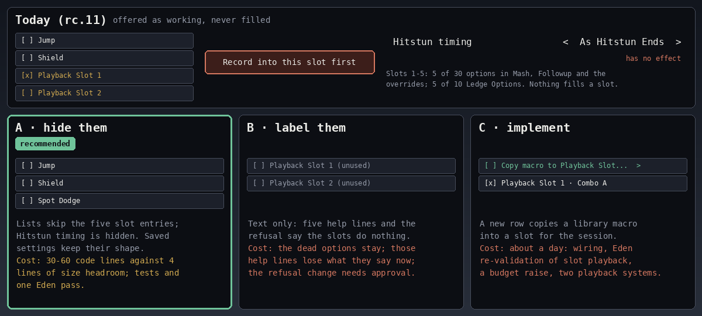

#### TR2 · The size gate after integration's #23, #15 and #25 fixes

How to make room for integration's three bug fixes: the pop-up's B close, the Loop list, and the Setup library's
restore after a live swap. On top of the held fix they put the code 35 lines over `size-budget.toml`: 147,956 against
a ceiling of 147,921 (integration, 10:40Z). TR9's V1, approved and being built, takes 4 off, so about +31 (147,952);
integration reports the exact number on its commit.

- **(a) · raise the ceiling by 31:** a new `[[budget]]` entry with the lead's approval. Cost to the player: none.
- **(b) · delete the old numbered-slot recorder:** nothing reaches it (#14). Its smallest cut that touches no carried
  file frees 258 lines, which covers the 31; all of it is 1,096 lines. Cost to the player: none. To build: a rebase
  and re-measure, and an Eden check of the settings migration it touches.
- **Not part of (b):** the old named capture (354 lines), the (b)(ii) path. Settings files written by v0.1.0 to
  v0.2.0-rc.3.1 (Source Named Library plus Trigger Save State Load) still start it on every load. If TR9 is V2, that
  last route ends, and those 354 lines can go too.
- **More, only with TR1 A done by removal:** removing the #8 entries outright frees 268 more on top of (i), (ii) and a
  24-line flag nothing sets. It changes the saved rows' lengths; hiding them while keeping the lengths was not
  measured.

Integration's measurement: `artifacts/phase23/tr-fix-23-15/SIZE-OPTION-B.md`, in the workspace.

**Recommendation: (b), together with TR1 A.** Code that can't run costs nothing to delete, and the budget stays a real
limit. If TR1 is C, the slot code is needed: then (a).

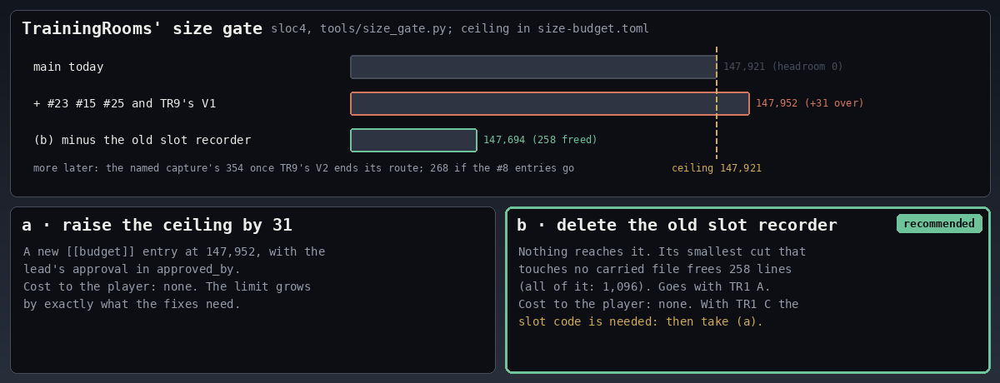

#### TR3 · HUD Off (#2)

Whether HUD Off should keep hiding the game's own HUD. That is what it does, not what rc.11's help line says.

- **A · keep it:** Off hides the damage and stock panels, item pointers and off-screen bubbles, as Training Modpack's
  HUD row did ("Show/hide elements of the UI"). The held fix says so. Cost to the player: none.
- **B · build what rc.11 described:** a plugin HUD for On to draw. Cost: new design and code, and Off would no longer
  give a clean screen.

**Recommendation: A.** It is upstream's behaviour and the useful one; only the text was wrong.

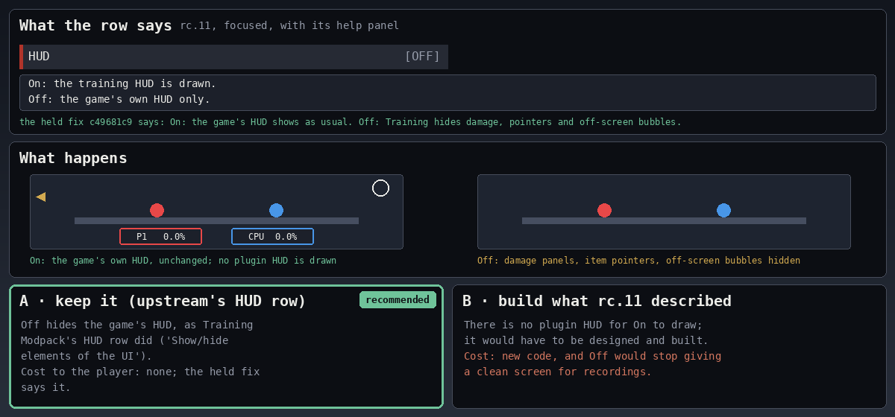

#### TR4 · Pummel Delay without a Throw (#4)

Whether Pummel Delay should pummel when Throw is None, the default. Today the CPU pummels only while it waits out
Throw Delay, with a Throw set.

- **A · keep it:** as Training Modpack does; the held help line says to set a Throw. Cost to the player: Pummel Delay
  alone does nothing.
- **B · pummel with Throw None too:** the CPU holds and pummels until the grab ends. Cost: behaviour upstream never had,
  a choice of what ends the hold, and an Eden check.

**Recommendation: A.** It matches upstream, and the help line now explains it.

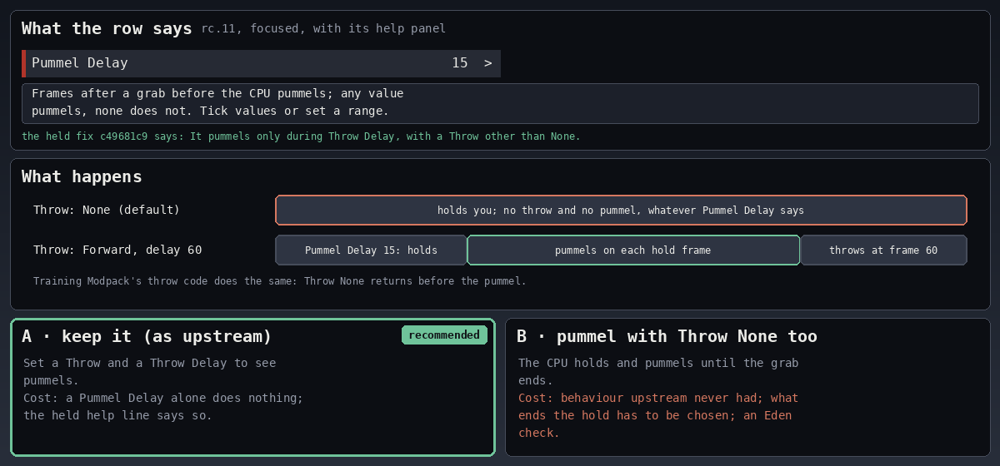

#### TR5 · Respawn on platform with Save States Off (#9)

Whether Respawn on platform Off should give an instant respawn with Save States Off. Today the row is ignored then, and
the revival platform appears.

- **A · keep it, and approve a restriction:** the held help line says "only while Save States is On". That line needs
  an approved restriction ID. Cost to the player: Off does nothing with Save States Off.
- **B · make it work:** answer the respawn parameters in practice whatever Save States says, as Training Modpack does.
  Cost: a small change in `state/hooks.rs`, a test, one Eden KO.

**Recommendation: B.** The row sits on another page from Save States, and nothing tells the player they're linked.
Upstream doesn't link them. B also settles one of the held fix's two flagged compliance lines.

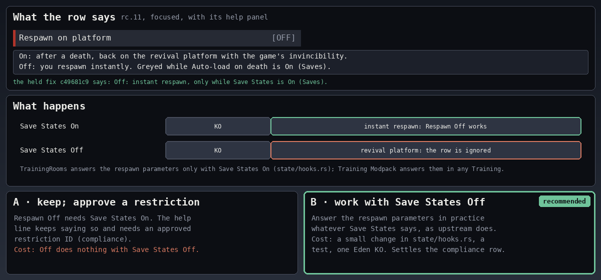

#### TR6 · Ask before switching fighter (#13)

Whether this row should govern every fighter question. Today only the Replay window reads it. Play chords on a macro
or a chain, and combo drills, ask Fighter Mismatch whatever it says.

- **A · keep it:** Off affects the Replay window only. Cost to the player: the other three still ask with the row Off.
- **B · every question follows the row:** Off keeps the current fighter everywhere. Cost: a small change in `rr_host`,
  tests, one Eden check.

**Recommendation: B.** A player who turns the question Off expects it gone everywhere: one row, one meaning.

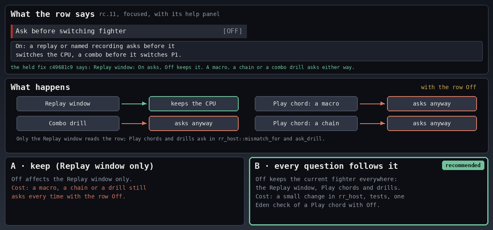

#### TR7 · Crop trailing neutral (#14)

Whether Record should drop the idle frames at the end of a recording when this row is On. Today Record never reads the
row. Of its two old readers, the slot recorder can't be reached, and the named capture starts only from settings of
v0.2.0-rc.3.1 or older.

- **A · remove the row:** Crop on a macro's screen stays. Cost to the player: upstream's automatic trim is gone.
- **B · make Record trim:** as upstream's Recording Crop did (default On). Cost: a few lines and a test, and one Eden
  take. A recording meant to end idle needs the row Off.

**Recommendation: B.** It is what the row promises and what upstream did, for little code.

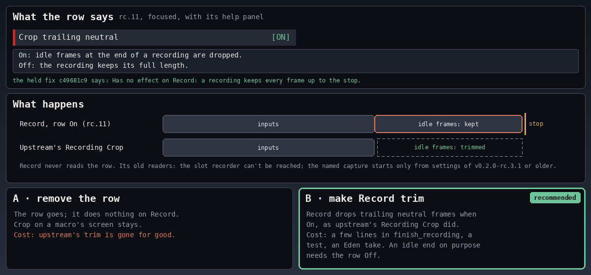

#### TR8 · Player Character with Player Swapping Off (#17)

Whether a portrait pick should load Player 1's fighter with Player Swapping Off. Today the pick is dropped with no
notice and loads only when Player Swapping goes On.

- **A · keep it, and approve a restriction:** the held help line says so. That line needs an approved restriction ID.
  Cost to the player: the pick looks broken.
- **B · a pick loads now:** like a combo's Switch, which already loads with Player Swapping Off. Player Swapping keeps
  governing the cycle chord, and its help line ("Off: only a combo's Switch changes Player 1") gains the pick. Cost:
  one argument in `character_roster.rs`, a test, one Eden pick.

**Recommendation: B.** A pick is an explicit request, and the Switch already works this way. B also settles the held
fix's other flagged compliance line.

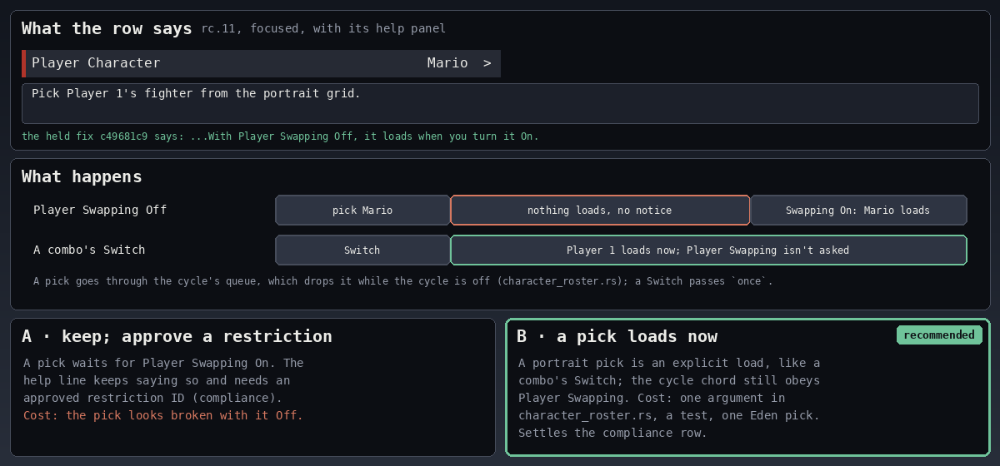

#### TR9 · Retire the old Record trigger row (V2), or keep its legacy start

Whether to retire the whole obsolete `record_trigger` row, as `migrate.rs` intends ("become nothing").

All 5 Forgejo releases (v0.1.0 to v0.2.0-rc.3.1) had a Recording-page "Trigger" dropdown, and picking "Save State
Load" stored `[0, 1]`. `d502615d` took the row off the page, but no tag contains that commit, and the value stays in
`settings.json` for good. No page shows it, so Reset page and Save defaults never touch it.

It has two effects today:
- It silently disables the Record chord (`recorder.rs:674`). **V1, the root fix for that, is approved and being
  built:** the chord ignores the hidden row (−4 sloc4, `recording.rs` and `recorder.rs`).
- If the old file also holds Source = Named Library, every save-state load starts the old named capture. That is TR2's
  (b)(ii) path. This second effect is what remains to decide.

The options:
- **A · V2, retire the row:** nothing reads `record_trigger` any more (−10 sloc4 in all, so −6 beyond V1).
  `begin_restore` loses its `trigger_save_state` branch. Cost to the player: a player whose old file holds both values
  no longer gets the named capture started on every save-state load. To build: an edit to carried `named_macros.rs`
  (a manifest transform and a regenerated ledger), and a test. It ends (b)(ii)'s last route, so TR2 can then delete the
  named capture's 354 lines.
- **B · keep the legacy start:** V1 only. Cost: a behaviour that no menu row shows or turns off stays for those
  players, and the named capture's 354 lines stay with it.

Migrating the stored value instead (rewriting `[0, 1]` to `[1, 0]` on load) adds code and writes the player's file.
Integration doesn't recommend it.

**Recommendation: A.** The row has been invisible since `d502615d`, so the legacy start is behaviour nobody can see or
switch off. V2 matches the design in `migrate.rs`, and it lets TR2 take (b)(ii)'s 354 lines.

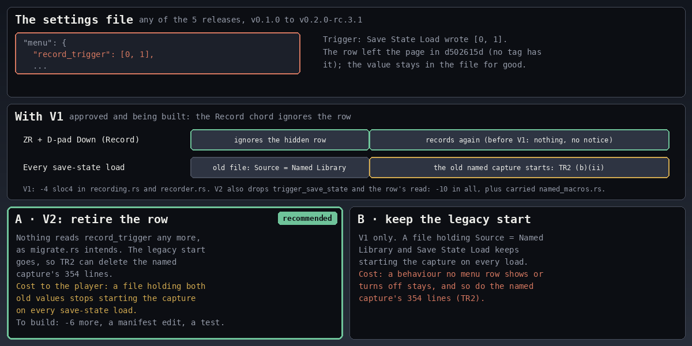

Not listed: #19 (Give item's item arrives when the menu closes). The code's comment gives the reason: a short-fuse item
must not expire while the picker still has the inputs.

#### rc13-DI-lines · DI chips like the game's blue DI indicator (rc.13 item 2): E1 x1

**Decided 2026-11-13 (~22:57Z): E1 x1.** After seeing the E1 x1 render, the operator said: "go with 1x". The look is
all four layers of `P_CmnVector` (flare01 glow, tri00 body, line09 streaks, line11 white core) at today's width
(`DI_WIDTH_RATIO` 1.2/3.5). Cost: +33 panes, no new textures. The decided look is the last picture below.

How the pointers on the **CPU › Defence › DI Direction** chips should look. The operator said today's lines are "super
skinny". Of the first mockup's options, the operator said "none of those options seem right for di", so A–D (wider or
fight-trail-like streaks) are rejected. The target is "the di trajectory indicator when someone gets hit in a match":
the blue DI indicator.

Today (rc.12) each pointer is one picture pane with the streak texture `line09`, in its pale tint, and unweighted chips
draw at half tint. The game's blue indicator is the effect `P_CmnVector` (`ef_common.eff`), with four picture layers:

| Layer | Picture | Role | Tint |
| --- | --- | --- | --- |
| emitter 4 | `flare01` | the glow | (12, 119, 255) |
| emitter 0 | `tri00` | the body | (0, 177, 255) |
| emitter 1 | `line09` | the streaks (today's only layer) | (200, 244, 255) |
| emitter 2 | `line11` | the white core | (255, 255, 255) |

The options, each at x2 or x3 of today's width (`DI_WIDTH_RATIO` 1.2/3.5):
- **Today (rc.12):** `line09` alone. Cost to the player: the hairline stays.
- **E1 · all 4 layers** (flare01 glow + tri00 body + line09 streaks + line11 white core). Cost: **+33 panes** (3 more
  layers × 11 chips) in the menu layout (`tools/layout-builder`).
- **E2 · glow plus streaks** (flare01 + line09). Cost: **+11 panes** (1 more layer × 11 chips).

For both: **no new textures.** `ef_common.eff` is resident in Training, and TrainingRooms' loader already finds all
four pictures (`describe Di ... pictures=4`). E1 and E2 only reference them, so nothing new is loaded.

**Caveat:** the game blends these layers additively. TrainingRooms' panes draw with the layout material's normal alpha,
because its UI code has no blend control. On the dark navy tiles that is close to the mockup. True additive blending
would need a BFLYT material change in `tools/layout-builder`, which hasn't been checked.

**Recommendation (not taken; E1 x1 was chosen): E2 x3,** for the cost (+11 panes). **E1 x2 is the closest to the native look,** because it has the
white core, if 33 more panes are acceptable.

The picture is author-2's mockup (`artifacts/rc13-di-lines/MOCKUP-blue.png` and `NOTE-blue.md`, in the workspace),
with its own green outline on E2 x3. It is a mockup, not the game's render: the colours and gains come from
`P_CmnVector`'s emitters (TrainingRooms' diagnostics), and the layer shapes are approximated. The "Native" panel is an
Eden crop of the real indicator: Mario's forward smash, CPU at 120 %, DI Up, Game speed 1/4.

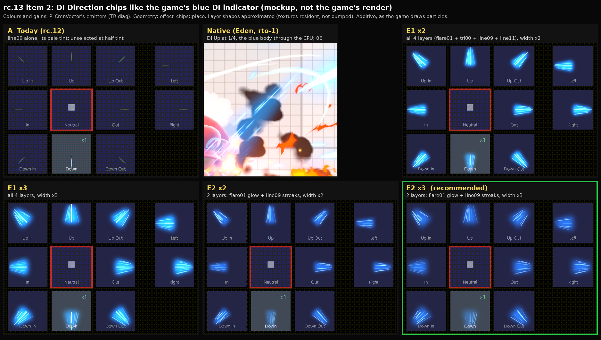

E1 x1, as the operator asked: all four layers of P_CmnVector at today's width (DI_WIDTH_RATIO 1.2/3.5). Cost: +33
panes, no new textures.

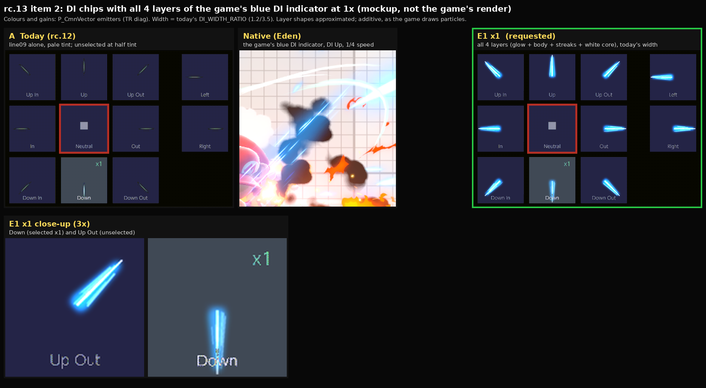

Eden capture of E1 x1 (additive, as the game draws it): the real textures are thinner and dimmer than the mockup.
Brightening is a follow-up option (layer gain/width, or a texture swizzle).

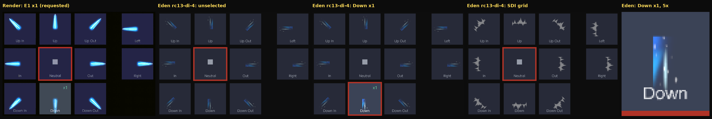

#### rc13-memory · Memory levers (rc.13): dropped

**Decided 2026-11-13 (~22:55Z): dropped; no lever will be implemented.** The operator: "drop the memory optimization.
Seems it's already fine. I don't want to sacrifice perforance." The measurements below stay as the record:
TrainingRooms' share is 398 MiB on the card settings and about 582 MiB at a cycle-lap peak.

Which levers to build to lower TrainingRooms' memory and widen Training's headroom. No feature is dropped by any of
them. The numbers come from worker B-2's measurements (`artifacts/rc13-memory/MEASURE.md`, in the workspace). They are
from Eden, on the rc.12 candidate diag, with the card's plugin set. The memory budget is 3,285 MiB, the same as the
console's.

**What "about 1 GiB" can mean.**
- **The whole process can't get to 1 GiB.** The game alone uses about 2.1 GiB at the main menu (2,129–2,164 MiB), and
  Training with TrainingRooms' preload Off uses 2,452 MiB. That is the floor in Training.
- **TrainingRooms' own share is already below 1 GiB:**
  - 398 MiB on the card settings;
  - 476 MiB on the defaults;
  - about 582 MiB at the peak of a CPU cycle lap.
- **So the levers lower that share and widen the headroom.**

**Baseline** (MiB used of 3,285, free in brackets; two boots):

| Scene and setting | rc13-mem-2 | rc13-mem-3 |
| --- | ---: | ---: |
| Main menu | 2,129 (1,155) | 2,164 (1,120) |
| Character select | 2,318 (966) | 2,348 (936) |
| Training, card settings: Preload Both, Ready Fighters 8, Ready Hats 5, 3 bodies, 5 slots | 2,822 (462) | 2,850 (434) |
| Training, preload Off, fresh entry (the game floor) | — | 2,452 (832) |
| Training, defaults: Both, Ready Fighters 10, Hats 5, 3 bodies, fresh entry | — | 2,928 (356) |
| CPU cycle lap, 4 steps, after the defaults (peak) | 3,034 (250) | — |

At the cycle-lap peak, a helper was refused for memory (it needed 272.8 MB with 268.3 MB of headroom), and TrainingRooms
showed "(1 waiting for memory)". The rc.11 console sample at the 11-13 hang was 3.05 GB used, 393 MB free.

**The levers**, as B-2 wrote them. Savings are estimates at Training entry on the defaults (2,928 MiB) unless the row
says otherwise.

| # | Lever | Estimated saving | Effect on features | Evidence or confidence |
| --- | --- | ---: | --- | --- |
| L1 | Ready Fighters default 10 → 8. The setting stays, with 2–12 available. | 78 MiB | Two fewer pre-built fighters by default. Those two load when first picked: one swap of ~0.4–1.0 s each, instead of warm (~50 ms). | measured (2,928 vs 2,850) |
| L2 | Bodies per role default 3 → 2. The setting keeps Off/2/3. | 100–125 MiB | The in-window instant swap covers 2 fighters per role instead of 3. The third goes through a group swap. | derived (~61 per body × 2) |
| L3 | Build extra groups on first use instead of at Training entry. Groups and their swap are kept. | 100–185 MiB at entry | The first swap into each extra group pays its build (~0.4–1.0 s; first pair ~2.1 s). Later swaps stay warm. | measured deltas (card 112, defaults 184) |
| L4 | Load hats and helper seats on first use (Ready Hats kept). | 40–50 MiB at entry | The first hat for a fighter is slower (~770 ms vs ~80 ms warm); later ones are warm. | measured deltas |
| L5 | Stagger the start-up window: build the bank bodies after the scene's own load settles, not inside it. | 150–190 MiB of **transient** peak | Banks are ready a few seconds later after entering Training. The settled use is unchanged. This targets the 11-13 abort, which came 64 ms after the window built 3-member banks. | derived from window headroom steps (−181 MiB at creation, −180 when bound) |
| L6 | Raise the admission floor from 16 to 512 MiB of headroom. | 0 at entry; up to ~260 MiB at the **peak** (cycle lap 3,034 → ≤ 2,773) | More "waiting for memory" while cycling, with those fighters loading on swap. Nothing is refused for good. | derived from the cycle-lap refusal at a 268 MiB headroom |
| L7 | Trim the plugin image and bss (TrainingRooms bss 1.7 MiB, diag ring and stacks). | 1–2 MiB | None | measured NRO header; too small to matter |

B-2's combined estimates: L1 + L3 + L4 brings Training entry to about 2,620–2,700 MiB (585–665 MiB free); L2 on top
gives about 2,500–2,600 MiB. L5 + L6 lower the peaks, not the settled figure.

**Recommendation (not taken; the item is dropped): L5 + L6 as the core, plus L4.**
- **L5 + L6:** they are peak-safety levers aimed at the 11-13 console abort. Neither changes the settled figure or any
  default.
- **L4:** hats and helper seats load on first use. It saves 40–50 MiB, and only the first hat per fighter is slower.
- **L1, L2 and L3 are offered, not recommended.** They trade swap speed for memory.

Limits (MEASURE.md §5):
- One run per state; the two boots agree within 35 MiB.
- L2 and L4 are derived from build deltas, not fresh entries.
- Eden carried about 60–90 MiB less than the console's 11-13 sample.
- No waiting-room or online scene was measured.

The picture is redrawn from B-2's `01-baseline.svg` and `03-levers.svg` by `tools/render_rc13_memory.py`; the per-lever
charts are `lever-1..7.svg` in the same folder.

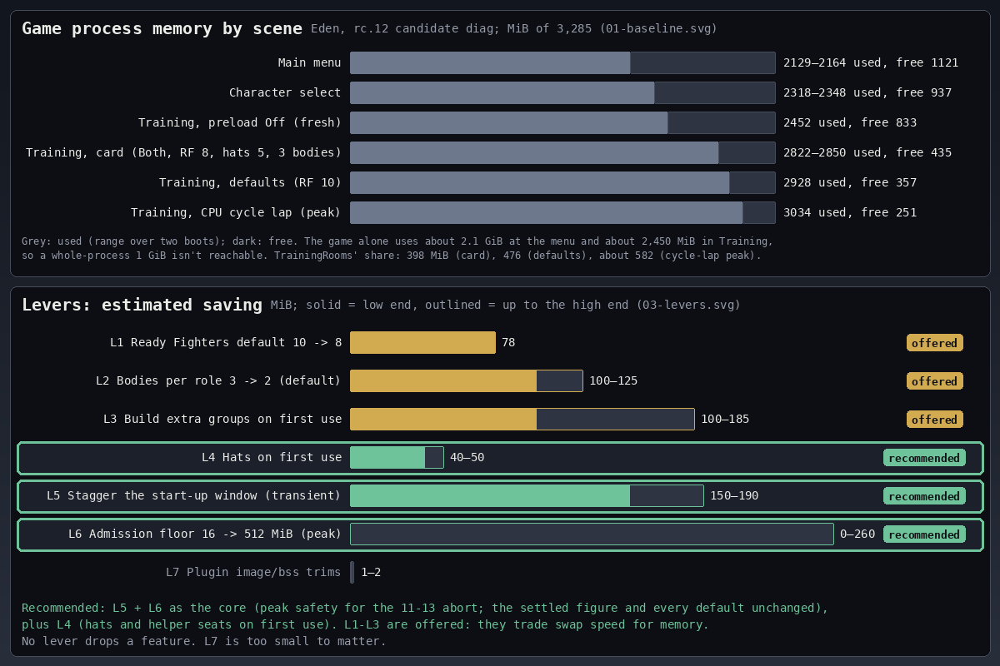

### Other projects

#### OP1 · Push the held doc fixes

Whether to push 23 docs-only commits that wait for an order, and when to push TrainingRooms' `c49681c9`. All 23 are
fast-forwards on their Forgejo `main` (checked 09:40Z).

- **Worker A:** 17 commits in 13 repos:
  - smash-replay-to-mp4 `1cec08a`;
  - ssbu-fx-control `4a23f6e` `0b1723c` `1ece8fb`;
  - smash-gamepad-overlay `98bd483`;
  - ssbu-memory-guard `e6f4e0b` `73f0f94`;
  - ssbu-quiet-elite-switch `51023c6`;
  - ssbu-desync-detector `b7f39a9`;
  - quickplay-cancel-fix `ad957f9`;
  - instant_back `063fbf9`;
  - ssbu-cpu-pilot `6275fe0`;
  - gsp-visualizer `f635098`;
  - ssbu-refresh-clock `d8ac3f9`;
  - ssbu-tile-cursor `8ce7b6e`;
  - elite-rematch `fcd9a38`.
- **Worker A, TrainingRooms:** `c49681c9`, the in-game text. It needs a rebase, and two of its help lines follow TR5 and
  TR8.
- **Integration:** ssbu-mod-playbook `cab8d43` `84bf626` `292f6c1` `13b2e83`.
- **Deluxe lane:** ssbu-online-deluxe-rewrite `5f9759f`.
- **Worker B:** ssbu-stall-press-carry `71dcb0f`.
- **Reconcile first:**
  - the Surface's `~/smash-replay-to-mp4` has uncommitted 10-15 edits in 6 of the same files;
  - the Yoga's `~/instant_back` has 3 commits that aren't on Forgejo;
  - the Yoga's `~/elite-rematch` and `~/ssbu-fx-control` have uncommitted work.

The options:
- **A · push the docs now:** the 23 commits, once the four copies are reconciled; `c49681c9` after TR5 and TR8. Cost to
  the player: none.
- **B · hold everything:** cost: wrong docs stay published, about 300 stale claims in worker A's repos alone. Among them
  are the wrong Switch status in 7 repos, a dead install link, and a config example that breaks `enabled=false`.

**Recommendation: A.** The fixes are checked, docs only, and fast-forwards.

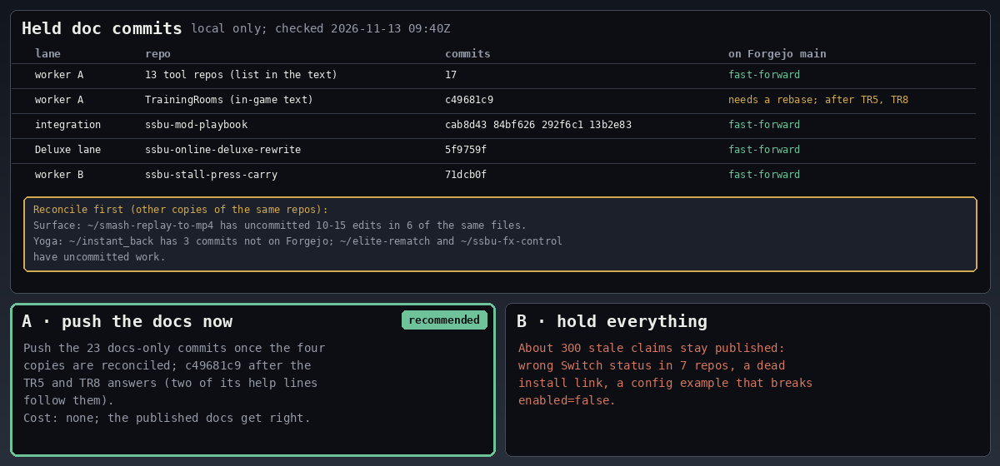

#### OP2 · The standalone `libimgui_smash.nro` on the card

Whether to remove it from the card. A read-only card scan found that nothing imports it and only Deluxe looks it up.
While it is there, Deluxe 0.10.4 draws with its ASCII-only font (the 1.0.2 build `f72a6b8d`), so names outside ASCII
show `?`.

- **A · remove it:** without it, Deluxe draws with its own font. Cost to the player: none found.
- **B · keep it:** names show `?` until an imgui build with a wider font ships (OP6).

**Recommendation: A.** Nothing needs it, and it is the cause of the `?` names.

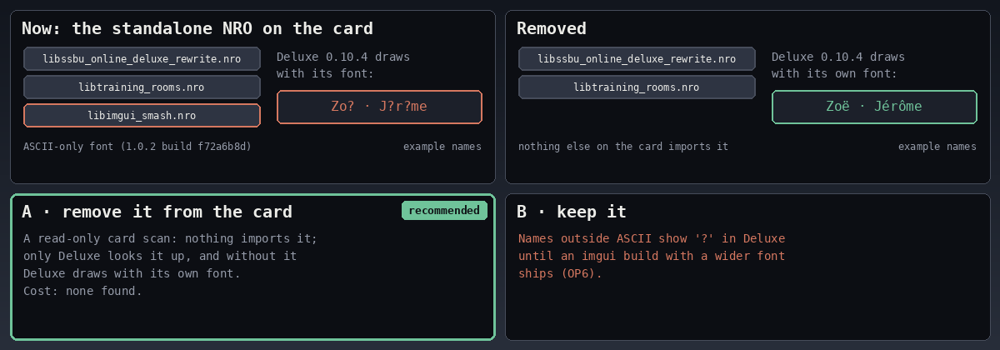

#### OP3 · Deluxe's hidden Stages + Counterpick page

Whether to show elite-stages-counterpick's page. The card's Deluxe `config.ini` has had
`hide_plugin_pages=stages_counterpick` since the 0.10.0 install (2026-11-01). Only CPU Pilot was set to Shown then.

- **A · show it:** on the console, Window Options › Stages + Counterpick › Shown. No card access is needed. Cost to the
  player: one more page in the cycle.
- **B · keep it hidden:** the plugin runs with no visible page, and every console check must unhide it first.

**Recommendation: A.** It was hidden as a side effect of the 0.10.0 install, not by choice.

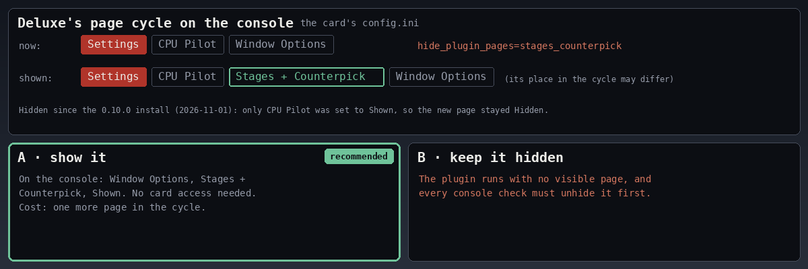

#### OP4 · elite-stages-counterpick and ssbu-cpu-pilot are private

Whether to make both public. Both return 404 when signed out. Deluxe's README and INSTALL.md link elite, and Deluxe's
README lists the pilot as a page plugin.

- **A · make both public:** after a history check for identities, as imgui-smash had. Cost to the player: none; the
  links start working.
- **B · keep them private:** drop the links from Deluxe's docs. Cost: players can't get either plugin.

**Recommendation: A.** Public docs already point players at them.

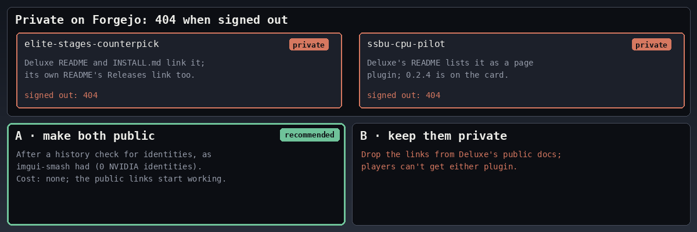

#### OP5 · The old Deluxe in Elite's release ZIP

Whether to drop the bundled older Deluxe from the ZIP of elite-stages-counterpick v0.1.0 (Forgejo release 473). The
bundled build is commit `0d28adc`, from before 0.8.0, 1,445,888 bytes.

- **A · drop it:** re-upload the ZIP with the plugin NRO only, and link Deluxe's own release. Cost to the player: none.
- **B · keep it:** unzipping the whole archive over Deluxe 0.10.4 puts the old build back. Only the README warns.

**Recommendation: A.** A plugin ZIP shouldn't be able to downgrade Deluxe.

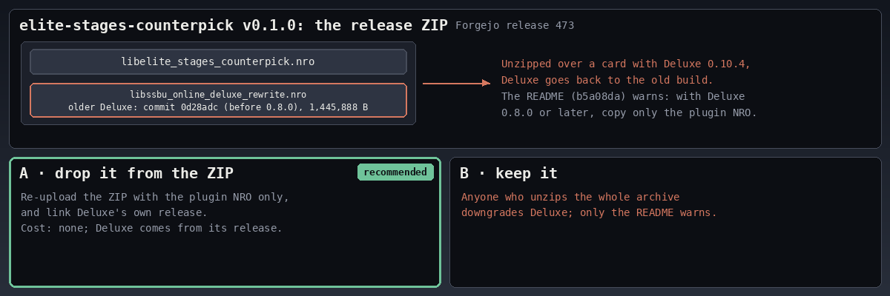

#### OP6 · Releases and tags that lag the card

Which builds to tag and release:
- ARCropolis: the card's `ac3e05a3` (main plus the `reject.log` cap) has no release.
- ssbu-desync-detector: 0.5.0 and 0.5.1 have no tag, though 0.5.1 is on the card.
- ssbu-cpu-pilot: 0.2.3 and 0.2.4 have no tag; 0.2.4 is on the card.
- ssbu-quiet-elite-switch: 0.2.0 has no release.
- quickplay-cancel-fix: 0.3.0 is still a pre-release.
- imgui-smash: `main` pins 1.0.2's archive from before the font merge, so it needs a re-pin, then a release.
- GitHub "Latest" is stale: the overlay shows v0.1.2 (Forgejo has v0.3.1), and smash-replay-to-mp4 shows v0.1.0.

The options:
- **A · tag and release what runs:** each from the commit that rebuilds the card's bytes exactly (checked). The
  detector waits for its console confirmation, and imgui for its re-pin. Fix GitHub "Latest". Cost to the player:
  none; downloads match the card.
- **B · leave them:** the card runs builds nobody can download or rebuild from a tag.

**Recommendation: A.**

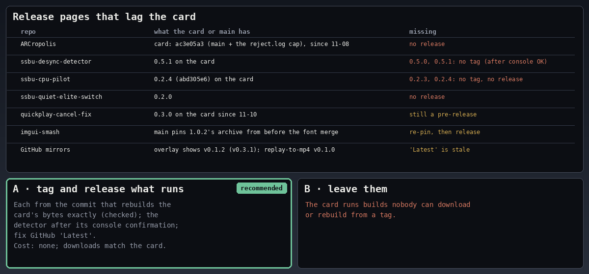

#### OP7 · LICENSE for six repos

Which licence for the six repos with no LICENSE file: smash-replay-to-mp4, instant_back, ssbu-fx-control,
ssbu-quiet-elite-switch, elite-rematch and ssbu-refresh-clock. The other seven of worker A's 13 repos, and
TrainingRooms, are MIT; Deluxe is AGPL.

- **A · MIT, like the others:** after checking that none carries GPL-family code. Cost to the player: none.
- **B · leave them unlicensed:** all rights reserved, so nobody may reuse or redistribute the code.

**Recommendation: A.** It matches the rest of the set.

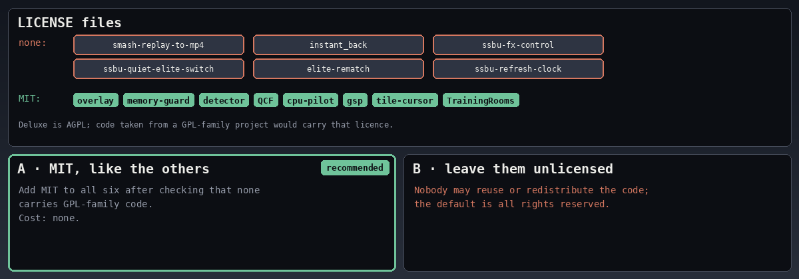

#### OP8 · Operator quotes in instant_back's design files

Whether to paraphrase the operator's quoted words in `DESIGN-v031.md` and `BRIEF-0.3.1.md`. The playbook allows
quotes in design working files. The detector's were paraphrased, and so were B's in `71dcb0f`. The repo is private
today.

- **A · paraphrase them:** cost: none; one docs-only commit.
- **B · keep them:** they'd be published if the repo goes public.

**Recommendation: A.** It is consistent with the other repos and safe if the repo goes public.

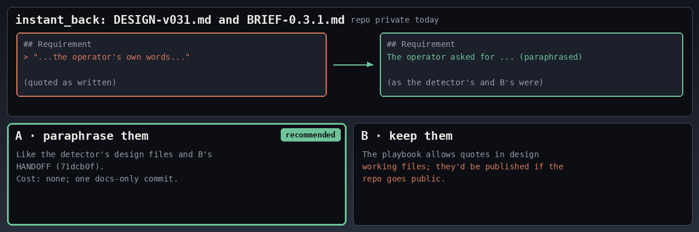
