# Decisions for the operator

- 2026-11-26. Scrub positions: operator ruling 2026-11-26 ~02:45Z (raising stack limit is fine).
- Only the diagnostic trace writer's recorded static bound changes: 2,880 to 2,896 bytes, as measured on the `bac7a4d5` ELF. Its allocation stays at 28,672 bytes.
- Restoring the direct combo decoder keeps the menu worker at 56,432 bytes in both ELFs, within its unchanged 57,152-byte bound and 90,112-byte allocation.
- These are static depths, not new gameplay high-water measurements.

- 2026-11-24. Replace rc.12 TR7's two-value crop setting with Start, End, Both and Off, and add the playback indicator (inbox 22:10:39Z).
- A macro's or input drill's own Trim applies at play time without changing its stored frames; hit combos have no Trim row (inbox 22:29:37Z).

2026-11-24: the Recording page's MACROS list gets RECORDINGS > for capture side, playback role, playback, and making a macro, combo, or drill.

- Replays > Replay window stays.
- Decision provenance: inbox 2026-11-24 22:45:56Z, design accepted 23:02:29Z.

- 2026-11-01. This page lists every operator decision of the menu proposal, one illustration per decision.
- In each picture the recommended option has a **green outline**.
- The images are in [`decisions/`](decisions/) and are drawn by `tools/render_decisions.py` in the menu mockup's style.
- Sources: `MENU-DRAFT.md` §4 (the menu questions keep their numbers), the specs' *Open questions* sections, `PROVENANCE.md` *Open questions* and `specs/SPEC-core-08` §10.

- **Answered 2026-11-01 (late evening ET):** the operator approved the proposal with the answers in the *Decision* column below, and implementation may begin.
- The remaining answers arrived on November 2 and are included in the table.
- The new requirements the answers add are collected in [*New requirements from the answers*](#new-requirements-from-the-answers), with their mockups.

<a id="november-menu-decisions"></a>

| # | Decision | Recommendation | Decision (2026-11-01) |
| --- | --- | --- | --- |
| Q1 | Number of pages | five, as drawn | **as recommended** (plus the hidden Developer page, Q8) |
| Q2 | Dropdown input | Left / Right cycle in place; A opens the list | **as recommended** |
| Q3 | Random-among-a-set delays | keep the checklists | **both:** checklist and min–max range; using one disables the other |
| Q4 | Overrides, chords, swap groups | one editor row each | **as recommended** |
| Q5 | First page on open | the last page used | **as recommended** (2026-11-02): the last page used; the first open ever shows CPU |
| Q6 | Item on load (older saves) | keep the row for now | **drop the row;** the import converts older saves once |
| Q7 | Replay capture in the menu | add the toggle | **as recommended** |
| Q8 | Preload Samples | diag build only | **Developer page:** hidden unless an INI enables it (the operator's own INI enables it) |
| Q9 | Menu shortcuts | read-only; the INI is the editor | **B: editable in the menu;** the menu writes `button_config.ini` |
| Q10 | Help text | two-line panel | **as recommended** |
| Q11 | P1 CPU fallback without the pilot | fallback rows, as drawn | **as recommended** |
| Q12 | Direction grid weights | weight digit on the chip | **as recommended** |
| Q14 | Grid paging | 4 × 8 items, 4 × 4 stages (the fork) | **B: denser, items and stages** (stages added 2026-11-02); in handheld mode 4 × 4 pages |
| Q15 | Mii rows | list with the bust where one exists | Approved November 1. [Text-only saved/replay rows, November 5](ROADMAP.md#deferred-operator-decision-2026-11-03). |
| Q16 | Fighter portraits and mods | read at run time, like stages | **as recommended** |
| Q17 | Which chips show the game's DI / SDI visual | DI and SDI only | As recommended. Longer white streaks bring the SDI spark closer to a match. |
| Q17 |  |  | Stretch ×2.0 confirmed 2026-11-02. |
| Q18 | When a CPU setting change takes effect | follow the fork: apply at the next CPU frame | **as recommended (A)** |
| S1 | Five import details | rename to `settings.json`, import both INIs, the rest as proposed | As recommended except item 3. Import all of `replay_captures/`, the Replay Window's crop source. |
| S2 | Corrupt settings file | keep a copy, load field by field | **as recommended** |
| B1 | Plugin name | `training_rooms` | **as recommended** |
| B2 | Panic policy | log it, no pop-up | **as recommended** |
| B3 | Another mod's training HUD layout | inject anyway, document it | **as recommended** |
| B4 | P1 driven by an AI | CPU settings on the CPU only; recording refused | Record refusal [reversed November 25](#record-while-an-ai-plays-player-1-2026-11-25). CPU settings still apply only to the CPU. |
| B5 | Input playback and the CPU settings | the recording wins | **the recording wins by default;** an advanced row lets the settings override it (default Off) |
| B6 | Ice Climbers state | one state per fighter | **as recommended** |
| B7 | In / Out for Airdodge and Shield Tilt | toward the opponent, everywhere | **as recommended** |
| B8 | Behaviour changes from the fork | accept the batch | As recommended, with two exceptions. No SDI setting means no SDI, preserving the fork's rule. |
| B8 |  |  | Respawn becomes a toggle. |
| B9 | Upstream developer-only code | drop it from the shipped build | **Developer page** (with Q8): shipped, hidden unless the INI enables it |
| B10 | README media | reuse the GIFs that show no menu | **as recommended** |
| B11 | Ledge options changed while the CPU is already on the ledge (fork and clean room) | re-roll on menu change, like SDI | 2026-11-02: both trees re-roll on menu change. The fork gets this in its next build. |

## Menu

| Menu recommendations | Recorded outcomes |
| --- | --- |
| Q1–Q18 | [November 1–2 decision table](#november-menu-decisions) |

### Q1 · Number of pages

Five pages, four (Saves and Display & Controls merged) or six (Stages & Lobby split out)?

- **Q1 proposal ([November 1 outcome](#november-menu-decisions)): five.** Each page has one theme, and no page is very long or nearly empty.
- Cost: none; the mockups already show five.

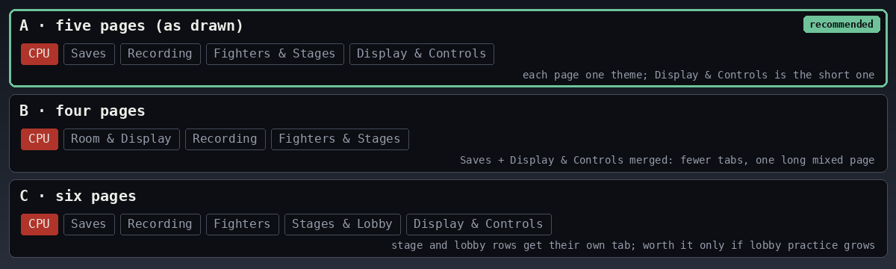

### Q2 · Dropdown input

Should Left / Right change a dropdown's value in place, or must A open the list first?

- **Q2 proposal ([November 1 outcome](#november-menu-decisions)): in place, as drawn.** A still opens the full list.
- It is one press per change instead of three.
- Cost: a stray Left / Right changes the value.

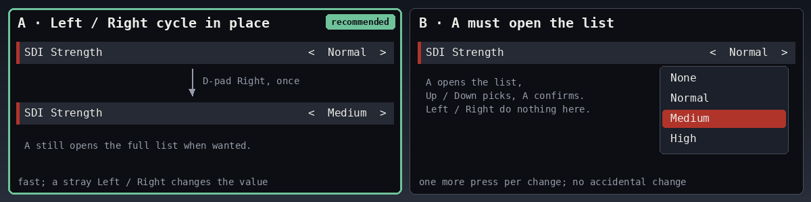

### Q3 · Random-among-a-set delays

Aerial, fast-fall, throw, pummel and ledge delays, OoS offset, reaction time and the slot sets: keep them as checklists, or use a min–max slider?

- **Q3 proposal ([November 1 outcome](#november-menu-decisions)): checklists.** They keep today's meaning, so saved files load unchanged.
- A range slider cannot express a set like {0, 5, 10}.
- Cost: a checklist is a longer popup than a slider.

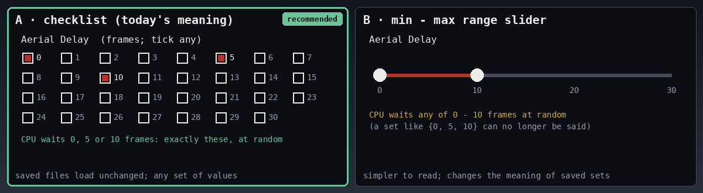

- **Decided 2026-11-01: both.** Each delay row offers the checklist and a min–max range; while one holds a value the other is greyed, and Y clears the active one.
- See *New requirements* N3.

### Q4 · Situation overrides, Button chords, Swap groups

Should these three be sub-screens (one row each), or should all their rows sit on the page?

- **Q4 proposal ([November 1 outcome](#november-menu-decisions)): sub-screens.** Putting the rows on the page adds 12 rows to CPU, 6 to Fighters & Stages and 5 to Display & Controls.
- Cost: one more press (A) to reach them.

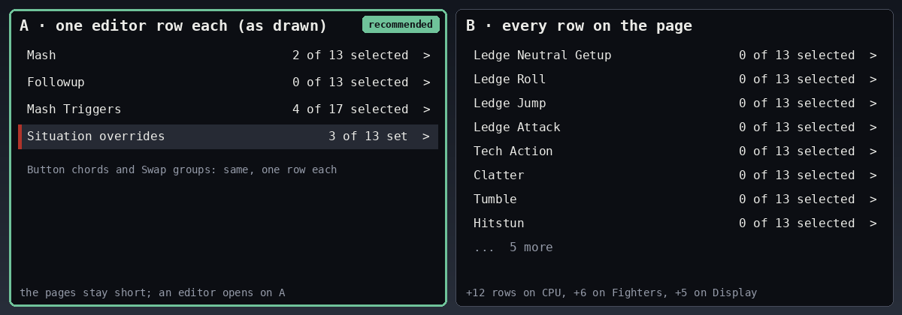

### Q5 · First page on open

Should the menu open on the last page used (today's behaviour) or always on CPU?

- **Q5 proposal ([November 2 outcome](#november-menu-decisions)): the last page used.** A drill loop (record, test, adjust) comes back to the same page.
- Cost: none; this is today's behaviour.

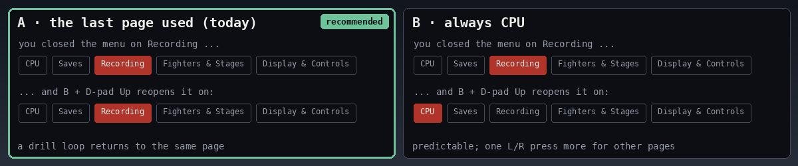

- **Decided 2026-11-02: the last page used;** the very first open (no saved page yet) shows CPU.

### Q6 · Item on load (older saves)

Keep this legacy row for saves made before the fork's item snapshot, or convert those saves once at import and drop the row?

- **Q6 proposal ([November 1 outcome](#november-menu-decisions)): keep it for now.** It carries no risk, and new saves never use it.
- Revisit once the import has been tested on real cards.
- Cost: one rarely used row on Saves.

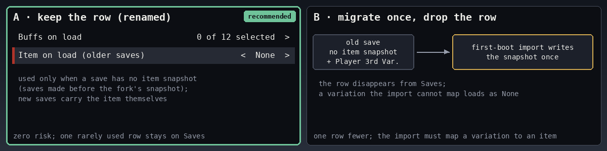

- **Decided 2026-11-01: drop the row.** The first-boot import sets an older save's item snapshot from this setting once (N6).

### Q7 · Replay capture in the menu

Should there be a menu toggle that writes `replay_capture.ini` and matches the Deluxe Plugins row, or should the setting stay INI / Deluxe only?

- **Q7 proposal ([November 1 outcome](#november-menu-decisions)): add the toggle.** It can then be changed in game, and all three places always agree.
- Cost: one row, and one small INI write when the row changes.

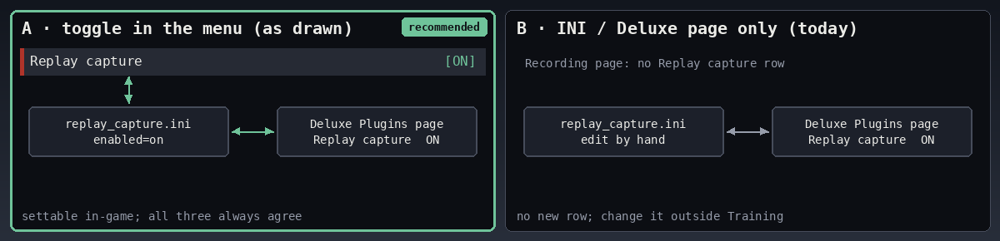

### Q8 · Preload Samples

Ship this diagnostics row under *Loading (advanced)*, or put it in the `diag` build only?

- **Q8 proposal ([November 1 outcome](#november-menu-decisions)): diag build only.** Players never need it, and the playbook's `diag` feature exists for exactly this.
- Cost: measuring on a card then needs the diag build.

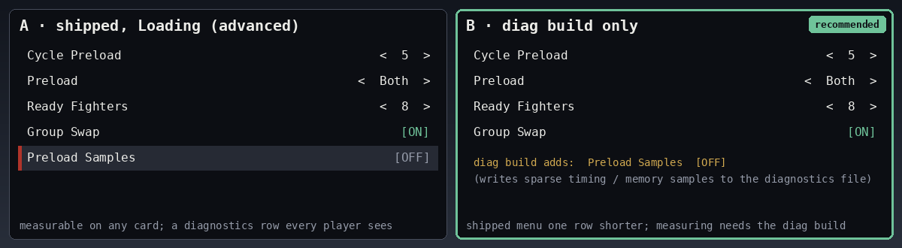

- **Decided 2026-11-01: a Developer page** (with B9), hidden unless an INI flag enables it; the operator's own INI enables it, so capture and test rows need no diag build (N1).

### Q9 · Menu shortcuts

Show the INI shortcuts read-only in the menu, or make them editable there with the INI as the file of record?

- (This also answers `PROVENANCE.md` open question 5.) **Q9 proposal ([November 1 outcome](#november-menu-decisions)): read-only.** No second chord editor is needed, and the behaviour matches the fork (restart to apply).
- Cost: changing a shortcut means editing `button_config.ini`.

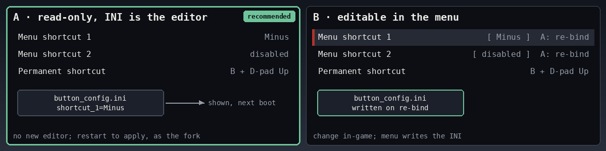

- **Decided 2026-11-01: B, editable in the menu.** The two shortcut rows open the chord editor; the menu writes `button_config.ini` and the new chord applies at once (N7).

### Q10 · Help text

Keep one help line at the bottom, or use a two-line panel?

- **Q10 proposal ([November 1 outcome](#november-menu-decisions)): two lines.** The fork's longer help texts (the group rows, for example) then fit without being cut.
- Cost: the item list shows one row fewer.

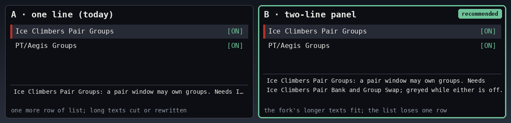

### Q11 · P1 CPU fallback when the pilot plugin is absent

Show the two hidden fallback rows (as proposed), make it INI only, or drop the TM-side control and require the pilot?

- **Q11 proposal ([November 1 outcome](#november-menu-decisions)): the fallback rows.** P1 control still works on a card without the pilot.
- With the pilot installed, only the info row shows.
- Cost: two rows, shown only when the pilot is absent.

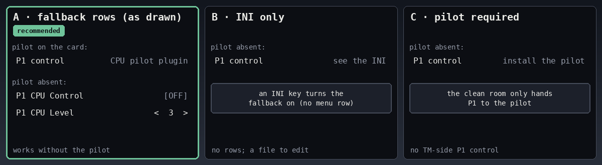

### Q12 · Direction grid weights

Show a weight digit on each selected chip (today's counts), or use plain on/off chips with an even pick?

- **Q12 proposal ([November 1 outcome](#november-menu-decisions)): weights.** They keep today's semantics, and saved files carry the counts.
- Cost: a small badge per chip, and A adds weight instead of only toggling.

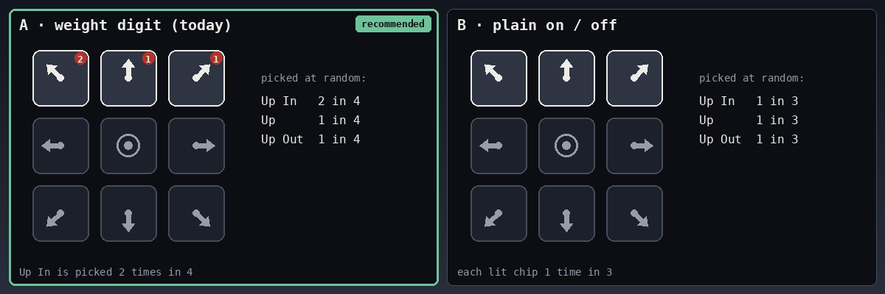

### Q14 · Grid paging

Keep items at 4 × 8 per page (two pages) and stages at 4 × 4 (eight pages), as the fork does, or use denser pages?

- **Q14 proposal ([November 1 outcome](#november-menu-decisions)): as the fork.** This layout is tested on the console, and the item names stay readable.
- Cost: L / R to reach items 33–38.

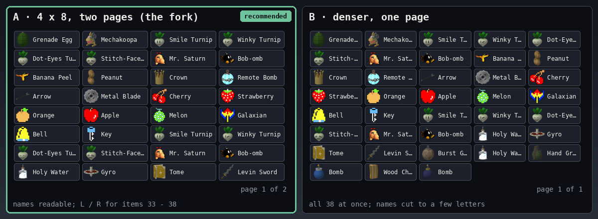

- **Decided 2026-11-01: B, denser, with a handheld rule.** The November design placed 38 items on one docked page or three handheld pages.
- Stages (operator, 2026-11-02): the denser paging applies to the stage grid too (N5).

- At the November 27 audit the [shipped item grid](../src/model/menu/grid.rs) held 39 items, or 16, 16 and 7 in handheld mode.

### Q15 · Mii rows

Lists with the fork's bust thumbnail beside each saved Mii where one exists, or text only?

- **Q15 proposal ([November 1 outcome](#november-menu-decisions)): busts where they exist.** They make saved Miis easy to tell apart, and the fork already makes them.
- Cost: one small texture per visible Mii.
- (The picture uses a neutral silhouette in place of a bust.)

- On November 5, the operator kept saved and replay Mii rows text-only.
- The native selector supplies the picture.
- [Q15 outcome](ROADMAP.md#deferred-operator-decision-2026-11-03)

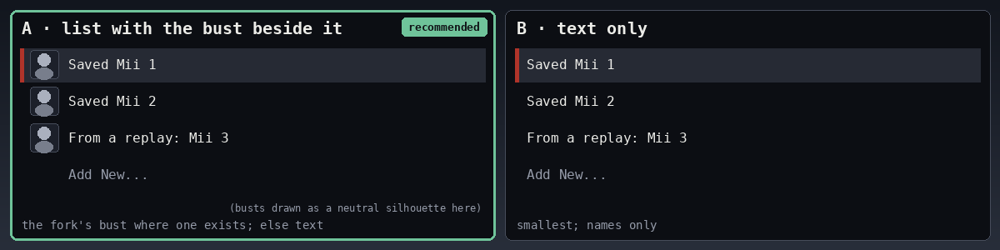

### Q16 · Fighter portraits and mods

- Should the portrait grid read each fighter's own UI portrait from the game at run time, as the stage grid does (so character and costume mods show), or keep fixed stock icons as the fork does?
- **Q16 proposal ([November 1 outcome](#november-menu-decisions)): read at run time, falling back to a text tile.**
- This is the same rule as stages and DI / SDI chips: nothing is baked or committed, and mods show.
- Cost: the run-time read has the same open unknowns as the stage thumbnails (`SPEC-core-07` §4.5, U1–U8), plus choosing the right costume, so it needs one more development probe.

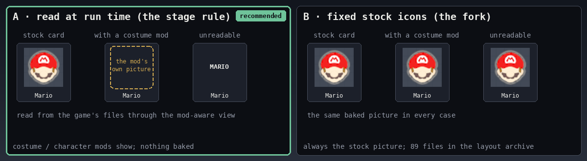

### Q17 · Which chips show the game's DI / SDI visual

Should only the DI and SDI chips show the game's own visual, with Airdodge Direction and Shield Tilt keeping
the clean room's arrows?

- **Q17 proposal ([November 1 outcome](#november-menu-decisions)): yes, DI and SDI only.** The game's visual shows launch influence; on an air-dodge or shield chip it would suggest something those options do not do.
- Cost: none; this is how the mockups are drawn.

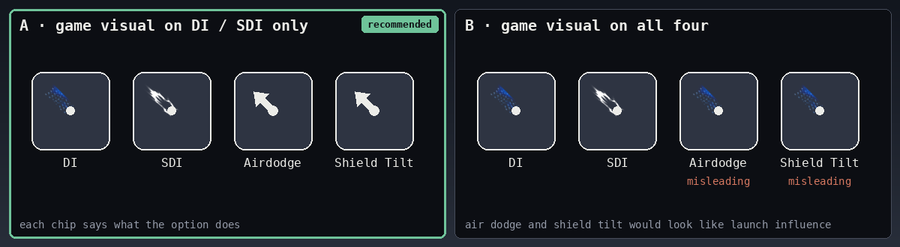

### Q18 · When a CPU setting change takes effect

- **The fork (stage M5o):** a changed SDI Direction or Shield Tilt now applies at the next CPU frame, with a new weighted roll; DI was already read live at each hit.
- (Before M5o, SDI Direction applied only at the next Training reset, and the menu did not say so.)
- **Clean-room options:**
- A. Apply at the next CPU frame. The roll holds until reset or another change to the row.
- B. Apply as in A and roll a new SDI direction every hitlag episode (`SPEC-cpu-02` questions 1 and 9).
- C. Keep reset-only and label the row "applies on next reset".
- **Q18 proposal ([November 1 outcome](#november-menu-decisions)): A, follow the fork.**
- It is built and was checked in Eden (the SDI Up → In change, and the Shield Tilt change, applied with no reset).
- The menu then means the same in both plugins, and Shield Tilt and the other per-reset rolls follow the same rule.
- Cost: with two or more directions selected, SDI keeps one direction until the next reset or change, which upstream's own source marks as a bug.
- B would vary it every hit at the price of one roll per hitlag episode and a parity difference from the fork. Q18 selected A on November 1.

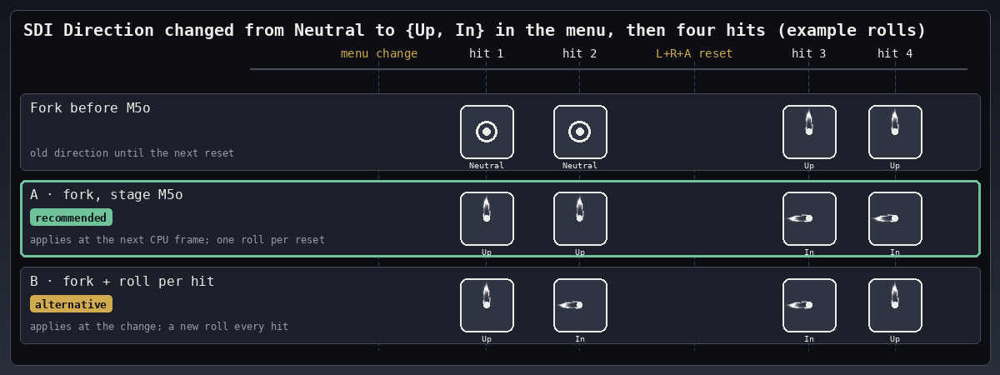

- Fork evidence: `artifacts/…/parked-reuse175/refactor/c1162/di-sdi-apply/RESULT.md` (Eden rows R-APPLY1–3 passed on the patch's own builds; `PATCH.patch` is in the same folder); the picture's rolls are examples.

## Files

| File decisions | Recorded outcomes |
| --- | --- |
| S1 and S2 | [November 1 decision table](#november-menu-decisions) |

### S1 · Five import details (`SPEC-core-08` §10)

Of the five original import recommendations numbered in the picture, four were accepted on November 1 and the capture recommendation was reversed.

- **1 · settings file name:** rename to `settings.json`, or keep the fork's name `training_modpack_menu.conf`?
  *Rename*; the loader also accepts the old name once.
- **2 · the two INIs** (`button_config.ini`, `replay_capture.ini`): import them too? *Yes*, under the same
  rules, so shortcuts and the capture choice survive.
- **3 · `replay_captures/`:** the proposal preferred manual copying and an empty Replay Window over a size-limited import (for example, 64 MiB). Neither option was chosen.
- **4 · TOML-only cards** (the fork before its JSON port): *not converted*; the fork's
  `tools/port_save_states.py` is the documented offline path.
- **5 · re-running the import:** by deleting `migration.json` only, or also from a menu row? *The marker only*;
  no menu row.

- Cost: item 2 adds two small files to the copy list.
- The others cost nothing.

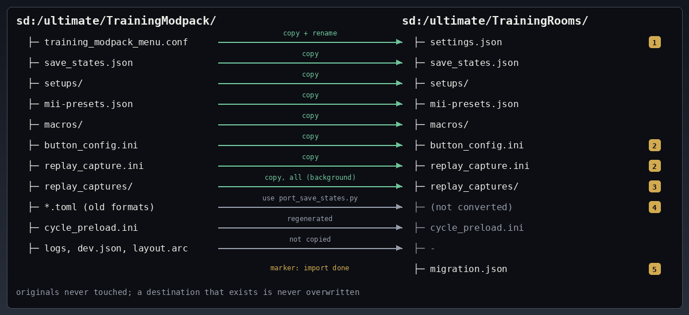

- **Decided 2026-11-01:** import all published captures in the background, without a size cap (N8). The Replay Window crops macros from those companions (`docs/reference/named-macros.md` in the fork). The importer skips unfinished capture staging folders.

- Corrected 2026-11-02: the source is `training_modpack_menu.conf`; `training_modpack.json` is the updater record and is not imported.

### S2 · Corrupt settings file (`SPEC-core-04` question 2)

Delete the file and start from defaults (upstream), or keep a renamed copy and load it field by field?

- **S2 proposal ([November 1 outcome](#november-menu-decisions)): keep a copy, default per field.** One bad field no longer wipes every setting.
- Cost: one renamed file on the card until the player deletes it.

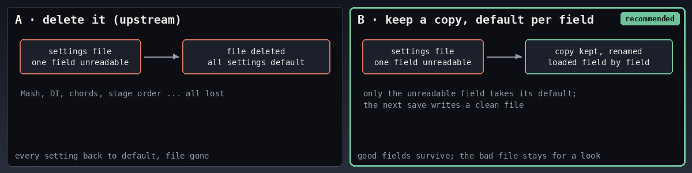

## Behaviour and product

| Decisions | Recorded outcomes |
| --- | --- |
| B1–B11 | [November 1–2 decision table](#november-menu-decisions) |
| B4 | November 25 reversal recorded in the same table. |

### B1 · Plugin name (`SPEC-core-01` question 6)

Name the plugin `training_rooms` (`libtraining_rooms.nro`), or keep `training_modpack`?

- **B1 proposal ([November 1 outcome](#november-menu-decisions)): `training_rooms`.** The two plugins can then be told apart on a card and in logs.
- They must never be installed together, because they hook the same sites.
- Cost: none.

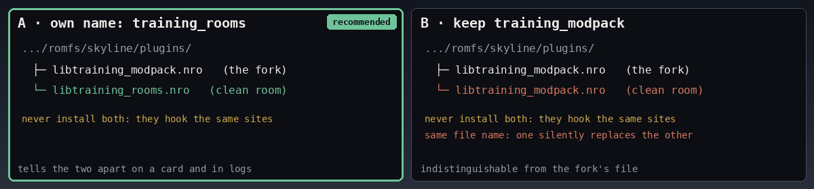

### B2 · Panic policy (`SPEC-core-01` question 1)

Show the error pop-up on a panic (upstream: the game is unusable until it is closed), or write the panic to the diagnostics file and the Skyline log with no pop-up?

- **B2 proposal ([November 1 outcome](#november-menu-decisions)): log it, no pop-up**, as the playbook's plugins do.
- Cost: the player sees no message on screen; the reason is in the logs.

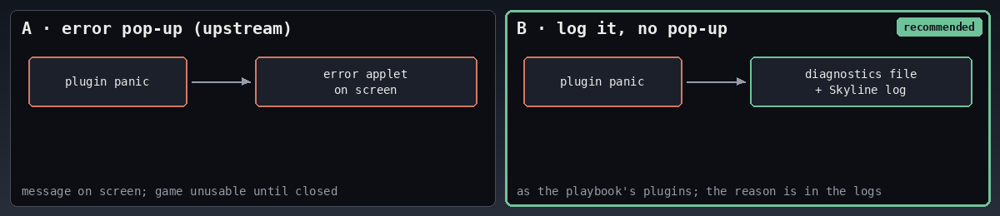

### B3 · Another mod's training HUD layout (`SPEC-core-05` question 2)

When another mod ships its own `info_training` layout, should the plugin inject its layout anyway and
document the conflict, or detect it and skip injection (the other mod's HUD stays and our menu is off)?

- **B3 proposal ([November 1 outcome](#november-menu-decisions)): inject anyway, document it.** The install line notes the other layout. Cost: that mod's
training HUD does not show while this plugin is installed.

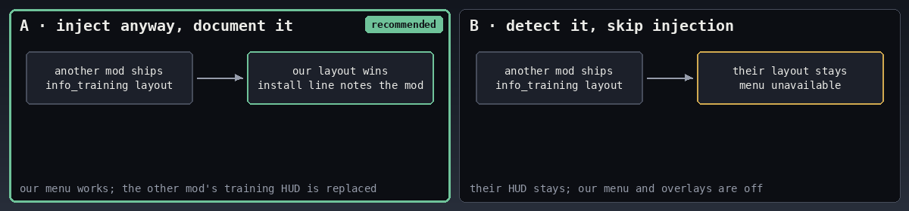

### B4 · P1 driven by an AI (`SPEC-cpu-01` question 7, `SPEC-input-01` question 7)

- When the pilot or the fallback drives P1: should the CPU settings (Mash, DI, SDI, ledge, tech, shield …) apply to P1 too, and what should Record do?
- **B4 proposal ([November 1 outcome](#november-menu-decisions)): the CPU settings apply to the CPU role only, and Record is refused with a notice.**
- Two drivers never fight over P1, and no new game site is needed.
- Cost: recording the AI's line would need the alternative (reading P1's controller slot).

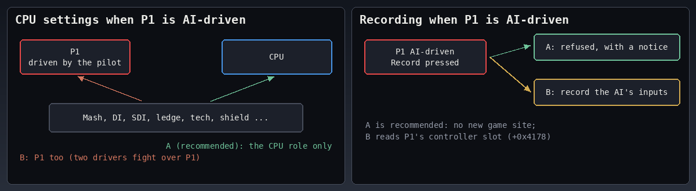

- **Reversed for Record on 2026-11-25:** see [Record while an AI plays Player 1](#record-while-an-ai-plays-player-1-2026-11-25).
- The CPU-settings half stands.

### B5 · Input playback and the CPU settings (`SPEC-cpu-02` question 7, `SPEC-cpu-04` question 6, `SPEC-cpu-06` question 7)

While a recording plays on the CPU, should the DI, SDI, air-dodge, tech and throw settings override it (upstream), or should the recording win?

- **B5 proposal ([November 1 outcome](#november-menu-decisions)): the recording wins**, the same way shield and stick already yield to playback.
- Cost: none; the settings apply again when playback ends.

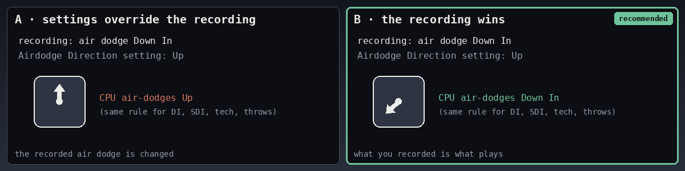

- **Decided 2026-11-01: the recording wins by default,** and an advanced row *Settings override playback* (default Off) restores the upstream rule when switched On (N4).

### B6 · Ice Climbers state (cross-cutting; `SPEC-cpu-02` … `-06` question 4 or 5)

Should Popo and Nana share one set of CPU counters and cases (upstream), or have one each?

- **B6 proposal ([November 1 outcome](#november-menu-decisions)): one per fighter.** Nana's SDI count, DI case and delays then stop leaking into Popo's.
- Cost: a few bytes per CPU fighter.

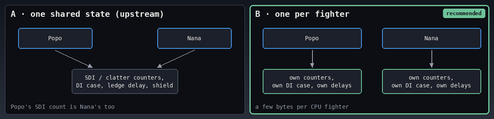

### B7 · In / Out for Airdodge and Shield Tilt (`SPEC-cpu-02` question 2, `SPEC-cpu-05` question 2)

- Upstream's air dodge mirrors only when the player is on the CPU's right, and its shield tilt is absolute.
- Should both use the opponent-relative rule that DI and SDI use?
- **B7 proposal ([November 1 outcome](#november-menu-decisions)): yes, toward the opponent everywhere.**
- The direction grid labels its chips In and Out, so they should mean the same on every row and on both sides.
- Cost: a visible change against the fork when the player stands on the CPU's left.

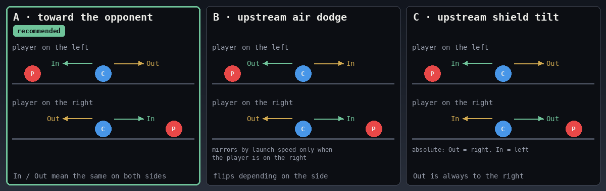

### B8 · Behaviour changes from the fork, as a batch

The specs recommend thirteen small user-visible fixes (top of the picture) and six behaviours to keep as
the fork has them (bottom).

- **B8 proposal ([November 1 outcome](#november-menu-decisions)): accept the batch.** Any single line can be reversed by naming it.
- Each line's spec question has the details.
- Cost: each fix is a small parity change against the fork, and the release notes list them.

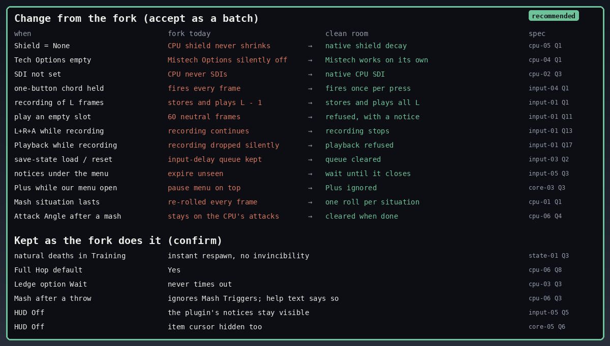

- **Decided 2026-11-01: the batch is accepted with two changes.** *SDI not set* keeps the fork's rule: with no SDI Direction selected the CPU does not SDI (the "native CPU SDI" line is withdrawn).
- *Natural deaths in Training* becomes the toggle *Respawn invincibility* (N2).
- The other twelve changes and five kept lines stand.

### B9 · Upstream developer-only code (`PROVENANCE.md` questions 3 and 4)

Drop `dev_config`, the debug hooks and `raygun_printer` from the shipped build, or keep them as diag-only behaviour?

- Should `training_mod_sync` (36 lines of lock helpers) be kept, or should the code use `parking_lot` directly?
- **B9 proposal ([November 1 outcome](#november-menu-decisions)): drop them, and add a diag version only if a developer asks; use `parking_lot` directly.** Cost: none for players.

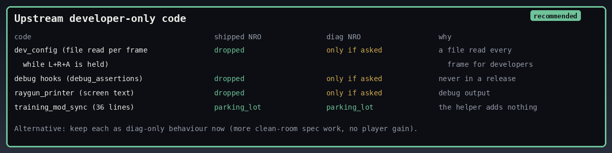

- **Decided 2026-11-01: the Developer page** (N1) holds the developer-only rows with Preload Samples; they ship hidden.
- `parking_lot` is used directly (the helper crate is not kept).

### B10 · README media (`PROVENANCE.md` question 2)

Reuse the fork's walkthrough GIFs now (some show the old menu), reuse only those without the menu, or ship no media until the new menu is built?

- **B10 proposal ([November 1 outcome](#november-menu-decisions)): reuse the GIFs that show no menu now, and re-record the menu GIFs after the build.** Cost: the README has no menu pictures until then.

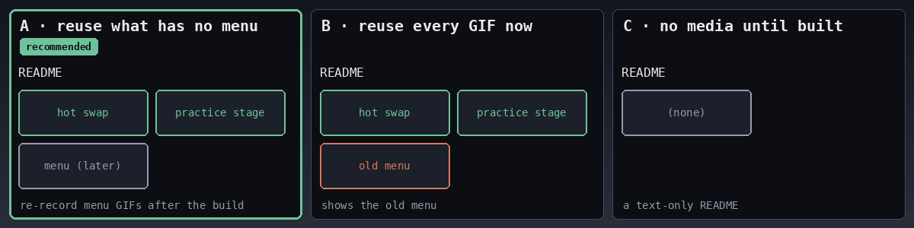

### B11 · Ledge options changed while the CPU is already on the ledge (`SPEC-cpu-03`)

- **Applies to both the fork (unchanged there) and the clean room.** Found while checking Q18: a CPU rolls its ledge option once per hang and holds it until it leaves the ledge; the held roll also survives while the Ledge Options row is empty.
- A CPU already parked on the ledge (for example with Wait) therefore ignores a newly selected option until it leaves the ledge and grabs again.
- The throw option behaves the same way for a CPU already holding someone.
- The fork's SDI and Shield Tilt rolls no longer have this problem (Q18).
- Options: (a) re-roll the ledge options (and the throw options) when the menu changes them, like SDI Direction: the CPU takes the new option during the same hang; (b) apply on the next ledge grab, which is what the fork does today and what `SPEC-cpu-03` currently says.
- **B11 proposal ([November 2 outcome](#november-menu-decisions)): (a).**
- The menu then does what it says without a second hang, and it follows the same rule as Q18.
- Cost: one more roll cleared on a menu change; a CPU already hanging can act differently the moment the row changes; the fork keeps (b) until it gets the same change.
- Source: the fork's `c1162/di-sdi-apply/PROGRESS.md`, "For the primary" item 2.

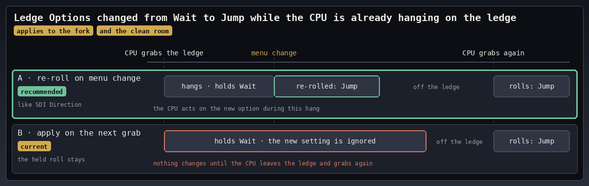

- **B11a (2026-11-18, primary 05:10Z, CPU-091).** In Eden `cpu091-verify-yoga-5`, a CPU parked with Wait still climbed when the row changed to Jump. TR rolled and requested Jump (`cpu_event request_status status=123 from=119`). The game's climb, held back by Wait, was pending and won that frame.
- In Eden `p3f-verify-yoga-3`, the game decided the climb in the frame of TR's request and won it. Under `SPEC-cpu-03` §4, TR denies native climb before and after requesting Neutral Getup, Roll, Jump or Getup Attack, so its chosen option comes first.
- TR requests the option on its first actionable frame, by buffered motion frame 19. After 30 actionable frames still hanging, it releases the denial and logs `climb_bound_release`. A fault cannot leave the CPU hanging indefinitely.
- With zero delay the denial starts before TR acts.

- **Decided 2026-11-02: (a), re-roll on menu change,** for the ledge options and the throw options, in both trees.
- The fork gets it in its next build; the clean room implements it from `SPEC-cpu-03` / `SPEC-cpu-06` in package 2.

## Already answered (not repeated above)

| Item | Answer | Where |
| --- | --- | --- |
| MIT copyright holder | the handle (`Copyright (c) 2026 intpa`) | `LICENSE`; `PROVENANCE.md` question 1; `MENU-DRAFT.md` §4 |
| Storage root and import | `sd:/ultimate/TrainingRooms/`, one-time copy of the fork's data | `specs/SPEC-core-08`; `MENU-DRAFT.md` §4 (also closes `SPEC-core-01` Q2, `SPEC-core-04` Q3, `SPEC-input-01` Q15, `SPEC-state-01` Q9) |
| Q13 grid picture source | stage thumbnails read at run time, never baked; item grid uses the fork's own icons | `MENU-DRAFT.md` draft 5; `SPEC-core-07` §4.5 |
| Placeholder chips (Kirby Hats, Solo Popo, items) | neutral placeholder until the icons are designed | `MENU-DRAFT.md` draft 4 |
| Shipped item pictures | Approved game assets | [Pane definitions](../src/model/ui/panes.rs) |
| Shipped hat and Solo Popo chips | Fighter portraits for hats, corner S marks for Solo Popo | [Grid definitions](../src/model/menu/grid.rs) |
| Origin tags on screens | removed | `docs/MENU-PROPOSAL.md` (removed after v0.2.0-rc.1; see that tag) v6 |
| DI / SDI chips | the game's own visual, read at run time | `MENU-DRAFT.md` draft 6; `SPEC-core-07` §4.6. |
| DI / SDI chips |  | Q17 concerns only arrows for Airdodge and Shield Tilt. |
| Who drives P1 | Standalone CPU pilot owns P1; Q11 approved fallback rows on 2026-11-01. | `MENU-DRAFT.md` §2/§3; `specs/INDEX-cpu.md` |
| Menu shortcuts (`PROVENANCE.md` question 5) | merged into Q9 | above |
| Upstream HEAD `077a8e43` inverted reset gate | not adopted | `SPEC-cpu-07` Q5, `SPEC-cpu-01` Q8 |
| Auto-update, Menu Open Start Press | dropped from the menu; old keys read and ignored | `MENU-DRAFT.md` §3; `SPEC-core-02` Q4 |
| Pushing `review/menu-proposal` | Standing order allowed docs-only pushes. | `TRAININGROOMS-HANDOFF.md` (removed after v0.2.0-rc.1; see that tag) |
| Pushing `review/menu-proposal` | All other pushes, Forgejo release and Switch install required an explicit order. |  |

## Left to the lead

| Questions in `specs/` | Disposition |
| --- | --- |
| Site guards, hook placement, measurements, RNG source, cost-only changes and Eden rows | Technical recommendations stand unless the operator objects; omitted here. |
| Operator-facing questions | Covered above in Q18 and S1–B11. |

## New requirements from the answers

| # | Requirement | Where | Mockup |
| --- | --- | --- | --- |
| N1 | **Developer page.** Sixth page, after Display & Controls. | `SPEC-core-01`, `SPEC-core-02`, `SPEC-core-08` | `20-developer.png` |
| N1 | At boot, read `developer_page=on` from `sd:/ultimate/TrainingRooms/developer.ini`. |  |  |
| N1 | A missing file or other value hides the page and disables its rows. |  |  |
| N1 | Preload Samples moves here from Loading (Q8). |  |  |
| N1 | B9 developer rows are rebuilt from their `SPEC-core-01` descriptions. |  |  |
| N1 | The normal build supports capture and testing. Only Eden stand-ins need `diag`. |  |  |
| N1 | The operator's card and Eden test profiles set `developer_page=on`. |  |  |
| N2 | **Respawn invincibility.** Default Off matches the fork: instant respawn without invincibility. | Saves › Save states, after *Auto-load on death*; `SPEC-state-01` | `02-saves.png` |
| N2 | On: natural Training deaths give P1 or CPU the game's normal respawn invincibility. |  |  |
| N2 | Use the game's match respawn platform wherever its native path allows. |  |  |
| N2 | Auto-load on death greys the row because it loads a save instead. |  |  |
| N2 | Any native-platform limitation required an operator decision before shipping. |  |  |
| N3 | **Delay rows (Q3).** One popup contains both the checklist and the range. | `SPEC-core-02`, `SPEC-cpu-01`/`-03`/`-05`/`-06` | `19-delay-popup.png` |
| N3 | Applies to Aerial, Fast Fall, Throw, Pummel and Ledge Delay, OoS Offset and Reaction Time. |  |  |
| N3 | Checking a value greys the range. Setting a range greys the checklist. |  |  |
| N3 | Range picks uniformly among steps between minimum and maximum. Y clears the active control. |  |  |
| N3 | Older files without a range load as checklists. |  |  |
| N3 | All three slot sets keep only their checklist (confirmed 2026-11-02). |  |  |
| N4 | **Settings override playback.** Advanced toggle, default Off. | Recording › Playback; `SPEC-cpu-02`/`-04`/`-06`, `SPEC-input-01` | `03-recording.png` |
| N4 | Off: playback takes precedence over DI, SDI, air-dodge, tech and throw settings (B5). |  |  |
| N4 | On: those settings take precedence, matching upstream. |  |  |
| N5 | **Item grid paging (Q14).** Docked: one 5 × 8 page, 38 items, short names. | `SPEC-core-03`; item grid (carried over) | `11-item-grid.png`, `18-item-grid-handheld.png`, `12-stage-grid.png`, `22-stage-grid-handheld.png` |
| N5 | Handheld: full names; three 4 × 4 pages holding 16, 16 and 6 items. |  |  |
| N5 | Shipped count, November 27: [39 items](../src/model/menu/grid.rs). Handheld pages hold 16, 16 and 7. |  |  |
| N5 | Item grid uses the console's operation mode when opened. |  |  |
| N5 | Stage decision, 2026-11-02: same tile geometry as items. |  |  |
| N5 | Docked stages: 5 × 8 with short names; All plus 117 stages. |  |  |
| N5 | Three docked pages hold 40, 40 and 38 tiles. |  |  |
| N5 | Handheld stages: eight 4 × 4 pages, matching the fork. |  |  |
| N6 | **Item on load dropped (Q6).** On first boot, import the old setting once. | `SPEC-core-08`, `SPEC-state-04` | `02-saves.png` |
| N6 | Write its item snapshot into each save lacking one; drop the row and setting. |  |  |
| N7 | **Editable menu shortcuts (Q9 B).** Menu shortcut 1 and 2 open the chord editor. | Display & Controls › Controls; `SPEC-input-04` | `05-display-controls.png` |
| N7 | Changes apply immediately and persist in `button_config.ini`, the file of record. |  |  |
| N7 | The permanent B + D-pad Up shortcut stays fixed. |  |  |
| N8 | **Import all replay captures (S1, item 3).** Copy `replay_captures/` in full to the new root. | `SPEC-core-08` | `S1-import-details.png` (as drawn, item 3 changed) |
| N8 | First boot continues during the copy; originals stay. |  |  |
| N9 | **SDI not set (B8).** With no Direction chip selected, the CPU performs no SDI. | `SPEC-cpu-02` | – |
| N9 | This keeps the fork's rule. |  |  |
| N10 | **Longer SDI streaks (Q17).** The chips lengthen the spark's white streaks to match gameplay. | `SPEC-core-07` §4.6 | screens `01`, `16`, `17` |

Added 2026-11-01 by the lead from the operator's answers.

- Each one is folded into `MENU-DRAFT.md` (draft 9), the affected spec (its *Open questions* answer and §9 test-provenance rows) and the mockups named here (`docs/menu-mockup/`, the renderer's style).

- **Answered 2026-11-02 (~02:4xZ):** Q5 and B11 as recommended; the SDI ×2.0 stretch, the Developer page (N1) and the delay popup (N3, slot sets checklist only) as proposed; N5 extended to the stage grid.
- Nothing in this list is open.

- **Label and page, 2026-11-06:** the row is labeled *Respawn on platform* and sits on Fighters & Stages › Stages, after Lobby Items (N2).
- The setting id stays `respawn_invincibility`.
- On still uses the game's revival platform and invincibility; Off is still the instant respawn.
- The row stays greyed while Auto-load on death (Saves) is On.
- This does not change the 2026-11-01 behaviour.

## CPU ownership and hot-slot decisions — 2026-11-02

| F9: newly active entry | Promoted member of CPU rotation |
| --- | --- |
| Entry 2 | Next member |
| Entry 3 | Following member |

### F9: promote the helper on CPU-count increases

- The 20:5xZ decision supersedes delayed count changes and native setter replay.
- When the CPU count rises, the helper already occupying newly active entry 2 or 3 becomes that CPU.
- Retain its body, remove it from the helper pool, and publish matching identity, descriptor, HUD, portrait and name through the existing swap identity path.
- Exact-Mii identity and Training-reset persistence are required.

- In slow mode, helper seats do not occupy live entries while the CPU count is greater than one; re-adopt them when the count drops.

The November 2 acceptance criteria covered count 1→2→3→2→1, a helper still loading, exact-Mii promotion, L+R+A and save/load with two or three CPUs, and zero total Unmapped messages in the retained Eden console.

- This records the behavior decision, not runtime acceptance.
- [The roadmap](ROADMAP.md) records the rc.5 F9 implementation and later Eden seat checks.

### Hot fighters and Kirby hats: measure before setting defaults

- The 21:1xZ preference is ten total hot fighters across both roles, including the two active fighters, plus a separate budget of five hot Kirby hats.
- Hat sources are not charged against the fighter budget; a hat whose fighter kind is already hot shares that body.
- A maximum of fifteen is conditional on fit.
- Keep the existing fighter-pool and free-memory guard, with ordinary slow loading beyond available capacity.

- The November 2 plan called for one low-priority Eden measurement at ten fighters plus five hats.
- Record fighter-pool capacity, reserve, peak guest memory and zero total Unmapped messages.
- If the pool or memory cannot hold that configuration, present the measurements for a decision rather than silently lowering it.
- The measurement must follow resolution of the existing helper-path fault hold.
- The follow-up was a blocker only if it changed approved behavior. [The roadmap](ROADMAP.md) records ten hot fighters and five hot hats in rc.5, with the first Eden rows in rc.6.

<a id="f9-live-hat-item-source-immediate-cutover-2026-11-03"></a>

### F9 live hat/item source: immediate cutover — 2026-11-03

- Operator decision relayed in TRAININGROOMS-LEAD-INBOX.md at 03:0xZ: when rotation changes the fixed target for physical entry 2 or 3, switch the seat immediately even when its old body supplies a live Kirby copy or thrown item.
- Do not hold the seat, stall rotation, or guess at native rebinding.

- Rebuild the hat through native copy_setup with the same hat kind from the new source when available, otherwise follow normal hat source rules.
- Copied charge and articles reset; the operator explicitly accepts that loss.
- Remove an item still in flight from the replaced body through normal native item removal.
- This supersedes the lossless migration requirement for these edge cases, not other identity, fixed-seat, exact-Mii or reset requirements.

- The acceptance checks requested on 2026-11-03 were: charged entry-2-sourced hat, advance rotation, verify entry 2 changes and hat rebuilds with charge reset; repeat with a live thrown item; raise CPU count and verify CPU 2 is the next rotation member.
- Each row requires no crash and zero total Unmapped in the retained full Eden console.
- This decision authorized the work; the [roadmap](ROADMAP.md#deferred-operator-decision-2026-11-03) records the cutover that shipped in rc.5.

## Developer reload processing — primary decision, 2026-11-03

| Request tracking | Primary decision |
| --- | --- |
| Count requests individually | Approved |
| Single dirty bit | Rejected |

- With Reload developer config enabled, holding L+R+A on Player 1 in Training queues requests; the menu worker reads `dev.json` in bounded batches.
- Turning the row or developer page off cancels pending work.
- A requested read is not a completed read.

- `tests/developer_features.rs` checks request counts, completed reads and read errors; it is not a runtime read-count measurement.

## 2026-11-03: RC archive working-buffer residency

| November 3 archive recipes | Capacity before bookkeeping |
| --- | --- |
| Per buffer | 1,570,692 bytes |
| Two buffers | 3,141,384 bytes (about 3.0 MiB) |

- Primary decision relayed in TRAININGROOMS-LEAD-INBOX.md under PRIMARY DECISION ~05:5xZ: keep the two preallocated archive working buffers to avoid allocation in the archive hook.

- Later recipes use the same [capacity rule](BUDGETS.md#resource-costs--clean-room-archive-accounting).
- Five-second release means logical hand-out retirement and return to the pool; it does not mean heap or RSS reclamation.

- Mandatory acceptance remains zero hook allocations, at most two buffers, at least five seconds of hand-out grace, repeated-load correctness and measured headroom.
- Count the reserved capacity separately from NRO image residency and include it in the 10-fighter plus 5-hat hot-slot memory measurement.
- Logical payload lengths, requested allocation capacity, allocator residency and host RSS are different measurements; do not add the buffer cost again to a measured heap total that already includes it.

On November 3, freeing between loads through qualified off-hook preparation moved to next-version work.

- Closing core05.12 required runtime evidence for the corrected requirement.
- The [allocation record](BUDGETS.md#resource-costs--clean-room-archive-accounting) describes what shipped.

## 2026-11-08: Group speed in rc.6 — operator decision

| rc.6 group-speed decision | Record |
| --- | --- |
| Console test | F6 run of release `1e6c6a0e` |
| Observed problem | Switching between groups was slow. |
| Decision | All three items selected for rc.6. |
| Relay, 2026-11-08 | `artifacts/phase23/INBOX-opus-rc6-hotslots.md` |

1. **Warm exit from a Mii group.** An ordinary fighter in the window a live Mii group displaced is reached by a warm
   exchange instead of a Reload. The Mii switch's publication is put back in the settle tick.
2. **Async Mii group build.** The 2026-11-02 restriction that kept Mii groups on the synchronous build is lifted for
   Mii groups. They build through the queued construction like ordinary groups; on the console, the CPU's Mii build
   had held the game thread 141 ms. Native (Pokémon Trainer, Aegis) and Ice Climbers pair groups keep the synchronous
   build under the 2026-11-02 restriction.
3. **Groups pre-built behind the Training loading screen.** Every planned group is built during the load, so its first
   switch is a warm exchange. The cost is load time, logged per group.

- This records the decision only; the implementation, host tests and Eden proofs are recorded in `CARRY-OVER.md`.

## 2026-11-08: Item 3 in rc.6 — groups built in the background (operator decisions)

| November 8 background-build decision | Record |
| --- | --- |
| Superseded | Item 3 of "Group speed in rc.6": pre-build behind the loading screen. |
| Relay | `artifacts/phase23/INBOX-opus-rc6-hotslots.md` |

- **19:12Z, the requirement:** the first group is hot when Training loads, and the rest load automatically in the
  background, so that going between groups is fast for Player 1 and the CPU.
  - After Training loads, every remaining planned group's bodies are built in the background while the current fighters stay live.
  - Each group's first switch is then a warm exchange (about 50 ms).
  - Feasibility came first, by static RE and a traced probe; Training's load gate was the fallback.
- **19:21Z, the requirement:** changing the character cycles afterwards works, and loads what is new then.
  A P1 or CPU cycle change in Training re-plans on the menu's close:
  - groups whose members left the cycle are released (memory back); the fighter on screen stays until switched away;
  - new members load in the background the same way;
  - the notice goes "Loading x/y" → "All loaded";
  - a cycle press meanwhile is held or served, never failed.
- **20:26Z, decided:** all groups in rc.6. Mii, Pokémon Trainer/Aegis and Ice Climbers pair groups are background-built too.
  Their exclusion in the first build is temporary; each kind follows as its research (`SPECIAL-GROUPS.md`) lands.
- **22:32Z** (`TASK-OPUS-rc6-bg-special.md`): a session that starts on Ice Climbers or Pokémon Trainer still gets its
  other groups built. A live pair or native window may defer a build only until the code for that window exists, never
  for the whole session.
- **2026-11-09 00:23Z** (primary, applying the two decisions above): the return to an Ice Climbers original is warm.
  The IC original can't Reload and destroy the role's bank, so the EXCLUSIONS §9 row is lifted for the normal pair
  original while the pair bank is on (a capability expansion, not a narrowing). Solo Popo, Mii and native-group
  originals keep the canonical Reload.
- **2026-11-09 01:09Z** (primary, INBOX-opus-rc6-hotslots, applying the 20:26Z decision): a session that starts on
  Pokémon Trainer or Pyra/Mythra gets P1's other groups built in the background, and the return to that original is warm, keeping P1's bank.
  - H1 accepts the native group as the window lead, and lifting the EXCLUSIONS §9 PT/Aegis-original row is approved: the native-group original is a bank member while native groups are on (a capability expansion).
  - Solo Popo and Mii originals keep the canonical Reload.

- This records the decisions only; the implementation, host tests and Eden proofs are recorded in `CARRY-OVER.md`.

## 2026-11-10: rc.7 — a window rebuild loads the picked fighter first (operator order)

| rc.6 console measurement | Duration |
| --- | --- |
| Three-body window | 7.6–7.9 s |
| Solo Reload | 3.3–3.5 s |

- Relayed in `artifacts/phase23/TASK-rc7.md` (item 2) and `TASK-OPUS-rc6.1-followups.md` (section 1), after the operator's console play test of rc.6.
- It extends "2026-11-08: Item 3 in rc.6 — groups built in the background" above.

- **Before:** a switch whose fighter is in neither the live window nor a built group Reloads a window of the fighter and
  up to two cycle neighbours, and the fighter is playable only when all of them are built.
- **Now, with group swap on:** that Reload builds the picked fighter alone, a one-member window. The members the full
  window would have held become the role's first background group, admitted on the cost the window charged them; the
  rest of the cycle follows as usual. The same rules apply: the live-Kirby rule and the memory admission a window used
  for its supplements, which is the group prefetch's.
- **Unchanged:** with group swap off the full window is built, the normal Ice Climbers pair keeps its pair-lead window,
  and Mii, Pokémon Trainer and Pyra/Mythra keep their own paths. The start-up window at Training's load is not a switch
  and is unchanged.
- "A window bank always starts with two members" (`Members::from_forms`) still holds for the full window. The one-member
  window is `Members::target_only`.

- This records the decision only; the implementation, host tests and Eden proofs are in the rc.7 notes.

## 2026-11-10: rc.7 — the Kirby guard removal (D-KIRBY1) as a root fix (operator decision)

| rc.7 order | Work included |
| --- | --- |
| About 12:30Z | A's fix, the lock refactor and the Kirby guard removal. |

The primary (12:32Z): a root fix, not a removed check.

- Background body construction must never write or read the live Kirby's copy registry, so background builds and prefetches proceed while Kirby is on screen.
- The Kirby cell-0 invariant stays.
- **The mechanism, by RE** (the docs lane's report, 12:55Z):
  - Body init's registration (`prepare_entry` at `0x607f30`) was already skipped for background bodies (rc.6 item 3).
  - The live hazard is `0x17e8610`'s G68 step (`0x17f0290` at `0x17e87ac`, while `R+0x4c` bit 2 is set). It hands
    back the Kirby-copy package `(k, costume)` that native's load completion took. A release of the bank's keys never
    took it, so under a live copy of `k` it takes the copy's.
- **The fix (F1):** the bank owns that step for every release it causes (kind −1 there).
  - The D-KIRBY1 gates then stand only while that hook can't be installed: the prefetch deferral, the key return, the
    ledger's two rules, the background builds' "live kirby" and the drain before a Kirby target.
  - **Unchanged:** the background registration skip, the cell-0 invariant and the copy-free departure gate
    (EXCLUSIONS §2).
  - **With target-first (above):** a Kirby target keeps his full window only while D-KIRBY1 is in force. Its gate
    (`native_body_bank::live_gate`) takes F1's route (`d_kirby1_live`), so with F1 installed a Kirby target is
    target-first like any other fighter and his neighbours build beside him.

## rc.10 S2: the product is not behind feature switches (supersedes D11)

| Decision date | Authority | Plan |
| --- | --- | --- |
| 2026-11-12 | Operator | rc.10 code reduction, `docs/CODE-REDUCTION-rc10.md`, S2 |

- **Before (D11, package 6):** the plugin carried the fork's whole Cargo feature table, and every feature in it had to
  build. 25 of those features were on in every build that shipped.
- **Now:** those 25 features are gone. Their code is always compiled, and the code that only compiled with one of
  them off is deleted. `deluxe-sdk` (an optional dependency), `diag` and the diagnostic family stay features.
- **`cargo build --no-default-features`** is now the whole product without the Deluxe SDK. Before, it was a smaller
  build that never shipped.
- **The guard tables' `feature` column** keeps the name each row was carried with; a name that is no longer a Cargo
  feature means "every build" (`tests/pkg6_features.rs`).
- Removed: `enhancements-alpha`, `native-unlink-guard`, `mii-hud-portrait-alpha`, `cycle-preload-extended`,
  `lobby-preload-extended`, `native-body-bank-alpha`, `managed-visible-grouped-source-alpha`,
  `mii-ordinary-cpu-alpha`, `managed-third-source-alpha`, `mii-editor-alpha`, `cpu-pilot-probe`, `p1-cpu-control`,
  `mii-managed-helper-alpha`, `waiting-roster-reload`, `practice-stage-request-alpha`,
  `training-stage-rotation-alpha`, `lobby-stage`, `practice-stage`, `training-stage-rotation`, `mii-saved-alpha`,
  `mii-ordinary-player-alpha`, `mii-managed-source-coexist-alpha`, `managed-sources`,
  `managed-grouped-source-alpha`, `managed-ldn-third-source-alpha`.

## 2026-11-14: rc.13 — a capsule is drawn as one pill (HB-PILLS, operator decision)

| Before rc.13 | Capsule rendering |
| --- | --- |
| Shapes with two centres | Hitboxes, hurtboxes and grab boxes |
| Discs per row | `ceil(d / (size x 1.75)) + 1`, limited to 2..16 |
| Panes | One per disc |
| Appearance | Scalloped edges and darker lenses where discs of the same capsule overlapped. |

- The operator approved it for rc.13 after the Ridley mockup (worker B-2's design, beads next to pills from one Eden frame).
- It refines HB-OWN-ORBS (own discs for every fighter sphere, 2026-11-05, on `review/menu-proposal`), which stays: the orbs are still the plugin's own panes, articles' hitboxes included.

- **Now:** a shape is held as its two end spheres (`hitbox::SHAPE_SPHERES`); the board folds them into one orb with a
  tail, and the layout tick draws it as one pill: two half-disc caps on the projected ends and a band between them,
  turned along the projected axis, one size (the two ends' mean projected radius). A point is two caps back to back.
  The caps and the band abut, so nothing in one pill is drawn twice.
- **Panes:** the same 512, as 340 caps (`tr_orb_cap`) and 172 bands (`tr_orb_band`): 170 pills. When they run out whole
  pills are cut, hitboxes and grab boxes first and hurtboxes last (review HB-2), with the same once-only log line.
- SPEC-core-06 §2a and §9 carry the rule; `core06_capsule_is_two_ends` replaces `core06_capsule_sampling`.

## rc.14 previews (2026-11-14): Eggs-ercise and Break the Targets

| Eggs-ercise preview | 2026-11-14 recording evidence |
| --- | --- |
| Three clips approved for content | GIF lane's Eden run on rc.14 core `3084a4ad` |
| Original notices | Centered over gameplay |
| Final rc.14 reshoots | Moved notices to a top band |
| Hardware coverage | Untested |

### Eggs-ercise

[Watch the three original Eggs-ercise takes](#rc14-targets-preview--eggs-ercise).


### Break the Targets

- Two clips from the Eden test runs of Break the Targets (`btt-4-2`, `btt-4-3`; builds `d2/btt-4` on the rc.14 core).
- Both takes already showed the top notice band.
- [The final rc.14 reshoots](#rc14-targets-preview--newest-takes-the-rc-14-build-footer-rc14-8199c696-shot-about-23-50z) followed the notice change.
- Untested on hardware.

[Watch the original placement and timed run](#rc14-targets-preview--break-the-targets).


## Lobby Practice is On by default (2026-11-22): decided

| # | Decided |
| --- | --- |
| LP1 | Fighters & Stages › Lobby Practice defaults On for new installs and missing keys. |
| LP1 | Preserve stored On or Off in both `menu` and `defaults_menu`. |
| LP2 | First-install reminders: Welcome, Open Menu, Save State, Load State, Input Record, Input Playback. |
| LP2 | Show once per install on first entry to Training or waiting-room practice. |
| LP2 | In the waiting room, wait for its practice session to open. |
| LP3 | Standing rule: scene-specific gates, labels or fallbacks for new features require operator approval. |
| LP3 | Applies to both Training-only and waiting-room-only differences. |

- **Decided 2026-11-22 (about 23:38Z).** The operator ordered that Lobby Practice defaults to On, and set a standing rule: every feature works the same in Training and in the waiting rooms, and a new feature is assumed to work in both.

Before this, Lobby Practice was Off until the player turned it On in Training, and the reminders showed in Training only.

- No earlier recorded decision set that default.

## rc.15 practice menu (2026-11-18): decided

| # | Decided |
| --- | --- |
| PM | Fighters & Stages › Practice games lists one row per game. |
| PM | Eggs-ercise, Break the Targets, Tech practice, Mash out and Parry practice. |
| PM | Mash out's Off / On becomes Start / Stop. |
| PM | Parry practice retires Off; stored Off means 10 attempts. |
| PM | A opens each game's own rows with existing labels, controls and order. |
| PM | The separate Tech practice section becomes its sub-screen. |
| Q1 | **A.** Start starts a game; closing the menu leaves its state unchanged. |
| Q1 | L+R+A still restarts a run. Closing the menu neither restarts nor stops it. |
| Q1 | Reverses rc14-eggs-D9 (c), 2026-11-14: reopening and closing the menu previously restarted Eggs-ercise. |
| Q2 | **A.** Remove Off choices. Start closes the menu, stops another game and starts this one. |
| Q2 | Stop ends the game and keeps the menu open. |
| Q2 | Preserve settings keys. Stored Off means the first mode. |
| Q2 | Remove the Break the Targets Off / On row; retain its `btt` key. |
| Q2 | Existing saved settings, defaults and layouts still load. |
| Q3 | **A.** Both Eggs-ercise and Break the Targets show CPU during a game. |
| Q3 | Both sub-screens use `practice_cpu`. |
| Q4 | **A.** Every game's sub-screen opens with the cursor on Start, its first row. |
| Q4 | During play it reads Stop, with green “Running”. |
| Q4 | The games list also shows “Running” on the active game's row. |

- **Decided 2026-11-18 (~14:58Z).** The operator approved the practice-games mockup with the four recommended answers (`artifacts/rc15-practice-menu/mockup/README.md`, not in this repo).
- Branch `rc15/practice-menu`.

- Target speed greys while Break the Targets runs. CPU during a game greys while Tech practice runs. Both read the running game, rather than another game's row.
- Tech point and Tech wizard start Tech practice with the mode the row shows.
- Load in Saved layouts no longer turns Break the Targets on. Start plays the course.
- This replaces rc14-eggs-D7 (b)'s single Practice games list of every game's rows.

## rc.14 sweet and sour spots (2026-11-14): decided

| # | Decided |
| --- | --- |
| SP1 | **Late** if this frame's strongest hitbox ranks below the same move's earlier peak. |
| SP1 | Otherwise, if strengths differ, every hitbox tied for strongest is **Sweet**; weaker ones are **Sour**. |
| SP1 | Otherwise, equally strong hitboxes or a lone hitbox get no label. |
| SP1 | A hit TrainingRooms cannot attribute gets no label. |
| SP1-KB | 2026-11-15 ~02:00Z: primary relayed the requested comparison with online treatment of these cases. |
| SP1-KB | Rank by hardest launch, following SmashWiki's sweet/sour definition and knockback formula. |
| SP1-KB | Use each hitbox's damage, base knockback, growth and set knockback. |
| SP1-KB | Use the defender's current percent and weight; damage breaks ties in knockback. |
| SP1-KB | Late also uses knockback. Ignore launch angle. This replaces SP1's damage ranking. |
| SP1-KB | Original attribution rule: use knockback received, with damage as a cross-check. |
| SP1-KB | Implemented 2026-11-15: identify the recorded attack slot; cross-check both knockback and damage. |
| SP1-KB | Original calculation gate: Spot labels or Match sweet/sour spot On. |
| SP1-KB | The shipped visualizer ranks hitboxes independently of the strip and combo toggles. |
| SP1-KB | Without a defender, rank colours against a middleweight at 0%. |
| SP1-KB | 2026-11-15 ~04:15Z: operator approved no percent limit. |
| SP1-KB | Rage, knockback ceiling and damage cap follow game code and data. |
| SP2 | Option On: Sweet keeps the existing red; Sour is light blue; Late is grey. |
| SP2 | Grab boxes and hurtboxes keep their colours. |
| SP3 | Input Display labels each hit marker Sweet, Sour or Late on P1 and CPU rows. |
| SP4 | Each combo link remembers its spot. |
| SP4 | With “Match sweet/sour spot” On the link counts only on the same spot. |
| SP5 | Three rows, all Off by default: Hitbox Visualization, Input Display and Recording › Options. |
| HB-CHECK | 2026-11-14 ~19:50Z, via primary: Hitbox Visualization becomes one checklist. |
| HB-CHECK | Hitboxes, Grab boxes, Hurtboxes, Frame data colours, Launch angles. Each draws independently. |
| HB-CHECK | Factory checks none. An older On checks the three box types. |
| HB-CHECK | Replaces SP5's Hitbox Visualization row; Input Display and Recording rows stay. |
| HB-CHECK | 2026-11-14 ~18:15Z: colours follow Ultimate Frame Data's legend. Strong red, weak pink, grab purple. |
| HB-CHECK | Hurtboxes: white normally, blue when intangible, green when invincible. |
| HB-CHECK | 2026-11-14 ~21:22–21:28Z: Windboxes becomes the sixth item, deep blue. |
| HB-CHECK | The game's no-reaction flag identifies knockback with no hitstun, regardless of damage. |
| HB-CHECK | Hitboxes also draws a windbox; the shape appears once. |
| HB-CHECK | 2026-11-14 ~22:00Z, primary: Windboxes includes fighter wind areas, superseding their exclusion for fighter moves. |
| HB-CHECK | Draw a translucent deep blue box or circle with a white wind direction line. |
| HB-CHECK | At this date item wind, including Gust Bellows, was still excluded. |
| HB-WIND-ARTICLES | 2026-11-15 ~04:10Z, via primary (rc.14 wind-articles): draw article and item wind areas like fighters'. |
| HB-WIND-ARTICLES | Track an article on any of four `AREA_WIND_2ND*` commands, like ATTACK and CATCH. |
| HB-WIND-ARTICLES | Keep it tracked while its area exists. Track items with live hitboxes or wind areas. |
| HB-WIND-ARTICLES | Reverses HB-CHECK's item-wind exclusion, including Gust Bellows. |
| HB-WIND-ARTICLES | 2026-11-15 ~04:15Z, operator via primary: exclude stage hazards' windboxes and stage objects. |
| HB-WIND-ARTICLES | Pac-Land's fire hydrant is a stage object. |
| HB-PALETTE | 2026-11-16, next rc.15 update: distinguish visualizer families in both colour modes. |
| HB-PALETTE | Windboxes remain blue; wind areas become burnt orange. Launch/wind direction lines become silver. |
| HB-PALETTE | Invulnerable hurtboxes become teal. Detection and checklist filtering stay the same. |
| HB-PALETTE | The key aligns colours and meanings; all eight attack-ID shades share one row. |
| HB-PALETTE | Supersedes HB-CHECK's blue wind areas, white direction lines and green invulnerable hurtboxes. |
| HB-ARTICLE-HURT | 2026-11-15, operator via primary (rc.15): append Article hurtboxes as item 7, bit 64, default Off. |
| HB-ARTICLE-HURT | Reuse fighter HitModule reader and status colours. An empty group draws nothing. |
| HB-ARTICLE-HURT | Caps: eight endpoints per object, 24 per batch. Draw whole shapes. |
| HB-ARTICLE-HURT | Lowest admission and draw priority; attacking objects cannot be displaced. |
| HB-ARTICLE-HURT | Waiting rooms exclude unknown article owners. |
| HB-ARTICLE-HURT | Indexed discovery uses a version/64-byte guarded Called seam only on enabled frames. |
| HB-ARTICLE-HURT | ABI and Pikmin prove feasibility. Gyro/Cypher require one built-diag acceptance boot. |
| HB-ARTICLE-HURT | Count each object's result only after it visibly spawns. |

- Requested about 17:55Z, for the build then in work:

- a sweet spot and sour spot view in the hitbox visualizer, as an option;
- the same in the input display, as an option, so that it says which spot landed;
- optionally, the spot as part of whether a combo landed.

The SP recommendations below were accepted about 18:07Z.

- The spots lane's mockups (drawn, not captured):

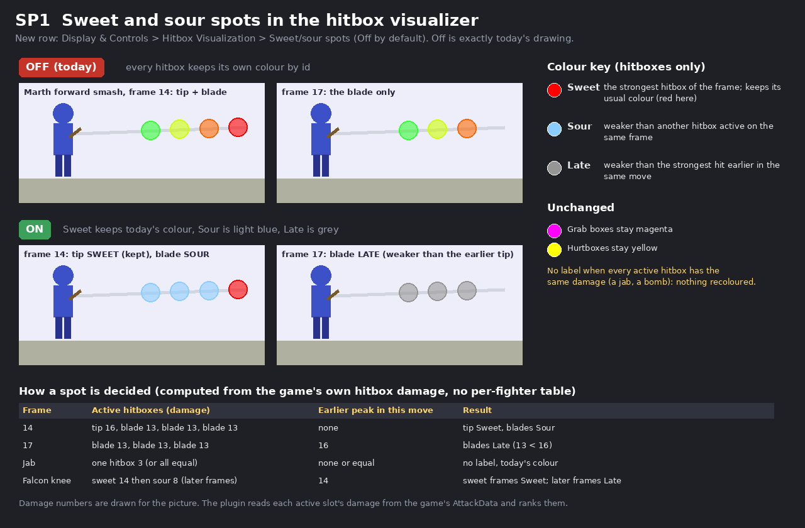

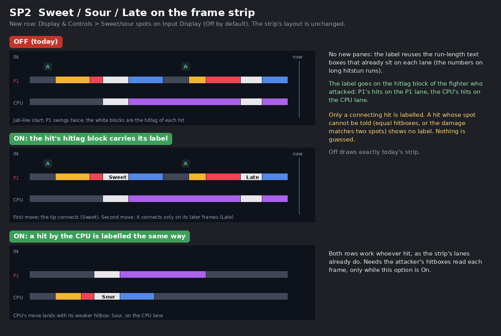

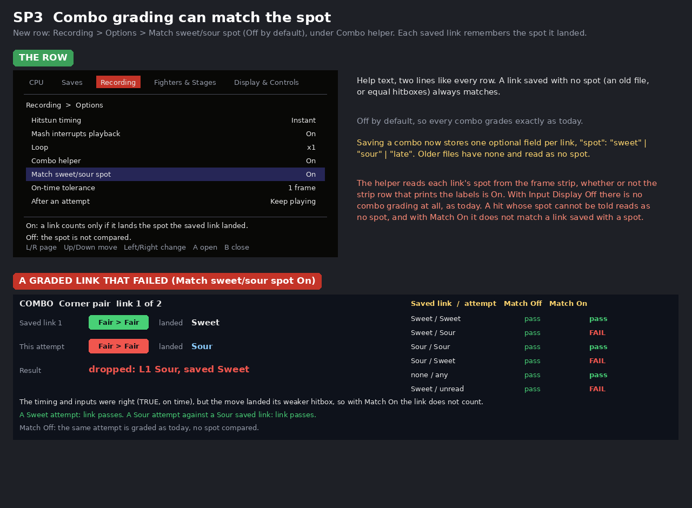

## Decided (2026-11-14, evening): the setup library

| Setup library decision | 2026-11-14, about 18:07Z |
| --- | --- |
| SL1 | Approved |
| SL2 | Full fix now |
| SL3 and SL4 | Added to rc.14 |

- All four go into rc.14: the stage and spots on the list, a full rename with X, a setup's own screen with Delete, and "Save setup here".
- The options and recommendations below stay as the record.

Asked for on 2026-11-14 about 17:28Z: improvements to the setup library and its GIFs.

- A review read the code and the two shipped GIFs and drew one mockup per change (`artifacts/setup-library-review/PROPOSAL.md`, not in this repo).
- Line counts are the review's estimates; the size gate measures the real ones.

- **Initial choices at 17:42Z, before the evening decision.**

| # | Change | Where it lands |
| --- | --- | --- |
| SL-A | Rewrite docs plainly. A moves both fighters to the setup once. | docs now; GIFs after SL-B |
| SL-A | Y makes Load go there. Save setup copies your bound save. |  |
| SL-A | Reshoot both GIFs after SL-B; add a Y-then-Load GIF. |  |
| SL-B | **S1:** show the real key legend; “Y delete” was wrong and A/Y never appeared. | rc.14, net about −5 to −1 lines |
| SL-B | **S2:** plain notices. **S4:** a true “nothing saved” message. |  |
| SL-B | **X minimum:** X no longer leaves a stale id. |  |

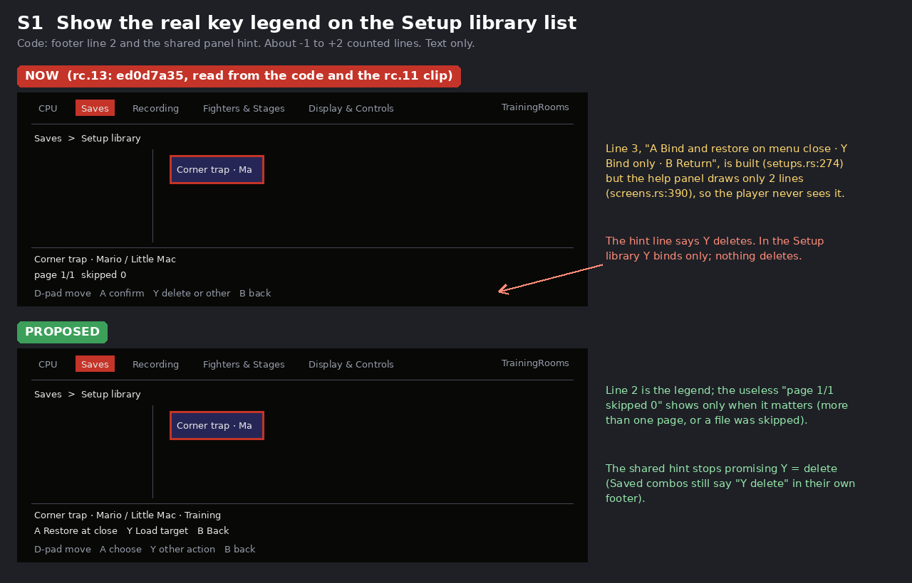

- **Original recommendations and estimated costs.** The evening decision included SL1 through SL4 in rc.14.

| # | Decision | Cost | Recommendation |
| --- | --- | --- | --- |
| SL1 | **S3** show the setup's stage (and the two fighters' spots) on the list | +6 (+6 more for the spots) | Include only if measured total stays ≤ 0; otherwise document the stage only. |
| SL2 | **S5** rename a setup with X | +25 (the minimum fix is +3) | **The minimum now**, rename later |
| SL3 | **S6:** give setups a screen for Restore here, Make Load use it, Rename and Delete. | +60 to +100 | not in rc.14 |
| SL3 | At proposal time players could not delete a setup in game. |  |  |
| SL4 | **S7: Save setup here** stores both fighters' current spots without overwriting the bound save. | +40 to +70, medium-high risk | not in rc.14; it also makes setups more like the Recording page's saves |
| SL4 | At proposal time, pressing Save first replaced the bound save. |  |  |

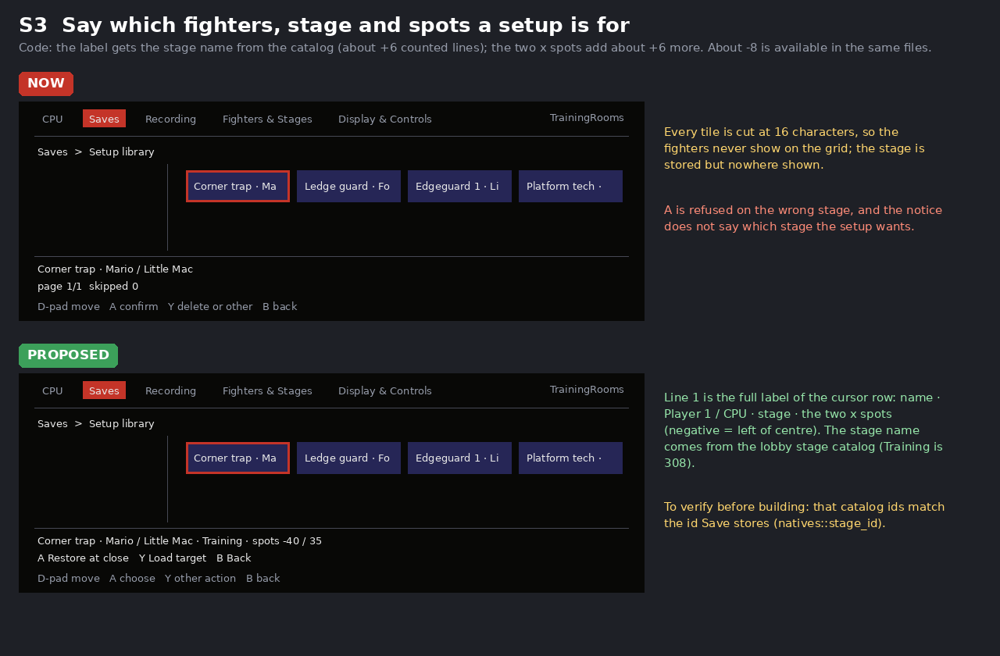

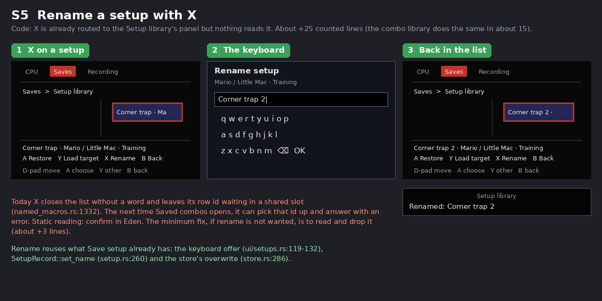

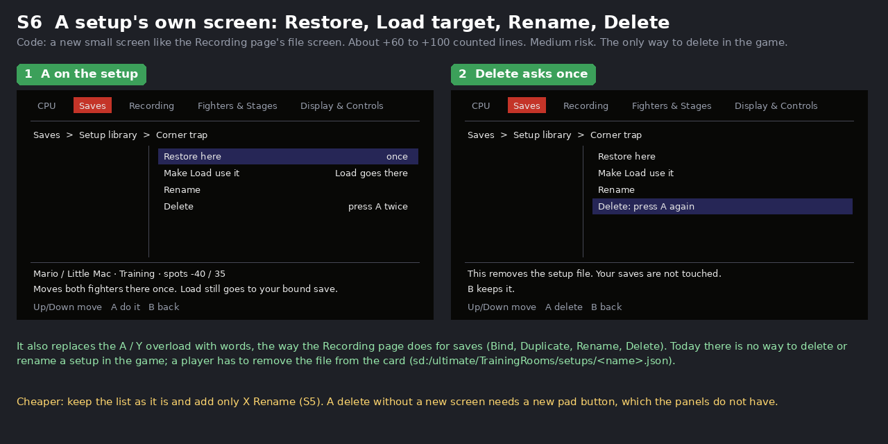

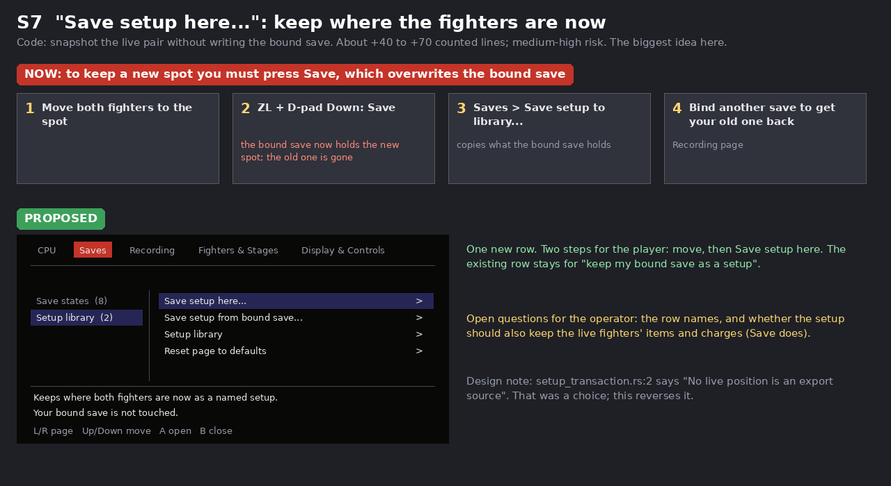

<a id="open-2026-11-1314"></a>

## Decisions from November 13–14, 2026

| Decision pictures | How to read them |
| --- | --- |
| Recommended option | **Green outline** |
| Default renderer | `tools/render_decisions_1113.py` |
| rc13-DI-lines | Author-2's mockup as drawn |
| rc13-memory | `tools/render_rc13_memory.py` |

- Opened by the primary for the operator from the lanes' reports of 2026-11-13 (rc13-hitbox-pills and rc14-eggs: 2026-11-14).
- **Every item is now decided**, and each says **Decided** under its heading: TR1–TR9 and OP1–OP8 on 2026-11-13 (~11:50Z, OP3 changed on 11-14), rc13-DI-lines, rc13-memory and rc13-hitbox-pills as dated, and rc14-eggs on 2026-11-14 (~13:00Z).
- The options and recommendations below stay as the record.
- Each item says what is being decided, the options with their cost to the player, and a recommendation.

- "The held fix" means `c49681c9`: worker A's in-game text fixes, then local, included in rc.12 as `900a1f48` (`artifacts/phase23/docs-audit-1113/WORKER-A-TEXT-FIXES.md`).
- TR1–TR8 come from the docs lane's audit of in-game text (`CODE-FINDINGS.md`; its row numbers are given as #n).
- TR9 comes from integration's reports of 10:40Z and 10:49Z.

| # | Decision | Recommendation |
| --- | --- | --- |
| TR1 | Playback Slot 1–5 and Hitstun timing (#8) | **Decided 11-13: C, implement**: a macro plays as Playback Slot 1–5, rc.12 `582c9831` |
| TR2 | Size gate after integration's #23, #15 and #25 fixes | **Decided 11-13: (b), no raise**: dead code deleted, rc.12 `972f4e02` and `f37a3699` |
| TR3 | HUD Off (#2) | **Decided 11-13: A, keep it**; the help line was fixed |
| TR4 | Pummel Delay without a Throw (#4) | **Decided 11-13: B, pummel with Throw None**, rc.12 |
| TR5 | Respawn on platform with Save States Off (#9) | **Decided 11-13: B, make it work**, rc.12 |
| TR6 | Ask before switching fighter (#13) | **Decided 11-13: B, every question follows the row**, rc.12 |
| TR7 | Crop trailing neutral (#14) | **Decided 11-13: B, make Record trim**, rc.12 `33f9ccc8` |
| TR8 | Player Character with Player Swapping Off (#17) | **Decided 11-13: B, a pick loads now**, rc.12 |
| TR9 | Retire the old Record trigger row (V2), or keep its legacy start | **Decided 11-13: A, V2, retire the row**, rc.12 `f37a3699` |
| rc13-DI-lines | DI chips like the game's blue DI indicator (A–D rejected) | **Decided 11-13: E1 x1**, all 4 layers at today's width |
| rc13-memory | Memory levers for TrainingRooms' share | **Decided 11-13: dropped**, no lever implemented |
| rc13-hitbox-pills | Hitbox Visualization draws capsules as pills, not rows of discs | **Decided 11-14: pills in rc.13**, with grab boxes in their own colour |
| rc14-eggs-D1 | Eggs-ercise: the object | **Decided 11-14: (a) with hitlag, and (c) as an option**; a break animation (13:13Z) |
| rc14-eggs-D2 | Eggs-ercise: where eggs appear | **Decided 11-14: (c)**, the stage's camera range, on screen; Melee-like physics with a speed row |
| rc14-eggs-D3 | Eggs-ercise: what breaks an egg | **Decided 11-14: (b)**, Any attack by default; Aerials and 12 %+ stay as values |
| rc14-eggs-D4 | Eggs-ercise: end and scoring | **Decided 11-14: (a) and (c)**: 1 minute, 10 and 20 targets, Free practice |
| rc14-eggs-D4.5 | (new) Break the Targets | **Decided 11-14: a new mode**: place targets on a zoomed-out stage, then break them |
| rc14-eggs-D5 | Eggs-ercise: the HUD | **Decided 11-14: (a)**, TR's standing notice |
| rc14-eggs-D6 | Eggs-ercise: the CPU | **Decided 11-14: (a)**, with Hide CPU (D6.5) |
| rc14-eggs-D6.5 | (new) Hide CPU | **Decided 11-14:** general Hide CPU plus a practice-game hide setting (13:19Z). |
| rc14-eggs-D7 | Eggs-ercise: the menu place | **Decided 11-14: (b)**, new Practice games group. |
| rc14-eggs-D7 |  | Since 11-18: one row and sub-screen per game (rc.15 practice menu). |
| rc14-eggs-D8 | Eggs-ercise: where it works | **Decided 11-14: (a)**, Training and waiting-room practice |
| rc14-eggs-D9 | Eggs-ercise: restart | **Decided 11-14: (a) and (c)**, L+R+A and reopening the menu. |
| rc14-eggs-D9 |  | **11-18 reversed (c)** under rc.15 practice menu Q1 A. |
| rc14-eggs-D9 |  | Only Start and Stop act. Closing restarts nothing, including Break the Targets. |
| OP1 | Push the held doc fixes | **Decided 11-13: A, done 11-13**: Deluxe `5f9759f`, worker A's 17 commits, the four copies reconciled |
| OP2 | The standalone `libimgui_smash.nro` on the card | **Decided 11-13: A, removed 11-13** (`removed_verified` 11:55:06Z); the standalone updated as imgui-smash 1.2.0 |
| OP3 | Deluxe's hidden Stages + Counterpick page | **Decided 11-14: B.** Keep the already-hidden card page hidden, reversing 11-13's A. |
| OP4 | elite-stages-counterpick and ssbu-cpu-pilot are private | **Decided 11-13: A, both public 11-13** |
| OP5 | The old Deluxe in Elite's release ZIP | **Decided 11-13: A, dropped 11-13** (release 473) |
| OP6 | Releases and tags that lag the card | **Decided 11-13: A, released 11-13** |
| OP7 | LICENSE for six repos | **Decided 11-13: A, MIT, pushed 11-13** |
| OP8 | Operator quotes in instant_back's design files | **Decided 11-13: A, paraphrased 11-13** (`32135ef`) |

### TrainingRooms

All nine were decided on 2026-11-13 about 11:50Z: TR1 the slots are fixed so that they work; TR4 the behaviour is wrong and is fixed; TR5 fixed; TR2, TR3, TR6, TR7, TR8 and TR9 agreed as proposed.

#### TR1 · Playback Slot 1–5 and Hitstun timing (#8)

- **Decided 2026-11-13 (~11:50Z): C, implement.** Integration built it for rc.12: a macro's page has "Playback slot" (None, Slot 1–5), and the CPU's Playback Slot actions play that macro once (`582c9831`; INBOX 11-13 15:45Z).
- Hitstun timing uses a Playback Slot.

- What to do with entries that are offered but can never work.
- Mash, Followup and the Situation overrides offer Playback Slot 1–5 among their 30 actions, and Ledge Options among its 10.
- Nothing ever fills a slot: Load never starts a slot recording, and no row opens the slot copy.
- So a ticked slot refuses "Record into this slot first", and Recording › Options › Hitstun timing does nothing.

- **A · hide them:** the four lists skip the five entries, and Hitstun timing is hidden. Saved settings keep their
  shape. Cost to the player: none. To build: 30–60 code lines, tests, one Eden pass. Removing the entries outright,
  instead of hiding them, frees lines (TR2) but changes the saved rows' lengths.
- **B · label them:** five help lines and the refusal say the slots do nothing. Cost to the player: the dead options
  stay, and those help lines lose what they say now. Changing the refusal needs an approved restriction.
- **C · implement:** a new row copies a library macro into a slot for the session. Cost to the player: none. To build:
  about a day, Eden re-validation of slot playback (unused since rc.5), a size-budget raise, and two playback systems
  to explain.

- **Original recommendation: A.** Players stop meeting options that can't work, at a fraction of C's cost, and it lets TR2 (b) delete the slot code.

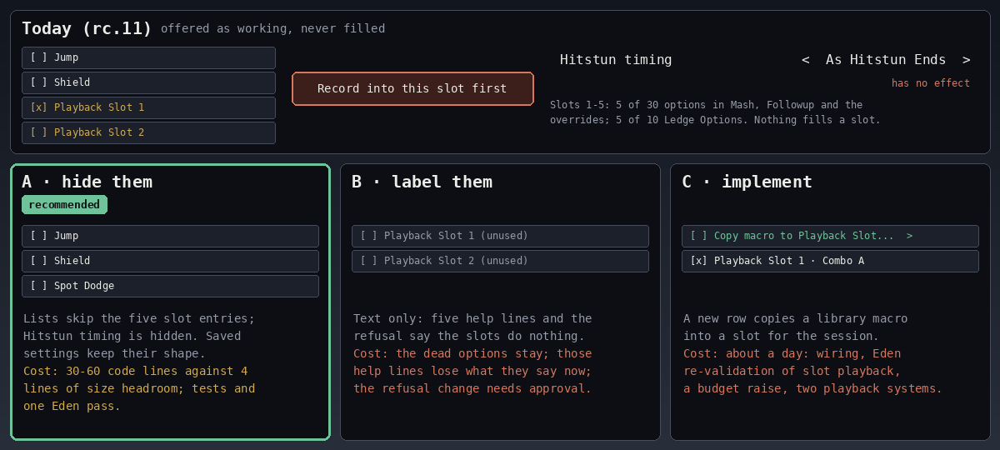

#### TR2 · The size gate after integration's #23, #15 and #25 fixes

- **Decided 2026-11-13 (~11:50Z): (b), no raise.** With TR1 at C the slot playback stayed, so integration deleted the code nothing reaches instead: TR9 V2's retired trigger and the old named capture (`f37a3699`, −355 lines; INBOX 11-13 15:25Z), then the old numbered recorder (`972f4e02`; INBOX 11-13 16:35Z).
- The ceiling was not raised.

- How to make room for integration's three bug fixes: the pop-up's B close, the Loop list, and the Setup library's restore after a live swap.
- On top of the held fix they put the code 35 lines over `size-budget.toml`: 147,956 against a ceiling of 147,921 (integration, 10:40Z).
- TR9's V1, approved and being built, takes 4 off, so about +31 (147,952); integration reports the exact number on its commit.

- **(a) · raise the ceiling by 31:** a new `[[budget]]` entry with the lead's approval. Cost to the player: none.
- **(b) · delete the old numbered-slot recorder:** nothing reaches it (#14). Its smallest cut that touches no carried
  file frees 258 lines, which covers the 31; all of it is 1,096 lines. Cost to the player: none. To build: a rebase
  and re-measure, and an Eden check of the settings migration it touches.
- **Not part of (b):** the old named capture (354 lines), the (b)(ii) path. Settings files written by v0.1.0 to
  v0.2.0-rc.3.1 (Source Named Library plus Trigger Save State Load) still start it on every load. If TR9 is V2, that
  last route ends, and those 354 lines can go too.
- **More, only with TR1 A done by removal:** removing the #8 entries outright frees 268 more on top of (i), (ii) and a
  24-line flag nothing sets. It changes the saved rows' lengths; hiding them while keeping the lengths was not
  measured.

- Integration's measurement: `artifacts/phase23/tr-fix-23-15/SIZE-OPTION-B.md`, in the workspace.

- **Original recommendation: (b), together with TR1 A.** Code that can't run costs nothing to delete, and the budget stays a real limit.
- If TR1 is C, the slot code is needed: then (a).

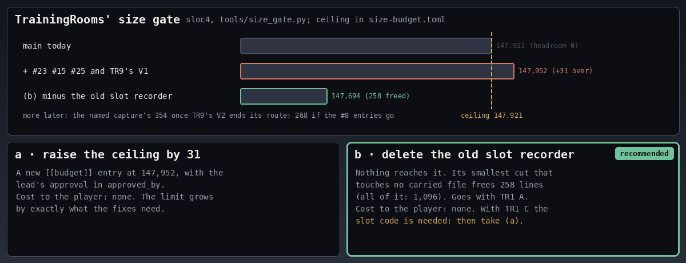

#### TR3 · HUD Off (#2)

- **Decided 2026-11-13 (~11:50Z): A, keep it.** Only the help line changed, in worker A's text fix (`c49681c9`, landed in rc.12 as `900a1f48`).

Whether HUD Off should keep hiding the game's own HUD.

- That is what it does, not what rc.11's help line says.

- **A · keep it:** Off hides the damage and stock panels, item pointers and off-screen bubbles, as Training Modpack's
  HUD row did ("Show/hide elements of the UI"). The held fix says so. Cost to the player: none.
- **B · build what rc.11 described:** a plugin HUD for On to draw. Cost: new design and code, and Off would no longer
  give a clean screen.

- **Original recommendation: A.** It is upstream's behaviour and the useful one; only the text was wrong.

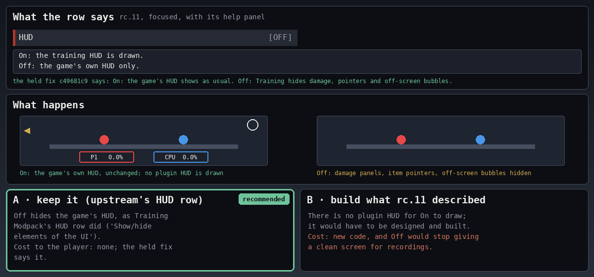

#### TR4 · Pummel Delay without a Throw (#4)

- **Decided 2026-11-13 (~11:50Z): B, pummel with Throw None.** Today's behaviour was judged wrong.
- Worker A, for rc.12: with Throw None a Pummel Delay pummels on the same cadence, and the hold ends when the held fighter breaks free (`c1905941` as posted; INBOX 11-13 12:28Z).

Whether Pummel Delay should pummel when Throw is None, the default.

- Today the CPU pummels only while it waits out Throw Delay, with a Throw set.

- **A · keep it:** as Training Modpack does; the held help line says to set a Throw. Cost to the player: Pummel Delay
  alone does nothing.
- **B · pummel with Throw None too:** the CPU holds and pummels until the grab ends. Cost: behaviour upstream never had,
  a choice of what ends the hold, and an Eden check.

- **Original recommendation: A.** It matches upstream, and the help line now explains it.

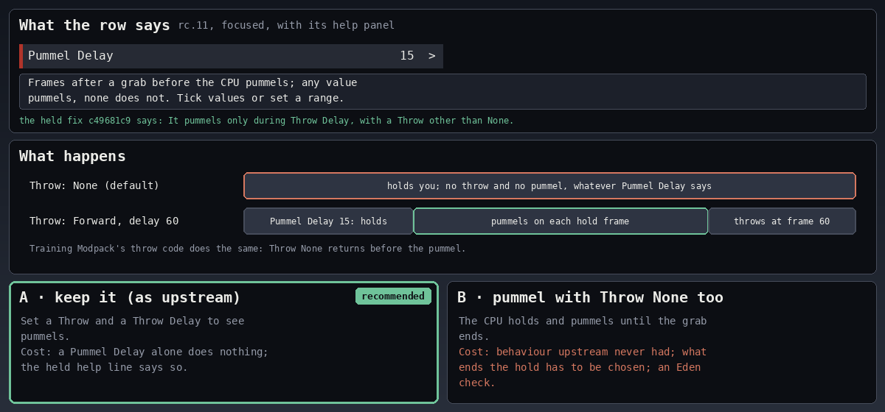

#### TR5 · Respawn on platform with Save States Off (#9)

- **Decided 2026-11-13 (~11:50Z): B, make it work.** Worker A, for rc.12: Respawn on platform works with Save States Off (`f0fb22f7` as posted; INBOX 11-13 12:28Z).

Whether Respawn on platform Off should give an instant respawn with Save States Off.

- Today the row is ignored then, and the revival platform appears.

- **A · keep it, and approve a restriction:** the held help line says "only while Save States is On". That line needs
  an approved restriction ID. Cost to the player: Off does nothing with Save States Off.
- **B · make it work:** answer the respawn parameters in practice whatever Save States says, as Training Modpack does.
  Cost: a small change in `state/hooks.rs`, a test, one Eden KO.

- **Original recommendation: B.** The row sits on another page from Save States, and nothing tells the player they're linked.
- Upstream doesn't link them.
- B also settles one of the held fix's two flagged compliance lines.

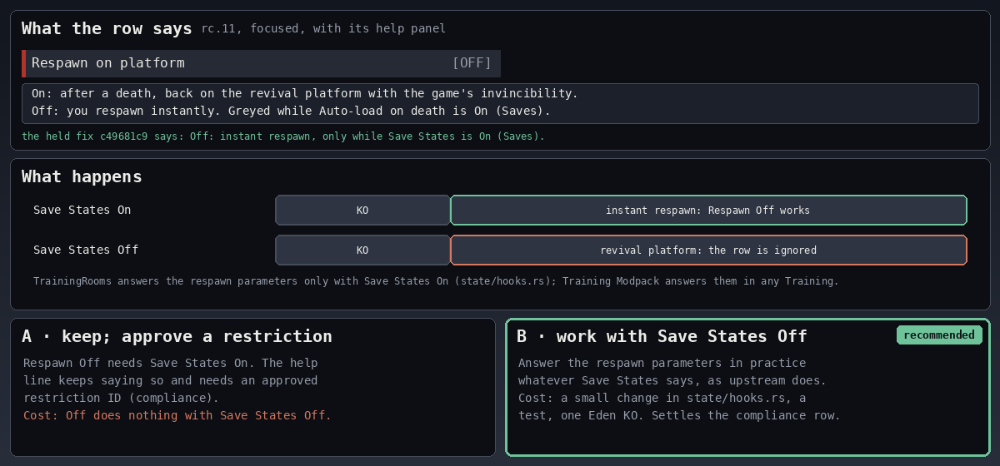

#### TR6 · Ask before switching fighter (#13)

- **Decided 2026-11-13 (~11:50Z): B, every question follows the row.** Worker A, for rc.12 (`58e07de0` as posted; INBOX 11-13 12:28Z).

Whether this row should govern every fighter question.

- Today only the Replay window reads it.
- Play chords on a macro or a chain, and combo drills, ask Fighter Mismatch whatever it says.

- **A · keep it:** Off affects the Replay window only. Cost to the player: the other three still ask with the row Off.
- **B · every question follows the row:** Off keeps the current fighter everywhere. Cost: a small change in `rr_host`,
  tests, one Eden check.

- **Original recommendation: B.** A player who turns the question Off expects it gone everywhere: one row, one meaning.

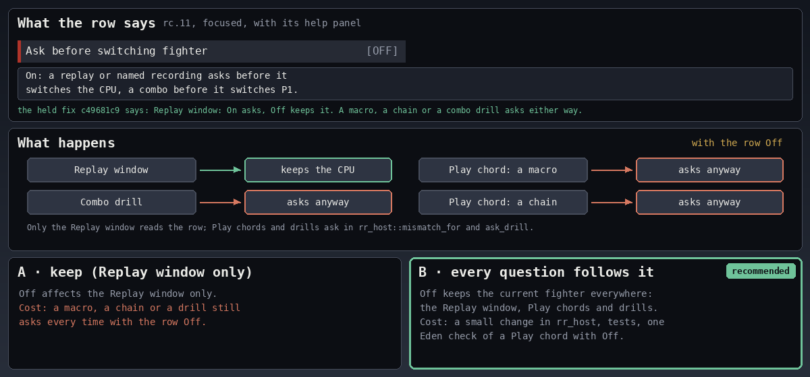

#### TR7 · Crop trailing neutral (#14)

- **Decided 2026-11-13 (~11:50Z): B, make Record trim.** Integration, rc.12 `33f9ccc8` (INBOX 11-13 16:11Z).

Whether Record should drop the idle frames at the end of a recording when this row is On.

- Today Record never reads the row.
- Of its two old readers, the slot recorder can't be reached, and the named capture starts only from settings of v0.2.0-rc.3.1 or older.

- **A · remove the row:** Crop on a macro's screen stays. Cost to the player: upstream's automatic trim is gone.
- **B · make Record trim:** as upstream's Recording Crop did (default On). Cost: a few lines and a test, and one Eden
  take. A recording meant to end idle needs the row Off.

- **Original recommendation: B.** It is what the row promises and what upstream did, for little code.

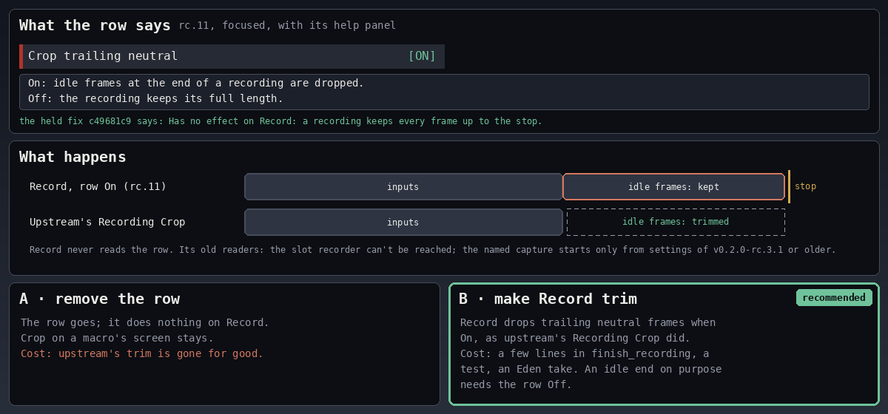

#### TR8 · Player Character with Player Swapping Off (#17)

- **Decided 2026-11-13 (~11:50Z): B, a pick loads now.** Worker A, for rc.12 (`b4eb42be` as posted; INBOX 11-13 12:28Z).

Whether a portrait pick should load Player 1's fighter with Player Swapping Off.

- Today the pick is dropped with no notice and loads only when Player Swapping goes On.

- **A · keep it, and approve a restriction:** the held help line says so. That line needs an approved restriction ID.
  Cost to the player: the pick looks broken.
- **B · a pick loads now:** like a combo's Switch, which already loads with Player Swapping Off. Player Swapping keeps
  governing the cycle chord, and its help line ("Off: only a combo's Switch changes Player 1") gains the pick. Cost:
  one argument in `character_roster.rs`, a test, one Eden pick.

- **Original recommendation: B.** A pick is an explicit request, and the Switch already works this way.
- B also settles the held fix's other flagged compliance line.

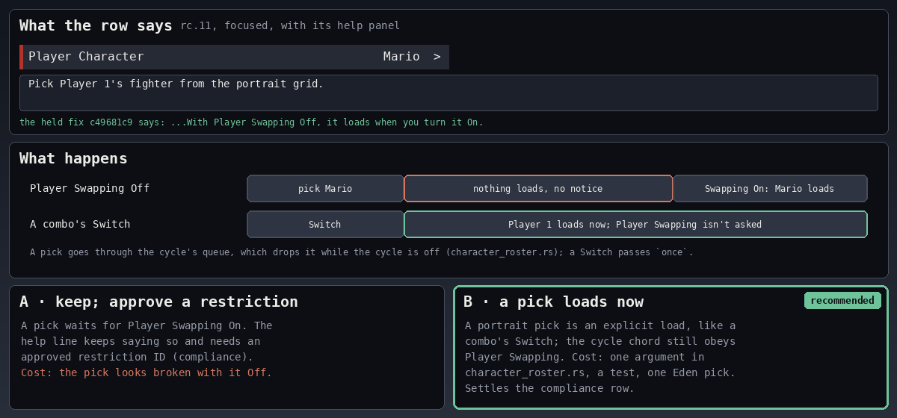

#### TR9 · Retire the old Record trigger row (V2), or keep its legacy start

- **Decided 2026-11-13 (~11:50Z): A, V2, retire the row.** Integration, rc.12 `f37a3699` (INBOX 11-13 15:25Z).

- Whether to retire the whole obsolete `record_trigger` row, as `migrate.rs` intends ("become nothing").

- All 5 Forgejo releases (v0.1.0 to v0.2.0-rc.3.1) had a Recording-page "Trigger" dropdown, and picking "Save State Load" stored `[0, 1]`.
- `d502615d` took the row off the page, but no tag contains that commit, and the value stays in `settings.json` for good.
- No page shows it, so Reset page and Save defaults never touch it.

- Before the November 13 decision, the hidden value had two effects:
- It silently disables the Record chord (`recorder.rs:674`). **V1, the root fix for that, is approved and being
  built:** the chord ignores the hidden row (−4 sloc4, `recording.rs` and `recorder.rs`).
- If the old file also holds Source = Named Library, every save-state load starts the old named capture. That is TR2's
  (b)(ii) path. The November 13 V2 decision retired this second path.

- The options:
- **A · V2, retire the row:** the old `record_trigger` value no longer triggers capture; migration reads and discards it (−10 sloc4 in all, so −6 beyond V1).
  `begin_restore` loses its `trigger_save_state` branch. Cost to the player: a player whose old file holds both values
  no longer gets the named capture started on every save-state load. To build: an edit to carried `named_macros.rs`
  (a manifest transform and a regenerated ledger), and a test. It ends (b)(ii)'s last route, so TR2 can then delete the
  named capture's 354 lines.
- **B · keep the legacy start:** V1 only. Cost: a behaviour that no menu row shows or turns off stays for those
  players, and the named capture's 354 lines stay with it.

Migrating the stored value instead (rewriting `[0, 1]` to `[1, 0]` on load) adds code and writes the player's file.

- Integration doesn't recommend it.

- **Original recommendation: A.** The row has been invisible since `d502615d`, so the legacy start is behaviour nobody can see or switch off.
- V2 matches the design in `migrate.rs`, and it lets TR2 take (b)(ii)'s 354 lines.

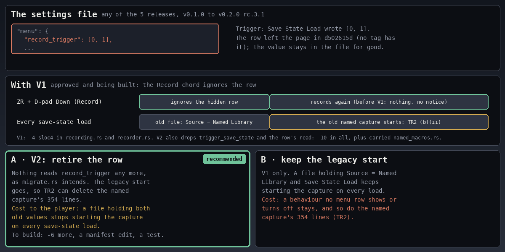

- Not listed: #19 (Give item's item arrives when the menu closes).
- The code's comment gives the reason: a short-fuse item must not expire while the picker still has the inputs.

#### rc13-DI-lines · DI chips like the game's blue DI indicator (rc.13 item 2): E1 x1

- **Decided 2026-11-13 (~22:57Z): E1 x1.** Chosen after the E1 x1 render was shown.
- The look is all four layers of `P_CmnVector` (flare01 glow, tri00 body, line09 streaks, line11 white core) at today's width (`DI_WIDTH_RATIO` 1.2/3.5).
- Cost: +33 panes, no new textures.
- The decided look is the last picture below.

How the pointers on the **CPU › Defence › DI Direction** chips should look.

- Today's lines were judged far too thin.
- None of the first mockup's options suited DI, so A–D (wider or fight-trail-like streaks) are rejected.
- The target is the DI trajectory indicator shown when someone is hit in a match: the blue DI indicator.

- Today (rc.12) each pointer is one picture pane with the streak texture `line09`, in its pale tint, and unweighted chips draw at half tint.
- The game's blue indicator is the effect `P_CmnVector` (`ef_common.eff`), with four picture layers:

| Layer | Picture | Role | Tint |
| --- | --- | --- | --- |
| emitter 4 | `flare01` | the glow | (12, 119, 255) |
| emitter 0 | `tri00` | the body | (0, 177, 255) |
| emitter 1 | `line09` | the streaks (today's only layer) | (200, 244, 255) |
| emitter 2 | `line11` | the white core | (255, 255, 255) |

- The options, each at x2 or x3 of today's width (`DI_WIDTH_RATIO` 1.2/3.5):
- **Today (rc.12):** `line09` alone. Cost to the player: the hairline stays.
- **E1 · all 4 layers** (flare01 glow + tri00 body + line09 streaks + line11 white core). Cost: **+33 panes** (3 more
  layers × 11 chips) in the menu layout (`tools/layout-builder`).
- **E2 · glow plus streaks** (flare01 + line09). Cost: **+11 panes** (1 more layer × 11 chips).

- For both: **no new textures.** `ef_common.eff` is resident in Training, and TrainingRooms' loader already finds all four pictures (`describe Di ... pictures=4`).
- E1 and E2 only reference them, so nothing new is loaded.

- **Caveat:** the game blends these layers additively.
- TrainingRooms' panes draw with the layout material's normal alpha, because its UI code has no blend control.
- On the dark navy tiles that is close to the mockup.
- True additive blending would need a BFLYT material change in `tools/layout-builder`, which hasn't been checked.

- **Original recommendation (not taken; E1 x1 was chosen): E2 x3,** for the cost (+11 panes).
- **E1 x2 is the closest to the native look,** because it has the white core, if 33 more panes are acceptable.

- The picture is author-2's mockup (`artifacts/rc13-di-lines/MOCKUP-blue.png` and `NOTE-blue.md`, in the workspace), with its own green outline on E2 x3.
- It is a mockup, not the game's render: the colours and gains come from `P_CmnVector`'s emitters (TrainingRooms' diagnostics), and the layer shapes are approximated.
- The "Native" panel is an Eden crop of the real indicator: Mario's forward smash, CPU at 120 %, DI Up, Game speed 1/4.

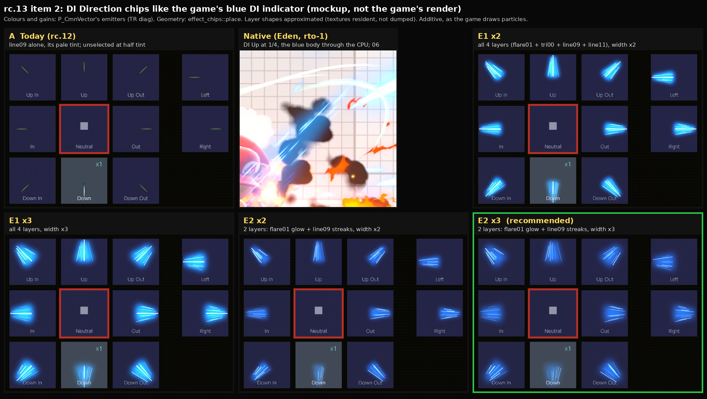

- E1 x1, as the operator asked: all four layers of P_CmnVector at today's width (DI_WIDTH_RATIO 1.2/3.5).
- Cost: +33 panes, no new textures.

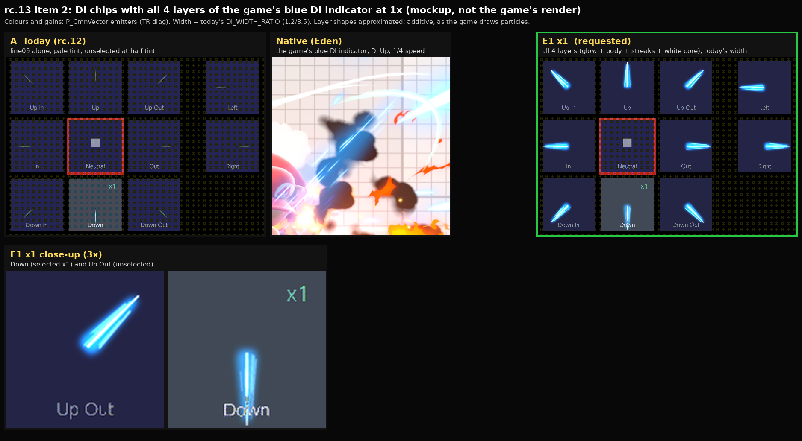

- Eden capture of E1 x1 (additive, as the game draws it): the real textures are thinner and dimmer than the mockup.
- Brightening is a follow-up option (layer gain/width, or a texture swizzle).

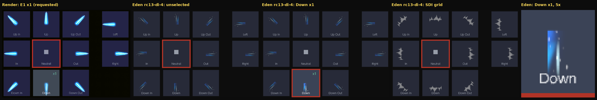

- **Final look (11-14):** E1 x1 as captured in Eden, not brightened.
- The Eden capture was accepted as it is.

#### rc13-memory · Memory levers (rc.13): dropped

- **Decided 2026-11-13 (~22:55Z): dropped; no lever will be implemented.** Memory is already fine, and performance is not to be given up for it.
- The measurements below stay as the record: TrainingRooms' share is 398 MiB on the card settings and about 582 MiB at a cycle-lap peak.

Which levers to build to lower TrainingRooms' memory and widen Training's headroom.

- No feature is dropped by any of them.
- The numbers come from worker B-2's measurements (`artifacts/rc13-memory/MEASURE.md`, in the workspace).
- They are from Eden, on the rc.12 candidate diag, with the card's plugin set.
- The memory budget is 3,285 MiB, the same as the console's.

- **What "about 1 GiB" can mean.**
- **The whole process can't get to 1 GiB.** The game alone uses about 2.1 GiB at the main menu (2,129–2,164 MiB), and
  Training with TrainingRooms' preload Off uses 2,452 MiB. That is the floor in Training.
- **TrainingRooms' own share is already below 1 GiB:**
  - 398 MiB on the card settings;
  - 476 MiB on the defaults;
  - about 582 MiB at the peak of a CPU cycle lap.
- **So the levers lower that share and widen the headroom.**

- **Baseline** (MiB used of 3,285, free in brackets; two boots):

| Scene and setting | rc13-mem-2 | rc13-mem-3 |
| --- | ---: | ---: |
| Main menu | 2,129 (1,155) | 2,164 (1,120) |
| Character select | 2,318 (966) | 2,348 (936) |
| Training, card settings: Preload Both, Ready Fighters 8, Ready Hats 5, 3 bodies, 5 slots | 2,822 (462) | 2,850 (434) |
| Training, preload Off, fresh entry (the game floor) | — | 2,452 (832) |
| Training, defaults: Both, Ready Fighters 10, Hats 5, 3 bodies, fresh entry | — | 2,928 (356) |
| CPU cycle lap, 4 steps, after the defaults (peak) | 3,034 (250) | — |

- At the cycle-lap peak, a helper was refused for memory (it needed 272.8 MB with 268.3 MB of headroom), and TrainingRooms showed "(1 waiting for memory)".
- The rc.11 console sample at the 11-13 hang was 3.05 GB used, 393 MB free.

- **The levers**, as B-2 wrote them.
- Savings are estimates at Training entry on the defaults (2,928 MiB) unless the row says otherwise.

| # | Lever | Estimated saving | Effect on features | Evidence or confidence |
| --- | --- | ---: | --- | --- |
| L1 | Ready Fighters default 10 → 8. The setting stays, with 2–12 available. | 78 MiB | Two fewer prebuilt fighters. Each first pick takes ~0.4–1.0 s versus ~50 ms warm. | measured (2,928 vs 2,850) |
| L2 | Bodies per role default 3 → 2. The setting keeps Off/2/3. | 100–125 MiB | Instant swaps cover two fighters per role; the third requires a group swap. | derived (~61 per body × 2) |
| L3 | Build extra groups on first use instead of Training entry; retain groups and group swaps. | 100–185 MiB at entry | Each extra group's first swap pays its build (~0.4–1.0 s; first pair ~2.1 s). | measured deltas (card 112, defaults 184) |
| L3 |  |  | Subsequent swaps stay warm. |  |
| L4 | Load hats and helper seats on first use (Ready Hats kept). | 40–50 MiB at entry | First hat per fighter: ~770 ms versus ~80 ms warm. Later hats stay warm. | measured deltas |
| L5 | Build start-up bank bodies after the scene's own load settles. | 150–190 MiB of **transient** peak | Banks become ready a few seconds after Training entry; settled usage stays unchanged. | derived from window headroom steps (−181 MiB at creation, −180 when bound) |
| L5 |  |  | Targets the 11-13 abort, 64 ms after the window built three-member banks. |  |
| L6 | Raise the admission floor from 16 to 512 MiB of headroom. | Zero at entry; up to ~260 MiB at peak (cycle lap 3,034 → ≤ 2,773). | More “waiting for memory” while cycling. Affected fighters load on swap; refusals are temporary. | derived from the cycle-lap refusal at a 268 MiB headroom |
| L7 | Trim the plugin image and bss (TrainingRooms bss 1.7 MiB, diag ring and stacks). | 1–2 MiB | None | measured NRO header; too small to matter |

- B-2's combined estimates: L1 + L3 + L4 brings Training entry to about 2,620–2,700 MiB (585–665 MiB free); L2 on top gives about 2,500–2,600 MiB.
- L5 + L6 lower the peaks, not the settled figure.

- **Original recommendation (not taken; the item is dropped): L5 + L6 as the core, plus L4.**
- **L5 + L6:** they are peak-safety levers aimed at the 11-13 console abort. Neither changes the settled figure or any
  default.
- **L4:** hats and helper seats load on first use. It saves 40–50 MiB, and only the first hat per fighter is slower.
- **L1, L2 and L3 are offered, not recommended.** They trade swap speed for memory.

- Limits (MEASURE.md §5):
- One run per state; the two boots agree within 35 MiB.
- L2 and L4 are derived from build deltas, not fresh entries.
- Eden carried about 60–90 MiB less than the console's 11-13 sample.
- No waiting-room or online scene was measured.

- The picture is redrawn from B-2's `01-baseline.svg` and `03-levers.svg` by `tools/render_rc13_memory.py`; the per-lever charts are `lever-1..7.svg` in the same folder.


#### rc13-hitbox-pills · Hitbox Visualization draws capsules as pills (rc.13): pills in rc.13

- **Decided 2026-11-14 (~03:49Z): pills in rc.13, and grab boxes in their own colour alongside.** The mockup was judged much cleaner.

Opened 2026-11-14 with the question whether pill shapes are used where they should be.

- Today, no.

- **Before rc.13:** each capsule hitbox or hurtbox (a shape with two centres) was drawn as a row of overlapping discs (2–16).
  Its edges are scalloped, and the discs show darker lenses where they overlap.
- **The proposal:** each capsule is drawn as one pill: two half-disc caps plus a band between them, in the same colour
  and alpha. A one-centre hitbox stays a disc. The pane count is a wash: 110 → 112 on Ridley vs Ridley, standing.
- **Cost:** about +70 lines. Worker B-2's parked feature-neutral size cuts (−172) cover it.
- **The rule change:** SPEC-core-06's `sphere_count` rule (ceil(distance / (size x 1.75)) + 1, clamped 2..=16) is
  retired.

- **Original recommendation: adopt the pills in rc.13.**

- The pictures are worker B-2's mockup from an Eden run (`artifacts/rc13-pills/`, with `PILL-DESIGN.md`, in the workspace).
- Ridley vs CPU Ridley, Hitbox Visualization On.
- Panel 1 is the real Eden frame with today's orbs.
- Panel 2 is the pre-rc.13 discs redrawn from the dumped panes.
- Panel 3 is the same capsules as pills.
- Every position and size comes from the dump.


#### rc14-eggs · Eggs-ercise mode (rc.14): nine decisions

<video src="https://git.syntaxbyexample.com/intpa/TrainingRoomsForUltimate/media/blob/17726eb104066a56c6d3fdb7be88614e5e01ec5f" autoplay muted loop playsinline controls></video>

*A jab leaves the egg intact. A neutral air breaks it.* [Open the clip](media/rc14-eggs-demo.mp4)

The draft used the one-minute setting. The clip shows the counting notice and the next egg at 25% hit speed.

Draft built at the recommended defaults; watch for the egg's look (D1), the notice size (D5) and the rise (D2).
- **One Eden run, no splice** (Training, P1 Fox, CPU Mario, draft `5b8c3fd0`). The egg before each hit was placed by
  a test hook so the hit can land; the egg after the break is the draft's own random spawn.
- **Spawns stay on screen in this draft.** On the earlier draft 4 of 6 random spawns were out of view; `5b8c3fd0`
  keeps them on screen and clear of the notice. The jab's egg is half behind the notice because the test hook put it
  at jab reach.
- **A new egg rises after it spawns**, and the arc can still pass the top of the screen briefly. Whether to keep the
  movement is D2's sub-choice.


- **Decided 2026-11-14 (~13:00Z):**

| Item | Decision |
| --- | --- |
| D1 | Hitlag is added to the target; the CPU as a target is an option |
| D2 | c |
| D3 | b |
| D4 | a and c |
| D4.5, added | Break the Targets: zoom out, let the player place targets, then break them. |
| D5 | a |
| D6 and D6.5, added | An option to hide the CPU in general; with it, D6 is (a) |
| D7 | B, practice games |
| D8 | (a) |
| D9 | A and c |

- Before that (~12:45Z): the disc looks like a target, its physics are closer to Eggs-ercise, and its speed is configurable for difficulty.
- After it: a break animation when the target is hit, if possible (13:13Z), and a Hide CPU option with a setting for it when a Training game starts (13:19Z).
- The decided design is §V2 of the spec (`artifacts/rc14-eggsercise/SPEC.md`, v2, in the workspace).
- It is built for rc.14; rc.13 takes no Eggs-ercise code.

- Opened 2026-11-14 for rc.14: an Eggs-ercise mode in which the player practises aerials by hitting an object, as a clean-room port of UnclePunch's Eggs-ercise tool.
- In UnclePunch's Melee Training Mode, eggs appear around the stage one at a time and you break as many as you can in one minute.

- The full behaviour, what is known of the Melee tool and what isn't, is in the draft spec (`artifacts/rc14-eggsercise/SPEC.md` in the workspace, proposed as `SPEC-input-08-eggsercise`).
- It is clean room: taken only from videos, transcripts and release-note prose; no source of the Training Mode or any fork was read.
- The pictures are integration-2's mockups from the spec; the recommended option has a green **recommended** badge.
- Line counts are rough, in the size gate's normalised lines; the size gate is not raised for this feature (the spec's D10).

##### D1 · The object

- **Decided: (a) with hitlag, and (c) as an option.** The disc becomes TR's own bullseye target.
- The proposal allowed native hitlag or a six-frame freeze modelled on Melee.
- A short break animation of our own plays (13:13Z).
- A row "Target: Disc / CPU" makes the CPU the target, held still and reset after each hit.

- The [shipped rule](../src/model/eggs_tests.rs) freezes Player 1 for six ticks on fighter breaks. Player 1's articles can break a target without freezing the fighter.
- **Changed 2026-11-15 (the operator, ~02:20Z):** the CPU target is no longer held still.
- It flies the disc's flight (launched up, a little drift, one bounce, then it stands where it landed), Target speed applies to it, and in the air it shows the game's own falling pose.
- Hits count in the air and on the ground as before.
- This reverses SPEC-eggsercise V2.1's "the CPU stays still" (2026-11-14).
- The rc.14 preview GIFs of the CPU target record the stationary CPU from that build (`rc14-eggs-cpu-target`).

D1 target look (B-2, `ab35f8f8`): our own bullseye, plus a cracked frame for the break animation.

- Eden stills, 2026-11-14 (run `rc14-egg-target-2`, 6/6 PASS):


- What the player hits.
- **(a) A TR-drawn egg:** a white disc TR draws itself, like the hitbox orbs, tested against Player 1's attack spheres
  that TR already reads. Nothing changes in the game, so it is safe in a waiting room. There's no hitlag on a break.
  About 170–230 lines.
- **(b) A real game item** spawned on the stage: real hitlag and knockback, closest to Melee. TR has no way to place an
  item at a point today (needs new reverse engineering), and a waiting-room item might be seen by the other consoles.
  About 220–320 lines.
- **(c) The CPU as the target,** moved to each spot and held still: real hitlag, but a fighter-sized target, not a
  small egg, and it fights the CPU settings, save states and swaps. About 130–180 lines.

- **Original recommendation: (a).** The draft left hitlag open in Q1.
- On November 14, D1 added hitlag on a break.


##### D2 · Where eggs appear

- **Decided: (c).** On November 14, the spawn box was limited to the visible camera range.
- The [November 19 ruling](#spawn-area-2026-11-19) kept In view as the default and added Whole stage.
- Targets launch straight up, fall, bounce once and rest, as in Melee, and a "Target speed" row (Normal, Slow, Fast) sets the difficulty (~12:45Z).

- **(a) A box around the stage centre:** random in a fixed width and height above the ground. The smallest; wrong on
  very wide or off-centre stages.
- **(b) A ring around Player 1:** always reachable, but never makes you cross the stage, as Melee does. About +10
  lines.
- **(c) From the stage's camera range:** the best fit per stage; TR reads no stage bounds today. About +30–60 lines and
  reverse engineering.

Each new egg keeps a minimum distance from the last one (two eggs in one hit stay possible).

- On appearing, the egg rises and falls back to its height, as in Melee.

- **Original recommendation: (a), with the minimum distance and the rise-and-fall on.** No movement option in rc.14.


##### D3 · What breaks an egg

- **Decided: (b).** Any attack is the default; the row stays, as "Breaks on", with Aerials and Hits of 12%+.

- **(a) Aerials only:** what the operator asked for. About +5–10 lines.
- **(b) Any attack.** No extra lines.
- **(c) Hits of 12 % or more,** Melee's default rule. About +15–25 lines. Ultimate's damage differs from Melee's, so
  12 % passes a different set of moves.

Under the November 14 rule, projectiles could not break an egg.

- On November 18, TR15-GAMES allowed Player 1's articles to break targets under the selected hit rule.

- **Original recommendation: one row, "Eggs break on", default Aerials, with Any attack and Hits of 12%+ as its other values.**


##### D4 · End and scoring

- **Decided: (a) and (c).** The modes are 1 minute, 10 targets, 20 targets and Free practice.
- The N-target modes count up and keep the fastest time per fighter.

- **(a) 1 minute, and Free practice** (no timer, the count goes up).
- **(b) 1 minute only.**
- **(c) N eggs against the clock.**

- **Original recommendation: (a).** The minute is counted in game frames, so a pause, the menu or a slower game speed stretch it the same way.
- At the end a notice reads "Time! 23 eggs (best 31)".
- The best is per fighter, for this session only; it isn't saved.


##### D4.5 · Break the Targets (new)

- **Decided: a new mode.** TR's own design, with nothing taken from Nintendo's stages or art:
- The camera shows the whole stage.
- A cursor places up to 10 targets: A places, B removes the last, X starts.
- The clock starts on the first input and stops at the last break. The best time is kept per fighter and per layout.
- Layouts are kept per stage for the session.
- **Saved layouts (decided 11-14, ~19:50Z):** the Recording convention, not the five numbered slots per stage first
  proposed (SPEC V2.5, `targets/<stage>.json`, never shipped).
  - Each saved layout has a file in `layouts/`. The list shows the current stage's layouts, with the five most recently used first.
  - A opens a layout's Load, Rename, Duplicate and Delete screen. While placing, Save creates a file. ZL + D-pad Left / Right step through the five.
  - Design and mockup: `artifacts/rc14-btt-layouts/DESIGN.md` (the list drawn as the Recording lists, option A).


##### D5 · The HUD

- **Decided: (a).**

- **(a) TR's standing notice,** updated in place: `Eggs 12   0:43`.
- **(b) New panes at the top left like Melee** (a counter and a timer). Changes the layout archive; costs more.

- **Original recommendation: (a).**


##### D6 · The CPU

- **Decided: (a)**, with Hide CPU as its own feature (D6.5): with that feature added, D6 stays (a).

- **(a) Leave it:** the CPU follows the CPU page as usual; hits on it don't count. No extra lines.
- **(b) Park it** in a corner while a run is live. About +30–50 lines.
- **(c) Hide it** as well. About +40–60 lines.

- **Original recommendation: (a)** for rc.14; the help says the CPU page still applies.
- Revisit if play in Eden shows the CPU in the way.


##### D6.5 · Hide CPU (new)

- **Decided: a general Hide CPU.** On, the CPU is invisible, can't be hit, doesn't collide and doesn't act.
- Off puts it back where it was.
- The general Hide CPU setting takes precedence over a CPU target. The [practice-only setting](../src/model/eggs_tests.rs) leaves the CPU visible when it is the target.
- A second setting, "CPU during a game" (Hide or Show), hides it while a practice game runs (asked for at 13:19Z, with the Hide CPU option).
- When the CPU is the target (D1), a practice game never hides it.

##### D7 · The menu place

- **Decided: (b).** A new group, "Practice games", is appended to the menu, so no group index moves.

- **(a) Fighters & Stages › Extras,** after Give item: two rows, "Eggs-ercise" (Off, 1 minute, Free practice) and
  "Eggs break on" (D3). No new editor or chord.
- **(b) A new group** appended to the menu, such as "Practice games".

- **Original recommendation: (a).**


##### D8 · Where it works

- **Decided: (a).** What changes game state (hitlag, Hide CPU, the zoomed camera) is used in a waiting room only after an LDN check.
- The November 15 check cleared hitlag for the waiting room; the [eligibility test](../src/model/eggs_tests.rs) records the result.

- **(a) Training and waiting-room practice,** like every other TR practice feature. The egg is drawn on this console
  only; the others in the room see nothing.
- **(b) Training only.**

- **Original recommendation: (a)**, which is safe only with D1 (a).


##### D9 · Restart

- **Decided: (a) and (c).**

- **(a) L+R+A:** the reset also starts a new run (score 0, 1:00, a new egg).
- **(b) Loading a save state.**
- **(c) Reopening the menu and closing it.**

- **Original recommendation: (a)**, and (c) always works, also with L+R+A Reset Off.
- A save-state load keeps the run going.

- **2026-11-18: (c) is reversed** by the rc.15 practice menu (Q1 A, above): closing the menu no longer starts or restarts any practice game, and B leaves a running game running.
- Start in a game's sub-screen starts it (with the game running it reads Stop) and Stop ends it: these are the only places a game starts and stops.
- L+R+A still restarts.
- The same holds for Break the Targets, which (c) had carried too: a close no longer puts its course back to Ready or resets its clock.
- Loading a saved layout while it runs is the one other change to a running course: the Load replaces the course and goes back to Ready with it.


### Other projects

- All eight were decided on 2026-11-13 (~11:50Z): OP1 and OP3 to OP8 as proposed; OP2 removed from the card, with the standalone copy in the fork kept up to date with what is baked into Deluxe.
- The lanes carried them out the same day.
- On 2026-11-14 they were answered again, because this section still read as open: OP1 push, OP2 remove it, OP3 b, OP4 yes, OP5 to OP8 a.
- That confirms every item except OP3, which is now B.

#### OP1 · Push the held doc fixes

- **Decided 2026-11-13: A, done 11-13** (confirmed 11-14).
- Worker A pushed its 17 commits in 13 repos (INBOX 11-13 11:39Z) and reconciled the four copies with nothing lost (11:43Z).
- The Deluxe lane pushed `5f9759f` (11:43Z).
- `c49681c9` went into rc.12 as `900a1f48`.

Whether to push 23 docs-only commits that wait for an order, and when to push TrainingRooms' `c49681c9`.

- All 23 are fast-forwards on their Forgejo `main` (checked 09:40Z).

- **Worker A:** 17 commits in 13 repos:
  - smash-replay-to-mp4 `1cec08a`;
  - ssbu-fx-control `4a23f6e` `0b1723c` `1ece8fb`;
  - smash-gamepad-overlay `98bd483`;
  - ssbu-memory-guard `e6f4e0b` `73f0f94`;
  - ssbu-quiet-elite-switch `51023c6`;
  - ssbu-desync-detector `b7f39a9`;
  - quickplay-cancel-fix `ad957f9`;
  - instant_back `063fbf9`;
  - ssbu-cpu-pilot `6275fe0`;
  - gsp-visualizer `f635098`;
  - ssbu-refresh-clock `d8ac3f9`;
  - ssbu-tile-cursor `8ce7b6e`;
  - elite-rematch `fcd9a38`.
- **Worker A, TrainingRooms:** `c49681c9`, the in-game text. It needs a rebase, and two of its help lines follow TR5 and
  TR8.
- **Integration:** ssbu-mod-playbook `cab8d43` `84bf626` `292f6c1` `13b2e83`.
- **Deluxe lane:** ssbu-online-deluxe-rewrite `5f9759f`.
- **Worker B:** ssbu-stall-press-carry `71dcb0f`.
- **Reconcile first:**
  - the Surface's `~/smash-replay-to-mp4` has uncommitted 10-15 edits in 6 of the same files;
  - the Yoga's `~/instant_back` has 3 commits that aren't on Forgejo;
  - the Yoga's `~/elite-rematch` and `~/ssbu-fx-control` have uncommitted work.

- The options:
- **A · push the docs now:** the 23 commits, once the four copies are reconciled; `c49681c9` after TR5 and TR8. Cost to
  the player: none.
- **B · hold everything:** cost: wrong docs stay published, about 300 stale claims in worker A's repos alone. Among them
  are the wrong Switch status in 7 repos, a dead install link, and a config example that breaks `enabled=false`.

- **Original recommendation: A.** The fixes are checked, docs only, and fast-forwards.


#### OP2 · The standalone `libimgui_smash.nro` on the card

- **Decided 2026-11-13: A, removed 11-13** (confirmed 11-14).
- `libimgui_smash.nro` `f72a6b8d` was removed from the card, `removed_verified` 11:55:06Z.
- The second half (align the standalone fork with the version built into Deluxe) is imgui-smash 1.2.0, published on Forgejo and GitHub and kept off the card (deluxe-2, INBOX 11-13 19:20Z).

Whether to remove it from the card.

- A read-only card scan found that nothing imports it and only Deluxe looks it up.
- While it is there, Deluxe 0.10.4 draws with its ASCII-only font (the 1.0.2 build `f72a6b8d`), so names outside ASCII show `?`.

- **A · remove it:** without it, Deluxe draws with its own font. Cost to the player: none found.
- **B · keep it:** names show `?` until an imgui build with a wider font ships (OP6).

- **Original recommendation: A.** Nothing needs it, and it is the cause of the `?` names.


#### OP3 · Deluxe's hidden Stages + Counterpick page

- **Decided 2026-11-14: B, keep it hidden.** On 11-13 the answer had been A.
- The card's Deluxe `config.ini` already has `hide_plugin_pages=stages_counterpick` (read 2026-11-14 13:07Z), so nothing changes.

Whether to show elite-stages-counterpick's page.

- The card's Deluxe `config.ini` has had `hide_plugin_pages=stages_counterpick` since the 0.10.0 install (2026-11-01).
- Only CPU Pilot was set to Shown then.

- **A · show it:** on the console, Window Options › Stages + Counterpick › Shown. No card access is needed. Cost to the
  player: one more page in the cycle.
- **B · keep it hidden:** the plugin runs with no visible page, and every console check must unhide it first.

- **Original recommendation: A.** It was hidden as a side effect of the 0.10.0 install, not by choice.


#### OP4 · elite-stages-counterpick and ssbu-cpu-pilot are private

- **Decided 2026-11-13: A, done 11-13** (confirmed 11-14).
- Both repos are public: the history holds crashbandicode only, and an anonymous HTTP request returns 200 (the primary, 11-13 ~11:50Z, `artifacts/card-inventory-20261113/make-public-receipt.json`).

Whether to make both public.

- Both return 404 when signed out.
- Deluxe's README and INSTALL.md link elite, and Deluxe's README lists the pilot as a page plugin.

- **A · make both public:** after a history check for identities, as imgui-smash had. Cost to the player: none; the
  links start working.
- **B · keep them private:** drop the links from Deluxe's docs. Cost: players can't get either plugin.

- **Original recommendation: A.** Public docs already point players at them.


#### OP5 · The old Deluxe in Elite's release ZIP

- **Decided 2026-11-13: A, done 11-13** (confirmed 11-14).
- Release 473 (`v0.1.0-alpha.3`) now holds the plugin NRO only (the Deluxe lane, INBOX 11-13 11:43Z), and elite's README says so (`98e0c3c`, 11:44Z).

- Whether to drop the bundled older Deluxe from the ZIP of elite-stages-counterpick v0.1.0 (Forgejo release 473).
- The bundled build is commit `0d28adc`, from before 0.8.0, 1,445,888 bytes.

- **A · drop it:** re-upload the ZIP with the plugin NRO only, and link Deluxe's own release. Cost to the player: none.
- **B · keep it:** unzipping the whole archive over Deluxe 0.10.4 puts the old build back. Only the README warns.

- **Original recommendation: A.** A plugin ZIP shouldn't be able to downgrade Deluxe.


#### OP6 · Releases and tags that lag the card

- **Decided 2026-11-13: A, done 11-13** (confirmed 11-14).
- Each release comes from a commit whose clean rebuild is byte-identical to the card's NRO, and GitHub "Latest" was fixed (worker B, INBOX 11-13 16:34Z).

- Which builds to tag and release:
- ARCropolis: the card's `ac3e05a3` (main plus the `reject.log` cap) has no release.
- ssbu-desync-detector: 0.5.0 and 0.5.1 have no tag, though 0.5.1 is on the card.
- ssbu-cpu-pilot: 0.2.3 and 0.2.4 have no tag; 0.2.4 is on the card.
- ssbu-quiet-elite-switch: 0.2.0 has no release.
- quickplay-cancel-fix: 0.3.0 is still a pre-release.
- imgui-smash: `main` pins 1.0.2's archive from before the font merge, so it needs a re-pin, then a release.
- GitHub "Latest" is stale: the overlay shows v0.1.2 (Forgejo has v0.3.1), and smash-replay-to-mp4 shows v0.1.0.

- The options:
- **A · tag and release what runs:** each from the commit that rebuilds the card's bytes exactly (checked). The
  detector waits for its console confirmation, and imgui for its re-pin. Fix GitHub "Latest". Cost to the player:
  none; downloads match the card.
- **B · leave them:** the card runs builds nobody can download or rebuild from a tag.

- **Original recommendation: A.**


#### OP7 · LICENSE for six repos

- **Decided 2026-11-13: A, done 11-13** (confirmed 11-14).
- The MIT LICENSE was pushed to all six repos, one docs commit each (worker B, INBOX 11-13 14:06Z).

Which licence for the six repos with no LICENSE file: smash-replay-to-mp4, instant_back, ssbu-fx-control, ssbu-quiet-elite-switch, elite-rematch and ssbu-refresh-clock.

- The other seven of worker A's 13 repos, and TrainingRooms, are MIT; Deluxe is AGPL.

- **A · MIT, like the others:** after checking that none carries GPL-family code. Cost to the player: none.
- **B · leave them unlicensed:** all rights reserved, so nobody may reuse or redistribute the code.

- **Original recommendation: A.** It matches the rest of the set.


#### OP8 · Operator quotes in instant_back's design files

- **Decided 2026-11-13: A, done 11-13** (confirmed 11-14). instant_back `32135ef` paraphrases the quotes (worker B, INBOX 11-13 13:56Z).

- Whether to paraphrase the operator's quoted words in `DESIGN-v031.md` and `BRIEF-0.3.1.md`.
- The playbook allows quotes in design working files.
- The detector's were paraphrased, and so were B's in `71dcb0f`.
- The repo is private today.

- **A · paraphrase them:** cost: none; one docs-only commit.
- **B · keep them:** they'd be published if the repo goes public.

- **Original recommendation: A.** It is consistent with the other repos and safe if the repo goes public.


### TR15 — One clip editor for saved files (2026-11-15)

- Crop on macros and combos uses the Replay window clip editor and keyboard save-as-new.
- Macro X previews kept inputs on the CPU, including a Player 1 macro.
- Combo handles select whole links; X is absent and has no action.
- Chains remain unchanged.
- This follows the operator ruling of 2026-11-15; no capture metadata, combo format or grader changes are part of it.

**HB-PALETTE-ONLY · November 16, 2026**

- The operator ruled through the primary that strength colours replace normal per-ID colours and their toggle. This supersedes HB-PALETTE.
- Strong hits use red, weak hits pink and grabs purple. Normal hurtboxes use grey and invulnerable ones green. Direction lines are white. The primary chose yellow for intangible hurtboxes.
- The November 27 audit confirmed the [shipped palette](../src/model/legend.rs) and its [intangible-colour test](../src/model/legend_tests.rs).
- Windboxes keep sky blue. A systematic search authorized by the primary chose olive (RGB 75, 85, 0) for wind areas. The previous deep blue was too close to purple under the approved all-pairs CIEDE2000 threshold of 20.
- Olive passes that threshold and the unchanged light- and dark-fill contrast bounds.
- Keep seven saved slots. Ignore and zero retired slot 3. Show six choices with matching colour names and meanings, preserving all surviving saved values.
- The gated release NRO goes to the shared real Switch review session. No dedicated Eden boot was requested.

### TR15-GAMES — Practice games: targets across the stage, P1's articles break them (2026-11-18)

- Operator rulings relayed by the primary (2026-11-18 15:40Z, replacing the 15:30Z ones) on the card report against reship-4 `8100b5e9`.
- It supersedes SPEC `rc14-eggsercise` V2.2 and §2.3b (targets on screen, on Player 1's ground only, `MIN_GAP` 30) and V2.3 (projectiles never break a target, except under Hits of 12%+).
- V2.2's on-screen rule stays: targets appear in view, with the player's own camera.

- **Spawns:** a random point of the stage's floors in view (main-stage tops and platforms, read once per run start from the
  game's collision with Tech's column rays, cut to the screen), chosen by length, on the floor or up to 25 units above it (within a jump; the launch is lowered so the flight stays on screen).
  - Each target keeps at least 16 units from Player 1's body.
  - It also keeps a spacing from the previous target: `MIN_GAP` where the floors are long, and a third of what is left beside Player 1 where they are not, so no target is ever pushed to a fixed side.
  - With no floor read, the run's ground is used.
- **Camera:** unchanged; the player's own camera. (A Fixed camera during Eggs-ercise was tried and withdrawn, 15:40Z.)
- **Articles:** in both games, P1-owned articles (projectiles, explosions, thrown items) break targets as `Breaks on`
  allows that hit (Any attack; Aerials while P1 is in an aerial; Hits of 12%+ by the article hit's damage). Break the
  Targets keeps its `Projectiles break targets` toggle. An article's break does not freeze the fighter.
- **D9 (a menu close restarts a game):** superseded by the operator-approved practice-games menu (Q1). menu-games-devin
  implements that; this lane makes no D9 change.

#### Spawn area (2026-11-19)

- **Ordered 2026-11-19 13:45Z**, relayed by the primary (`c07b3449`): Eggs-ercise adds **Spawn area**, with **In view** as the default and **Whole stage** as an option.
- Whole stage lets targets appear anywhere on the stage's floors within the stage's range, even off screen, using the player's own camera.
- It supersedes the on-screen rule for Whole stage only; In view keeps the existing behavior.
- The setting applies on the next Start.

<a id="zone-editor-decision"></a>

### rc.15 zone editor: design 3, the crop window (operator decision, 2026-11-22)

- At about 17:07Z design 3 was chosen as the cleanest.
- Design 1 used cards and design 2 used solid lines.
- The crop window reuses existing rectangles and practice pictures: no pane, texture or material is added.
- The HB-PILLS cap stays at 170 pills; the earlier proposal to assign orb pictures permanently to the guide, leaving 141 to 151 pills, is not taken.


*Model rendering of design 3.*


*The proving boot still drew the guide inside the zones.*

Eden build `2a29baf4` tested the spike before full implementation.

### RR1–RR2 — Recording page role tabs (2026-11-22)

- The Recording page shows the pop-up's Player/CPU plate in the same place, with ZR beside it where ZR changes the page view. The cap is hidden on a file screen, picker or keyboard. The page view and the pop-up's Record role remain separate.

### RR3 — Recording roles on the card (2026-11-22)

- The two roles are saved independently in the top-level `recording_roles` key of `settings.json`. Files without that key start both roles at Player; each role persists across menu closes, leaving Training and restarting the game.

## Guard the Edge and Juggler (2026-11-22): the return rule, the crosshair, Player 1's start — decided

| # | Decision | Answer |
| --- | --- | --- |
| GJ1 | Count the CPU KO once Player 1 returns | **A.** Stand on a floor or platform, or hold a ledge, within 10 seconds. |
| GJ1 | Player 1 gets KO'd or times out | Count a miss in the total, reset the streak, record no time. |
| GJ2 | Guard the Edge wizard: Break the Targets' crosshair in place of the quadrant page | **Approved.** One crosshair page replaces the Area and CPU pages (4 pages become 3) |
| GJ3 | Juggler wizard: the same crosshair for the CPU spot, and the Percent page | **Approved**; the Percent page is kept (option A) |
| GJ4 | Player 1's start in the combined proof | **Approved.** Measure the floor's last point on the bridge lineup before choosing A or B. |
| GJ4 | Between attempts | Wait for a KO'd Player 1. Keep the existing damage rule. |

- **Answered by the operator on 2026-11-22** (tr-primary-2 ledger, 18:32:14Z and 18:37:43Z).
- Design by the edge-juggle-sol lane on source `7d962416` (the rc.15 round head), after the operator's hand test of the card build, in which the wizard's start mark, the pointer, the remembered start and Player 1's start point all worked.
- This entry is the design and the answers recorded before implementation; see the [Guard the Edge](guide/guard-the-edge.md) and [Juggler](guide/juggler.md) guides for the implemented rules.
- No Eden measurement was made for this page; the numbers in GJ4 are read from the rc.15 combined-proof traces.
- The pictures are mockups drawn by `artifacts/phase23/edge-juggle/illustrations/make_gte_next.py` (not in this repo); the chosen option has a **green outline**.
- Line counts are estimates; the size gate measures the real ones.
- The wording below carries the reviewer's corrections of 18:22:59Z, 18:23:20Z and 18:23:46Z.

Added by the operator with the answers: the crosshair is built as one shared component, because the new Recording
placement wizard (hit-streak-sol lane) uses it too.

<a id="gj1-ko-decision"></a>

### GJ1 · Guard the Edge: a KO counts only once Player 1 is back

Required since 2026-11-22: an edgeguard counts only when Player 1 then returns to the stage.

- **Before this fix.** The attempt is Secured on the frame the CPU is KO'd (its status is Dead or Rebirth, `src/runtime/features/edge_juggle.rs:2090`; `src/model/edge_juggle.rs:495–502`), wherever Player 1 is.
- Player 1 is read then for one thing only: while it holds a ledge, the CPU's catch of that same ledge is a trump and is not scored as the CPU's recovery (`:2095–2100`, `:2104`).

**The rule (A, agreed)**

1. When the CPU is KO'd, the card says `KO · get back to the stage` and a return window opens.
2. **Back on the stage** means Player 1's situation is ground (it stands on the main floor or a platform) or cliff (it
   holds a ledge, for as long as it holds it; no getup is needed). This is a new test for Player 1. It is modelled on
   the CPU's own results but is not the same read: the CPU's "Recovered at the ledge" is the ledge-catch status, less
   the trump above, and its "Recovered on stage" is the ground situation.
3. A Player 1 who stands on the stage or holds a ledge on the KO frame is back on that frame, and the attempt is
   scored as today. A Player 1 who is in the air on that frame, also above the stage, is back when it lands or grabs a
   ledge.
4. **Limit:** 10 seconds after the KO. A fall ends sooner by itself, so only stalling reaches the limit.
5. **Player 1 KO'd**, by the CPU or by a self-destruct, at any time from the release until it is back: the attempt is
   not counted as secured.
6. **Not counted** is a miss: the attempt is added to the total, the streak goes to 0 and no time is recorded.
7. **Fastest** stays the time from the release to the KO, and is recorded only for a counted attempt.

| The card | When |
| --- | --- |
| `KO · get back to the stage  2/4 · Streak 2 · Best 3` | the CPU is KO'd and Player 1 is not back yet |
| `Secured  3/5 · Streak 3 · Best 3 · 4.20 s` | Player 1 is back (the text of today) |
| `Not counted · P1 KO  2/5 · Streak 0 · Best 3` | Player 1 was KO'd before getting back |
| `Not counted · no return  2/5 · Streak 0 · Best 3` | the 10 s ran out |
| `P1 KO  2/5 · Streak 0 · Best 3` | Player 1 was KO'd while the CPU was still recovering |

- **Native state read.** No new hook and no new native site.

- Player 1's situation: `SITUATION_KIND_GROUND` and `SITUATION_KIND_CLIFF`. The drill reads Player 1's cliff situation
  already (`:2096`); Player 1's ground situation is a new read of the same native.
- Player 1's KO: its status is `FIGHTER_STATUS_KIND_DEAD`, `FIGHTER_STATUS_KIND_STANDBY` or
  `FIGHTER_STATUS_KIND_REBIRTH`. The CPU's KO is read from Dead and Rebirth in the same way today. Standby is added
  because it is the status Player 1's object asked for in the Lucas trace (GJ4).

**The options the operator had**

| | Option | Cost to the player |
| --- | --- | --- |
| **A** (agreed) | a floor, a platform or a ledge grab counts; an uncounted KO is a miss | none for an edge-guard from the stage; off the stage you must make it back |
| B | a floor only: a ledge grab must be followed by a getup | about a second more per attempt for the getup |
| C | as A, but an uncounted KO leaves the total and the streak alone | a traded stock does not show in the count |

- Code: about +60 to +80 lines, tests about +90. The rule is for the ordinary Guard the Edge scoring (CPU 9 and Perfect); the Zoom drill and Juggler are not changed.

**Unproven on a running game**

- Which of the three statuses Player 1 goes through at a KO in Training. The trace shows one Standby request, then a
  Fall request at (0, 150); no Rebirth request was captured.
- What the respawned CPU does to a Player 1 who is still returning. The CPU's pad is held neutral during the return
  window, as it is before a release.
- The trace readers take event 1 as the KO frame. With this rule event 1 is written when Player 1 is back, and a new
  event marks the KO; the readers of the sealed rows change with it.


- Implemented in the fix build of 2026-11-23: trace code 8 marks the CPU KO when Player 1 is not back yet, 9, 10 and 11 mark the three new results, and 1 marks a secured return.
- The bridge phase is `return`; the new outcome names are `not_counted_p1_ko`, `not_counted_no_return` and `p1_ko`.

### GJ2 · Guard the Edge wizard: Break the Targets' crosshair in place of the quadrant page

*Changed 2026-11-25: the [off-stage decision](#off-stage-decision) added a Guard the Edge option to start the CPU under the stage.*

- Decided 2026-11-22: the start is picked with the same crosshair as Break the Targets, not by quadrant. That saves code and is simpler. This replaces the four start areas chosen on 2026-11-20 (Q1 of the Guard the Edge design).

- **What the crosshair is in the code.**

- **The controls** are one function, `model::btt::placing_motion` (`src/model/btt.rs:295–310`), run at each controller
  poll: the stick moves the point 2 units a poll outside a 0.3 dead zone, and the D-pad moves it 1 unit a press,
  repeating while held. Tech practice already uses it (`src/model/tech/picker.rs:127`).
- **The picture** (`EggPicture::Cursor`) and **the Fixed camera** that shows the whole stage (`btt_camera`) are shared
  already. Guard the Edge and Juggler hold that camera, and they draw Player 1's point with that picture
  (`src/runtime/features/edge_juggle.rs:2237–2246`).
- **Not shared today:** the two wizards move their points with their own stick-only function (`:1455–1464`), with no
  D-pad step, and the CPU start is drawn as the target mark.

- **The wizard (3 pages; today 4).**

1. **CPU start:** the crosshair. Stick or D-pad moves it, A goes on, X returns it to the default of the side it is on,
   Y jumps to the other side's default.
2. **Player 1's start:** the same crosshair and controls, on the main floor between the ledges, as today.
3. **Preview:** the target mark on the CPU start and the crosshair on Player 1's start, as today.

- **Which point the crosshair opens on.** Each side of the stage has one default:

- **Left:** the fighter's measured left start (`left_start`, `src/model/edge_juggle.rs:749–789`), else its shared
  measured start (`area_offset`, `:790–832`), else the middle of the lower-left quadrant.
- **Right:** the fighter's shared measured start, mirrored, else the middle of the lower-right quadrant.
- A measured start that the stage would clip is not used; the lower middle of that side is.

| Case | Today | With the crosshair |
| --- | --- | --- |
| Nothing remembered for this fighter and stage | Open Lower left (`:833–835`, `:852–874`). | Open on the left default. |
| Lower-left measured start | Use the measured point. | Same opening point. |
| No measured start | Use the lower-left middle. | Same opening point. |
| Upper measured start (Link, Lucas, Sonic) | Open lower-left middle. Step to Upper left for the measured start. | Open on the upper measured start. |
| X on the CPU page | Reset the full setup to its opening values and open Preview. | Reset the crosshair to this side's default. |
| X on other pages | Same full reset and Preview. | Unchanged. |
| Y | not used | CPU page: the crosshair jumps to the other side's default |
| A measured start the stage would clip | the middle of the chosen quadrant | the lower middle of that side |
| Quadrant middles | Four middles, one press each. | Without a measured start, default to that side's lower middle. Move to reach other middles. |

- **What the drill still needs, and where it comes from.**

| Need | Today | With the crosshair |
| --- | --- | --- |
| Side and ledge | Chosen quadrant's side. | Use the point's side of stage centre and that side's ledge. |
| Existing placement and route readers | Already read side and ledge from the point (`:1690`, `src/model/edge_juggle.rs:722`). | Use those readers. |
| Upper or lower | Chosen quadrant keys fastest time and best streak (`:2061`, `:2219–2223`). | Upper when point y reaches or exceeds its side's ledge height. See below. |
| Start limits | Inside quadrant, ≥1 unit outside ledge and ≥1 unit inside blast line (`src/model/edge_juggle.rs:647–666`). | Keep both limits without the quadrant. |
| A over or under the stage | Outside the quadrant. | Refuse with `Pick a point off the stage`. |
| Route envelope | Each fighter's measured routes test the point itself (`perfect::*::in_region`). Planner reads live CPU. | Unchanged. |

- **The bests' bucket at the ledge's height.** Today a start at exactly the ledge's height is legal in the upper and in the lower quadrant (`:647–665`), and its bests are keyed by the quadrant chosen.
- With the crosshair such a start is always in the upper bucket.
- No measured start has height 0, so every default keeps the bucket it has today and no measured start moves.
- The bests are kept for the session only, so nothing saved changes meaning.

- **The marks and the remembered start.**

- **The larger mark:** on page 1 the CPU start is the crosshair itself. Once it is set, the large target mark stays on
  it on pages 2 and 3, as today.
- **The pointer:** kept, and it follows the crosshair on page 1. Unlike in Break the Targets, the crosshair must be
  able to leave the picture, because some default starts lie outside it (the farthest are Pyra's, 104 units outside the
  ledge, and Incineroar's, 110).
- **The remembered start:** a start the player never moved follows the current fighter's default for the side it is
  on (today: for its quadrant); a moved one stays exactly as set (`src/model/edge_juggle.rs:891–898`).
- **Player 1's point:** the same crosshair. Its picture is the crosshair already; it gains the D-pad step.

- **Code.** About −110 and +65 lines of product code, and about 230 lines of the wizard's tests rewritten; every exact-coordinate check of the measured starts is kept.
- The saving is small because the quadrant page is about 55 lines and the per-fighter table of measured starts stays.
- The gain is for the player: one page fewer, a 1-unit D-pad step, and the same controls as Break the Targets and Tech practice.

**Risks**

1. Every Eden route, still reader and sealed-row recipe that drives or reads the wizard's pages changes with them.
   The starts of the rc.15 rows stay reachable because the defaults are the same points. A D-pad press moves the point
   1 unit from where it is; it does not snap to whole coordinates, and the defaults are fractions measured from the
   ledge (Final Destination's left ledge is at x −79.9856).
2. The crosshair can be outside the picture. The pointer, the coordinates in the notice and X cover that.
3. The refusal over and under the stage is a new path to test.
4. The bests' bucket is read from the point, so a start moved across the ledge's height changes bucket.
5. Three of the four one-press quadrant middles are gone for a fighter without a measured start, and all four for a
   fighter with one on that side; the player moves the crosshair there.
6. The wizard's texts change, so the rc.15 guide pictures of these pages are redone.

- Unproven on a running game: the crosshair outside the picture with the pointer, and the feel of the 1-unit D-pad step over the long off-stage distances.


### GJ3 · Juggler wizard: the same crosshair for the CPU spot; the Percent page

Decided 2026-11-22: Juggler picks the CPU's area with the same crosshair, the one of Break the Targets.

- Juggler has no quadrant page. Its first page is already a free point anywhere in the stage's camera range, moved with the stick alone and drawn as the target mark; the notice shows its x and its height above the floor under the stage centre (`src/runtime/features/edge_juggle.rs:1774–1777`).

- **Approved.** That page uses the crosshair picture and Break the Targets' controls, so the D-pad's 1-unit step is added.
- The height is still read from the point.
- Player 1's page uses the same crosshair, on any floor or platform as today.
- The pages stay four: CPU spot, Percent, Player 1, Preview.
- Code: about −5 and +10 lines, shared with GJ2.

**The Percent page**

| | Option | Cost |
| --- | --- | --- |
| **A** (chosen) | keep the page as it is: D-pad ±1 and ±10 | none. The D-pad's two uses are on different pages |
| B | Make it a menu row, like Guard the Edge's percent. | Three pages like Guard the Edge, about 40 extra lines, one new saved setting. |

- **Rework 2026-11-23 (GJ4-8).** The Player cursor returns to the last position with a floor if its move has none underneath. A point whose floor is gone is refused on A; see the [Player cursor rule](#gj4-8-player-cursor).


<a id="gj4-start-decision"></a>

### GJ4 · Player 1's start: two measured defects the crosshair does not remove

- Both were seen in the rc.15 combined proof on release `83eecc32`.
- They are next-build items (tr-primary-2 ledger, 2026-11-22 14:10:49Z and 14:12:48Z).
- The traces record positions and the status requests of each fighter's object.
- They do not record completed status transitions, a KO callback, a stock change or the plugin's start write.

**Defect 1: a start on the floor's last point (Sonic boot `cp1a-sonic-83ee-1`, 26 releases)**

- The Player page's cursor stops on the floor's last point, x −79.9856 on Final Destination. The floor is readable
  there, and the Preview prints `P1 (−80, 0)`.
- No release has Player 1 there. In 24 of 26 it rests in the edge-teeter wait at x −79.03. In 2 of 26 (releases 1 and
  4) the release has it hanging on the ledge, at (−81.70, −10.70); before that the trace has its request for Fall at
  x −81.9956, 2 units past the ledge. The start write is not in the trace, so how long after the write that Fall came
  is not measured.
- Not established: what decides between the two, and whether the start was written again. The review of 14:21:36Z
  found that the note's conclusion "the rewrite never acted" is not supported: the hit freeze, the watched flag, the
  rewrites spent and the writes themselves were not recorded.
- Note: `artifacts/phase23/edge-juggle/ROOT-CAUSE-sonic-lip-p1-start.md`.

- **Defect 2: Player 1 above the stage centre at attempt 18 (Lucas, both boots).** The release of attempt 18 has Player 1 in the air above the stage centre, at (0, 73.7) and (0, 75.2).
- A reading of the two traces for this page (`artifacts/phase23/edge-juggle/evidence/tools/obj_status_frames.py`, not in this repo) fits a KO and a respawn of Player 1, not a start written to a wrong point.
- **That is an inference**, strong in the first boot and weaker in the second:

| Frame (first boot) | What the trace has |
| --- | --- |
| 23061 | attempt 17 is released with Player 1 on its start, (−68, 0.01) |
| 23086 | CPU back on stage, 2.8 units from Player 1. No CPU KO on attempt 17. |
| 23104–23109 | CPU requests jump squat, up smash start and up smash. |
| 23104–23109 | Trace omits Player 1's position and which hit landed. |
| 23181 | Player 1's object asks for Standby at (−77.06, 180.11), above the top of the stage |
| About 23184 | Ready begins. Inferred from release minus 60 Ready updates; transition uncaptured. |
| 23185 | Player 1's object requests Fall at exactly (0, 150). Plugin never writes that point. |
| 23244 | attempt 18 is released with Player 1 at (0, 73.69), falling |

- The second boot has the same request for Fall at (0, 150), at frame 25835, 56 frames before its attempt 18 at
  (0, 75.19). It has no Standby request and no KO callback.
- Stills of the first boot show Player 1's damage growing from attempt to attempt (9.6 % at attempt 23, 45.2 % at
  attempt 29). The drill sets the CPU's percent at every release and leaves Player 1's alone. Player 1's damage at
  attempts 17 and 18 was not measured.
- Not in the trace: the start write, Player 1's percent, and which hit KO'd it. The up smash 72 frames before the
  Standby request is the likely one; that is also an inference.
- Hero's centre-high release (attempt 27, at (0, 72.2)) fits the same pattern and was not read again for this page.
  Hero's two other outliers are slides along the floor, which is another case.

- **Does the crosshair remove them?** No. The crosshair changes how the point is picked, not what the game does with a fighter written onto it. The cursor already stops on the readable end of the floor today.

**Decided (as recommended)**

1. **Measure first**, in one boot on the bridge lineup: at every start write, Player 1's status, hit freeze and speed,
   the watched flag, the rewrites spent and each write, and Player 1's position and status on the next three frames.
   One start on the floor's last point and one inside it, for Sonic, Lucas and Hero.
2. **A KO'd Player 1:** the next attempt does not start while Player 1 is KO'd, and writes its start once it is back
   in play. GJ1 uses the same read. Player 1's percent is left alone, as today.
3. **The floor's last point,** after the measurement:
   - **A** (recommended): keep it as a start and make it repeat, so every release begins in the edge-teeter wait.
   - **B:** stop the crosshair 1 unit inside the end, so every start is a plain standing wait.
   - Either way the Preview prints where Player 1 will rest, not `(−80, 0)`.

**Built 2026-11-23 (fix build)**
- Placement waits while Player 1 is KO'd and wakes a held CPU if placement restarts.
- Option B was chosen: both falls came after Ready began, so a pre-Ready correction catches neither, and a correction during Ready cannot distinguish the game's fall from a player's own drop to the ledge. The game's cause is unknown. See [the design](#gj4-player-start).
- The measurement boot was not flown; the `83eecc32` trace was read again instead.
- Host tests are named in the design; the Eden proof is the fix build's boot. Whether a fighter written one unit inside stands in a plain Wait or starts the teeter there is not measured.

- **Rework 2026-11-23.** The Guard the Edge Player inset is 1.25 units.
- The game's teeter check reaches 1.06 units from the floor end the fighter faces and moves the fighter to 0.96 units from it.
- A 1.0-unit write rests in teeter, not where Preview shows.
- The fix boot checks a standing Wait at the written x on both ends.


<a id="planned-tests-and-proof-not-written-not-run"></a>

### Test plan recorded on November 22, 2026

The [crosshair model tests](../src/model/edge_juggle/crosshair_tests.rs) now cover the two side defaults, region limits, remembered start and D-pad movement.

| Requirement clause | Design | Planned test |
| --- | --- | --- |
| Count a successful edgeguard after Player 1 returns | GJ1 A: return within 10 seconds; player KO or timeout scores a miss. | Session model tests for five card texts. Source test for both native reads. |
| Replace quadrant selection with the Break the Targets crosshair | GJ2: one shared-controls page. Read side, ledge and upper/lower from the point. | Model-test allowed region, both side defaults, remembered start and bests' bucket. |
| For Juggler, reuse the same crosshair when selecting the CPU's area | GJ3: the shared controls and picture on Juggler's CPU page | a model test of the D-pad step on that page |
| Player 1 starts where the wizard shows | GJ4: wait for KO'd Player 1. Choose lip start after measurement. | Model-test the wait; test the last-floor-point fix after measurement. |

- The Eden proof of each uses the bridge lineup (tr-primary-2 ledger, 2026-11-22 17:09:54Z) and playbook `b49b4e1` or later.

## Menu lists (2026-11-22): a held Up / Down repeats and quickens; the Recording page jump goes on — decided

| # | Decided |
| --- | --- |
| D1 · vertical | On every menu list, held Up/Down repeats on D-pad and stick. |
| D1 · timing | First repeat at 21 frames, then every 8 frames. |
| D1 · acceleration | After one second repeat every 5 frames; after two seconds, every 4. |
| D1 · horizontal | Left/Right change values. Stick repeats every 21 frames; D-pad does not repeat. |
| D1 · ZL | Held ZL + Up/Down repeats every 21 frames without acceleration. |
| D2 · D-pad repeat | Release a direction held when the menu opened before it can repeat. |
| D2 · closed menu | A hold while closed also needs release, including when the Recording pop-up opens. |
| D2 · addendum | Edge-juggle-sol lane, posted 19:38:36Z. |
| D3 · Recording lists | ZL + Up/Down jumps one window (12 rows), stopping at the first or last entry. |
| D3 · following jump | Continue to the other list, then the previous or next section, using native list jump. |
| D3 · pop-ups | Recording pop-up lists, file screens and chain picker jump one window and wrap. |
| D3 · earlier behavior | Other menu pop-ups already wrapped. The chain picker previously ignored the jump. |

- **Decided by the operator on 2026-11-22** (tr-primary-2 ledger, 19:05:48Z: defaults D1 to D3 approved), on the operator's report that holding Down on the Recording lists does not speed up and that the page-down shortcut does not work there.
- Finding by the preview-vis-sol lane on source `aad616bc`: no menu list sped up on a hold, because the one input adapter every menu screen shares never repeated a D-pad direction and repeated a stick at a constant 21 frames; and the Recording lists had a private copy of the list jump that wrapped inside one list.

- The speeds are three constants (`HOLD_QUICKEN`), to be tuned after the operator has tried them. A repeat waits while the menu's worker has not taken the previous press, so the cursor does not run on after the release.

D3 replaces, for the Recording page's lists only, the rule of rc15/submenu-page-switch (about 23:10Z) that
ZL + Up / Down stop on the edge, then wrap, on the page.

- For Eden routes: a menu D-pad Up or Down held 21 frames or longer now steps more than once.

## Guard the Edge and Juggler in the waiting room; parity by default (operator)

| 2026-11-22 requirement | Outcome |
| --- | --- |
| Juggler and Guard the Edge missing from the waiting room | Fixed |
| Feature parity | Training and waiting rooms behave the same unless separately decided. |

- Both games are listed and run in a waiting room's practice as in Training; the opponent is the first training partner.
- The room has no pause panel, so while a drill runs the plugin sets that partner's control type to the stock CPU with the game's own setter and gives the room's Training Partner Behavior back at Stop, and its level is the drill's.
- The room's L + R + A also restarts the drill's set.
- Eden rows for both scenes are in the combined run.
- Turning Lobby Practice Off while a drill runs stops it first; the partner gets its behavior and fighter back, then practice ends.
- If the partner cannot be given back, practice stays on in that room until the room ends.

- **Lobby Practice Off while a partner is owed: the release does not depend on the layout's readiness (F15-4, 2026-11-24).**
- The menu's draw pass reads the Lobby Practice setting itself and drops the room's readiness as soon as it is Off.
- When it ran before the game thread's next update, practice ended in the very update that armed the release, and the drill's borrowed fighter and CPU type stayed in the room.
- While a release is under way the game thread now counts the room as ready (`lobby_flag::released_clock`).
- The room's other readers of that readiness follow the same rule, so the practice session and the game speed do not drop for a frame during the give-back.
- Leaving the room still ends practice at once, and the draw pass is unchanged.
- Seen once on `71158421` in a waiting room; the code on this path is the same in the build before it.
- Host tests only so far.

## Record placement · RP4 missed-tech face

| Input | Missed-tech facing |
| --- | --- |
| X | Select face up or face down. |

- DOWN's entry picks the missed-tech face from the fighter's pose. On the same frame, immediately after entry, the plugin sets the chosen face flag and restarts that face's bound motion when either differs from the choice.

## Menu lists (2026-11-23): Up / Down wrap in each list

| Recording list control | Action |
| --- | --- |
| ZL + Up / Down | Keep D3's section jump. |
| Left / Right | Switch lists. |
| L / R | Turn the page. |

- The operator reported on hardware that the submenu lists, the save states and the macros among them, do not go round from one end to the other.
- The menu's own lists already wrapped, but the Recording page lists moved on at their ends; file screens, pickers, saved layouts, Mii lists and the Keep / Switch question stopped there.

- Every list's Up / Down wraps through one shared step.
- On the Recording page each list wraps on its own; an empty list passes to the other list.

- Grids are unchanged.
- The Recording page's footer names ZL + Up / Down as the way out of a list.

- The Recording-page rule was the edge-juggle-sol lane's default (posted 12:53:06Z); tr-primary-2 approved it the same day (ruling of about 12:55Z). The operator may still overrule it.

## F15 (2026-11-23): the room's partner type after a drill

| Drill using its own CPU fighter | Room partner type |
| --- | --- |
| Before the fix | Partner retained stock CPU type instead of Training Partner Behavior. |
| Fighter swap | Saved type follows the swap. |
| Drill ends | Restore that type to the fighter in the slot. |

## Recording chain back-out (2026-11-23)

| Picker action | X (Done) |
| --- | --- |
| Existing edit | Write the edit. |
| New chain or sequence | Ask for its name. |

B in the chain picker was "done": on a new chain or sequence it opened the name keyboard, and cancelling that keyboard
in Training left an unseen name draft open that held both fighters after the Recording menu closed.

- A1 (tr-primary-2's ruling of 16:05Z; it replaces the edge-juggle-sol default of 16:02:42Z, under which B backed out
  only with nothing numbered): B always backs out.
  - In + New chain, + New sequence, Edit chain and Edit combos, B leaves the picker with no keyboard and nothing saved; an edit keeps the old order.

  - It is X because the menu has no standard done button: A gives a number here. Only closed-menu wizards read +. While the page waits for a name, B cancels it.
- A2: a cancelled keyboard makes nothing, and the page's name draft is open only while the page waits for it. When the
  page stops waiting (B, the menu closed or lost), the draft is closed and its keyboard job is retired, also while that
  keyboard is still up or parked for a waiting room; a late answer from it is dropped. Another owner's keyboard is not
  touched.

## The open menu holds the CPU; Stop takes effect behind the menu (2026-11-23)

| Fighter | Open-menu hold |
| --- | --- |
| Player 1 | Stays unfrozen. |

- The menu owned Player 1's input but did not hold the other fighters, so the CPU acted behind it. Stop ended a drill at once, but Guard the Edge, Juggler and Mash out could wait for the menu to close before giving the CPU back.

- The open menu now uses the panels' special stop on every fighter but Player 1 that the panels hold: the CPU and extra CPUs in Training, and the practice partner in a waiting room.
- Both scenes use the same stop; Training does not pause the whole game because the menu's own services, including the keyboard, run on fighter frames.

- The hold stands down while something else drives or places the CPU: a preview from any screen (the clip editor's, an input drill's, through its tail), a save-state load, a recording, a macro queued or playing on either fighter, and a fighter that is loading.
- The Recording pop-up and the close window do not hold the CPU.

- After Stop, Guard the Edge and Juggler hand the CPU Behavior back under the menu unless the saved behaviour is Control, which waits for the close.
- Mash out stops driving the CPU and gives it up while the menu is open, also when Player 1 is still held; from the close on it keeps the CPU neutral until that hold has ended, as a Stop without the menu does.
- A fighter a drill borrowed (Mash out's attacker, a drill's own CPU fighter) comes back when the menu closes: the loader takes no fighter change while the menu owns the input, the rule a CPU Character picked in the menu follows.
- This is built on the item owner's default; the operator may overrule it.

## Move names (2026-11-24)

| View | Move names |
| --- | --- |
| Live | Player 1's moves |
| Saved, fighter identified | Recorded fighter's move names |
| Saved, fighter unidentified | Common names |

- tr-primary-2's inbox ruling at 17:21:31Z and the operator's green light about 17:22Z, install 4: add an Off-by-default move-name toggle. Special and Final Smash names come from the message file served by ARCropolis.

## The ACTION model (2026-11-24): one fighter-agnostic model for recorded inputs — decided (operator)

| Input at take start | Recorded event |
| --- | --- |
| Button already held | Counts as a press. |

- Decided by the operator on 2026-11-24 for the next build (relayed by tr-primary-2, inbox 17:21:31Z):

- The ten-fighter list is eliminated. Aims come from the outcome rule, for every fighter.
- No aim event in a special's own direction: a straight-up up special has no first-direction mark.
- A side tilt's or side smash's angle comes from the animation the game chose, not from the stick.

- Charge: the hold length, from the press to the release of the same button, is recorded and graded within a band.
- Steering (each travel's path) and an angle-and-deflection toggle are decided too; they are built as a separate
  change.
- The Final Smash needs no handling of its own (19:48:35Z).

Design: [Action model](#action-model).

## Range sliders and the Recording pop-up (2026-11-24)

| Recording pop-up control | Action |
| --- | --- |
| ZR | Toggle Player 1 / CPU role. |
| ZL, L or R | Switch tabs. |

- Decided by the operator on 2026-11-24 (relayed by tr-primary-2, inbox 23:57:04Z): Up / Down choose the slider handle and, while editing, raise or lower it; Left / Right do nothing.
- A edits or puts a handle down, and B puts it down or leaves.
- Damage ranges step by 0.5%; Tech ranges keep their own steps.

- The storage form and hold curve were accepted by tr-primary-2 on 2026-11-25 00:08:17Z.
- Damage rows store `[lower, upper]` in whole percents, or `[lower, upper, lower half, upper half]` with 0 or 1 flags for half-percent ends.
- Held damage presses 1–2 move 0.5%, 3–6 move 1%, 7–12 move 2%, 13–22 move 5%, then each moves 10%; the adapter reaches 150% from 0 at poll 168.

This reverses SPEC-core-02's slider keys and increments (Left / Right handles, ±1 and ±10) and the r8 pop-up's L and R
role keys (primary 2026-11-08 15:55Z).

## Record while an AI plays Player 1 (2026-11-25)

| P1 CPU Control | Behavior |
| --- | --- |
| During a take | Keeps playing. |
| Menu or Playback Slot run | Waits. |

- Decided on 2026-11-25 (about 14:05Z, relayed by tr-primary-2, inbox 14:02:10Z): the mod does not block Record while an AI plays Player 1. The design was accepted by tr-primary-2 on 2026-11-25 14:15:33Z.

- Record starts while the CPU pilot or P1 CPU Control plays Player 1, from the Record chord, which is the one start
  for the pop-up, Record drill and Record placement, in Training and in waiting rooms.
- The take holds Player 1's inputs as the game receives them: the mapped record after the pilot or P1 CPU Control
  wrote it.
- With the Recording role set to CPU, those inputs drive the CPU and fill the take, and Player 1 stands neutral, as
  for a player.
- The `record_refused` log reasons keep their numbers (1 fighter missing, 2 save state loading, 3 busy); 0 is
  retired.
- Unchanged: Play on Player 1 and the waiting room's L + R + A Quick Reset are refused while an AI plays Player 1,
  and the CPU settings never apply to entry 0.

- This reverses the Record half of B4 (2026-11-01: "Record is refused with a notice"). Vault and match captures never had that refusal. This decision recorded host tests, not a gameplay result.

## Preview stop and Recording chord hints (2026-11-25)

| Input during preview | Effect |
| --- | --- |
| B | Stop and drop remaining frames; keep the editor open. |
| Second B | Close the editor. |
| X | Stop. |
| Editor ZR tap | Switch target and stop the preview. |

Decided by the operator on 2026-11-25 (relayed by tr-primary-2, inbox 14:29:24Z): the five preview entry points share
B as the stop key and `B stop preview` as their hint.

- The Recording pop-up's first help line shows the configured Record and Play chords.
- It uses the full names when they fit the pane's UTF-16 capacity and width, then P1 and CPU, then a pointer to the chords screen.
- Only the clip editor hint `B stop preview` depends on active playback; the key line reads `B back` during the approximately one-second tail (tr-primary-2's ruling, 2026-11-25 15:11:54Z).
- The design was accepted at 14:35:13Z; the hint lifecycle and fit rule were amended after review by rv-hit-streak at 14:36:00Z.

<a id="off-stage-decision"></a>

## Off stage, found from the stage's own lines (2026-11-25): decided (operator)

| | Choice | A | B |
| --- | --- | --- | --- |
| T1 | Switch a fighter to Off stage | Pick nearest open-air ledge's default spot, then move the crosshair freely. | Off stage accepts only off-stage points. |
| T2 | Under a solid | Placement accepts it; Guard the Edge keeps refusing it | No feature accepts it |
| T3 | Guard the Edge, Juggler and the eggs Off stage zone | Move them to the same rule in a later build | Placement only |


- Reported on 2026-11-25 (about 16:00Z): the Training stage's tracing is off when placement decides where off stage is. Training has a wall on its left side, a Battlefield-like stage in the centre and a long ledge on the right, so off stage is only at the Battlefield part.

- **What was found** (lane training-offstage; `artifacts/phase23/training-stage-tracing/FINDINGS.md`):

- The Training stage is three separate solids. Guard the Edge, Juggler and the eggs Off stage zone took "the stage" to
  be the one solid under the middle of the camera, which there is the long floor on the right.
- Its right end (x 620) is past the blast line (x 500), so Guard the Edge and Juggler made no stage and did not start.
- The eggs Off stage zone reached into the island. Placement's Off stage used no stage shape at all.


- **The rule.** No stage is named and no table is kept; everything is read from the stage's lines and the blast lines.

- A point is **off stage** when it is inside the blast lines, not inside a solid, and nothing to stand on is beneath
  it down to the bottom blast line. **Open** has no solid above it; **under** has one (below the island, below
  Battlefield).
- A **ledge with open air** is the end of a solid floor with open off stage beside it.
- The **default spot** beside a ledge is the middle of the open air next to it.


- **The three choices put to the operator** ([stage geometry review](#training-stage-offstage)):

- **The answer**, 2026-11-25 about 17:05Z (relayed by tr-primary-2, inbox 17:06:54Z), is the list below. Its reason for T2: some fighters, Pikachu for one, can recover from under the stage. Its reason for T3: the design is much better, so the build waits for it.

**Decided:**

- **T1: A.** A fighter switched to Off stage whose spot is not off stage goes to the default spot of the nearest ledge
  with open air. The crosshair then stays free. Placement accepts under.
- **T2: neither option as written.** Guard the Edge gets an option to start the CPU under the stage, Off by default.
  This reverses GJ2's "Over or under the stage, A is refused" (2026-11-22, above; `docs/RESTRICTIONS.md`
  `edge-juggle-start-over-stage`) for under while the option is On. Over the stage stays refused, and Juggler keeps
  refusing under.
- **Added by the same answer:** a Guard the Edge option for the CPU having already used its midair jumps. The default
  keeps the jumps.
- **T3: this build, not a later one.** Guard the Edge, Juggler and the eggs Off stage zone move to the rule in the same
  build as placement. The build waits for it.
- **Testing:** the operator does the full test; the lanes do one light smoke boot.

- Who builds what is in tr-primary-2's inbox post of 17:06:54Z. The rule lives in the stage-geometry module (`artifacts/phase23/stage-geometry/DESIGN.md`).

<a id="placement-decision"></a>

## Change placement: the crosshair, on the save itself (2026-11-25): decided (operator)

| | Choice | Decided |
| --- | --- | --- |
| PC1 | Floor selection | **B.** Left/Right follow the floor; Up/Down step to the floor above or below. |
| PC1 | Source | Reuse Tech practice's surface walk. A diagonal stick hold keeps the floor. |
| PC1 | While tracing | The fighter stands on the floor under a free crosshair. |
| PC2 | Entry points | **All four routes open the same picker.** |
| PC2 | Save or macro | Open from the save screen, or edit the start save from a macro/chain screen. |
| PC2 | Recording pop-up | Press X on a save. |
| PC2 | Recording › Replays | The row opens the active macro's start save. |
| PC3 | Pages | **All five.** Where, Spot, State, Percent, Preview. |
| PC3 | Save | **+ saves from any page.** Unvisited pages keep the save's values. |
| PC4 | Place fighters before Record | **A.** Share one wizard for both uses. |
| PC4 | Shared features | Where page, live fighters, game's magnifier and range to the blast line. |
| PC5 | Shared start save | **Ask first.** Show how many macros use it. Offer change for all or copy. |
| PC5 | Copy from a macro | That macro uses the new start save. |
| PC5 | Copy from the save screen | No macro uses the new copy. |
| PC5 | Advanced setting | **Shared start save** offers Prompt (default), Always change or Always copy. |
| PC6 | Old key grid | **A.** Remove the grid. Move Momentum to the macro's own screen. |
| PC6 | Existing macro offset | Show its Offset row. A clears it. |


- Required on 2026-11-25 about 14:40Z (relayed by tr-primary-2, inbox 14:40:44Z):

- Placement uses the Break the Targets crosshair, with a choice of Player 1 or the CPU.
- It edits the save state itself, not through the Replays menu.
- Change placement first asks On stage or Off stage. On stage reuses the traced stage, and Down chooses the ground
  or a platform. Off stage uses the crosshair too, with its magnifier. The parts are reused.

- **The design** (lane tile-fix-g4; `artifacts/phase23/placement-crosshair/DESIGN.md`): Change placement is the wizard of Place fighters before Record, opened on a save state, on the live game.
- The design showed the fighters at their spots during placement and proposed saving with A. The November 25 PC3 ruling below assigned + to save from any page and A to confirm on Preview.
- Six choices were put to the operator in the [placement review](#placement-crosshair).
- A green outline in a picture marks the lane's recommendation at the time, which is not always what was decided.

**The answers**, 2026-11-25 about 15:50Z (relayed by tr-primary-2, inbox 15:53:07Z), are the table below.

**Decided:**


- **What a save writes** (design review by rv-edge-juggle-sol, 2026-11-25 15:19:35Z; accepted by tr-primary-2 15:23:38Z):

- Only the save file, and in it only what you edited, field by field: a fighter's spot and place, its start state,
  its damage. With nothing edited no file is written.
- No macro file is touched. A macro's offset stays its own, and Play still adds it on top of the save's spot.
- **Correction 2026-11-25:** the outcome described above was inaccurate. Copy from a macro relinks that macro only;
  from a chain, macro 1; from the save, none. The picker leaves inputs, Momentum and offsets alone. The decision
  itself is unchanged.
- If the file cannot be written the picker says `Not saved · {save} could not be written` and puts both fighters
  back (`docs/RESTRICTIONS.md`, `place-save-write`).

- **Switching a fighter to Off stage (T1 A).** The 2026-11-25 answer at about 17:05Z chose T1 A (inbox 17:06:54Z). See “Off stage, found from the stage's own lines” for the full record.
- If the fighter's current spot is on stage, the switch sends it to the default spot beside the nearest ledge with open air. The crosshair then stays free.
- A spot under a solid counts as off stage.

- **Which point is read** (tr-primary-2, 2026-11-25 19:44:44Z): on the Spot page it is the crosshair's point, because
  off stage the fighter follows the crosshair.
  - In open air or under a solid, the fighter goes to the crosshair and nothing else moves.
  - Over the stage or in a solid, the crosshair and the fighter both go to the default spot beside the ledge nearest the crosshair.
  - On the Where page, which shows no crosshair, it is the fighter's spot.
- The rule is read on the switch only, never while the crosshair moves. Opening a save whose fighter is already Off
  stage is not a switch, and moving the crosshair back over a floor afterwards moves nothing.
- When the stage cannot be read, or it has no ledge with open air, the fighter is switched to Off stage where it is.

- **Memory** (tr-primary-2, 2026-11-25 16:48:42Z): the picker keeps no outline of its own. It reads the one outline Tech practice traces, and walks it there when it is not traced yet.

**Reverses:**

- Edit placement as an offset editor in Recording › Replays (`docs/FEATURE-LEDGER.md` row 70; primary 2026-11-08
  #70 (a)). The row stays, renamed Change placement, and opens the picker.
- "The recording start picker keeps its chevron: its spots are clamped to the camera's range"
  ([wizard start design](#rc15-gte-wizard-start), 2026-11-23). Under PC4 A it holds the fighters at their spots and reaches
  to 1 unit inside the blast line off stage.
- Place fighters before Record had four pages; it has five.

- **Followed:** one shared crosshair (Guard the Edge and Juggler, 2026-11-22, above); Training and the waiting room alike (2026-11-22, above); no per-stage and no per-fighter table.

- At the time of the decision, only host tests had run. Later [placement observations](EVIDENCE.md#evidence-rc15-installs--preview-build-cc71537c) distinguish the builds and checks.

<a id="placement-crosshair"></a>

<a id="placement-crosshair--change-placement-six-choices"></a>

## Change placement: six choices

| Proposed step | Action |
| --- | --- |
| 1 | Open Change placement with A on the save screen. |
| 2 · Where | Choose On stage or Off stage for each fighter. |
| 3 · Spot | Move the fighter with the crosshair. |
| 4 | Press A to save, then load once. |


The 2026-11-25 proposal used the Break the Targets crosshair to edit a save directly, with separate Player 1 and CPU choices.

- **Decided 2026-11-25, about 15:50Z.** Each section gives the outcome first. Green outlines mark the original recommendations. See [the decision record](#placement-decision) and [the Recording guide](guide/recording.md#change-placement-and-the-replay-window).

<a id="placement-crosshair--pc1-on-stage-how-the-floor-is-chosen"></a>

### PC1 · On stage: how the floor is chosen


**B was chosen.**

- **A (recommended then).** Move freely. Above a platform, stand on it. Moving below it selects the ground. The existing Record placement rule passed 19/19 emulator rows and needed no new code.
- **B.** Left/Right follow the current floor. Up/Down hop to the next floor. The proposal estimated 70 extra lines and dedicated tests. It had no emulator results at the time.

<a id="placement-crosshair--pc2-where-change-placement-is-opened"></a>

### PC2 · Where Change placement is opened


**All four entry points were kept.**

- **A (recommended then).** Open from a save, from a macro to edit its start save, or with X on a save in the in-game pop-up.
- **B.** Open only from a save or macro screen.
- Both proposals removed the Replays row. The decision kept it as a fourth route to the same picker.

<a id="placement-crosshair--pc3-how-many-pages"></a>

### PC3 · How many pages


- **Five pages were chosen.** + saves from any page.

- **A (recommended then).** Where and Spot only. Keep damage and facing. Change an impossible start state, such as a missed tech moved into the air, to Standard.
- **B.** Add three pages per visit to edit state and damage and preview the result, as in Record placement.

<a id="placement-crosshair--pc4-record-placement-gets-the-same-picker"></a>

### PC4 · Record placement gets the same picker


**A was chosen.**

- **A (recommended then).** Both workflows share Where, live fighters and the game's magnifier. Redo the Record placement emulator checks and guide clip.
- **B.** Keep Record placement as a separate picker with different behavior.

<a id="placement-crosshair--pc5-a-start-save-several-macros-share"></a>

### PC5 · A start save several macros share


- **Users choose each time by default.** Advanced offers Prompt, Always change and Always copy.

- **A (recommended then).** Edit the shared save for every linked macro. The Saved notice names the count, for example “2 macros start here”.
- **B.** Create a new save each time and relink this macro alone. Estimated cost was 40 extra lines.

<a id="placement-crosshair--pc6-the-old-offset-key-grid"></a>

### PC6 · The old offset key grid


**A was chosen.**

- **A (recommended then).** Remove the key grid, Keep and New. Move Momentum to the macro screen. Show Offset when one exists. A clears it, B cancels placement and Duplicate copies a save.
- **B.** Keep the grid as Fine offset, giving two ways to move the start.
- **Correction, 2026-11-25 15:31Z.** The design lane corrected the diagram and text. Placement edits the save. The earlier diagram reset the macro offset to zero. Play adds the offset until the user clears it. Choosing a separate copy from a macro relinks that macro.

<a id="rc14-targets-preview"></a>

<a id="rc14-targets-preview--rc-14-preview-targets-eggs-ercise-and-break-the-targets"></a>

## rc.14 preview: targets (Eggs-ercise and Break the Targets)

| Test setting | Scope |
| --- | --- |
| Eden, 2026-11-14 | Preview builds of Eggs-ercise and Break the Targets. |

- These 2026-11-14 Eden recordings document preview builds. The test did not include hardware.

<a id="rc14-targets-preview--newest-takes-the-rc-14-build-footer-rc14-8199c696-shot-about-23-50z"></a>

### Newest takes (the rc.14 build, footer "rc14 8199c696", shot about 23:50Z)

<video src="https://git.syntaxbyexample.com/intpa/TrainingRoomsForUltimate/media/blob/ca02937736c0df8348aa67185cf2d371ce7d5277" autoplay muted loop playsinline controls></video>

*Save two layouts and reload the first* [Open the clip](media/rc14-preview-btt-layouts.mp4)

- The preview used a full-width top band.
- On 2026-11-17, rc15/notice-compact replaced the band and earlier centred plates. All notices, including practice games, used a compact box sized to the text.
- At 1280 × 720 the box started 16 px from the left and 8 px from the top. It wrapped before the frame strip and stacked below the Break the Targets chip while visible, leaving the middle clear.

- **Save.** On Battlefield the player placed three targets and saved Layout 1 with ZL + Down.
- **Replace.** Y twice cleared the stage. The player placed a higher course and saved Layout 2.
- **Restore.** ZL + Right stepped to the other layout. ZL + Up loaded Layout 1, restoring its three original positions.

- **Layout list**

- Practice games › Saved layouts listed layouts for this stage. The five most recently used came first in green outlines (Layout 7 through 3), followed by Layouts 1 and 2.
- A opened Load, Rename, Duplicate and Delete for the selected layout. Load enabled Break the Targets and restored three targets.
- The reshoot on list-padding build `rc14 4f810d34` showed names clear of the selection box and green outline. “3 targets” cleared the right edge.

<video src="https://git.syntaxbyexample.com/intpa/TrainingRoomsForUltimate/media/blob/38af5dc0d8cdba0d96a9329b1c563fbb77276913" autoplay muted loop playsinline controls></video>

*Saved layouts, layout actions and Load* [Open the clip](media/rc14-preview-btt-layouts-list.mp4)

- **Eggs-ercise, 1 minute:** the menu sets Eggs-ercise to 1 minute. A neutral air breaks the target, and the count goes
from 0 to 1.

<video src="https://git.syntaxbyexample.com/intpa/TrainingRoomsForUltimate/media/blob/d5983121c6f363eadd4a26af43d1047bf7b84ec8" autoplay muted loop playsinline controls></video>

*Eggs-ercise, 1 minute, on the rc.14 build* [Open the clip](media/rc14-preview-eggs-1-minute-v2.mp4)

- **Target speed (new):** the same run side by side, with Target speed set to Slow and to Fast. A Slow target drifts down
for about three seconds. A Fast one settles in about half a second.

<video src="https://git.syntaxbyexample.com/intpa/TrainingRoomsForUltimate/media/blob/9f49c41bb19c9f259b580d99f84200990da805d5" autoplay muted loop playsinline controls></video>

*Eggs-ercise target speed, Slow beside Fast* [Open the clip](media/rc14-preview-eggs-speed.mp4)

- **Target: CPU:** on 10 targets, the Target row is switched from Disc to CPU. Fox jabs the CPU three times and the notice
counts 1/10, 2/10, 3/10. After each counted hit the CPU is put back at a fresh spot at 0 %. No disc appears.

<video src="https://git.syntaxbyexample.com/intpa/TrainingRoomsForUltimate/media/blob/12a490d710ed93dd0b4bca347e411e3ddc0c0e81" autoplay muted loop playsinline controls></video>

*Eggs-ercise with the CPU as the target, on the rc.14 build* [Open the clip](media/rc14-preview-eggs-cpu-target-v2.mp4)

- **10 targets:** Eggs-ercise goes from Off to 10 targets, and the clock counts up as Fox breaks them one by one (0/10, 3/10,
7/10, 9/10). The tenth stops it: "Done! 10 in 0:15.53 (best 0:15.53)". Shot on the list-padding build ("rc14 4f810d34").

<video src="https://git.syntaxbyexample.com/intpa/TrainingRoomsForUltimate/media/blob/938f3af3f8cd439173b7460a59d6b3f1c17a1921" autoplay muted loop playsinline controls></video>

*Eggs-ercise, 10 targets, on the rc.14 build* [Open the clip](media/rc14-preview-eggs-n-targets-v2.mp4)

- **Break the Targets, placing:** Practice games › Place targets closes the menu into the zoomed-out placing view. The
crosshair moves, and A places three targets ("Place targets 3/10"). B removes the last one, and X starts at Ready with
the two left ("Targets 0/2 0:00.00").

<video src="https://git.syntaxbyexample.com/intpa/TrainingRoomsForUltimate/media/blob/7616f5e7297e85160734e4a2e4c8bef79dec5324" autoplay muted loop playsinline controls></video>

*Place three targets, remove one and start* [Open the clip](media/rc14-preview-btt-place-v2.mp4)

- **Break the Targets, a run:** at Ready the clock reads 0:00.00 and starts on the first input. Three breaks later it stops:
"Done! 3 in 0:04.73 (best 0:04.73)". Then it's Ready again, with every target back.

<video src="https://git.syntaxbyexample.com/intpa/TrainingRoomsForUltimate/media/blob/fa9530c8b37b0e6ee1835c255fbfdf522ed67e38" autoplay muted loop playsinline controls></video>

*Break the Targets: a full run to Done! and back to Ready* [Open the clip](media/rc14-preview-btt-run-v2.mp4)

- **After the preview.** On 2026-11-15 the CPU target adopted disc flight. The shipped hide setting also hides the floating CPU tag and HUD panel with the body. These clips remain the original takes.

<a id="rc14-targets-preview--cpu-tag-at-the-top-of-a-flight"></a>

### CPU tag at the top of a flight

<video src="https://git.syntaxbyexample.com/intpa/TrainingRoomsForUltimate/media/blob/20d7e8d2b76b2b116c88a9ff2ebcb6d45a7470b9" autoplay muted loop playsinline controls></video>

*CPU tag passing behind the old notice band* [Open the clip](media/rc14-preview-cpu-tag-apex.mp4)

- **Source.** Eden, 2026-11-15, diagnostic build `fa04daab` with CPU flight. The lower-right inset magnifies the band 2×. The clip came from the existing take.
- **Short hop.** Fox launched the CPU beside him. The tag was visible above the standing and rising CPU, then passed behind the band for about 0.9 s. It returned on the hit (Eggs 1) and stayed visible as the CPU fell to its next spot.
- **First flight.** Its higher launch hid the tag for about 0.8 s. The CPU itself stayed visible throughout both flights.
- **Alternatives.** Keep disc flight and the brief overlap, or lower the CPU's peak to keep the tag clear at the cost of matching disc flight.
- **Outcome.** The 2026-11-17 compact notice replaced the band involved in this choice. The CPU kept the discs' flight path.

- **Earlier takes (the draft build).** The earlier Eggs-ercise takes show the centred notice. Both Break the Targets takes below already show the top band.

<a id="rc14-targets-preview--break-the-targets"></a>

### Break the Targets

<video src="https://git.syntaxbyexample.com/intpa/TrainingRoomsForUltimate/media/blob/c8fceff0d6950f7ad688e1cd9dedce4cccfe2c09" autoplay muted loop playsinline controls></video>

*Break the Targets: placing three targets* [Open the clip](media/rc14-preview-btt-place.mp4)

- **Placing:** Fighters & Stages › Practice games › Place targets. The stage zooms out, and A places a target where the
cursor is (three placed here).

- **A run:** the clock starts on your first input. Break all three: "Done! 3 in 0:04.08 (best 0:04.06)".

<video src="https://git.syntaxbyexample.com/intpa/TrainingRoomsForUltimate/media/blob/7ab7168ab0564e9e2dcf570d083b61ae10b7302f" autoplay muted loop playsinline controls></video>

*Three-target run with the clock and best time* [Open the clip](media/rc14-preview-btt-run.mp4)

<a id="rc14-targets-preview--eggs-ercise"></a>

### Eggs-ercise

<video src="https://git.syntaxbyexample.com/intpa/TrainingRoomsForUltimate/media/blob/02e39f54547da1f2ece5fbdf93795738b0498564" autoplay muted loop playsinline controls></video>

*Eggs-ercise, 1 minute* [Open the clip](media/rc14-preview-eggs-1-minute.mp4)

- **1 minute:** break as many targets as you can before the clock runs out.

- **10 targets:** a timed run to ten breaks, with your best kept: "Done! 10 in 0:17.25 (best 0:17.25)".

<video src="https://git.syntaxbyexample.com/intpa/TrainingRoomsForUltimate/media/blob/5015eca5396ee7de078c104a31cb08b51ebac1b0" autoplay muted loop playsinline controls></video>

*Eggs-ercise, 10 targets* [Open the clip](media/rc14-preview-eggs-n-targets.mp4)

- **Target: CPU:** the CPU is the target. Each hit counts, and the CPU resets to 0 % at a new spot.

<video src="https://git.syntaxbyexample.com/intpa/TrainingRoomsForUltimate/media/blob/867785f05794d57fcb7e75b7f2603d05c5d787e8" autoplay muted loop playsinline controls></video>

*Eggs-ercise with the CPU as the target* [Open the clip](media/rc14-preview-eggs-cpu-target.mp4)

<a id="training-stage-offstage"></a>

<a id="training-stage-offstage--how-the-training-stage-s-off-stage-rule-was-chosen"></a>

## How the Training stage's off-stage rule was chosen

| Choice | Original A (recommended) | Original B | Decided 2026-11-25, about 17:05Z |
| --- | --- | --- | --- |
| T1 · Switch to Off stage | Pick the nearest open-air ledge's default spot, then move freely. | Restrict Off stage to off-stage points. Make air above floors a third placement mode. | A. Preserve an already off-stage spot. |

- This 2026-11-25 review used stage-file diagrams and plugin code. See [Technical notes](TECHNICAL.md#stages) for the implementation.

<a id="training-stage-offstage--1-the-stage"></a>

### 1. The stage


- Training has three solids: a left block with a wall, a Battlefield-shaped three-platform island, and a long right floor where fighters start.
- The block top and long floor cross the side blast lines. Fighters cannot fall there.
- Open air lies in the two 90-unit gaps and under the island.
- The stage file lists four ledges, two per gap.

<a id="training-stage-offstage--2-what-the-readers-saw-before-the-change"></a>

### 2. What the readers saw before the change


- Guard the Edge, Juggler and the eggs Off stage zone used the solid under the middle of the camera.
  On Training that was the long floor only.
- Tech traced the solid under Player 1, plus the platforms.
- Placement queried the floor under each point and found all three floors.

<a id="training-stage-offstage--3-where-the-old-rule-put-fighters-and-targets"></a>

### 3. Where the old rule put fighters and targets


- **Eggs, Off stage:** the zone reached from the long floor into the island; about a quarter of the recorded target
  spots fell inside the island's solid.
- **Guard the Edge and Juggler:** the long floor ended past the blast line, so neither drill had a valid stage.
  Code established this finding.
- **Placement, Off stage:** switching to Off stage left the fighter above its old floor. The crosshair did not use
  the stage's shape.

<a id="training-stage-offstage--4-the-proposed-rule"></a>

### 4. The proposed rule


- The proposal used geometry on every stage:

- A point is **off stage** when it is inside the blast lines, not inside a solid, and there is nothing to stand on
  beneath it down to the bottom blast line.
- **Under a solid** (teal) is kept as its own class, so each feature can take it or leave it.
- A **ledge** is the end of a solid floor that has such open air beside it.
- A **default spot** (the white crosses) is the middle of the open air beside a ledge.

- On Training this marks the two gaps and the same four ledges the stage file lists. It excludes the block top, wall step and far floor end.


Both rules marked the same area and two ledges on Battlefield.

<a id="training-stage-offstage--three-choices"></a>

#### Three choices

| Choice | Original A (recommended) | Original B | Decided 2026-11-25, about 17:05Z |
| --- | --- | --- | --- |
| T1 · Switch to Off stage | Pick the nearest open-air ledge's default spot, then move freely. | Restrict Off stage to off-stage points. Make air above floors a third placement mode. | A. Preserve an already off-stage spot. |
| T2 · Under a solid | Allow placement. Keep the Guard the Edge refusal from 2026-11-22. | Exclude it from every feature. | Add Guard the Edge options for under-stage CPU starts and midair jumps already used. |
| T3 · Guard the Edge, Juggler and Off stage eggs | Adopt the shared rule later for all three. | Apply it only to placement. | Include all three so drills support Training and eggs avoid the island. |

[Read the dated decisions](#off-stage-decision).

<a id="training-stage-offstage--evidence-limits"></a>

#### Evidence limits

- This review used no emulator or console. Earlier runs supplied the stage shape, detected ledges and egg zone. Code supplied the rest.
- Moving stages and stages without an open-air ledge were excluded.

<a id="action-model"></a>

<a id="action-model--the-action-model-design-2026-11-24"></a>

## The ACTION model (design, 2026-11-24)

| Defect | Cause | Rule |
| --- | --- | --- |
| Reset swallowed the next input | The cleared tracker forgot the held pad state | Clear keeps buttons and stick; the drill attempt resets. |

The shipped [combo and drill guide](guide/combos.md) covers recording and grading.

<a id="action-model--what-it-is"></a>

### What it is


- An action is an originating input and the status chain it starts.
- It owns its release (and so its hold), its angle and its aims.
- A step starts only at an originating input, and the grader compares actions: what was pressed, how long it was held, which angle the game chose and where the special went.
- One description is read by the strip, the bar, the menu and the grader.
- The design and requirement trace are `artifacts/phase23/action-model/DESIGN.md` (base `e7667f26`).
- Research is in `artifacts/phase23/research/general-input-recording/REPORT.md` and `REPORT-2.md`.

Travel detail and the angle-and-deflection toggle of DESIGN §8–§9 are described under "Travel parts and the stick
toggle".

<a id="action-model--the-five-defects-it-removes"></a>

### The five defects it removes

| Defect | Cause | Rule |
| --- | --- | --- |
| Reset swallowed the next input | The cleared tracker forgot the held pad state | Clear keeps buttons and stick; the drill attempt resets. |
| A late first aim split a step | Every event after an idle gap opened a step | Only an originating input does; the first aim appends. |
| A held button's release split a step | A release after the gap opened a step | A release appends to the active step. |
| A release was graded on its stick | Release direction was compared like a press | Compare the owned hold length instead. |
| Bar and menu omitted a link's arrow | Each site named the move independently | All read the same description and formatter. |

<a id="action-model--ownership-and-steps"></a>

### Ownership and steps


- `action::originates` accepts a press, C-stick input or flick.
- While grouping a recording, `InputCapture::step_with` starts a step when one of these arrives more than 20 frames after the last retained event.
- The drill helper instead grades against the reference's step schedule.
- A second or later aim starts its own step, and a full 12-event step continues in another.
- Other events append to the active step: a release or first aim does not itself split on idle. `Combo::unreleased` discards a release when the capture has no unmatched press for that button.
- A button already held when a take starts is a press.

<a id="action-model--clear"></a>

### Clear


- `Tracker::clear` retains `buttons` and `stick`, clearing its other state.
- A drill step opened by a press still held at clear, with no release after that press, belongs to the clear gesture.
- A result is provisional while all presses that opened its steps remain held, even after the attempt is forgotten.
- A clear withdraws the leading provisional results and restores their displaced history, streak and best.
- An open gesture-only attempt is discarded.
- Releasing an opening button makes its result and older provisional results final.
- Load after waits for a provisional result to become final and is dropped if the clear withdraws it.
- Otherwise an ungraded final gesture step is removed and an open attempt with a graded step is cleared.
- An open attempt without a graded step is discarded.
- Hit-combo clearing remains as before.

- The game acts on its Training reset chord about eight frames before it initialises the fighters again (Eden `i4-final-yoga-01`: the chord's first status request at frame 58324, the fighter gone at 58332, initialised at 58336), so the drill takes the reset from the chord.
- On a poll where Player 1's raw controller holds L+R+A in native Training with L+R+A Reset On, the runtime sets `RESET_COMMAND` in that poll's buttons.
- It rides in the record through Input Delay (`input_delay::with_reset_command`, `split_reset_command`), so the game never gets the bit.
- On a frame that carries it the drill clears the attempt as at a clear, after the frame's presses are taken, and leaves the hit-combo capture alone.
- With L+R+A Reset Off the chord resets nothing and its presses are ordinary input.

<a id="action-model--grading"></a>

### Grading

| Event | Compared |
| --- | --- |
| Press, C-stick, flick | Kind, direction and offset; an old presses-only link matches button and its four-way aim. |
| Special press owning aims | Kind and offset, not its stick direction; the aim events carry the direction. |
| Release | Drills grade only reacted reference releases by hold. Hit links retain their release comparison. |
| Aim | Part and facing-relative eight-way direction; for an aim-bearing target its timing delta is zero. |

`grade_with` matches events in order and uses `GradeContext` for hold and aim ownership.

- `Grade.band` adds `min(saved_hold / 8, 15)` frames to the chosen On-time tolerance.
- A drill step is graded at its deadline: the latest reference event's offset other than an unreacted release, plus the tolerance.
- A reacted release with a saved hold counts from the frame the attempt pressed its button (`Combo::owner_press`, `Combo::nth_press`): its offset there is that press plus the saved hold and its band.
- So a button held longer than the saved hold plus the band and the tolerance drops the step: as a missing release, or, when another event of the step kept it open, as a release that is off.
- A reference drill release with no owning press gets no mark.
- An unmatched attempt event is extra.
- For hit combos a release with no counterpart at the hit is not graded. `Tracker::late` reports the originating press of the action whose status changed, before any new action opens.
- Its release becomes `LetGo` if that change occurs on the release frame or within the selected On-time tolerance afterwards.
- A change with no known origin upgrades nothing, and a status left while Player 1 could already act belongs to no action: a release that starts a walk long after its move ended is not a reaction.
- An ordinary `Release` stays recorded but contributes no mark or deadline in a drill.

<a id="action-model--one-description"></a>

### One description


- `ActionDesc` carries the opening move, an `of` continuation for `Other`, the side-attack angle, a variant and two directions. `write` names the move and writes the angle and parts through `action::arrow`.
- The strip's `append_moves`, combo-bar cell and recording menu use it.
- Diagonals are two cardinal arrows.
- The description holds kinds, never names.
- `variant` identifies engine-common motion variants and returns zero when none is known.
- The ledge, get-up and trip attack animations use `Normal` numbers 26, 27 and 28 respectively.

- `LinkRec` holds both descriptions in three bytes and remains 124 bytes: each side has 12 bits, five for `of` (0 undescribed, 1 described without `of`, 2 onward the indexed move), two for angle (0 none, 1 up, 2 down) and five for variant.
- Follow-up parts come from its aim events.
- If both links are described, wrong-move compares move, `of` and angle, not variant or parts.
- Otherwise it compares the follow-up endpoints: a reference `other` matches any move older files called `other`.
- A named reference matches only that move.

- `Action` stores the tracker action state.
- At opening its origin is the newest press at most `INPUT_LOOKBACK` (15) frames earlier.
- A hit uses that frame or the action start. `ids::Table::named_move` maps Catch through CatchAttack to Grab, Throw to Throw and exactly Final to Final Smash.
- It maps `CLIFF_ATTACK`, `DOWN_STAND_ATTACK` and `SLIP_STAND_ATTACK` to Ledge attack, Getup attack and Trip attack.
- Each opens its own action from a wait, even one that is not actionable, when the tracked move is different.
- A throw changes a grab's move without opening a new action. `Move::legacy` maps these six kinds to `Other`.
- The lane's colours are unchanged.

<a id="action-model--the-outcome-rule"></a>

### The outcome rule


- `aim::Rule` decides an aim from what the fighter did and what the stick asked for.
- It reads no fighter kind and holds no table of statuses.
- The letters are those of REPORT-2 §2.2 and of the recorded decisions:

- **A, inside a special:** from an engine-common special start status (neutral, side, up or down) through the
  fighter's own statuses to the next common status. The start gives the special's own direction: up for an up
  special, down for a down special, either way along the ground for a side special, none for a neutral special.
- **B, onset:** an entry into an own status opens a candidate at the position of the last frame before it that was not in hitstop, with the velocity the fighter had then.
  - Within `W` frames not in hitstop the fighter must be at least `MOVED` from that position.
  - A status change drops the candidate.
  - Re-entering a status with an earlier onset in the same special opens the next part.
  - For a new velocity, require a change of at least `DV` and a turn greater than `FOLLOW` from the preceding onset.
  - Reject carried motion when old speed was at least `CARRIED`, direction stayed within `FOLLOW`, and speed rose by at most `DV`.

- **C, stick-follow:** some left-stick sample since the onset before it (or since the originating press) is off centre (`DEAD`) and within `FOLLOW` of the heading.
  - The newest such sample is found by searching backwards from the onset frame.
  - Ground clause: when the fighter stood on the ground before the entry and the heading is level within `FOLLOW`, a stick pointing downward on the same horizontal side also follows it.

- **D, not the special's own direction:** the heading is more than `FOLLOW` from the direction rule A gave. A
  straight-up up special has no aim.
- **E, part number:** the onset's ordinal in the special. Every onset counts, also one that rule C or D refuses;
  only the first two can be parts. An accepted part is reported once, in the nearest of eight screen directions.

| Constant | Value |
| --- | --- |
| `MOVED` | 1 game unit |
| `W` | 3 non-hitstop frames |
| `DV` | 1 unit/frame |
| `FOLLOW` | 33.75 degrees |
| `DEAD` | 24 raw stick units |
| `CARRIED` | 0.3 unit/frame |

- Hitstop does not consume the movement window or update the previous positions.
- The strip places an emitted mark at the candidate's entry frame.
- `Tracker::aim_pending` exposes a candidate whose movement is still undecided.
- The rule does not read fighter kind or use a fighter-specific status-number table: it does compare status identities to detect entry and re-entry. `src/model/aim_f13_fixture.rs`, generated by `tools/gen_aim_f13_fixture.py` from trace boot `f13-trace-0a17-1`, has Pikachu's 14 casts, whose parts the rule reproduces.
- The 2026-11-24 design recorded no dense traces for other fighters and no game run of that change.

<a id="action-model--the-angle-from-the-animation"></a>

### The angle from the animation


- `Tracker::late` reports an action opening and a changed side-tilt or side-smash angle, with its originating press when known. `InputCapture::step_late` rewrites the matching C-stick event, or Attack press if there was no C-stick event, using `action::angled`.
- Forward or back is retained and the animation supplies up, level or down.
- An undecided direction can wait up to `INPUT_LOOKBACK` frames. `Helper::regrade` updates an already graded step while its attempt is open and resolves a newly unclean attempt.

<a id="action-model--travel-parts-and-the-stick-toggle"></a>

### Travel parts and the stick toggle


- `action::Travel` is what one travel part measured: the deciding stick (angle in tenths of a degree, deflection in percent), the heading and straight-line distance of the whole part (tenths of a degree, tenths of a unit) and eight path points in game units from where the part began.
- Everything is facing-relative: 0° is forward, 90° is up.

- **Measured by the rule.** When `aim::Rule` reports an onset as a part it opens that part: its base position, the special's facing and the deciding stick, which is the newest stick sample since the onset before it (or the press) that points along the heading (`aim::follows`, `action::stick_of`).
  - It keeps up to 16 positions.
  - When they are full it keeps every second one and samples half as often.
  - The part ends on the first frame whose status is not the part's. `Rule::ended` and `Tracker::late().travel` hold the part number and its `Travel` on that frame only.

- **Path.** The line from the base through the kept positions to the last one, resampled at eighths of its length,
  mirrored for a left facing, rounded and saturated to ±127 units.
- **Kept with the drill.** `InputCapture::step_with` attaches the travel to the newest `Aim` event of that part
  (`Combo::attach_travel`). A combo has room for `DETAILS` (4) travels, 30 bytes per stored detail; a fifth is dropped. The join on
  load and a crop move the entries with their events.
- **Graded in input drills.** When the reference's and the attempt's aim both carry a travel and their eight-way directions agree, `action::path_off` fails the step with `Mark::Path` if any of the eight points is farther apart than `max(PATH_ABS, PATH_REL × the reference path's length)` (6 units, 0.30).
  - With *Match angle and deflection* On, `action::stick_off` then fails it with `Mark::Angle` when the stick's angle is more than `ANGLE_TOL` (10°) off, else with `Mark::Deflection` when its deflection is more than `DEFLECTION_TOL` (15 points) off.
  - The reasons are `AimPath`, `AimAngle` and `AimDeflection` ("S1 1st path off", "S1 1st angle 12 off", "S1 1st deflection 30% low"), reported after an extra aim and before a timing fault.
  - The angle mark and reason use the same tenth of a degree that was graded: a 10.2-degree miss shows `10.2 off`, not `10 off`.

- **Late travel.** A part can end after its step was graded; `Helper::regrade` grades that step again, as for a late
  angle.
- **The toggle.** Recording › Options, *Match angle and deflection* (`combo_stick`, Off by default), read into
  `combo::Settings::match_stick`. A step keeps the grade of the setting in force when it was graded or graded again;
  flipping the toggle during a drill does not grade its earlier steps again.

<a id="action-model--a-special-s-own-travel"></a>

### A special's own travel


- Rule D gives a special that goes its own way no aim event, so a steered special (an up special bent a little to one side) left nothing to grade.
- The rule now also measures the special's own travel, as part 0.

- **What it is.** Player 1's positions from the frame before the special's start status until the special ends, a new special starts or its first aim part opens, in whatever status the fighter moves.
  - While an entry into an own status may still turn out to be an aim part, it does not sample.
  - It is kept only if some position is at least `MOVED` from where the special began.
  - A special that stands still keeps nothing.

- **The stick kept with it** is the one held for the most frames of that travel, by eight-way direction, as its
  newest sample; neutral when no direction was held longest (a tie goes to a direction).
- **Entry velocity** is the displacement between the two unstopped positions immediately *before* the special starts, with X relative to the fighter's facing.
  - The preceding position supplies the magnitude of the change between the last two velocities.
  - Both velocity and change are stored to 1/256 of a unit.
  - A missing third position gives no timing allowance.
  - A missing velocity is unknown, not zero.
  - Aim parts have no entry.

- **Handed over** as `Late::travel` with part 0 and `Late::press`, the press that began the special, on the frame the travel ends.
  - The capture attaches it to that press's event (a Special press or a C-stick event), in the same four-entry table.
  - When the table is full an aim's travel takes the place of the last one kept on a press.
  - A press's travel never takes an aim's.

- **Graded in input drills,** when the reference's and the attempt's press both carry one: the path as for an aim part (`Mark::Path`, "S1 Special path off").
  - Then, only when some path point is more than `STEER_FLOOR` (2 units) apart **and** both entries are comparable, grade the stick's eight-way direction (`Mark::Steer`, "S1 Special steer wrong"), and with *Match angle and deflection* On its angle and deflection ("S1 Special angle 12 off", "S1 Special deflection 30% low").
  - Inside the floor or with incomparable or unknown entry, the stick is not compared.
  - A steered special at incomparable entry speed gets no steering, angle or deflection fault.
  - A path outside the independent wide-path tolerance still says path off.

- Entries compare up to an inclusive vector distance of 1/16 unit/frame plus the larger observed entry change
  times the selected On-time tolerance in frames. Either entry can be the later one in an accelerating fall. A
  zero-frame tolerance or two constant-speed approaches keep the original 1/16 threshold.
- The optional JSON pair `entry_x`, `entry_y` uses game units/frame. An old press path without them retains the path
  comparison but does not grade the stick. `entry_change` is absent when zero. One axis without the other, change
  without the pair, bad types, or unrepresentable values are refused.
- The last step of a drill waits for the special to end when the drill keeps any travel, as it does for an aim.

<a id="action-model--the-runtime-reads"></a>

### The runtime reads


- On sampled Player 1 frames, `input_display::p1_motion` reads the animation for a recognised attack or named move behind `ANGLE_ON`, set by the CPU mash unit's guarded row. `p1_position` reads x and y behind `AIM_ON`, set by the Recording unit's guarded position rows.
- The capability table names these boundaries in `tests/capabilities.rs`.
- No hook, native site, lock or static was added for the ACTION model.

<a id="action-model--files"></a>

### Files


- On input-drill load, a step beginning with a release or `Aim(1)` joins its predecessor if their events fit in 12.
- The original file is not rewritten by loading.
- Optional event keys include `hold` and `reacted` for releases and `stick`, `heading`, `distance` and `path` for aim travel.
- A release may write unsigned `hold`, checked for type on reading.
- This build records reactions using the selected On-time tolerance and writes `reacted: true` for an input-drill `LetGo` and `reacted: false` for an ordinary release.
- A non-boolean is rejected.
- For a legacy release without `reacted`, an owned hold under eight frames stays ungraded, while a hold of eight or more is graded in its band.
- An unowned release remains ungraded.
- Re-recording a drill gives it the causal rule.
- Described hit links write both optional objects `from_shown` and `to_shown`: applicable members are `of` (a move key), `angle` (`up` or `down`) and `variant` (0–31), and `move` for a Final Smash only.
- Both objects are needed for a described link.
- `{}` is valid. `from` and `to` write `grab`, `throw`, `ledge_attack`, `getup_attack` and `trip_attack` by name (the 2026-11-25 decision, which reversed that day’s rule that the six kinds belong in the description, for these five).
- It is not backward compatible: install 4 (`a945b0c1`) and earlier shipped installs refuse a file with one of the five in `from` or `to`.
- A Final Smash still writes `other` with `move`, and the reader refuses `final_smash` straight in `from` or `to`.
- The reader still takes the older form of the five (`other` with `move`) and reads it to the same link.
- A file read from disk keeps its own JSON, and a crop or a new record writes the names.
- A named `from` or `to` with a `move` member is refused.
- Without both objects a link is compared by its endpoints: `other` stands for any move older files call other, a named endpoint for that move only.

- An input drill's aim event that has a travel also writes `stick` (`{"angle": 135.0, "deflection": 100}`, only when a stick was kept), `heading`, `distance` and `path` (eight `[dx, dy]` pairs).
- On reading, an aim event with `path` gets a travel: `path` must be eight pairs of integers from −127 to 127, `heading` a number from 0 to under 360, `distance` a number of 0 or more, and `stick`, when present, an angle in the same range and a deflection from 0 to

100. Without `path` the other three keys are ignored. No schema version changes. A Special press or a C-stick event
that keeps the special's own travel writes and reads the same four keys; such a drill stays version 2.

- Versions 1 and 3 are hit combos, 2 and 4 are input drills; 3 and 4 allow aim events.
- The writer selects 1 or 2 when the combo has no aim, 3 or 4 when it has one.
- A source-backed write retains its original fields but writes the selected version and name.

<a id="action-model--changes-against-the-build-before-it"></a>

### Changes against the build before it


- A special's own direction does not produce an aim mark or event.
- An own status that never moves, or whose movement the stick never followed, produces no aim.
- A later travel is an aim only if the stick pointed along it after the onset before it and it is off the special's
  own direction; before, every entry into the travel status that moved was a part.
- In a new take, stick flicks inside any fighter's special are not events; before, only inside the listed fighters'
  specials. An attempt against a drill that has no aim events still counts them, as that drill was saved.
- A fighter-own status continuing a special is named by that special, with or without travel.
- Described links distinguish an angled side tilt or smash from a level one.

<a id="action-model--limits"></a>

### Limits


- At most two onset parts per special are emitted.
- The re-entry shortcut of rule B remembers two statuses per special.
- The stick search of rule C reaches back no further than the tracker keeps frames (`SNAP_RING`, 96).
- Hit-combo aim events retain eight-way direction grading.
- A saved link stores no travel arrows.
  - The bar and the menu show the follow-up's from its aim events.
  - A link after the first shows its first move's from the link before it, whose follow-up is the same action (`Combo::descs`).
  - The combo's first link shows only the base special and the angle for its first move, where the live strip also shows its travel arrows.

- A drill keeps four travels in all, aim parts before the travels kept on presses; hit-combo links keep none.
- A special's own travel is told apart from a steered one only beyond `STEER_FLOOR`; path points are whole units. The
  floor and what counts as steered were set from one fighter's sampled casts (Mario's up special) and had no flight evidence in that design.
- A different approach can move the path outside the wide-path tolerance even when the stick is not comparable.
  The result then reports the path, not wrong steering.
- The entry tolerance was checked against one fighter's traced fall (Pikachu, 44 samples) and had no flight evidence in that design. An attempt
  whose entry does not compare has its stick left ungraded, so it can pass without the recorded steer.
- Every stored combo carries the 120-byte travel table, also where no travel can occur (four 30-byte details).
- The 2026-11-24 design proposed hand tests and a roster sweep for the numeric defaults.
- A recording take spanning a Training reset is unchanged.
- An origin identifies a press frame, not a button: simultaneous presses share that frame and cannot be distinguished
  by the reaction rule. Hit-combo link grading remains unchanged.
- A result under a newer final result is final too, even if its own opening buttons remain held.
- Older drill files lack reaction evidence, so their hold-length compatibility rule cannot establish causality.

<a id="action-model--host-checks"></a>

### Host checks


- Ownership and clear: `a_cast_after_a_training_reset_is_graded`,
  `a_specials_first_aim_stays_in_its_step_however_late`, `a_second_aim_part_keeps_its_own_step`,
  `a_held_buttons_release_stays_in_the_step_of_its_press`, `buttons_held_through_a_clear_are_not_presses`,
  `a_release_without_its_press_is_not_an_event`, `a_button_held_when_a_take_starts_is_a_press`,
  `a_clear_mid_attempt_is_cleared_and_the_next_cast_is_graded`, `unrelated_inputs_still_split_on_idle`.
- Grading and files: `a_release_has_no_direction_to_grade`, `a_special_that_owns_aims_is_graded_by_its_aims_not_its_stick`,
  `a_hold_is_graded_on_its_length_within_a_band`, `a_short_hold_keeps_the_on_time_tolerance`,
  `a_press_inside_the_tolerance_keeps_its_whole_hold_band`,
  `a_repeated_button_uses_its_matching_press_for_the_hold_deadline`,
  `a_reference_release_without_its_press_is_not_graded`, `a_split_step_file_reads_as_the_new_recorder_saves_it`,
  `a_joined_file_is_written_back_unchanged`, `a_release_records_its_hold_in_the_file`.
- Smoke regressions: `a_tap_is_not_graded_on_its_length`, `a_charge_release_is_graded_on_its_hold`,
  `a_held_special_that_ignores_its_release_is_not_graded`, `a_status_change_outside_the_tolerance_is_no_reaction`,
  `an_older_files_tap_is_not_graded_and_its_long_hold_is`, `a_new_file_says_whether_the_game_reacted`,
  `a_reacted_release_round_trips`, `a_reset_chord_alone_leaves_no_result`,
  `a_reset_before_the_deadline_leaves_no_result`, `a_real_attempt_then_a_reset_records_as_today`,
  `a_failed_attempt_is_not_taken_back_by_a_later_reset`, `only_the_owning_press_reacts_to_its_actions_change`,
  `a_press_does_not_react_to_the_opening_of_its_own_action`, `a_held_moves_end_is_a_reaction_for_its_own_press`,
  `a_change_after_the_action_ended_is_no_reaction`, `a_recording_uses_the_selected_tolerance`,
  `the_recording_host_passes_its_selected_reaction_window`,
  `a_staggered_chord_takes_back_both_results`, `a_released_press_makes_its_result_final`,
  `a_load_after_waits_for_a_provisional_result`, `a_hit_combo_load_is_not_deferred`,
  `two_provisional_results_restore_a_distinct_full_history_in_order`,
  `a_release_finalizes_a_result_after_capture_overflows`, `a_new_final_result_keeps_an_older_deferred_load`.
- Description and angle: `the_bar_and_the_menu_name_a_link_as_the_strip_does`,
  `a_hit_combo_tells_an_angled_tilt_from_a_level_one`, `a_link_without_descriptions_grades_as_before`,
  `link_descriptions_round_trip_in_optional_keys`, `a_link_record_keeps_its_size`,
  `the_description_holds_no_names`, `a_side_tilts_drill_direction_comes_from_its_animation`,
  `the_strip_mark_and_the_drill_direction_agree`, `a_buffered_tilt_waits_for_its_animation_before_it_is_graded`,
  `kirbys_angled_tilt_still_saves_as_version_two`, `the_tracker_reports_an_action_when_it_opens`,
  `the_action_takes_its_origin_when_it_opens`, `a_throw_stays_in_the_action_of_its_grab`,
  `the_status_predicates_use_the_resolved_constants`,
  `a_link_keeps_both_moves_directions_and_the_special_a_travel_continues`.
- Outcome: `the_outcome_rule_gives_f13s_pikachu_parts`, `an_aim_in_the_specials_own_direction_is_no_event`,
  `a_carried_or_drifting_status_is_no_onset`, `an_onset_the_stick_never_pointed_at_is_no_aim`,
  `a_ground_travel_follows_the_sticks_side`, `a_reentered_status_is_the_next_part_and_a_third_is_none`,
  `a_delayed_aim_uses_the_stick_since_the_press`, `hitstop_frames_do_not_use_up_the_onset_window`,
  `the_design_tolerances_are_the_stated_defaults`, `stick_flicks_inside_any_special_are_not_events`,
  `any_fighters_special_can_aim`, `no_fighter_table_is_left`,
  `the_runtime_reads_the_angle_and_the_travel_behind_their_gates`.
- Travel and the stick toggle: `a_travel_part_records_its_stick_heading_distance_and_path`,
  `the_deciding_stick_is_the_last_one_that_pointed_along_the_heading`,
  `a_path_is_eight_points_by_arc_length_facing_relative`, `the_tracker_hands_over_a_travel_when_its_part_ends`,
  `a_steered_part_is_graded_on_its_path_within_the_tolerance`, `a_short_warp_fails_a_long_warp_drill`,
  `the_angle_and_deflection_toggle_grades_the_stick`, `the_toggle_row_reads_its_setting_and_is_off_by_default`,
  `a_travel_that_ends_after_its_step_was_graded_amends_the_grade`, `aim_details_round_trip_in_optional_keys`,
  `a_drill_keeps_details_for_its_first_four_aims`, `the_travel_table_is_packed_into_120_bytes_a_combo`,
  `a_later_links_first_move_borrows_its_travel_arrows`, `a_failed_stick_angle_shows_the_difference_that_was_graded`,
  `a_travel_that_ends_the_frame_after_its_step_was_graded_amends_the_grade`,
  `the_stick_toggle_flipped_mid_drill_applies_from_the_next_grade`.
- A special's own travel: `a_specials_own_travel_is_measured_from_its_start_to_its_end`,
  `a_special_that_does_not_move_has_no_own_travel`, `the_own_travel_ends_where_the_first_aim_part_begins`,
  `the_stick_most_held_is_kept_with_the_own_travel`, `the_tracker_hands_over_a_specials_own_travel_with_its_press`,
  `a_steered_special_must_be_steered`, `a_special_that_ignores_the_stick_cannot_fault`,
  `a_wide_steer_fails_on_its_path`, `carried_momentum_inside_the_floor_is_not_a_steer_fault`,
  `a_specials_own_travel_is_kept_on_its_press`, `the_stick_toggle_also_grades_a_steered_specials_stick`,
  `a_press_keeps_its_own_travel_in_optional_keys`, `an_aims_detail_is_not_displaced_by_a_press_path`,
  `a_steered_specials_faults_reach_both_card_panes`.
- Entry velocity: `entry_motion_does_not_turn_an_airborne_fixed_kick_into_a_steer`,
  `entry_motion_on_a_steer_must_match_to_judge_the_stick`,
  `entry_motion_round_trips_and_old_press_paths_do_not_grade_the_stick`,
  `entry_motion_one_frame_apart_compares_on_all_44_pikachu_fall_samples`.
- The new reasons and marks of both are also drawn by
  `every_reason_the_grader_can_give_is_shown_in_full_at_the_cards_width` and
  `every_mark_under_a_step_is_shown_in_full`.
- Edge attacks: `the_edge_attack_statuses_are_the_games`, `an_edge_attack_opens_its_own_action_at_its_press`,
  `an_edge_attack_keeps_its_move_one_frame_past_its_end`, `an_edge_attack_links_on_both_sides_and_reads_alike`,
  `the_grader_tells_an_edge_attack_from_another_move`, `edge_attacks_round_trip_in_files_and_in_the_packed_link`,
  `an_old_file_grades_an_edge_attack_as_before`, `an_edge_attack_step_is_decided_when_its_action_opens`,
  `an_edge_attack_takes_its_name_number_from_its_animation`,
  `a_new_link_names_a_grab_a_throw_and_the_edge_attacks_and_round_trips`,
  `an_old_file_with_other_and_a_description_reads_as_before`, `a_file_mixing_old_and_new_links_reads_both`,
  `the_combo_and_drill_views_name_them_the_same`, `a_final_smash_is_still_refused_straight_in_from_or_to`,
  `a_named_endpoint_takes_no_move_in_its_description`, `a_named_endpoint_without_descriptions_grades_by_its_name`,
  `a_crop_of_an_old_file_writes_the_names`, `the_format_docs_say_which_builds_read_a_named_link`.

<a id="compact-strip-layout"></a>

<a id="compact-strip-layout--frame-strip-layout"></a>

## Frame strip layout

| Requirement clause | Design | Test |
| --- | --- | --- |
| Layout C, with an On/Off switch for link history | Compact readouts, three stacked corner-card chips and a separate link-cell band | `a_drilled_sequence_draws_the_corner_card_and_helper_cells`, `the_current_combo_is_always_in_a_window_of_three` |

The shipped [Display & Controls menu](menu/display-and-controls.md) includes the link-history setting.

- `src/model/ui/strip_layout` holds the shipped layout.
- The `C` spec composes the strip and card geometry.
- It also owns the waiting-room drop, the space reserved for Link history and the condition and opacity for fading the whole panel.

- Adjust the strip and card positions, widths, row spacing and heights in this module.
- `frame_strip_plan` and `combo_plan` supply the text, visibility, colours and state for each pane.
- Keep move names, verdicts, grades and sequence state in those plans.

- The same layout module supplies the pane recipe builder and the live HUD.
- After changing the geometry, rebuild both the Training and waiting-room recipes with the commands in [Building](BUILD.md).
- Test the geometry with both history settings and both card modes.
- In Eden, check the card against the native damage and Waiting panels and move a fighter behind the panel to check that the backdrops, text and marks fade together.

<a id="compact-strip-layout--text-length-2026-11-24"></a>

### Text length (2026-11-24)


- A line's capacity belongs to its type.
- Each bar has one table (`panes::iv::units`, `panes::cb::units`): 40 UTF-16 units for the strip's three readout lines and the card's reason, link titles and marks, 24 for every other line.
- The native boxes are declared from the table and the pane cache keeps each line by it, so a pane costs a short line and only a long line adds its tail.
- Every line was 24 units before, and the card cut its reason there.
- The longest line is a reason of 37 units.
- To make another line long, add it to its bar's table and rebuild both recipes.

- A reason wider than the card's content width wraps to a second line (`Text::fitted`, the notice box's wrap).
- The card grows by one line pitch (`CardSpec::grown`): the reason's first line stays on its row, a sequence's statistics move down, and the fade uses the grown plate.
- The 2026-11-24 text-length record provided host evidence for wrapping and growth.

- Lines whose place cannot grow keep 24 units (`SHORT_UNITS`): a name on the card (the title, a sequence's name, chips, `landed` and `dropped`), Parry's pills and the LAST row's moves.
- The mark under a step shares its row with a hit combo's verdict and can run under it.

<a id="compact-strip-layout--requirement-trace"></a>

### Requirement trace

| Requirement clause | Design | Test |
| --- | --- | --- |
| Layout C, with an On/Off switch for link history | Compact readouts, three stacked corner-card chips and a separate link-cell band | `a_drilled_sequence_draws_the_corner_card_and_helper_cells`, `the_current_combo_is_always_in_a_window_of_three` |
| Link history defaults On and Off folds the latest follow-up into LINK | Persist the Display & Controls choice and reclaim the LAST row when disabled | `legacy_settings_default_link_history_to_on`, `link_history_choices_persist`, `link_history_hides_the_last_row_and_folds_the_newest_moves` |
| The layout is separate from the function | Archived panes and live placement share geometry. Integration checks native clearance and inherited alpha. | `runtime_and_archive_share_the_strip_layout`, `the_same_content_can_be_placed_in_a_second_layout`, `compact_bounds_and_fade_follow_the_scene_and_visible_rows` |

<a id="gj4-8-player-cursor"></a>

<a id="gj4-8-player-cursor--guard-the-edge-and-juggler-player-cursor"></a>

## Guard the Edge and Juggler: Player cursor

| Install 1 observation | What the player saw |
| --- | --- |
| Stick crossed the end of a floor | The cursor moved unseen beyond the last valid Player point. |

Both [Guard the Edge](guide/guard-the-edge.md) and [Juggler](guide/juggler.md) use this floor check on the Player page.

<a id="gj4-8-player-cursor--original-defect-2026-11-23"></a>

### Original defect, 2026-11-23

| Install 1 observation | What the player saw |
| --- | --- |
| Stick crossed the end of a floor | The cursor moved unseen beyond the last valid Player point. |
| Crosshair, notice and bridge | All three continued to show the last point with a floor below. |
| A, reversal or D-pad movement | A failed. Movement stayed invisible until the cursor returned over the floor. |
| Juggler, Yoga | Successive reads were −64, −78 and −78. |
| Guard the Edge, same boot | Successive reads were −66 and −78.9856. |

- The original record named the external `artifacts/phase23/fix-round-20261123/gj4/gj4-8/CAUSE.md` receipt.
- The published [GJ4 decision](#gj4-start-decision) preserves the placement history.

<a id="gj4-8-player-cursor--shipped-cursor-rule"></a>

### Shipped cursor rule

| Floor read | Result |
| --- | --- |
| Floor below the new cursor | Update the last floor position and the Player point. |
| New position misses | Restore the last floor position and read it again. |
| That floor is gone too | A refuses the point. |

The fix kept the existing floor lookup for both drills.

<a id="gj4-8-player-cursor--requirement-trace"></a>

### Requirement trace

| Ruling clause (tr-primary-2 2026-11-23 20:11:55Z) | Design | Test |
| --- | --- | --- |
| Reject a move without a floor | A missed move is undone | `a_juggler_player_cursor_stays_where_its_floor_was_read`, `a_guard_player_cursor_on_a_point_with_no_floor_goes_back_to_its_last_floor` |
| Restore the last position with a floor | The cursor and Player point use the last floor position | `a_dpad_step_reaches_the_last_whole_unit_of_a_floor`, `a_player_point_whose_floor_is_gone_is_refused` |
| Require a floor for the Player point | A missing floor at both positions refuses A | `a_player_point_whose_floor_is_gone_is_refused`, `a_player_point_with_no_floor_is_refused_and_the_floor_read_stays_the_card_build_s` |
| After a stick hold reads −78, one D-pad Right gives −77 | The cursor returns on each missed move, then answers the D-pad | `a_juggler_player_cursor_stays_where_its_floor_was_read` |

<a id="gj4-8-player-cursor--limits"></a>

### Limits

| Case | Limit |
| --- | --- |
| Evidence at the original revision | The 2026-11-23 design recorded host tests. |
| Gap wider than one cursor step | The cursor cannot cross it to select the next floor. |
| Juggler cursor above the highest floor | Its height remains unseen. |
| Juggler fixture, stick and D-pad | Two-unit stick steps stopped at −78. A one-unit D-pad step reached −79. |
| Juggler release near an end | Within the facing-end teeter range (1.06), see [Player 1’s start](#gj4-player-start). |
| Missing floor at a wall joint | A step landing on that x stops. A step crossing it succeeds. |
| Wall joint evidence | Host fixture only. The original design recorded no stage measurement. |

<a id="gj4-player-start"></a>

<a id="gj4-player-start--guard-the-edge-and-juggler-player-1-s-start"></a>

## Guard the Edge and Juggler: Player 1's start

| Player 1 at the write | Releases | What followed |
| --- | ---: | --- |
| Edge-teeter wait | 19 | All teeter, at x −79.0256 |


*Two placement defects reconstructed from trace values.*

- The shipped placement rules apply to [Guard the Edge](guide/guard-the-edge.md) and [Juggler](guide/juggler.md).
- See [GJ4 for placement](#gj4-start-decision) and [GJ1 for KO scoring](#gj1-ko-decision).

<a id="gj4-player-start--measured-cause"></a>

### Measured cause

| Player 1 at the write | Releases | What followed |
| --- | ---: | --- |
| Edge-teeter wait | 19 | All teeter, at x −79.0256 |
| Hanging on the ledge | 2 | Both teeter |
| Landing (0x16) or status 0x50 | 2 | Both teeter |
| Wait inside at x −76.79 | 1 | Teeter |
| Wait inside at x −75.13 | 1 | Fall requested at x −81.9956 two frames into Ready, then ledge hang |
| First attempt, A came through as a jab on the point | 1 | Fall requested one frame into Ready, then ledge hang |

- On release `83eecc32`, Sonic's 26 Guard the Edge releases used the last point of Final Destination's main floor, x −79.9856.
- The original record identified the external trace as `artifacts/phase23/edge-juggle/evidence/cp1a-sonic-83ee-1/p1-before-release.txt`.

- Both falls began after Ready started. The trace omitted facing and speed, so it cannot establish the cause.
- The Lucas traces in GJ4 suggest a Player 1 KO. Standby preceded Fall at (0, 150), and the next release showed Player 1 falling.
- In Training a KO goes through Standby. A fighter on the rebirth platform goes through Rebirth.

<a id="gj4-player-start--the-teeter-range-2026-11-23-rework"></a>

#### The teeter range (2026-11-23 rework)

- The game's `GroundModule::is_ottotto` checks the floor end the fighter faces at 0.86 + 0.1 + 0.1 = 1.06 units.
- Within that range it moves the fighter to 0.96 from the end.
- In fix-build flight `755d9936`, both hosts wrote x −78.9856 and rested at −79.025604 (−79.9856 + 0.96), status 126 in Training and 127 in the waiting room.

<a id="gj4-player-start--rule"></a>

### Rule

| Placement case | Shipped rule |
| --- | --- |
| Player 1 is Dead, in Standby or in Rebirth | Wait. On restart, wake the CPU if placement held it asleep. |
| Player 1 damage | Preserve it between attempts. |
| Guard the Edge | Clamp the Player point 1.25 units inside each main-floor end. |
| Main floor narrower than 2.5 units | Use the midpoint. |
| Juggler | Keep the Player point without the inset. |
| Wizard and placement | Use the same rule for both. |

<a id="gj4-player-start--requirement-trace"></a>

### Requirement trace

| Requirement clause | Design | Test |
| --- | --- | --- |
| The next attempt waits for a KO'd Player 1 | KO status restarts placement, waking a held CPU | `placement_waits_for_a_knocked_out_player`, `edge_juggle_waits_for_a_knocked_out_player` |
| Player 1 starts where the wizard shows it | Cursor and placement share the inset and narrow-floor midpoint | `guard_player_point_stops_outside_the_teeter_range_of_each_floor_end`, `a_main_floor_narrower_than_two_insets_keeps_the_player_on_its_middle`, `a_crosshair_below_a_platform_finds_the_floor_under_it` |
| The Preview prints where Player 1 will rest, not (−80, 0) | Player and Preview use the Player point after the cursor's inset | `guard_player_point_stops_outside_the_teeter_range_of_each_floor_end` |

Clauses are the decided GJ4 of `docs/DECISIONS.md` (2026-11-22); the item was ordered into the fix build on 2026-11-23.

<a id="gj4-player-start--limits-and-proof"></a>

### Limits and proof

| Case | Evidence or limit |
| --- | --- |
| Native teeter range | The 2026-11-23 design derived 1.06 from game code. |
| Flight criterion for 1.25 | Check standing Wait (status 0) at the written x on both ends. |
| Edge-teeter start | Guard the Edge excludes it. Juggler keeps its unclamped point. |
| KO after placement, during Ready | Outside the placement check. |
| Damage between attempts | Player 1 keeps it. |

<a id="rc13-taunts"></a>

<a id="rc13-taunts--player-1-taunts-in-practice"></a>

## Player 1 taunts in practice

| Field | Record |
| --- | --- |
| Scope | Player 1’s D-pad taunts in Training and waiting-room practice. |

The rc.13 setting shipped on **Display & Controls → Controls → [Taunts](menu/display-and-controls.md#taunts)**.

<a id="rc13-taunts--design-record-2026-11-14"></a>

### Design record, 2026-11-14

| Field | Record |
| --- | --- |
| Scope | Player 1’s D-pad taunts in Training and waiting-room practice. |
| Decision | 03:44Z, 2026-11-14. Kirby keeps Up while wearing a copy hat. |
| Owner | gif-nav-author-2, branch `gna2-taunts`. |
| Base | Worker A’s `a21fd166`, `/home/intpa/tr-fixes-20261113/wa-orbs`. |
| Integration | The design branch targeted worker A’s tree. |
| Sources | Plugin at `a21fd166`, game constants by name in `model::cpu::ids`, and `skyline_smash` constant names. |

<a id="rc13-taunts--existing-input-path"></a>

### Existing input path

| Component | Role |
| --- | --- |
| Grounded status script | Requests `FIGHTER_STATUS_KIND_APPEAL` when the command flag and transition term both allow it. |
| D-pad flags | `FIGHTER_PAD_CMD_CAT2_FLAG_APPEAL_HI`, `_S_L`, `_S_R`, `_LW`. |
| Transition terms | `FIGHTER_STATUS_TRANSITION_TERM_ID_CONT_APPEAL_U`, `_S`, `_LW`. |
| `cpu_transition_term_hook` | Reuses `WorkModule::is_enable_transition_term` at `main+0x208dd60` (`sites_pkg2`, feature `CpuLedge`). |
| Earlier hook | At the design base, it already handled the CPU’s ledge climb. |
| Chords and shortcuts | Consume Player 1’s controller poll independently, including B + D-pad Up. |
| `role_scene()` | Recognizes native Training and live waiting-room practice (`model::scene`, D4). |
| Player 1 | Entry 0, including Nana. The frame wrapper visits each body. |
| Kirby | Reads `FIGHTER_KIRBY_INSTANCE_WORK_ID_FLAG_COPY`, as do `roster::kirby_hats::equipped` and the body bank. |

<a id="rc13-taunts--shipped-behavior"></a>

### Shipped behavior

| Setting and scene | Player 1’s native taunts |
| --- | --- |
| On, or outside practice | All permitted. This setting never overrides a native refusal. |
| Off, in practice, Kirby with a hat | Up can drop the hat. Side and Down are denied. |
| Off, in practice, any other body | Up, Side and Down are denied. |

- The `taunts` row followed L+R+A Reset. Appending it to `model::factory::DEFS` preserved stored indices. On comes first and supplies the missing-row default, as with Lobby Items, HUD and L+R+A Reset.
- The entry-0 `fighter_frame` branch reads the published `CpuSettings::taunts` in practice, body kind and copy flag. `denied_mask(on, practice, kirby_with_hat)` produces the three-bit mask.
- An atomic table holds an accessor and mask for each of two bodies (Popo and Nana). Outside practice or with Taunts On, the mask is zero. `scene_departed` clears both slots.
- After a positive native answer, `denies(terms, mask, term)` checks this accessor and the three appeal terms. CPU taunts, online matches, native D-pad flags and controller input retain their normal paths.
- `TermContAppealU/S/Lw` and `KirbyFlagCopy` resolve by name. Unresolved terms pass through. The taunt check requires no lock, native call or allocation.
- When the mask changes, diagnostics emit `cpu_event taunts entry=0 slot=<n> kind=<k> mask=<m> practice=<b>`. The `[FrameStrip] p1 status=` line identifies an appeal.
- The size comparison used `tools/build/nro_size.py` before and after adding the row, two-slot table, hook comparisons and entry-0 branch. The original post reported the delta.

<a id="rc13-taunts--requirement-trace"></a>

### Requirement trace

| Requirement clause | Design | Test |
| --- | --- | --- |
| Taunts can be turned off | the `taunts` toggle row, appended, default On | `taunts_row_defaults_on_and_reads_off` |
| Off disables every D-pad taunt | `denied_mask` denies Up, Side and Down while Off in practice | `off_denies_every_appeal_in_practice` |
| Kirby with a hat keeps the up taunt | Up stays allowed for Kirby with `FLAG_COPY` set | `kirby_with_a_hat_keeps_up_only` |
| Kirby without a hat has no exception | Kirby without the flag is denied like anyone | `kirby_without_a_hat_is_denied` |
| It applies in Training and in the waiting room only | only `role_scene()` Training or Lobby; online and every other scene answer the original | `outside_practice_nothing_is_denied` |
| On preserves native behavior | On allows all three everywhere | `on_allows_every_appeal` |
| (only the game's taunt is touched) | only the three appeal terms are ever denied | `only_appeal_terms_are_denied` |

<a id="rc15-bridge-open-list"></a>

<a id="rc15-bridge-open-list--bridge-recording-list-depth"></a>

## Bridge recording list depth

| Component | Before the fix |
| --- | --- |
| `Menu::depth` | Counted the menu stack alone. Recording screens lived outside that stack. |

The 2026-11-24 fix gave the Recording library’s DRILLS sublist its own `tr.menu` identity and depth.

<a id="rc15-bridge-open-list--original-defect"></a>

### Original defect

| Component | Before the fix |
| --- | --- |
| `Menu::depth` | Counted the menu stack alone. Recording screens lived outside that stack. |
| Bridge worker | Published that depth for both Combos and DRILLS. |
| Recording list ID | Used the section number, which DRILLS shared with its parent. |

<a id="rc15-bridge-open-list--shipped-bridge-snapshot"></a>

### Shipped bridge snapshot

| Focus | Depth and list |
| --- | --- |
| Recording page | Add recording depth to the menu stack. |
| Recording pop-up taking input | Report the pop-up’s own recording depth. |
| DRILLS or Recordings sublist | Add one level for the sublist. |
| File, numbered picker, keyboard | Each open screen adds one level on its face. |
| B returning one screen | Subtract one level. |
| File or picker with selectable rows | Publish `recording/file` or `recording/picker`. |
| Empty list, loading overlay or keyboard | Publish no focused list on either face. |
| DRILLS | Append `/drills` to `recording/<face>/<group>/1`. |
| Recordings sublist | Append `/recordings` to its section ID. |
| Mash out and practice CPU editor pop-ups | The recording depth change did not affect them. |

The fix retained the bridge key names.

<a id="rc15-bridge-open-list--regression-coverage"></a>

### Regression coverage

| What the test checks | Test |
| --- | --- |
| DRILLS on the page and pop-up | `the_drills_sublist_is_its_own_list_one_level_down_on_both_faces` |
| B and depth | `every_b_that_goes_back_takes_one_off_depth_on_the_recording_lists` |
| Focused list in the published block | `the_bridge_publishes_the_focused_list_and_still_omits_rows` |
| A recording screen without a row | `a_recording_screen_with_no_row_publishes_no_list_not_the_page_under_it` |

<a id="rc15-eggs-paths-on-stage"></a>

<a id="rc15-eggs-paths-on-stage--eggs-ercise-a-moving-path-stays-over-its-floor"></a>

## Eggs-ercise: a moving path stays over its floor

| Original step | Bounds used |
| --- | --- |
| Spawn | One of the stage’s floors. |

Shipped behavior and settings are in the [Eggs-ercise guide](guide/eggs-ercise.md).

- 2026-11-22 card report: with Moving paths checked, a target sometimes flies off the stage and stops where the fighter cannot get to it.


*Training stage floors from its collision file.*

- A target uses one floor, shown in yellow.
- Its moving path stays above that floor and clear of gaps.
- See the [Training stage collision diagrams](#training-stage-offstage).

<a id="rc15-eggs-paths-on-stage--cause-on-the-original-build"></a>

### Cause on the original build

| Original step | Bounds used |
| --- | --- |
| Spawn | One of the stage’s floors. |
| In view | Screen rectangle, clipped to the blast lines. |
| Whole stage | Camera rectangle, clipped to the blast lines. |
| Fit | Move the start until the path’s entire envelope fits. |
| Rest | Up to 180 units sideways (Galaxian) or about 74 below the start (Axe). |
| Clearance | Only Off stage carried the side used for an outline check. |

- The box caused the failure. The measured direction, scale and outline checks passed.

First failing position on main `7d962416`, from the first red run of `moving_paths_stay_over_the_stage` as it stood in `70ff45f4` (a floor from x −50 to 50 at height 0, a platform from −40 to −10 at height 30, the screen 137 units wide, the camera range ±100 and −60 to 90):

```text
left the stage: area 0 target 0 path 0 seed 0 tick 41: (-46.3392, 25.237444), floor from -50 to 50 at 0
```

- A probe of the same fixture (first target of seed 0; `probe-main.log` in `artifacts/phase23/eggs-paths-on-stage/`) has that Axe come to rest at (−62.7, −12.8) on main: 12.7 units past the ledge and 12.8 below the floor line.
- On Whole stage the Axe rests at (−93.1, −50.2) and the Galaxian at (−90.6, 3.7), 40.6 units past the ledge.

<a id="rc15-eggs-paths-on-stage--the-first-fix-and-why-it-failed-review"></a>

### The first fix and why it failed review

| 2026-11-22 review | Record |
| --- | --- |
| Candidate | `70ff45f4` bounded x by the outside ends of all usable floors. |
| Verdict | review-games-astra-3 rejected it at 14:58:57Z and 14:59:45Z. |

- **Rest over a gap.** With floors from −50 to −28 and from 25 to 50, seed 0's Boomerang is sampled on the left floor, started at x 19 and came back to rest there: over the gap, more than a target radius from either floor.
- **A flight held at one point.** A box of exactly no width was accepted. The flight was then scaled to nothing: a moving path was selected and the target did not move.
- **Different draws on a fallback.** When a target fell back to Pop up, the direction draw was skipped, so the targets after it drew differently. The note claimed the draws were unchanged.

The recorded failures on `70ff45f4` of the tests written for those findings:

```text
a_boomerang_rests_over_the_floor_it_appeared_over: the Boomerang started at [19.0, 4.0] and rests at [19.000002, 4.0], over no floor (floors from -50 to -28 and from 25 to 50)
moving_paths_keep_to_their_own_floor_across_a_gap: left its floor: tick 0: (-9.325935, 41.614426); area 0 target 0 path 0 seed 0, sampled at [-38.34481, 4.0], its floor from -50 to -28 at 0
moving_paths_stay_over_the_stage: left its floor: tick 57: (-40.001095, 39.169693); area 0 target 0 path 0 seed 27, sampled at [-28.171028, 34.0], its floor from -40 to -10 at 30
a_moving_path_with_exactly_no_room_pops_up: a box of no width: Pop up, not an Axe held at one point
a_moving_path_needs_room_only_on_the_axes_it_uses: assertion `left == right` failed: path 0 with room sideways and none above
a_pop_up_fallback_takes_the_same_random_draws_as_a_flight: assertion `left == right` failed: target 0: the Pop up fallback and the flight took different random draws
```

<a id="rc15-eggs-paths-on-stage--the-second-fix-and-why-it-failed-review"></a>

### The second fix and why it failed review

| 2026-11-22 review | Record |
| --- | --- |
| Candidate | `0e1e78f6` used the sampled floor and accepted any positive room on used axes. |
| Verdict | review-games-astra-3 cleared the first three findings, then rejected two stationary targets at 15:29:42Z. |

- **A flight scaled to nothing.** On a floor from x 32 to 64 at height 81.99999 the target rests at 85.99999, under a box top of 86 on Whole stage. That box is 0.0000076 units high.
- The Axe was fitted into it at a scale of 7 in 100 million; every step rounds away and the target stays at one point.
- **Pop up with no room to rise.** On a floor whose target sits exactly at the top of the box the path fell back to Pop up. Pop up's launch is lowered to fit under the top, so there it is 0 and the target does not move, whatever room the other floors have.

tr-primary-2 ruled on 2026-11-22 (15:46:34Z, option A of four): a path flies only where its box has at least 2 × `RADIUS` (8 units) of room on each axis it uses; among the 32 sampled spots one with room wins; Pop up only when none has it.

- The recorded failures on `0e1e78f6` of the tests written for that ruling:

```text
an_axe_with_a_hair_of_height_pops_up: an Axe in a box 0.0000076293945 high would be scaled to nothing and stay at one point: Pop up
a_path_that_needs_height_appears_over_a_floor_that_has_it: should fly over the floor with room: area 0 floor at 42 path 0 seed 0: sampled at [-2.167122, 46.0], the Boomerang at [-2.167122, 46.0]
a_moving_path_needs_a_target_width_of_room: assertion `left == right` failed: path 0 with 7 units of room sideways
a_spot_with_room_among_the_thirty_two_wins_and_pop_up_is_for_none: assertion `left == right` failed: seed 1 sampled at [-18.59807, 86.0]: an Axe over the short floor when one of its 32 spots is there, else Pop up
```

<a id="rc15-eggs-paths-on-stage--shipped-fix"></a>

### Shipped fix

| Bound | Shipped on-stage limit |
| --- | --- |
| Left and right | One target radius inside each endpoint of the sampled floor. |
| Bottom | One radius above the higher endpoint of the sampled floor. |

- The top of the box and the blast cut are as before.
- The fit is unchanged: the start is moved and the flight is scaled until the whole envelope is inside the box, so a flight that needs more room than its floor has is flown smaller.
- The flight and its rest are therefore over the target's own floor at every tick, on any number of floors.

- **Room.** A path flies only in a box with at least 8 units of room (2 × `RADIUS`, one target wide) on each axis it uses: sideways for all four paths, and height for all but the Boomerang, which flies level.
- It is the measure the spawn already uses to decide whether a target may hang in the air; as a condition for a flight it is a new rule.
- It is a rule about room, not about travel. The fit scales a flight by the smaller of room ÷ envelope over the axes the path uses, and never above 1.
- With 8 units on each of them the scale is at least 8 ÷ the path's larger extent: 8/103 for the Axe, 8/180 for the Galaxian, 8/65 for the Boomerang, 8/56 for the Homing Missile.
- So a flight is never scaled to nothing. How far the target then travels depends on the path: a level Homing Missile in a box 8 units high travels about 7.7 units.

- **The spot.** The spawn draws its 32 candidate spots as before. A candidate whose floor gives the selected path that room now wins over one whose floor does not.
- Among candidates of the same kind the earlier rule decides: the one that falls least short of the gaps to the last target and to Player 1, the earliest drawn on a tie.
- With no path selected, or with room at every candidate, the choice is main's.

**Pop up.** Only when none of the 32 candidates has the room does this one target use Pop up, at the spot the earlier rule picks.

- **The start.** The fit puts the start of a flight where its whole envelope is inside the box.
- For a flight that goes left and is scaled by its width, rounding could put that start a float step past the box's right side: 0.000008 units in the test's fixture.
- The fit is main's, and neither earlier fix changed it. The first run of this fix's tests on the changed spawn showed it:

```text
a_flight_starts_inside_its_box: area 0 path 1 seed 0: starts at [46.000008, 5.26359], outside its box from [-46.0, 4.0] to [46.0, 52.42857]
a_path_that_needs_height_appears_over_a_floor_that_has_it: left its floor: tick 0: (46.000008, 5.26359); area 0 floor at 42 path 1 seed 0: sampled at [-39.32128, 5.26359], the Boomerang at [-2.167122, 46.0]
```

The on-stage spawn now holds the start inside the box after the fit.

- `0a372163` made that change in `Motion::new`, which also places Off stage flights, and said nothing else about them changed. review-games-astra-3 failed that on 2026-11-22 (16:37:02Z and 16:38:08Z).
- Off stage, a fitted start one float step past the zone's box fails the clearance check, and the target then starts at its drawn spot; with the start held inside the box the check passes.
- In the reviewer's fixture (zone settings 64, 0, 220, 173, Galaxian, seed 682) that moved the start 35.39 units, and with Player 1 near it the spawn went on to draw all 32 candidates instead of stopping at the first.
- So `Motion::new` is main's again, the hold is on the on-stage path only, and Off stage placement and draws are main's. The recorded failures on `0a372163` of the two tests written for that finding:

```text
an_off_stage_start_is_placed_as_on_main: assertion `left == right` failed: the fit starts a float step past the zone's box, so the target starts at its drawn spot: [-50.568626, -55.840355]
an_off_stage_spawn_takes_the_draws_it_took_on_main: assertion `left == right` failed: the first drawn spot is clear of Player 1 and ends the draws after three: [-50.568626, -69.81018], rng 0x2c4d2f4e
```

- Where is there no room?
- Sideways, a floor line the spawn accepts leaves more than 12 units unless a blast line cuts the box, so sideways room is missing only there and on the stand-in ground (below) of a spawn range under 16 units wide.
- Above, the target rests a radius above its floor and the box ends a radius under the screen's top (In view) or the camera range's top (Whole stage), or under the upper blast line where that is lower.
- So a floor less than 16 units under that top has no room for a path that uses height.

<a id="rc15-eggs-paths-on-stage--random-draws"></a>

### Random draws

| Draw order | Operation |
| --- | --- |
| 1 | Generate all 32 on-stage candidates. |
| 2 | Choose among the candidates without advancing the generator. |
| 3 | Draw direction for every selected path except Homing Missile, including fallback. |

- On In view and Whole stage, with the same floors and view, a target takes the same draws as on main: its 32 candidate spots, then the direction draw of a path other than Homing Missile.
- What one candidate draws depends on its floor, as on main: where 8 units or more are free above the target it takes a coin and, on heads, a height.
- Choosing among the candidates takes no draw, and the direction draw is taken whether the target then flies or falls back to Pop up.
- So for the same candidates the sequence a seed gives depends neither on the room rule nor on the fallback.
- Off stage targets are placed and drawn by main's code, which is not changed.
- The sampled spot (`Run::egg`) is one of the same 32 candidates as on main. It is main's candidate when that one has room for the path, and otherwise the best candidate that has. Which candidate is best also depends on where the previous target was broken, and that can differ now because the flight differs.
- The displayed start (`egg_at`) is the sampled spot moved into the box by the fit. That was so before; with the smaller box it is moved more often and further.

<a id="rc15-eggs-paths-on-stage--limits-and-what-is-not-shown"></a>

### Limits and what is not shown

| Evidence | Scope |
| --- | --- |
| Host fixtures | Synthetic floors, platforms, gaps and narrow ranges. |
| Geometry | Each target sees its own floor line; higher obstructions lie outside that model. |

- **A Pop up target at the top of the box does not move.** Pop up's launch is lowered so that the target stays under the top of the box.
- On a floor whose target sits at that top there is nothing to rise into, and the target stays where it appeared.
- That is main's behaviour for every Pop up target on such a floor, with or without Moving paths, and it is not changed.
- A selected path now comes to it only when all 32 candidates are on floors without room for it.
- **A short floor with room can be missed.** The 32 candidates are drawn by floor length. Where the only floor with room is short beside the others, some targets draw no candidate on it and use Pop up. In the test's fixture (2 units of spawn span with room beside 80 without) that is 14 of the 32 seeds.
- **Off stage is main's.** There the fit can still start a flight a float step past the zone's box, and the clearance check then starts the target at its drawn spot. Holding that start inside the box would change where Off stage targets appear and how many candidates they draw, so it is not done here.
- **Each floor line stands alone.** The floors are the game's floor lines, without their kind and without their neighbours. On a floor made of several lines (a slope, a step) a target keeps to the one line it appeared over, so its flight is smaller there. Joining lines needs a rule for gaps and steps; none is approved.
- **Platforms give small flights.** A target that appears on a platform keeps over it. On a box 30 units wide a Galaxian is flown at one sixth of its size.
- **What is above the floor line is not read.** A target can pass through a platform above its floor. Solid ground, walls and ceilings inside the box are not known to the model.
- **The stand-in ground is unchanged.** When no floor line is usable (none read, or none inside the spawn range) the spawn range and the run's ground stand in for the floor, as they do for every target. A target put that way can be over no real ground, moving path or not.
- **Height is unchanged.** A flight may start and rest well above its floor: an Axe starts up to 80 units times its scale above the floor and comes down to it, and a Homing Missile climbs toward Player 1.
- **Original host evidence.** The host tests use made-up floors: one main floor with a platform, two floors with a gap, floors at and just under the top of the box alone and beside a floor with room, a short floor with room, and narrow ranges with no floor. The 2026-11-22 host report included no Eden run.

- The seeds named in `a_spot_with_room_among_the_thirty_two_wins_and_pop_up_is_for_none` come from `rare-room.py` (with the evidence in `artifacts/phase23/eggs-paths-on-stage/`): a separate arithmetic model of the generator and of the draws each candidate takes.
- It does not read the product code.

<a id="rc15-eggs-paths-on-stage--requirement-trace"></a>

### Requirement trace

| Requirement clause | Design | Test |
| --- | --- | --- |
| Restrict moving paths to the stage | Inset the sampled floor line by one radius at both ends and above. | `moving_paths_stay_over_the_stage`, `moving_paths_keep_to_their_own_floor_across_a_gap` |
| Keep flight and rest over the sampled floor | Fit the flight envelope and hold its start and ticks inside. | `a_boomerang_rests_over_the_floor_it_appeared_over`, `moving_paths_keep_to_their_own_floor_across_a_gap`, `a_flight_starts_inside_its_box` |
| Reproduce the original defect (tr-primary-2, 2026-11-22 14:06:33Z) | The original host failure gives the first outside position. | `moving_paths_stay_over_the_stage` |
| Keep moving paths moving (2026-11-22 reviews, 14:58:57Z and 15:29:42Z) | Prefer sampled floors with eight units on each used axis. | `an_axe_with_a_hair_of_height_pops_up`, `a_path_that_needs_height_appears_over_a_floor_that_has_it`, `a_moving_path_with_exactly_no_room_pops_up` |
| Minimum room (tr-primary-2, 2026-11-22 15:46:34Z) | Require two target radii on each axis the path uses. | `a_moving_path_needs_a_target_width_of_room`, `a_moving_path_needs_room_only_on_the_axes_it_uses`, `a_moving_path_with_no_room_over_its_floor_pops_up` |
| Prefer any viable candidate among 32 (same ruling) | Use Pop up only if every candidate lacks room. | `a_spot_with_room_among_the_thirty_two_wins_and_pop_up_is_for_none`, `a_path_that_needs_height_appears_over_a_floor_that_has_it` |
| Keep Boomerang rest over its original floor, including separated floors | Fit to a single floor line from the sample through the last tick. | `a_boomerang_rests_over_the_floor_it_appeared_over`, `moving_paths_keep_to_their_own_floor_across_a_gap` (targets on both floors) |
| Preserve draws on fallback (14:58:57Z review, point 2) | Draw direction even when the selected moving path cannot fly. | `a_pop_up_fallback_takes_the_same_random_draws_as_a_flight`, `a_path_that_needs_height_appears_over_a_floor_that_has_it` |
| Preserve Off stage placement and draws (16:37:02Z and 16:38:08Z review) | Keep the original Off stage fit and clearance test. | `an_off_stage_start_is_placed_as_on_main`, `an_off_stage_spawn_takes_the_draws_it_took_on_main` |

<a id="rc15-fix-f10-drill-preview"></a>

<a id="rc15-fix-f10-drill-preview--f10-design-preview-an-input-drill-through-the-recording-player"></a>

## F10 design: preview an input drill through the Recording player

| Fact | Where |
| --- | --- |
| Input drills stored events with directions and offsets, without input frames. | `model/combo.rs` (`InputCapture`), `model/combo_record.rs` (`kind: input_drill`) |

The [Recording menu](menu/recording.md) describes the shipped drill preview.

<a id="rc15-fix-f10-drill-preview--1-before-f10-observations-on-f7-s-head"></a>

### 1. Before F10 (observations on F7’s head)

| Fact | Where |
| --- | --- |
| Input drills stored events with directions and offsets, without input frames. | `model/combo.rs` (`InputCapture`), `model/combo_record.rs` (`kind: input_drill`) |
| Event types were press, release, C-stick and three flicks. | `model/combo.rs` |
| `+ Record drill…` saved P1 events as Drill N and discarded captured frames. | `model/rr_host.rs`, `service_at`, record edge 2 |
| Make combo kept the source macro id in `made_from`. | `rr_runtime::save_made_combo` |
| The player's Play queue read a card macro’s frame range for one role. | `rr_host::request_preview(source, role, start, end)` → `Playback::play_range` |
| Stop dropped remaining frames. The player exposed whether preview still ran. | `stop_preview()`, `preview_running()` (F7) |
| P1 playback filled the mapped record after the menu neutralized real input. | `runtime/features/input_delay.rs`, `recorder::on_p1_poll` |
| Make combo already played P1 under the menu. | `recorder::on_p1_poll` |
| X cycled the MACROS loop and was free on combo and drill rows. | `recording_menu.rs`, `handle_page`, `press_popup_outcome` |
| Crop used X to start, X/B to stop, and ZR to stop and switch targets. | `replay_capture.rs`, `on_input` |
| The editor stayed open for the 60-frame tail after playback. | `clip_panel.rs`, `PreviewTail`, `hides_page` |

So a drill has nothing the player could play unless its take's frames are kept where the player reads, and the player reads macro files.

<a id="rc15-fix-f10-drill-preview--2-shipped-design"></a>

### 2. Shipped design

| Stage | Data |
| --- | --- |
| Record | Store the event drill and its owned frame take. |
| Select | Resolve the nonempty take on the focused drill. |
| Preview | Play the trimmed frame range once on Player 1. |

<a id="rc15-fix-f10-drill-preview--2-1-a-recorded-drill-owns-its-take"></a>

#### 2.1 A recorded drill owns its take

When `+ Record drill…` stops and the drill is saved, the take's frames are saved as a macro file the drill owns, and the drill file names it in a new field, `take`.

- **Hidden:** a take is named `Drill take` followed by a 16-digit key from its frames and save time.
- Its id comes from its name, so a drill copied from another card names no take here, says `Re-record to preview`, and deletes nothing.
- Only a macro with such a name that a drill names counts as a take; the menu removes it from its catalog.
- **Deleted with the drill:** deleting the drill deletes its take unless another drill file still names it. A file the library skips is not a drill and keeps no take. Whether the take goes is settled before the drill file is touched; when the folder cannot be read, nothing is deleted.
- **The frames** are the ones an ordinary Record of Player 1 would have saved, with the recording trim applied (Start, End, Both or Off).
- The take creates no start save, active macro or recent-use mark. The drill, the grading target, the Record role and `made_from` (empty for a direct drill) behave as before.
- An overfull or empty take saves neither file, as before. A crop of a drill has other inputs, so the cropped drill has no take.

<a id="rc15-fix-f10-drill-preview--2-2-the-preview"></a>

#### 2.2 The preview

- **Which rows:** a drill row (DRILLS, page and pop-up) that has its own take with at least one frame. Nothing else is ever played: `made_from` is not used, because a crop of a made drill keeps `made_from` and would play the uncropped source, which is not the drill's inputs.
- **A drill without a take** (recorded before this build, a crop, or one Make combo made) shows `Re-record to preview` as the first line of its CONNECTIONS text, and X does nothing on it. A made drill's source macro can still be played as a macro.
- **Button:** X, the Crop and Replay preview's button. X in MACROS still cycles the loop; context decides.
- **What plays:** `rr_host::request_drill_preview(take id, frames, trim)` queues one preview on Player 1 through the Play queue, using the drill’s trim setting to choose the frame range, from where the fighters stand (a take has no start save). The shared player supplies the input frames.
- **While it plays:** the menu (or the pop-up) stays open and keeps Player 1's pad, and is not drawn. The strip's key line reads `B stop preview`.
- Only X and B act: they stop the preview, and the page returns once the player has dropped the rest of the take (the same worker pass in practice), so no frame of the take is handed to Player 1 behind a shown page.
- After the last frame the result stays on screen for about a second and the key line reads `B back`; B or X returns to the page or pop-up at once, or it returns after the tail.
- **Not started** (nothing happens) while the shared preview gate says no: practice not ready, a load in flight, a take open, a Play queued or running on Player 1 (it is not replaced), or another preview running.
- **Hint:** the footer of a previewable drill row names it. Page: `A open   X preview   ZR role   L/R page   B close`. Pop-up: `A drill   X preview   Left/Right section   ZL/L/R tab   ZR role   ZL+Up/Down page   B close`.
- **Bridge:** one line added to `tr.menu/1`, `recording.preview` = `drill` while the preview hides the menu, else empty.
- **Training and the waiting room:** the same code; nothing is scene-specific.
- **One writer:** `state::PREVIEW_HIDES` is set and cleared by the menu worker only. A lost renderer drops the menu's ownership; the worker's next pass sees neither the menu nor the pop-up open, stops the player and clears the flag.

<a id="rc15-fix-f10-drill-preview--2-3-implementation-map"></a>

#### 2.3 Implementation map

| Piece | File | Owner note |
| --- | --- | --- |
| the drill file's `take` field | `model/combo_record.rs` | Recording UI |
| `save_drill_take`, `save_drill_with_take`, `delete_combo`, the catalog's `take` | `model/rr_runtime.rs` | no player code |
| `Effect::PreviewDrill { source, frames, trim }`, both faces, hints and take filtering | `model/recording_menu.rs` | Recording UI |
| `DrillPreview` (only X and B act; the 60-frame tail, reusing `PreviewTail`) | `model/macro_ui/drill_preview.rs` (new) | Recording UI |
| start, hide, press routing, return; the bridge line | `runtime/ui/worker.rs`, `runtime/ui/state.rs`, `runtime/ui/tick.rs`, `model/bridge_state.rs` | Recording UI |
| Save/delete the owned take, dispatch its effect and guard preview | `model/rr_host.rs`: `save_input`, `keep_drill_take`, `delete_file`, `apply_menu` and the preview guards | Playback integration: calls the existing player |
| the shared gate becomes `pub(crate)` | `runtime/macros/replay_capture.rs` `capture_ready` | Playback integration: one word |

The original F10 patch left these files and paths alone: `playback.rs`, `recording.rs`, and in `rr_host.rs` everything but the places named.

<a id="rc15-fix-f10-drill-preview--3-compatibility-and-playback-limits"></a>

### 3. Compatibility and playback limits

| Drill source | List-row preview |
| --- | --- |
| Direct recording with owned take | Available. |
| Older event-only drill, cropped drill or Make combo drill | Re-record to preview. |

- **Old recorded drills** have no frames anywhere. Building inputs from their events would not be the recorded inputs (the stick between events was never stored), so they say `Re-record to preview`.
- **A drill Make combo made** has no preview in this build. Its source macro holds its inputs, but the file cannot tell a made drill from a crop of one, and keeping a take at Make combo's save is inside the player's code (`finish_make`), which this item does not edit.
- **A take left without its drill** (the drill file removed by hand on the card) shows up under MACROS with its keyed take name; nothing cleans it up.
- **A drill save that fails** before the drill file is written deletes the take it just wrote. Once the drill file is written both stay, also when the index update then fails; the drill is then not made the active drill.
- **After X or B** the page returns when the player reports no run left.
- A preview plays from the files read at its start, so a card that stops reading while it plays does not end it, and a Stop drops its queued frames without reading the card (changed 2026-11-25 with the held playback files).
- If the card's recordings cannot be read when a preview starts, or when the mod writes the library while one plays, the player ends the preview's run and drops its queued frames as after a Stop, and nothing resumes when the card reads again.
- One limit stays in the player's code: a frame the pad hook is taking at the instant the queue is dropped is still handed over, within the game frame of the stop.
- **A drill's own screen and the Crop editor** get no preview key: the key is on the list rows.
- **Preview strip:** the menu keeps the pad and hides its library. The strip stays visible with the stop or back hint.

<a id="rc15-fix-f10-drill-preview--4-tests-host"></a>

### 4. Tests (host)

| Test surface | What the assertions cover |
| --- | --- |
| Library | Ownership, shared takes, deletion and failed writes. |
| Player | Role, queued frames, stop and tail. |
| Interface | Both faces, hints, hidden state and input ownership. |

- `a_direct_drill_keeps_its_take_as_a_macro_without_a_save_or_role_change` (`rr_host`, replaces `direct_drill_shares_record_without_macro_or_role_change`): one keyed take macro with the take's frames, the drill's `take` is its id and its `made_from` stays empty, no save state, no active macro, the Record role unchanged. Red on F7's head.
- `deleting_a_drill_deletes_its_take` (`rr_host`): the Delete effect on that drill leaves no macro file.
- `a_failed_drill_save_deletes_its_take` (`rr_runtime`): a failed drill save removes the take it just wrote.
- `an_index_failure_after_the_drill_file_keeps_the_pair` (`rr_runtime`): a later index failure leaves the drill and its take intact.
- `a_drill_file_from_another_card_neither_plays_nor_deletes_the_local_take` (`rr_runtime`): a copied drill cannot name or delete a different local take.
- `a_take_two_drill_files_name_survives_the_first_delete` (`rr_runtime`): a shared take remains until its last drill is deleted.
- `a_skipped_combo_file_does_not_keep_a_deleted_drills_take` (`rr_runtime`): a skipped file does not keep a take.
- `a_combo_folder_that_cannot_be_read_refuses_the_delete_and_keeps_the_pair` (`rr_runtime`): an unreadable folder leaves both files intact.
- `x_during_a_play_on_player_one_starts_no_drill_preview` (`rr_host`): a queued or running Play keeps its inputs and is not replaced.
- `a_takes_name_is_the_prefix_and_sixteen_hex_digits` (`combo_record`): names require the prefix and exactly 16 lowercase hex digits.
- `a_recorded_drills_take_previews_on_player_one_through_the_play_queue` (`rr_host`): `request_preview` of the take feeds Player 1's queue exactly the take's frames, and nothing to the CPU's.
- `a_stop_while_the_index_is_unreadable_retires_the_preview_run` (`rr_host`): with the index unreadable a held preview plays on past its queued frames without a read; a Stop drops the queued frames without a read; a library write by the mod makes the next pass read the index, and that failure drops the queued frames and does not resume the run.
- `a_drills_take_is_kept_by_a_rename_and_dropped_by_a_crop` (`combo_record`): the `take` field through the file, a rename and a crop.
- `x_previews_a_drill_that_has_its_take_on_both_faces` (`recording_menu`): both faces hide takes from macro lists and pickers. A valid take supplies its id and frame count; the test checks both hints. Missing takes and drills with only `made_from` show `Re-record to preview` and produce no effect. X in MACROS still cycles the loop.
- `a_cropped_made_drill_has_no_preview` (`recording_menu` or where the crop path's test lives): a crop of a drill made from a macro keeps `made_from`, shows `Re-record to preview` and X does nothing.
- `only_x_and_b_stop_a_drill_preview_and_the_page_returns_after_the_tail` (`drill_preview`).
- `after_x_or_b_the_page_waits_for_the_player_to_stop_and_skips_the_tail` (`drill_preview`).
- `the_snapshot_says_a_drill_preview_hides_the_menu` (`bridge_state`).
- `a_drill_preview_hides_the_open_menu_and_keeps_its_pad` (source test over `runtime/ui/worker.rs`, `tick.rs`, `state.rs`): the effect goes through `rr_host::request_drill_preview` behind the shared gate; `visible` falls with `PREVIEW_HIDES`; a press while hidden reaches nothing but the stop; the worker alone writes the flag, and its pass stops the player when neither the menu nor the pop-up is open.

<a id="rc15-fix-f14"></a>

<a id="rc15-fix-f14--direction-marks-in-the-frame-strip-design-2026-11-23"></a>

## Direction marks in the frame strip (design, 2026-11-23)

| Motion | Hash | Angle |
| --- | --- | --- |
| `attack_s3_hi` | `0x0cba28ee97` | up |

- Superseded on 2026-11-24 by [the ACTION model](#action-model): the travel table, `travel_status`, the fighter read for aims and the check `the_travel_statuses_are_the_traces` are removed.
- The tables below record what this design used.

- On 2026-11-23, F14 added Player 1's move direction to the existing frame strip in Training and waiting-room practice.
- The F14 design and requirement trace is recorded in `artifacts/phase23/fix-round-20261123/f14/DESIGN.md` at base `152629cd`.

<a id="rc15-fix-f14--strip-and-font-in-f14"></a>

### Strip and font in F14


- The strip names a move in LAST and LINK, but side tilts and smashes have the same name at every angle and a fighter's own status is named `Move`.
- Four existing label boxes per lane show long runs or hit spots.
- LAST holds 24 UTF-16 units and LINK 32; neither the panes nor the layout archive change.

- The `nintendo64` font's character maps in `artifacts/phase23/rc5-combined/glyphs/fonts-bfotf-{2c46f6bb68,2d24073d3a,2d58bc0c11}.cmap.txt` include U+2190–U+2195 but not the diagonal arrows.
- Diagonals are written as two cardinal arrows, as in the drill list.
- The motion names and hashes from `artifacts/enhancements/stage-assets/ParamLabels.csv` are:

| Motion | Hash | Angle |
| --- | --- | --- |
| `attack_s3_hi` | `0x0cba28ee97` | up |
| `attack_s3_s` | `0x0b7dd72b57` | level |
| `attack_s3_lw` | `0x0c244b16f0` | down |
| `attack_s4_hi` | `0x0c27ffd62e` | up |
| `attack_s4_s` | `0x0b78983dd2` | level |
| `attack_s4_lw` | `0x0cb99c2e49` | down |

<a id="rc15-fix-f14--f14-design-superseded-2026-11-24"></a>

### F14 design (superseded 2026-11-24)


- The per-frame P1 sample reads `motion_kind` only for side tilt or side smash, behind `ANGLE_ON`, which boot sets only when the CPU mash unit is usable.
- Behind `AIM_ON` (the Recording unit's `pos_x` and `pos_y` rows) and `p1_fighter` (`KIND_ON`), it reads position while the fighter is in its travel status.
- A gate that is off leaves its field empty.

- The travel table (`model::aim`) holds the ten fighters from F13 trace boot `f13-trace-0a17-1`, REPORT.md §1.
- Kinds come from the game's `FIGHTER_KIND_*` constants.
- Each entry into the fighter's travel status is one part:

| Fighter | Kind | Travel status |
| --- | --- | --- |
| Pikachu | `0x08` | `0x1e1` |
| Pichu | `0x13` | `0x1e1` |
| Greninja | `0x35` | `0x1e7` |
| Palutena | `0x36` | `0x1e1` |
| Zelda | `0x11` | `0x1e3` |
| Sheik | `0x10` | `0x1e7` |
| Mewtwo | `0x19` | `0x1e6` |
| Fox | `0x07` | `0x1e1` |
| Falco | `0x14` | `0x1e2` |
| Wolf | `0x2f` | `0x1e1` |

- In the trace, movement matched the direction the game used within one degree in every cast; the immediately preceding stick sample did not give the direction Fox, Falco and Wolf flew.
- The travel count is not used.

- The tracker retains four `Aim { frame, dir }` marks.
- An angle transition marks the swing frame.
- A travel entry remembers its frame and position.
- The first later position at least one unit away supplies its nearest eight-way heading, marked on the entry frame.
- A motion restart inside travel is not another entry and keeps its name and directions.
- A travel that does not move produces no mark.
- A hit and a link hold a copy of their move's name and directions.
- A direction that arrives later (a heading known after the hit, a second part) reaches every copy of that move, and no other move's.
- Each action retains up to two directions and, for a recognized fighter-owned travel, the preceding special's name.
- Display fields do not change `Move`, action splitting, `Link.from`, `Link.to`, or verdicts.

- The newest two visible marks take the first two Player 1 lane label boxes, centred on their own frame.
- Startup and hitlag use dark ink.
- Other cells use light text.
- Existing run labels take the remaining boxes, and the CPU lane is unchanged.
- LAST and folded LINK append arrows to names.
- A line that does not fit drops spaces around `>` and before the arrows.
- The bridge publishes `strip.aims`, oldest first: only marks whose label box exists in the layout, and nothing on a stale or hidden pass.

- Scrollback also publishes `strip.scroll` (columns behind) and `strip.back_ms` (frames behind in milliseconds).
- Both are 0 on a live, hidden or stale pass.

- Chips, the stick row, combo grading, saved combos, the drill list, pane capacities and the layout archive are unchanged.
- No hook or native site is added; the angle and fighter reads use existing guarded rows.

<a id="rc15-fix-f14--risks-and-checks"></a>

### Risks and checks


- Arrow text can overhang a cell because its existing label box is wider than a cell.
- Two visible marks leave only two boxes for run lengths or hit spots.
- Unrecognized animation names do not receive an angle mark.
- Travel marks depend on the trace's statuses and motion, and the F14 design recorded no game run of that build.
- A ground travel shows the way the fighter went rather than the stick's direction.

Host checks: `angle_of_reads_the_angled_side_animations`,
`an_angled_side_tilt_marks_the_frame_its_swing_starts`, `a_level_side_tilt_marks_nothing`,
`a_buffered_second_swing_of_the_same_angle_marks_again`,
`heading_bins_a_movement_to_the_nearest_of_eight_directions`, `the_travel_statuses_are_the_traces`,
`each_entry_into_the_travel_status_marks_its_frame_with_the_way_it_moved`,
`a_link_keeps_both_moves_directions_and_the_special_a_travel_continues`,
`a_second_part_reaches_the_link_its_special_already_made`,
`the_lane_draws_each_mark_on_its_frame_in_a_label_box`, `marks_take_two_label_boxes_and_lengths_keep_the_rest`,
`the_bridge_reports_only_the_marks_whose_label_box_exists`,
`a_diagonal_is_written_as_its_two_cardinal_arrows`, `the_last_row_and_the_link_line_name_the_direction_beside_the_move`,
`a_long_pair_of_moves_drops_its_spaces_to_fit`, `strip_aims_reports_the_marks_drawn_on_the_last_pass`,
`the_runtime_reads_the_angle_and_the_travel_behind_their_gates`.

<a id="rc15-fix-f5-f3"></a>

<a id="rc15-fix-f5-f3--the-speed-label-s-button-and-the-recording-indicator-design-2026-11-23"></a>

## The speed label's button and the recording indicator (design, 2026-11-23)

| Fact | Where |
| --- | --- |
| The bind uses the menu setter’s native label writer. | `0x1bbbd30(menu, value, pane)`; `training_tick`; [native speed research](#rc8-binds--2-the-native-speed-checked-against-the-elf) |

For the shipped controls see [Game speed](guide/game-speed.md) and [Recording](guide/recording.md).

<a id="rc15-fix-f5-f3--1-f5-reproduction-the-speed-label-read-1-frame-press"></a>

### 1. F5 reproduction: the speed label read `1 Frame (Press )`


<a id="rc15-fix-f5-f3--cause-confirmed-in-the-owned-13-0-5-main-elf-and-on-the-card-build-in-eden"></a>

#### Cause (confirmed in the owned 13.0.5 main ELF and on the card build in Eden)

| Fact | Where |
| --- | --- |
| The bind uses the menu setter’s native label writer. | `0x1bbbd30(menu, value, pane)`; `training_tick`; [native speed research](#rc8-binds--2-the-native-speed-checked-against-the-elf) |
| Value 2 (1 Frame) loads the Training pause menu’s glyph style. | `.1bbbd78`: `ldr w8,[x22,#0x30]`; jump table `0x44f8a24`, entry 0 |
| Default button code is `0xc`; styles 3–6 index a table. | `[main+0x44681a0 + 4*(style-3)]`, `.1bbbd78`–`.1bbbd94` |
| Each text object receives the style at `+0x25c`. | `.1bbbe34`–`.1bbbf78` |
| Menu row and stopwatch receive the button code as their sole message argument. | `mel_training_speed1`, `mel_training_speed_control_frame`; `0x377a280(pane, label, 1, code)` |
| Opening Training pause maps controller style (1–7) to a glyph style. | `[[c+0x10]+0x9c]`, table `main+0x4753de0`: 1,2,3,4,5,6,6 |
| Open calls the setter and stores the resulting style again. | `0x1bb8b20(menu, index)`, store `.1bb8db4`; open path `.13e4e08`–`.13e4e88` |
| The constructor zeroes the field. | `.1bb16b0`: `str wzr,[x19,#0x30]` |
| No other menu code stores a 32-bit value to `+0x30`. | `0x1bb0000`–`0x1bc8000`; `re/peek.py find-store` |
| The other speeds' labels take no argument (`0x377a120(pane, label)`), so only 1 Frame shows it | `.1bbbda8`–`.1bbbe30` |

- So with the game's pause menu never opened in the Training session, the bind's call draws the button with glyph style 0, which is no glyph.
- The game never meets this: its own setter runs only with the menu open.

**Eden, the card build, one boot (`rc15-docs-17060a5e-yoga-2`, eggs-offstage-sol):**
- Pause menu never opened in the session, chord to 1 Frame: `1 Frame (Press )`. Still: `artifacts/phase23/fix-round-20261123/f5-f3/repro/repro-r5/1-frame-top-right-1080p.png`.
- One open and close of the game's pause menu, then chord to x1 and back to 1 Frame: `1 Frame (Press ZL)` with the glyph. Still: `artifacts/phase23/fix-round-20261123/f5-f3/repro/repro-r5-native-pause/1-frame-top-right-1080p.png`.

<a id="rc15-fix-f5-f3--fix"></a>

#### Fix

The bind lends the text call Player 1's glyph style, the value the menu's open step would have stored for the controller that set the speed:

1. Player 1's poll already reads the controller style (`chords::field::STYLE`, the same `+0x9c`). `game_speed::on_hold` keeps it in an atomic.
2. `model::game_speed::glyph_style(style)` is the game's table (1..=6 as they are, 7 the GameCube pad 6, anything else 0).
3. `model::game_speed::label_lend(value, style, rows)` gives `Some(glyph style)` only for 1 Frame, a style with a glyph style, and the label's rows passed at boot.
4. `training_tick` (the UI job thread, where the menu's own code runs): read `menu+0x30`, write the lent style, call `0x1bbbd30`, write the old value back.
  - The field stays the game's: after the call it holds what the game put there (0, or the last opener's style), and the game's next open overwrites it as always.
  - The two text objects keep the style, as they do after the menu's own setter.

5. Without a lend the call is made as before.

- Not changed: the stored speed, the stopwatch show and hide, the apply, the pop-up, the waiting room (it has no stopwatch).

<a id="rc15-fix-f5-f3--guards"></a>

#### Guards

- F5 added the 31st data file, `data/tables/rows_speed_label.ROWS.tsv`, written by `tools/gen_rows_speed_label.py`, group `speed_label`, all `Relied`, read-only, not per frame.
- The historical digests stay unchanged.

| Row | Offset | What it holds |
| --- | --- | --- |
| `speed_label.frame_text` | `0x1bbbd78` | value 2's case: `ldr w8,[x22,#0x30]`, the button code from the style |
| `speed_label.frame_set` | `0x1bbbeb4` | `mel_training_speed1` set with the code (`bl 0x377a280`), the second read of `menu+0x30`, `str w8,[x21,#0x25c]` |
| `speed_label.style_source` | `0x13e4e0c` | the open step: controller `[main+0x5339860 + 8*index]`, its style `[[c+0x10]+0x9c]` (`ldr x8,[x8,#0x10]; ldr w8,[x8,#0x9c]`) |
| `speed_label.style_store` | `0x13e4e4c` | the table `main+0x4753de0`, `bl 0x1bb8b20`, `str w22,[x21,#0x30]` |
| `speed_label.glyph_styles` | `0x4753de0` | the table `1,2,3,4,5,6,6` |

- The gate `LABEL_ROWS` is its own: when a row fails, nothing is lent and the label is written as before.
- The bind and 1 Frame do not depend on it.
- No hook, no called function added.
- Card scan (2026-11-23, playbook `scan-offsets.py`, `card-scan.txt`): none of the card's other 20 plugins references the five offsets or the three functions around them.

<a id="rc15-fix-f5-f3--2-f3-the-recording-indicator"></a>

### 2. F3: the recording indicator


<a id="rc15-fix-f5-f3--before-the-fix-2026-11-23-card-build-eden-rc15-docs-17060a5e-yoga-2-repro-repro-r3"></a>

#### Before the fix (2026-11-23 card build, Eden `rc15-docs-17060a5e-yoga-2`, `repro/repro-r3-*`)

- A take for the CPU: the CPU's fighter is tinted by phase (lockout blue, standby magenta, recording red) and a one-second notice names the phase.
- A take for Player 1: nothing on screen.
- The take's role is one atomic, `rr_host::CAP_ROLE` (0 none, 1 Player 1, 2 CPU), set at the Record chord that starts it and cleared at the one that stops it. The bridge already publishes it (`recording.capture.role`). `rr_host::capture_take()` hands it to the HUD as `hud_row::Take`.

<a id="rc15-fix-f5-f3--design-the-compact-hud-row"></a>

#### Design: the compact HUD row

- In the shipped build, playback can also appear between the recording label and the target line.
- The top-left compact row that Break the Targets uses (`TrBtt`: a dark plate, a 32-unit picture chip, one text) shows the take:

| State | Text | Text and chip colour | Box |
| --- | --- | --- | --- |
| Player 1's take | `REC P1` | the roster's Player red `[255, 83, 92]` | 140 wide, at the row's corner |
| The CPU's take | `REC CPU` | the roster's CPU blue `[75, 164, 255]` | the same |
| Break the Targets' line, no take | existing target count | target text colour, chip white | existing dimensions (`btt_hud_box`) |
| A take during Break the Targets | `REC P1 · ` or `REC CPU · ` and then the line | the role's colour | `btt_hud_box` of the whole text |
| Playback without a take | `PLAY P1`, `PLAY CPU` or `PLAY P1 + CPU` | Player red or CPU blue (both: blue) | Fits the text |
| No take, playback or target line | hidden | | |

- **Where:** 16 px from the left and 8 px from the top at 1280 × 720, the corner the notices use; in the waiting room it moves down with the notices and the strip, under the native panels. A notice stacks under the row, as it does under the Break the Targets line.
- **The dot:** the chip is the row's own picture (the target), tinted by its vertex colours like the orbs and eggs. Red tint: an almost solid red disc. Blue tint: a blue disc with dark rings.
- **When:** from the Record chord that opens the take to the one that closes it, for every kind of take that goes through `CAP_ROLE` (Record, Record drill). Hidden while the plugin's menu covers the HUD, like the rest of it.
- **Independent of the notice queue:** Combo Display Off, a refusal or another notice does not remove it.
- **No layout change:** no pane, texture or material is added or changed; the pane recipe guard passes unchanged.
- **Colours:** the two role colours move from `runtime/ui/view.rs` into the model, and the roster grid and the row use the same constants.
- **Bridge:** one line added to `tr.menu/1`, `recording.indicator` = `player`, `cpu` or empty: the role of the take the HUD's row actually drew on its last pass.
  - The row's writer returns the take only when the row's container, chip and text panes were there to write, and the HUD stamps each pass with it (`uptime_ms << 2 | take`, the scene stamp's form).
  - Empty when that pass drew none (no take, the menu over the HUD, a layout without the row such as the stock layout) and when no pass ran in the last 500 ms (a waiting room without the plugin's host, a scene change), so the line never names a chip that is not on screen.

<a id="rc15-fix-f5-f3--design-the-recorded-fighter-s-tint"></a>

#### Design: the recorded fighter's tint

- While its take records, the recorded fighter has its role's hue, the scheme the chip uses: Player 1 red, the CPU blue.
- The CPU's two phases before its take records keep hues of their own.

| Take | Phase | Fighter | Before | Shipped |
| --- | --- | --- | --- | --- |
| Player 1's | open (it has no lockout or standby) | Player 1's | no tint | red `[1, 0, 0]` |
| The CPU's | Lockout (30 frames) | the CPU's | blue | **yellow `[1, 1, 0]`** |
| The CPU's | Standby (until the first input) | the CPU's | magenta | magenta `[1, 0, 1]`, unchanged |
| The CPU's | Recording | the CPU's | red | blue `[0, 0, 1]` |

- **The values** are the pure hues the phases already had: the card build's recording red goes to Player 1 and its lockout blue to the CPU's recording. Lockout takes yellow, a hue none of the others has (red, blue, magenta).
- **The phase notices** keep their tint's hue, as before: `Lockout` light yellow `[255, 224, 112]` (15.2:1 on the notice plate), `Standby` unchanged, `Recording` light blue `[148, 176, 255]` (the value Lockout had, 9.4:1). Their text, length and timing are unchanged.
- **The CPU's tint** is written where it was (the AI hook, every frame of the phase); only `Phase::tint`'s values change.
- **Player 1's tint** is written in Player 1's own fighter frame in a practice scene (`cpu::fighter_frame`, entry 0.
  - Training and the waiting room) by `recorder::tint_player`: on every frame `rr_host::player_tint()` gives the tint, to entry 0's active body (never Nana, as the CPU's).
  - It does not depend on the CPU's AI frame, which a drill, a placement or Mash Out skips, so Record drill is tinted too.

- **Nothing new native:** the same `ModelModule::set_color_rgb` (`model_set_color_rgb`, package 4) and colour-blend constant the CPU's tint uses; no hook, guard row or called function added.
- **Chip and tint together:** the chip names the role for the whole take; during the CPU's take its fighter is yellow, magenta, then blue.

Not changed: the phases, their notices' text and timing, the standby tint, the recording itself.

<a id="rc15-fix-f5-f3--runtime-checks-requested-on-2026-11-23"></a>

#### Runtime checks requested on 2026-11-23

- How the tinted chip and the 13-unit text read on a real screen, on a bright and a dark stage.
- The waiting room's row (same code path; Eden only).
- Player 1's tint on a running game: the write is the CPU's, made at a new place (Player 1's fighter frame).

<a id="rc15-fix-f5-f3--3-tests-host"></a>

### 3. Tests (host)


**F5**

- `the_one_frame_label_is_lent_player_ones_glyph_style` (`game_speed_tests`): a table of value, controller style and rows against the lend.
- `the_glyph_styles_are_the_games_table`, `the_frame_label_reads_the_menus_glyph_style`, `the_frame_label_sets_both_texts_with_the_button_code`, `the_menus_open_step_stores_the_glyph_style_of_the_controller`, `every_label_row_is_gated` (`speed_label_rows_tests`): each constant the runtime uses decoded from the guard words.
- `the_training_write_lends_the_glyph_style_around_the_text_call` (source test over `runtime/features/game_speed.rs`): the lend is written before the text call and the old value after it, and `on_hold` keeps the style. Red on `17060a5e`.

**F3**

- `a_take_shows_rec_in_the_roles_colour`, `no_take_and_no_line_hides_the_row`, `the_targets_line_alone_is_drawn_as_before`, `a_take_during_the_targets_run_shares_the_line`, `the_rec_row_is_short_and_holds_its_text`, `a_notice_stacks_under_the_rec_row`, `the_rec_row_keeps_clear_of_the_lobbys_panels` (`hud_row_tests`).
- `the_hud_draw_shows_the_open_take_in_training_and_the_waiting_room` covers `runtime/features/hud_draw.rs`, `runtime/bridge_state.rs` and `runtime/ui/view.rs`.
  - Both layouts read `rr_host::capture_take` and use role colours for chip and text. The menu hides the row. The roster uses the same colours.
  - Each pass publishes what it drew. Without a container it publishes nothing. A take requires both chip and text panes.
  - Red on `17060a5e`.
  - The published-draw part red on `67568434`.

- `the_open_take_is_the_capture_role` (`rr_host` tests): no take, Player 1's take and the CPU's take through the Record chord, and the bridge word equal to `recording.capture.role`'s.
- `the_snapshot_says_which_take_the_hud_shows`, `the_indicator_is_the_take_the_hud_drew_on_a_fresh_pass` (`bridge_state` tests): the new line for player, cpu and none; the stamp read as player or cpu while fresh, empty when the pass drew no chip, when no pass ran since, and before any pass.
- `phase_notifications` (`tests/input01.rs`, its pins changed), `a_recorded_fighter_has_its_roles_tint` (the same file): the four tints, each a different hue, the CPU's recording tint the CPU's, and each phase notice in its tint's hue. Red on `17060a5e`.
- `player_one_is_tinted_only_during_its_own_take` (`rr_host` tests): no take, Player 1's take, its stop and the CPU's take through the Record chord.
- `the_runtime_tints_each_recorded_fighter` (source test over `runtime/features/recorder.rs` and `runtime/features/cpu.rs`): the CPU's phase tint and Player 1's take tint go through one writer, Player 1's is written to entry 0's active body from Player 1's frame in a practice scene. Red on `17060a5e`.
- Unchanged and passing: `tests/pane_recipe_guard.rs`, the table digests (plus the 31st file's count), the Break the Targets and notice box tests.

<a id="rc15-gte-wizard-start"></a>

<a id="rc15-gte-wizard-start--guard-the-edge-and-juggler-player-start"></a>

## Guard the Edge and Juggler player start

| 2026-11-22 baseline | Record |
| --- | --- |
| Card build / NRO | `51d19bbd` / `280f3a0d` |

The shipped setup is documented in [Guard the Edge](guide/guard-the-edge.md) and [Juggler](guide/juggler.md).

<a id="rc15-gte-wizard-start--measured-cause"></a>

### Measured cause

| 2026-11-22 baseline | Record |
| --- | --- |
| Card build / NRO | `51d19bbd` / `280f3a0d` |
| Boot | `fg2-g1-yoga-33`, 91 Guard the Edge releases. |
| Sample | Player 1 position and status on every frame. |
| Trace SHA-256 | `4c8b475c29ed8e94fddb93d9c01114237a6f2f6c7d04b299818d1fc5c49131cb` |
| Review | Passed 2026-11-22 05:47:51Z. |

- The drill writes Player 1's start once per attempt. In all 91 attempts Player 1 was on the written point one update later; in 90 of them in Wait (attempt 1, written while idle, was on the point in another status).
- In 21 attempts the write found Player 1 in a knockback status (Damage, Damage air, Damage fly or Damage fly roll).
- In all 21 Player 1 then moved off the point along the floor, still in Wait: 18 on the first update after the write, 3 after 2, 8 and 11 updates.
- The largest step in one update was 3.01 units.
- In the other 70 attempts the write found Player 1 in another status, and it was on the point at the release.

- The speed that outlives the write is not identified.
- The three late starts had not moved for the three updates before the write; that they were in hit freeze is an inference, the trace has no hit-freeze flag.

<a id="rc15-gte-wizard-start--placement-and-bound"></a>

### Placement and bound

| Player 1 before the write | Placement |
| --- | --- |
| Hit freeze or a status other than Wait | Watch the written point for this attempt. |
| Idle Wait | Follow the ordinary placement path. |

- After a watched write, on every placement update until Ready, whether or not the CPU has reached Fall yet, the drill writes that same point again while Player 1 is in hit freeze, or is in Wait and not on its start.
- On its start means the written x and standing on the floor the write found: the first floor under Player 1's feet has the written height at that x.
- Another x is off the start whatever the floor read says.
- When the floor cannot be read, nothing is shown: a Player 1 that is not in hit freeze is not written, and Ready may start as before (tr-primary-2 ledger, 2026-11-22 07:20:07Z).
- Hit freeze is written again whatever the floor read says. Any other status is left alone.

- Ready starts on the first update on which the CPU is in Fall and nothing was written.
- The rewrites of one attempt are counted against `Drill::ready_frames()` (60 in Guard the Edge, 45 in Juggler); after that many the drill goes on as before.
- Rule and bound were approved in the tr-primary-2 ledger at 2026-11-22 05:45:52Z.

- A start write that finds Player 1 idle is not watched and follows the existing path on the same frame as before.
- Nothing holds Player 1 through Ready.
- No hook site and no native site is added; every native used is an existing granted row.

<a id="rc15-gte-wizard-start--requirement-trace"></a>

### Requirement trace

| Requirement clause | Design | Test |
| --- | --- | --- |
| Place Player 1 at the wizard point after a hit | Watch placement and repeat its write until the player stands idle there. | `hit_player_start_is_rewritten_until_it_holds`, `player_start_is_judged_on_every_update_before_ready`, `edge_juggle_settles_a_hit_player_before_ready` |
| Keep player movement free during Ready | Rewrite only hit freeze or displaced Wait. Only the CPU is held through Ready. | `hit_player_start_is_rewritten_until_it_holds`, `player_start_is_judged_on_every_update_before_ready`, `edge_juggle_settles_a_hit_player_before_ready` |
| The drill never stalls | At most one ready period of rewrites, from the existing constants | `hit_player_start_is_rewritten_until_it_holds`, `player_start_is_judged_on_every_update_before_ready` |
| Recompute an unedited CPU default for the current fighter | Moving the point records an edit. Assigning a default clears it. | `unmoved_remembered_start_follows_the_current_fighter`, `a_moved_start_stays_as_set_even_back_on_its_default`, `edge_juggle_remembers_whether_the_start_was_moved` |
| Retain a saved manual CPU point | Keep the edit even after moving back onto the default. | `a_moved_start_stays_as_set_even_back_on_its_default`, `edge_juggle_remembers_whether_the_start_was_moved` |
| Make the CPU start readable | Original Area step displayed coordinates and the whole marker; sealed notice pages stayed distinguishable. | `edge_wizard_marks_its_cpu_start_readably`, `edge_wizard_notice_keeps_the_pages_the_sealed_rows_read` |
| An off-picture CPU start has a pointer at the picture border | Project the start and draw a five-dot chevron at the canvas edge | `a_start_outside_the_picture_gets_a_pointer_at_the_border`, `edge_wizard_marks_its_cpu_start_readably` |
| Match pointer visibility to coordinate readouts | Originally Area, CPU and Preview showed coordinates. Percent and Player omitted the chevron. | `the_pointer_steps_are_the_ones_that_show_the_cpu_coordinates`, `edge_wizard_points_only_where_the_notice_shows_the_cpu`, `edge_wizard_notice_keeps_the_pages_the_sealed_rows_read` |

<a id="rc15-gte-wizard-start--original-cursor-mark-and-remembered-start-2026-11-22"></a>

### Original cursor mark and remembered start (2026-11-22)

| Wizard version | First step |
| --- | --- |
| 2026-11-22 design | Area selection. |
| Shipped [Guard the Edge setup](guide/guard-the-edge.md) | CPU point. Y tries the opposite side. |

- In that design the CPU start used the whole marker. The Area step showed its coordinates without the word CPU.
- The Percent and Player steps are unchanged because the sealed rows' readers (`guard_rows.py:37–64`) tell the pages apart by that word and by the word start.
- A five-dot chevron at the picture border points toward a start outside the picture, on the steps whose notice shows the CPU coordinates: Area, CPU and Preview (tr-primary-2 ledger, 2026-11-22 08:49:08Z).
- On Percent and Player the mark is drawn when it is in the picture, and nothing points to it when it is not.

- The wizard records whether the player edited the CPU start. A stick move that changes the point is an edit, also when a later move brings the point back onto the default.
- Choosing an area and X assign a default and clear the edit.
- On a plain Start, a start saved without an edit follows the current fighter's default for its area, and a percent-dependent default follows the current percent.
- A start saved with an edit, and Juggler's saved start, stay exactly where they were. Set up… always opens on the current fighter's defaults.

- The 2026-11-22 review had no flight evidence for the chevron’s projection or appearance.
- F11 superseded its normal off-screen use on 2026-11-23.

<a id="rc15-gte-wizard-start--2026-11-23-the-cpu-waits-at-its-start-fix-round-item-f11"></a>

### 2026-11-23: the CPU waits at its start (fix round, item F11)

| Off-screen marker | Decision |
| --- | --- |
| Original design | Five-dot border chevron. |
| F11, 2026-11-23 | Show the held CPU’s native magnifier when available. |

- The game shows that magnifier only for a fighter that is itself out of the camera's view: its per-fighter cursor update (`main+0x1556dc0`..`0x1557010` in 13.0.5) asks the fighter's camera module first, and only then `FLAG_LOUPE` or `FLAG_FORCE_LOUPE`.
- No picker moved a body, so a CPU start outside the picker's Fixed camera had nothing of the game's at it.

- While the Guard the Edge or Juggler picker is up, the CPU now waits at its picked start: placed awake with a Fall request for `PREVIEW_SETTLE` frames, then held asleep there, with the placement the drill's own start uses (`model::crosshair::CpuPreview`, `placement::preview`).
- In view the game draws the CPU under the crosshair; out of view it draws its magnifier with the direction pointer.
- The chevron stays where the body cannot be held (constants or grants missing) and while the game HUD is off, which hides the magnifier.
- Leaving the picker without starting puts the CPU back where it stood, except while a save state loads. A started drill wakes it and the existing placement runs unchanged.
- `tr.practice` reports `wizard.cpu` as `in_view` or `magnifier`; the second is the game's `FLAG_IS_LOUPE` read back.

Before 2026-11-25, the recording start picker kept its chevron: its spots are clamped to the camera's range. *Changed 2026-11-25: the recording start picker and Change placement are one wizard that holds both fighters at their spots; see "Change placement: the crosshair, on the save itself" in `docs/DECISIONS.md`.*

| Requirement | Design | Test |
| --- | --- | --- |
| Show the CPU magnifier outside the picture | Hold the CPU at its point. Suppress the chevron while its magnifier can appear. | `the_dotted_pointer_is_not_drawn_while_the_cpu_stands_at_its_point`, `the_drill_picker_holds_the_cpu_at_the_picked_point`, `the_picker_places_the_cpu_awake_then_holds_it_asleep` |
| In the picture the crosshair shows as before | `Marks::shown` changes only the pointer | `the_dotted_pointer_is_not_drawn_while_the_cpu_stands_at_its_point` |
| The direction stays shown | The game's magnifier carries its pointer; without a held body the chevron remains | `the_dotted_pointer_stays_when_the_cpu_cannot_be_held`, `a_start_outside_the_picture_gets_a_pointer_at_the_border` |
| Leaving the picker leaves the CPU where it was | `Engine::wake_cpu` ends the preview and writes the origin back | `leaving_the_picker_puts_the_cpu_back_where_it_stood`, `a_new_cpu_body_starts_its_own_preview_from_where_it_stood` |
| The bridge can tell which is shown | `crosshair::cpu_view` in `tr.practice` | `the_practice_state_says_how_the_cpu_point_is_shown`, `the_practice_snapshot_carries_the_cpu_view` |

- Eden, 2026-11-23, XPS, card lineup `20261123-1532Z` with the bridge, build `5f9a9916` (run `f11-probe-1`, Final Destination, Player 1 Mario, CPU Zero Suit Samus).
- The Guard the Edge picker read `in_view` at (-160, -69), (-130, -30) and (-165, -30) and `magnifier` at (-200, -30), (-230, -30), (-230, 60) and (-150, -100), with the CPU on the picked point each time and back at its place after B.
- Every Juggler point was in view. Not run: a waiting room, another stage, a console.

<a id="rc15-gte-wizard-start--2026-11-23-leaving-the-picker-with-the-drill-s-own-fighter-f11-follow-up"></a>

### 2026-11-23: leaving the picker with the drill's own fighter (F11 follow-up)

| Roster event | Position source |
| --- | --- |
| Enter picker | The drill’s own CPU fighter replaces the Training CPU. |
| End drill | The original Training CPU returns. |
| Accept swap request | The incoming fighter inherits the outgoing body’s position at that time. |

- B on the picker's first page ends the practice game in Player 1's controller poll.
- The practice CPU service asked for the original fighter at once, before the picker's put-back, which runs after Player 1's own frame.
- So the original came back at the picked start: off the stage for Guard the Edge, where it had to recover or was KO'd (early install 2 boot, Yoga, run `rc15-i2e-e1b5cf15-yoga-1`, row `f11-t1`: Zero Suit Samus came in at Donkey Kong's held point and was KO'd 164 frames after B).
- Before F11 no picker moved the body, so the roster handed the original place back.

- The service now reads the slot through `picker::observable`.
- While nothing is selected and a left picker has not let go of the CPU (`edge_juggle::leaving_picker`: B's menu request is still to be taken, or the engine still holds the preview; a busy engine reads as held), the roster is not read and the original is not asked for.

- B reopens the menu on Player 1's next poll, and the roster does not change the CPU under an open menu.
- So after B the drill's fighter stands at the CPU's place under the menu, and the Training CPU returns when the menu closes, as it does after Stop from the menu.
- The menu request is part of the rule because a request the roster finds already waiting under an open menu is dropped after 180 polls with a notice.

| Requirement | Design | Test |
| --- | --- | --- |
| Restore the Training CPU after B | Wait for the picker to restore the body and release it before requesting a swap. | `the_original_is_not_asked_for_while_a_picker_holds_the_cpu`, `the_original_cpu_comes_back_after_the_picker_put_the_body_back` |
| A drill's own choice is still compared while its picker holds it | `picker::observable` asks about the hold only when nothing is selected | `a_selection_is_compared_whatever_the_picker_holds` |

- Not changed: stopping a running drill that has its own fighter.
- The original takes over wherever the drill's fighter is, also at the off-stage start during Ready.
- The 2026-11-23 follow-up report did not cover this change in Eden (rows `f11-t4` and `f11-w4` in `eden/f11-magnifier/`).

<a id="rc15-gte-wizard-start--limits-and-proof"></a>

### Limits and proof

| Measurement | Scope |
| --- | --- |
| Stage | Final Destination. |
| Blind spots | Hit freeze on the three late slides and an unreadable floor at unchanged x. |

- The 2026-11-22 measuring boot never rewrote Player 1. Its trace established the original displacement only. The proposed flight check read Player 1 at every release on the changed build.
- The three late starts are covered only if the game reports hit freeze for Player 1 while it stands in Wait on the written point. The query can be true in Wait, but its value in those three attempts was not recorded. If it is false there, Ready starts before the slide and the start is missed as before.
- A slide step that takes Player 1 past the ledge or into a teeter leaves Wait and is not rewritten. In `fcd2-guard-1` one update moved Player 1 6.4 units (attempt 62) and 7.9 units (attempt 38) to a Fall off the left ledge.
- A Player 1 that stands at the written x on another floor is missed when the floor under it cannot be read, as before the fix. Every measured displacement changed x; this case was never observed.
- The x comparison is exact. On a floor where the game moves a grounded fighter's x after the write, the drill would rewrite until the bound. Only Final Destination was measured.

<a id="rc15-overlay-frame-sync"></a>

<a id="rc15-overlay-frame-sync--overlay-frame-sync"></a>

## Overlay frame sync

| Path | Source | Acquisition and lifetime |
| --- | --- | --- |
| Fighter initialization | `src/runtime/features/reset_hub.rs`, `hitbox.rs` | Increment the fighter slot’s atomic generation. The worker leaves Store and board untouched. |

The shipped [Display & Controls](menu/display-and-controls.md) overlay projects the completed simulation frame.

<a id="rc15-overlay-frame-sync--native-order"></a>

### Native order

```mermaid
flowchart LR
    n0x0["Phase 1 fighter pass"] --> n0x1["Phase 4 world shapes"] --> n0x2["Phase 8 model update"] --> n0x3["Overlay sample"]
```

- The fighter pass runs in the stock phase-1 `BattleObjectManager::process_begin` task at `main+0x3ac660`.
- The stock HitModule updates its world shapes in phase 4 via `main+0x3ad3e0 → 0x3a8798 → 0x469dc0 → 0x468220`.
- The phase-8 `BattleObjectManager::process_end` uses the normal and alternate ModelModule paths at `main+0x3a8be0` and `main+0x3a8c50`.
- Both object walks complete before the native return.
- The hook on `main+0x3ade50` calls the stock task first.

<a id="rc15-overlay-frame-sync--sampling-and-placement"></a>

### Sampling and placement

```mermaid
flowchart LR
    n0x0["Fighter identities"] --> n0x1["Phase 8 world sample"] --> n0x2["Layout projection"]
    n1x0["Live editor state"] --> n1x1["Layout projection"]
```

- The phase-1 caller queues fighter identities.
- At the phase-8 return, one sample validates those identities, rebuilds fighter and article geometry, and snapshots the practice pictures.
- It uses the existing joint transform, wind area geometry, and angle calculation.
- The layout callback at `main+0x375efa8` uses the render camera to project that sample.
- A skipped publication cannot supply a previous frame's combat or target geometry.
- A held simulation preserves the last completed pose while the camera can still update.

- The layout tick reads the live input-driven editor state and passes it through the same projection and pane writer.
- BTT placement shows cursor movement and edited targets before the next simulation step.
- After X confirms and A starts the run, the committed layout remains visible until phase 8 supplies the first active-target sample.
- Holding the board during the HUD read makes that handoff use one snapshot.
- The egg-zone wizard, Tech placement and Guard the Edge placement likewise read live editor state.
- BTT targets in play and moving Eggs-ercise discs come from the phase-8 sample.
- Egg and BTT camera feedback, practice gameplay, the Perfect recovery height probe, input and speed keep their original callbacks.

- The same phase-8 publication carries fighter anchors independently of the legend setting.
- The compact strip's `fighter_screen_anchors(layout_name)` reader yields a fighter ID, its sampled top joint and that point projected into the current HUD canvas.
- It requires a matching active scene, a current snapshot and a valid render projection.
- The reader is a readiness boundary: it returns no anchors until boot has installed the overlay unit, so a refused orb row turns the strip's fade off, leaves the strip drawn and reaches no overlay native from the UI pass.

<a id="rc15-overlay-frame-sync--overlay-store-ownership"></a>

### Overlay store ownership

| Path | Source | Acquisition and lifetime |
| --- | --- | --- |
| Fighter initialization | `src/runtime/features/reset_hub.rs`, `hitbox.rs` | Increment the fighter slot’s atomic generation. The worker leaves Store and board untouched. |
| Fighter CATCH | `hitbox.rs:1524–1580` | Stamp before reading shape. Under STORE, attach only if the lifetime still matches. |
| Fighter ATTACK | `hitbox.rs:1534–1538` | Defer geometry to the fighter pass. |
| Article ATTACK/CATCH | `hitbox.rs:1556–1580` | Track under ARTICLES. Command guards drop before the original call. |
| Four article wind commands | `hitbox.rs:1584–1629` | Track under ARTICLES. Release the guard before calling the original. |
| Rebound reset | `hitbox.rs:1634–1656` | Call original, read status, clear cached spheres under STORE. Board clearing uses try-lock. |
| Phase-8 overlay sampling | `hitbox.rs:1374,1658–1664` | Run the original task first, then try BOARD, STORE and ARTICLES. |

- The combat-store and article mutexes are private to `src/runtime/features/hitbox.rs`.
- The coordinates are from the stock 13.0.5 image.

- The reset hub patches Fighter vtable slot `+0x30` at `main+0x4f80240` and runs the original `main+0x60dfa0` before retiring the cache.
- Stock virtual dispatch `main+0x656f88..0x656f94` reaches that slot from the task at `main+0x354a7dc` via `main+0x135dd70`, `main+0x14de860` and `main+0x656134`.
- Historical stock traces recorded 192 init calls, including 46 off main.
- In the Yoga Mii reset receipt, sequence 4099 reaches the exact slot on guest thread 113.
- The original init uses the same non-null accessor at `main+0x60f7c4..0x60f7c8`.
- This rules out keeping init's inherited Store acquisition under a single-thread assumption.

- Each native fighter object slot has a generation available before any plug-in cache bind.
- Stock lookup at `main+0x3ac58c` takes bits 16–27 of a category-0 ID as the slot and checks the full ID at `main+0x3ac648..0x3ac650`.
- The constructor stores capacity 24 at `main+0x14f4c98..0x14f4c9c`.
- The manager publishes this pool in category 0 at `main+0x14f55e4..0x14f55f4`.
- The counter table uses 24 atomic words.
- A stamp contains both the full ID and generation.

- Phase 8 stamps a fighter before reading native geometry and attaches that stamp to the cache, combat board record and compact-strip anchor.
- The HUD checks the stamp against the atomic generation when it reads the board or returns an anchor.
- A fresh stamp survives the worker's return.
- A retirement during a sample makes the earlier geometry and anchor ineligible on its next read, including when the board was held at retirement.
- Other fighter slots, articles and practice pictures retain their own publications.

- The cache drops records from a different native lifetime on rebind.
- A grab that was already inside the Store guard when init retired its lifetime can finish writing only to the old stamp.
- The next current-lifetime operation replaces it before using those records.
- Phase 8 reclaims retired sets even if their fighters have no new shapes.
- The accepted legacy command and rebound callers retain their own cache operations.
- The worker has no later callback that could erase a fresh publication.

- The layout worker at `main+0x375efa8` calls `draw_orbs` and `fighter_screen_anchors`.
- They only read `BOARD` for combat geometry.
- No UI callback or plugin-owned worker reaches `STORE` or `ARTICLES`.
- The early Perfect recovery measurement uses invocation-local scratch and does not acquire either lock.
- Diagnostic signature and census reads borrow the Store guard phase 8 already acquired.
- The lock regression follows the real init, phase-8 and early Perfect roots and checks that it detects an injected blocking acquisition on each.

- Stock `main+0x135ca00` invokes the registered phase callbacks synchronously through `main+0x137b4d0` or `main+0x137b5a0`.
- Exact RED observes phase 1, HitModule phase 4 and phase 8 on guest thread 80, with layout on guest thread 99.
- Historical records also put the observed ATTACK calls and two wind variants on thread 80.
- The stock task roots `main+0x353d514` and `main+0x37ccad8` can dispatch both wind scripts and worker init.
- They do not identify a unique thread.
- CATCH, rebound and the wind exports also have independent indirect entry from stock fighter modules.
- The archive contains 3,466 ATTACK entries and 20 stacks for the arg10 box and circle wind variants, all on the observed simulation thread.
- It contains no off-main observation for CATCH, rebound, plain-box wind or arg9-circle wind.
- The complete scheduling ownership of those callers remains unproven.
- The primary's 21:06Z ruling accepts this evidence for the intermediate build's inherited callbacks.
- The intermediate design required a lossless handoff from thread-owned state before rc.15.
- At the 2026-11-27 pin, the grab, article and rebound paths still take blocking locks.

<a id="rc15-overlay-frame-sync--board-storage"></a>

### Board storage

```mermaid
flowchart LR
    n0x0["Zero-initialized board"] --> n0x1["First complete sample"] --> n0x2["Reader accepts board"]
```

- `BOARD` starts as the all-zero pattern, written as a zeroed initializer, so the linker keeps it in `.bss`.
- In `f6c81d24` the empty scene and the sixteen empty practice pictures were encoded with nonzero bytes.
- That moved the whole 45,800-byte object into initialized data and grew the NRO file by about 45 KB.
- The zero pattern is a valid sample that no reader accepts: `read_overlay_sample` is the only read path and requires the board's first completed frame, and the board's own zero pattern is `Board::new()`.

<a id="rc15-overlay-frame-sync--documented-deviation-hook-placement"></a>

### Documented deviation: hook placement

```mermaid
flowchart LR
    n0x0["Guarded process_end entry"] --> n0x1["Call stock task"] --> n0x2["Sample completed world"]
```

- The phase-8 hook is a replace hook at the entry of `BattleObjectManager::process_end` (`main+0x3ade50`).
- The playbook asks for a hook after the prologue, or a call of the game function.
- The sample has to run after the stock task has returned, so the wrapper calls the stock task first, with its argument unchanged.
- The site has its exact 64-byte guard, and the dated card scan found no other plugin at it. tr-primary-2 kept this placement for the intermediate card on 2026-11-21 (21:47Z).
- The 2026-11-27 pin retains the entry hook and calls the stock task before sampling.

<a id="rc15-overlay-frame-sync--requirement-trace"></a>

### Requirement trace

| Requirement clause | Design | Test |
| --- | --- | --- |
| Correct the previous-frame drawing across overlays | Phase-8 snapshot for attacks, grabs, hurtboxes, wind and angles, article geometry, and practice discs | `overlay_board_exposes_only_the_completed_simulation_frame` |
| Preserve the defined shapes and their draw rules | Use the shared world placement and HUD projection | `a_capsules_two_ends_are_one_orb`, `an_articles_wind_area_is_drawn_and_keeps_it_tracked`, `a_live_targets_hurtbox_is_its_picture_disc` |
| Keep editor input visible while the simulation is held | Draw live edits, then committed layout until the first active sample, then active targets. | `paused_editor_polls_update_pictures_without_advancing_the_world_sample` |
| Check the new native site and avoid blocking the game hook | Exact 64-byte guard and bounded acquisition | `core06_rows_match_the_owned_elf`, `overlay_sampling_and_perfect_height_do_not_wait_for_overlay_data` |
| Keep worker init nonblocking and preserve the current fighter publication | Stamp by native fighter slot before cache or pose reads and revalidate in the HUD | `delayed_worker_init_cannot_erase_a_fresh_overlay_sample`, `retirement_during_a_busy_board_invalidates_only_the_old_fighter`, `retirement_overlapping_first_bind_cannot_carry_an_old_grab_into_the_new_lifetime`, `core06_fighter_generations_use_the_stock_object_pool`, `overlay_sampling_and_perfect_height_do_not_wait_for_overlay_data` |
| Gate UI projection when the row owning `orb_world_to_screen` is poisoned or refused | `fighter_screen_anchors` is a readiness boundary owned by the overlay unit | `a_poisoned_row_disables_every_entry_point_that_can_reach_it_and_no_installed_one_calls_it`, `cross_needs_match_the_call_graph`, `every_boundary_checks_its_gate_first` |
| Make BOARD zero-initializable again | A zeroed initializer; every read requires the board's first frame | `the_overlay_board_starts_as_zero_bytes_that_no_reader_accepts` |

<a id="rc15-overlay-frame-sync--exact-runtime-evidence"></a>

### Exact runtime evidence

```mermaid
flowchart LR
    n0x0["RED reproduction"] --> n0x1["Release 3448686c and stock Training step"]
    n1x0["GREEN plan"] --> n1x1["Integrated candidate session"]
```

- The original RED reproduction used release `3448686c` with the stock Training step input.
- The plan assigned GREEN to the integrated candidate’s combined Eden session.
- The artifact ledger records the NRO identities, native and plugin traces, stills, and card scan.

<a id="rc15-recording-menu-mix"></a>

<a id="rc15-recording-menu-mix--recording-menu-and-wizard-visibility"></a>

## Recording menu and wizard visibility

| State | Shipped behavior |
| --- | --- |
| Pop-up over a kept screen | The pop-up owns drawing and jump input. |

The [Recording menu](menu/recording.md) includes these four changes from the 2026-11-22 design.

<a id="rc15-recording-menu-mix--the-mixed-page"></a>

### The mixed page

| State | Shipped behavior |
| --- | --- |
| Pop-up over a kept screen | The pop-up owns drawing and jump input. |
| Next menu opening | The kept sub-screen returns. |
| Original defect | The sub-screen drew over the pop-up while the pop-up still took input. |

Regression tests:

- `recording_popup_over_a_kept_game_screen_is_the_popup_alone`
- `recording_popup_is_the_popup_alone_over_every_kept_screen`
- `recording_popup_takes_jumps_over_a_kept_screen`
- `kept_game_screen_survives_a_popup_between_two_menu_openings`

<a id="rc15-recording-menu-mix--the-shared-wizard-state"></a>

### The shared wizard state

| State | Shipped behavior |
| --- | --- |
| Wizard opens | Its kind sets its bit with `runtime::published::WIZARDS.set_up`. |
| Any wizard up | The HUD hides its strip, card and helper bar. |
| Wizard exits | Its frame or exit path lowers its bit. |

Regression tests:

- `set_up_reports_whether_the_wizard_was_up`
- `the_strip_stays_hidden_until_the_last_wizard_leaves`
- `the_strip_asks_the_shared_wizard_state`
- `every_wizard_is_lowered_by_the_menu_and_by_its_own_frame`

<a id="rc15-recording-menu-mix--the-page-role-tabs"></a>

### The page role tabs

| State | Shipped behavior |
| --- | --- |
| Recording page | The pop-up’s role plate lights the page role and displays a ZR cap. |
| File screen, picker or keyboard | Keep the plate and hide its cap. |
| Pop-up | ZR switches role. L/R changes tabs. |

Regression tests:

- `the_recording_page_shows_its_role_like_the_popup`
- `a_file_screen_keeps_the_role_tabs_without_the_zr_cap`
- `role_caps_reuse_the_two_cap_panes`
- `the_page_tabs_end_left_of_the_role_plate`
- `the_role_tabs_draw_the_models_caps`

<a id="rc15-recording-menu-mix--roles-on-the-card"></a>

### Roles on the card

| State | Shipped behavior |
| --- | --- |
| Pop-up | Saves the Record role independently of the page view. |
| Page | Saves its own Player or CPU view. |
| Settings change | The worker updates live settings and requests the existing settings writer. |
| Opening a fresh model | Read top-level `recording_roles` before synchronizing the page. |
| Older settings files | Both roles default to Player. |
| Boot | The worker adopts the saved pop-up role through `rr_host::adopt_saved_role`. |
| First Record after restart | Records on the saved role before any menu visit. |

Regression tests:

- `an_old_file_without_recording_roles_reads_player`
- `recording_roles_round_trip_and_ignore_bad_values`
- `recording_popup_reopens_on_the_role_picked_last`
- `a_role_change_is_saved_without_a_menu_close`
- `a_held_model_keeps_its_roles_at_a_menu_opening`
- `recording_page_role_is_saved_and_restores_its_view`
- `popup_and_page_roles_are_saved_separately`
- `recording_roles_reach_the_card_from_one_place`
- `a_cold_start_records_on_the_saved_popup_role`
- `the_saved_popup_role_is_adopted_at_boot`

<a id="rc15-speed-frame"></a>

<a id="rc15-speed-frame--single-frame-speed-in-training-and-waiting-room-practice"></a>

## Single-frame speed in Training and waiting-room practice

| Record | Detail |
| --- | --- |
| Previous decision | [The rc.8 bind](#rc8-binds) left 1 Frame in the native menu on 2026-11-11. |

On 2026-11-21, rc.15 added [1 Frame](guide/game-speed.md#1-frame) to the speed chord in both modes.

<a id="rc15-speed-frame--decision-and-sources"></a>

### Decision and sources

| Record | Detail |
| --- | --- |
| Previous decision | [The rc.8 bind](#rc8-binds) left 1 Frame in the native menu on 2026-11-11. |
| Change | tr-primary-2’s 13:20Z brief followed the 13:16Z decision. |
| Lane | tr-speed-frame (Devin, Opus 5.5), `rc15/speed-frame` from `5fb35633`. |
| Worktree | `/home/intpa/tr-fixes-20261113/rc15-speed-frame` |
| Game | Owned 13.0.5 main ELF, `0789f0a4…`. Addresses below are main-relative. |
| Disassembly | `llvm-mc`, `/home/intpa/speed-frame-re/dis.py` |
| Decompilation | Ghidra, `/home/intpa/speed-frame-re/o0*.txt` |
| Earlier measurements | QCF’s `RESEARCH-rc8-speed.md` §3 and §9, and `qcf-spd05y` task census. |

<a id="rc15-speed-frame--native-training-step"></a>

### Native Training step

| Native field or function | Behavior |
| --- | --- |
| `PauseMenu+0xb54`, `.155b654`, `rates_slow` | Value 2 selects 1 Frame. Code 0, 60 updates, no slow slot. |
| Request word `0x52b92ec` | Training owns bit 2 (`orr #4` at `.1556c70`). |
| Bit clears | `.1556b7c`, `.155a70c`, `.155b608`; see `g-52b92e8.txt`. |
| `FUN_00555da0`, `.555ef4`, decompile `o02.txt` | Sole writer of paused word `0x52b92e8`. Synchronizes requests and applies pause/resume side effects. |
| Paused scheduler | Skips slow step (`.135cab4 cbnz w22`). Runs six paused tasks including registry walker (`.135cc10`). |
| `FUN_015569e0`, `+0x194 == 2` | Reads step input each update (`.1556a18`–`.1556c78`). |
| No input | Sets bit 2, then synchronizes the pause word. |
| Step press | Clears bit 2 and synchronizes, permitting one update. |
| `FUN_0177e8f0` | Scans ten controllers with functor `0x509ebd0`. |
| Mode 0 / 1 | `just_down & current` at `.177ec20` / held. |
| `0x177fe20`, table `0x45434f0` | Masks by style: `400,400,100,100,400,400,100` (hex). |
| Styles 1, 2, 5, 6 | Raw ZL (`0x400`). |
| Styles 3, 4, GameCube (7) | Raw L (`0x100`); GameCube L is logical ZL. |
| Hold counter `+0x1bc` | Runs continuously from update 18 (`.1556abc`, `.1556b24`–`.1556b34`). |

<a id="rc15-speed-frame--shipped-controls"></a>

### Shipped controls

| Context | Behavior |
| --- | --- |
| Speed chord | Both lists run from 1 Frame through 1/4, 1/2, 2/3, x1, x1.5. |
| List ends | Stop at each end (`TRAINING_SPEEDS`, `LOBBY_SPEEDS`). |
| Popup | D-pad arrows flank **1 Frame**. |
| Training | Native stopwatch appears away from x1. |
| Lobby | The popup shows 1 Frame while held. There is no stopwatch. |

**Training apply**

- Store value 2 at `+0xb54`. Refresh text through `0x1bbbd30` and update the HUD. `training_apply` sets `+0x194 = 2`, frees the old slot, clears the step and selects code 0 / 60.
- From the next update `FUN_015569e0` handles ZL as after the native menu. `hud_icon` shows the stopwatch and the game writes the value-2 label. The [button glyph fix](#rc15-fix-f5-f3) supplies the menu’s glyph style when the menu is closed (2026-11-23).
- Leaving 1 Frame clears request bit 2 (`.155b608`). In closed-menu play the bind also synchronizes the paused word if it still has bit 2. This follows the mode’s run path (`.1556b64`–`.1556b84`), using guards `game_speed.pause_sync` and `game_speed.step_run`.
- Original test (a) checked whether P1’s input mapping, outside the scheduler at `FUN_0135f570` / `.1360ad4`, can exit 1 Frame while paused.

**ZL ownership**

- Review of `985c79c6`, 2026-11-21 16:55Z and 17:38Z: the mode object reads the controller after mapping. It checks `just_down & current` at `.1556a78` and held `current` at `.1556ae0`. Hiding a button just during mapping was insufficient.
- `lobby_speed::step_take` and `StepKeep` remove ZL during the speed hold. They also remove a successful ZL chord’s button until release, preventing a fighter input or frame step. A plain ZL press passes through.
- Clear current and both edge sets. Mark previous. Plus, read by the same reader (`.1558e20`, mask `0x40000`), needs only its edges hidden (`6e226733`). With ZL, preserving current let a held chord run Training from update 18 (`2bd5445d`).
- Refresh copies cleared current into previous, restores held ZL in current and reports another press. A refresh after physical release does not report one (`6e226733` trace).
- Repeated polling before refresh leaves edges zero and current/previous as written. All 46 repeats on `3448686c` showed this (`artifacts/phase23/1f-save-hold/repoll-boot/`, smash-training-lobby).
- The detector sees one held chord. The mode reads no current bit. The game’s release check needs both previous and just-released. A mark counts only without just-released, preserving a release missed by the poll (review-games-astra-3, 23:51:14Z).
- After a skipped P1 poll or controller change, clear the kept bit and chord-owned buttons, and close the speed hold. Preserve pending requests. Reset under the poll lock, then close the popup before processing new notices or events.
- A session clear on the same controller preserves the kept bit and chord-owned buttons. If the speed chord ends before ZL, restore current with no edge. The native counter can reach 18 without an extra step press.
- The original poll-order checks used three presses and a hold under the speed chord, then D-pad Down + ZL for two seconds. Expected results were zero steps and one save.

**Waiting-room hold**

- `speed_frame.entry_hold` at `main+0x135ca38` follows the paused-word load into w22 (`.135ca30`, `FUN_0135ca00`). It runs only for live practice at 1 Frame when the entry has waiting-area vtable `main+0x506d4d8` at `[x20]`.
- Without a step due, set x22 to 1 for this entry only. The entry skips the slow step and runs the paused scheduler. Global paused stays zero and the hook writes no game memory.
- The six paused tasks still run. The walker’s per-object skip reads the global word (`FUN_01358ad0`), so mode objects and Quickplay objects `0x506fec0` and `0x10af089a93` tick at x1. Both objects had `+0xb = 0` in the census.
- Update count, rate words `0x593b444` and `0x523d004`, slow table and room retain their native behavior. The online match class `0x5061460` fails the per-call class check.
- P1’s own sample supplies ZL (GameCube L, guarded table `0x45434f0`). A press lets one normal entry run: one slow step, one logic frame, one full scheduler pass, one walker tick. From the 18th held poll every entry runs.
- The popup, an input owner or busy waiting-room UI blocks stepping. Otherwise a plain ZL still reaches the fighter. `lobby_speed::step_input` ignores successful chords and their hidden buttons until each is released.
- `985c79c6` read raw input and both saved and stepped on D-pad Down + ZL. The shipped chord produces one save without a step, even when held.
- Test (b) considered whether a press between steps survives only while still held at the step. The mapping reads paused zero and N 1 (`.1753598`). Native 1 Frame holds that input.

**Why the entry hook was needed (2026-11-21 16:37Z reuse review)**

| Candidate | Finding at `.135ca00`–`.135cc80` |
| --- | --- |
| Existing bind | Reuse the popup, wanted speed, `LobbyPlan`, P1-frame live flag and slot release. |
| Lifecycle | Reuse `practice_changed`, `session_clear` and the lobby’s existing rate-word rule. |
| Step | Return directly from the hook to run the native x1 entry. |
| Slow slot | Limits divisor to 1–100 (`.135cae4`–`.135caf4`), writing `1/N` every update (`.135cbb8`–`.135cc00`). |
| Period end | Latches divisor (`.135cb3c`, `.135cbb0`) and counts a logic frame (`.135cb48`, `.135cbb4`). |
| Slowest slot | One frame per 100 updates (1.67 s). Existing writes cannot reach sub-counter `0x52c518a`. |
| `.151b170` waiting-area hook | Called at `.135cc2c`, after the slow step and scheduler (`.135cc18`). Can add passes. |
| Global pause | `FUN_00555da0` changes global state, calling `0x555f20` and sound function `0x35a0460`. |
| Other native pause effects | Writes state at `0x5335e90` and `0x52c50f0`, outside normal waiting-room behavior. |
| Selected hold | Single register-only hook at `.135ca38`; entering 1 Frame uses the rc.8 slot release. |
| Original pair check | Hold host for 60 seconds and watch for a stalled guest LDN session. |

**Resets and guards**

- The 14:12Z ruling approved the register-only hold with a card scan, stock guard, waiting-area class check, 1 Frame only, no locks or global room/rate/slot writes, and ZL stepping outside the speed chord.
- `practice_changed` returns the lobby to x1 on practice start/end. `session_clear` handles P1 destruction, exit, scene change and busy UI. The live flag clears before match teardown and match entries have another class.
- New Training starts at x1 (`.1bb49f4`). Native settings reset stores 1 (`.13e87dc`); exit clears pause (`.1552370`, `.155353c`). Scene change drops a pending bind write. The original reset question was settled by Training’s native reset and the lobby session clear.
- `lobby::update` refreshes `HOLD_CLASS` once per game frame: zero or the armed vtable. Other entries cost one atomic read. Only the armed class reads two slow-state bytes and clears one atomic bit.
- `tools/gen_rows_speed_frame.py` generates 13 `speed_frame` guards in `data/tables/rows_speed_frame.ROWS.tsv`. They cover `entry_hold`, both `cbnz w22` branches, walker paused-skip, pause sync, step mode/press/hold/repeat (18)/run/pause, button functor and table.
- `FRAME_ROWS` adds three lobby-speed entry rows. A mismatch removes 1 Frame from `Place::offered` and skips hook installation. The original release checklist called for scanning every new offset. The hook uses atomics only.

<a id="rc15-speed-frame--3-requirement-trace"></a>

### 3. Requirement trace

| Requirement clause | Design | Test |
| --- | --- | --- |
| The speed toggle has a single-frame option | Scale, native Training and waiting-room step | `the_scale_has_one_frame_slowest_and_stops_at_both_ends` |
| 〃 | 〃 | `one_frame_pop_up_reads_one_frame` |
| 〃 | 〃 | `leaving_one_frame_resumes_the_training_pause` |
| 〃 | 〃 | `the_lobby_step_lets_exactly_one_entry_run_per_press` |
| 〃 | 〃 | `holding_the_step_button_runs_from_the_eighteenth_poll` |
| 〃 | 〃 | `the_training_step_is_the_mode_objects_and_its_button_is_zl` |
| 〃 | 〃 | `a_plain_step_press_steps_the_lobby_once` |
| 〃 | 〃 | `a_plain_held_step_button_still_runs_from_the_eighteenth_update` |
| 〃 | 〃 | `a_held_save_state_chord_never_steps` |
| 〃 | 〃 | `a_held_save_state_chord_never_steps_when_a_repeated_poll_finds_the_edges_cleared` |
| 〃 | 〃 | `the_kept_step_button_is_marked_in_the_previous_set` |
| 〃 | 〃 | `a_release_the_poll_did_not_see_is_not_a_held_step_button` |
| 〃 | 〃 | `a_skipped_poll_forgets_the_kept_step_button` |
| 〃 | 〃 | `an_exposed_release_keeps_the_games_release_edge` |
| 〃 | 〃 | `a_bare_step_press_after_a_gap_is_a_press` |
| 〃 | 〃 | `a_kept_step_button_does_not_follow_a_controller_handoff` |
| 〃 | 〃 | `a_session_clear_on_the_same_pad_keeps_the_chords_step_button` |
| 〃 | 〃 | `an_open_speed_hold_does_not_follow_a_controller_handoff` |
| 〃 | 〃 | `a_speed_chord_pressed_after_a_handoff_opens_the_hold_again` |
| 〃 | 〃 | `pending_requests_survive_a_re_entry` |
| 〃 | 〃 | `a_re_entry_close_and_a_refused_save_fall_on_the_same_poll` |
| 〃 | 〃 | `holding_the_speed_chord_never_steps` |
| It does not desync against the unmodified game, and that is tested | Waiting-room hold and paired-console test (b) | `the_lobby_path_never_writes_the_update_rate_words` |
| 〃 | 〃 | `the_hold_overrides_only_the_waiting_area_entry_of_the_live_practice` |
| 〃 | 〃 | `a_step_press_under_the_speed_hold_is_not_a_frame_step` |
| It does not stay enabled into a match | Scene reset and match-found test (c) | `every_reset_returns_the_lobby_to_x1_and_ends_the_hold` |
| 〃 | 〃 | `the_hold_overrides_only_the_waiting_area_entry_of_the_live_practice` |

<a id="rc15-speed-frame--original-eden-acceptance-plan-2026-11-21"></a>

### Original Eden acceptance plan, 2026-11-21

| Case | Observation requested |
| --- | --- |
| (a) Training | Select 1 Frame, step with ZL, check stopwatch, exit by chord, change modes at x1. |
| (b) Quickplay pair | TrainingRooms host accepts vanilla guest. Step in 1 Frame and check both rooms stay connected. |
| Pair timing | Compare both trace counters and room code cadence at `main+0x1564088`. |
| (c) Match found | Both reach x1. No slot, match-class hold or state difference at matched frames. |
| (d) Roles swapped | Optional repeat with host and guest reversed. |

<a id="rc15-speed-frame--later-paired-eden-result"></a>

#### Later paired Eden result

| Run | Observed result |
| --- | --- |
| `rc15-ldn-xps-2` | 15/15 rows passed with TrainingRooms host and vanilla guest. |
| Practice | Held world froze. Ten taps and held ZL advanced it; chord-owned ZL gave no step. |
| Match | All 2,105 match-class records per instance had x22=0. |
| Detector | Both instances ended at frame 2,426 with `desync_seen=0`. |
| Return | Both reached room fighter select. Waiting-area x1 after return was outside this run. |

Run receipts: `artifacts/phase23/1f-save-hold/ldn-pair/rc15-ldn-xps-2` in the campaign workspace.

<a id="rc15-zone-editor-crop-window"></a>

<a id="rc15-zone-editor-crop-window--rc-15-zone-editor-crop-window"></a>

## rc.15 zone editor: crop window

| Key | Meaning |
| --- | --- |
| `zone.step` | The current editor step, or empty when closed. |

The [Eggs-ercise guide](guide/eggs-ercise.md) covers the shipped editor.

- On 2026-11-22, Design 3 replaced the editor's band guide without changing its five steps, buttons, notice text, zones, boundaries or wide camera.
- Blue edges mark Top and Bottom, yellow the Inner edge and purple the Outer edge; the active edge is thicker.
- The two-colour handle marks the boundary being adjusted, at the middle of its on-screen part; an edge with no on-screen part has no handle.
- The active edge must meet the canvas on both axes; touching only its border does not count. One yellow line per side marks the inner limit, replacing the dashes.
- Sample target pictures replace hatching and show places a target can appear. X at Preview now writes the notice again with the factory zone's numbers; before, the notice kept the old numbers.
- The overview inset remains when a zone extends out of view.


*Design 3 crop-window model.*

- See the [zone editor decision and proving-boot still](#zone-editor-decision).

- The world view uses up to 19 rectangles: five dims, two limit lines, eight edges and four handle rectangles.
- The inset adds up to ten more limits and edges, for at most **29 of the 176 roster stripes**. These are existing menu rectangles, not added panes or textures.
- Up to **10 target pictures** use the practice picture pool. The inset backing and traced contour use at most **65 of the 172 orb bands**; the world guide no longer uses bands.
- The **170-pill cap** is unchanged.

- With the editor up and the menu closed, `view::Crop` hides the menu's panes, shows its container with only the crop rectangles, and restores the pane table's starting visibility on leave or re-resolution.
- The rectangles use `p::linear`; the dim ink is `[10, 15, 27, 140]`.

- The proving boot observed this draw order, back to front: the game's HUD, the plugin's orb bands and practice pictures, the menu rectangles, and the plugin's notice and frame strip.
- Consequently the HUD is dimmed outside the zones and clear inside. The inset's backing and contour are under the dim; its zone edges are opaque rectangles over it.
- When a zone's window grows over the inset's place, its backing and contour are not dimmed there, and the world view's edges cross it; the original spike did not demonstrate that overlap.
- A hole in the dim was considered but not taken: it would leave a pale patch in the dim and show Training's panel through it, with the same contour contrast.
- On a black background the dim reads lighter than the window: outside black becomes `(7, 7, 19)`, while the inside remains `(0, 0, 0)`.

- The inset's contour is still translucent bands, so it can be pale on a bright stage as today.
- Drawing it with turned menu rectangles could make it opaque; the 2026-11-22 design retained the band contour.

- The pane count and pill cap are pinned by `the_pane_table_keeps_the_count_the_game_loaded` and `the_orb_pools_keep_the_pill_cap`.
- The layout builder's `the_built_layouts_keep_the_counts_the_game_loaded` needs both stock archives and pins Training to 1,824 panes / 132 materials / 89 textures and Waiting to 1,710 / 85 / 137.
- It runs in `tools/layout-builder` with both stock archives (`UI_STOCK_FIXTURE`) when a recipe is rebuilt, not in the gate's test step.
- The gate's `the_committed_recipes_were_built_from_this_pane_table` ties the committed recipes to the pane table, so a recipe cannot change unseen. Any change to these counts needs a boot that reaches Training.

- The proving boot was `rc15-zone-crop-2a29baf4-yoga-1`, release `b53469ea190a68b34dd720b5c846be03a42a936dc9e046280ca7c27210b3cc49`, build `2a29baf4`.
- Its record is `/home/intpa/smash-training-lobby/artifacts/phase23/zone-editor-crop/boot1/RESULTS.md`.
- That boot tested the spike, not this implementation.
- A bright stage, the Inner, Outer and Preview steps, the inset's new appearance, a zone's window over the inset's place, Apply and console use fell outside that spike’s evidence.

<a id="rc15-zone-editor-crop-window--what-the-optional-tr-menu-1-test-bridge-reads"></a>

### What the optional `tr.menu/1` test bridge reads

| Key | Meaning |
| --- | --- |
| `zone.step` | The current editor step, or empty when closed. |
| `zone.last` | Applied, cancelled, or empty; empty while editing. |
| `zone.stage` | The last stage opened in the editor, or -1 before opening. |
| `zone.bins` | The four edited settings, or empty when closed. |
| `zone.y` | The edited bottom and top, or empty when closed. |
| `zone.left` | The edited left zone, or empty when absent or closed. |
| `zone.right` | The edited right zone, or empty when absent or closed. |
| `zone.saved` | Stage settings after the worker commits Apply, or empty if none. |

<a id="rc15-zone-editor-crop-window--requirement-trace"></a>

### Requirement trace

| Requirement clause | Design | Test |
| --- | --- | --- |
| Keep the functionality: the zones | Everything outside the two zones is dimmed; each zone is a clear window. | `crop_window_dims_everything_outside_both_zones` `crop_window_with_one_side_or_a_zone_off_the_screen` |
| Show boundaries and the active edge | Four opaque edges per side; the active edge is thicker and has a handle. | `crop_window_edges_lie_outside_the_zone_and_the_active_one_is_thicker` `crop_window_puts_a_handle_on_the_boundary_the_step_moves` `crop_window_handles_require_the_active_edge_on_both_axes` |
| Distinguish inward and off-stage sides | Yellow marks inner, purple marks outer. One yellow line marks each inner limit. | `crop_window_marks_the_inner_limit_once_a_side` |
| Keep the inset view | Draw inset limits and edges after world rectangles; retain the backing and contour. | `crop_window_draws_the_inset_after_the_world_view` |
| Keep every function: where a target can appear (the hatching's) | Up to five sample targets a side, on the outward-connected part of each row. | `zone_samples_are_spots_a_target_can_appear_at` |
| Keep the editor's buttons | The controls are unchanged; at Preview, X also refreshes the notice when the zone changes. | `zone_wizard_polls_guard_edge_controls` `zone_wizard_writes_the_notice_again_when_x_resets_the_preview` |
| The test bridge reads the editor state | The snapshot carries the current step, bounds, settings and close outcome. | `the_zone_editor_snapshot_shows_open_values_and_closed_outcomes` `zone_editor_packing_round_trips_and_reserves_zero` `zone_cell_reads_complete_states_and_declines_an_in_progress_write` `the_bridge_reports_the_committed_zone_not_a_queued_apply` |
| Keep edges readable on bright and dark stages | Host tests check opaque colors. Bright/dark readability needs flight evidence. | `crop_window_edges_lie_outside_the_zone_and_the_active_one_is_thicker` `zone_overlay_dims_the_live_view_and_backs_the_inset_guide` |
| Reuse existing panes, textures and materials | Reuse 29 roster stripes; preserve the pane table and both archive counts. | `the_pane_table_keeps_the_count_the_game_loaded` `crop_stripes_are_matching_hidden_rectangles_under_the_same_parent` |
| The pill cap stays 170 | The orb pools are untouched. | `the_orb_pools_keep_the_pill_cap` |
| The menu comes back as it was (review 2026-11-22 19:00:21Z) | Leaving the window restores the pane table's starting visibility, also through a layout resolved again. | `the_crop_window_leaves_every_menu_pane_as_the_table_starts_it` `the_crop_window_is_put_back_when_the_layout_is_resolved_again` |

The builder also runs `the_built_layouts_keep_the_counts_the_game_loaded` when a recipe is rebuilt.

<a id="rc8-binds"></a>

<a id="rc8-binds--rc-8-binds-the-input-display-toggle-and-the-game-speed-design-2026-11-11"></a>

## rc.8 binds: the input display toggle and the game speed (design, 2026-11-11)

| Existing control | Source at the design base |
| --- | --- |
| Input display | SPEC-input-06, `input_display_strip` |

The display and speed chords shipped in rc.8, and the [game speed guide](guide/game-speed.md) covers the later addition of **1 Frame**.

- **Scope:** rc.8 §1–§3 (`artifacts/phase23/TASK-rc8.md`).
- **Owner and branch:** the docs lane, branch `p23/rc8-binds` from `p23/rc7-final` `722525a5`.
- **Sources:**
  - QCF's static RE, `quickplay-cancel-fix-work/RESEARCH-rc8-speed.md` ("QCF §n" below);
  - this lane's own reads of the owned 13.0.5 main ELF (sha256 `0789f0a4…`), with `llvm-objdump-21`;
  - the plugin's source at `722525a5`.


*Original proposal; the speed lists and apply path changed.*

<a id="rc8-binds--1-baseline-on-2026-11-11"></a>

### 1. Baseline on 2026-11-11

| Existing control | Source at the design base |
| --- | --- |
| Input display | SPEC-input-06, `input_display_strip` |
| Eight editable chords | SPEC-input-04, `options::CHORD_ROWS` |
| Standing notices | `TrModDisp0` |
| Native Training speed | `PauseMenu+0xb54` |

- **The input display is the frame strip** (SPEC-input-06; operator decision INPUT-VIZ option A, 2026-11-05).
  - It's the settings row `input_display_strip` (`Off`, `Frame strip`; factory `Frame strip`), shown as "Input
    Display" on Display & Controls → On screen.
  - `hud_draw::draw` draws it in Training (`info_training`) and in the waiting-room practice (`info_waiting`, under
    `TrModPort`).
  - The runtime reads it from the published settings (`published::live().input_display`).
- **The binds are the chord rows** (SPEC-input-04):
  - Eight rows of 16-button arrays in `settings.json` (`model::factory` `DEFS`), listed in `options::CHORD_ROWS`.
  - They're edited in one screen, Display & Controls → Controls → "Button chords" (hold one button, press the others;
    X re-captures, Y empties, A confirms).
  - `model::chords` detects them on P1's controller poll. A chord passes when one of its buttons is held, the others
    are pressed on this poll, and at least one button is newly pressed; extra buttons don't disqualify it.
  - Nothing is raised while an input owner is active.
  - A passed chord's buttons are hidden from the game until each one is released.
  - `button_config.ini` holds only the two menu-opening shortcuts (N7). It isn't where binds live.
- **The conventions:**
  - Every chord is a shoulder button plus one D-pad direction: ZL for states and cycles, ZR for recording.
  - All eight ZL/ZR × Up/Down/Left/Right pairs are taken.
  - L doesn't exist on a GameCube pad (`chords::unusable_on` greys such a row). R is the GameCube Z.
- **A pop-up exists:** the notice slot `TrModDisp0` has standing notices (`notices::upsert(id, …)` / `notices::clear(id)`),
  drawn in Training and in the lobby practice by the same `hud_draw` tick.
- **The pause menu is reachable:** `cpu_level` already reads Training's pause menu through
  `[[[[[[main+0x52c3420]+8]]+0xb38]]+0x210]+8]+0x80` (seam row `cpu_level.training_rank_choice`). Its CPU Behavior and
  level are `+0xb4c`/`+0xb50`; the Speed is `+0xb54` beside them.

<a id="rc8-binds--2-the-native-speed-checked-against-the-elf"></a>

### 2. The native speed, checked against the ELF

| site | what the bytes say | used for |
| --- | --- | --- |
| `0x1bbacc0` (the menu setter) | `ldr w8,[x1]`: item ≤12, jump table `0x44f89dc`; `ldr x19,[x0,#8]`: menu; `ldr w20,[x2]`: value | QCF §6: entry u32 values at `[x1]` and `[x2]` identify item and value. |
| `.1bbaf10`–`.1bbaf2c` (item 7, value unchanged) | `add x21,x19,#0x538; …; str w20,[x19,#0xb54]; bl 0x1bbbd30(menu, value, menu+0x538)` | Training chord uses native store and text without slide or sound. |
| `.1bbbb70`–`.1bbbbcc` (item 7, value changed) | text via `0x1bbbd30`, the slide `+0x558`/`+0x568`, `str w20,[x19,#0xb54]`, then SE `0x15_1ca6_c028` unless `[[0x532f8d0]+8]+0x191` is set | the menu's own change: not used (an SE with the menu closed) |
| `0x1bbbd30` (value → text) | `sub w8,w1,#2; cmp w8,#4; b.hi` (default `x1`), jump table `0x44f8a24`, `0x377a120(pane, label)` | called with the setter's own arguments |
| only 2 callers of `0x1bbbd30`: `.1bbaf2c`, `.1bbbb7c` | the menu never refreshes the Speed text by itself when it opens | why a bare store isn't enough |
| `.155b4a8`–`.155b5ec` (the speed code of `FUN_0155a000`, pause/resume side only; the bind repeats its writes) | Compare `x25+0x194` with `+0xb54`; change frees slot: `{0,1}`, dirty `+0x40=1`, slot `0xff`. | the slot steps the lobby copies |
| `.155b654`, `.155b674`, `.155b864` | Code/rate: x1 and 1 Frame 0/60; 2/3 4/`0x78`; x1.5 6/`0xb4`. | QCF's rate trace points are right |
| `.13e5500` (Training HUD) | R1 correction, 2026-11-11 (§3.6): `ldr w9,[[hud+8]+0x80+0xb54]` runs only in menu state 6. | The bind refreshes the speed icon during play. |
| `0x1fca5c0` `BattleObjectSlow__rate_request_impl` | `ldr x0,[0x52c3610]`; dirty `ldrb [x0,#0x40]` selects `0x14a2cd0`, else default `[0x52c5189]`. | Native maximum divisor across `{in_use,N}` slots at `+0x20..+0x3f` applies the lobby rate. |
| **create** `.1345f74`–`.134601c` | only when `*(0x52c3610) == 0`: 0x48 bytes, all 16 slots `{0, 1}`, dirty 1 | **a new table has no slot in use** |
| **destroy** `.134d52c`–`.134d558` | Set `[0x523d138]=1.0f`, free table, clear `*(0x52c3610)` while emptying BattleObjectManager. | the practice battle's table goes with the battle |

- **Corrections to QCF:**
  - **The lobby trace point.** QCF's `main+0x155b4bc` (register x8) records x8 *before* `ldr x8,[x20,#0xb38]` runs.
    Without a Training root, `.155b4b0 cbz` jumps past it. Use `main+0x155b4c0` (x8 = the Training object) plus a
    counter on `main+0x155b510` (the path with no Training object).
  - **The slow table** the rate code reads is `*(0x52c3610)`. The exported `lib::Singleton<app::BattleObjectSlow>::instance_`
    is at `0x52b8550` (QCF's index lists that), but no code read here uses it for the slots.
- **Inferences at the design date** (the original runtime checks are in §6):
  1. The native Left/Right order of the Speed item (QCF §1: no static table).
  2. The thread of `FUN_01559590` (QCF §3: the main loop, inferred).
  3. That battle objects advance by the slow rate (QCF §3: from the export's name).
  4. That the lobby battle has no Training object (QCF §5).
  5. That the practice battle's teardown runs before a match's table is created. Create reuses a live table: if the
     practice table outlived the round's start, a leftover slot would reach the match.

<a id="rc8-binds--3-decisions"></a>

### 3. Decisions

| Factory chord | rc.8 action |
| --- | --- |
| R + D-pad Down | Toggle the frame strip. |
| R + D-pad Up | Open Game speed; Left/Right choose a speed. |

1. **Two new chord rows** in the same "Button chords" editor, with no new screen:
   - "Input display" (`input_display_toggle`), default **R + D-pad Down**;
   - "Game speed" (`game_speed`), default **R + D-pad Up**.
   - Why: R is free on every controller (the GameCube's Z), and it makes a third family beside ZL (states, cycles)
     and ZR (recording): two buttons, one shoulder, one D-pad direction.
   - Both rows are editable and can be emptied, like the eight others. Their reset and old-file rules are the same.
   - **Not while L is held (added 2026-11-11, option 2 of the docs lane's 19:57Z finding; the primary 20:01Z built it,
     20:48Z chose it for rc.8).**
     - Unlike the eight others, these two rows don't pass while L is held, unless the row's own chord holds L
       (`chords::passes_without_l`). An open speed hold takes no Left/Right step while L is held.
     - Online Deluxe 0.10.4 used L + R + D-pad Down for window pages, L + R + D-pad Up for its 30-second capture, and L + R + X to toggle.
     - Extra buttons still matched the default binds. Down also flipped the input display; Up would have opened the speed popup.
     - The CPU pilot and counterpick plugin shared that window.
     - **The card scan** ([card chord survey](#rc8-chord-survey): `ultimate/` configs and the plugins' NRO
       strings, read-only, 2026-11-11): no other plugin chord with R and a D-pad direction was found. The NRO strings
       show only text, so chords hard-coded as button masks aren't covered.
2. **The input display bind** flips `input_display_strip` between `Off` and `Frame strip`.
   - The flip is a settings change through the menu worker, like a change in the menu: published at once and saved
     with the settings. The menu then shows the same value: one source of truth.
   - A short notice says "Input display: On" or "Off".
   - It works wherever the chords work: Training and the waiting-room practice.
3. **The speed bind is a hold:**
   - **Open:** the chord passes. The pop-up opens with the current speed.
   - **While open:**
     - D-pad Left/Right, newly pressed, steps one speed. It stops at the ends and doesn't wrap.
     - The chord's buttons and D-pad Left/Right are hidden from the game.
     - No other chord can fire (ZL + Left would otherwise cycle the CPU).
     - The rest of P1's input reaches the game, so P1 keeps moving.
   - **Close:** on the first poll where none of the chord's buttons is held, the pop-up goes away. The speed stays.
   - The press that opened it is never also a step.
4. **The pop-up** is the standing notice "Game speed", body `<D-pad Left glyph> 1/2 <D-pad Right glyph>` (the game
   font's own glyphs, `chords::glyph`).
   - It goes to the front at once (`notices::show_now`, new): `upsert` would wait behind a notice on screen.
   - It's updated on each step and cleared on release. A notice it covered comes back with the time it had left.
5. **The speeds and their order:**
   - **Training in rc.8:** the five speeds offered by its chord: 1/4, 1/2, 2/3, x1, x1.5 (values 5, 4, 3, 1, 6).
     - **In rc.8, 1 Frame stayed in the native menu.** The [later frame-step design](#rc15-speed-frame) added it to the bind.
     - At native-menu 1 Frame in rc.8, the popup showed “1 Frame” and stepped from x1’s position. In rc.15 it steps from the slow end of the list.
   - **Waiting-room practice:** ~~1/4, 1/2, x1~~. **Superseded 2026-11-11 (rc.8 R2, `TASK-rc8.md` "SCOPE REOPENED"):**
     the same five as Training. 2/3 is a paced slot and x1.5 an extra world step, both local
     ([waiting-room speed design](#rc8-lobby-speed); QCF's Eden pairs `qcf-spd04y`/`qcf-spd05y`).
   - The rc.8 design proposed checking native Left/Right order with T1. The shipped chord lists speeds from slowest to fastest.
6. **Training writes the game's own field, the native way:**
   - It stores `PauseMenu+0xb54`, then calls `0x1bbbd30(menu, value, menu+0x538)`. That's the setter's own
     unchanged-value path (`.1bbaf28`/`.1bbaf2c`): text, no slide, no SE.
   - It runs on the UI job thread in `info_training`'s tick, where the plugin's HUD draw already runs.
   - ~~It never writes the rate globals or a slot in Training; the game's apply does that on the next update.~~
     **Corrected 2026-11-11 (Eden `rc8b-train-1ecf920a-xps/out-diag6`, QCF's RE 09:12Z/09:18Z, the primary 10:12Z):**
     the game's speed code (`FUN_0155a000`, `.155b4a8`–`.155bbb8`) runs only on the pause/resume side. In closed-menu
     play its gate (`.155a08c`–`.155a0c4`) skips it: 0 hits in play, 137 with the menu open.
   - **So P1's next poll (a game thread) does the apply's writes itself** (`training_apply`, `model::game_speed::mode_apply`):
     - to the Training mode object, x25 there, found the way the game finds it on every update (`FUN_0135ca00`,
       `.135ca34`–`.135ca50`): `[[main+0x52c3910]]`'s registry (`FUN_015435c0`, a libc++ unordered_map) at key
       `0x1022590708`, used only when its vtable is `main+0x506fd10`.
       - Not key `0x1308abad79` (QCF's first reading): that one holds another object, vtable `main+0x5070380`, which the
         vtable check refused live (Eden `rc8b-train2-2c2ca140-xps/out-mode`). QCF corrected it at 11:16Z.
       - `out-key` showed the game's find for `0x1022590708` returning x25 (`0x11a757f618`, vtable
         `main+0x506fd10`), the same object its per-update step runs with.
       - No hook is needed.
     - the applied value `+0x194`; its old slot freed `{0, 1}`; the step clears (`main+0x52b92ec` bit 2,
       `[[main+0x53398d8]+8]`); the rate code `main+0x593b444` and updates `main+0x523d004` (2/3: 4/120, x1.5: 6/180,
       the others 0/60); a new slot `{1, N}` and `+0x1b4`; the table's dirty byte last.
     - Not while the game's pause menu is open (its own apply runs then), not in the state that makes the game apply 0,
       and never in the lobby.
     - The game's own apply later sees `+0xb54 == +0x194` and leaves it.
   - ~~Its icon and help line refresh themselves.~~ **The HUD speed indicator: corrected 2026-11-11** (the docs lane's
     GIFs `docs-rd10-eca14e4b`; the primary's 18:20Z made it an R1 defect for rc.8). After a step back to x1 the
     stopwatch kept the last label ("x1.5"), and a step away from x1 showed none.
     - **The game's refresh** (`.13e5500`–`.13e5544`) compares `+0xb54` with its shown flag at `D+0x231`. Any value but
       x1 plays `in_speed` (`menu+0x168`) and sets the flag; x1 plays `out_speed` (`menu+0x178`) and clears it.
       - `D` is the HUD's data object: the chain's `[[[[root+8]]+0xb38]]+0x210`, stored at `.13af80c`.
     - **It runs only in state 6** of that object's state machine (`.13e5470` at `D+0xa0`), the Training menu state
       the Speed is edited in. Play (state 5, `.13e5110`) never runs it, so a closed-menu store changed nothing on
       screen.
     - **The label** is the pane `menu+0x338`, which `0x1bbbd30` writes only for values 2–6. A step back to x1 left the
       last one showing.
     - **So the UI tick runs that refresh after its store and text** (`hud_icon`, `model::game_speed::hud_icon`): the
       same animation through `0x377aee0(anim, 1.0)` and the same flag. It runs only when the HUD object's
       `[[+8]+0x80]` is the menu the write went to. The next menu visit finds the flag right and does nothing.
     - The help line refreshes itself (`FUN_01bc0f30`, cursor on the Speed row).
   - When the pop-up opens, the bind reads `+0xb54`, so a value set in the native menu is where it starts.
7. **The lobby (waiting-room practice) owns one slot in the BattleObjectSlow table** (`*(0x52c3610)`):
   - **Take:** the first slot with `in_use 0` becomes `{1, N}` (N 2 or 4), and dirty `+0x40 = 1`. The native apply's
     take (`.155b684..`) does the same.
   - **Free:** `{0, 1}` and dirty `= 1` (`.155b5d8`–`.155b5e4`).
   - **When:** P1's frame step in the practice (`lobby::frame`), edge-triggered: only when the wanted speed differs
     from the one applied.
   - **The lobby speed starts at x1** in each new practice session. A round in between starts the next one at x1.
   - **The rate globals are never written.**
8. **Never online-affecting.** No Quickplay or online match may start with a plugin slot or a rate other than 60:
   - The slot is taken only while the lobby practice is live: the lobby engine active, the live mode words the waiting
     room, and the native waiting-room UI not busy.
   - **It's released on the first frame where that stops,** and on session clear. A busy UI also releases the slot while the practice is still live. Match-found teardown was measured separately below.
   - **A release writes only into the table it was taken from,** and only when the slot still holds `{1, N}`. The
     table pointer is kept at take. Once the scene has left the practice, the plugin writes nothing at all; the
     game's own teardown then owns the table.
     - **The release that matters** is the session clear on the practice P1's destroy (`97437d66`). A match found
       shows no busy edge (worker B 08:20Z), and that destroy comes while the mode words are still the waiting room,
       2.3 s before the match scene (Eden `rc8b-qp2-97437d66-xps`).
     - R8 (worker B 09:45Z): both `step` and the teardown release are drop-only outside the practice again. A match's
       table can reuse the practice table's block and hold the game's own `{1, N}` at our slot.
   - Training's speed is the game's own (decision 6). The native apply gives 0 to any battle without the Training
     object.
   - The Eden proof (§6) shows a Quickplay match starting with `[0x523d004] = 60`, code 0, and no slot in use, after
     the plugin's release line and the table's teardown.
9. **Guards:** a new seam group `game_speed` (`model::seams::native_seams::rows_game_speed`), generated from the owned
   ELF like `rows_cpu_level`.
   - **Code rows:** the setter's unchanged path, `0x1bbbd30`, the apply's read and free, the HUD read, the create and
     destroy, `rate_request` and the max-divisor function.
     - The HUD indicator fix adds four: `hud_icon_show` (`.13e5530`), `hud_state` (the state table, `.13af660`),
       `hud_data` (`str x20,[x19,#0x210]`, `.13af808`) and `anim_play` (`0x377aee0`, called). The card scan over the
       rc.7 card's 19 plugins finds no reference to any of them (`rc8-binds-gates/card-scan-game-speed-hud.txt`).
   - **Data rows:** the label table `0x44f8a24`.
   - It's authoritative, compared once at boot. Host tests decode every offset the runtime uses from the guarded
     words (the QCF pattern): `0xb38`, `0x210`, `0x80`, `0xb54`, `0x538`, `0x52c3610`, `+0x20`, `+0x40`, and the
     init's `{0, 1}` pattern.
   - **If any row fails, the speed bind is off** (its install line says so), and the display bind still works.
10. **Game-path synchronization:** the new state is atomics, or `try_lock` used only by game threads.
    - The teardown release too (R8): if `LOBBY` is taken, it sets `RELEASE_PENDING`, and the next `lobby_frame` makes
      the release, still only in the practice.
    - The menu worker gets the display toggle as an atomic counter.
    - `lock_order` and `hook_locks` pass unchanged.
    - **No new hook.**

<a id="rc8-binds--4-requirement-trace"></a>

### 4. Requirement trace

| Requirement clause | Design | Test |
| --- | --- | --- |
| A bind brings up the input display | §3.1–3.2: the chord row `input_display_toggle`; its request flips `input_display_strip` through the menu worker | `the_ten_chords_keep_todays_defaults_and_add_two`, `input_display_chord_raises_its_request`, `display_toggle_flips_the_strip_row` |
| A bind lowers the game speed | §3.1, §3.3, §3.6: hold `game_speed` for popup; P1’s poll applies Training speed. | `the_ten_chords_keep_todays_defaults_and_add_two`, `hold_opens_on_the_chord_steps_on_left_right_and_closes_on_release`, `mode_apply_does_the_speed_codes_writes`, `registry_find_walks_the_games_map`, `game_speed_rows_decode_the_training_apply` |
| It follows Training mode's own speed setting and its values | §2, §3.5–3.6: native labels/values 1–6 at `PauseMenu+0xb54`. Slow speeds: 2/3, 1/2, 1/4. | `speeds_are_the_native_values_and_labels`, `game_speed_rows_decode_the_native_offsets` |
| The speed can be changed quickly while practising | §3.3: one combo, Left/Right while held, no menu | `hold_opens_on_the_chord_steps_on_left_right_and_closes_on_release` |
| A small pop-up shows the speed | §3.4: the standing notice "Game speed" with the speed between the D-pad glyphs | `popup_body_shows_the_speed_between_the_dpad_glyphs` |
| Left or Right steps the speed while the combo is held | §3.3: newly pressed D-pad Left/Right steps, clamped; other chords blocked; the step buttons hidden | `the_scale_has_one_frame_slowest_and_stops_at_both_ends`, `hold_hides_the_chord_and_step_buttons_and_blocks_other_chords` |
| The pop-up goes away on release | §3.3: closes on the poll no chord button is held; the speed stays | `hold_opens_on_the_chord_steps_on_left_right_and_closes_on_release` |
| In Training the change shows in the Training menu | §3.6: `+0xb54` stored, then `0x1bbbd30(menu, value, menu+0x538)`, the setter's own unchanged-value path | `training_write_is_the_native_store_then_text`, `game_speed_rows_decode_the_native_offsets` |
| R1, 2026-11-11 18:20Z: stopwatch incorrectly displayed x1.5 after returning to x1. | §3.6: UI tick synchronizes flag and `in_speed`/`out_speed` via `hud_icon` after store/text. | `hud_icon_shows_away_from_x1_and_hides_back_at_x1`, `hud_icon_matches_the_speed_after_every_step_from_either_flag`, `game_speed_rows_decode_the_hud_icon` |
| Option 2, 2026-11-11 20:01Z: protect default display and speed controls while L is held. | §3.1: `chords::passes_without_l` for the two rows; an open hold takes no step with L held | `input_display_chord_raises_its_request`, `hold_opens_on_the_chord_steps_on_left_right_and_closes_on_release`, `only_the_rc8_rows_mind_l` |
| The bind works in the waiting room | §3.7–3.8: take/free the native BattleObjectSlow slot `{1,N}`; release before a round. | `slot_take_and_free_match_the_native_steps`, `lobby_offers_the_training_speeds`, `lobby_slot_is_released_outside_the_practice_and_never_written_elsewhere` |
| The speed-up is local too (§2b, owned by QCF) | rc.8 R2: local 2/3 and x1.5 completed its five-speed lobby list | `lobby_offers_the_training_speeds` |

<a id="rc8-binds--5-code-shape"></a>

### 5. Code shape

| Owner | Responsibility |
| --- | --- |
| `model::game_speed` | Speed scale, hold, native slot lifecycle |
| `model::chords` | Controller samples and visibility |
| `runtime::features::game_speed` | Native writes and notice |
| Menu worker | Persist display changes |

- **`model::game_speed`** (pure, host-tested):
  - `Speed` (the native values and labels) and the two speed lists;
  - `step`;
  - `Hold`, the hold state machine;
  - the pop-up body;
  - `SlowTable`, the take and free steps over the 0x48-byte table;
  - `LobbySlot`, the edge-triggered keeper and its release rule.
- **`model::chords`:** the two rows, `Request::InputDisplay`, and the hold run beside the detector: open, block,
  hide, close.
- **`runtime::features::game_speed`:**
  - the seam gate;
  - the Training write in the `info_training` tick;
  - the lobby step from `lobby::frame`;
  - the pop-up through `notices`.
- **The menu worker** applies the display toggle (an atomic count from the poll) as a change of `input_display_strip`.
- **Size:** measured at the end and raised in its own commit. Raising it as needed was approved beforehand.

<a id="rc8-binds--6-original-rc-8-integration-tests"></a>

### 6. Original rc.8 integration tests

| Later evidence | Record |
| --- | --- |
| Training speed chord | [Feature ledger](FEATURE-LEDGER.md), row 81 |
| Waiting-room timing and match transition | Same ledger, row 82 |
| Stopwatch on and off | Same ledger, row 83 |

**Original rows**

- **Training:** hold the speed combo; the pop-up shows; Right, Left; release.
  - The native Training menu shows the value.
  - The trace `.155b5b8` shows the applied value; the HUD icon shows.
  - **R1 fix (2026-11-11):** x1.5 → x1 timed on a perf host with the GDB stub on (it runs at x1), and a GIF of the
    stopwatch shown at x1.5 and gone at x1.
- **Training:** the display combo hides and shows the strip.
- **Lobby (LDN pair, with host acceptance per `AGENTS.md`):**
  - 1/2, then 1/4: the trace at `0x1fca5d0` shows the plugin's `{1, 2}` / `{1, 4}`, and `[0x523d004]` stays 60;
  - the match found;
  - the release line, before the table's destroy (T5).
- **Quickplay:** the match starts with no slot in use, rate 60, code 0.
- **GIFs:** before → the combo → the visible result.

**Trace points** (persistent `trace.*`, points off in timed rows):

| id | point | settles |
| --- | --- | --- |
| T1 | `main+0x1bbacc0` entry, `[x1]` u32, `[x2]` u32 | the native Left/Right order (inferred 1) |
| T2 | `main+0x155b5b8` x8, x25; `main+0x374a124` x9 | the applied value; the rate the loop sees |
| T3 | `main+0x1fca5d0` x0, `[x0+0x20]` 32 bytes | the slots in use (the lobby's own, none at a match's start) |
| T4 | `main+0x155b4c0` x8; counters `main+0x155b510` | the lobby battle has no Training object (inferred 4) |
| T5 | counters `main+0x134601c` (create), `main+0x134d558` (destroy) | the teardown order (inferred 5) |
| T6 | `thread_id` at `main+0x155b5b8`, `main+0x13e5500`, the plugin's `lobby::frame` and `hud_draw::draw` | Thread identity (inference 2); Training text runs on the HUD’s field-reading thread. |

<a id="rc8-binds--7-original-scope-and-later-decisions"></a>

### 7. Original scope and later decisions

| Scope at the design date | Outcome |
| --- | --- |
| QCF §2b: 2/3 and x1.5 in the lobby | Included in rc.8 R2; see the [waiting-room speed design](#rc8-lobby-speed). |
| 1 Frame from the bind | [Frame stepping](#rc15-speed-frame) shipped after the 2026-11-21 decision. |
| `button_config.ini` | rc.8 kept the existing menu shortcuts. |
| Worker A, §4/§6/§7 | `compat/menu.rs::PENDING` shared the menu worker with the display-toggle consumer. |
| Integration | The rc.8 branch limited its worker change to one call site. |

<a id="rc8-chord-survey"></a>

<a id="rc8-chord-survey--card-survey-for-the-rc-8-button-chords"></a>

## Card survey for the rc.8 button chords

| Source | Extent |
| --- | --- |
| Card configs | `/run/media/intpa/SWITCH SD/ultimate/`, as exposed by the user. |

This read-only survey on 2026-11-11 informed the [rc.8 bind decision](#rc8-binds) at 20:01Z.

<a id="rc8-chord-survey--sources-checked"></a>

### Sources checked

| Source | Extent |
| --- | --- |
| Card configs | `/run/media/intpa/SWITCH SD/ultimate/`, as exposed by the user. |
| Plugin binaries | Strings from 19 NROs in `atmosphere/contents/01006A800016E000/romfs/skyline/plugins/`. |
| Tools | `nro_chords.py`, `nro_grep.py`, `nro_context.py`. |
| Search receipts | `artifacts/phase23/feature-gifs-rc8/survey-tools/`, with the README searches. |
| Documentation | Plugin READMEs available on the machine that day. |
| Scope | R with D-pad Up, Down, Left and Right. No mounting, unmounting or card writes. |

<a id="rc8-chord-survey--overlaps-on-the-surveyed-card"></a>

### Overlaps on the surveyed card

| Plugin | Control on 2026-11-11 | Finding |
| --- | --- | --- |
| Online Deluxe 0.10.4 | L + R + Down: next window page | Flipped Input display (R + Down) on both `fx-record-refused` takes. |
| `libssbu_online_deluxe_rewrite.nro` | README and NRO named the page chord. | Both sources agreed. |
| Online Deluxe, Performance | L + R + Up: 30-second capture | Could open Game speed (R + Up). NRO string at `0xf201c`. |
| Online Deluxe | L + R + X: toggle framed icon/profile | No R-and-D-pad overlap. README and NRO string. |
| Online Deluxe | ZR + Left/Right: edit; plain Up/Down: select | No R overlap. README and NRO string. |
| TrainingRooms, rc.7 | ZR + Left/Right | Already used for Play on Player 1 and Recording popup. |
| CPU pilot 0.2.3 | L + R + Down; ZR + Left/Right; L + R + X | Same Deluxe-window overlap, per `libssbu_cpu_pilot.nro`’s README. |
| Stages + Counterpick | L + R + Down; ZR + Left/Right | Same overlap on its Deluxe-window page, per README. |
| `libelite_stages_counterpick.nro` | `elite-legal-stages-public/settings.toml` named L+R+Up. | Stale comment. Only Deluxe’s NRO contained that string. |
| Smash Replay to MP4 | L + R + A + Plus: quit playback | No R-and-D-pad overlap. README and inventory. |
| Smash Replay to MP4 | X + Down: hide display | No R-and-D-pad overlap. README and inventory. |
| QuickPlay cancel fix | No chord in six source files | Its `config.ini` contained only `hold_seconds`. |
| TrainingRooms on survey card | Minus, configured menu shortcut; B + Up, permanent shortcut | From `button_config.ini` and `model::chords`. |
| TrainingRooms on survey card | L + R + A, optional reset; eight ZL/ZR + D-pad rows | Neither overlapped the two new defaults. |
| TrainingRooms rc.8 | R + Down, Input display; R + Up, Game speed | The two new rows were the survey subjects. |

<a id="rc8-chord-survey--plugins-without-a-documented-chord-on-the-survey-date"></a>

### Plugins without a documented chord on the survey date

| Sources checked | Plugins |
| --- | --- |
| NRO strings, configs and local READMEs | ARCropolis, css_preserve, elite_rematch, gsp_visualizer, imgui_smash |
| Same sources | instant_back, memory_guard, nro_hook, param_hook, smash_gamepad_overlay |
| Same sources | ssbu_desync_detector, ssbu_quiet_elite_switch, ssbu_refresh_clock |

A compiled button mask could exist without any string; these plugins’ sources were unavailable on the survey machine.

<a id="rc8-chord-survey--decision-and-later-behavior"></a>

### Decision and later behavior

| State | Result |
| --- | --- |
| rc.8, L held | Protected both default R + D-pad chords regardless of press order. |
| rc.8, L released but R held | Pressing Up/Down still matched TrainingRooms’ default chords. Deluxe documented plain Up/Down for selection. |
| Shipped overlay handling | The detector also checks whether Deluxe owns row selection while its overlay is open. |

<a id="rc8-lobby-speed"></a>

<a id="rc8-lobby-speed--rc-8-r2-2-3-and-x1-5-in-the-waiting-room-practice"></a>

## rc.8 R2: 2/3 and x1.5 in the waiting-room practice

| Observation | Result |
| --- | --- |
| Training at 2/3 or x1.5 | Adds a slow slot and raises the game update rate. |

- 2026-11-11, QCF (`tr-opus-qcf`), branch `p23/rc8-lobby-speed` from `9626926c`.
- Scope: `artifacts/phase23/TASK-rc8.md` "SCOPE REOPENED" R2 and R9.
- Research: `quickplay-cancel-fix-work/RESEARCH-rc8-speed.md` §9 (static RE, Eden pairs `qcf-spd04y` and `qcf-spd05y`).
- The bind itself (the chord, the pop-up, Training) is in the [rc.8 bind design](#rc8-binds).

- The five-speed design shipped in rc.8.
- By 2026-11-27, [1 Frame](#rc15-speed-frame) preceded those five speeds in both Training and waiting-room practice.
- See the [Game speed guide](guide/game-speed.md).

<a id="rc8-lobby-speed--1-why-the-waiting-room-used-a-separate-clock"></a>

### 1. Why the waiting room used a separate clock

| Observation | Result |
| --- | --- |
| Training at 2/3 or x1.5 | Adds a slow slot and raises the game update rate. |
| Rate words | `[main+0x593b444]`: code 4 or 6. `[main+0x523d004]`: 120 or 180. |
| Side effect | The update rate also clocks Quickplay room timers. |
| `qcf-spd04y` experiment | Ran the whole battle task entry twice per two updates. |
| Host room code | Hit every 40 frames instead of 59. |
| Peer | Received the match 0.62 seconds late. |
| Waiting-room rule | Leave both rate words untouched. |

<a id="rc8-lobby-speed--2-one-update-in-the-waiting-area-13-0-5"></a>

### 2. One update in the waiting area (13.0.5)

```text
FUN_0135ca00 (the battle task entry, every update, main thread)
 |-- slow step         main+0x52c5184: frames +0, N +4, target +5, sub +6, second counter +8
 |                     N = 1: a logic frame on every update; N > 1: one per N updates (the period ends when sub -> 0)
 |-- FUN_0137b3f0(S)   the battle scheduler: phases 0..9 of tasks
 |      phase 1: ... 0x5061910 BattleObjectManager/Fighter/Item ...  0x5061b98 REGISTRY WALKER ... 0x5061c28 Fighter/Stage
 |      phase 3: ... 0x5061cb8 BattleObjectSlow/Fighter/Item ...
 |                     the walker ticks the registry objects: the Quickplay ROOM (0x506fec0) and the mode object
 |-- class update      vtable +0x50: the waiting area's FUN_0151b150
        +-- .151b170   <== lobby_speed.class_update (our inline hook): 2/3's pace, x1.5's extra pass
        +-- FUN_014f8940 (the battle flow check), the scene messages
```

<a id="rc8-lobby-speed--3-design"></a>

### 3. Design

| Speed in rc.8 | Waiting-room implementation |
| --- | --- |
| 1/4, 1/2 | Take slot `{1, N}` on Player 1’s frame. Teardown frees it, as in `9626926c`. |
| 2/3 | `LobbyPlan::TwoThirds` takes a paced slot, initially `{1, 1}`. |
| x1 | Normal update cadence. |
| x1.5 | `LobbyPlan::ExtraPass` adds a world step every other allowed update (`Cadence`). |

**Paced slot**

- After each waiting-area slow step, read N and the sub-counter.
- At sub 0, the slow step latches its target. `paced_divisor` and `LobbySlot::pace` alternate the slot divisor between 2 and 1.
- A one-update period followed by a two-update period gives two logic frames per three updates. A hit’s larger divisor still wins.
- Write only the divisor byte and dirty byte while the original table still holds the practice slot.

**Extra pass**

- After the scheduler pass, `run_pass` checks the entire walk using `plan_phases`, following the unpaused `FUN_0137b3f0` order.
- Read each phase again immediately before ticking it. Use the scheduler’s phase word and skip masked tasks and the registry walker (tick `main+0x1358970`).
- Fighters, items and stage receive the extra step. The room and mode objects stay at x1.
- A complete pass adds both slow-step counter increments, as the native x1 step does.
- `pass_allowed` requires live practice, free UI, unpaused play, N and target both 1, and phase word −1 between passes.
- `Plan::runnable` checks every pointer, caps each phase at 96 tasks and requires exactly one walker. Otherwise nothing ticks and diagnostics record `lobby pass skipped`.
- Stop if a tick invalidates a later phase or teardown clears the live flag between ticks. An incomplete pass adds no counters (R2 review, finding 1).

**Teardown and hooks**

- Player 1’s practice frame arms the live flag. `game_speed::session_clear` clears it and frees the slot on practice P1 destruction, exit or scene change, before native teardown.
- The match uses another class. With the slot freed and flag cleared, it starts at x1 (R9).
- Boot compares ten `lobby_speed` rows from `tools/gen_rows_lobby_speed.py`. Install the hook only if those and the `game_speed` guards pass.
- `lobby_speed_rows_tests` decodes offsets and constants from guard words. The 2026-11-11 rc.7 card scan found no plugin references to these sites.
- The rc.8 inline hook runs after the prologue, uses `try_lock` and allocates no heap memory.
- World tasks can reach Player 1’s frame and take the `game_speed` lock. Release that lock before running them.
- The pass holds only its exclusive static task buffer, keeping that buffer off the world ticks’ stack (finding 2).

<a id="rc8-lobby-speed--4-requirement-trace"></a>

### 4. Requirement trace

| Requirement clause | Design | Test |
| --- | --- | --- |
| The speed bind works in the waiting room | The rc.8 list matched Training. | `lobby_offers_the_training_speeds`, `each_lobby_speed_has_its_plan_and_none_raises_the_update_rate` |
| The speed-up is local too | The extra pass leaves room and mode objects at x1. | `the_walk_follows_the_scheduler_and_leaves_out_the_walker_and_masked_groups`, `the_extra_pass_needs_the_live_practice_unpaused_with_no_slow_and_between_passes`, `the_extra_pass_runs_on_every_other_update_and_restarts_after_a_reset`, `the_skipped_tick_is_the_registry_walker`, `the_pass_ticks_every_task_in_the_schedulers_order_and_is_whole`, `each_phase_is_read_again_right_before_its_ticks`, `counting_and_listing_walks_agree_and_a_phase_wider_than_the_buffer_is_not_run` |
| The speed changes ship in rc.8, not in a later release | Paced slot and extra pass shipped together. | `lobby_offers_the_training_speeds`, `two_thirds_paces_periods_of_one_and_two_updates`, `half_and_quarter_are_not_paced_and_two_thirds_yields_to_a_longer_slow` |
| None of it is deferred to rc.9 | R2’s pair also covered R9 teardown at 1/4. | `match_found_at_two_thirds_frees_the_paced_slot_before_the_drop`, `match_found_with_no_busy_edge_frees_the_slot_before_the_drop`, `the_paced_slot_is_kept_through_its_divisors_and_freed_with_the_one_it_holds`, `the_pass_stops_between_ticks_once_the_practice_is_no_longer_live` |

<a id="rc8-lobby-speed--5-original-rc-8-test-plan-and-later-evidence"></a>

### 5. Original rc.8 test plan and later evidence

| Evidence | Scope |
| --- | --- |
| [Feature ledger, row 82](FEATURE-LEDGER.md) | Later five-speed timing runs. |
| Original plan | A Quickplay pair (b hosting, a joining), diagnostic build and QCF’s trace points. |

- per cycle (x1, 2/3, x1.5, 1/4): the host's room cadence (`main+0x1564088` hits), the round start and the match
  arrival on both consoles, a clean match (`sync_end … desync_seen=0` at the same frame);
- the fighter's speed: Player 1's frames per second (a trace counter on the plugin's per-fighter frame) against x1;
- match found while holding each speed: T3 (`main+0x1fca5d0`, the match's table has no plugin slot), T5 (destroy before
  create), and the diag lines `[GameSpeed] lobby pass` / `lobby paced` stopping at the session clear;
- R9: the 1/4 match-found teardown row.

<a id="tech-aim-solvable"></a>

<a id="tech-aim-solvable--tech-practice-aim-and-retry-limits"></a>

## Tech practice aim and retry limits

| Design record | Detail |
| --- | --- |
| Lane / reviewer | preview-vis-sol / rv-hit-streak |
| Worktree | `/home/intpa/tr-fixes-20261113/tech-aim` |
| Branch / base | `fix/tech-aim-solvable` from `rc-next` at `0a63c101` |
| Playbook | `c8d9959` |
| Initial finding | docs-tutorials, 05:39:25Z |
| Inbox decisions | tr-primary-2, 05:40:04Z and 05:48:17Z |
| Review correction | rv-hit-streak, 05:49:37Z. Part 1 revised at 05:50:07Z. |
| Implementation approval | 05:57:16Z, including the remembered spot field |

The 2026-11-27 fix shipped with the retry and stop behavior described in the [Tech practice guide](guide/tech-practice.md).

<a id="tech-aim-solvable--original-host-reproduction"></a>

### Original host reproduction

| Before the fix | Measurement |
| --- | --- |
| Runs | `gate/repro1`, `gate/repro2`, `gate/red1` |
| Factory settings, Floor, flat stage | 1,330 of 12,844 draws had no start. |
| Attempts played | 99 of 1,000 lacked a plan. The first failure was attempt 5. |
| Repeated snap, 65,536 positions | The second snap moved 127 flat-line and 4,626 sloped-line points. |
| Solver at the time | `solver.rs:65` required bit equality between the target and its snap. |
| Affected targets | Both parameter-generated and already-snapped Chosen points could fail that test. |
| Consequence | One rejected draw called `planning_failed` in `tech.rs` and ended practice. |

<a id="tech-aim-solvable--shipped-design"></a>

### Shipped design

| Operation | Rule |
| --- | --- |
| Represent a target | `picker::Spot` stores a line, parameter `t` and direction flag `far`. |
| Interpret the parameter | Zero marks the starting endpoint, one the opposite endpoint. |
| Reverse direction | With `far` set, measure from the line’s second endpoint. |
| Compute the world point | `Spot::point` delegates to `Line::at`. |
| Test membership | `Spot::on_segment` requires a valid line and a finite parameter in [0, 1]. |
| Membership consumers | Solver, planner (all start modes), wizard, and remembered-spot save and recovery. |
| Membership review | rv-hit-streak, 06:38:56Z. Membership uses neither projection nor a position tolerance. |
| Produce a spot | Random selection supplies its drawn parameter. |
| Cursor and picker restore | `Surfaces::nearest` uses the clamped parameter from `Line::project`. |
| Remember | Store the endpoints in measurement order with their parameter. |
| Recover | Keep the fresh line. Set `far` when endpoint order reverses. |
| Recovery result | Identical arithmetic reproduces the retained launch target bit for bit. |
| Draw an attempt | `planner::draw_attempt` tries up to eight candidates with unchanged settings in one frame. |
| Bound the work | Each candidate can cost 73 solver passes. Fixed values can repeat identical failures. |
| Exhaust all eight | Stop with “No launch fits these Tech practice values”. |
| Restriction | [tech-no-launch-fits](RESTRICTIONS.md) applies when the player’s values leave no launch. |
| Diagnostics | `planner::Refused` distinguishes values, aim and start in the diagnostic log. |

<a id="tech-aim-solvable--limits"></a>

### Limits

| Evidence boundary | Detail |
| --- | --- |
| Stage geometry | The original host tests used synthetic flat and sloped stages. |
| Fixed choices | A chosen point with fixed launch values can repeat one rejected candidate. |
| Factory settings | Factory draws avoid the no-launch stop. |

<a id="tech-aim-solvable--requirement-trace"></a>

### Requirement trace

| Requirement clause and decision time (UTC) | Regression test |
| --- | --- |
| Retry a draw without a start (05:40:04) | `an_unsolvable_draw_is_drawn_again_and_the_stop_is_a_listed_restriction` |
| Avoid the factory-settings stop (05:40:04) | `factory_draws_on_a_flat_floor_never_need_a_second_candidate` |
| Explain the stop for impossible player values (05:40:04) | `an_unsolvable_draw_is_drawn_again_and_the_stop_is_a_listed_restriction` |
| Count the initial draw toward the eight-candidate bound (05:50:07) | `an_attempt_draws_eight_candidates_in_all` |
| Share line-parameter membership across producers and consumers (05:50:07) | `every_position_of_every_producer_is_a_target_the_solver_takes` |
| Reject off-segment targets (05:50:07) | `a_target_off_its_segment_is_refused` |
| Apply membership to wizard, Set and Random starts (06:38:56) | `off_segment_targets_never_replace_the_wizard_pick_or_get_a_manual_start` |
| Reproduce the two failed draws against a single snap (05:50:07) | `the_two_reviewed_draws_have_a_start_and_one_snap_is_not_why` |
| Cover Chosen-point restore (05:50:07) | `every_position_of_every_producer_is_a_target_the_solver_takes` |
| Require zero redraws on the factory fixture (05:50:07) | `factory_draws_on_a_flat_floor_never_need_a_second_candidate` |
| Preserve the target on reversed lines (05:55:51, accepted 05:57:16) | `a_remembered_spot_returns_to_its_exact_point_on_a_reversed_line` |

<a id="toggle-load-wait"></a>

<a id="toggle-load-wait--clip-editor-fighter-switch-and-roster-loading"></a>

## Clip editor fighter switch and roster loading

| 2026-11-27 record | Detail |
| --- | --- |
| Defect report | dup-audit, clip 2, 00:38:37Z. |

When switching fighters, the [clip editor](guide/recording.md) waits for the roster’s outcome and accepts B until the roster commits.

<a id="toggle-load-wait--design-history"></a>

### Design history

| 2026-11-27 record | Detail |
| --- | --- |
| Defect report | dup-audit, clip 2, 00:38:37Z. |
| Scope and handover | tr-primary-2 at 00:40:25Z and 00:54:26Z. |
| First revision | docs-tutorials, `artifacts/phase23/docs-tutorials/toggle/DESIGN.md`. |
| Revision 2 | preview-vis-sol, reviewed by rv-hit-streak. |
| Worktree / branch | `/home/intpa/tr-fixes-20261113/toggle-wait`, `fix/toggle-load-wait`. |
| Base | `rc-next` at `cc71537cb7405690c468ecc9e42d776bca8176bd`. |
| Playbook | `c8d9959`. |
| Revision 2 decision | At 01:02:26Z, option 1 assigned drop reporting to the roster. |

<a id="toggle-load-wait--why-the-old-editor-timed-out"></a>

### Why the old editor timed out

| Evidence at `cc71537c` | Consequence |
| --- | --- |
| Visible editor published `REPLAY_EDITOR` through `macros::sync_owner`. | `Owners::holds_gameplay()` kept the roster’s input gate closed. |
| `menu::captures_input()` remained true. | An admitted request waited up to 180 fighter frames, then failed (`character_roster.rs:1453–1473`). |
| `clip_panel.rs::tick_fighter_load` counted 600 worker passes. | The editor could stop waiting before the roster answered. |
| `cancel_fighter` cleared only editor fields. | The roster retained its request and could commit after editor close. |

The original diagnosis came from source inspection.

<a id="toggle-load-wait--why-revision-1-was-superseded"></a>

### Why revision 1 was superseded

| Mii-owner sequence | Why a quiet roster was ambiguous |
| --- | --- |
| Complete the load | Clear the track and release its lock. |
| Publish the observed pair afterwards | The roster may already be idle, and publication itself can return without writing. |
| Revision 1 inference | An unchanged observed pair plus an idle roster could falsely report a drop. |
| Revision 2 | The roster explicitly marks a drop. Success uses the game’s live fighter kind. |

The original trace cites `mii_ordinary_player.rs:605–610` and `character_roster.rs:1683–1698`.

<a id="toggle-load-wait--input-ownership-and-outcomes"></a>

### Input ownership and outcomes

| State or event | Shipped behavior |
| --- | --- |
| Editor visible, no fighter switch | Hold input. A visible browser also holds input. |
| Switch wanted, asked or loading | Publish `REPLAY_LOADING`. The panel remains visible and Player 1 remains neutral. |
| Loading owner | B reaches the editor. The editor releases the roster’s gameplay gate. |
| Ticket storage | The existing `CLIP_REPLY` word holds the role, target and state. |
| Asked | The worker posted a request. A superseded ticket never reaches the roster. |
| Admitted or refused | The game frame reports the roster’s admission decision. |
| Dropped | The roster marks a matching request when it gives up. |
| Applied | An admitted or committed request can settle when idle with the requested live kind. |
| Fighter observation | Both roles use the live fighter. A delayed or refused pair publication cannot hide success. |
| Unresolved | Continue displaying Loading. No editor counter or timeout decides the result. |

This removed `tick_fighter_load`, `fighter_load_passes` and the old timeout message, “The fighter did not load; the editor keeps the current one”.

<a id="toggle-load-wait--b-and-commitment"></a>

### B and commitment

| When B arrives | Outcome |
| --- | --- |
| Wanted, before posting | Cancel locally. The roster has received nothing. |
| Posted, before admission | Mark the ticket withdrawn. The game frame skips the request. |
| Admitted, still queued | Post withdrawal. The game frame calls `character_roster::withdraw_direct`. |
| Owner has committed | Continue Loading without the B prompt until the roster applies or drops the request. |
| Mii owner has taken the request | The editor follows that committed load. |

<a id="toggle-load-wait--ticket-boundaries"></a>

### Ticket boundaries

| Boundary | Rule |
| --- | --- |
| Role departs | Invalidate its switch even before admission. |
| Mii track or bank fails | Only an admitted or committed switch can belong to that owner. |
| Mailbox overflows | Mark the exact evicted clip ticket. Ignore unrelated tickets and legacy messages. |
| Terminal mark and matching fighter coexist | Consume the mark before testing the observed fighter for success. |
| Mailbox drain precedes fighter callback | Arbitrate B at the irreversible handoff on the existing ticket, without another lock. |
| Handoff sites | Accepted Mii handoff, already-active direct selection, and generic direct reload about to start. |
| Native reload clears recording state | Only the committed role and target can identify the editor’s own install. |
| Editor’s own reload | Preserve its clip draft. Clear other transient UI. |
| Actual scene or entry departure | Clear normally. |
| Toggle waits for scrub release | Save the entry generation and recheck it at admission, even after delayed posting. |

<a id="toggle-load-wait--evidence-limits"></a>

### Evidence limits

| Scope | Recorded evidence |
| --- | --- |
| Roster wait | Its existing 180-fighter-frame bound was outside the editor change. |
| Older Switch path | `service_reload` retained its existing 600-pass wait. |
| Original revision | Host tests only. The handoff assigned subsequent Eden rows to dup-audit. |

<a id="toggle-load-wait--requirement-trace"></a>

### Requirement trace

| Requirement clause (00:40:25Z and 01:02:26Z decisions) | Test |
| --- | --- |
| Wait for the live fighter kind or an explicit refusal | `an_outcome_after_600_passes_still_ends_the_load` |
| Keep Loading visible beyond 600 worker passes | `an_outcome_after_600_passes_still_ends_the_load` |
| Allow B to withdraw before commitment | `b_before_commit_withdraws_the_request` |
| Follow the roster after commitment | `b_after_commit_follows_the_roster` |
| Show an admission refusal | `a_refused_switch_shows_the_refusal` |
| Keep the strip in sync with an unfinished load | `the_strip_stays_loading_until_the_roster_answers` |
| Cover the CPU chord (ZL+R) and switching back | `the_cpu_toggle_and_the_way_back_wait_on_the_roster` |
| Propagate direct-request drops for the correct fighter | `clip_switch_reports_the_rosters_answer_on_the_next_worker_pass` (the fixture's dropped and other-fighter checks) |
| Use the live kind across a Mii completion gap | `a_mii_owners_completion_gap_ends_on_the_new_fighter` |
| Use the game’s fighter even if publication fails | `a_refused_publish_still_shows_the_fighter_the_game_has` |
| Handle scene departure and entry destruction | `clip_switch_reports_the_rosters_answer_on_the_next_worker_pass` (the fixture's role-wide mark on a committed load) |
| Release the roster gate while the editor remains visible | `the_editor_does_not_hold_the_rosters_gate_during_a_fighter_load` |

<a id="menu-mockup"></a>

<a id="menu-mockup--menu-mockup-screens-proposal-v10-in-game-look-1280x720"></a>

## Menu mockup screens (proposal v10, in-game look, 1280x720)

| Proposal v10 | Artwork or behavior shown |
| --- | --- |
| Renderer | `tools/render_menu_mockup.py`, from [menu draft](../MENU-DRAFT.md) §2 |
| Focus | Each page illustrated new controls and showed the focused item's help. |
| Portraits | Fighter icons cropped from the fork's Training grid. |
| Items | 38 unchanged icons from the fork. |
| Stages | Stock captures illustrated the proposed mod-aware runtime thumbnail lookup (SPEC-core-07 §4.5). |
| Placeholders | Kirby Hats, Solo Popo and character-item chips. |
| DI and SDI | One game-effect still each, rotated toward the launch angle or SDI vector (§4.6). |
| Chip sheet | Actual capture crops beside the rendered streak and spark for comparison. |
| Airdodge and Shield Tilt | Original vector arrows. |
| Origins | Screens omitted tags. See the draft’s Origin column and [provenance record](../PROVENANCE.md). |

| Screens | Changes drawn on 2026-11-01 (v10, DECISIONS N1–N7 and N10) |
| --- | --- |
| 01, 16, 17, 21 | SDI burst doubled along the vector. Sheet 21 compared stretches. |
| 02 | Added Respawn invincibility and removed Item on load. |
| 03 | Added the advanced Settings override playback row. |
| 05 | Made menu shortcuts editable. |
| 11, 18 | Docked items occupied one 5×8 page. Handheld items occupied three 4×4 pages. |
| 19 | Delay popup showed checklist and range. |
| 20 | Hidden Developer page received Preload Samples. |
| 04, 14, 15 | Moving Preload Samples left six Loading rows. |

- `01-cpu.png` / `.svg` — page CPU (Defence group: direction grids; the DI and SDI rows preview their selected chips)
- `02-saves.png` / `.svg` — page Saves (Save states group; the 2026-11-01 screen draws Respawn invincibility focused, Item on load gone). The in-game row is labeled Respawn on platform and sits on Fighters & Stages › Stages.
- `03-recording.png` / `.svg` — page Recording (Playback group; the advanced row Settings override playback focused)
- `04-fighters-stages.png` / `.svg` — page Fighters & Stages (Player 1 and CPU: portrait pickers, cycle preview, Solo Popo placeholder)
- `05-display-controls.png` / `.svg` — page Display & Controls (Controls group; Menu shortcut 1 / 2 are editor rows, Permanent shortcut stays info)
- `06-situation-overrides.png` / `.svg` — sub-screen Situation overrides (CPU > Reactions)
- `07-button-chords.png` / `.svg` — sub-screen Button chords (Display & Controls > Controls)
- `08-swap-groups.png` / `.svg` — sub-screen Swap groups (Fighters & Stages > Loading)
- `09-direction-grid.png` / `.svg` — sub-screen DI Direction: the 3x3 direction grid of DI streak chips with absolute Left/Right and weights
- `10-character-grid.png` / `.svg` — sub-screen Character Cycles: the fork's 13x7 portrait grid with P1 (red) and CPU (blue) order badges
- `11-item-grid.png` / `.svg` — sub-screen Give item, docked: one page of 5x8 tiles (38 used) with short names and the fork's own item icons, page 1 of 1
- `12-stage-grid.png` / `.svg` — proposed docked Lobby Stages picker.

| Detail | Screen 12 |
| --- | --- |
| Geometry | 5×8 per page, matching the docked item grid. |
| Order | All first, then 117 stages across three pages (40, 40, 38). |
| Labels | Short names, order badges and form tags. |
| Page shown | First page. Only the first 16 had stock captures. Tiles 17–40 used text. |
| Design target | Read each stage's game UI texture at runtime to reflect stage mods. |
- `13-kirby-hats-grid.png` / `.svg` — sub-screen Kirby Hats: the same portrait grid as a two-role hat order
- `14-fighters-extras.png` / `.svg` — page Fighters & Stages (Extras group: Kirby Hats and Give item placeholders, Mii lists)
- `15-fighters-stage-rows.png` / `.svg` — page Fighters & Stages (Stages group: stage order preview)
- `16-chip-sheet.png` / `.svg` — review sheet: the placeholder chip at full and row size for its three uses, the rendered DI and SDI chips with crops of the captures beside them as the check, and the Airdodge / Shield Tilt arrows
- `17-sdi-direction-grid.png` / `.svg` — sub-screen SDI Direction: the 3x3 direction grid of SDI spark chips with absolute Left/Right and weights (same layout as 09)
- `18-item-grid-handheld.png` / `.svg` — sub-screen Give item, handheld: 4x4 tiles with full names, page 1 of 3, with a small handheld tag
- `19-delay-popup.png` / `.svg` — popup Aerial Delay with both controls, two states: (a) checklist active (0, 5, 10 ticked), range greyed; (b) range 0 - 10 active, checklist greyed; Y clears the active one
- `20-developer.png` / `.svg` — sixth page Developer, hidden unless developer.ini has developer_page=on: Preload Samples (moved from Loading), Reload developer config, Debug hooks
- `21-sdi-stretch-compare.png` / `.svg` — review sheet: SDI Up and In chips at 60 and 30 px for the v9 render and four stretches along the SDI vector (x1.17, x1.4, x1.7, x2.0), beside the captured Up and In crops at the same size
- `22-stage-grid-handheld.png` / `.svg` — sub-screen Lobby Stages, handheld: 4x4 tiles per page as the fork, full names, All, order badges and form tags, page 1 of 8, with a small handheld tag

<a id="menu-mockup--image-sources-review-mockup-only-not-shipped-artwork"></a>

### Image sources (review mockup only, not shipped artwork)

| Mockup sources | Capture details |
| --- | --- |
| Stock fighters and stages | Captured from the fork's Training grids into `captures/`. |
| Items | Byte copies in `captures/items/`. |
| Scope | Review assets only. No upstream menu icons (PROVENANCE §C). |
| Crop tool | `tools/crop_menu_captures.py` pinned source SHA-256 hashes in `captures/crops.json`. |
| Eden window | 1920×1080. Game origin (361,181), scaled to 1198×674. |
| Feature walkthroughs | Two 1280×720 frames from `docs/feature-walkthroughs/`, byte-identical to the fork worktree. |

| source | file | sha256 |
| --- | --- | --- |
| change-player | `/home/intpa/smash-training-lobby/artifacts/enhancements/console-practice91/lobby-parity167/parked-reuse175/refactor/gs-panic-pool14/evidence-m5f/surface/captures/072638-gsp9-p1grid.png` | `c0a2e5b48e3a80ba1a6244b1c617fbebfa385935e9a2baac1243242be5e878fb` |
| change-cpu | `/home/intpa/smash-training-lobby/artifacts/enhancements/console-practice91/lobby-parity167/parked-reuse175/refactor/gs-panic-pool14/evidence-m5h/surface/captures/121311-s40-cpugrid.png` | `50869bfcfa1f05e502ab7648a1049d9b9513149ebea88c446862b9b7bd39df53` |
| kirby-grid | `/home/intpa/smash-training-lobby/artifacts/enhancements/console-practice91/lobby-parity167/parked-reuse175/refactor/stages/m5k/stage/docs/feature-walkthroughs/kirby-grid.png` | `dda1ba4b0112ba92eb4106a0a51beac4a9efd0aa771428b5852fc8f3d363cba8` |
| stage-rotation | `/home/intpa/smash-training-lobby/artifacts/enhancements/console-practice91/lobby-parity167/parked-reuse175/refactor/stages/m5k/stage/docs/feature-walkthroughs/stage-rotation.png` | `84dbcd0e8da2e657c26251170843ff54bdb53e5f7b369e4977d1bdfa8092d412` |

Crop boxes (x0, y0, x1, y1 in source pixels). Portraits come from `change-player` except cells that carry the cursor or an order badge there (Fox, Sora: `change-cpu`) and the ALL cell (`kirby-grid`); Waiting Room has no picture in the fork's stage grid and none here.

| cell | crop | source | box |
| --- | --- | --- | --- |
| Mario | `captures/portraits/mario.png` | change-player | (438, 275, 494, 331) |
| Donkey Kong | `captures/portraits/donkey-kong.png` | change-player | (520, 275, 576, 331) |
| Link | `captures/portraits/link.png` | change-player | (602, 275, 659, 331) |
| Samus | `captures/portraits/samus.png` | change-player | (685, 275, 741, 331) |
| Dark Samus | `captures/portraits/dark-samus.png` | change-player | (767, 275, 823, 331) |
| Yoshi | `captures/portraits/yoshi.png` | change-player | (850, 275, 906, 331) |
| Kirby | `captures/portraits/kirby.png` | change-player | (932, 275, 988, 331) |
| Fox | `captures/portraits/fox.png` | change-cpu | (1014, 275, 1070, 331) |
| Pikachu | `captures/portraits/pikachu.png` | change-player | (1097, 275, 1153, 331) |
| Luigi | `captures/portraits/luigi.png` | change-player | (1179, 275, 1235, 331) |
| Ness | `captures/portraits/ness.png` | change-player | (1261, 275, 1318, 331) |
| Captain Falcon | `captures/portraits/captain-falcon.png` | change-player | (1344, 275, 1400, 331) |
| Jigglypuff | `captures/portraits/jigglypuff.png` | change-player | (1426, 275, 1482, 331) |
| Peach | `captures/portraits/peach.png` | change-player | (438, 340, 494, 396) |
| Daisy | `captures/portraits/daisy.png` | change-player | (520, 340, 576, 396) |
| Bowser | `captures/portraits/bowser.png` | change-player | (602, 340, 659, 396) |
| Ice Climbers | `captures/portraits/ice-climbers.png` | change-player | (685, 340, 741, 396) |
| Sheik | `captures/portraits/sheik.png` | change-player | (767, 340, 823, 396) |
| Zelda | `captures/portraits/zelda.png` | change-player | (850, 340, 906, 396) |
| Dr. Mario | `captures/portraits/dr-mario.png` | change-player | (932, 340, 988, 396) |
| Pichu | `captures/portraits/pichu.png` | change-player | (1014, 340, 1070, 396) |
| Falco | `captures/portraits/falco.png` | change-player | (1097, 340, 1153, 396) |
| Marth | `captures/portraits/marth.png` | change-player | (1179, 340, 1235, 396) |
| Lucina | `captures/portraits/lucina.png` | change-player | (1261, 340, 1318, 396) |
| Young Link | `captures/portraits/young-link.png` | change-player | (1344, 340, 1400, 396) |
| Ganondorf | `captures/portraits/ganondorf.png` | change-player | (1426, 340, 1482, 396) |
| Mewtwo | `captures/portraits/mewtwo.png` | change-player | (438, 406, 494, 462) |
| Roy | `captures/portraits/roy.png` | change-player | (520, 406, 576, 462) |
| Chrom | `captures/portraits/chrom.png` | change-player | (602, 406, 659, 462) |
| Mr. Game & Watch | `captures/portraits/mr-game-watch.png` | change-player | (685, 406, 741, 462) |
| Meta Knight | `captures/portraits/meta-knight.png` | change-player | (767, 406, 823, 462) |
| Pit | `captures/portraits/pit.png` | change-player | (850, 406, 906, 462) |
| Dark Pit | `captures/portraits/dark-pit.png` | change-player | (932, 406, 988, 462) |
| Zero Suit Samus | `captures/portraits/zero-suit-samus.png` | change-player | (1014, 406, 1070, 462) |
| Wario | `captures/portraits/wario.png` | change-player | (1097, 406, 1153, 462) |
| Snake | `captures/portraits/snake.png` | change-player | (1179, 406, 1235, 462) |
| Ike | `captures/portraits/ike.png` | change-player | (1261, 406, 1318, 462) |
| Pokémon Trainer | `captures/portraits/pokemon-trainer.png` | change-player | (1344, 406, 1400, 462) |
| Diddy Kong | `captures/portraits/diddy-kong.png` | change-player | (1426, 406, 1482, 462) |
| Lucas | `captures/portraits/lucas.png` | change-player | (438, 471, 494, 527) |
| Sonic | `captures/portraits/sonic.png` | change-player | (520, 471, 576, 527) |
| King Dedede | `captures/portraits/king-dedede.png` | change-player | (602, 471, 659, 527) |
| Olimar | `captures/portraits/olimar.png` | change-player | (685, 471, 741, 527) |
| Lucario | `captures/portraits/lucario.png` | change-player | (767, 471, 823, 527) |
| R.O.B. | `captures/portraits/r-o-b.png` | change-player | (850, 471, 906, 527) |
| Toon Link | `captures/portraits/toon-link.png` | change-player | (932, 471, 988, 527) |
| Wolf | `captures/portraits/wolf.png` | change-player | (1014, 471, 1070, 527) |
| Villager | `captures/portraits/villager.png` | change-player | (1097, 471, 1153, 527) |
| Mega Man | `captures/portraits/mega-man.png` | change-player | (1179, 471, 1235, 527) |
| Wii Fit Trainer | `captures/portraits/wii-fit-trainer.png` | change-player | (1261, 471, 1318, 527) |
| Rosalina & Luma | `captures/portraits/rosalina-luma.png` | change-player | (1344, 471, 1400, 527) |
| Little Mac | `captures/portraits/little-mac.png` | change-player | (1426, 471, 1482, 527) |
| Greninja | `captures/portraits/greninja.png` | change-player | (438, 537, 494, 593) |
| Palutena | `captures/portraits/palutena.png` | change-player | (520, 537, 576, 593) |
| PAC-MAN | `captures/portraits/pac-man.png` | change-player | (602, 537, 659, 593) |
| Robin | `captures/portraits/robin.png` | change-player | (685, 537, 741, 593) |
| Shulk | `captures/portraits/shulk.png` | change-player | (767, 537, 823, 593) |
| Bowser Jr. | `captures/portraits/bowser-jr.png` | change-player | (850, 537, 906, 593) |
| Duck Hunt | `captures/portraits/duck-hunt.png` | change-player | (932, 537, 988, 593) |
| Ryu | `captures/portraits/ryu.png` | change-player | (1014, 537, 1070, 593) |
| Ken | `captures/portraits/ken.png` | change-player | (1097, 537, 1153, 593) |
| Cloud | `captures/portraits/cloud.png` | change-player | (1179, 537, 1235, 593) |
| Corrin | `captures/portraits/corrin.png` | change-player | (1261, 537, 1318, 593) |
| Bayonetta | `captures/portraits/bayonetta.png` | change-player | (1344, 537, 1400, 593) |
| Inkling | `captures/portraits/inkling.png` | change-player | (1426, 537, 1482, 593) |
| Ridley | `captures/portraits/ridley.png` | change-player | (438, 602, 494, 658) |
| Simon | `captures/portraits/simon.png` | change-player | (520, 602, 576, 658) |
| Richter | `captures/portraits/richter.png` | change-player | (602, 602, 659, 658) |
| King K. Rool | `captures/portraits/king-k-rool.png` | change-player | (685, 602, 741, 658) |
| Isabelle | `captures/portraits/isabelle.png` | change-player | (767, 602, 823, 658) |
| Incineroar | `captures/portraits/incineroar.png` | change-player | (850, 602, 906, 658) |
| Piranha Plant | `captures/portraits/piranha-plant.png` | change-player | (932, 602, 988, 658) |
| Joker | `captures/portraits/joker.png` | change-player | (1014, 602, 1070, 658) |
| Hero | `captures/portraits/hero.png` | change-player | (1097, 602, 1153, 658) |
| Banjo & Kazooie | `captures/portraits/banjo-kazooie.png` | change-player | (1179, 602, 1235, 658) |
| Terry | `captures/portraits/terry.png` | change-player | (1261, 602, 1318, 658) |
| Byleth | `captures/portraits/byleth.png` | change-player | (1344, 602, 1400, 658) |
| Min Min | `captures/portraits/min-min.png` | change-player | (1426, 602, 1482, 658) |
| Steve | `captures/portraits/steve.png` | change-player | (602, 668, 659, 724) |
| Sephiroth | `captures/portraits/sephiroth.png` | change-player | (685, 668, 741, 724) |
| Pyra / Mythra | `captures/portraits/pyra-mythra.png` | change-player | (767, 668, 823, 724) |
| Kazuya | `captures/portraits/kazuya.png` | change-player | (850, 668, 906, 724) |
| Sora | `captures/portraits/sora.png` | change-cpu | (932, 668, 988, 724) |
| Mii Brawler | `captures/portraits/mii-brawler.png` | change-player | (1014, 668, 1070, 724) |
| Mii Swordfighter | `captures/portraits/mii-swordfighter.png` | change-player | (1097, 668, 1153, 724) |
| Mii Gunner | `captures/portraits/mii-gunner.png` | change-player | (1179, 668, 1235, 724) |
| ALL | `captures/portraits/all.png` | kirby-grid | (962, 520, 1022, 580) |
| ALL | `captures/stages/all.png` | stage-rotation | (136, 106, 223, 194) |
| Battlefield | `captures/stages/battlefield.png` | stage-rotation | (741, 106, 845, 194) |
| Small Battlefield | `captures/stages/small-battlefield.png` | stage-rotation | (1048, 106, 1152, 194) |
| Big Battlefield | `captures/stages/big-battlefield.png` | stage-rotation | (128, 240, 232, 327) |
| Final Destination | `captures/stages/final-destination.png` | stage-rotation | (435, 240, 539, 327) |
| Peach's Castle | `captures/stages/peach-s-castle.png` | stage-rotation | (741, 240, 845, 327) |
| Kongo Jungle | `captures/stages/kongo-jungle.png` | stage-rotation | (1048, 240, 1152, 327) |
| Hyrule Castle | `captures/stages/hyrule-castle.png` | stage-rotation | (128, 373, 232, 460) |
| Super Happy Tree | `captures/stages/super-happy-tree.png` | stage-rotation | (435, 373, 539, 460) |
| Dream Land | `captures/stages/dream-land.png` | stage-rotation | (741, 373, 845, 460) |
| Saffron City | `captures/stages/saffron-city.png` | stage-rotation | (1048, 373, 1152, 460) |
| Mushroom Kingdom | `captures/stages/mushroom-kingdom.png` | stage-rotation | (128, 506, 232, 593) |
| Princess Peach's Castle | `captures/stages/princess-peach-s-castle.png` | stage-rotation | (435, 506, 539, 593) |
| Rainbow Cruise | `captures/stages/rainbow-cruise.png` | stage-rotation | (741, 506, 845, 593) |
| Kongo Falls | `captures/stages/kongo-falls.png` | stage-rotation | (1048, 506, 1152, 593) |

| Item icons, proposal v5 | Provenance |
| --- | --- |
| Method | Uncropped byte copies of the fork's item-grid pictures. |
| Frozen M5k directory | `/home/intpa/smash-training-lobby/artifacts/enhancements/console-practice91/lobby-parity167/parked-reuse175/refactor/stages/m5k/stage/scripts/item-icons/assets` |
| Fork directory | Byte-identical to `scripts/item-icons/assets/`. |
| Manifest | `sources.json` SHA-256 `8fbed7ab430130d87bf6761994f6b06e911e038148d2d9e9378033ce6f870887`. |
| Verification | The tool checked each icon against the manifest before copying. |
| Native `item_0` UI icons | Mr. Saturn, Bob-omb and Banana Peel. |
| Other icons | Renders of each item's own game model and textures. |

| # | item | file | sha256 |
| --- | --- | --- | --- |
| 0 | Banjo & Kazooie: Grenade Egg | `captures/items/icon-00.png` | `3d32ba4b3b6aaaa2f796dfbf1eedcf5aea9f342d89e50ea1323831bcc17a1065` |
| 1 | Bowser Jr.: Mechakoopa | `captures/items/icon-01.png` | `90f5a8f7482ae7cdb5c583b7d349f52de90d5a7eab7507bbe5ed993aea73b735` |
| 2 | Daisy: Smile Turnip | `captures/items/icon-02.png` | `ee643fab9b28a2aa17b198e95d5fcefcd7aad694a411f39026438c86a1d918ce` |
| 3 | Daisy: Winky Turnip | `captures/items/icon-03.png` | `ae1128531822d7f46b0117453e126b6d7af701b35e2078158f454f6459d083d0` |
| 4 | Daisy: Dot-Eyes Turnip | `captures/items/icon-04.png` | `ef7967d410d8b5af487973cd48e875a1595906a1a4a7b9fe0d54c9f36f4641d6` |
| 5 | Daisy: Stitch-Face Turnip | `captures/items/icon-05.png` | `4e459691982911c1badaf1a440313b90bf0bca91b0293d9a313e1524e50a36c6` |
| 6 | Daisy: Mr. Saturn | `captures/items/icon-06.png` | `918c87d08f790d805a10ca56b4be71902c90cc174c4fee5f4fdc52146c73bcca` |
| 7 | Daisy: Bob-omb | `captures/items/icon-07.png` | `d4d894be9fa6bc4016c14eec92814fc2c759926948c6a856009fb26e4b973eea` |
| 8 | Diddy Kong: Banana Peel | `captures/items/icon-08.png` | `c1c7d74fc6da1152dede1462ddd1ec731e3edbf093122a00e6e002cc8b6509ca` |
| 9 | Diddy Kong: Peanut | `captures/items/icon-09.png` | `6ce930342a8d715305b177d5fa176b8ae3eafd2c1286b6a2cfae8dfdb7aedb26` |
| 10 | King K. Rool: Crown | `captures/items/icon-10.png` | `f39120f31655bbcd33f3b78cce7789f751b969c0705b463f4e0ad7afd48140eb` |
| 11 | Link: Remote Bomb | `captures/items/icon-11.png` | `826961ac749989535578113b0a4c3314f903d4e7d02b97b185ba9473dcbdcfc9` |
| 12 | Link: Arrow | `captures/items/icon-12.png` | `69e8d6ed411964fa129caedacf494fdafd3b4229238d66562cfa6a15b714c441` |
| 13 | Mega Man: Metal Blade | `captures/items/icon-13.png` | `724282a79bde109d50d30f3376b6d51f3176db9eab972a09bafa567155de07f4` |
| 14 | Pac-Man: Cherry | `captures/items/icon-14.png` | `44447262eb791551f03c6d924a944c2bf43729606a43f3e963bfeeb141dc0437` |
| 15 | Pac-Man: Strawberry | `captures/items/icon-15.png` | `6c00d18a79c59544b2af32b9d6f444a879fa3157a50d192679c98bee34163720` |
| 16 | Pac-Man: Orange | `captures/items/icon-16.png` | `f24254d6fb357a41db5765d0448a6ec103efd0f693f21dfac02b0e52bdc0a2ec` |
| 17 | Pac-Man: Apple | `captures/items/icon-17.png` | `8a98c9b006dd82b2d65e5ee914919ac2a91b20f7c07072d92178ebc5d0882ca5` |
| 18 | Pac-Man: Melon | `captures/items/icon-18.png` | `d763b83fa88d7f9526f40b2c307324a5055199927cd321f759e8e18313d61e76` |
| 19 | Pac-Man: Galaxian | `captures/items/icon-19.png` | `96028383dd49c9aaedca2beda752d5f7424bc63c4f434d52524a4a6d5f2c2392` |
| 20 | Pac-Man: Bell | `captures/items/icon-20.png` | `c6477c1b71920ab76c986dc131bbc6121861b3ba95f5ae459f5a77bd20b74e96` |
| 21 | Pac-Man: Key | `captures/items/icon-21.png` | `2822de83b6eda7b1ff752b85790f94bf9669eea1456b7cf3d1d9854f74c86ab5` |
| 22 | Peach: Smile Turnip | `captures/items/icon-22.png` | `4abbb9a61dcced2c65b3e104588ce19aef3d7c87425aea9c860cfa4cfa495fee` |
| 23 | Peach: Winky Turnip | `captures/items/icon-23.png` | `0cd6f8c78294e6b2d95dfef3d71e3902ccbc39cf6d1e6e86409fcaf5adaf8aa6` |
| 24 | Peach: Dot-Eyes Turnip | `captures/items/icon-24.png` | `aeaa8cac778ea511445db3961373d89ef787e5598077fadb33d083b78b989a02` |
| 25 | Peach: Stitch-Face Turnip | `captures/items/icon-25.png` | `d94484daaeade3fa89ce4d220796166e1ea26525cc6f0e315e581361b0c5fd97` |
| 26 | Peach: Mr. Saturn | `captures/items/icon-26.png` | `918c87d08f790d805a10ca56b4be71902c90cc174c4fee5f4fdc52146c73bcca` |
| 27 | Peach: Bob-omb | `captures/items/icon-27.png` | `d4d894be9fa6bc4016c14eec92814fc2c759926948c6a856009fb26e4b973eea` |
| 28 | Richter: Holy Water | `captures/items/icon-28.png` | `151759e5e2d31d5e7249338326617693789bbf50ee78612c82977024fcfd2456` |
| 29 | R.O.B.: Gyro | `captures/items/icon-29.png` | `aa50909bf4224a22fce1f32fd4f66d1e1d8606955472fa3a02d5c983d6960d6b` |
| 30 | Robin: Tome | `captures/items/icon-30.png` | `5fd3b9493ed7b94365d41d0b568a866b98f3c91996327a7bbdc945bef9efaa28` |
| 31 | Robin: Levin Sword | `captures/items/icon-31.png` | `04c227ea2313c9d73a4ebfbc3bb3bab8449ed25b12258fc9ad97106ce52a7fc1` |
| 32 | Sheik: Burst Grenade | `captures/items/icon-32.png` | `c270c03a96f515285f9301024a455994b20c0d97e9660ae8ebf8e01e50ef63dd` |
| 33 | Simon: Holy Water | `captures/items/icon-33.png` | `151759e5e2d31d5e7249338326617693789bbf50ee78612c82977024fcfd2456` |
| 34 | Snake: Hand Grenade | `captures/items/icon-34.png` | `a589d64af7f963ce7fe7ad3ce185db10c7f0fbbb4c2114832f7958ec23155e56` |
| 35 | Toon Link: Bomb | `captures/items/icon-35.png` | `bcf3878cebb06ba72fa31b9357d9ecf67d35eb40ebb1ffba3e5cf0984b560d7b` |
| 36 | Villager: Wood Chip | `captures/items/icon-36.png` | `0af3312adee081227d9300119e649d886371a075e5b6f648768b7e8a6bfbe2db` |
| 37 | Young Link: Bomb | `captures/items/icon-37.png` | `9bf26f635d1ff93720cbe7d3b06c808c909d62363780ab51113ec9fe72bf1bef` |

| DI and SDI chip renders, proposal v9 | Method |
| --- | --- |
| Screens | 01, 09, 16 and 17. Sheet 16 paired captures with renders. |
| Extraction | c1162 W9, `c1162/di-sdi-extract/RESULT.md` §4. |
| Source | Stock 13.0.5 `effect/system/common/ef_common.eff`, including emitter textures, meshes and colours. |
| Effects | DI `P_CmnVector` and SDI `P_CmnHitStopSpark`. |
| Composite | Particle life 0.3, effect origin centred, reach 0.46 chip widths. |
| Copied layers | Two 432 px RGBA Up layers, alpha equal to the maximum channel. |
| Direction | Renderer rotated each layer to the launch angle or SDI vector. |
| Interpretation | W9 inferred field meanings and calibrated SDI emitter `spark1` against capture (§4.8, §7). |
| Runtime design | Read the player's game file. This directory contained review artwork. |
| Raw inputs | The review added no effect, texture, mesh or parameter file. |
| W9 manifest | `/home/intpa/smash-training-lobby/artifacts/enhancements/console-practice91/lobby-parity167/parked-reuse175/refactor/c1162/di-sdi-extract/out/chips/manifest.json` |
| SHA-256 | `e6ac05dded1b811ab43987d3a57c5d2c15d68afd55ad528ee890b3de59362661` |

| render | file | source | sha256 |
| --- | --- | --- | --- |
| DI Up (432x432) | `captures/renders/di-up-4x-layer.png` | `/home/intpa/smash-training-lobby/artifacts/enhancements/console-practice91/lobby-parity167/parked-reuse175/refactor/c1162/di-sdi-extract/out/chips/di-up-4x-layer.png` | `b87f8d8122ed5c752f623a95f4832f34fea1f7242cf82851105524910c494ccb` |
| SDI Up (432x432) | `captures/renders/sdi-up-4x-layer.png` | `/home/intpa/smash-training-lobby/artifacts/enhancements/console-practice91/lobby-parity167/parked-reuse175/refactor/c1162/di-sdi-extract/out/chips/sdi-up-4x-layer.png` | `9d665a9051a1f54030ed53529f2eba1c18bf1a3196f5fdffe75b1b54fa061254` |

| SDI burst, longer (proposal v10) | Measurement or decision |
| --- | --- |
| Screens | 01, 16, 17 and decision pictures 17 and 18 used the doubled burst. |
| Selected file | `captures/renders/sdi-up-4x-layer-stretch.png`. The original W9 layer remained for comparison. |
| Capture | `c1162/captures-ally-sdi/sdi-up`, frames +10 through +15. |
| Measurement | Bounding box of largest connected pixels with min(R,G,B) ≥ 240. |
| Height/width in frame order | 1.76, 1.47, 1.78, 1.84, 1.65, 1.57. Median 1.71. |
| Exclusions | The burst merged with fighters at +16 and +17. |
| W9 burst | Crown and legs, alpha ≥230, excluding thin line. 58×86 px, height/width 1.48. |
| First stretch | ×1.17 matched captured proportions (1.72), but looked unchanged at chip size. |
| Sheet 16 calibration | Capture crops scaled to 0.40 chip reach. The captured burst was bolder. |
| Tip distance from head | Up 0.36 chips, In 0.31, W9 0.19. Detached In streaks extended beyond 0.40. |
| Sheet 21 | Up and In crops beside ×1.0 (v9), ×1.17, ×1.4, ×1.7 and ×2.0 at 60/30 px. |
| ×1.7 | Tip 0.32, short of Up and the detached In streaks. |
| ×2.0 | Tip 0.39, closest reach and weight. Burst width remained 13% versus capture's 29%. |
| Shape | The rendered flame remained taller and thinner than the captured arch. |
| Renderer | `tools/render_sdi_stretch.py` imported W9’s `di-sdi-extract/tools/render_chips.py` read-only. |
| Changed field | Only the burst emitter `impactring1` scale-Y. The thin calibrated `spark1` line stayed fixed. |
| ×1.17 key | Particle life 0.5 instead of 0.3. Y rose from 1.356 to 1.584, alpha 1.0. |
| Key table limit | At life 1.0, Y reached 1.93 (×1.42), but alpha dropped to 0.14. |
| ×1.4, ×1.7 and ×2.0 | Multiplied life-0.3 scale-Y, calibrated against captures like the W9 quad. |
| Fixed fields | Scale-X, origin, colours, gain, framing and other emitter. |
| Self-check | Factor 1 reproduced W9 pixel for pixel. |
| Environment | `tools/crop_menu_captures.py` invoked the renderer using NumPy in the ssbu-recomp Python environment. |
| Inputs | SHA-256 pins below. Raw effect, texture, mesh and parameter files stayed outside the review. |

| field | value |
| --- | --- |
| file drawn | `captures/renders/sdi-up-4x-layer-stretch.png` (432x432, RGBA light layer), factor 2.0 (scale); same pixels as `captures/renders/variants/sdi-up-4x-layer-x2.0.png` |
| sha256 | `11d9e2d29004c918fe7dc266216140d7087b3993a0dc1e19fe48f6967dbb4d61` |
| tool | `tools/render_sdi_stretch.py (imports W9 tools/render_chips.py)`; W9 `tools/render_chips.py` sha256 `b123bc3baa7ba3c47d963327f756d6fc086433df2f9003303544558e73e7b0bb` |
| inputs | stock 13.0.5 `ef_common.eff` sha256 `8ff5bad0681cc922dfc4988acfb0212def0514d717bb62b4df17b916d04e0023`; W9 `sdi-up-4x-layer.png` sha256 `9d665a9051a1f54030ed53529f2eba1c18bf1a3196f5fdffe75b1b54fa061254` |

Compared stretches (sheet 21, review material; the file drawn is the x2.0 one):

| factor | file | source | sha256 |
| --- | --- | --- | --- |
| x1.17 | `captures/renders/variants/sdi-up-4x-layer-x1.17.png` | emitter key table at life 0.5 (y key 1.356 -> 1.584) | `03afeaacc00f7071b161c37cd855ceb899955f108385c8b3b058c042148d8cdb` |
| x1.4 | `captures/renders/variants/sdi-up-4x-layer-x1.4.png` | life-0.3 S.y x 1.4 (calibrated) | `09a8a003dfbabbba3ac5a297c7c1f51f7d379c8ef3c400bd693e0874ebde01a2` |
| x1.7 | `captures/renders/variants/sdi-up-4x-layer-x1.7.png` | life-0.3 S.y x 1.7 (calibrated) | `2d63be098dc73c7cefe96c016946c39814129f8bdddb779231d610868dd9e5cb` |
| x2.0 | `captures/renders/variants/sdi-up-4x-layer-x2.0.png` | life-0.3 S.y x 2.0 (calibrated) | `11d9e2d29004c918fe7dc266216140d7087b3993a0dc1e19fe48f6967dbb4d61` |

| DI streak | Capture and comparison |
| --- | --- |
| v8 | DI chips used one crop of the game's `sys_vector` effect. |
| v9 onward | Sheet 16 showed the captured streak next to rendered chips. |
| Game behavior traced | One effect rotates about Z to the DI-corrected launch angle. |
| Trace | SPEC-core-07 §4.6 and `c1162/di-sdi-trace/RESULT.md` §3.1. |
| Runtime design | Read the effect from the player's game files. The crop served only for review. |
| Take | `c1162/captures-ally`, run A, Ally Eden, fork M5l, Training on Final Destination. |
| Setup | Steve forward smash against CPU Sora, DI Up, Hitbox Visualization off. |
| Recorder | Eden GIF, 1280×720 game frame, 256-colour palette. |
| Timing | Frame +13 after first contact. Streak visible approximately +5 through +15. |
| Crop | Rotate about centre until measured streak axis points along +x. Cut along and across. |
| Alpha | Smoothstep feathered strip edges, preserving pixel colours. Background and CPU keyblade remained visible. |

| field | value |
| --- | --- |
| crop | `captures/di/di-streak.png` (137x44) |
| source | `/home/intpa/smash-training-lobby/artifacts/enhancements/console-practice91/lobby-parity167/parked-reuse175/refactor/c1162/captures-ally/di-sdi/runA/frames/runA_f+13.png` |
| sha256 | `4c7efe013c29de1a7ff6c49c5db769523c886355695366ee73fa61cb40515300` |
| centre, axis | (738, 332), 44.8° counter-clockwise from +x |
| along, across | (-45, 92) px along the streak, ±22 px across; feather (20, 10) |
| crop box in the source | corners (690.6, 348.1), (787.8, 251.6), (818.8, 282.8), (721.6, 379.3); bounding box (690, 251, 819, 380) |
| rotation centre in the crop | (45, 22) px. Streak tail centred on chip, streak pointing in selected direction. |

| SDI spark, proposal v9 | Capture and comparison |
| --- | --- |
| Effect | `sys_hitstop_spark`, a white spiky burst and ring on the CPU's head. |
| Orientation | The burst pointed along the SDI vector. Sheet 16 centred the captured ring. |
| Runtime design | Read effect from player files. Captures served only for comparison with rendered chips. |
| Take | W8 `c1162/captures-ally-sdi`, Ally Eden, fork M5l, Training on stock Final Destination. |
| Setup | Steve forward smash against CPU Fox at 100%, SDI Up, High strength, DI none. |
| Display | Hitbox Visualization off. Same recorder and frame dimensions as DI. |
| Timing | First flash = 0. Spark visible about +6 through +17, absent in `sdi-none/`. |
| Crop | Same strip cut as DI. Smoothstep keyed whiteness using min(R,G,B) between thresholds below. |
| Background | Stage, smoke and both fighters behind pure white spark. Pixel colours stayed unchanged. |
| Rotation check | CPU stood right of player. In pointed left. |
| Sheet 16 | Captured In appeared once beside the rendered In chip. |

| field | SDI Up (16, check) | SDI In (16, check) |
| --- | --- | --- |
| crop | `captures/sdi/sdi-spark.png` (206x124) | `captures/sdi/sdi-spark-in-check.png` (166x132) |
| source | `/home/intpa/smash-training-lobby/artifacts/enhancements/console-practice91/lobby-parity167/parked-reuse175/refactor/c1162/captures-ally-sdi/sdi-up/frames/sdiup_f+12.png` | `/home/intpa/smash-training-lobby/artifacts/enhancements/console-practice91/lobby-parity167/parked-reuse175/refactor/c1162/captures-ally-sdi/sdi-in/frames/sdiin_f+12.png` |
| sha256 | `34084656526eec369da73ca3eaf49a355a5a4758561663450cbdd23f2e343c37` | `c43059336aa8823978b13602ead400d39347b9fd9179ac4ae719a3cf3c22d124` |
| centre, axis | (595, 262), 90.0° counter-clockwise from +x | (463, 352), 180.0° counter-clockwise from +x |
| along, across | (-64, 142) px along, ±62 px across; feather (10, 10) | (-80, 86) px along, ±66 px across; feather (10, 10) |
| whiteness key | (200, 245) on min(R,G,B) | (200, 245) on min(R,G,B) |
| crop box in the source | corners (533.0, 326.0), (533.0, 120.0), (657.0, 120.0), (657.0, 326.0); bounding box (533, 120, 657, 326) | corners (543.0, 418.0), (377.0, 418.0), (377.0, 286.0), (543.0, 286.0); bounding box (377, 286, 543, 418) |
| rotation centre in the crop | (64, 62) px (the ring centre, on the chip centre) | (80, 66) px (the ring centre, on the chip centre) |

<a id="menu-redesign"></a>

<a id="menu-redesign--menu-redesign-first-proposal"></a>

## Menu redesign: first proposal

| Tab | Rows | Of which single-choice | Notes |
| --- | ---: | ---: | --- |
| Mash Settings | 14 | 0 | all multi-select (random pick among selected) |

The 2026-11-01 wireframe and controls below record the first proposal, before
implementation; [the later inventory](../MENU-DRAFT.md) superseded it. For the
menu in the game, use the [menu pages](README.md).

<a id="menu-redesign--fork-menu-at-the-2026-11-01-inventory"></a>

### Fork menu at the 2026-11-01 inventory

| Tab | Rows | Of which single-choice | Notes |
| --- | ---: | ---: | --- |
| Mash Settings | 14 | 0 | all multi-select (random pick among selected) |
| Override Settings | 13 | 0 | one row per situation, each a multi-select of the same 13 actions |
| Defensive Settings | 14 | 5 | |
| Input Recording | 15 | 9 | 6 of the rows are the fork's named-macro rows |
| Button Config | 6 | 0 | chords (the fork retired Menu Open Start Press) |
| Save States | 13 | 6 | 2 fork rows (setup library) |
| Misc Settings | 12 | 12 | mixed bag: display, input delay, hazards, HUD, reset, lobby practice, stages, P1 CPU |
| Characters | 4 | 1 | fork |
| Character Extras | 14 | 14 | fork: Solo Popo, hats, item, 10 preload/group rows |

The inventory counted four control types (single toggle, multi toggle, ordered list, slider) plus portrait, hat, Mii and stage pickers, named and setup libraries, the clip editor and replay window.

The review identified too many pages, settings scattered (display items
in Misc, stages in Misc, chords on their own tab), 13 near-identical override
rows, 10 preload rows most players never touch, and single-choice settings shown
as toggle rows that take a whole row's worth of cycling.

<a id="menu-redesign--five-page-proposal-with-sections-and-dropdowns"></a>

### Five-page proposal with sections and dropdowns

```
 ┌──────────────────────────────────────────────────────────────────────────────┐
 │  CPU      SAVES      RECORDING      FIGHTERS & STAGES      DISPLAY & CONTROLS │  L / R: page
 ├──────────────────────────────────────────────────────────────────────────────┤
 │ ▸ Reactions                                                                  │  section header
 │   Mash                      [ Airdodge, Jump, Shield … ]      checklist   ⋯  │  A: open
 │   Followup                  [ none ]                          checklist      │
 │   Mash Triggers             [ Hitstun, Shieldstun, … ]        checklist      │
 │   Situation overrides       [ 2 of 13 set ]                   editor ▸       │  A: subscreen
 │ ▸ Defence                                                                    │
 │   Airdodge Direction        [ Neutral, Up ]                   checklist      │
 │   DI Direction              [ none ]                          checklist      │
 │   SDI Direction             [ none ]                          checklist      │
 │   SDI Strength              [ Normal          ▾ ]             dropdown       │  ◂ ▸ cycles, A opens list
 │   Clatter Strength          [ None            ▾ ]             dropdown       │
 │   Dodge Staling             [ On  ]                           toggle         │
 │ ▸ Ledge & Tech                                                               │
 │   …                                                                          │
 ├──────────────────────────────────────────────────────────────────────────────┤
 │  Help: Relative strength of the smash directional influence inputs.          │  help text of the row
 │  Y reset row · ZR reset page · X save as defaults · B close                  │
 └──────────────────────────────────────────────────────────────────────────────┘
```

Controls:

| Control | Looks like | Input | Used for |
| --- | --- | --- | --- |
| **Dropdown** (new) | `[ Value ▾ ]` | ◂/▸ cycle without opening; A opens a popup list, ▴/▾ move, A picks, B cancels | every single-choice setting (fork `ToggleSingle` rows with more than two values) |
| **Toggle** | `[ On ]` / `[ Off ]` | A or ◂/▸ flips | two-value settings |
| **Checklist** | `[ a, b, c ]` (summary) | A opens checklist or toggles item. B closes. ZL selects all/none. | multi-select settings (fork `ToggleMultiple`) |
| **Slider** | `[ 0 ━━●━━ 150 ]` | ◂/▸ move the handle; A edits the other end | ranges (damage) |
| **Editor ▸** | `[ summary ]  ▸` | A opens a sub-screen; B returns | overrides, chords, grids, libraries, Mii lists |
| **Section header** | `▸ Name` | collapsed by default when marked *(advanced)*; A on the header expands | grouping inside a page |

The draft retained these controls from the fork: Y resets the focused row to its default, ZR resets the
page, X saves the current values as the defaults, B closes the menu, the help
text of the focused row shows at the bottom, and the menu opens with Minus or
the permanent B + D-pad Up.

| Navigation changes recorded on 2026-11-05 | Decision |
| --- | --- |
| Reset (`p23/menu-nav`) | Move page reset off ZR to avoid accidental resets near roster role switching. |
| Reset page to defaults | End each page with confirmation. A reset, B cancelled, and shortcuts stayed. |
| Logging | Record the page and changed rows. |
| Reopening | Restore the player's previous menu position. |
| ZL + Up/Down (review MN-1/MN-2) | Jump one section on a page or one window in popup lists. |
| Other screens | Direction grids, sliders, roster/stage grids and panels kept separate ZL and direction presses. |
| Tap detection | Releasing ZL alongside another press did not count as a tap. |

<a id="menu-redesign--page-1-cpu-what-the-cpu-does"></a>

#### Page 1 — CPU (what the CPU does)

| Section | Row | Control | Values / default | Fork baseline |
| --- | --- | --- | --- | --- |
| Reactions | Mash | checklist | 13 actions / none | Mash → Mash Toggles |
| | Followup | checklist | 13 actions / none | Mash → Followup Toggles |
| | Mash Triggers | checklist | 16 situations / Hitstun, Shieldstun, … (upstream default) | Mash → Mash Triggers |
| | Situation overrides | editor ▸ | Choose among 13 situations, tick desired actions, see count configured. | Override tab (13 rows) |
| Defence | Airdodge Direction | checklist | 11 directions / none | Defensive |
| | DI Direction | checklist | 11 / none | Defensive |
| | SDI Direction | checklist | 11 / none | Defensive |
| | SDI Strength | dropdown | None, Normal, Medium, High / None | Defensive |
| | Clatter Strength | dropdown | None, Normal, Medium, High / None | Defensive |
| | Dodge Staling | toggle | On | Defensive |
| Ledge & Tech | Ledge Options | checklist | 4 / default | Defensive |
| | Ledge Delay | checklist | 0–300 by 10 / none | Defensive |
| | Tech Options | checklist | 4 / all | Defensive |
| | Mistech Options | checklist | 4 / all | Defensive |
| | Hide Tech Animations | toggle | Off | Defensive |
| Shield | Shield | dropdown | None, Infinite, Hold, Constant / None | Defensive → Shield Toggles |
| | Shield Tilt | dropdown | 11 directions / Neutral | Defensive |
| | OoS Offset | checklist | 0–30 hits / none | Mash |
| | Reaction Time | checklist | 0–30 frames / none | Mash |
| Attacks & Movement | Attack Angle | checklist | Neutral, Up, Down / none | Mash |
| | Throw | checklist | 5 / none | Mash → Throw Options |
| | Throw Delay | checklist | 0–150 by 5 / none | Mash |
| | Pummel Delay | checklist | 0–150 by 5 / none | Mash |
| | Falling Aerials | checklist | Yes, No / No | Mash |
| | Aerial Delay | checklist | 0–30 / none | Mash |
| | Full Hop | checklist | Yes, No / Yes | Mash |
| | Fast Fall | checklist | Yes, No / No | Mash |
| | Fast Fall Delay | checklist | 0–30 / none | Mash |
| | Crouch | toggle | Off | Defensive |
| CPU plays Player 1 | P1 CPU Control | toggle | Off | Misc |
| | P1 CPU Level | dropdown | 1–9 / 3 | Misc |

The proposal considered checklists for random Yes/No values. Falling Aerials, Full Hop and Fast Fall now use the Yes / No / Random dropdown.

<a id="menu-redesign--page-2-saves-positions-damage-setups"></a>

#### Page 2 — Saves (positions, damage, setups)

| Section | Row | Control | Values / default | Fork baseline |
| --- | --- | --- | --- | --- |
| Save states | Save States | toggle | On | Save States → Enable |
| | Slot | dropdown | 1–5 / 1 | Save States |
| | Randomize Slots | checklist | 1–5 / none | Save States |
| | Mirroring | dropdown | None, Alternate, Random / None | Save States |
| | Auto-load on death | toggle | Off | Save States → Auto Save States |
| | Player damage on load | dropdown | Default, Save State, Random / Default | Save States → Save Dmg (Player) |
| | Player damage range | slider | 0–255 % | Save States |
| | CPU damage on load | dropdown | Default, Save State, Random / Default | Save States |
| | CPU damage range | slider | 0–150 % | Save States |
| | Buffs on load | checklist | 9+ / none | Save States → Buff Options |
| | Item on load (older saves) | dropdown | None, Player #1–8, CPU #1–8 / None | Save States → Character Item |
| Setup library | Save setup to library… | editor ▸ | names the selected slot, writes a portable file | Save States (fork) |
| | Setup library | editor ▸ | list; A binds and restores, Y binds only | Save States (fork) |
| Training room | L+R+A Reset | toggle | On | Misc |
| | Stage Hazards | toggle | Off | Misc |

<a id="menu-redesign--page-3-recording-inputs-the-cpu-plays-back"></a>

#### Page 3 — Recording (inputs the CPU plays back)

| Section | Row | Control | Values / default | Fork baseline |
| --- | --- | --- | --- | --- |
| Recording | Record Slot | dropdown | 1–5 / 1 | Input Recording → Recording Slot |
| | Trigger | dropdown | Button, Save State load / Button | Input Recording |
| | Duration | dropdown | 60–600 frames / 150 | Input Recording |
| | Crop trailing neutral | toggle | On | Input Recording → Recording Crop |
| | Place fighters before Record | toggle | Off | Record placement wizard |
| Playback | Button slots | checklist | 1–5 / 1 | Input Recording → Playback Button Slots |
| | Hitstun timing | dropdown | (upstream values) / Hitstun | Input Recording → Playback Hitstun Timing |
| | Save-state slots | checklist | 1–5 / none | Input Recording → Save State Playback |
| | Mash interrupts playback | toggle | On | Input Recording → Playback Mash Interrupt |
| | Loop | toggle | Off | Input Recording |
| Named macros | Source | dropdown | Numbered slots, Named library / Numbered | Input Recording → Macro Source (fork) |
| | Ask before switching fighter | toggle | On | → Fighter Prompt (fork) |
| | Named library | editor ▸ | | fork |
| | Save slot to library… | editor ▸ | | fork |
| | Edit placement | editor ▸ | | fork |
| | Replay window | editor ▸ | | fork |

<a id="menu-redesign--page-4-fighters-stages"></a>

#### Page 4 — Fighters & Stages

| Section | Row | Control | Values / default | Fork baseline |
| --- | --- | --- | --- | --- |
| Player 1 and CPU | Player Swapping | toggle | Off | Characters |
| | Player Character | editor ▸ (portrait grid) | | Characters |
| | CPU Character | editor ▸ (portrait grid) | | Characters |
| | Character Cycles | editor ▸ (grid, red/blue orders, ZR switches role, Y Solo Popo) | | Characters |
| | Solo Popo (original Ice Climbers) | toggle | Off | Character Extras |
| Extras | Kirby Hats | editor ▸ (hat grid, both roles) | | Character Extras |
| | Give item | editor ▸ (item grid) | | Character Extras → Character Item choice |
| | Mii Brawler / Mii Swordfighter / Mii Gunner | dropdown each (saved Miis, replay Miis, *Add New…*) | role chosen with ZR inside the list | Character Extras (fork Mii lists) |
| Stages | Lobby Practice | toggle | Off | Misc |
| | Lobby Stages | editor ▸ (ordered stage grid; Y cycles Normal/Omega/Battlefield) | | Misc → Lobby Stages |
| | Training Stage Rotation | toggle | Off | Misc |
| Loading *(advanced, collapsed)* | Cycle Preload | dropdown | Off, 1–5 (built-in max) / max | Character Extras |
| | Preload | dropdown | Fighters, Hats, Both / Both | Character Extras → Preload Sources |
| | Ready Fighters | dropdown | total across roles / 10 | Character Extras |
| | Ready Fighter Bodies | dropdown | Off, 1–3 / native max | Character Extras |
| | Group Swap | toggle | On | Character Extras |
| | Swap groups | checklist | Seven independent switches, all on in the proposal. See list below. | Character Extras (7 rows → 1) |
| | Preload Samples | toggle | Off | Character Extras |

| Proposed switches | Entries |
| --- | --- |
| Banks | Ice Climbers pair bank, Original fighter bank |
| Groups | Solo Popo groups, Ice Climbers pair groups, PT/Aegis groups |
| Other groups | Ice Climbers pair group, Mii groups |
| Help | Independent On/Off switches shared a help format inside one popup. |
| Dependencies | Grey unavailable entries and explain the Group Swap or three-body requirement, as for portraits. |

<a id="menu-redesign--page-5-display-controls"></a>

#### Page 5 — Display & Controls

| Section | Row | Control | Values / default | Fork baseline |
| --- | --- | --- | --- | --- |
| On screen | HUD | toggle | On | Misc |
| | Hitbox Visualization | toggle | Off | Misc |
| | Frame Advantage | toggle | Off | Misc |
| | Input Display | dropdown | Off, Smash, Raw, Status only / Smash (upstream default) | Misc |
| | Group inputs by status | toggle | Off | Misc → Input Display Status |
| | Input Delay | dropdown | 0–10 frames / 0 | Misc |
| Button chords | Chords | editor ▸ | Save/Load State, Input Record/Playback, Cycle Player/CPU. Hold one button and press the others. | Button Config (6 rows → 1) |
| | Menu shortcuts | read-only rows | the INI's `shortcut_1` / `shortcut_2` and the permanent B + D-pad Up | `button_config.ini` (fork) |

<a id="menu-redesign--page-count-and-row-count"></a>

### Page count and row count

| | Fork baseline | Proposal |
| --- | ---: | ---: |
| Pages | 9 | 5 |
| Rows reported in the first proposal | 103 (tab counts above sum to 105) | 73 total. Merge overrides 13→1, chords 6→1, groups 7→1. Add two read-only shortcuts. |
| Single-choice rows shown as dropdowns | 0 | 24 |

<a id="menu-redesign--alternatives-considered-on-2026-11-01"></a>

### Alternatives considered on 2026-11-01

| Alternative | Trade-off discussed |
| --- | --- |
| Four pages | Merge Display & Controls into Saves as Room & Display. The resulting page grows longer. |
| Six pages | Split Fighters & Stages into Fighters and Stages & Lobby as lobby practice grows. |
| Loading editor | Put advanced Loading rows behind one editor instead of a collapsed section. |
| Yes/No values | Keep three checklists for random selection or use Yes / No / Random dropdowns. |

<a id="menu-redesign--decisions-after-the-first-proposal"></a>

### Decisions after the first proposal

| Question | Alternatives reviewed | Decision |
| --- | --- | --- |
| Grouping | Four, five or six regular pages | Five regular pages plus a hidden Developer page (November 1). |
| Dropdown input | Cycle directly or require A to avoid accidental changes | Left/Right cycle directly. A opens the list (November 1). |
| Overrides, Chords and Swap groups | Separate page rows or one entry each | One editor or popup per group (November 1). |
| Menu shortcuts | Read-only INI display or in-menu editing | Two editable shortcuts write the INI. The permanent chord stays fixed (November 1). |
| Initial page | Last page used or always CPU | Last used. CPU on first open (November 2). |

The [later inventory](../MENU-DRAFT.md) records the 2026 decisions.

<a id="menu-redesign--implementation-assumptions-in-the-first-proposal"></a>

### Implementation assumptions in the first proposal

| Area | 2026-11-01 proposal |
| --- | --- |
| Menu model (SPEC-core-02) | Add Dropdown, Section and a sub-screen stack. |
| Editors | Reuse the fork's grids, lists and panels as editor rows. |
| Settings JSON | Preserve keys so the fork's `training_modpack.json` files load unchanged. |
| Swap groups | Keep seven settings fields behind one checklist. |
| Layout archive (SPEC-core-05) | Add dropdown and section-header panes with original artwork (SPEC-core-07). |
