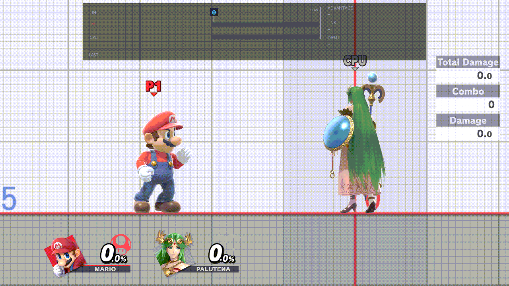
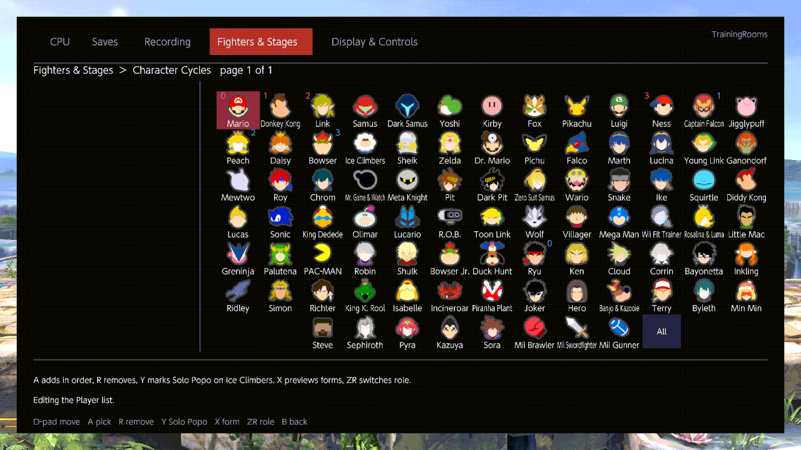
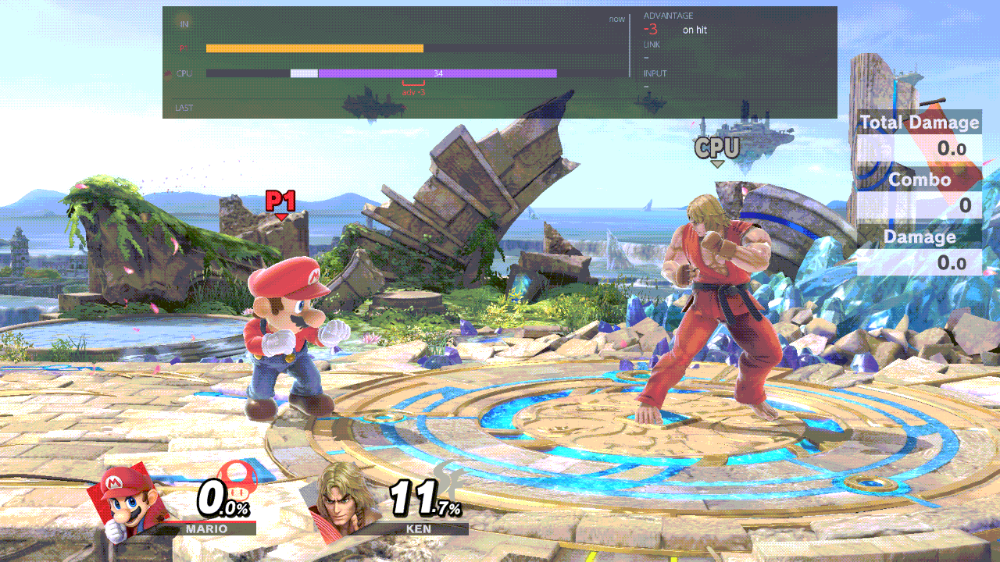
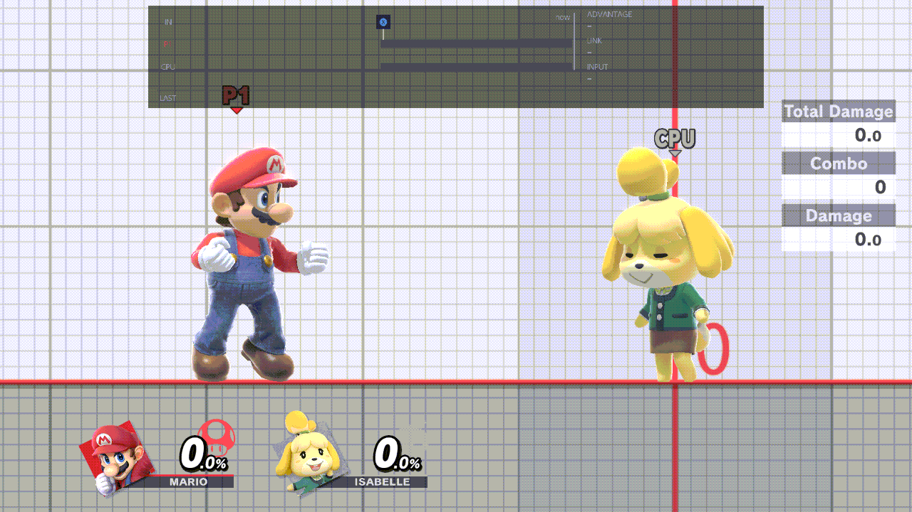
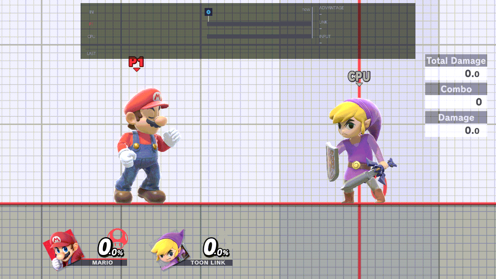
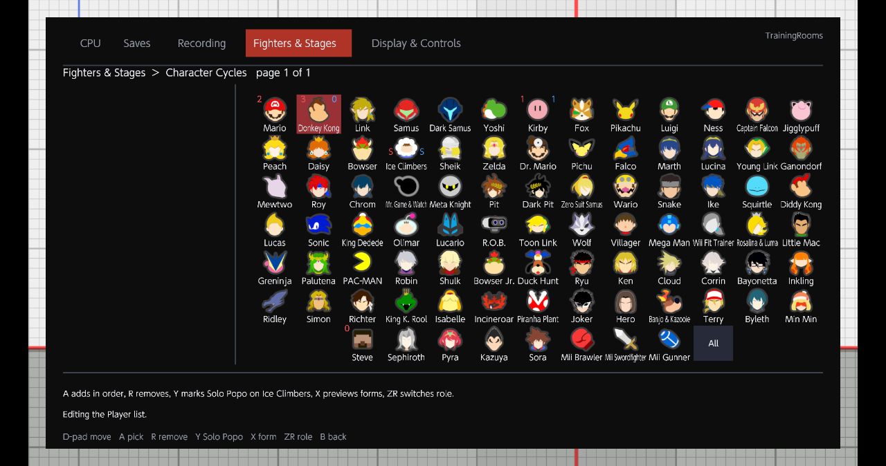

# Differences from the Training Modpack fork

TrainingRooms re-specifies the features of this project's earlier Training Modpack fork (stage M5q) and keeps its
behaviour unless an operator decision changed it ([DECISIONS.md](DECISIONS.md), [MENU-DRAFT.md](../MENU-DRAFT.md)).
The original comparison used 0.2.0-rc.3 (`p23/rc3-candidate` `3c8f5bc`, 2026-11-05). Later changes and captures are identified below and in [Media](MEDIA.md).

## Install and files

| Change | Where in the code |
| --- | --- |
| [Install one training plugin per card](#differences-from-the-fork-1) | `Cargo.toml:2`, `src/model/storage.rs:10` |
| [Import fork settings on first boot](#differences-from-the-fork-2) | `src/model/migration.rs:42-62` |
| [Recover invalid settings](#differences-from-the-fork-3) | `src/model/settings_file.rs:5-13` |
| [Log a panic](#differences-from-the-fork-4) | `src/runtime/boot.rs:100-104` |
| If another mod replaces the Training HUD layout, the plugin still injects its own. | `src/runtime/ui/archive.rs` (`build_on_vanilla`) |

**Install one training plugin per card**

- The plugin is `libtraining_rooms.nro`; its data lives in `sd:/ultimate/TrainingRooms/`. It does not detect the fork's `libtraining_modpack.nro`: never install both.

**Import fork settings on first boot**

- First boot on a card with the fork's folder imports its settings (`training_modpack_menu.conf` → `settings.json`), `button_config.ini`, `replay_capture.ini`, `replay_captures/`, `save_states.json`, `mii-presets.json`, `setups/` and `macros/` by copying. `migration.json` marks it done; delete it to import again.

**Recover invalid settings**

- A settings file that does not parse is kept as `settings.invalid-N.json`, and each bad field falls back to its default; the other fields load.

**Log a panic**

- A panic is written to the diagnostics file and the Skyline log; there is no pop-up.

## Menu

 
*The five pages of the menu, then Hitbox Visualization with three rows ticked. Eden, rc.14 (untested on hardware).*

| Change | Where in the code |
| --- | --- |
| [Navigate five standard pages and an optional Developer page](#differences-from-the-fork-5) | `src/model/menu/table.rs:10-22`, `src/model/developer_ini.rs:24` |
| The menu opens on the last page used (CPU the first time). | `src/model/menu/mod.rs:529` (`Menu::new`) |
| Dropdown rows change in place with Left/Right; A opens the list. | `src/model/menu/mod.rs:1626` (`cycle`) |
| [Set a delay by checklist or range](#differences-from-the-fork-6) | `src/model/menu/table.rs:281` (`delay`) |
| A adds weight on multi-direction grids, wrapping to zero. Single-choice grids toggle one direction. | `src/model/menu/mod.rs:2039-2051` |
| Stage and item grids use 5×8 tiles docked or 4×4 handheld. | `src/model/menu/grid.rs:82-83` |
| Fighter grids use 13 columns and seven rows in either mode. | `src/model/menu/grid.rs:49-52,78-79` |
| [Load mod-aware stock icons](#differences-from-the-fork-7) | `src/runtime/roster/character_roster.rs:2376-2382` |
| [Draw DI and SDI indicators](#differences-from-the-fork-8) | `src/model/effect_chips.rs:7-16` |
| [Edit the menu shortcuts](#differences-from-the-fork-9) | `src/model/menu/table.rs:496`, `src/model/ini_files.rs:85` |
| A *Replay capture* row writes `replay_capture.ini`; the Online Deluxe overlay's row shows the same value. | `src/model/menu/table.rs:391`, `src/runtime/deluxe_row.rs:31` |

**Navigate five standard pages and an optional Developer page**

- Five pages (CPU, Saves, Recording, Fighters & Stages, Display & Controls), switched with L/R. A sixth Developer page appears only with `developer_page=on` in `developer.ini`; developer-only rows live there.

**Set a delay by checklist or range**

- The seven delay rows offer a checklist and a min–max range; using one greys the other, Y clears.

**Load mod-aware stock icons**

- Fighter grids show the game's own stock icons, loaded at run time through the game's mod-aware loader, so modded icons show.

**Draw DI and SDI indicators**

- The DI and SDI chips show the game's own DI line and SDI streak (the streak drawn ×2.0).

**Edit the menu shortcuts**

- Menu shortcuts 1 and 2 are edited in the menu with a chord editor, apply at once and are saved to `button_config.ini`. B + D-pad Up always opens the menu.

## CPU and practice behaviour

| Change | Where in the code |
| --- | --- |
| Air dodge and shield tilt *In*/*Out* are relative to the opponent on both sides. | `src/model/cpu/defence.rs:64-71` |
| [Choose instant or platform respawn](#differences-from-the-fork-10) | `src/model/menu/table.rs:456` |
| [Re-roll ledge and throw options](#differences-from-the-fork-11) | `src/model/cpu/state.rs:165` (`publish`) |
| [Give playback priority over settings](#differences-from-the-fork-12) | `src/model/cpu/playback.rs:29-31` |
| Ice Climbers keep one CPU state each for Popo and Nana. | `src/model/cpu/role.rs:32-52` |
| [Record the pilot’s inputs](#differences-from-the-fork-13) | `src/model/cpu/role.rs:3-6`, `src/model/recording.rs` (`record_refusal`, `fallback_waits`), `src/runtime/features/recorder.rs` (`record_refusal`) |

**Choose instant or platform respawn**

- The fork's instant respawn is the default; [Respawn on platform](menu/fighters-and-stages.md#respawn-on-platform) offers the alternative and lists when it is greyed out.

**Re-roll ledge and throw options**

- Changing ledge or throw options in the menu re-rolls them at once, even for a CPU already on the ledge.

**Give playback priority over settings**

- During input playback the recording wins over DI, SDI, air dodge, tech and throw. *Settings override playback* (default Off) restores the fork's rule.

**Record the pilot’s inputs**

- When the CPU pilot plugin drives Player 1, CPU settings apply to the CPU only. Record works and holds the AI's inputs (2026-11-25; it was refused before).

## Added in rc.2

*Red marks Player; blue marks CPU.*

Operator decisions of 2026-11-05 (`origin/review/menu-proposal` `deccd62`); the fork keeps its own behaviour. The Character Cycles still is from the Player list in `tr-p23-surface-rc2d`, 2026-11-05, rc.2 diag NRO `719324b6` (final rc.2 code).

| Change | Where in the code |
| --- | --- |
| [Retire loading helpers before opening pause](#differences-from-the-fork-14) | `src/runtime/roster/native_source_capacity.rs:793` (`pause_state_exit`), `src/runtime/roster/character_sources.rs:276` (`pause_opening`), `src/runtime/roster/native_source_capacity.rs:829` (`retire_at`) |
| [Place Solo Popo marks above the name](#differences-from-the-fork-15) | `src/model/ui/panes.rs:216` (`roster_tile`) |
| [End unsuccessful Kirby hat requests](#differences-from-the-fork-16) | `src/runtime/roster/kirby_hats.rs:390` (`tick`) |
| A swap away from Kirby ends that role's pending hat request (HAT-REQUEST-END, rule 2). | `src/runtime/roster/kirby_hats.rs:445` (`fighter_committed`) |

**Retire loading helpers before opening pause**

- A pause that opens while a preloaded helper fighter is still loading no longer crashes. At pause-open, before the game's pause check walks the fighter entries, each helper entry the plugin created that has no actor yet is retired through the game's own single-slot retire;
- the helper is then created again, reusing its owner (PAUSE-HELPER, option a).

**Place Solo Popo marks above the name**

- The Solo Popo "S" marks sit on the icon's lower corners, just above the fighter's name, never over it (SOLO-S-PLACEMENT).

**End unsuccessful Kirby hat requests**

- Every Kirby hat request ends: it ages each game frame and, if the hat never arrives, ends with "Kirby hat could not be loaded" (HAT-REQUEST-END, rule 1).

## Added in rc.3

| Operator decisions, 2026-11-05 | Choice for rc.3 |
| --- | --- |
| INPUT-VIZ | Option A: the frame strip |
| SETTINGS-PERSIST | No hidden ZR reset |
| HB-OWN-ORBS | Option 1: plugin-drawn discs |
| Other orders | Change Stage and menu navigation |
| Source | `docs/DECISIONS.md` on `origin/review/menu-proposal` at `5cb1a2a` |

| Change in rc.3 | Where in the code at the time |
| --- | --- |
| [Read the 60-frame input strip](#differences-from-the-fork-17) | `src/model/frame_strip.rs:276` (`Tracker`), `src/model/frame_strip.rs:216` (`Link`), `src/runtime/features/input_display.rs:142` (`sample_frame`), `src/model/menu/table.rs:421`, `src/model/settings.rs:463` |
| [Change stage from its grid](#differences-from-the-fork-18) | `src/model/menu/table.rs:393`, `src/editors/stages.rs:132` (`change`), `src/runtime/lobby/mod.rs:31-32`, `src/runtime/ui/worker.rs:500` |
| [Jump between sections and lists](#differences-from-the-fork-19) | `src/model/ui/adapter.rs:188`, `src/model/menu/mod.rs:978` (`jump_section`), `src/model/menu/mod.rs:278` (`LIST_JUMP`) |
| [Reopen the last menu location](#differences-from-the-fork-20) | `src/model/menu/mod.rs:359` (`place`), `src/model/menu/mod.rs:369` (`restore_place`), `src/runtime/ui/worker.rs:116`, `src/runtime/ui/worker.rs:220` |
| [Confirm a page reset](#differences-from-the-fork-21) | `src/model/menu/mod.rs:971`, `src/model/menu/mod.rs:505`, `src/model/menu/mod.rs:899`, `src/model/menu/mod.rs:1104` (`reset_page`), `src/runtime/ui/worker.rs:301` |
| [Draw fighter spheres with plugin discs](#differences-from-the-fork-22) | `src/model/hitbox_orbs.rs:28` (`OrbSink`), `src/runtime/features/hitbox.rs:171` (`publish_orbs`), `src/runtime/features/hitbox.rs:201` (`draw_orbs`), `tools/layout-builder/src/main.rs:67` (`orbs_first`) |

**Read the 60-frame input strip**

- The input display is a **frame strip** (Display & Controls › *Input Display*: Off or Frame strip, default Frame strip) instead of the fork's 15-row input log.
- At the top of the screen it shows the last 60 frames of Player 1 and the CPU (startup, active, recovery, hitlag, hitstun, shieldstun) and each new press.
- It also shows how the last follow-up linked (a true combo by N frames, or dropped by N, with the window it had to be pressed in and how late it was) and the frame advantage.
- A settings file with the old input-log row takes Off or Frame strip from it.

**Change stage from its grid**

- **Change Stage** (Fighters & Stages › Stages): a stage grid without the All tile; A goes to that stage when the menu closes, Y picks its form first, in Training and in waiting-room practice. The fork's stage request is used as it is;
- rc.2's Direct pick did nothing because the lobby stage hook was installed before the practice stage observer checked its instructions, and the fork's order is restored.

**Jump between sections and lists**

- **ZL + Up/Down** jumps to the previous or next section of a page, and by a screenful (12 lines) in lists; popup lists wrap at an end. On the Recording page a jump at the end goes to the other list, then to the page's previous or next section. Held jumps repeat steadily.
- **L / R** change the page from a game's screen, a fighter grid or an editor screen too (`Menu::switches_page`). ZL's own action in those lists (all or none) is a tap, sent when ZL is released with nothing else pressed.

**Reopen the last menu location**

- The menu **reopens where it was closed**: the same page, each page's row, open advanced groups, and a popup list or editor the menu itself owns (the fighter, stage and item grids and the libraries fall back to their row). Kept for the boot (closes, L+R+A, scene changes); a stale row clamps.
- Across boots only the last page is kept, as before.

**Confirm a page reset**

- **ZR no longer resets a page** (it is also the role switch in the roster grids, easy to press by accident). Each page ends with *Reset page to defaults*, which asks (A reset, B cancel) and writes `[TrainingRooms] page reset page=… rows=… changed=…` to the plugin's diagnostics log, release builds included.
- Y still resets only the focused row.

**Draw fighter spheres with plugin discs**

- Hitbox Visualization draws every fighter sphere (hitboxes, hurtboxes, grab boxes) as the plugin's own discs instead of the game's shared effect pool, which refused part of a large fighter's spheres (two Ridleys: 22 of 55 on every frame).
- The layout has 512 disc panes: up to 128 spheres for each of Training's four possible fighter objects (two fighters, each possibly Ice Climbers with Nana). Only while a gone fighter's last spheres linger (a few frames) can there be more;
- then hurtboxes are cut before hitboxes and grab boxes, and the log says so once.
- The discs sit under the HUD and the menus like the old spheres, are flat (no depth), stop at each sphere's radius (the old glow went past it) and trail the camera by one to two frames while it pans. Projectiles keep the game's effect spheres.

## Kept from M5q

| In rc.3 | What remained from M5q |
| --- | --- |
| Additional CPUs | Wrong-CPU limitation |
| Cold fighter switch | Could hitch |
| Recording after swaps | The existing limitation remained. |
| Power loss | Could leave a partial write |
| Large fighters' first-frame hitboxes | Plugin discs removed fighter-sphere refusals; projectiles still used the game's effect spheres. |
