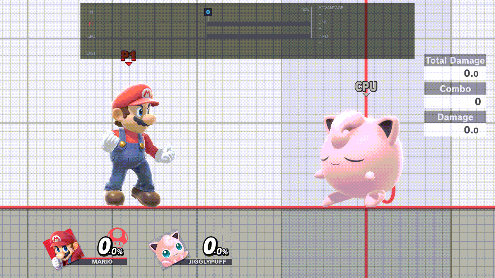
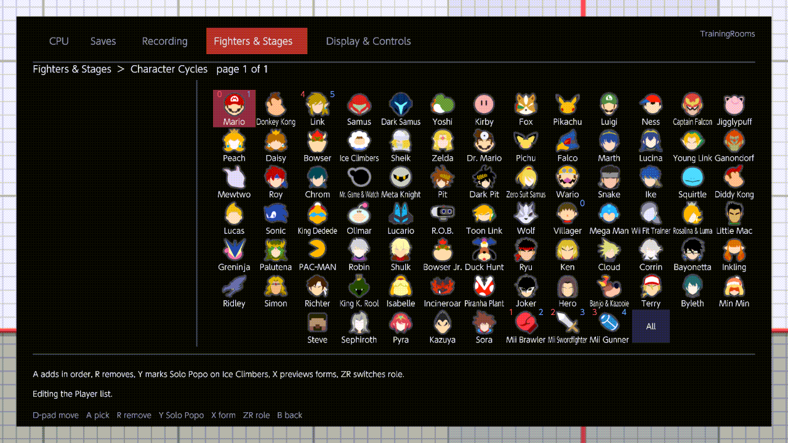
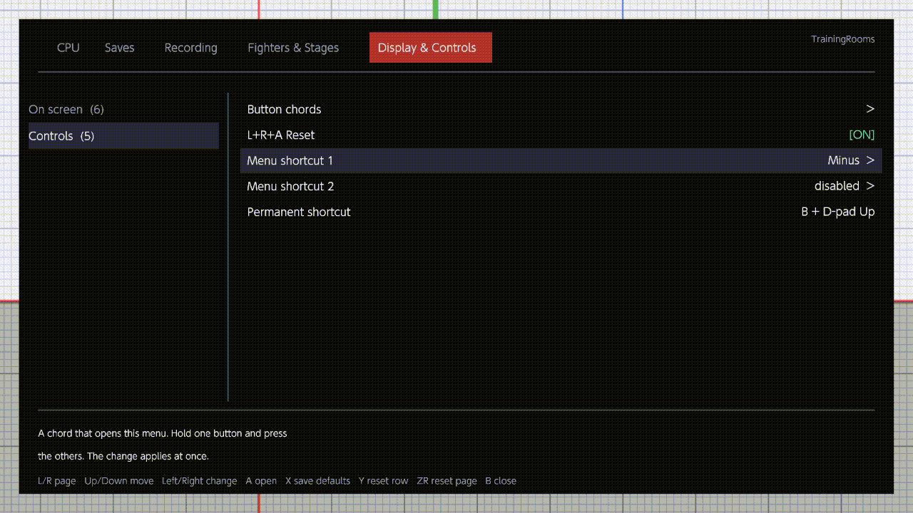
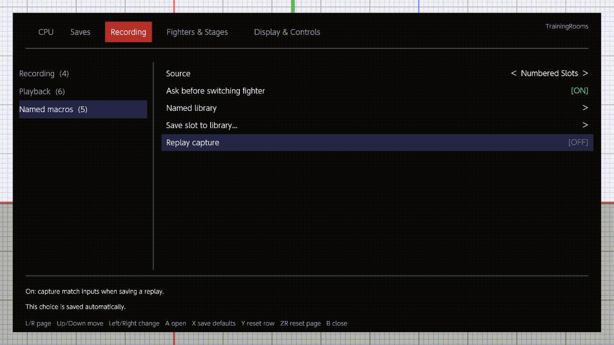
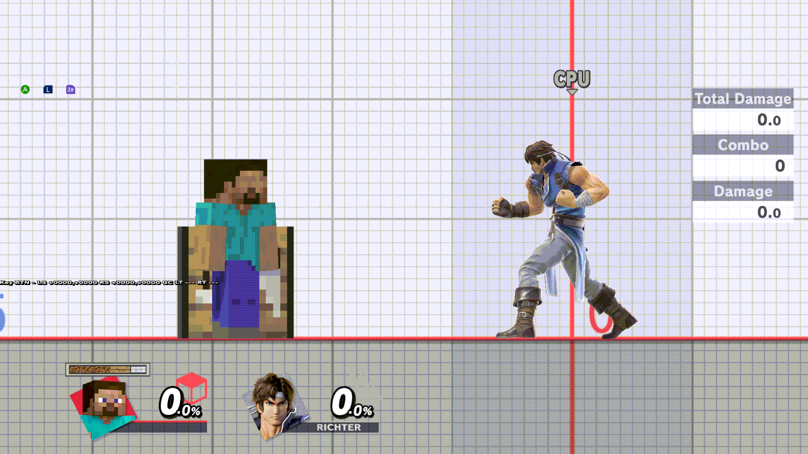
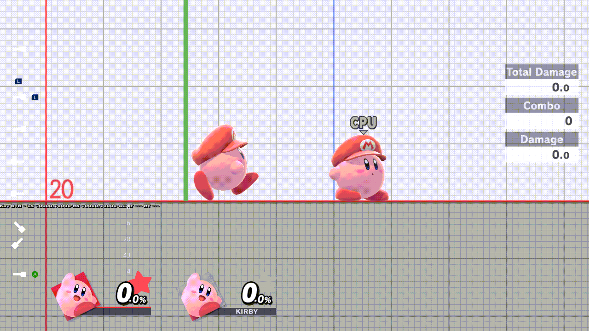
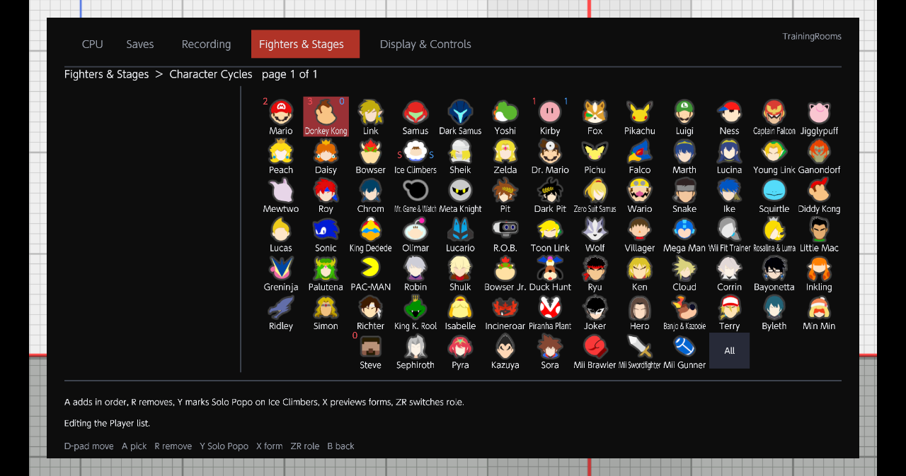

# Differences from the Training Modpack fork

TrainingRooms re-specifies the features of this project's earlier Training Modpack fork (stage M5q) and keeps its
behaviour unless an operator decision changed it ([DECISIONS.md](DECISIONS.md), [MENU-DRAFT.md](../MENU-DRAFT.md)).
This page lists only the changes, each checked against the code of 0.2.0-rc.3 (`p23/rc3-candidate` `3c8f5bc`,
2026-11-05). Clips are Eden footage of the rc.1 release NRO unless a caption names another build; see
[MEDIA.md](MEDIA.md).

## Install and files

| Change | Where in the code |
| --- | --- |
| The plugin is `libtraining_rooms.nro`; its data lives in `sd:/ultimate/TrainingRooms/`. It does not detect the fork's `libtraining_modpack.nro`: never install both. | `Cargo.toml:2`, `src/model/storage.rs:10` |
| First boot on a card with the fork's folder imports its settings (`training_modpack_menu.conf` → `settings.json`), `button_config.ini`, `replay_capture.ini` and `replay_captures/` by copying. `migration.json` marks it done; delete it to import again. | `src/model/migration.rs:42-62` |
| A settings file that does not parse is kept as `settings.invalid-N.json`, and each bad field falls back to its default; the other fields load. | `src/model/settings_file.rs:5-13` |
| A panic is written to the diagnostics file and the Skyline log; there is no pop-up. | `src/runtime/boot.rs:100-104` |
| If another mod replaces the Training HUD layout, the plugin still injects its own. | `src/runtime/ui/archive.rs:183-189` |

## Menu

| Change | Where in the code |
| --- | --- |
| Five pages (CPU, Saves, Recording, Fighters & Stages, Display & Controls), switched with L/R. A sixth Developer page appears only with `developer_page=on` in `developer.ini`; developer-only rows live there. | `src/model/menu/table.rs:10-22`, `src/model/developer_ini.rs:24` |
| The menu opens on the last page used (CPU the first time). | `src/model/menu/mod.rs:323` (`Menu::new`) |
| Dropdown rows change in place with Left/Right; A opens the list. | `src/model/menu/mod.rs:1060` (`cycle`) |
| The seven delay rows offer a checklist and a min–max range; using one greys the other, Y clears. | `src/model/menu/table.rs:203-204` |
| Direction grids carry a weight per chip: each A adds one. | `src/model/menu/mod.rs:1357-1358` |
| Grids page more densely: 5×8 docked, 4×4 handheld. | `src/model/menu/grid.rs:76-77` |
| Fighter grids show the game's own stock icons, loaded at run time through the game's mod-aware loader, so modded icons show. | `src/runtime/roster/character_roster.rs:2168-2174` |
| The DI and SDI chips show the game's own DI line and SDI streak (the streak drawn ×2.0). | `src/model/effect_chips.rs:7-16` |
| Menu shortcuts 1 and 2 are edited in the menu with a chord editor, apply at once and are saved to `button_config.ini`. B + D-pad Up always opens the menu. | `src/model/menu/table.rs:430-433` |
| A *Replay capture* row writes `replay_capture.ini`; the Online Deluxe overlay's row shows the same value. | `src/model/menu/table.rs:353`, `src/runtime/deluxe_row.rs:31` |

## CPU and practice behaviour

| Change | Where in the code |
| --- | --- |
| Air dodge and shield tilt *In*/*Out* are relative to the opponent on both sides. | `src/model/cpu/defence.rs:64-71` |
| *Respawn on platform* is a toggle on Fighters & Stages › Stages; Off (default) is the fork's instant respawn. It is greyed while *Auto-load on death* (Saves) is On. | `src/model/factory.rs:143`, `src/model/menu/table.rs`, `src/model/menu/mod.rs` (`respawn_invincibility`) |
| Changing ledge or throw options in the menu re-rolls them at once, even for a CPU already on the ledge. | `src/model/cpu/state.rs:178-183` |
| During input playback the recording wins over DI, SDI, air dodge, tech and throw. *Settings override playback* (default Off) restores the fork's rule. | `src/model/cpu/playback.rs:29-31` |
| Ice Climbers keep one CPU state each for Popo and Nana. | `src/model/cpu/role.rs:32-52` |
| When the CPU pilot plugin drives Player 1, CPU settings apply to the CPU only, and Record is refused with a notice. | `src/model/cpu/role.rs:3-6`, `src/runtime/features/recorder.rs:548` (`record_refusal`) |

## Added in rc.2

Operator decisions of 2026-11-05 (`origin/review/menu-proposal` `deccd62`); the fork keeps its own behaviour.

| Change | Where in the code |
| --- | --- |
| A pause that opens while a preloaded helper fighter is still loading no longer crashes. At pause-open, before the game's pause check walks the fighter entries, each helper entry the plugin created that has no actor yet is retired through the game's own single-slot retire; the helper is then created again, reusing its owner (PAUSE-HELPER, option a). | `src/runtime/roster/native_source_capacity.rs:793` (`pause_state_exit`), `src/runtime/roster/character_sources.rs:276` (`pause_opening`), `src/runtime/roster/native_source_capacity.rs:829` (`retire_at`) |
| The Solo Popo "S" marks sit on the icon's lower corners, just above the fighter's name, never over it (SOLO-S-PLACEMENT). | `src/model/ui/panes.rs:216` (`roster_tile`) |
| Every Kirby hat request ends: it ages each game frame and, if the hat never arrives, ends with "Kirby hat could not be loaded" (HAT-REQUEST-END, rule 1). | `src/runtime/roster/kirby_hats.rs:390` (`tick`) |
| A swap away from Kirby ends that role's pending hat request (HAT-REQUEST-END, rule 2). | `src/runtime/roster/kirby_hats.rs:445` (`fighter_committed`) |

*Character Cycles, Player list: the red (Player) and blue (CPU) "S" marks on the Ice Climbers icon's lower corners,
clear of the name. Eden run `tr-p23-surface-rc2d`, 2026-11-05, rc.2 diag NRO `719324b6` (the final rc.2 code).*

## Added in rc.3

Operator decisions and orders of 2026-11-05: INPUT-VIZ (option A, the frame strip), SETTINGS-PERSIST (no hidden ZR
reset) and HB-OWN-ORBS (option 1, "go with discs for all") in `docs/DECISIONS.md` on `origin/review/menu-proposal`
(`5cb1a2a`), and the orders for Change Stage and the menu navigation.

| Change | Where in the code |
| --- | --- |
| The input display is a **frame strip** (Display & Controls › *Input Display*: Off or Frame strip, default Frame strip) instead of the fork's 15-row input log. At the top of the screen it shows the last 60 frames of Player 1 and the CPU (startup, active, recovery, hitlag, hitstun, shieldstun), each new press, how the last follow-up linked (a true combo by N frames, or dropped by N, with the window it had to be pressed in and how late it was) and the frame advantage. A settings file with the old input-log row takes Off or Frame strip from it. | `src/model/frame_strip.rs:276` (`Tracker`), `src/model/frame_strip.rs:216` (`Link`), `src/runtime/features/input_display.rs:142` (`sample_frame`), `src/model/menu/table.rs:421`, `src/model/settings.rs:463` |
| **Change Stage** (Fighters & Stages › Stages): a stage grid without the All tile; A goes to that stage when the menu closes, Y picks its form first, in Training and in waiting-room practice. The fork's stage request is used as it is; rc.2's Direct pick did nothing because the lobby stage hook was installed before the practice stage observer checked its instructions, and the fork's order is restored. | `src/model/menu/table.rs:393`, `src/editors/stages.rs:132` (`change`), `src/runtime/lobby/mod.rs:31-32`, `src/runtime/ui/worker.rs:500` |
| **ZL + Up/Down** jumps to the previous or next section of a page (no wrap), and by a screenful (12 lines) in the popup lists. ZL's own action in those lists (all or none) is a tap, sent when ZL is released with nothing else pressed. | `src/model/ui/adapter.rs:188`, `src/model/menu/mod.rs:978` (`jump_section`), `src/model/menu/mod.rs:278` (`LIST_JUMP`) |
| The menu **reopens where it was closed**: the same page, each page's row, open advanced groups, and a popup list or editor the menu itself owns (the fighter, stage and item grids and the libraries fall back to their row). Kept for the boot (closes, L+R+A, scene changes); a stale row clamps. Across boots only the last page is kept, as before. | `src/model/menu/mod.rs:359` (`place`), `src/model/menu/mod.rs:369` (`restore_place`), `src/runtime/ui/worker.rs:116`, `src/runtime/ui/worker.rs:220` |
| **ZR no longer resets a page** (it is also the role switch in the roster grids, easy to press by accident). Each page ends with *Reset page to defaults*, which asks (A reset, B cancel) and writes `[TrainingRooms] page reset page=… changed=…` to the plugin's diagnostics log, release builds included. Y still resets only the focused row. | `src/model/menu/mod.rs:971`, `src/model/menu/mod.rs:505`, `src/model/menu/mod.rs:899`, `src/model/menu/mod.rs:1104` (`reset_page`), `src/runtime/ui/worker.rs:301` |
| Hitbox Visualization draws every fighter sphere (hitboxes, hurtboxes, grab boxes) as the plugin's own discs instead of the game's shared effect pool, which refused part of a large fighter's spheres (two Ridleys: 22 of 55 on every frame). The layout has 512 disc panes: up to 128 spheres for each of Training's four possible fighter objects (two fighters, each possibly Ice Climbers with Nana). Only while a gone fighter's last spheres linger (a few frames) can there be more; then hurtboxes are cut before hitboxes and grab boxes, and the log says so once. The discs sit under the HUD and the menus like the old spheres, are flat (no depth), stop at each sphere's radius (the old glow went past it) and trail the camera by one to two frames while it pans. Projectiles keep the game's effect spheres. | `src/model/hitbox_orbs.rs:28` (`OrbSink`), `src/runtime/features/hitbox.rs:171` (`publish_orbs`), `src/runtime/features/hitbox.rs:201` (`draw_orbs`), `tools/layout-builder/src/main.rs:67` (`orbs_first`) |

## Kept from M5q

These fork limitations are unchanged in rc.3: adding CPUs keeps the wrong-CPU limitation; cold fighter switches can
hitch; recording after swaps and partial writes on power loss remain. The first-frame hitbox refusals on large
fighters are gone for fighter spheres (the own discs above); projectiles keep the game's effect spheres.
