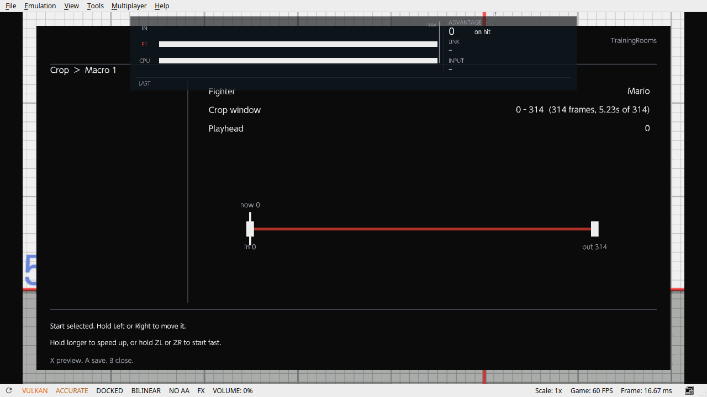

# Crop editor acceptance — 2026-11-15

Tested source: **d520d325aa2fe82de61e690fa01cb88f77de8c35**, base400e2c69. The following docs/evidence commit changes no Rust source. Release NRO SHA256 `d35f0f7497a679cc8a7de69b69062c44a93a39ae8560c4925f51f8f4c2bc128d`; tested diagnostic NRO SHA256 `aea5f904b0bb7ab6db40b23268053846776bb84cca3cb229cc8e23c7bb44f973`. All six XPS gates passed: release, diag, test, clippy, no-default-features and size. Tests:2193 passed, zero failed, four ignored across102 binaries. Size147731/147921,190 spare. Artifacts: `/home/intpa/smash-training-lobby/artifacts/rc15-crop-editor/gate-d520d325/status.json`.

- Yoga ran the current released Eden AppImage SHA256 `2f315fc4b7d9658afef84f4ba3cb80a3d0b33292eaef66a802ef837222a247b9`, with the diagnostic NRO above and the pinned21-plugin set recorded in each run config.
- Both runs used one owned profile copy, display72, GDB6572 enabled before game.load, persisted volume0 and memory_layout_mode0.
- Start/main-menu stills were visually checked out of attract mode.
- No Surface or card used.
- Existing setup helper receipts call the CPU Mario; the actual readable CPU was Bayonetta in boot1 and Ridley in boot2.
- The existing Fighter Mismatch choice kept that current CPU.

| Check | Observed result | Raw evidence under the artifact directory |
| --- | --- | --- |
| Macro Crop opens shared editor; handle redraw | P1 Macro1,314 frames. Start moved0→180 with explicit L and40ms taps; screen shows134 frames kept. | `runtime1/crop-macro/*macro-resume-full-range.png`, `*macro-resume-kept-range.png`, `macro-frame-publish.log` |
| Macro X CPU preview and B exit | Preview inputs complete; HideClip seq272. Editor-closed still shows gameplay. | `runtime1/crop-macro/*preview-started.png`, `*preview-complete.png`, `*editor-closed.png`; frame log |
| Macro save-as-new and playback | Native keyboard named kept-jab-2;134 frames equal source[180:]; original bytes unchanged. New macro set active on CPU and played with existing chord after existing mismatch choice. | `runtime1/crop-macro/{source-macro.json,kept-macro.json,macro-crop.json}` and new-macro-played still |
| Combo units, no X, empty name | Two-link fixture cropped to first link. No X help; after-X frame pixel-identical to selected frame. Native keyboard true-empty confirmation produced Combo2; original unchanged. | `runtime1/crop-combo/` source/kept JSON, before/selected/after-X/saved stills and combo receipt |
| Replay entry handle redraw | Shared standalone editor range0..180→1..180, publish seq69→71. | `runtime2-continuation/crop-replay-continuation/` before/handle-redrawn stills and replay-frame-publish.log |
| Replay X CPU preview and B exit | Publish seq72 playing; inputs_complete revision7 frames179; hidden seq251, editor visibly gone. | Same directory preview-started/preview-complete/editor-closed stills; `runtime2-continuation/crop-replay-continuation.json` PASS4.5s |
| Drill integration | Shared Step units, labels, default Drill N and save-same-kind adapter covered by host tests. | `drill_units_share_clip_editor_and_save_same_kind` in the green gate. Full drill recording/runtime belongs to the input-drill lane. |

- The first boot label was `rc15-crop-editor-d520d325`: final6PASS/1FAILED (Replay stopped before entry).
- The explicitly authorized fresh boot was `rc15-crop-replay-d520d325`: setup4PASS, first Replay probe FAILED at the visible existing mismatch choice because its log assertion did not recognize that screen.
- The same boot continued from the visually observed Keep current fighter choice in a separate row/output directory and passed.
- No third boot.
- Both original failed Replay receipts/stills remain; failed macro probes remain as raw STOP timestamp receipts, FAIL stills and logs.
- The shared runner overwrites the prior per-row JSON on retry; its generated RESULTS summary counts zero archived JSON failures.
- Earlier JSON receipts are therefore not all retained, and this report does not claim they are.

- Initial macro probes used150ms taps, which triggered documented held acceleration and saved an unintended14-frame copy.
- Another probe omitted handle reselection after preview/save and did not move the handle.
- Successful continuation used explicit L/R selection and40ms taps, asserting each range.
- A later probe assumed a nonexistent Play on CPU file row; the successful continuation used Set active and the existing CPU playback chord.
- These were probe/setup failures; no product failure is established by them.
- Failed receipts and outputs were kept.
- Existing handle deselection after preview/save is now stated in the docs table.

- Both runs completed Down with cleanup_failures=[], full profile restored and separately verified, owned processes stopped, and copies pruned (2.6GB unique per run; no leftovers).
- The ledger records RELEASED, including second run16:00:31.941Z. game.stop reached its shutdown deadline and lifecycle used owned SIGKILL, explicitly recorded as a forced stop, not a crash.
- Retained console logs contain zero matches for `panic|abort|crash|unmapped|fault`; console hashes, pattern and memory peaks are in `console-scan.json`.
- Peaks were5804122112B and5513334784B.
- `run.json`, `memory.peak`, configs, dry-run receipts, Down receipts and ledger snapshot are retained in `runtime-metadata/`.

*Eden,2026-11-15,rc.15 d520d325; hardware untested. Real crop selection,1280×720,5fps,4.6s. First/action/end frames reviewed. The final actual frame is held for readability. This GIF shows range selection; preview/save/play/exit use the separate evidence above. Source hashes and review are in gif-source-map.json and gif-review/REVIEW.md. GIF SHA256115e7f4562dc9f057c26258ee06756c09c83ba503280e3f95a31a3dd8dad0e2e.*

- Archived hooks, manifests, fixtures and recorded segments: `eden/rc15-crop-editor/`.
- They use the unchanged shared runner/lifecycle; they are evidence for these owned runs, not permission to drive another owner's paths.
- No push, tag, release or card write.
- Manual compliance limitation: not every local inspection command in this delegated session used the playbook's memory/time guard wrapper.
- This cannot be retroactively proven; it is reported as a failed process requirement to the primary.
- Build and runtime jobs did use bounded remote gate/lifecycle admission.
- No claim of full process compliance is made.
