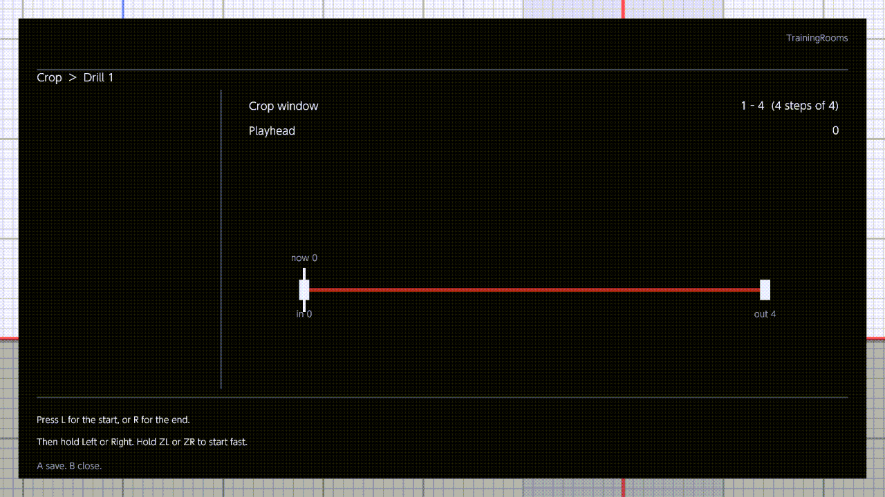

# Input drill acceptance — 2026-11-15

Tested source: **2eb3903e6eb66aedafc3e4dff6d802e9b856fdd7**, base `400e2c69`. This evidence commit changes no Rust source. Release NRO SHA256 `d694d5e1a2d040062197deb8a32a356d8ef5f1b12935d1107a7ae943ba8ab95f`; tested diagnostic NRO SHA256 `181a6518c7f7b896e0a8519f6035fb49b33cbd1014cdab70f01653d9631624ea`.

All six Yoga gate steps ran. Release, diag, clippy and no-default-features passed, with zero clippy warnings. Host tests: 2,202 passed, one failed (size only), four ignored across 102 binaries. Standalone size 148,141 was 220 over 147,921 and 66 over 148,075; no ceiling was changed in this lane. Net 410 versus imported crop3549ee3f. The integration owner took responsibility for the combined size. Gate receipts: `/home/intpa/smash-training-lobby/artifacts/rc15-input-drill/gate-2eb3903e/`.

- The first native boot, `rc15-input-drill-1b134e51`, exposed an idle input flag incorrectly becoming Jump: an empty take saved a phantom Jump and the four-dash take saved five steps.
- Both files and the failing host regression remain.
- The repair normalizes that flag only in InputCapture below the existing jump-stick threshold; real Jump/release and tap-jump remain covered.
- Full host library 302/0 passes.
- Hit-link event capture, tolerances, guards and file schemas were not changed by the repair.

The authorized replacement was `rc15-input-drill-2eb3903e` on Yoga, one copied profile from g, display 72. Eden AppImage SHA256 `2f315fc4b7d9658afef84f4ba3cb80a3d0b33292eaef66a802ef837222a247b9`, actual game 13.0.5, muted volume 0, memory_layout_mode 0 and GDB stub enabled before game.load. Start reached the actual main menu, visually checked. The real CPU was Min Min despite the inherited setup helper calling it Mario. No waiting-room pair or hardware test was performed.

The table records the November 15 observations. Its paths name the original captures. The shared workspace retains the build gate and the final run summary in `artifacts/rc15-input-drill/HANDOFF.md`. The raw drill JSON and grading stills were unavailable for the November 27 audit.

| Check | Observed result | Evidence under `artifacts/rc15-input-drill/runtime-2eb3903e/` |
| --- | --- | --- |
| Direct input drill, strip Off | Real +Record drill and Record chord saved Drill1 with exactly four dash steps, no Jump; schema2, no intermediate macro, no Made from; selected as the grading target. | `drill-direct-crop/direct-source.json`, row receipt and strip-Off stills. Native saved IDdrill-1, steps 4. |
| Whole-step Crop | Shared editor range0..4→0..3; native keyboard empty name saved Drill2 with exactly the first three steps; original drill and schema1 combo bytes unchanged. X never previewed. | `drill-direct-crop/cropped-drill.json`, `clip-frames.log`, before/after-X stills and row receipt. |
| No-hit Make combo | Ordinary P1 recordingmacro-1 made Drill3, exactly four steps, Made frommacro-1. The macro, target and legacy combo were unchanged. | `drill-make-nohit/` source/made JSON and actual saved-ID/count diagnostics. |
| Clean grading | Frame 128 at 4.280 s: four on-time cells, “clean, 4 of 4”, streak1, Best4/4; before frame showed0/0. TRUE has no verdict. | Original clean GIF SHA256 `4065d727567f0e33cb8df62d6cac78c64b0093e8728d6894b5c1713690e53952`; `grade-review-frames/clean-detail-f0128-t4.280.png`. |
| Late grading, initial attempt | Only 12 neutral frames added before the second dash; first event/source untouched. Frame 80 at 2.650 s shows Step1 on time, Step2 red “dash missing”, “1 of 4 counted”, “S2 dash missing”, streak0, Best4/4. Frames 78/82/86 bracket the initial result before suffix attempts. | Original late GIF SHA256 `6e7d730b2816de6558f49f9d3c740353ffb152327e52a4dcec8846f800fd1a0d`; `grade-review-frames/late-candidate-f0080-t2.650.png`. |
| More than four steps | A separate real six-dash recording made Drill4. Four cells follow Step2–5, thenStep3–6. Frame 172 at 5.690 s shows “clean, 6 of 6”, streak1, Best6/6 and no TRUE verdict. | Original six GIF SHA256 `ef0573e22dd374d897587609f36d66be9ce132f7d8fa77c583ad2ad17f1b0f3b`; `grade-review-frames/six-detail-f0135-t4.470.png`, `six-detail-f0148-t4.890.png`, `six-detail-f0172-t5.690.png`. |

The original late-before still already had streak0 after source selection, so this native take does not prove a1→0 transition. The host tests cover streak reset; the live frames separately prove clean0→1 and late0. The schema1 fixture stayed byte-identical, SHA256 `27e5549c53cfd104dfab8143b69ecb7a0940e540996a371d1b9a8514bf01a75d`.

- Initial setup retained four passing boot rows and one failed optional register snapshot: the inherited direct GDB kick had already ended its holding helper, so no helper served the dump request.
- That root-added step was removed under fresh prepare labeldrill-prepare-r2 on the same boot.
- Five product/setup rows passed.
- Original manifest, failure, STOP and runner log are retained.
- Guest tracing remains unverified; no second debugger client or trace boot was added.

- Two additional fresh re-grade rows passed on the same boot with the approved55s recorder cap, a full source allowance after the actual playback receipt, and unchanged20s finalization checks.
- All first captures/source bytes remain.
- The earlier claim of a12.8s warp eating the capture is retracted: native diagnostic prefixes use Switch GetSystemTick, while Python uses host monotonic time; the clocks were not calibrated.
- R3 records both host timestamps and observes request→receipt about0.405s.
- The original decisive frames already contained completion and the initial late fault.

*Eden,2026-11-15,rc.15 source2eb3903e; hardware untested. Real Drill1 range selection4→3→4→3,1280×720,3.78s,5fps request, nine encoded frames from19 captured frames. Start/middle/end and contact sheet reviewed. GIF SHA256 `a7f8a550de084758ed076c81b4dff39bc4503b2eacc80a8b7c9bb317b4fa9ccc`.*

Visual issue in this take: after the first handle action, the helper HUD redraws over the editor's upper centre. The range and handle result remain readable. This capture preserves that overlap; it is reported to the editor/integration owner, not called a clean editor-layout pass. Native grading/step interfaces and save-as-new are established separately above.

- Shared Down RELEASED at17:57:26Z, lifecycleec37282ac71a495c9ee6481c1e32ec8a.
- Cleanup failures were empty; restoration independently verified equal and snapshot_equal across2,016 entries; owned Eden PIDs1072946/1072952 were absent.
- All three owned copies were pruned after58 written files were harvested, freeing2,616,865,297 unique bytes.
- A terminal game.stop deadline required lifecycle SIGKILL; this is a forced cleanup, not a crash.
- Console patterns panic/abort/crash/fatal/segmentation had zero matches; memory.peak was6,616,621,056B.
- The verified raw archive SHA256 is `cd206eb8c15c685e3103f44295140bba512786cb723602d69d411d5f559c743c`.
- All retained unique receipts total11 PASS and one failed optional setup snapshot; the generated final-run summary counts only the last two rows.
- Separate GRADE-REVIEW.md and frame/hash manifests retain the independent visual review.
- No push, tag, release or card write.
- Historical process exceptions remain disclosed: not every inspection command before16:11Z used the required memory/time guard, and the failed first boot reused row labels despite preserving attempt files.
- Replacement continuations use fresh row labels.
- No claim of full process compliance or paired waiting-room acceptance is made.
