# Frame strip

The frame strip is the input display. Turn it on at Display & Controls › Input Display. The choices are Off and Frame strip. Frame strip is the default. It sits at the top of the screen in Training and in waiting-room practice, and it replaces the old 15-row input log.

The Input display chord, R + D-pad Down by default (R is Z on a GameCube controller), turns it on and off without opening the menu, in Training and in waiting-room practice. A notice says "Input display" and On or Off. The menu's Input Display row then shows the same value, and the choice is saved like a change made in the menu. The chord is the "Input display" row of Display & Controls › Button chords.

It keeps the last 60 game frames, about one second. The newest frame is on the right. Player 1 and the CPU each have a lane. Player 1's button presses are chips above the lanes. On the right, three readouts say who could act first after the last hit, whether the last follow-up was a true combo, and how the press was timed. A LAST row under the lanes keeps the last four follow-ups.

The strip hides while the TrainingRooms menu, the recording pop-up, the Fighter Mismatch question, or the game's pause menu is open, while Input Display is Off, and outside Training and lobby practice. It clears when the scene changes, when you hot-swap, when a save state loads, and when Training resets or replaces a fighter. The frames from before that did not happen. While the strip is on screen, the separate Frame Advantage notice stays down, because the ADVANTAGE readout is that number.

An older settings file that still says Smash Inputs, Raw Inputs, or Status Only becomes Frame strip. Off stays Off.

The pictures for this page are listed in [MEDIA.md](MEDIA.md). Each one is a full-screen capture, 1280 wide, under 10 seconds, and one behaviour, of rc.7 `722525a5` as shipped (diag NRO `cfec85c7`, log lines only), taken on 2026-11-11.

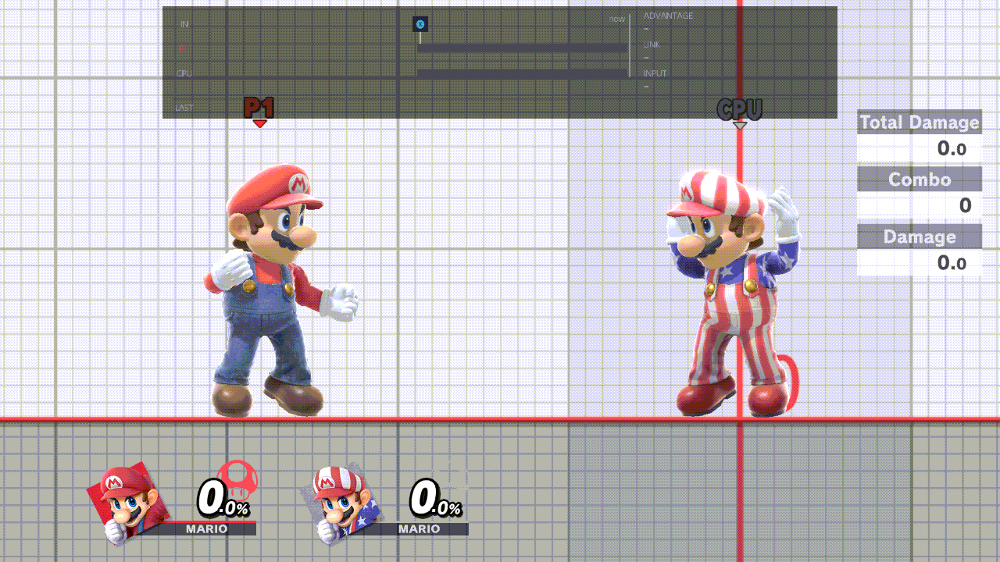

## Lanes and colours

Each column is one game frame. A run of the same state is one block. A run of 7 or more frames of recovery, hitstun, or shieldstun prints its length on the block. Shorter runs, and the other states, do not print a count.

The colour is the first rule that matches:

| What you see | Colour | When |
| --- | --- | --- |
| Hitlag | Light grey | The fighter is in hitstop. |
| Hitstun | Purple | The fighter is in hitstun. |
| Shieldstun | Teal | The fighter is in shieldstun. |
| Actionable | Dark blue-grey | The fighter can act. This includes cancel windows, not only the end of the move. |
| Active | Red | Player 1 only, and only when one of the attack's hitboxes is out. |
| Startup | Gold | Player 1 only, while this action has not had an active frame yet and the status is an attack. |
| Recovery | Blue | Player 1 is still busy and none of the rows above matched: lag, landing, a dodge. |

The CPU lane uses the same rules without active and without startup. A busy CPU frame that is not hitlag, hitstun, shieldstun, or actionable is recovery, so it is blue.

Hitlag is painted when the game reports that fighter as stopped. On the boot that measured this, the CPU in hitlag reported that stop and Player 1, the attacker, did not, so Player 1's lane can show no grey cells for the same freeze. A fighter's own attack status that this list does not name, such as some of Steve's jabs, is called Move in the LAST row, and a startup that the game already calls actionable has no gold cells.

## Chips

A chip appears on the frame a button goes down. The chip is the button, not the stick. If several buttons go down on the same frame, one chip is shown, the first of: Attack (A), Special (B), Grab (Z), Jump (X or Y), Shield (L or R).

| Button | Colour |
| --- | --- |
| Attack (A) | Green |
| Special (B) | Red |
| Jump (X or Y) | Blue |
| Shield (L or R) | Slate |
| Grab (Z) | Purple |

A white tick drops from the chip to Player 1's lane. Up to eight chips stay on the strip.

The arrow on a chip is the left stick on that frame, binned to eight screen directions: right, up-right, up, up-left, left, down-left, down, down-right. A stick inside the dead zone (a small horizontal tilt, or a small vertical tilt) has no arrow. The arrow is drawn only when that bin is a direction.

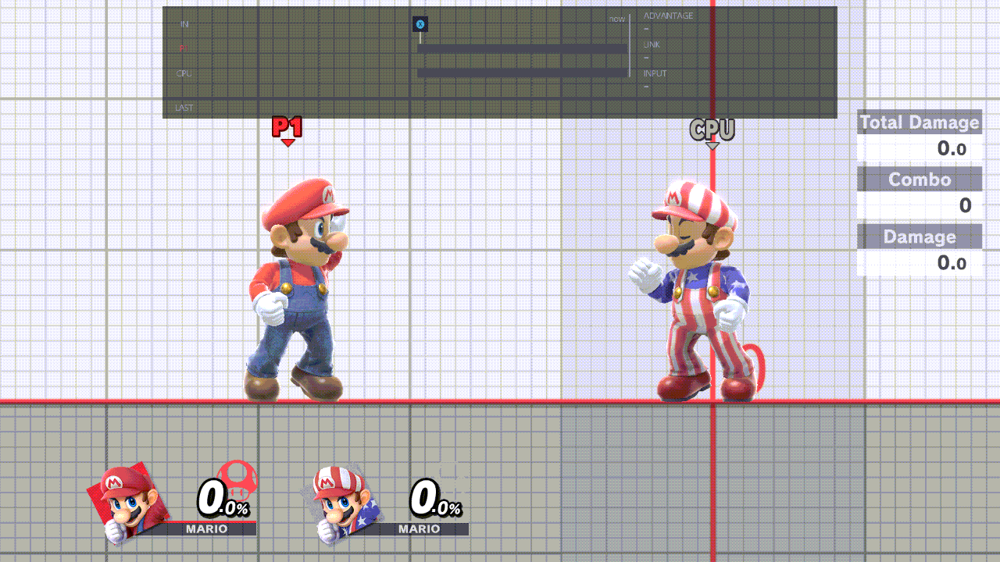

A C-stick attack, the attack the game marks as coming from the C-stick, takes its chip arrow from the C-stick when that stick is outside the dead zone. A press that is not a C-stick attack keeps the left-stick arrow, even if the C-stick is held. A C-stick attack whose C-stick stays inside the dead zone also keeps the left-stick arrow.

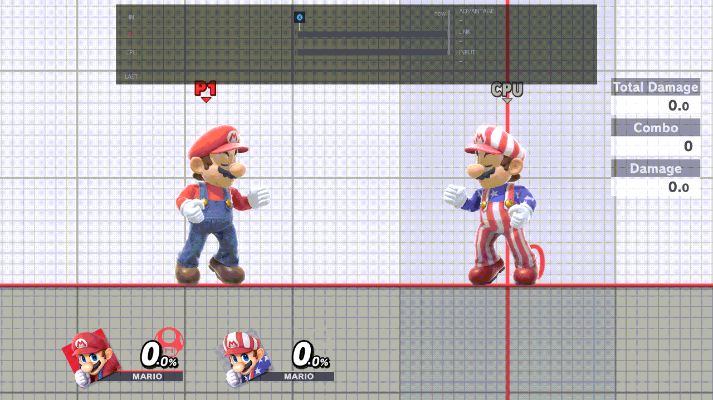

## Stick row

Under Player 1's lane, every frame of the same 60 shows the left stick's held direction. It reads the physical left stick, so a C-stick attack with the left stick neutral leaves the row blank. The eight directions are the same bins as the chip arrow, and a neutral frame is blank. The row scrolls and freezes with the rest of the strip. A change of binned direction resets the quiet count, so the strip does not freeze across that change. Holding one direction can still freeze it.

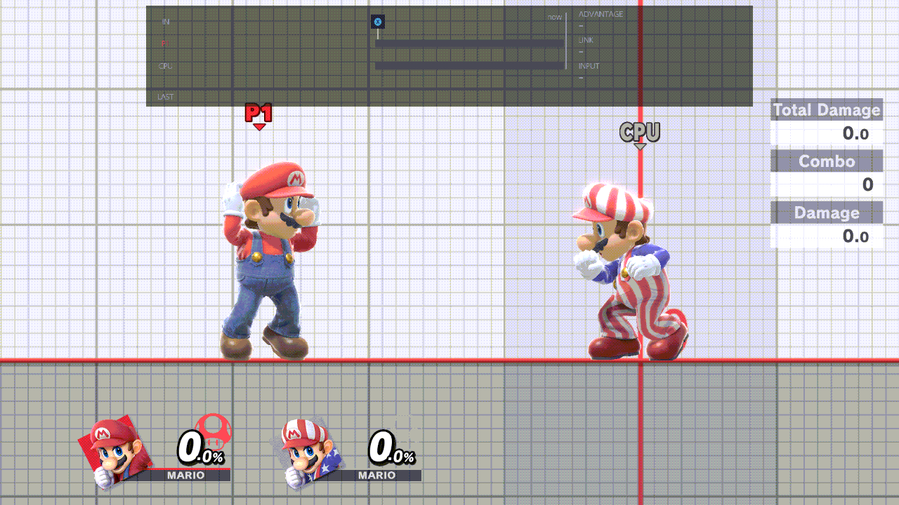

## Freeze

When both fighters can act, Player 1 has no new button press, the left stick stays in the same bin, and neither fighter is in hitlag, for 30 frames, the strip stops scrolling and keeps the last exchange on screen. It moves again on the next frame where that is no longer true: someone cannot act, a button goes down, the left stick's bin changes, or someone is in hitlag.

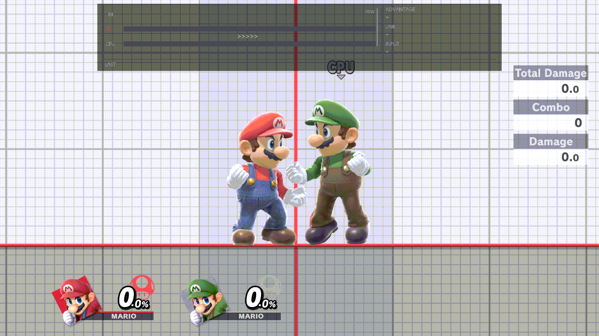

A change from one held direction to another starts the strip scrolling again. Leaving neutral is one such change. Staying in the same direction does not.

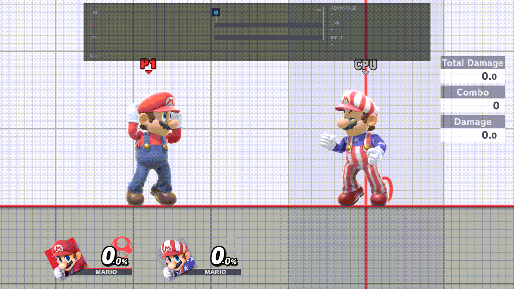

## Readouts

Until the first exchange has finished, ADVANTAGE is a dash. Until the first follow-up, LINK and INPUT are dashes.

### ADVANTAGE

ADVANTAGE is the CPU's first actionable frame minus yours, both counted from the last hit. Plus means you can act first. Minus means the CPU can act first. Zero means the same frame.

"Actionable" includes cancel windows. An aerial, or any move you can cancel, can read more plus than a frame-data site that waits until the move and its landing lag have finished.

The line under the number says **on hit** or **on shield**. Plus is green, minus is red, and zero is plain. A shield hit is not a link. It still sets ADVANTAGE, with the words on shield.

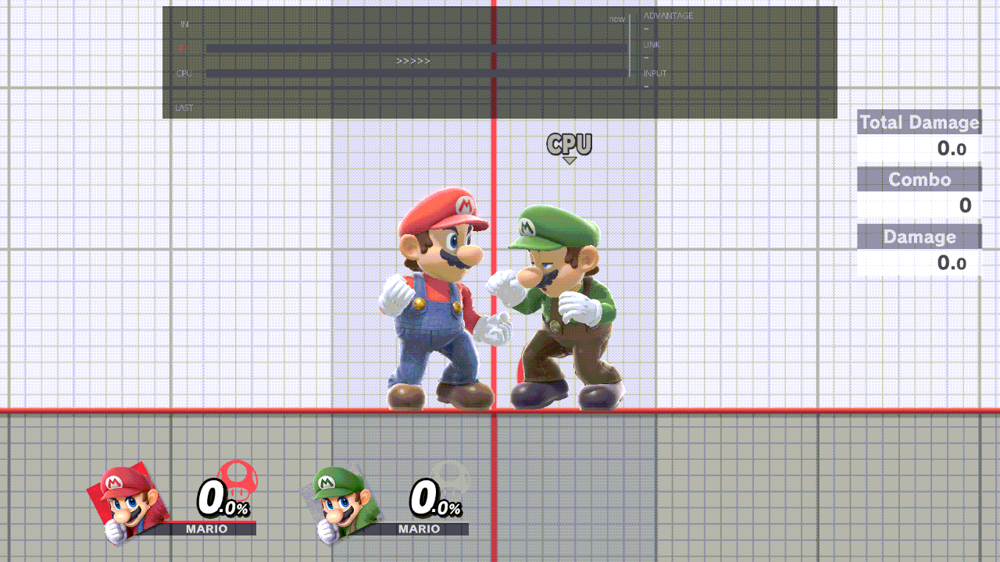

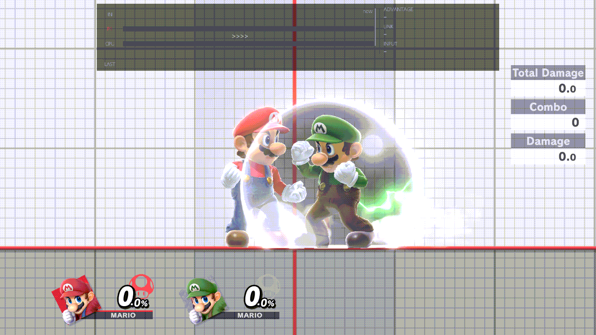

### LINK

A follow-up is a later hit from a different action, on hit, while the CPU has been free for at most 20 frames. Hits of one action, such as the hits inside one multi-hit move, are not follow-ups. A hit on shield is not a follow-up.

LINK is that follow-up:

- **True by N.** The CPU never got an actionable frame before the hit. The readout is a number of zero or below and the words TRUE combo, in green. N is how many frames it had to spare: the on-screen number is minus that N, so true by 4 is shown as -4. If the hitstun left could not be read, the readout says TRUE with no number.
- **Dropped by N.** The CPU did have an actionable frame before the hit. The readout is +N and the word DROP, in red. N is how many frames after the CPU could act the hit landed.

The combo window is the green bar above Player 1's lane, labelled `window Nf`. N is how many frames wide the presses are that would still have made a true combo, assuming the same startup. The window starts on your first actionable frame after the previous hit. It is missing when even a frame-perfect press would drop, or when the true-combo number could not be read.

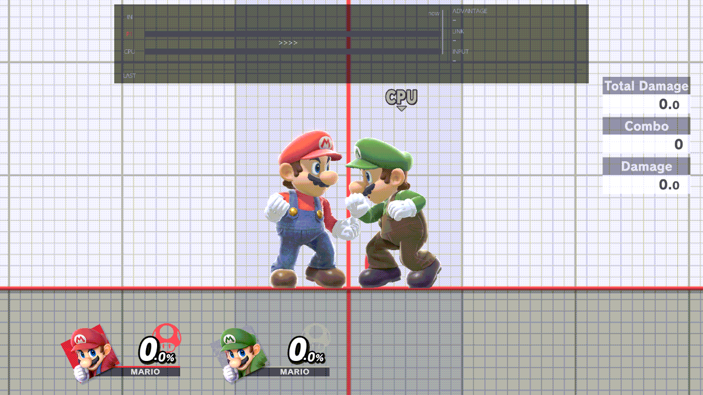

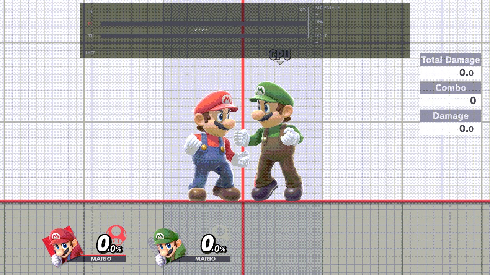

### INPUT

INPUT is how the follow-up's press was timed against the first frame you could act. The press it uses is the latest attack, special, grab, jump, or shield that went down, looked for up to 15 frames before the follow-up started. If there is no such press, it uses the frame the follow-up started.

The number is that press minus your first actionable frame. The words next to it are:

- `0` and **on time**
- `+N` and **Nf late**
- `-N` and **buffered Nf** (you pressed before you could act; the move still starts on the first frame you could act)

Then the spare frames. A true combo adds `, N spare`: how many frames later the same press could have been. A drop adds `, Nf past`: how far past the window the hit was. A true combo with no number omits that half.

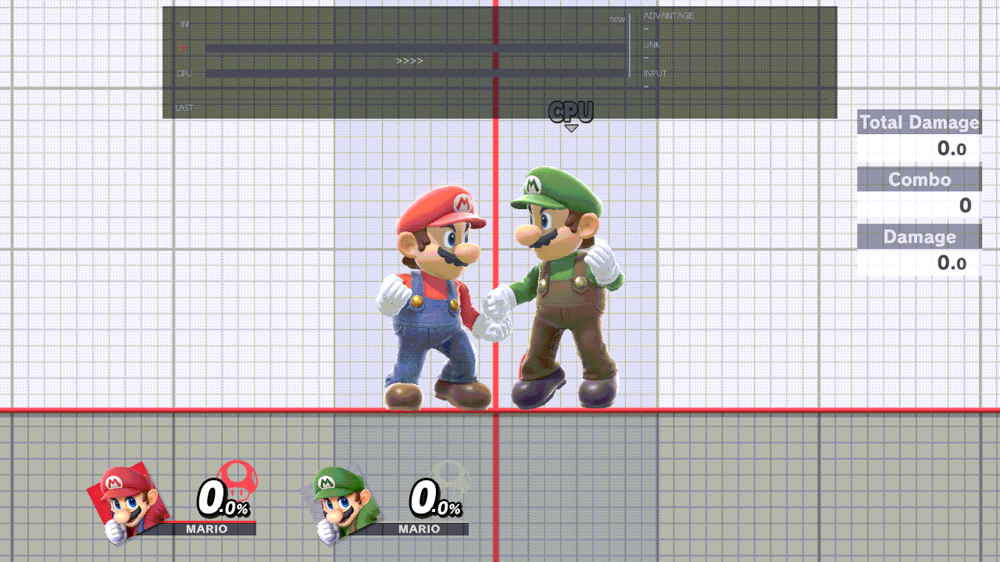

### LAST

The LAST row is the last four follow-ups, newest first. Each one is a pill and the two moves. A true combo's pill is green and reads `TRUE` plus the signed number, or `TRUE` alone when the number could not be read. A drop's pill is red and reads `DROP` plus the positive number. The moves use a plain `>` because that is what the font draws, as in `Jab > Up tilt`. A fighter-specific attack this list does not name is `Move`.

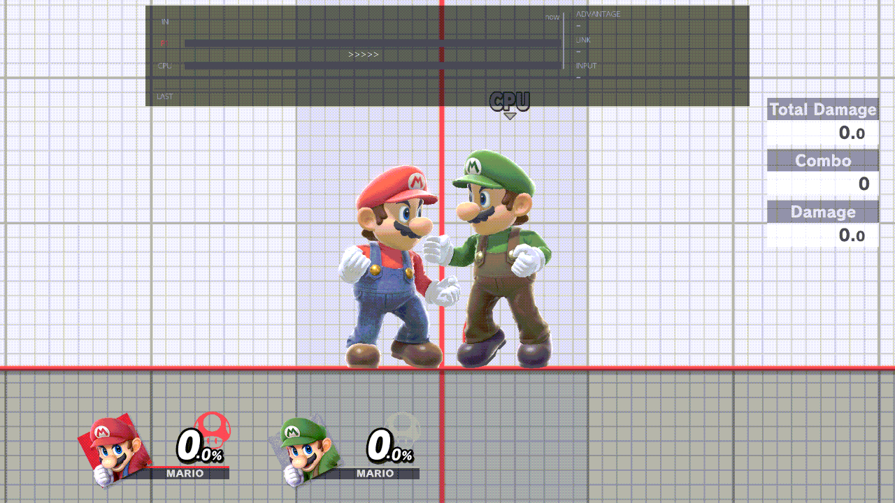

## The 20-frame exchange

The 20-frame rule is how a new hit either continues the exchange or starts another one.

If the previous hit was on hit, this hit is on hit, it comes from a different action, and the CPU has been able to act for 20 frames or fewer, it is a follow-up. Inside those 20 frames it is a true combo or a drop, as LINK says. A drop can be a large number, up to 20, and it is still the same exchange.

If the CPU has been able to act for more than 20 frames, the next hit is not a drop. It opens a new exchange. ADVANTAGE then waits until both fighters can act again after that new hit. A shielded hit also does not link. It can still set ADVANTAGE to on shield.

The same 20 frames are what the combo helper uses when it decides that an exchange ended before the next step. A gap of 20 still belongs to the exchange. A gap of 21 does not. The helper grades the follow-up's input events from these samples: presses, releases, the C-stick, and the fast-fall, dash, and tap-jump flicks, facing-relative. Drift is shown and is not graded. An older combo file that stored only presses is still graded on those presses.

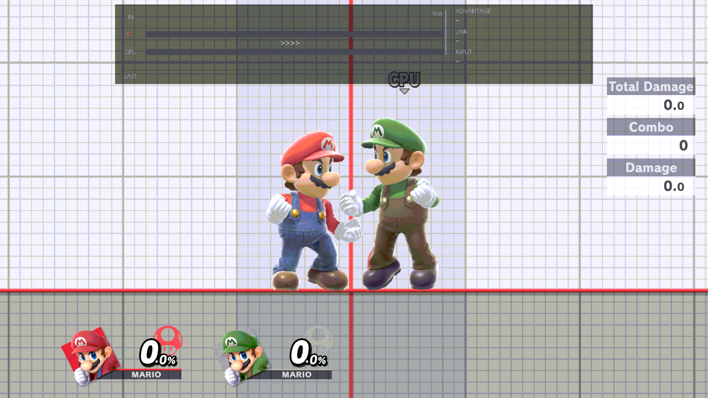

## Sources

The lanes, chips, freeze, readouts, the stick row, the C-stick arrow, and the 20-frame rule are what `src/model/frame_strip.rs` draws, as specified in `specs/SPEC-input-06-frame-strip.md`.
