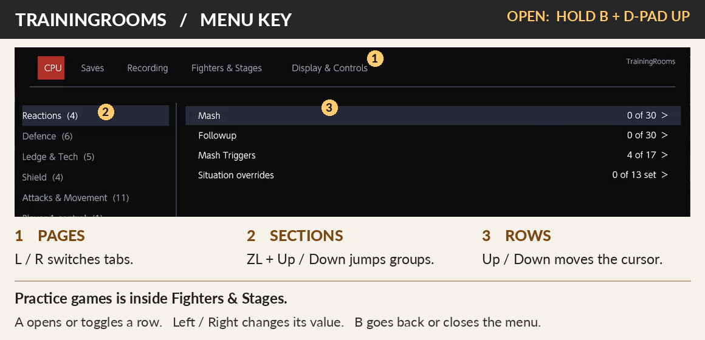
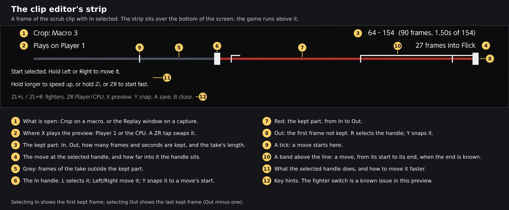
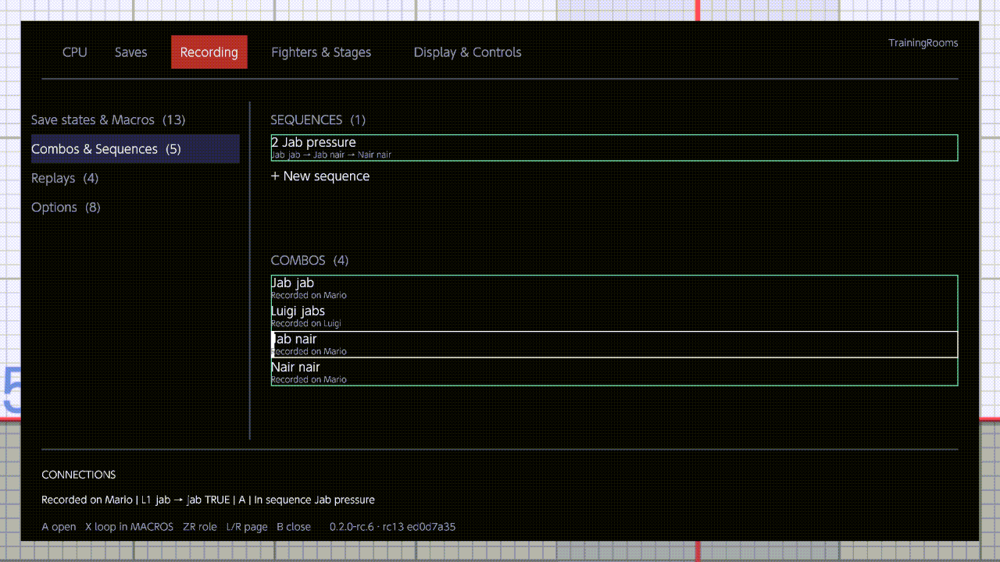

# Media

The gameplay GIFs in [`media/`](media) use actual Eden footage. The tables record files, dimensions and pages **at capture time**;
they include retired takes, not just files still published. The 68 original comparison and composite GIFs were 1280 wide and
404, 436 or 764 high. The raw takes stay outside git with their runs.

The [zone-editor proof still](decisions/rc15-zone-editor-crop-proving-boot.png) omits the 28-row test banner at the top. The remaining 1280×646 pixels are unchanged.

The [crop-editor GIF receipt](media/rc15-crop-editor.json) lists the source-frame hashes and output hash for the
[November 15 crop-editor take](EVIDENCE.md#evidence-rc15-crop-editor).

## README menu tour

| Picture (`docs/media/`) | Source | Frame or time |
| --- | --- | --- |
| `readme-tour-key.png` | `tut-menu-tour.mp4`, CPU tab; navigation labels added outside the rows | 1.30 s |

The labelled menu key and six detail pictures in the [menu tour](../README.md#about-trainingrooms) are crops of actual menu frames, not mock-ups.

| Picture (`docs/media/`) | Source | Frame or time |
| --- | --- | --- |
| `readme-tour-key.png` | `tut-menu-tour.mp4`, CPU tab; navigation labels added outside the rows | 1.30 s |
| `readme-tour-cpu.png` | `tut-menu-tour.mp4`, Reactions list | 1.30 s |
| `readme-tour-display.png` | `tut-menu-tour.mp4`, On screen list | 7.15 s |
| `readme-tour-fighters.png` | `tut-menu-tour.mp4`, CPU Character selected | 5.20 s |
| `readme-tour-games.png` | `rc15-practice-menu-start.gif`, early Practice games list, before four more games were added | frame 18 (zero-based) |
| `readme-tour-recording.png` | [Source still of the named combos](media/rc13-combo-library.png) | still |
| `readme-tour-saves.png` | `tut-menu-tour.mp4`, damage and mirroring settings | 3.25 s |

The README showcase also embeds the existing `tut-guard-edge-setup-and-score`, `tut-input-drill-record`, `tut-clip-snap`, `tut-fighter-cycle`, `tut-stage-change`, `tut-kirby-hat` and `tut-mii-pick` MP4s from the tutorial table. The three interim GIFs are `rc13-replay-capture`, `rc11-lobby-practice` and `rc11-give-item`.

## Tutorial clips (2026-11-25 through 2026-11-27)

| Cut by the crop | Clips |
| --- | --- |
| The frame strip's top rows (IN, "now", the ADVANTAGE heading) | `tut-menu-tour`, `tut-menu-change-option`, `tut-controls-change-chord`, `tut-input-delay`, `tut-input-display`, `tut-input-drill-record` |

The legend labels the strip at 4.5 s in `tut-clip-scrub-moves.mp4`, with In selected.

The menu tour, menu option and button-chord films come from `tut-c51f4d81-yoga-1` on release build `c51f4d81`.
They crop a 1842×1036 region at (39, 44) from the 1080p capture and scale it to 720p, removing the capture tool's
yellow `BRIDGE LIVE` mark and, when visible, the top input lane. The other rows name their own source runs.

- Every clip of this table is cut with that same crop, except `tut-save-load.mp4` and the six files of run `tut-dc5302f1-yoga-6`, which are whole frames.
- The first, middle and last frame of all 34 files then published were read on 2026-11-27: none shows the mark.
- Ten lost content of the game's own at the top edge.
- Two of those, `tut-input-special-direction` and `tut-spacing-grader`, were retired the same day with two other clips; the eight below remained published on November 27 and were listed for a whole-frame take:

| Cut by the crop | Clips |
| --- | --- |
| The frame strip's top rows (IN, "now", the ADVANTAGE heading) | `tut-menu-tour`, `tut-menu-change-option`, `tut-controls-change-chord`, `tut-input-delay`, `tut-input-display`, `tut-input-drill-record` |
| The recording indicator ("REC P1", top left) | `tut-record-macro`, `tut-input-drill-record` |
| Break the Targets' count and clock (top left) | `tut-break-the-targets` |

| Clip | Shows | Film, cut | Bytes | SHA256 (first 16) | Pages at capture time |
| --- | --- | --- | ---: | --- | --- |
| `tut-menu-tour.mp4` | [Shows](#take-tut-menu-tourmp4) | `t01-menu-tour`, 0.3–9.8 s | 1,301,566 | `866d3984b6c2c2cc` | [Getting started](guide/getting-started.md) |
| `readme-menu-tour.gif` | The same film as an image preview: 1280×720, 10 fps, 128 colours, no dithering | cut from `tut-menu-tour.mp4` (build `c51f4d81`), its whole 9.5 s | 6,353,868 | `a107cbf0955c5f56` | Former README opening |
| `tut-menu-change-option.mp4` | CPU › Crouch flips On with D-pad Right, the menu closes, the CPU crouches | `t02-menu-change-option`, 1.6–8.6 s | 1,514,380 | `9ef6bc2ccd65da7c` | [Using the menu](guide/using-the-menu.md) |
| `tut-controls-change-chord.mp4` | Button chords: Save State Save is changed to ZL + D-pad Left, which then saves | `t04-controls-change-chord`, 0.2–7.8 s | 1,867,343 | `4b49a4cb454bea75` | [Controls](guide/controls.md) |
| `tut-save-load.mp4` | [Shows](#take-tut-save-loadmp4) | [Film, cut](#take-tut-save-loadmp4) | 3,748,140 | `435f35b4f8e24e1c` | [Save states](guide/save-states.md) |
| `tut-clip-scrub.mp4` | [Shows](#take-tut-clip-scrubmp4) | `t41-clip-scrub` of run `tut-5df3d9dc-yoga-3` (the diagnostic build of `5df3d9dc`), 0.6–10.8 s | 2,866,172 | `0aafcffcbbcd865d` | [Recording](guide/recording.md#crop), [menu](menu/recording.md#replay-window) |
| `tut-clip-playhead.mp4` | [Shows](#take-tut-clip-playheadmp4) | `t42-clip-playhead` of the same run, 0.6–12.0 s | 3,376,060 | `24744f80377dec3e` | [Recording](guide/recording.md#crop), [menu](menu/recording.md#replay-window) |
| `tut-clip-scrub-moves.mp4` | [Shows](#take-tut-clip-scrub-movesmp4) | `t41-clip-scrub` of run `tut-cc71537c-yoga-4` (the diagnostic file of preview build `cc71537c`, 2026-11-27), 0.8–12.0 s | 3,199,071 | `4144b9be50b9797d` | [menu](menu/recording.md#moves-while-you-scrub-preview-build) |
| `tut-clip-snap.mp4` | [Shows](#take-tut-clip-snapmp4) | `t43-clip-snap` of the same run, 0.6–10.6 s | 3,190,826 | `9d9b2403110f13df` | [menu](menu/recording.md#moves-while-you-scrub-preview-build) |
| `tut-toggle-p1.mp4` | [Shows](#take-tut-toggle-p1mp4) | [Film, cut](#take-tut-toggle-p1mp4) | 7,712,561 | `2490a45569a7451f` | [menu](menu/recording.md#fighter-toggle) |
| `tut-toggle-cpu.mp4` | [Shows](#take-tut-toggle-cpump4) | [Film, cut](#take-tut-toggle-cpump4) | 9,104,856 | `658362bcfa521968` | [menu](menu/recording.md#fighter-toggle) |
| `tut-clip-scrub-home.mp4` | [Shows](#take-tut-clip-scrub-homemp4) | [Film, cut](#take-tut-clip-scrub-homemp4) | 6,713,883 | `7b0c4a55203f46a1` | [menu](menu/recording.md#moves-while-you-scrub-preview-build) |
| `tut-clip-x-preview.mp4` | [Shows](#take-tut-clip-x-previewmp4) | [Film, cut](#take-tut-clip-x-previewmp4) | 5,792,564 | `6dabd909faf837e5` | [Recording](guide/recording.md#crop) |
| `tut-loading-ready-fighter-bodies.png` | [Shows](#take-tut-loading-ready-fighter-bodiespng) | [Film, cut](#take-tut-loading-ready-fighter-bodiespng) | 650,251 | `a87297fadbf60a4b` | [menu](menu/fighters-and-stages.md) |
| `tut-loading-swap-groups.png` | [Shows](#take-tut-loading-swap-groupspng) | [Film, cut](#take-tut-loading-swap-groupspng) | 635,146 | `1ced0acac1c5ed84` | [menu](menu/fighters-and-stages.md) |
| `tut-juggler-setup-and-result.mp4` | [Shows](#take-tut-juggler-setup-and-resultmp4) | `t44-juggler` of run `tut-5df3d9dc-yoga-3`, 11.5–29.5 s | 6,320,217 | `1dd2fb6407149b0f` | [Juggler](guide/juggler.md) |
| `tut-guard-edge-setup-and-score.mp4` | [Shows](#take-tut-guard-edge-setup-and-scoremp4) | `t45-guard-edge` of the same run, 18–51 s | 12,687,556 | `52df2bbb56168a07` | [Guard the Edge](guide/guard-the-edge.md) |
| `tut-menu-list-scroll.mp4` | [Shows](#take-tut-menu-list-scrollmp4) | `t03-menu-list-scroll` of run `tut-5df3d9dc-yoga-3`, 0.5–20.0 s | 566,038 | `c0352b105b434bbc` | [Using the menu](guide/using-the-menu.md) |
| `tut-notice-save-states-off.mp4` | The save chord refused with Save States Off; Save States On; the chord saves | `t05-notice-save-states-off` of the same run, 0.3–9.0 s | 2,463,368 | `911d7fd9435aff39` | [Troubleshooting](guide/troubleshooting.md) |
| `tut-record-macro.mp4` | [Shows](#take-tut-record-macromp4) | `t08-record-macro` of the same run, 0.3–7.5 s | 3,349,706 | `9e94692216f4955e` | [Recording](guide/recording.md) |
| `tut-mash-out.mp4` | Mash out: a mashed hold reads Good · 30f, the next one Poor · 90f | `t14-mash-out` of run `tut-cc71537c-yoga-4`, 7.5–15.0 s | 3,873,860 | `053d7299efc52285` | [Mash out](guide/mash-out.md), [Practice games](menu/fighters-and-stages.md#practice-games) |
| `tut-break-the-targets.mp4` | Mario misses the target, then punches it; it flashes and disappears | `t15-break-the-targets` of run `tut-cc71537c-yoga-4`, 14.5–25.5 s | 4,896,200 | `3571a7f96cafadc2` | [Break the Targets](guide/break-the-targets.md) |
| `tut-tech-practice.mp4` | Missed at 3/20. The final notice shows the earlier launch failure. | `t16-tech-practice` of run `tut-5df3d9dc-yoga-3`, 13.5–30.0 s | 7,511,366 | `b5a88dc8254878ed` | [Tech practice](guide/tech-practice.md) |
| `tut-hitbox-visualization.mp4` | Hurtbox pills on both fighters; a jab and a grab with their boxes drawn | `t18-hitbox-visualization` of the same run, 0.3–6.0 s | 2,508,502 | `3506e99fdcd8da32` | [Display & Controls](menu/display-and-controls.md#hitbox-visualization) |
| `tut-hitbox-colour-legend.mp4` | The Hitbox Visualization checklist and its Colour legend | `t20-hitbox-colour-legend` of the same run, 0.3–5.0 s | 130,141 | `1d90ab63bde904b0` | [Display & Controls](menu/display-and-controls.md#hitbox-visualization) |
| `tut-cpu-mash.mp4` | CPU Mash: Link answers a jab out of hitstun | `t26-cpu-mash` of the same run, 0.3–8.5 s | 4,249,903 | `00e5cd16878ebc16` | [CPU behaviour](guide/cpu-behaviour.md#mash-and-followup) |
| `tut-cpu-shield.mp4` | CPU Shield held through three jabs | `t27-cpu-shield` of the same run, 0.3–6.0 s | 2,369,048 | `4d834abd0cc27050` | [CPU behaviour](guide/cpu-behaviour.md) |
| `tut-cpu-di.mp4` | DI Direction Left, then Right: the same smash at 80% sends Link along two lines | `t28-cpu-di` of the same run, 0.5–16.0 s | 9,503,476 | `ea876d6c9fcb0271` | [CPU behaviour](guide/cpu-behaviour.md#direction-chips) |
| `tut-cpu-hide.mp4` | Hide CPU On, the CPU gone; Off, the CPU back | `t30-cpu-hide` of the same run, 0.5–11.0 s | 2,693,222 | `29c7aa26b49d119f` | [CPU](menu/cpu.md#hide-cpu) |
| `tut-fighter-cycle.mp4` | Cycle Player: Mario becomes Donkey Kong in place | `t31-fighter-cycle` of the same run, 0.3–6.0 s | 2,499,823 | `a629bd963f6b3bd0` | [Fighter cycles](guide/fighter-cycles.md), [Fighters & Stages](menu/fighters-and-stages.md) |
| `tut-game-speed.mp4` | The same forward smash at normal speed and at 1/4, with the speed label | `t35-game-speed` of run `tut-cc71537c-yoga-4` (the diagnostic file of preview build `cc71537c`), 0.5–10.0 s | 4,099,078 | `fe364b3f1c192320` | [README](../README.md), [Game speed](guide/game-speed.md) |
| `tut-input-display.mp4` | [Shows](#take-tut-input-displaymp4) | `t21-input-display` of run `tut-cc71537c-yoga-4` (the diagnostic file of preview build `cc71537c`), 0.3–6.3 s | 2,592,316 | `0f412a197ed9e93c` | [Frame strip](guide/frame-strip.md) |
| `tut-input-special-direction.mp4` | [Shows](#take-tut-input-special-directionmp4) | `t22-input-special-direction` of the same run, 0.5–9.0 s | 4,439,496 | `9aa72ee27664cb3c` | [Frame strip](guide/frame-strip.md) |
| `tut-input-delay.mp4` | A jab at Input Delay 0, the setting moved to 10, the same jab again | `t24-input-delay` of the same run, 0.5–14.0 s | 2,552,981 | `898728fd56ca087e` | [Display & Controls](menu/display-and-controls.md#input-delay) |
| `tut-spacing-grader.mp4` | Spacing grader on: one jab hits and the strip tags it Good | `t25-spacing-grader` of the same run, 0.3–6.0 s | 2,182,109 | `45c52d205a7a3589` | [Display & Controls](menu/display-and-controls.md#spacing-grader) |
| `tut-kirby-hat.mp4` | Kirby as Player 1 gets Mario's cap from hold B + left-stick click; one hat | `t32-kirby-hat` of the same run, 0.8–10.0 s | 3,793,315 | `7771d3b17eea8633` | [Fighter cycles](guide/fighter-cycles.md), [Extras](menu/fighters-and-stages.md#extras) |
| `tut-stage-change.mp4` | [Shows](#take-tut-stage-changemp4) | `t33-stage-change` of the same run, 0.3–12.0 s | 6,532,251 | `2ef8e6dc3f63a8d6` | [README](../README.md), [Stages](guide/stages.md), [Stages menu](menu/fighters-and-stages.md#stages) |
| `tut-input-drill-record.mp4` | Player 1 red while a drill is recorded; DRILLS lists Drill 1; a try follows | `t10-input-drill-record` of the same run, 14–30 s | 4,072,178 | `c8272b9b40882c26` | [Recording](guide/recording.md#input-drills) |
| `tut-one-frame.mp4` | The 1 Frame label, small changes in Mario's stance, then normal speed | `t36-one-frame` of the same run, 0.3–14.0 s | 2,311,554 | `595a432f3380c8e5` | [Game speed](guide/game-speed.md) |
| `tut-hitbox-windboxes.mp4` | [Shows](#take-tut-hitbox-windboxesmp4) | `t19-hitbox-windboxes` of the same run, 8.5–20.5 s | 4,854,247 | `fec8c3c7867e1ba0` | [Display & Controls](menu/display-and-controls.md#hitbox-visualization) |
| `tut-mii-pick.mp4` | [Shows](#take-tut-mii-pickmp4) | `t34-mii-pick` of the same run, 6–22 s | 4,670,765 | `eb1a5e950691f406` | [Mii Fighters](guide/mii.md) |

**tut-menu-tour.mp4**

- **Shows** · B + D-pad Up opens the menu, R turns through the five pages, B closes it, Mario walks

**tut-save-load.mp4**

- **Shows** · ZL + D-pad Down saves, two jabs hit the CPU, ZL + D-pad Up puts both fighters back at 0%
- **Film, cut** · `t06-save-load` of run `tut-c51f4d81-yoga-2` (the diagnostic build of `c51f4d81`), 0.5–7.5 s, whole frame: the capture tool was switched off during the take, so nothing is cropped

**tut-clip-scrub.mp4**

- **Shows** · Crop on a macro: L, Right moves the start and the fighters stand where the recording had them; R, Left moves the end; R releases them.
  - No preview

**tut-clip-playhead.mp4**

- **Shows** · Right browses to 64, Y takes it to the start of the nearest move, at 66, L sets In there; R later keeps frame 100 (Out 101)

**tut-clip-scrub-moves.mp4**

- **Shows** · Crop on a macro recorded on the preview build: with In, then Out, selected and moved, both fighters take the take's pose on that frame; with no handle they stand again.
  - No preview

**tut-clip-snap.mp4**

- **Shows** · Replay window on a King K. Rool capture: X is refused with In mid-action.
  - Y snaps In to the aerial's start; X then previews on the CPU.

**tut-toggle-p1.mp4**

- **Shows** · ZL+L loads King K. Rool as Player 1 in the replay window for his capture.
  - ZL+L again brings Mario back; B closes the editor.
- **Film, cut** · `k01-toggle-p1` of run `tut-dc5302f1-yoga-6` (the release build of `dc5302f1`, 2026-11-27, at 1x), 1.5–21.8 s, whole frame, the capture tool off during the take

**tut-toggle-cpu.mp4**

- **Shows** · In the same capture, ZL+R loads King K. Rool as the CPU; ZL+R again brings Link back.
  - B closes the editor at the end
- **Film, cut** · `k02-toggle-cpu` of the same run, 1.5–26.5 s, whole frame, the capture tool off during the take

**tut-clip-scrub-home.mp4**

- **Shows** · Crop on a macro: both fighters at their spots, In moved into the take with both posed, B, both back at their spots
- **Film, cut** · `k03-scrub-home` of the same run, 0.5–20.0 s, whole frame, the capture tool off during the take

**tut-clip-x-preview.mp4**

- **Shows** · Crop on a macro: In moved into the take, X previews the kept part (Mario's side smash), B closes
- **Film, cut** · `k04-x-preview` of the same run, 3.0–22.0 s, whole frame, the capture tool off during the take

**tut-loading-ready-fighter-bodies.png**

- **Shows** · Fighters & Stages › Loading with the cursor on Ready Fighter Bodies and its two help lines; 1920×1080 still
- **Film, cut** · `k05-loading-help` of the same run, the frame at 5.5 s, whole frame, the capture tool off during the take

**tut-loading-swap-groups.png**

- **Shows** · The same section with the cursor on Swap groups and its two help lines; 1920×1080 still
- **Film, cut** · `k05-loading-help` of the same run, the frame at 13.0 s, whole frame, the capture tool off during the take

**tut-juggler-setup-and-result.mp4**

- **Shows** · Juggler: Set up… (CPU spot, percent, Player 1's start, Preview), Start; the CPU lands unhit and the result notice shows

**tut-guard-edge-setup-and-score.mp4**

- **Shows** · Guard the Edge: Set up… (CPU start off stage, Player 1's start, Preview), Start, three attempts, “Secured 1/3”

**tut-menu-list-scroll.mp4**

- **Shows** · Held Down and Up on the CPU page, then ZL + Down between the Recording page's lists

**tut-record-macro.mp4**

- **Shows** · Player 1 turns red while recording; Mario's forward smash hits Link for 18.5%; the tint clears

**tut-input-display.mp4**

- **Shows** · Frame strip on: two jabs hit, the lanes fill, the link line reads TRUE -6 Jab > Jab

**tut-input-special-direction.mp4**

- **Shows** · A neutral, a side and an up special in a row with the frame strip on

**tut-stage-change.mp4**

- **Shows** · Change Stage grid, Y for Ω, A on Battlefield; the stage swaps with both fighters on it

**tut-hitbox-windboxes.mp4**

- **Shows** · Only Windboxes ticked, the legend, then F.L.U.D.D. at 1/4 speed pushing the CPU off with no damage

**tut-mii-pick.mp4**

- **Shows** · The saved Brawler confirmed again in the Player list; Cycle Player brings it in as Player 1

### Earlier waiting-room example

| Clip | What it shows | Run | Bytes | SHA256 (first 16) |
| --- | --- | --- | ---: | --- |
| [Guard the Edge in a waiting room](guide/waiting-rooms.md#what-works-there) | CPU placement and a recovery at the ledge, 0/1. Not an install 6 test. | `rc15-ib-17060a5e-yoga-lobby-3`, 720p export of `guard-the-edge-lobby.mp4` | 2,015,965 | `ac0699f06cf92fee` |

## Capture history

| File | Shows | Picture | Bytes | sha256 |
| --- | --- | --- | ---: | --- |
| `media/i4-replay-editor-timeline.mp4` (removed) | The clip editor over the game | 1280×720 | 1,177,939 | `48a92a57` |

### rc.15 install 4 clips (2026-11-25)

Nineteen clips were recorded for install 4; the [release notes](RELEASE-NOTES.md#release-notes-rc15--install-4) show the nine clean takes and describe the ten whose recordings carried a test banner.

- **Run/build:** Eden runs `i4-media-qp-yoga-01` (the Quick Play capture) and `i4-media-yoga-01` (Training), the
  installed build `a945b0c1` with the card's 21 plugins; Eden only, not checked on the console.
- **Format:** H.264, 60 fps, no audio. The full-screen clips are 1280×720 from a 1920×1080 capture. A close-up is a
  crop of that capture around the drill panel, the input display or the playback mark, where the effect cannot be
  read at 1280×720.
- **In the picture:** the stage is Final Destination's flat form. The yellow BRIDGE LIVE banner is the test bridge's
  overlay.
- **Frame pacing:** the game ran at 61.0 to 62.6 fps, so the 60 fps capture could not include every game frame.
  Some captured frames also repeat: `i4-cpu-damage-range.mp4` has three repeats.
- **Not here:** the ledge attack was not filmed. The 1080p evidence clips, GIFs and trip-attack clips are retained
  with the ledger under `artifacts/phase23/install4-media/20261125-1352Z/`. The raw films were removed after encoding.
- **Total:** 27,393,733 bytes for the nineteen.
- **Removed on 2026-11-27:** the ten files marked "removed" below carried the test banner and are no longer
  in the tree. Their rows record what was filmed; the files are in the history before `ff562fbc`.

| File | Shows | Picture | Bytes | sha256 |
| --- | --- | --- | ---: | --- |
| `media/i4-replay-editor-timeline.mp4` (removed) | The clip editor over the game | 1280×720 | 1,177,939 | `48a92a57` |
| `media/i4-replay-editor-preview.mp4` (removed) | Preview on Player 1, then on the CPU | 1280×720 | 2,934,762 | `272ee935` |
| `media/i4-vault-recordings-menu.mp4` (removed) | Recordings | 1280×720 | 297,714 | `f64f6358` |
| `media/i4-vault-playback.mp4` (removed) | Playing a capture back | 1280×720 | 4,121,266 | `0bf55623` |
| `media/i4-trim-modes.mp4` | Trim: Off, Start, End and Both | 1280×720 | 3,240,017 | `a338f21d` |
| `media/i4-playback-indicator-zoom.mp4` | The playback indicator | close-up | 864,615 | `67674e67` |
| `media/i4-drill-step-names.mp4` (removed) | Drill steps are listed by move | 1280×720 | 435,263 | `21999d69` |
| `media/i4-move-names-toggle.mp4` (removed) | Move names Off and On | 1280×720 | 1,436,743 | `80b44cca` |
| `media/i4-action-off-147-zoom.mp4` | Match angle and deflection, Off | close-up | 790,213 | `2656134a` |
| `media/i4-action-on-147-zoom.mp4` | Match angle and deflection, On, another angle | close-up | 810,794 | `c5ca99d5` |
| `media/i4-action-on-135-zoom.mp4` | Match angle and deflection, On, the recorded angle | close-up | 751,403 | `2e095875` |
| `media/i4-steer-steered-zoom.mp4` | A steered special, steered | close-up | 731,983 | `1db9271b` |
| `media/i4-steer-straight-zoom.mp4` | A steered special, not steered | close-up | 695,066 | `6614162c` |
| `media/i4-edge-getup-record.mp4` (removed) | A get-up attack, recorded | 1280×720 | 2,706,716 | `f851b8c7` |
| `media/i4-edge-getup-play.mp4` (removed) | A get-up attack, played back | 1280×720 | 1,715,756 | `64ec18c4` |
| `media/i4-reset-chord-alone-zoom.mp4` | L + R + A by itself | close-up | 1,386,307 | `c010352d` |
| `media/i4-reset-after-fail-zoom.mp4` | L + R + A after a failed attempt | close-up | 1,134,887 | `8fb0b3cc` |
| `media/i4-scrollback-zoom.mp4` (removed) | Scrolling the input display back | close-up | 1,750,067 | `ccd31142` |
| `media/i4-cpu-damage-range.mp4` (removed) | Damage range sliders | 1280×720 | 412,222 | `053af66e` |

### rc.15 Stage tech practice (2026-11-17)

The retired take `rc15-stage-tech.gif` showed the crosshair on a floor spot, the launch, shield input on the frame strip,
then "Perfect · timing unavailable · In place · 1/10 · streak 1". For the current procedure see [Tech practice](guide/tech-practice.md).

- **Run/build:** `rc15-tech-ui-55b20f59-reset-v2-boot1`, rc.15 `55b20f59`; Eden, untested on hardware.
- **Size:** 1280×720, 22 frames, 3.32 s, 4,396,682 bytes.
- **Source:** the same native-resolution take as `tech-full-loop-55b20f59-v2-final.gif`,
  `out-presentation-floor-stream/presentation-native-source/tech-full-loop-v2-native-source.gif`, 0–1.82 s.
- **Edits:** final captured frame held an extra 1.5 s for reading; no crop, scaling or interior cuts.
  Every decoded frame matches the source; start, action and result were visually checked.
- **Source SHA256:** `778600bfe736b174d47d8c21a5a45b41f8e6ef92c937b592113480da98028918`.
- **Docs GIF SHA256:** `a9b2ce87a670e7ab0e00502b76e07ddb8ba2e5dd884acdc9aae59e27715a6e6f`.

The smaller evidence GIF was not enlarged. The raw take and review receipt stay outside git with the run.
This shared preview does not show the session-choice list, Random surface selection, variable edits,
Set / Random / Auto changes or the completed summary; the November 17 capture did not cover those options.

The [README](../README.md) now pairs feature clips with a menu tour of stills. “Embedded in” entries below record the placements at the time of capture, not a current link index.

### rc.13 clips (2026-11-14, untested on hardware)

The rc.13 options and drawing changes, shot by gif-nav-author-2. rc.13 is Eden-tested and **untested on hardware**.

- **Builds:** each clip's diag build is the integration build that first had its change; that code is unchanged in
  rc.13 `ed0d7a35`:
  - Taunts and Aerial Drift: integration group 10 `f4f058e2` (diag `b731641d…`);
  - pills and projectiles: group 12 `40446661` (diag `ad522d4d…`);
  - Wario's bike: `7a6ba197` (diag `38623f23…`);
  - grab boxes and Left / Right on toggles: rc.13 `ed0d7a35` itself (diag `2a667381…`), with the grabber's hurtboxes
    kept through the grab.
- **The earlier rc.13 final:** DI, the DI and SDI chips, Dodge Staling, Mash a dodge on Always, Fast Fall Delay, Input
  Delay and the stage pick were shot on `7d7b74c9` (diag `134636ef…`), the rc.13 final before the re-roll. The rc.13
  commits after it add Taunts, Aerial Drift, the hitbox drawing changes, Wario's bike and Left / Right on toggles.
- **Runs:** the Yoga, one instance, Training only, muted, Eden `2f315fc4b7d9` with its GDB stub on; recorded at 15 fps,   1280 wide.
- Hitbox clips and Aerial Drift run at Eden speed 25 % (the game's frames, four times as long); the Input   Delay and Fast Fall Delay clips at the game's own speed 1/4.
- Every frame is a captured frame; holds are on real   frames.
- Side-by-side clips line two takes up on the same input.
- **Replaced:** `rc13-di.gif` and `rc13-di-sdi-chips.gif` replace `rc11-di.gif` and `rc11-di-sdi-chips.gif` in the   README, TECHNICAL, menu/cpu and guide/cpu-behaviour; `rc13-fast-fall-delay-quarter.gif` replaces   `rc12-fast-fall-delay.gif` in menu/cpu (rc.12 counted the delay in 60 Hz reads, not game frames, so its 1/4 clip is   out of date); `rc13-clatter-strength.gif` replaces `rc11-cpu-clatter-strength.gif` in menu/cpu (the rc.11 clip's menu   set Normal, not High, and never showed the break-out).
- The rows below preserve those earlier takes' provenance.
- **SDI Direction and Clatter Strength:** the last two clips were added later, on rc.13 `ed0d7a35` (diag `2a667381…`),   on the XPS, one instance, Training only, muted, GDB stub on, with the gamepad overlay; Clatter Strength at Eden   speed 50 %.
- `rc13-sdi-direction.gif` is Kirby's rapid jab, not a neutral air: six neutral airs probed (Samus, Kirby,   Pikachu, Link, Palutena, Diddy) each gave only 2 to 4 SDI inputs, and Out and In flipped sign as the fighters swapped   sides mid-move.
- `rc13-clatter-strength.gif` was cut to 3.9 s and 160 colours to stay under 10 MB.

| File | Run, row | Embedded in | Length, size | Raw windows kept | What the frames show |
| --- | --- | --- | --- | --- | --- |
| `media/rc13-taunts-off.gif` | `gna-g10-1`, `t-p2-taunts` | menu/display-and-controls (Taunts) | 8.4 s, 4.7 MB | 4.22–12.62 and 22.33–30.73 s, side by side | [What the frames show](#take-rc13-taunts-offgif) |
| `media/rc13-taunts-kirby-hat.gif` | `gna-g10-1`, `t-p2-taunts-kirby` | menu/display-and-controls (Taunts) | 9.9 s, 3.8 MB | 3.71–5.71, 6.67–10.28, 15.01–19.29 s | [What the frames show](#take-rc13-taunts-kirby-hatgif) |
| `media/rc13-aerial-drift.gif` | `gna-g10-1`, `t-p2-aerial-drift` | menu/cpu (Aerial Drift) | 6.1 s, 9.3 MB | 5.33–11.43 and 24.37–30.47 s, side by side | [What the frames show](#take-rc13-aerial-driftgif) |
| `media/rc13-pills.gif` | `gna-hb-2`, `t-p2-hb-pills` | menu/display-and-controls (Hitbox Visualization) | 7.7 s, 7.5 MB | 3.31–5.61, 10.54–13.24, 20.51–23.21 s | [What the frames show](#take-rc13-pillsgif) |
| `media/rc13-projectile-hitboxes.gif` | `gna-hb-2`, `t-p2-hb-projectiles` and `t-p2-hb-proj-link` | menu/display-and-controls (Hitbox Visualization) | 6.4 s, 5.3 MB | 8.41–10.61 s (Ridley); 9.52–10.82 and 26.70–28.10 s (Link) | [What the frames show](#take-rc13-projectile-hitboxesgif) |
| `media/rc13-grab-boxes.gif` | `gna-final-2`, `t-p2-hb-grab-boxes` and `t-p2-hb-grab-olimar`; `gna-samus-2`, `t-p2-hb-grab-samus` | README (Display & Controls); menu/display-and-controls (Hitbox Visualization) | 9.6 s, 8.3 MB | 4.17–6.87 s (Mario); 14.73–17.43 s (Samus); 3.01–5.71 s (Olimar) | [What the frames show](#take-rc13-grab-boxesgif) |
| `media/rc13-wario-bike.gif` | `gna-bike-2`, `t-p2-bike` | menu/fighters-and-stages (Give item) | 9.7 s, 5.0 MB | 18.39–22.52, 23.87–29.41 s | [What the frames show](#take-rc13-wario-bikegif) |
| `media/rc13-left-right-toggle.gif` | `gna-lr-1`, `t-p2-left-right` | README (The menu); menu/display-and-controls (Taunts) | 7.5 s, 1.0 MB | 3.38–10.83 s | [What the frames show](#take-rc13-left-right-togglegif) |
| `media/rc13-di.gif` | `gna-r13b-yoga-1`, `t-p2-r13-di` | README (CPU); TECHNICAL; menu/cpu (DI Direction) | 9.4 s, 9.8 MB | 1.82–4.22, 10.54–11.54, 12.03–13.03, 14.44–16.84, 21.12–23.72 s | [What the frames show](#take-rc13-digif) |
| `media/rc13-di-sdi-chips.gif` | `gna-r13b-yoga-1`, `t-p2-r13-di-chips` | TECHNICAL; menu/cpu (SDI Direction); guide/cpu-behaviour | 9.2 s, 0.2 MB | 2.18–2.98, 4.18–6.39, 6.99–9.09, 12.54–14.52, 15.12–17.22 s | [What the frames show](#take-rc13-di-sdi-chipsgif) |
| `media/rc13-dodge-staling.gif` | `gna-r13a-yoga-2`, `t-p2-r13-staling` | menu/cpu (Dodge Staling) | 6.0 s, 6.5 MB | from 12.02 and 32.21 s, side by side | [What the frames show](#take-rc13-dodge-stalinggif) |
| `media/rc13-mash-dodge-always.gif` | `gna-r13a-yoga-2`, `t-p2-r13-mash-dodge` | README (CPU); menu/cpu (Mash Triggers) | 5.0 s, 11.7 MB | from 8.13 and 21.93 s, side by side | [What the frames show](#take-rc13-mash-dodge-alwaysgif) |
| `media/rc13-fast-fall-delay-quarter.gif` | `gna-r13d-yoga-1`, `t-p2-r13-ffd-speed` | menu/cpu (Fast Fall Delay) | 3.2 s, 12.0 MB | from 2.23 and 8.27 s, side by side | [What the frames show](#take-rc13-fast-fall-delay-quartergif) |
| `media/rc13-input-delay-sbs.gif` | `gna-r13a-yoga-1`, `t-p2-r13-input-delay` | menu/display-and-controls (Input Delay) | 3.0 s, 4.7 MB | from 3.79 and 12.80 s, side by side | [What the frames show](#take-rc13-input-delay-sbsgif) |
| `media/rc13-stage-pick.gif` | `gna-r13c-yoga-3`, `t-p2-r13-stage-pick` | README (Fighters & Stages); menu/fighters-and-stages, guide/stages (Training Stage Rotation) | 9.9 s, 5.3 MB | 8.65–10.65, 29.26–30.46, 31.01–32.61, 50.88–52.68, 65.07–65.77, 77.73–80.33 s | [What the frames show](#take-rc13-stage-pickgif) |
| `media/rc13-sdi-direction.gif` | `gna-rc13c-x1`, `t-p2-rc13-sdi-variants` | menu/cpu (SDI Direction) | 3.4 s, 9.4 MB | 6.64–10.04 and 25.08–28.48 s, side by side | [What the frames show](#take-rc13-sdi-directiongif) |
| `media/rc13-clatter-strength.gif` | `gna-rc13c-x1`, `t-p2-rc13-clatter` | menu/cpu (Clatter Strength) | 3.9 s, 8.6 MB | 3.39–7.31 and 13.51–17.43 s, side by side | [What the frames show](#take-rc13-clatter-strengthgif) |

**rc13-taunts-off.gif**

- **What the frames show** · The same D-pad Up, Side and Down from the same L+R+A, lit on the pad.
  - Left, Taunts Off: Mario stands through all three.
  - Right, On: three taunts.

**rc13-taunts-kirby-hat.gif**

- **What the frames show** · Taunts Off, Player 1 Kirby.
  - No hat: D-pad Up lights, Kirby stands.
  - Falco's hat; Side and Down: nothing; Up: Kirby takes the hat off.

**rc13-aerial-drift.gif**

- **What the frames show** · At 25 %, Mario vs CPU Mario (Mash Fair, Always), from the same L+R+A.
  - Left, None: the CPU full hops, fairs and lands on its spot.
  - Right, In: the same fair carries it toward Player 1.

**rc13-pills.gif**

- **What the frames show** · At 25 %: Ridley standing, his hurtboxes as yellow pills; his forward tilt, a red pill along the tail; his down tilt, the tail sweep.

**rc13-projectile-hitboxes.gif**

- **What the frames show** · At 25 %: a red disc follows Ridley's fireball; the disc on Link's arrow; Link throws a bomb, the disc on the bomb.

**rc13-grab-boxes.gif**

- **What the frames show** · At 25 %: Mario's standing grab box in magenta in front of him as the CPU is caught; Samus's tether as a magenta pill along the beam; the magenta disc on the Pikmin Olimar throws.
  - Each grabber keeps its yellow hurtboxes through the grab.
  - Each grab is held 0.5 s on its captured frame with the most magenta.

**rc13-wario-bike.gif**

- **What the frames show** · Give item's grid with the cursor on the last tile, the bike's own icon; A gives it and the menu closes.
  - Mario holds the bike; A throws it: it drives forward into the CPU, then stays on the floor (`[CharacterItem] granted choice=38`).

**rc13-left-right-toggle.gif**

- **What the frames show** · The menu on Display & Controls with the cursor on Taunts [ON].
  - D-pad Right: the row reads [OFF].
  - D-pad Left: [ON] again.
  - No A.
  - The menu closes.
  - The open menu covers the gamepad overlay, so each press is named in the menu for 1.4 s from its logged time (`[Ui] press Right` / `Left`, row Taunts, depth 0).
  - Checked outside the cut: Right then close, and Left then close, each log `menu closed changed=true`, and the setting reads Off, then On.

**rc13-di.gif**

- **What the frames show** · DI Down: Mario's forward smash launches Donkey Kong low.
  - The DI grid: Down selected (full tint), the rest dim; Y clears Down; Up picked.
  - DI Up: the same load and smash launch him high.

**rc13-di-sdi-chips.gif**

- **What the frames show** · CPU › DI Direction with nothing picked; the grid, every chip dim; the cursor to Up; A: Up x1 at full tint beside the dim chips, held.
  - SDI Direction the same.

**rc13-dodge-staling.gif**

- **What the frames show** · Standing CPU, Mash Spot Dodge on Always, from the same L+R+A.
  - Left, Dodge Staling Off: a dodge every 546 ms.
  - Right, On: every 704 ms, so the right side falls behind.

**rc13-mash-dodge-always.gif**

- **What the frames show** · Mash Triggers Always.
  - Left, Mash Spot Dodge; right, Mash Roll Forwards: the CPU dodges, stands (Wait), dodges again, at least 3 times (rc.12 stayed in the first dodge).

**rc13-fast-fall-delay-quarter.gif**

- **What the frames show** · Fast Fall Yes, Game speed 1/4, the same CPU full hop.
  - Left, Delay 0: the spark at the top and the fast drop.
  - Right, Delay 20: the normal fall, then the spark 1.25 s later (18.8 game frames), then the drop.

**rc13-input-delay-sbs.gif**

- **What the frames show** · Game speed 1/4, the gamepad overlay.
  - A lights at the same moment on both.
  - Left, Input Delay 0: Mario jabs at 0.9 s.
  - Right, 18: he jabs at about 2.0 s (rc.12: 0.28 s later at any speed).

**rc13-stage-pick.gif**

- **What the frames show** · Training Stage Rotation On.
  - The stage select (B held from the character select); the cursor off Training to Small Battlefield; A; Training opens on it.
  - Back to the character select, Mario, Training again: the next stage of the list, Big Battlefield.

**rc13-sdi-direction.gif**

- **What the frames show** · Player 1 Kirby, CPU Mario, SDI Strength High, Kirby's rapid jab from the same reset.
  - Left, SDI Direction Out: the CPU slides away from Kirby while the hits land (15 `sdi_input` lines, stick x +1.0).
  - Right, In: it stays against him until the last hit (18 lines, x −1.0).

**rc13-clatter-strength.gif**

- **What the frames show** · Eden speed 50 %.
  - Mario grabs the CPU at 100% from the same save state.
  - Left, Clatter Strength None: the CPU stays held through the whole clip (0 `clatter` lines).
  - Right, High: it mashes (the flash) and breaks free about 3 s in (26 lines).
  - The last 0.5 s of the take is cut, once both are apart.

### CPU option clips (2026-11-13)

One clip per CPU option of [menu/cpu](menu/cpu.md): the option at its starting value, the menu change made with the menu itself, then the same action again. The ledger of the 2026-11-13 GIF pass is outside git (`artifacts/phase23/option-gifs-20261113/LEDGER.md`).

- **Build:** rc.11 `0c628724`, its diag NRO `bd0bc61b…`; Player 1 Mario.
- **Runs:** the XPS, one instance, Training only, muted, Eden `2f315fc4b7d9` with its GDB stub on, at 1x; recorded at 15 fps, 1280 wide. The host ran two instances, so the game ran below full speed; the clips keep the game's own frame times. Cut with every recorded frame kept (no frame dropped for size), then `gifsicle -O3`; nothing cropped.

| File | Run, row | Embedded in | Length, size | Raw windows kept | What the frames show |
|---|---|---|---|---|---|
| `media/rc11-cpu-mash.gif` | `wa-menu1-0c628724`, `wa-mash` | menu/cpu (Mash) | 9.8 s, 13.7 MB, 108 frames | 3.2–7.0, 13.0–15.2, 23.1–26.9 s | [What the frames show](#take-rc11-cpu-mashgif) |
| `media/rc11-cpu-mash-triggers.gif` | `wa-menu1-0c628724`, `wa-triggers` | menu/cpu (Mash Triggers) | 9.6 s, 8.7 MB, 103 frames | 1.3–4.7, 11.5–14.3, 17.4–20.8 s | [What the frames show](#take-rc11-cpu-mash-triggersgif) |
| `media/rc11-cpu-situation-overrides.gif` | `wa-menu1-0c628724`, `wa-overrides` | menu/cpu (Situation overrides) | 9.8 s, 13.0 MB, 118 frames | 3.2–7.0, 18.4–20.6, 27.9–31.6 s | [What the frames show](#take-rc11-cpu-situation-overridesgif) |
| `media/rc11-cpu-shield.gif` | `wa-menu1-0c628724`, `wa-shield` | menu/cpu (Shield) | 9.8 s, 12.1 MB, 107 frames | 3.1–6.9, 9.0–11.2, 19.2–23.0 s | [What the frames show](#take-rc11-cpu-shieldgif) |
| `media/rc11-cpu-full-hop.gif` | `wa-menu1-0c628724`, `wa-fullhop` | menu/cpu (Full Hop) | 9.6 s, 10.5 MB, 105 frames | 1.5–4.9, 9.5–12.3, 15.5–18.9 s | [What the frames show](#take-rc11-cpu-full-hopgif) |
| `media/rc11-cpu-crouch.gif` | `wa-menu1-0c628724`, `wa-crouch` | menu/cpu (Crouch) | 9.6 s, 4.2 MB, 89 frames | 1.4–4.8, 8.5–11.3, 15.4–18.8 s | Before: the CPU stands. Crouch, A to On. After: it crouches. |
| `media/rc11-cpu-p1-cpu-control.gif` | `wa-menu1-0c628724`, `wa-p1cpu` | menu/cpu (P1 CPU Control) | 9.8 s, 7.2 MB, 103 frames | 1.4–4.9, 9.7–12.5, 17.0–20.5 s | [What the frames show](#take-rc11-cpu-p1-cpu-controlgif) |
| `media/rc11-cpu-p1-cpu-level.gif` | `wa-menu1-0c628724`, `wa-p1level` | menu/cpu (P1 CPU Level) | 9.8 s, 12.0 MB, 113 frames | 1.5–5.0, 13.2–16.0, 19.3–22.8 s | [What the frames show](#take-rc11-cpu-p1-cpu-levelgif) |
| `media/rc11-cpu-followup.gif` | `wa-menu2-0c628724`, `wa-followup` | menu/cpu (Followup) | 9.8 s, 14.7 MB, 108 frames | 5.6–9.3, 16.1–18.5, 28.5–32.2 s | [What the frames show](#take-rc11-cpu-followupgif) |
| `media/rc11-cpu-tech-options.gif` | `wa-menu2-0c628724`, `wa-tech` | menu/cpu (Tech Options) | 9.8 s, 13.9 MB, 127 frames | 3.4–7.1, 12.5–14.9, 23.4–27.1 s | [What the frames show](#take-rc11-cpu-tech-optionsgif) |
| `media/rc11-cpu-mistech-options.gif` | `wa-menu2-0c628724`, `wa-mistech` | menu/cpu (Mistech Options) | 9.8 s, 14.5 MB, 127 frames | 3.4–7.1, 12.6–15.0, 23.8–27.5 s | [What the frames show](#take-rc11-cpu-mistech-optionsgif) |
| `media/rc11-cpu-clatter-strength.gif` | `wa-menu2-0c628724`, `wa-clatter` | menu/cpu (Clatter Strength) until rc.13; replaced by `rc13-clatter-strength.gif` | 9.8 s, 7.5 MB, 125 frames | 3.3–7.0, 9.3–11.7, 20.0–23.7 s | [What the frames show](#take-rc11-cpu-clatter-strengthgif) |
| `media/rc11-cpu-p1-control.png` | `wa-menu2-0c628724`, `wa-p1control` | menu/cpu (P1 control) | still, 0.12 MB | one shot | [What the frames show](#take-rc11-cpu-p1-controlpng) |
| `media/rc11-cpu-airdodge-direction.gif` | `wa-menu3-0c628724`, `wa-airdodge` | menu/cpu (Airdodge Direction) | 9.6 s, 11.2 MB, 82 frames | 2.1–5.5, 15.1–17.9, 22.6–25.9 s | [What the frames show](#take-rc11-cpu-airdodge-directiongif) |
| `media/rc11-cpu-hide-tech-animations.gif` | `wa-menu3-0c628724`, `wa-hidetech` | menu/cpu (Hide Tech Animations) | 9.6 s, 11.1 MB, 81 frames | 1.7–5.1, 10.9–13.7, 18.1–21.5 s | [What the frames show](#take-rc11-cpu-hide-tech-animationsgif) |
| `media/rc11-cpu-shield-tilt.gif` | `wa-menu2-0c628724`, `wa-shieldtilt` | menu/cpu (Shield Tilt) | 9.6 s, 10.2 MB, 99 frames | 4.7–8.1, 15.9–18.7, 25.6–29.1 s | [What the frames show](#take-rc11-cpu-shield-tiltgif) |
| `media/rc11-cpu-throw.gif` | `wa-menu3-0c628724`, `wa-throw` | menu/cpu (Throw) | 9.6 s, 11.7 MB, 97 frames | 4.7–8.1, 16.9–19.7, 26.7–30.1 s | [What the frames show](#take-rc11-cpu-throwgif) |
| `media/rc11-cpu-throw-delay.gif` | `wa-menu3-0c628724`, `wa-throwdelay` | menu/cpu (Throw Delay) | 9.6 s, 12.2 MB, 100 frames | 4.7–8.1, 16.1–18.9, 25.8–29.2 s | [What the frames show](#take-rc11-cpu-throw-delaygif) |
| `media/rc11-cpu-falling-aerials-aerial-delay.gif` | `wa-menu4-0c628724`, `wa-aerialpair` | menu/cpu (Falling Aerials) | 7.2 s, 15.8 MB, 76 frames | 5.1–7.5, 21.8–24.2, 29.2–31.6 s | [What the frames show](#take-rc11-cpu-falling-aerials-aerial-delaygif) |
| `media/rc11-cpu-falling-aerials-aerial-delay.gif` | `wa-menu4-0c628724`, `wa-aerialpair` | menu/cpu (Aerial Delay) | 7.2 s, 15.8 MB, 76 frames | 5.1–7.5, 21.8–24.2, 29.2–31.6 s | [What the frames show](#take-rc11-cpu-falling-aerials-aerial-delaygif-237) |
| `media/rc11-cpu-ledge-options.gif` | `wa-menu7-0c628724`, `wa-ledge` | menu/cpu (Ledge Options) | 9.6 s, 12.4 MB, 98 frames | 0.0–3.4, 30.1–32.9, 35.1–38.5 s | [What the frames show](#take-rc11-cpu-ledge-optionsgif) |
| `media/rc11-cpu-ledge-delay.gif` | `wa-menu7-0c628724`, `wa-ledgedelay` | menu/cpu (Ledge Delay) | 9.6 s, 11.8 MB, 98 frames | 0.0–3.4, 13.3–16.1, 18.4–21.8 s | [What the frames show](#take-rc11-cpu-ledge-delaygif) |

**rc11-cpu-mash.gif**

- **What the frames show** · CPU Chrom.
  - Before: Mario walks in and his three-hit jab lands (9.9%).
  - The Mash checklist, Jump ticked.
  - After: the same jab; the CPU jumps out after the second hit (4.9%).

**rc11-cpu-mash-triggers.gif**

- **What the frames show** · Mash Jump.
  - Before: the default triggers, nothing hits the CPU, it stands.
  - Mash Triggers, Always ticked.
  - After: the CPU jumps again and again.

**rc11-cpu-situation-overrides.gif**

- **What the frames show** · Mash Jump.
  - Before: the jab, the CPU jumps out.
  - The overrides editor: Hitstun, Shield ticked.
  - After: the same jab, the CPU's shield comes up.

**rc11-cpu-shield.gif**

- **What the frames show** · Before: the jab lands (9.9%).
  - Shield, Right to Infinite.
  - After: the CPU shields; the jabs hit the shield, 0%.

**rc11-cpu-full-hop.gif**

- **What the frames show** · Mash Jump, Always.
  - Before: full hops, near the top of the frame.
  - Full Hop, Right to No.
  - After: short hops.

**rc11-cpu-p1-cpu-control.gif**

- **What the frames show** · No input from Player 1.
  - Before: Mario stands.
  - P1 CPU Control, A to On.
  - After: Mario moves and jumps on his own.

**rc11-cpu-p1-cpu-level.gif**

- **What the frames show** · P1 CPU Control On, no input.
  - Before: level 1, Mario hops about.
  - The list, 9.
  - After: Mario attacks the CPU (its damage climbs).

**rc11-cpu-followup.gif**

- **What the frames show** · CPU Mario, Mash Jump.
  - Before: the three-hit jab, the CPU jumps away.
  - The Followup checklist, Neutral Air ticked.
  - After: the same jab; the CPU jumps and kicks a neutral air.

**rc11-cpu-tech-options.gif**

- **What the frames show** · CPU Mario loaded at 50%, Mario's up smash.
  - Before: No Tech, it lands flat and gets up.
  - The checklist: No Tech off, Roll Forwards on.
  - After: it lands and rolls past Mario.

**rc11-cpu-mistech-options.gif**

- **What the frames show** · CPU Mario at 50%, No Tech, Mario's up smash.
  - Before: Mistech Neutral Getup.
  - The checklist: Neutral Getup off, Getup Attack on.
  - After: the CPU's getup attack sweeps the floor.

**rc11-cpu-clatter-strength.gif**

- **What the frames show** · CPU Mario loaded at 100%, Mario grabs it (L).
  - Before: Clatter None, held over 3 s.
  - Clatter Strength, Right to High.
  - After: the CPU breaks out at once.

**rc11-cpu-p1-control.png**

- **What the frames show** · A still: the row is read-only, nothing to change or play.
  - CPU > Player 1 control with the CPU pilot plugin installed: the one row reads "CPU pilot plugin"; the help line says its settings are on its own page.

**rc11-cpu-airdodge-direction.gif**

- **What the frames show** · CPU Mario loaded at 40%, Mash Air Dodge, Mario's up smash.
  - Before: no direction chosen, the CPU tumbles down and lands.
  - The grid: Up x1.
  - After: the same smash; the CPU air dodges upward and is still high at the end.

**rc11-cpu-hide-tech-animations.gif**

- **What the frames show** · CPU Mario at 50%, Tech Options Roll Forwards, Mario's up smash.
  - Before: the CPU lands and rolls in plain sight.
  - The row, A to On.
  - After: the same landing; the CPU vanishes during the roll (one Mario on screen).

**rc11-cpu-shield-tilt.gif**

- **What the frames show** · CPU Mario, Shield Infinite, Mario's three-hit jab on the shield.
  - Before: no tilt, the bubble covers the CPU down to the floor.
  - The grid: Up.
  - After: the bubble rides higher; the CPU's feet show under it.

**rc11-cpu-throw.gif**

- **What the frames show** · CPU Mario, Mash Grab (out of the jab's hitstun).
  - Before: Throw None, the CPU grabs Mario and lets go.
  - The checklist: None off, Backward Throw on.
  - After: the same jab; the CPU grabs and back-throws Mario (13%).

**rc11-cpu-throw-delay.gif**

- **What the frames show** · CPU Mario, Mash Grab, Throw Forward.
  - Before: grab and forward throw at once.
  - The delay pop-up: 60.
  - After: the CPU holds Mario about a second, then throws.

**rc11-cpu-falling-aerials-aerial-delay.gif**

- **What the frames show** · One GIF for Falling Aerials and Aerial Delay, three parts of 2.4 s from wa-falling (before, after) and wa-aerialdelay (after); CPU Luigi, Mash Neutral Air out of the jab, one jump each; a zoomed inset of the CPU's jump column (source 590,40 260x470) at the right.
  - 1: Falling Aerials No, the kick near the top on the way up.
  - 2: Yes, the kick on the way down.
  - 3: Aerial Delay 30 (Falling No), the kick later, hitting Mario as the CPU lands.
  - Every 4th frame left out (about 10.6 fps, game speed kept) and pixels within 24 of the frame on screen kept, to come near 15 MB.

**rc11-cpu-falling-aerials-aerial-delay.gif**

- **What the frames show** · The same GIF as Falling Aerials (its row above): the third part is Aerial Delay 30 frames.

**rc11-cpu-ledge-options.gif**

- **What the frames show** · A save with the CPU on the left ledge (a save-file fixture made from the ledge probe), loaded each time.
  - Before: Ledge Options Neutral Getup, the CPU climbs onto the stage.
  - The checklist: Neutral Getup off, Jump on.
  - After: it jumps up from the ledge and lands on the stage.

**rc11-cpu-ledge-delay.gif**

- **What the frames show** · The same ledge save, Ledge Options Neutral Getup.
  - Before: no delay, the CPU climbs up at once.
  - The delay pop-up: 60.
  - After: it hangs about a second, then climbs up.

### rc.11 reshoots (2026-11-13)

- The GIF audit of 2026-11-13 (criteria: the input visible, the same setup before and after, the effect held ≥ 1 s with nothing covering it, readable text) marked 17 README GIFs for a reshoot.
- At the time, each retake replaced the README and docs embeds. The inventory retained the old filename.

- **Build:** rc.11 `0c628724`, its diag NRO `bd0bc61b…`.
- **Runs:** the Surface, one instance, Training only, muted, Eden `2f315fc4b7d9` with its GDB stub on, no gamepad overlay; the menu closed with its close chord only.
  - `docs-rs1-0c628724` (03:21–03:32Z), `docs-rs1b-0c628724` (03:44–03:53Z) and `docs-rs1e-0c628724` (04:17–04:28Z), slot 1.
  - `docs-rs2-0c628724` (04:05–04:25Z), slot 2, with the CPU's character-select coin pinned to Donkey Kong first (`rs2-pin-dk`), so re-entries keep the same CPU.
  - `docs-rs2b-0c628724` (04:33–04:46Z), slot 2, the DI take again with its smash on the C-stick.
  - `docs-rs3-0c628724` (04:30–04:46Z), slot 1.
  - `docs-rs5-0c628724` (06:08–06:20Z) and `docs-rs5b-0c628724` (06:54–07:03Z), slot 2.
  - `docs-ldn2-0c628724` (07:20–07:38Z), the local-wireless pair on both slots.
- **Evidence clips** (640 wide, outside git with the runs, `feature-gifs-rc11/cuts/`; the feature ledger lists each one's frames)
  - `rs11-f63-respawn.gif` (#63, `docs-rs2` `rs-respawn`: the same walk-off KO with Respawn on platform Off, back at once, then On, back on the revival platform, with a zoomed inset of the platform)
  - `rs11-f74-cpu-level.gif` (#74, `docs-rs2` `rs-cpu-level`, the README clip's take at 640)
  - `rs11-f56-cycle-switch.gif` (#56, `docs-rs3` `rs-cycle-switch` at 640, with a zoomed inset of the grid's badges)
  - `rs11-f79-cycle-change.gif` (#79, `docs-rs3` `rs-cycle-change`: A on Donkey Kong adds "2" (inset), "Fighters · Loading 8/9" at once after the close, the chord to Link, "Ready 9/9", the chord to Donkey Kong).
- **Recording and playback evidence** (`docs-rs4-0c628724`, slot 2, 04:56–05:12Z; the CPU made Mario so the lanes match; rc.11 posts no notice for Record, Play or Load, so those presses are named in the ledger, with their log lines in the receipts)
  - `rs11-f10-record.gif` (#10)
  - `rs11-f12-active-after-record.gif` (#12)
  - `rs11-f13-play-cpu.gif` (#13)
  - `rs11-f15-playback.gif` (#15, the strip zoomed)
  - `rs11-f17-both-play.gif` (#17)
  - `rs11-f22-mash-interrupt.gif` (#22)
  - `rs11-f29-bind-load.gif` (#29); from `docs-rs4c-0c628724` (slot 1, 06:12–06:28Z; the pop-up closed with a one-frame B tap) `rs11-f14-play-stop.gif` (#14)
  - `rs11-f18-loop.gif` (#18)
  - `rs11-f20-chain.gif` (#20)
  - `rs11-f26-popup.gif` (#26: its B close throws Mario's fireball, a product defect)
  - `rs11-f30-hot-five.gif` (#30)
  - `rs11-f35-no-start-save.gif` (#35)
  - `rs11-f36-chord-once.gif` (#36), the pop-up's list or the notice zoomed; `rs11-f68-replay-window.gif` (#68, `docs-rs5b`, the README take at 640). The ledger lists each one's frames.
- **Frame strip and Fighter Mismatch evidence** (`docs-rs6-0c628724`, slot 2, 07:46–07:57Z; Mario vs Mario from a
  bound save; the strip zoomed along the bottom of each clip, the colours kept with a 255-colour palette):
  `rs11-f02-lanes.gif` (#2), `rs11-f03-stick-row.gif` (#3), `rs11-f04-cstick.gif` (#4), `rs11-f07-adv-frames.gif`
  (#7: jab −14, forward tilt −13, forward smash −21, neutral air −6 on shield), `rs11-f08-readouts.gif` (#8) and
  `rs11-f23-mismatch.gif` (#23, #24, #25: Keep plays, the strip hidden under the prompt, B plays nothing).
- **Combos and Mii evidence** (`docs-rs7-0c628724`, slot 1, 08:47–09:05Z; everything through the Recording page):
  `rs11-f38-sequence.gif` (#38), `rs11-f45-shared-combo.gif` (#45), `rs11-f46-other-fighter.gif` (#46, #47),
  `rs11-f51-mii-identical.gif` (#51) and `rs11-f54-named-mii.gif` (#54).
- **Migration, placement and the CPU pilot** (`docs-rs8-0c628724`, slot 2, 08:43–09:00Z)
  - `rs11-f37-migration.gif` (#37; its first 3.5 s is a receipt card listing the card's pre-rc.5 files, since no screen in the game shows them, then the Recording page after the first Training entry)
  - `rs11-f70-edit-placement.gif` (#70: Offset X −40, the same jab whiffs)
  - `rs11-f84-pilot-refusals.gif` (#84, #87 and #89's Play half: Record and Play on Player 1 refused, R + D-pad Down inert while Online Deluxe shows a page with rows, B + D-pad Up still opening the menu).
- **Player 2 and the setup library** (`docs-rs9-0c628724`, slot 1, 09:54–10:12Z, Player 2's controller connected; `docs-rs8c-0c628724`, slot 2, 09:58–10:11Z)
  - `rs11-f60-p2-control.gif` (#60: under Control, Player 2 walks and taunts the CPU, cycles it to Kirby and gives it Mario's hat; Player 1 saves and loads)
  - `rs11-f61-p2-lra-mii.gif` (#61: Player 2's L + R + A resets, then a Mii Brawler)
  - `rs11-f69-setup-restore.gif` (#69: a setup saved, both fighters moved, the library puts them back). Player 2's presses have no on-screen mark; the ledger names them.
- **VS through sudden death** (`docs-rs9d-0c628724`, slot 2, 11:26–11:38Z, Player 2's controller connected):
  `rs11-f71-vs-capture.gif` (#71: TIME!, sudden death, GAME!; then in Training the Replay window lists the capture
  at 5325 frames, past the timer's 3600, zoomed; then the Vault's Replay Data with the new replay first). Three takes
  joined.
- **Quickplay** (`docs-qp77-0c628724`, the XPS pair, 11:10–11:26Z, one search group, `qp-check` passed; both
  pilots fight): `rs11-f77-qp-pilot.gif` (#77: Online Deluxe's CPU Pilot page goes from P1 "Player" to "CPU (L7)" in
  b's waiting room, zoomed; in the match b's fighter fights with no input, its HUD tag "CPU Lv7") and
  `rs11-f67-qp-practice-flag.gif` (#67: the frame strip in b's waiting room, then the match with none; the match
  ended on both with `desync_seen=0`).
- **Cycle and hot-slot evidence** (`docs-rs3b-0c628724`, slot 1, 05:29–05:45Z): `rs11-f55-cpu-cycle.gif` (#55, the
  CPU list zoomed, then Captain Falcon, the Mii Gunner and Peach in order; a greyed Mii class can't be shown on this
  card, whose Smash save holds a Mii of every class) and `rs11-f57-hot-slots.gif` (#57, "Fighters · Loading 4/10" to
  "Ready 10/10" on entering Training, zoomed; Mario to Kirby on the same frame; Falco's hat).

| File | Run, row | Embedded in | Length, size | Raw windows kept | What the frames show |
| --- | --- | --- | --- | --- | --- |
| `media/rc11-game-speed.gif` | `docs-rs1-0c628724`, `rs-speed` | README, Game speed; TECHNICAL; guide/game-speed | 9.4 s, 5.7 MB | 3.7–6.3, 12.6–14.4, 16.5–21.5 s | [What the frames show](#take-rc11-game-speedgif) |
| `media/rc11-menu-shortcut.gif` | `docs-rs1b-0c628724`, `rs-menu-shortcut` | README, Menu; TECHNICAL; DIFFERENCES-FROM-THE-FORK; menu/display-and-controls | 7.8 s, 7.6 MB | 0.0–0.8, 8.4–9.4, 9.5–10.4, 11.9–13.4, 14.3–15.3, 23.4–26.0 s | [What the frames show](#take-rc11-menu-shortcutgif) |
| `media/rc11-waiting-menu.gif` | `docs-ldn66d-0c628724`, `fx-waiting-hitboxes` (2026-11-12, the Surface LDN pair, the guest) | none (replaced by `rc14-waiting-menu.gif`, 2026-11-15: HB-PILLS) | 8.9 s, 5.1 MB | 0.6–2.0, 3.3–4.3, 11.8–18.3 s | [What the frames show](#take-rc11-waiting-menugif) |
| `media/rc11-menu-tour.gif` | `docs-rs1e-0c628724`, `rs-hitbox-tour` | none (replaced by `rc14-menu-tour.gif`, 2026-11-15: HB-PILLS) | 9.2 s, 5.1 MB | 10.1–10.9, 14.4–15.2, 16.5–17.3, 17.9–18.7, 20.0–20.8, 21.0–21.6, 27.6–28.4, 28.8–29.6, 34.0–34.8, 41.2–43.4 s | [What the frames show](#take-rc11-menu-tourgif) |
| `media/rc11-hitbox.gif` | `docs-rs1e-0c628724`, `rs-hitbox-tour` | none (replaced by `rc14-hitbox.gif`, 2026-11-15: HB-PILLS) | 8.4 s, 6.6 MB | 10.1–10.9, 27.2–28.4, 28.8–29.8, 34.0–35.0, 35.8–36.4, 37.8–38.4, 39.9–40.5, 41.0–43.6 s | [What the frames show](#take-rc11-hitboxgif) |
| `media/rc11-hud.gif` | `glm1-gifs-yoga`, `glm-hud` (the GLM trial lane, the Yoga, 2026-11-13) | menu/display-and-controls | 9.8 s, 2.4 MB | 4.9–6.3, 15.8–24.2 s | [What the frames show](#take-rc11-hudgif) |
| `media/rc11-di-sdi-chips.gif` | `docs-rs2-0c628724`, `rs-di-chips` | README, CPU; TECHNICAL; menu/cpu; guide/cpu-behaviour | 8.5 s, 0.3 MB | 0.2–1.5, 4.3–5.0, 5.2–6.0, 7.3–8.5, 8.7–9.5, 9.6–10.3, 11.3–11.8, 12.8–13.3, 15.1–16.3, 16.5–17.3 s | [What the frames show](#take-rc11-di-sdi-chipsgif) |
| `media/rc11-cpu-level.gif` | `docs-rs2-0c628724`, `rs-cpu-level` | TECHNICAL; menu/cpu | 8.7 s, 9.6 MB | 2.4–3.2, 9.0–10.0, 32.0–33.0, 46.7–48.7, 58.3–59.2, 61.2–64.2 s | [What the frames show](#take-rc11-cpu-levelgif) |
| `media/rc11-lobby-stages.gif` | `docs-rs2-0c628724`, `rs-lobby-stages` | README, Fighters & Stages; TECHNICAL; menu/fighters-and-stages; guide/stages | 5.6 s, 0.4 MB | 0.2–1.4, 4.3–5.0, 5.3–6.0, 6.3–8.8, 9.2–9.7 s | [What the frames show](#take-rc11-lobby-stagesgif) |
| `media/rc11-stage-rotation.gif` | `docs-rs2-0c628724`, `rs-stage-rotation` | TECHNICAL; menu/fighters-and-stages; guide/stages | 6.7 s, 8.5 MB | 0.2–1.4, 3.2–4.0, 6.6–7.6, 49.2–50.2, 85.8–88.5 s | [What the frames show](#take-rc11-stage-rotationgif) |
| `media/rc11-di.gif` | `docs-rs2b-0c628724`, `rs-di` | README, CPU; TECHNICAL; menu/cpu | 8.6 s, 6.0 MB | 1.7–5.2, 11.2–11.8, 13.3–13.8, 16.2–17.0, 23.4–26.6 s | [What the frames show](#take-rc11-digif) |
| `media/rc11-change-stage.gif` | `docs-rs3-0c628724`, `rs-change-stage` | TECHNICAL; menu/fighters-and-stages; guide/stages | 9.9 s, 10.5 MB | 15.6–17.3, 20.1–28.3 s | [What the frames show](#take-rc11-change-stagegif) |
| `media/rc11-player-swapping.gif` | `docs-op2-0c628724`, `op-player-swapping2` | menu/fighters-and-stages | 9.8 s, 2.2 MB | 0.8–9.0, 17.6–19.2 s | [What the frames show](#take-rc11-player-swappinggif) |
| `media/rc11-cpu-character.gif` | `docs-op2-0c628724`, `op-cpu-character2` | menu/fighters-and-stages | 9.6 s, 3.6 MB | 0.8–7.4, 11.0–14.0 s | [What the frames show](#take-rc11-cpu-charactergif) |
| `media/rc11-give-item.gif` | `docs-op2-0c628724`, `op-give-item2` | menu/fighters-and-stages | 9.2 s, 1.2 MB | 0.8–10.0 s | [What the frames show](#take-rc11-give-itemgif) |
| `media/rc11-mii-swordfighter.gif` | `docs-op2-0c628724`, `op-mii-swordfighter` | menu/fighters-and-stages | 9.6 s, 2.0 MB | 0.8–9.0, 15.6–17.0 s | [What the frames show](#take-rc11-mii-swordfightergif) |
| `media/rc11-mii-gunner.gif` | `docs-op2-0c628724`, `op-mii-gunner` | menu/fighters-and-stages | 5.3 s, 0.4 MB | 0.8–6.1 s | [What the frames show](#take-rc11-mii-gunnergif) |
| `media/rc11-solo-popo.gif` | `docs-op2-0c628724`, `op-solo-popo` | menu/fighters-and-stages | 9.8 s, 5.4 MB | 0.8–6.6, 9.9–13.9 s | [What the frames show](#take-rc11-solo-popogif) |
| `media/rc11-lobby-practice.gif` | `docs-lb3b-0c628724`, `lb-practice` | menu/fighters-and-stages | 9.0 s, 2.2 MB | 0.5–9.5 s | [What the frames show](#take-rc11-lobby-practicegif) |
| `media/rc11-frame-advantage.gif` | `gna-dc-yoga-1`, `t-dc-frame-advantage` (gif-nav-author's take) | menu/display-and-controls | 6.3 s, 4.1 MB | 5.71–8.26, 12.32–13.62, 19.94–22.38 s | [What the frames show](#take-rc11-frame-advantagegif) |
| `media/rc11-mirroring.gif` | `gna-sv-yoga-1`, `t-sv-mirroring` (gif-nav-author) | menu/saves | 7.2 s, 7.8 MB | 0.60–3.41, 6.60–8.30, 9.83–12.83 s | [What the frames show](#take-rc11-mirroringgif) |
| `media/rc11-auto-load-on-death.gif` | `gna-sv-yoga-2`, `t-sv-auto-load` (gif-nav-author) | menu/saves | 9.0 s, 12.0 MB | 3.76–6.16, 7.60–9.00, 15.24–20.44 s | [What the frames show](#take-rc11-auto-load-on-deathgif) |
| `media/rc11-damage-on-load.gif` | `gna-sv-yoga-1`, `t-sv-damage-on-load` (gif-nav-author) | menu/saves | 9.6 s, 8.9 MB | 0.60–3.41, 6.60–10.51, 12.15–15.26 s | [What the frames show](#take-rc11-damage-on-loadgif) |
| `media/rc11-buffs-on-load.gif` | `gna-sv-yoga-1`, `t-sv-buffs-on-load` (gif-nav-author) | menu/saves | 9.9 s, 10.5 MB | 0.77–3.78, 8.13–11.30, 13.36–17.07 s | [What the frames show](#take-rc11-buffs-on-loadgif) |
| `media/rc11-setup-library.gif` | `gna-sv-yoga-2`, `t-sv-setup-library` (gif-nav-author) | menu/saves | 9.9 s, 5.9 MB | 0.90–4.11, 11.48–13.36, 14.60–19.40 s | [What the frames show](#take-rc11-setup-librarygif) |
| `media/rc11-input-delay-sbs.gif` | `gna-dco-yoga-1`, `t-dc-input-delay` (gif-nav-author) | menu/display-and-controls | 3.0 s, 1.9 MB | 0.47–3.47 and 11.70–14.70 s, side by side | [What the frames show](#take-rc11-input-delay-sbsgif) |
| `media/rc11-button-chords.gif` | `gna-dco-yoga-2`, `t-dc-button-chords` (gif-nav-author) | menu/display-and-controls | 9.9 s, 2.6 MB | 0.90–3.20, 8.57–12.45, 12.97–13.67, 15.71–18.71 s | [What the frames show](#take-rc11-button-chordsgif) |
| `media/rc11-lra-reset.gif` | `gna-dco-yoga-2`, `t-dc-lra-reset` (gif-nav-author) | menu/display-and-controls | 9.9 s, 7.3 MB | 3.52–8.41, 12.20–13.50, 18.19–21.89 s | [What the frames show](#take-rc11-lra-resetgif) |
| `media/rc11-menu-shortcut-2.gif` | `gna-dco-yoga-2`, `t-dc-menu-shortcut-2` (gif-nav-author) | menu/display-and-controls | 9.1 s, 1.8 MB | 0.77–2.67, 9.26–12.11, 12.44–13.34, 16.37–18.98 s | [What the frames show](#take-rc11-menu-shortcut-2gif) |
| `media/rc11-permanent-shortcut.gif` | `gna-dco-yoga-2`, `t-dc-permanent-shortcut` (gif-nav-author) | menu/display-and-controls | 6.6 s, 1.6 MB | 0.27–6.51 s | [What the frames show](#take-rc11-permanent-shortcutgif) |
| `media/rc11-edit-placement.gif` | `docs-rs8-0c628724`, `rs-edit-placement` | menu/recording | 9.4 s, 9.4 MB | 1.4–4.6, 11.1–11.9, 24.0–24.6, 29.4–30.2, 41.0–45.0 s | [What the frames show](#take-rc11-edit-placementgif) |
| `media/rc11-mash-interrupts.gif` | `docs-rs4-0c628724`, `rs-mash-interrupt` | menu/recording | 8.6 s, 11.0 MB | 2.0–3.2, 9.7–12.4, 18.3–23.0 s | [What the frames show](#take-rc11-mash-interruptsgif) |
| `media/rc11-popup-player-cpu.gif` | `docs-rs4c-0c628724`, `rs-popup` | menu/recording | 4.3 s, 0.8 MB | 1.0–3.4, 7.3–8.7, 9.9–10.4 s | [What the frames show](#take-rc11-popup-player-cpugif) |
| `media/rc11-popup-hot-five.gif` | `docs-rs4c-0c628724`, `rs-popup` | menu/recording | 6.7 s, 0.3 MB | 14.2–15.2, 20.6–21.6, 24.7–26.0, 30.2–31.8, 38.6–40.4 s | [What the frames show](#take-rc11-popup-hot-fivegif) |
| `media/rc11-popup-loop-count.gif` | `docs-rs4c-0c628724`, `rs-loop-chain` | menu/recording | 8.7 s, 7.9 MB | 24.7–25.5, 27.5–28.3, 33.3–40.4 s | [What the frames show](#take-rc11-popup-loop-countgif) |
| `media/rc11-after-an-attempt.gif` | `docs-op3-0c628724`, `op-after-attempt` | menu/recording | 9.2 s, 9.1 MB | 0.0–2.9, 8.3–14.6 s | [What the frames show](#take-rc11-after-an-attemptgif) |
| `media/rc11-on-time-tolerance.gif` | `docs-op5-0c628724`, `op-tol-take` | menu/recording | 9.5 s, 8.3 MB | 0.0–0.9, 4.1–6.5, 9.3–12.5, 15.85–16.45, 17.8–20.2 s | [What the frames show](#take-rc11-on-time-tolerancegif) |
| `media/rc11-settings-override.gif` | `docs-op6-0c628724`, `sop-take3` | menu/recording | 9.4 s, 13.8 MB | 1.0–5.0, 9.9–11.6, 15.1–18.8 s | [What the frames show](#take-rc11-settings-overridegif) |
| `media/rc12-attack-angle.gif` | `gna-p2-rsa-1`, `t-p2-angle-sbs` (gif-nav-author) | menu/cpu | 3.0 s, 9.5 MB | 2.13–5.13 and 7.84–10.84 s, side by side | [What the frames show](#take-rc12-attack-anglegif) |
| `media/rc12-fast-fall.gif` | `gna-p2-cpu-1`, `t-p2-fast-fall` (gif-nav-author) | menu/cpu | 3.6 s, 11.8 MB | 2.74–6.34 and 9.80–13.40 s, side by side | [What the frames show](#take-rc12-fast-fallgif) |
| `media/rc12-fast-fall-delay.gif` | `gna-p2-rta-1`, `t-p2-fast-fall-delay` (gif-nav-author) | menu/cpu | 2.9 s, 11.1 MB | 1.88–4.78 and 7.12–10.02 s, side by side | [What the frames show](#take-rc12-fast-fall-delaygif) |
| `media/rc12-player-character.gif` | `gna-p2-fsa-1`, `t-p2-player-character` (gif-nav-author) | menu/fighters-and-stages | 7.5 s, 3.1 MB | 1.00–2.00, 4.87–5.87, 7.57–10.73, 12.04–14.34 s | [What the frames show](#take-rc12-player-charactergif) |
| `media/rc12-stage-hazards.gif` | `gna-p2-rte-1`, `t-p2-stage-hazards` (gif-nav-author) | menu/fighters-and-stages | 9.8 s, 0.8 MB | 3.36–4.46, 23.56–26.06, 38.39–39.39, 76.69–81.89 s | [What the frames show](#take-rc12-stage-hazardsgif) |
| `media/rc12-preload-hats.gif` | `gna-p2-fsb-xps-1`, `t-p2-preload-hats` (gif-nav-author) | menu/fighters-and-stages | 9.9 s, 2.9 MB | 0.30–5.03, 13.86–16.12, 19.14–19.94, 22.35–24.45 s | [What the frames show](#take-rc12-preload-hatsgif) |
| `media/rc12-ask-before-switching-fighter.gif` | `gna-p2-rec-1`, `t-p2-ask-before-switching` (gif-nav-author) | menu/recording | 9.8 s, 7.6 MB | 0.70–5.35, 7.31–10.21, 11.16–13.36 s | [What the frames show](#take-rc12-ask-before-switching-fightergif) |
| `media/rc12-crop-trailing-neutral.gif` | `gna-p2-rsa-1`, `t-p2-crop-sbs` (gif-nav-author) | menu/recording | 6.4 s, 11.8 MB | 8.64–15.04 and 32.75–39.15 s, side by side | [What the frames show](#take-rc12-crop-trailing-neutralgif) |
| `media/rc12-loop.gif` | `gna-p2-rec-1`, `t-p2-loop` (gif-nav-author) | menu/recording | 9.9 s, 8.7 MB | 0.70–2.90, 6.97–11.26, 13.20–16.60 s | [What the frames show](#take-rc12-loopgif) |
| `media/rc11-damage-range.gif` | `gna-sv-ally-1`, `t-sv-damage-range` (gif-nav-author) | menu/saves | 9.9 s, 12.2 MB | 0.57–1.37, 2.09–3.29, 3.39–3.99, 4.51–5.71, 15.42–16.62, 25.36–26.46, 27.80–28.60, 29.12–30.32, 30.42–31.02, 31.76–32.95 s | [What the frames show](#take-rc11-damage-rangegif) |
| `media/rc11-save-setup.gif` | `gna-sv-ally-1`, `t-sv-save-setup` (gif-nav-author) | menu/saves | 9.7 s, 0.7 MB | 0.07–2.65, 4.75–6.25, 12.45–13.15, 24.63–25.83, 26.25–29.99 s | [What the frames show](#take-rc11-save-setupgif) |
| `media/rc12-reaction-time.gif` | `gna-p2-rta-1`, `t-p2-reaction-time` (gif-nav-author) | menu/cpu | 2.2 s, 7.0 MB | 4.77–6.97 and 28.84–31.04 s, side by side | [What the frames show](#take-rc12-reaction-timegif) |
| `media/rc12-pummel-delay.gif` | `gna-p2-rtg-2`, `t-p2-pummel-delay` (gif-nav-author) | menu/cpu | 9.9 s, 8.0 MB | 3.01–5.51, 13.87–17.27, 21.11–25.11 s | [What the frames show](#take-rc12-pummel-delaygif) |
| `media/rc12-lobby-items.gif` | `terra-r4-qp-surface`, `r4-items` (codex-terra) | menu/fighters-and-stages | 1.8 s, 5.3 MB | 0.00–1.75 and 11.10–12.85 s, side by side | [What the frames show](#take-rc12-lobby-itemsgif) |
| `media/rc12-preload.gif` | `gna-p2-rtg-2`, `t-p2-preload-sbs` (gif-nav-author) | menu/fighters-and-stages | 2.6 s, 7.1 MB | 30.51–33.11 and 60.64–63.24 s, side by side | [What the frames show](#take-rc12-preloadgif) |
| `media/rc12-ready-fighter-bodies.gif` | `gna-p2-rtg-2`, `t-p2-bodies-sbs` (gif-nav-author) | menu/fighters-and-stages | 2.6 s, 7.2 MB | 31.66–34.26 and 61.05–63.65 s, side by side | [What the frames show](#take-rc12-ready-fighter-bodiesgif) |
| `media/rc12-hitstun-timing.gif` | `gna-p2-rtg-2`, `t-p2-hitstun-half` (gif-nav-author) | menu/recording | 5.2 s, 13.3 MB | 7.89–13.09 and 22.00–27.20 s, side by side | [What the frames show](#take-rc12-hitstun-timinggif) |
| `media/rc12-oos-offset.gif` | `gna-p2-rti-1`, `t-p2-oos-offset` (gif-nav-author) | menu/cpu | 8.0 s, 6.6 MB | 4.36–6.56, 15.40–18.60, 24.91–27.51 s | [What the frames show](#take-rc12-oos-offsetgif) |
| `media/rc12-cycle-preload.gif` | `gna-p2-rti-1`, `t-p2-cycle-preload-sbs` (gif-nav-author) | menu/fighters-and-stages | 2.6 s, 7.3 MB | 29.75–32.35 and 65.02–67.62 s, side by side | [What the frames show](#take-rc12-cycle-preloadgif) |
| `media/rc12-ready-fighters.gif` | `gna-p2-rth-1`, `t-p2-ready-fighters-sbs` (gif-nav-author) | menu/fighters-and-stages | 2.6 s, 7.3 MB | 19.76–22.36 and 48.54–51.14 s, side by side | [What the frames show](#take-rc12-ready-fightersgif) |
| `media/rc12-sdi-strength.gif` | `gna-p2-rtj-1`, `t-p2-sdi-sbs` (gif-nav-author) | menu/cpu | 3.2 s, 10.0 MB | 6.52–9.72 and 19.36–22.56 s, side by side | [What the frames show](#take-rc12-sdi-strengthgif) |
| `media/rc12-group-swap.gif` | `gna-p2-rtk-1`, `t-p2-group-swap-sbs` (gif-nav-author) | menu/fighters-and-stages | 3.6 s, 9.9 MB | 14.87–18.47 and 41.10–44.70 s, side by side | [What the frames show](#take-rc12-group-swapgif) |
| `media/rc12-swap-groups.gif` | `gna-p2-rtn-1`, `t-p2-mii-groups-sbs` (gif-nav-author) | menu/fighters-and-stages | 3.6 s, 10.9 MB | 71.54–75.14 and 35.33–38.93 s, side by side | [What the frames show](#take-rc12-swap-groupsgif) |
| `media/rc11-cycle-switch.gif` | `docs-rs3-0c628724`, `rs-cycle-switch` | TECHNICAL; DIFFERENCES-FROM-THE-FORK; menu/fighters-and-stages; guide/fighter-cycles | 8.4 s, 9.1 MB | 10.2–11.6, 13.6–14.5, 15.2–15.7, 20.9–22.3, 24.0–24.5, 27.4–28.8, 30.3–30.8, 33.6–35.4 s | [What the frames show](#take-rc11-cycle-switchgif) |
| `media/rc11-replay-capture.gif` | `docs-rs5-0c628724`, `rs-replay-capture` | TECHNICAL; DIFFERENCES-FROM-THE-FORK; menu/recording | 7.3 s, 5.0 MB | 0.2–1.0, 3.0–3.9, 5.2–6.4, 8.0–8.6, 10.0–10.6, 12.5–15.7 s | [What the frames show](#take-rc11-replay-capturegif) |
| `media/rc11-replay-window.gif` | `docs-rs5b-0c628724`, `rs-replay-window` | TECHNICAL; menu/recording | 9.2 s, 6.6 MB | 0.3–0.8, 7.2–7.8, 13.8–14.4, 16.4–18.2, 21.9–22.6, 31.7–32.4, 35.7–37.0, 43.4–46.4 s | [What the frames show](#take-rc11-replay-windowgif) |
| `media/rc11-lobby-speed.gif` | `docs-ldn2-0c628724`, `fx-ldn-lobby-speed` (the Surface LDN pair, guest b) | guide/game-speed | 9.2 s, 8.5 MB | 5.8–8.8, 14.9–15.4, 16.2–16.7, 17.4–18.0, 20.4–25.0 s | [What the frames show](#take-rc11-lobby-speedgif) |
| `media/rc11-lobby-combos.gif` | `docs-ldn2-0c628724`, `fx-ldn-lobby-combos` | TECHNICAL; guide/waiting-rooms | 8.2 s, 7.4 MB | 8.4–10.4, 29.8–30.4, 35.2–36.0, 40.4–41.2, 46.9–50.9 s | [What the frames show](#take-rc11-lobby-combosgif) |
| `media/rc11-waiting-reentry.gif` | `docs-ldn2-0c628724`, `fx-ldn-reentry-a` and `fx-ldn-reentry-b` (two GIFs joined: the route is longer than one capture) | TECHNICAL; guide/waiting-rooms | 7.4 s, 8.9 MB | a: 0.9–1.5, 8.2–9.0, 11.2–12.0, 14.2–14.8, 17.9–18.7, 39.0–39.6, 46.4–47.0 s; b: 67.9–71.0 s | [What the frames show](#take-rc11-waiting-reentrygif) |

**rc11-game-speed.gif**

- **What the frames show** · Mario vs Ridley in Training, the frame strip on.
  - From the reset spot Mario walks in and forward-smashes Ridley to 18.5% at x1.
  - After a reset, R + D-pad Up's pop-up steps x1 → 2/3 → 1/2 → 1/4 and the HUD's stopwatch reads 1/4; the same walk-in and smash take about four times as long and hit for 18.5% again.
  - The log: `[GameSpeed] … speed=1/4`.
  - Replaces `rc8-game-speed-chord.gif` (the x1 jab under a notice; the 1/2 jab looked as fast as x1).

**rc11-menu-shortcut.gif**

- **What the frames show** · Mario vs Ken on Battlefield Ω.
  - Display & Controls › Menu shortcut 1 reads Minus; the chord editor goes from Minus to "ZL + D-pad Up"; the row reads ZL + D-pad Up (`button_config.ini written by the writer thread`).
  - Back in Training (a cut over Minus being pressed: no `[Ui] menu opened`), ZL held shows as Mario's shield, D-pad Up, and the menu opens (`[Ui] menu opened page=display_controls`).
  - Replaces `rc7-menu-shortcut.gif` (the new chord was never shown opening the menu).

**rc11-waiting-menu.gif**

- **What the frames show** · A Local Wireless waiting room, the guest's first practice.
  - B + D-pad Up opens the menu on Display & Controls; Hitbox Visualization goes from Off to On; the menu closes and both practice fighters show their boxes in the room.
  - Replaces `waiting-menu.gif` (an older menu, and it never returned to the room).

**rc11-menu-tour.gif**

- **What the frames show** · Mario vs Palutena in Training, nothing drawn.
- The menu opens on CPU; R steps Saves, Recording, Fighters & Stages, Display & Controls (in order: rs1–rs1d's takes wrapped back to CPU or covered the hit); Hitbox Visualization Off, then On; back in Training the yellow hurtboxes cover both fighters
  - At 1/4 speed (a cut over the pop-up) Mario's short-hop neutral air shows its red hitbox for over a second.
  - Replaces `rc7-menu-tour.gif` (pages jumped back to CPU; it ended before any hit).

**rc11-hitbox.gif**

- **What the frames show** · The same take: nothing drawn; Hitbox Visualization Off → On; the hurtboxes; R + D-pad Up's pop-up at x1, 1/2, then the stopwatch at 1/4; Mario's short hop and neutral air, its red hitbox held ~1.4 s while the strip's lane turns red.
  - The log: `[GameSpeed] … speed=1/4`.
  - Replaces `rc7-hitbox.gif` (the smash's red hitbox lasted 0.3 s under the hit flash).

**rc11-hud.gif**

- **What the frames show** · Mario vs Ganondorf in Training, the frame strip on.
  - The menu on Display & Controls with HUD `[ON]` focused; A turns it `[OFF]`; back in Training the game's damage and stock panels and the P1/CPU pointers are gone while the strip, the Total Damage panel and the CPU-level `5` stay.
  - The menu wrote `hud=[0,1]` at the close.
  - The row's help line still reads "the game's own HUD only"; the frames show Off hiding the game's HUD.

**rc11-di-sdi-chips.gif**

- **What the frames show** · CPU › Defence: DI Direction reads 0 selected; A opens the grid on Neutral, nothing selected; the cursor to Up; A, "Up x1" under Selected; back, 1 selected.
  - SDI Direction the same, to 1 selected.
  - Each press's diag line names the chip.
  - Replaces `di-sdi-chips.gif` (stills of grids already set).

**rc11-cpu-level.gif**

- **What the frames show** · CPU › Level › CPU Level changes from Off to 7 with Left/Right. Donkey Kong's character-select card reads CPU Lv. 3.
  - Training shows "Lv 7 from TrainingRooms (Training menu: Lv 3)" (one judged line, one notice).
  - Training's own menu sets CPU Behavior to CPU (Lv. 3); Donkey Kong attacks Mario, 0% → 28%.
  - Replaces `rc7-cpu-level-notice.gif` (the row never appeared; the CPU stood still).

**rc11-lobby-stages.gif**

- **What the frames show** · Fighters & Stages › Lobby Stages opens a grid with "1. Big Battlefield".
  - The cursor moves to Battlefield. After A, the tile reads "2. Battlefield" for 2.5 s before backing out.
  - Replaces `menu-stages.gif` (an older menu; a static grid).

**rc11-stage-rotation.gif**

- **What the frames show** · Mario vs Donkey Kong on the training stage; Training Stage Rotation Off, then On; the character select with the same two fighters; Training opens on Big Battlefield, held 2.7 s with no notice (`[TrainingRotation] apply`).
  - Replaces `rc7-lobby-stages-rotation.gif` (the CPU changed between before and after; a notice covered the result).

**rc11-di.gif**

- **What the frames show** · Mario vs Donkey Kong, the CPU loaded at 80% from the same save both times.
  - DI Down: Mario's C-stick forward smash (18.7%) sends Donkey Kong on a low line to land near the 10 mark.
  - CPU › Defence › DI Direction: the grid with Down x1; Y clears it; the cursor on Up, A, "Up x1".
  - DI Up: the same load and smash (18.8%) send him on a steep line, still in the air past the 15 mark.
  - Replaces `rc7-di-up.gif` (no DI and DI Up looked alike).
  - The first try (`docs-rs2`) was dropped: its fsmash segment came out as a 10% down smash on one load.

**rc11-change-stage.gif**

- **What the frames show** · Mario vs Ryu on the training stage; the Change Stage grid with Battlefield (Ω) picked, A (labelled), the menu closes and "Practice Stage · Stage requested" shows
  - The static 2.8 s wait (17.3–20.1 s, nothing moves) is cut, labelled "(3 s wait cut)"; then the whole stage morph (the camera pulls back, the training stage fades to white, Battlefield Ω fades in) and "Stage ready" with the camera settling.
  - Re-cut 2026-11-13 to show the stage morph; 15 fps cap, no fps halving.
  - The earlier cut (7.7 s) showed the cursor and Y but skipped the morph.

**rc11-player-swapping.gif**

- **What the frames show** · Link vs Link; B + Up, A on Player Swapping (Off → On), Down, A (the grid), Left ×2, A, B (each labelled); the fighter loading (9.0–17.6 s) is cut; Player 1 Captain Falcon, "Player Character · Player fighter applied".
  - Input labels from the take's reviewed press times; 15 fps cap, no fps halving.

**rc11-cpu-character.gif**

- **What the frames show** · Captain Falcon vs the CPU; B + Up, A (the grid), Right, A, B (each labelled); the load (7.4–11.0 s) is cut; the CPU is the new fighter, "CPU Character · CPU fighter applied".
  - Input labels from the take's reviewed press times; 15 fps cap, no fps halving.

**rc11-give-item.gif**

- **What the frames show** · Captain Falcon; B + Up, A (the item grid), Down, Right ×2 to Daisy: Bob-omb, A, B (each labelled); the notice "Character Item" and the Bob-omb in Player 1's hand.
  - Input labels from the take's reviewed press times; 15 fps cap, no fps halving.

**rc11-mii-swordfighter.gif**

- **What the frames show** · Captain Falcon vs a CPU Mii Swordfighter; B + Up, A (the list, Player), ZR (the CPU's list: "1. > 剣术", "2. 剣术", Add New…), Down, A ("2. > 剣术"), B (each labelled); the reload (9.0–15.6 s) is cut; "CPU Character · Saved Mii applied".
  - Input labels from the take's reviewed press times; 15 fps cap, no fps halving.

**rc11-mii-gunner.gif**

- **What the frames show** · Captain Falcon vs a CPU Mii Gunner; B + Up, A (Player 1's Mii Gunner list), ZR (the CPU's list: "1. > 射击", Add New…), Down to Add New… (each labelled).
  - Ends before A, which opened the Mii editor.
  - Input labels from the take's reviewed press times; 15 fps cap, no fps halving.

**rc11-solo-popo.gif**

- **What the frames show** · Popo and Nana face a CPU Meta Knight. The labelled inputs are B + Up, A on Solo Popo (Off → On), then B.
  - Player 1 leaves to reload; the gap (6.6–9.9 s) is cut. Popo returns alone with the notice "Player Character · 0. Ice Climbers".
  - Input labels from the take's reviewed press times; 15 fps cap, no fps halving.

**rc11-lobby-practice.gif**

- **What the frames show** · b (the guest) in the host's local wireless room, Byleth beside a partner, the frame strip at the top; B + Up (the menu on Fighters & Stages › Lobby Practice [ON]), A ([OFF]), B; the strip gone (`[LobbyPractice] active=false`); B + Up: no `[Ui] menu opened`, Byleth's up special.
  - The input labels' times were read from the frames (this take wrote no input log).
  - Input labels from the take's reviewed press times; 15 fps cap, no fps halving.

**rc11-frame-advantage.gif**

- **What the frames show** · A jab into the CPU's shield with Frame Advantage Off: no notice; the row turned On; the same jab: the notice with the frame advantage (−14).
  - 15 fps cap, no fps halving.

**rc11-mirroring.gif**

- **What the frames show** · Mirroring None: Load puts Mario left and the CPU right; set to Alternate, the next Load puts each fighter at the mirror image of its saved spot, facing the other way

**rc11-auto-load-on-death.gif**

- **What the frames show** · Auto-load on death turned On, then Mario runs off the stage: at the KO the save state loads at once instead of a respawn

**rc11-damage-on-load.gif**

- **What the frames show** · The save holds Player 1 at 42% and the CPU at 80%: with Default a Load gives 0%; with Save State for Player 1 and the CPU it gives 42% and 80%

**rc11-buffs-on-load.gif**

- **What the frames show** · The CPU Joker loads without Arsene; with Arsene ticked in Buffs on load, the next load fills the rebellion gauge and Arsene comes out

**rc11-setup-library.gif**

- **What the frames show** · Setup library: A on a setup binds and restores it; when the menu closes both fighters stand where the setup was saved

**rc11-input-delay-sbs.gif**

- **What the frames show** · The same jab from the same spot: with Input Delay 0 (left) Mario jabs as A lights on the pad; with Input Delay 18 (right) A lights at the same moment and the jab comes 18 frames (0.3 s) later

**rc11-button-chords.gif**

- **What the frames show** · L + D-pad Down (lit on the pad) first saves nothing; in the chord editor Save State Save is changed from ZL + D-pad Down to L + D-pad Down, which then saves.
  - A caption names the chord

**rc11-lra-reset.gif**

- **What the frames show** · On: after a forward smash, holding L, R and A (lit on the pad) puts both fighters back at 0%; turned Off, the same buttons do nothing.
  - A caption names the chord

**rc11-menu-shortcut-2.gif**

- **What the frames show** · L + D-pad Up does nothing while Menu shortcut 2 is disabled; set to L + D-pad Up in its editor, the same chord opens the menu.
  - A caption names the chord; the last frame before the menu is held 0.4 s

**rc11-permanent-shortcut.gif**

- **What the frames show** · B + D-pad Up (named in a caption; B lit on the pad) opens the menu on the Permanent shortcut row, which cannot be changed.
  - The last frame before the menu is held 0.4 s

**rc11-edit-placement.gif**

- **What the frames show** · Play on Player 1 (ZR + Left, labelled): the warp, the jab hits (2.7%); the Placement keys, "Offset X 0.00"; "Offset X −40.00" after forty X− presses; Write; the same Play from the same reset: Mario starts 40 units left and the jab whiffs (0%).
  - Input labels from the take's reviewed press times; 15 fps cap, no fps halving.

**rc11-mash-interrupts.gif**

- **What the frames show** · CPU › Reactions: Mash 1 of 30; Play on CPU (ZR + Up, labelled), the warp, the CPU taunts on a loop; Mario's jab (A, labelled) hits (2.7%); the CPU mashes out and stands: the macro stopped.
  - Input labels from the take's reviewed press times; 15 fps cap, no fps halving.

**rc11-popup-player-cpu.gif**

- **What the frames show** · The match; ZR + Right (labelled): the pop-up on its Player tab; R: the CPU tab lit, the CPU's lists; B: the match back.
  - Ends at 10.4 s, before the B reaches the fighter (CODE-FINDINGS #23).
  - Input labels from the take's reviewed press times; 15 fps cap, no fps halving.

**rc11-popup-hot-five.gif**

- **What the frames show** · The MACROS list: Macro E, C, A, G in the hot five; Down; A (labelled) on Macro D below the hairline; Macro D first and filled, then E, C, A; Y (labelled): the list unchanged.
  - Input labels from the take's reviewed press times; 15 fps cap, no fps halving.

**rc11-popup-loop-count.gif**

- **What the frames show** · The pop-up's CPU tab, Walk + jab active; X (labelled) sets its loop to 2; Play on CPU (ZR + Up, labelled): the warp, pass 1 walks right and jabs, pass 2 walks on from there and jabs again.
  - Input labels from the take's reviewed press times; 15 fps cap, no fps halving.

**rc11-after-an-attempt.gif**

- **What the frames show** · Mario vs Diddy Kong, the drill Combo 1 (jab > jab); B + Up, Right (Keep playing → Load save state), B; cut; jab > jab (labelled): the link drops (`[FrameStrip] link verdict=Drop(8)`), then `state placed` for both fighters with no input: the save loads by itself.
  - Input labels from the take's reviewed press times; 15 fps cap, no fps halving.

**rc11-on-time-tolerance.gif**

- **What the frames show** · Mario vs Mario, the drill Combo 1 (a True jab > jab), On-time tolerance Exact.
  - Player 1's macro is the same jab > jab taken with Record; its first A release is 1 frame later than the combo's.
  - ZR + Left (Play on P1): the bar reads "0 of 1 true · L1 Attack release 1f late", a red dot, streak 0.
  - B + Up, Right (Exact → 1 frame), B.
  - The same Play: "clean", a green dot, streak 1.
  - Cut: the load warps and the waits.
  - Input labels from the take's press times; 15 fps cap, no fps halving.

**rc11-settings-override.gif**

- **What the frames show** · Mario vs Mario.
  - The CPU's active macro `hold-down` is 360 frames of the left stick held Down with no start save (Play doesn't warp); DI Direction Up alone, no SDI; the CPU loads at 80%; Settings override playback Off.
  - ZL + Up (Load), ZR + Up (Play on CPU): the CPU crouches; C-stick Right: forward smash (22.4%), a low line, the CPU skids along the floor to about 14.
  - B + Up, A (Off → On), B.
  - The same Load, Play on CPU and forward smash (22.8%): a steep line, the CPU high in the air past 15.
  - Input labels from the take's press times; 15 fps cap, no fps halving.

**rc12-attack-angle.gif**

- **What the frames show** · Side by side at 1/4 speed, the CPU's forward tilt with Attack Angle at none and at Up: the Up tilt is angled upward.

**rc12-fast-fall.gif**

- **What the frames show** · Side by side at 1/4 speed, the CPU's jump with Fast Fall at No and at Yes: with Yes it falls faster and lands at about 2.0 s, against 3.4 s with No.

**rc12-fast-fall-delay.gif**

- **What the frames show** · Side by side at 1/4 speed, the CPU's fast fall with Fast Fall Delay at 0 and at 30: at 0 it sparks at the top of the jump and lands first.

**rc12-player-character.gif**

- **What the frames show** · With Player Swapping Off, picking Link as Player Character shows "Player fighter applied" and Player 1 becomes Link at once.

**rc12-stage-hazards.gif**

- **What the frames show** · On Mario Bros. with Stage Hazards Off there are no POW blocks and no enemies; after it is set On, the stage reloads with POW blocks and Shellcreepers.

**rc12-preload-hats.gif**

- **What the frames show** · Kirby copies a fighter whose hat is not ready yet, and the hat comes only after "Fighters · Loading"; with Ready Hats raised to 5, the next copy (Sheik) gets its hat at once.

**rc12-ask-before-switching-fighter.gif**

- **What the frames show** · With Ask before switching fighter On, playing a macro recorded as Luigi while Player 1 is Mario opens the Fighter Mismatch prompt; turned Off, the same macro plays at once without asking.

**rc12-crop-trailing-neutral.gif**

- **What the frames show** · Side by side, the same macro on Loop 2 with Crop trailing neutral Off and On: On starts again every 1.22 s, while Off waits out the recorded idle and starts again every 4.07 s.

**rc12-loop.gif**

- **What the frames show** · Loop is set from 1 to 3 in the menu, and the macro then plays again and again on its own.

**rc11-damage-range.gif**

- **What the frames show** · Random Value with both ranges 0-150 gives any damage (104% and 46%, then 113% and 31%); with Player damage range and CPU damage range set to 140-150, every load gives 140-150% (144% and 149%, then 149% and 141%).

**rc11-save-setup.gif**

- **What the frames show** · The Setup library is empty ("No setups saved"); Save setup to library... keeps the saved spot as the setup Corner trap, and the Setup library then lists it (Corner trap · Mario / Mario).

**rc12-reaction-time.gif**

- **What the frames show** · Side by side, the CPU shields Mario's jab with Reaction Time at none and at 30: with none it drops its shield and escapes at about 0.7 s, with 30 it holds its shield until about 1.3 s.

**rc12-pummel-delay.gif**

- **What the frames show** · With Throw None and no Pummel Delay the CPU grabs Mario and only holds him (0%); after 10 is ticked in Pummel Delay, the same grab pummels him to 3%.

**rc12-lobby-items.gif**

- **What the frames show** · Side by side in the Quickplay waiting room: with Lobby Items On there are items on the floor; after it is set Off, there are none.

**rc12-preload.gif**

- **What the frames show** · Side by side, the same Donkey Kong to Link swap with Preload at Hats and at Both: with Hats the spot stays empty for about 0.9 s, with Both Link appears at once.

**rc12-ready-fighter-bodies.gif**

- **What the frames show** · Side by side, the same Donkey Kong to Link swap with Ready Fighter Bodies Off and at 3: Off leaves the spot empty for about 0.35 s, 3 swaps at once.

**rc12-hitstun-timing.gif**

- **What the frames show** · Side by side at game speed 1/2, lined up on the hit: with As Hitstop Begins the CPU's macro starts at the hit, with As Hitstun Ends about 1.3 s later.

**rc12-oos-offset.gif**

- **What the frames show** · Mario jabs the shielding CPU: with no OoS Offset it acts out of shield right after the first hit; after 2 is ticked in OoS Offset, it holds its shield for the next hits first.

**rc12-cycle-preload.gif**

- **What the frames show** · Side by side, the same Link to Kirby swap with Cycle Preload Off and at 5: Off leaves the spot empty for about 1.7 s, 5 swaps at once.

**rc12-ready-fighters.gif**

- **What the frames show** · Side by side, the same Link to Kirby swap with Ready Fighters at 4 and at 10: 4 leaves the spot empty for about 1.3 s, 10 swaps at once.

**rc12-sdi-strength.gif**

- **What the frames show** · Side by side, Kirby's rapid jab on CPU Mario with SDI Strength None and High, Direction Out: None stays in for 19 hits, High slides out after 10.

**rc12-group-swap.gif**

- **What the frames show** · Side by side, the same Link to Kirby swap with Group Swap Off and On: Off leaves the spot empty until about 2.9 s, On swaps at once.

**rc12-swap-groups.gif**

- **What the frames show** · Side by side, the same CPU swap from Dark Samus to Mii Gunner with Mii groups On and Off: On shows Mii Gunner at once, Off leaves the spot empty until about 2.0 s.

**rc11-cycle-switch.gif**

- **What the frames show** · Player Swapping On (before the cut).
  - Character Cycles: red badges Mario 0, Donkey Kong 1, Link 2, Ness 3; blue Ryu 0, Captain Falcon 1, Peach 2, Bowser 3.
  - In Training against Ryu, ZL + D-pad Right switches Player 1 to Donkey Kong, Link, then Ness: each switch shows its "Player fighter applied" notice for 0.5 s, then a cut to the fighter clear of it (each notice stays about 5 s).
  - Replaces `rc6-cycle-switch.gif` (the notice hid each new fighter; P1 and the CPU ended as the same Mii).

**rc11-replay-capture.gif**

- **What the frames show** · Mario vs Isabelle.
  - Recording › Replays › Replay capture [OFF], then [ON]; back in Training, L + R + Down opens Online Deluxe's overlay at the top right, its Player Info page (a 2.4× inset in the middle): "Training Rooms › Replay capture On", held 3.2 s.
  - The card's Deluxe config hides that page; the take showed it and hid it again (checked in Deluxe's `config.ini`).
  - Replaces `rc7-replay-capture.gif` (its overlay text was about 7 px).

**rc11-replay-window.gif**

- **What the frames show** · Mario vs Mario.
- The Replay window on "RC4 replay window: Mario vs Mii Gunner" (a fixture), the Mario track, then the Mii Gunner track (Fighter Mismatch answered Keep, cut); L/R crop it to 13–170 (157 frames); A: "Named Macro · Saved Gunner jabs"
  - Play on CPU: Fighter Mismatch, Switch to recorded fighter; "CPU Character · Saved Mii applied", the CPU now the capture's red-armoured Mii Gunner; it plays the crop (the CPU lane fills, a jab).
  - The frame strip draws over the editor's breadcrumb.
  - Replaces `rc6-replay-window.gif` (the captured moment never played).

**rc11-lobby-speed.gif**

- **What the frames show** · A Local Wireless waiting room, Lobby Practice On; Sheik (b) against a Mario partner (swapped with the CPU cycle so the two differ), both on a save made beside each other.
  - Sheik's C-stick forward smash hits Mario at x1 (13.3%); the save loads again; R + D-pad Up's pop-up steps x1 → 2/3 → 1/2; the same smash, visibly slower, hits for 13.1%.
  - The log: `[GameSpeed] step place=Lobby … speed=1/2`.
  - Replaces the 11-12 take of the same name (at 1/2 the smash went the other way and missed).

**rc11-lobby-combos.gif**

- **What the frames show** · Sheik's jab > jab on the Mario partner, the strip (zoomed along the bottom) reads LAST DROP +3; Recording › Combos & Sequences › + Save last combo… (named Combo 1 through the diag request: no keyboard in Eden's capture)
  - COMBOS (1) Combo 1; back in the room the helper bar shows Combo 1; the next jab > jab: TRUE −1, "1 of 1 true", held 4 s.
  - Replaces `rc6-lobby-combos.gif` (3.9 s, no attempt graded).

**rc11-waiting-reentry.gif**

- **What the frames show** · Room A: Plus opens the game's panel, Training Partners 1 → 2 (a second partner drops in), Behavior Stop; the panel closes; Leave Battle, "Would you like to leave the game?" Yes
  - (the rejoin with the host's approval and the character select are cut); room B opens with two partners standing still (`[LobbyPersist] entry saved=Saved { partners: Some(2), behavior: Some(1) }`).
  - Replaces `rc6-waiting-reentry.gif` (only the after, under notices).

### rc.11 docs clips (2026-11-12)

- **Build:** rc.11 `0c628724` as shipped, its diag NRO `bd0bc61b…`.
- **Runs:** muted, Eden's GDB stub on, no gamepad overlay; every row passed.
  - `docs-rd18-0c628724`, the Surface, one instance: the footer.
  - `docs-lb4-0c628724`, the XPS, b alone in the Quickplay waiting room with Lobby Items Off. The lobby speed row
    passed on its same-boot retry.
- **Evidence clips** (640 wide, outside git with the runs, `feature-gifs/evidence/`; the feature ledger lists each one's
  frames):
  - `rc11-vs-sudden-death.gif` (`docs-rd17c-0c628724` `vs-route`, rc.11): TIME!, sudden death at 300%, a Bob-omb,
    GAME!, while the replay capture runs on (#71).
  - `rc11-waiting-hitboxes.gif` (`docs-ldn66d-0c628724` `fx-waiting-hitboxes`, rc.11, the Surface LDN pair): the
    guest's waiting room as its first practice; the menu turns Hitbox Visualization On, the overlay appears; Off, it
    goes (#66).
  - `rc11-qp-station1-battle.gif` (`docs-qp67c-0c628724` `r1-battle`, rc.11, the XPS pair; the CPU pilot plays both
    fighters, as the Quickplay rule asks: both attack): b joined second (station 1); the online match, a stock lost to
    an attack, TIME!; both detectors `sync_end … desync_seen=0`, and b's waiting-room practice goes `active=false`
    when the match's scene starts (#67).
  - `rc11-migration.gif` (`docs-rd16d-0c628724` `fx-migration`, rc.11): a boot on pre-rc.5 slot files; the menu's
    Recording page lists the migrated saves `Slot 1 (2026-11-12)` and `Slot 2 (2026-11-12)` and `Old jab` (#37).
  - On rc.10's diag `79922abe` (`docs-rd14`, `docs-rd14b` and `docs-rd15-32ee7595`; rc.11 changes nothing they show):
    `rc10-rename.gif` (#32), `rc10-chain-picker.gif` (#21), `rc10-active-after-record.gif` (#12), `rc10-hot-five.gif`
    (#30), `rc10-edit-placement.gif` (#70), `rc10-intro-fresh.gif` (#65) and `rc10-mash-interrupt.gif` (#22).

| File | Run, row | Embedded in | Length, size | Raw windows kept | What the frames show |
| --- | --- | --- | --- | --- | --- |
| `media/rc11-footer-tag.gif` | `docs-rd18-0c628724`, `fx-footer-tag` (the Surface, 17:51–17:58Z) | TECHNICAL.md, the build tag | 9.1 s, 1.7 MB | 0.0–9.1 s | [What the frames show](#take-rc11-footer-taggif) |
| `media/rc11-strip-under-menu.gif` | [Run, row](#take-rc11-strip-under-menugif) | README, Input display | 9.8 s, 9.0 MB | 0.0–9.8 s | [What the frames show](#take-rc11-strip-under-menugif) |

**rc11-footer-tag.gif**

- **What the frames show** · Mario vs Chrom in Training; the menu opens on Fighters & Stages, R to Display & Controls; both pages' key hints end with `0.2.0-rc.6 · rc11 0c628724`; the menu closes.

**rc11-strip-under-menu.gif**

- **Run, row** · `docs-strip92b-0c628724`, `lp-q2-change` (the XPS, 20:28–20:43Z; b alone in the Quickplay waiting room, after `qp-check` found no pop-up)
- **What the frames show** · The waiting room with the frame strip at the top; Plus opens the game's menu (Training Partners, Training Partner Behavior) and the strip is gone; Right adds a second partner, Down and Left set Behavior to Attack; the menu closes and the strip is back while the partners attack.
  - The log: `[LobbyPersist] saved … change=Partners(2)`, then `change=Behavior(7)`.
2026-11-13 corrected this line, which said it knocks the partner off: **reshoot**). The log: `[GameSpeed] step place=Lobby dir=Left speed=1/2`, `lobby Taken(… divisor: 2 …) in_practice=true`; ms per motion frame ×1.946 at 1/2. |

### rc.10 docs clips (2026-11-12)

- **Build:** rc.10 `32ee7595` as shipped, its diag NRO `79922abe…`.
- **Run:** `docs-rd12-32ee7595` on the Surface, 13:56–14:26Z: one instance, untimed, muted, Eden's GDB stub on.
  - The companions are the card's: CPU pilot 0.2.4 and Online Deluxe 0.10.5 with the card's settings. No gamepad
    overlay.
  - Every row passed.
- **Evidence clips** (640 wide, outside git with the run, `feature-gifs/evidence/`):
  - `rc10-pilot-refusals.gif`: the pilot armed from Deluxe's page with no TrainingRooms pop-up, then Record and Play
    on Player 1 refused;
  - `rc10-recording-popup.gif`: the Recording pop-up over the match, with R switching it to the CPU.

| File | Run, row | Embedded in | Length, size | Raw windows kept | What the frames show |
| --- | --- | --- | --- | --- | --- |
| `media/rc10-save-load.gif` | `docs-rd12-32ee7595`, `fx-save-load` | README, Save states | 9.8 s, 5.7 MB | 5.0–14.8 s | [What the frames show](#take-rc10-save-loadgif) |
| `media/rc10-footer-tag.gif` | `docs-rd13-32ee7595`, `fx-footer-tag` (the Surface, 15:12–15:24Z) | TECHNICAL.md, the build tag | 9.8 s, 1.6 MB | 0.0–9.8 s | [What the frames show](#take-rc10-footer-taggif) |
| `media/rc10-record-play-cpu.gif` | `docs-rd12-32ee7595`, `fx-record-play-cpu` (take 3) | README, Recording | 9.9 s, 9.6 MB | 6.7–11.0, 19.2–24.8 s | [What the frames show](#take-rc10-record-play-cpugif) |

**rc10-save-load.gif**

- **What the frames show** · Mario vs Mewtwo in Training.
  - Mario at a new spot; ZL + D-pad Down: "Save State · Saved Slot 1"; Mario walks back and forward-smashes Mewtwo (10%); ZL + D-pad Up: the load burst, both fighters back where Save was pressed, Mewtwo at 0%, nothing plays.
  - The log: `state saved slot=1`, `state load_request`, `state placed`.

**rc10-footer-tag.gif**

- **What the frames show** · Mario vs Ganondorf in Training; the menu opens on Fighters & Stages, R to Display & Controls; both pages' key hints end with `0.2.0-rc.6 · rc10 32ee7595`; the menu closes.

**rc10-record-play-cpu.gif**

- **What the frames show** · Mario records a jab, a dash and a forward smash (Mewtwo 18.5%); after the cut, Play on CPU warps both to the recording's start (0%), and Mewtwo dashes and forward-smashes as recorded.
  - Cut out between the windows: the stop, the CPU's pick of the new recording (made in `recording-index.json`, as the pop-up's pick would be) and the Fighter Mismatch question (Keep).
  - The log: `recording=1`/`=0`, `screen=playback role=cpu warp=1`, `start_observed slot=1`.

### rc.8 chords (2026-11-11)

- **Build:** the rc.8 integration head `d3eeac81` (R1 and R8 merged before shipment), diag NRO `9f8afc66…` (release
  NRO `08cd4a83…`). The rows check its `[GameSpeed]` and `input_display bind` log lines.
- **Runs:** the Surface, one instance, display :71, untimed:
  - `docs-rd8-d3eeac81` (15:12–15:17Z);
  - `docs-rd8b-d3eeac81` (15:27–15:34Z).
- **The lobby clip** waited for R2 (the lobby's 2/3 and x1.5); R2 is in since rc.8, and the clip is
  `media/rc11-lobby-speed.gif` (the reshoots section above).

| File | Run, row | Embedded in | Length, size | Raw windows kept | What the frames show |
| --- | --- | --- | --- | --- | --- |
| `media/rc8-game-speed-chord.gif` | `docs-rd8b-d3eeac81`, `fx-speed-bind` (the 1280 capture) | RELEASE-NOTES-rc8.md (the README and TECHNICAL use `rc11-game-speed.gif` since 2026-11-13) | 9.1 s, 7.7 MB | 4.9–5.7, 9.5–11.7, 12.3–13.8, 17.5–18.7, 19.3–21.8, 35.7–36.6 s | [What the frames show](#take-rc8-game-speed-chordgif) |
| `media/rc8-input-display-chord.gif` | `docs-rd8-d3eeac81`, `fx-display-bind` | README, Frame strip; RELEASE-NOTES-rc8.md | 7.8 s, 5.6 MB | 3.2–4.6, 8.0–10.9, 13.4–16.9 s | [What the frames show](#take-rc8-input-display-chordgif) |
| `media/rc8-speed-hud-fixed.gif` | `docs-r1gif-3f9d61dd`, `r1-hud-gif1280` (the rc.8 head `3f9d61dd`, diag `61533917`) | README, Game speed; RELEASE-NOTES-rc8.md | 9.1 s, 5.1 MB | 2.3–11.4 s | [What the frames show](#take-rc8-speed-hud-fixedgif) |
| `media/rc8-footer-tag.gif` | `docs-r1gif-3f9d61dd`, `fx-footer-tag` (the same build) | RELEASE-NOTES-rc8.md, the build in the menu footer | 9.0 s, 3.7 MB | 3.0–12.0 s | [What the frames show](#take-rc8-footer-taggif) |

**rc8-game-speed-chord.gif**

- **What the frames show** · Mario vs Samus in Training.
  - A jab at x1; the "Game speed" pop-up x1, 2/3, 1/2; a jab at 1/2; the pop-up at 1/4; a jab at 1/4; the pause menu's Other Settings: Speed 1/4 ("Play in slowest motion"), the HUD stopwatch 1/4.
  - The log: `popup open place=Training speed=x1`, `step … speed=2/3`, `speed=1/2`, `training write value=4`, `popup close speed=1/2`, then `speed=1/4`, `training write value=5`, `popup close speed=1/4`.

**rc8-input-display-chord.gif**

- **What the frames show** · A jab on the frame strip; R + D-pad Down: "Input display · Off", the strip gone, a jab with no strip; again: "Input display · On", the strip back, the jab drawn.
  - The log: `input_display bind on=false`, then `on=true`.

**rc8-speed-hud-fixed.gif**

- **What the frames show** · Mario vs Marth in Training. x1 with no stopwatch; the "Game speed" pop-up, Right to x1.5, and the HUD stopwatch reads x1.5; the pop-up again, Left to x1, and the stopwatch goes away.

**rc8-footer-tag.gif**

- **What the frames show** · The TrainingRooms menu opens; two pages whose key hints end with `0.2.0-rc.6 · rc8 3f9d61dd`; the menu closes.

### Post-ship refresh: rc.7 as shipped (2026-11-11)

- **Why:** many earlier clips carry a line of text across the frame, "Key BTN - LS +0000,+0000 RS +0000,+0000 GC LT ---   RT ---".
- It comes from another plugin, `libsmash_gamepad_overlay.nro`, which was in the capture sessions' plugin set.
- The rc.1–rc.4 clips also show the fork's old 15-row input log at the left edge.
  - The audit is `artifacts/phase23/feature-gifs/POSTSHIP-RETAKES.md`: 43 of the 68 GIFs carry the bar.
  - The rc.7 refresh left that plugin out of its captures.
- **Build:** rc.7 `722525a5` as shipped (release NRO `b6e60bb9…`). The clips use the same commit's diag NRO
  `cfec85c7…`, because the rows check its log lines; the diag build adds log lines only.
- **Runs:** one instance each, 2026-11-11:
  - on the Yoga: `docs-rd2-722525a5` (05:06–05:14Z), `docs-rd2b-722525a5` (05:27–05:34Z) and `docs-rd3b-722525a5`
    (05:18–05:23Z);
  - on the Surface: `docs-rd5-722525a5` (07:42–07:48Z).
- **Review and cuts:** each take's frames were read on its row's timeline. The cuts use `clips.py cutw` at 10 fps, as
  above.

| File | Run, row | Embedded in | Length, size | Raw windows kept | What the frames show |
| --- | --- | --- | --- | --- | --- |
| `media/rc7-menu-tour.gif` | `docs-rd2b-722525a5`, `fx-menu-tour-hitbox` | none (replaced by `rc11-menu-tour.gif`, 2026-11-13) | 7.5 s, 3.6 MB | 4.0–4.6, 7.6–8.6, 9.9–10.7, 11.4–12.2, 12.9–13.7, 14.5–15.5, 24.6–25.6, 28.5–30.0 s | [What the frames show](#take-rc7-menu-tourgif) |
| `media/rc7-hitbox.gif` | `docs-rd2b-722525a5`, `fx-menu-tour-hitbox` | none (replaced by `rc11-hitbox.gif`, 2026-11-13) | 8.8 s, 8.0 MB | 4.0–4.8, 22.3–25.0, 28.5–33.8 s | [What the frames show](#take-rc7-hitboxgif) |
| `media/rc7-respawn-on.gif` | `docs-rd2b-722525a5`, `fx-respawn-on` | README, Save states and respawn | 9.6 s, 9.1 MB | 3.0–3.5, 17.9–19.2, 24.0–27.8, 34.0–38.0 s | [What the frames show](#take-rc7-respawn-ongif) |
| `media/rc7-change-stage.gif` | `docs-rd2b-722525a5`, `fx-change-stage` | none (replaced by `rc11-change-stage.gif`, 2026-11-13) | 5.4 s, 3.1 MB | 0.0–0.8, 8.8–10.0, 10.6–11.6, 12.4–13.6, 18.6–19.8 s | [What the frames show](#take-rc7-change-stagegif) |
| `media/rc7-kirby-hats.gif` | `docs-rd3b-722525a5`, `fx-p1-kirby-hats` | README, Fighters, cycles and Kirby hats | 8.1 s, 7.1 MB | 0.0–8.1 s (the whole take) | [What the frames show](#take-rc7-kirby-hatsgif) |
| `media/rc7-combo-helper.gif` | `docs-rd2-722525a5`, `fx-make-combo-drill` | README, Recording; menu/recording | 4.8 s, 5.3 MB | [Raw windows kept](#take-rc7-combo-helpergif) | [What the frames show](#take-rc7-combo-helpergif) |

**rc7-menu-tour.gif**

- **What the frames show** · Training with nothing drawn; the menu on CPU, then Saves, Recording, Fighters & Stages, Display & Controls (Hitbox Visualization [OFF]); [ON]; back in Training, yellow shapes cover Mario and Jigglypuff.

**rc7-hitbox.gif**

- **What the frames show** · 0–0.8 s Training, nothing drawn
  - 0.8–2.1 s Display & Controls, Hitbox Visualization [OFF] focused, then [ON]
  - 3.5–8.8 s yellow shapes on both fighters, Player 1's forward smash, the CPU 6.3% → 24.8%.
  - The row's own help text reads "Hurtboxes are not available in this RC".

**rc7-respawn-on.gif**

- **What the frames show** · 0–0.5 s Training
  - 0.5–1.8 s Fighters & Stages › Stages, Respawn on platform [OFF] focused, then [ON]
  - 1.8–5.6 s Player 1 runs off the left side and is KO'd
  - 5.6–9.6 s Player 1 on the revival platform at the top, coming down.
  - The take has a second KO between 27.8 and 34.0 s (the run-off macro went on after the first respawn); the platform shown follows it.

**rc7-change-stage.gif**

- **What the frames show** · Training; the Change Stage grid, the cursor from Waiting Room to Battlefield [N]; Y gives Battlefield [Ω] ("Form: Omega"); A, and "Practice Stage · Stage requested"; Training on Battlefield Ω.

**rc7-kirby-hats.gif**

- **What the frames show** · 0–1.1 s Player 1's plain Kirby vs Olimar; the hat chord; 4.4 s Kirby wears Falco's hat; the chord again; 7.4 s Sheik's hat.

**rc7-combo-helper.gif**

- **Raw windows kept** · 42.8–43.85, 51.3–55.0 s (trimmed 2026-11-13: an unrelated fireball before the warp, flagged by the GIF audit)
- **What the frames show** · The pop-up's COMBOS with Combo 1 (made from Macro 1, jab → jab) drilled; back in Training the jabs; the bar under the frame strip: "Combo 1 · 1 Jab>Jab · TRUE −5 · on time".

**`media/rc7-di-up.gif`**

- **Run, row** · `docs-rd5-722525a5`, `fx-di-up` (Surface, 07:42–07:48Z)
- **Embedded at capture** · none (replaced by `rc11-di.gif`, 2026-11-13)
- **Length, size** · 9.0 s, 7.9 MB
- **Raw windows kept** · 7.9–8.6, 9.3–12.3, 21.9–22.5, 23.7–24.9, 31.6–32.1, 32.8–35.8 s
- **What the frames show** · 0–0.7 s Toon Link loaded at 80% (CPU damage on load Random Value 80–80, DI and SDI empty); 0.7–3.7 s Player 1's forward smash, the CPU launched on a shallow line, landing at the right
  - 3.7–5.5 s CPU › Defence › DI Direction, "none selected", then "Up x1"; 5.5–9.0 s the same load at 80% and forward smash, a steeper line, the CPU near the top right 1.5 s after the hit (mid-height with no DI).

**`media/rc7-menu-shortcut.gif`**

- **Run, row** · `docs-rd5-722525a5`, `fx-menu-shortcut`
- **Embedded at capture** · none (replaced by `rc11-menu-shortcut.gif`, 2026-11-13)
- **Length, size** · 6.2 s, 1.5 MB
- **Raw windows kept** · 0.0–0.3, 5.0–5.6, 6.7–7.5, 8.0–9.4, 10.2–10.9, 13.8–14.6, 15.4–17.0 s
- **What the frames show** · Training; Display & Controls › Menu shortcut 1 "Minus"; the chord editor; the capture reads "ZL", then "ZL + D-pad Up"; A, and the row reads "ZL + D-pad Up" (`button_config.ini written by the writer thread`); Training; the menu open again (`[Ui] menu opened`), from ZL + D-pad Up.

**`media/rc7-respawn-off.gif`**

- **Run, row** · `docs-rd5-722525a5`, `fx-respawn-off`
- **Embedded at capture** · DIFFERENCES-FROM-THE-FORK.md
- **Length, size** · 7.5 s, 6.3 MB
- **Raw windows kept** · 3.8–4.4, 9.75–10.8, 15.6–17.2, 18.2–22.4 s
- **What the frames show** · Training; Fighters & Stages › Stages › Respawn on platform [ON], then [OFF]; Player 1 runs off the left side, KO; 0.5 s after the blast Player 1 is back at the top, falling, with no platform (the plugin's `dead_rebirth_wait_frame` returned 1).

The takes' frames were read on each row's timeline; the machine checks are in each row's JSON (`di_state` Up alone,
`respawn_invincibility` Off, the shortcut written and the menu opened by it).

From `docs-rd1-722525a5` (the Yoga, alone, 2026-11-11 04:32–04:48Z; the rc.5 docs rows and the rc.6 sequence row on
the shipped build), reviewed take by take (batch I). The rows' own takes are 1280 wide at 15 fps and are kept at 15 fps.

| File | Row | Embedded in | Length, size | Raw windows kept | What the frames show |
| --- | --- | --- | --- | --- | --- |
| `media/rc7-frame-strip-lanes.gif` | `gif-frame-strip-lanes` | FRAME-STRIP.md | 3.8 s, 5.6 MB | 0–3.8 s | [What the frames show](#take-rc7-frame-strip-lanesgif) |
| `media/rc7-frame-strip-chips.gif` | `gif-frame-strip-chips` | FRAME-STRIP.md | 3.2 s, 4.7 MB | 0–3.2 s | [What the frames show](#take-rc7-frame-strip-chipsgif) |
| `media/rc7-frame-strip-cstick.gif` | `gif-frame-strip-cstick` | FRAME-STRIP.md | 2.7 s, 4.1 MB | 0–2.7 s | A C-stick forward smash: the chip's right arrow; the stick row stays blank. |
| `media/rc7-frame-strip-stick-row.gif` | `gif-frame-strip-stick-row` | FRAME-STRIP.md | 2.7 s, 4.0 MB | 0–1.1, 4.4–6.0 s | [What the frames show](#take-rc7-frame-strip-stick-rowgif) |
| `media/rc7-frame-strip-freeze-stick.gif` | `gif-frame-strip-freeze-stick` | FRAME-STRIP.md | 4.7 s, 7.0 MB | 0–4.7 s | [What the frames show](#take-rc7-frame-strip-freeze-stickgif) |
| `media/rc7-chain-play.gif` | `gif-chain-play` | guide/recording.md, Chains | 3.6 s, 5.0 MB | 0–3.6 s | One warp; recording 1 (walk and jab), then recording 2 (jab) with no warp between. |
| `media/rc7-fighter-mismatch.gif` | `gif-fighter-mismatch` | guide/recording.md | 5.0 s, 4.1 MB | 0–5.0 s | The cursor starts on Keep; Mario plays the chain; no second prompt. |
| `media/rc7-loop-no-warp.gif` | `gif-loop-no-warp` | guide/recording.md | 3.8 s, 5.3 MB | 0–3.8 s | The first pass warps; the second continues from where the first ended, with no warp. |
| `media/rc7-sequence-drill.gif` | `seq-gif` | README, Combos; guide/recording.md; RELEASE-NOTES-rc6.md | 6.0 s, 8.9 MB | 0–6.0 s | [What the frames show](#take-rc7-sequence-drillgif) |
| `media/rc7-record.gif` | `fx-record-list` (10 fps) | README, Recording and playback | 7.6 s, 3.5 MB | 11.6–13.0, 15.2–16.0, 17.9–18.7, 20.0–20.7, 22.4–23.7, 26.4–29.0 s | [What the frames show](#take-rc7-recordgif) |

**rc7-frame-strip-lanes.gif**

- **What the frames show** · Player 1's lane gold, red, blue; the CPU's light grey then purple; runs print 11, 30, 23; ADVANTAGE −7 on hit.

**rc7-frame-strip-chips.gif**

- **What the frames show** · The attack chip with its arrow; a leftover X chip from the setup is on the strip until 1.3 s, never beside the new chip.

**rc7-frame-strip-stick-row.gif**

- **What the frames show** · Held directions and blanks under Player 1's lane.
  - The take's ledge fall and KO (1.2–2.4 s) are cut, with the down-right run in that part.

**rc7-frame-strip-freeze-stick.gif**

- **What the frames show** · The strip keeps scrolling through neutral, left, right with no button pressed; Mario runs off the left ledge at 3.2 s.

**rc7-sequence-drill.gif**

- **What the frames show** · SEQUENCE Combo pairs: Pair 1 lands (✓), Pair 2 starts, "L1 wrong move: Up tilt", DROP +16, back at combo 1; streak 4 → 0, best 9.

**rc7-record.gif**

- **What the frames show** · The pop-up with no saves and no macros (Player, then CPU); Record on Player 1 and two jabs; the pop-up lists "Macro 1" (Recorded on Mario) and "Macro 1 · start", with the connection.
  - No playback.

From `docs-rd7-722525a5` (the Yoga, timed, alone, 2026-11-11 12:14–12:22Z) and `docs-rd7b-722525a5` (13:07–13:12Z),
reviewed take by take (batches L and M): the reshoots of the clips that had been cropped.
- **Why rd1's takes had failed:** the docs block's `strip` fixture bound a save with Player 1 30 units from the CPU, so
  every jab missed.
- **The fix:** these takes start from `cov-crop`'s `jab-start` instead (Player 1 at x −5 facing the CPU at x 5).
- **The play chord:** the CPU loop is set to ∞, so only the second press can end the playback.

| File | Row | Embedded in | Length, size | Raw windows kept | What the frames show |
| --- | --- | --- | --- | --- | --- |
| `media/rc7-frame-strip-advantage-hit.gif` | `gif-frame-strip-advantage-hit` | FRAME-STRIP.md | 3.0 s, 4.3 MB | 0–3.0 s | [What the frames show](#take-rc7-frame-strip-advantage-hitgif) |
| `media/rc7-frame-strip-advantage-shield.gif` | `gif-frame-strip-advantage-shield` | FRAME-STRIP.md | 2.9 s, 4.0 MB | 0–2.9 s | [What the frames show](#take-rc7-frame-strip-advantage-shieldgif) |
| `media/rc7-frame-strip-drop.gif` | `gif-frame-strip-drop` | FRAME-STRIP.md | 3.4 s, 5.2 MB | 0–3.4 s | [What the frames show](#take-rc7-frame-strip-dropgif) |
| `media/rc7-frame-strip-exchange.gif` | `gif-frame-strip-exchange` | FRAME-STRIP.md | 4.0 s, 5.9 MB | 0–4.0 s | [What the frames show](#take-rc7-frame-strip-exchangegif) |
| `media/rc7-frame-strip-freeze.gif` | `gif-frame-strip-freeze` | FRAME-STRIP.md | 5.0 s, 7.3 MB | 0–5.0 s | [What the frames show](#take-rc7-frame-strip-freezegif) |
| `media/rc7-frame-strip-input.gif` | `gif-frame-strip-input` | FRAME-STRIP.md | 3.0 s, 4.2 MB | 0–3.0 s | [What the frames show](#take-rc7-frame-strip-inputgif) |
| `media/rc7-frame-strip-last.gif` | `gif-frame-strip-last` | FRAME-STRIP.md | 3.6 s, 5.1 MB | 0–3.6 s | [What the frames show](#take-rc7-frame-strip-lastgif) |
| `media/rc7-frame-strip-link.gif` | `gif-frame-strip-link` | FRAME-STRIP.md | 3.0 s, 4.6 MB | 0–3.0 s | [What the frames show](#take-rc7-frame-strip-linkgif) |
| `media/rc7-save-warp.gif` | `docs-rd9-722525a5`, `fx-save-warp` (10 fps; the Yoga, 14:01–14:06Z) | guide/recording.md, Save states | 6.3 s, 8.2 MB | 13.5–19.8 s | [What the frames show](#take-rc7-save-warpgif) |
| `media/rc7-play-chord.gif` | `docs-rd7b-722525a5`, `fx-play-stop` (10 fps) | guide/recording.md, Set active | 7.5 s, 8.9 MB | 17.6–25.1 s | [What the frames show](#take-rc7-play-chordgif) |

**rc7-frame-strip-advantage-hit.gif**

- **What the frames show** · The jab lands at 0.8 s (CPU 2.7%); "ADVANTAGE −8 on hit" in red from 1.27 s.

**rc7-frame-strip-advantage-shield.gif**

- **What the frames show** · The jab on the held shield at 0.7 s; "−14 on shield" from 1.19 s; LINK stays "-"; CPU 0%.

**rc7-frame-strip-drop.gif**

- **What the frames show** · A hit at 0.7 s, a late jab: "LINK +17 DROP" in red, "INPUT +7 7f late, 17f past", LAST "DROP +17 Jab > Jab" at 1.27 s.

**rc7-frame-strip-exchange.gif**

- **What the frames show** · A hit at 0.65 s (−8 on hit); the strip holds still 1.67–2.13 s; a second hit at 2.2 s opens a new exchange: LINK stays "-", LAST stays empty, the "adv −8" bracket moves under the new lanes (2.9 s).

**rc7-frame-strip-freeze.gif**

- **What the frames show** · A hit at 0.7 s; the lanes hold still 1.66–3.4 s; the second jab (3.44 s, lands, 5.1%) starts the scroll again.

**rc7-frame-strip-input.gif**

- **What the frames show** · "INPUT +3 3f late, 13f past" and "LINK +13 DROP" at 1.26 s; "ADVANTAGE −10 on hit" at 1.66 s.

**rc7-frame-strip-last.gif**

- **What the frames show** · Three jabs: LAST "TRUE −5 Jab > Jab" at 0.94 s, then "TRUE 0 Jab > Jab" listed first at 1.2 s; "+1 on hit" in green at 1.99 s.

**rc7-frame-strip-link.gif**

- **What the frames show** · "LINK −5 TRUE combo" in green with the green "window 6f" bar, LAST "TRUE −5" at 0.93 s; "−10 on hit" at 1.4 s.

**rc7-save-warp.gif**

- **What the frames show** · Both Mario side by side at the bound save (`strip`'s `jab-start`); Player 1 walks away left; Load: the warp's burst, both back at the save; the CPU stands.
  - The log has `state load_request` and `hub_run cause=SaveStateLoad` and no `screen=playback` line.
  - Replaces the crop `rc5-save-warp-crop.gif`.

**rc7-play-chord.gif**

- **What the frames show** · Training; Play on CPU: one warp to the start save, then the CPU jabs in place, a new jab block in the strip's CPU lane every 25 frames; the same chord again at about 4.0 s: no new jab, the strip freezes, the CPU stands.

Kept from rc.5 but cut down to leave out the bar (primary 04:40Z, rule c: the retake from rd1 fell short, and the clip
is clean outside the bar). The crops keep every frame and its time; the trims keep the menu part only.
- The eight frame-strip crops and the play-chord crop (`<name>-crop.gif`, 2026-11-11 morning) were removed from the
  tree on 2026-11-27: the retakes above replace them. The files are in the history before `64496a81`.
- Trimmed: `rc5-popup-trim.gif` (0.45–3.95 s, the pop-up only; the bar shows once it closes, so the close is not
  shown) and `rc5-recording-page-trim.gif` (from 0.5 s; the first 0.47 s in Training had the bar).
- The rc.7 recording guide replaced the marked `rc5-record-start-save` take with `rc7-record-macro`.

With Online Deluxe 0.10.1 and the CPU pilot 0.2.1 (the card's own install, `switch-mtp-v0101-v021`) staged and the
gamepad overlay left out: `docs-rd6-722525a5` (Surface, 2026-11-11 09:28–09:33Z) and `docs-rd6b-722525a5`
(09:58–10:03Z).

| File | Run, row | Embedded in | Length, size | Raw windows kept | What the frames show |
| --- | --- | --- | --- | --- | --- |
| `media/rc7-replay-capture.gif` | `docs-rd6-722525a5`, `fx-replay-capture` | none (replaced by `rc11-replay-capture.gif`, 2026-11-13) | 5.4 s, 3.4 MB | 0.0–0.6, 10.3–11.9, 27.3–28.4, 29.3–31.4 s | [What the frames show](#take-rc7-replay-capturegif) |

**rc7-replay-capture.gif**

- **What the frames show** · Training (a leftover "Saved Slot 1" notice); Recording › Replays › Replay capture [OFF], then [ON]; Training, the Online Deluxe overlay at the top right (its network page); its plugins page, "Training Rooms › Replay capture On".
  - The log has `[ReplayCapture] menu preference enabled=true result=Applied` and `replay_capture.ini written by the writer thread enabled=true` at the menu's close.
  - (The row's own check looked before the close and failed; the take is complete.)

`record-refused.gif` (2026-11-05, the bar and the old input log) was removed, not retaken: on the rc.7 build Record
was not refused. In `docs-rd6b-722525a5` `fx-record-refused`:
- the overlay's CPU Pilot page turned P1 from Player to "CPU (L3)", and the HUD read "CPU Lv3";
- the pilot moved Player 1;
- TrainingRooms had logged `pilot_present=true` at boot;
- Record (ZR + D-pad Down) then showed "Input Recording · Lockout", then "Recording", not "P1 is controlled by an AI:
  recording is off".

The evidence clip is `artifacts/phase23/feature-gifs/evidence/rd6b-record-not-refused.gif` (640 wide, 7.4 s, 4.0 MB;
evidence clips stay outside this repository): Player 1's HUD reads MARIO; the overlay's CPU Pilot page goes from
"Player" to "CPU (L3)" and the HUD from MARIO to CPU Lv3; the pilot dashes Player 1; Record shows "Input Recording ·
Lockout", then "Recording".

In rc.8 (`8607526b`, merged into `eca14e4b`), the Record chord began refusing an AI-driven Player 1. The rc.10
evidence take was `rc10-pilot-refusals.gif` (outside git). That refusal was retired on 2026-11-25; see
[recording while an AI plays](RELEASE-NOTES.md#release-notes-rc15--record-works-while-an-ai-plays-player-1).

Retired from the README (each carried the bar):
- `mii-editor.gif` and `mii-editor-list.gif` (2026-11-05): `rc7-mii-editor.gif` shows the editor, the new row and the
  pick;
- `menu-tour.gif`, `hitbox-overlay.gif`, `respawn-on.gif`, `change-stage.gif`, `cpu-kirby-hat.gif`,
  `combo-helper.gif`, `di-up.gif` and `di-none.gif` (one clip now), `menu-shortcut.gif`, and `respawn-off.gif`
  (DIFFERENCES-FROM-THE-FORK.md): replaced above.

### rc.7 docs clips (2026-11-10)

- **Build:** rc.7 `7d720c68` (`p23/rc7-final` at 21:06Z: F1 plus the Fighter Mismatch role fix), the diag NRO
  `a45ba951…`, which adds log lines only. rc.7's final head later moved to `b3678dfe`, which adds A's body-bank
  scheduler fix. None of these three clips depends on that code.
- **Run:** `docs-rc7b-7d720c68`, the Surface, one instance, 2026-11-10 21:38–22:38Z. 30 of 30 rows passed, after one
  retry of four rows that had failed on harness faults.
- **Also:** `docs-rc7c-b3678dfe`, the XPS, one instance, 2026-11-11 01:44–01:52Z, on rc.7's final head `b3678dfe`
  (diag NRO `9dfc784c…`), for `rc7-record-macro` and `rc7-cpu-level-notice`.
- **Review and cuts:**
  - Each take was reviewed against its row's own timeline (`take_timeline.py`; batch F in
    `artifacts/phase23/feature-gifs/takes/verdicts/`).
  - Each was cut to before, action and result (`clips.py cutw`, 10 fps): one palette of 128 colours from three frames,
    no dither, the game's frame times.
  - Of a frame shorter than 1/10 s and the one after it, the longer is shown. Before 2026-11-11 00:58Z the cut kept the
    first, and so dropped the 300 ms Switch frame from the first `rc7-mismatch-player1` cut.

| File | Run, row | Embedded in | Length, size | Raw windows kept | What the frames show |
| --- | --- | --- | --- | --- | --- |
| `media/rc7-mismatch-player1.gif` | `docs-rc7b-7d720c68`, `cov-combo-other-fighter` | guide/recording.md, Fighter Mismatch | 5.8 s, 3.9 MB | 48.6–51.2, 53.0–56.2 s | [What the frames show](#take-rc7-mismatch-player1gif) |
| `media/rc7-mii-editor.gif` | `docs-rc7b-7d720c68`, `fx-mii-editor-use` | README, Mii fighters | 7.3 s, 5.2 MB | 19.43–20.43, 34.92–36.42, 63.72–64.32, 67.12–68.62, 73.6–76.3 s | [What the frames show](#take-rc7-mii-editorgif) |
| `media/rc7-lobby-stages-rotation.gif` | `docs-rc7b-7d720c68`, `fx-lobby-stages-rotation` | none (replaced by `rc11-stage-rotation.gif`, 2026-11-13) | 7.8 s, 6.3 MB | 12.32–14.2, 24.92–27.4, 43.52–44.4, 66.67–69.2 s | [What the frames show](#take-rc7-lobby-stages-rotationgif) |
| `media/rc7-record-macro.gif` | `docs-rc7c-b3678dfe`, `fx-record-list` | guide/recording.md, Recording a macro | 6.6 s, 3.4 MB | 11.7–12.9, 15.3–16.0, 18.1–18.7, 20.3–20.9, 22.5–23.9, 26.4–28.5 s | [What the frames show](#take-rc7-record-macrogif) |
| `media/rc7-cpu-level-notice.gif` | `docs-rc7c-b3678dfe`, `fx-lc-entry-notice` | none (replaced by `rc11-cpu-level.gif`, 2026-11-13) | 9.7 s, 7.1 MB | 0.0–0.6, 4.2–5.4, 17.4–19.0, 21.1–22.9, 33.9–38.4 s | [What the frames show](#take-rc7-cpu-level-noticegif) |

**rc7-mismatch-player1.gif**

- **What the frames show** · 0–0.8 s the pop-up's COMBOS, the cursor on Luigi jabs ("Recorded on Luigi")
  - 0.8–2.2 s Fighter Mismatch, the footer "Recorded Luigi · current Player 1 Mario", Keep focused
  - 2.2–2.6 s "Switch to recorded fighter" focused and chosen
  - 2.6–4.6 s the match, Player 1 still Mario (HUD MARIO)
  - 4.7–5.8 s Luigi drops in as Player 1, "Player Character · Player fighter applied", HUD LUIGI.
  - Player Swapping was Off (it doesn't block this switch).

**rc7-mii-editor.gif**

- **What the frames show** · 0–1.0 s Smash's Mii Fighter Settings, specials 1/1/1/1
  - 1.0–2.4 s Neutral Special 2 Flashing Mach Punch and Side Special 2 Burning Dropkick, Save
  - 2.4–2.5 s the panel closes (Save)
  - 2.5–3.1 s the Mii Brawler list with a fourth row, "4. 格斗 [2211]", the "> " on row 1
  - 3.1–3.8 s row 4 focused
  - 3.8–4.6 s "4. > 格斗 [2211]" (the marker leaves row 1)
  - 4.6–7.3 s Training, Player 1 is Mii Brawler ("Player Mii configuration applied"), and B is the new neutral special's punch rush (strip: a multi-hit move).
  - The row also checked that one new Mii file was written and nothing else changed.

**rc7-lobby-stages-rotation.gif**

- **What the frames show** · 0–1.9 s the Lobby Stages grid: "1. Waiting Room", "2. Big Battlefield"
  - 1.9–3.0 s Training Stage Rotation [ON], the menu closes
  - 3.0–4.4 s Training on the training stage (Mario vs Donkey Kong)
  - 4.4–5.3 s the character select, READY TO FIGHT
  - 5.3–7.8 s Training opens on Big Battlefield (Mario vs Dark Pit).
  - The plugin's log names the stage it applied (`[TrainingRotation] apply`, stage 2).

**rc7-record-macro.gif**

- **What the frames show** · 0–1.2 s the pop-up on Player 1: SAVE STATES (0), MACROS (0)
  - 1.2–1.9 s Record (the pop-up opens and closes on Player)
  - 1.9–3.1 s two jabs
  - 3.1–4.4 s the stop (the pop-up's role to CPU, the chord again)
  - 4.4–6.6 s the pop-up: SAVE STATES (1) "Macro 1 · start", MACROS (1) "Macro 1" (Recorded on Mario), and CONNECTIONS "start save of Macro 1".
  - The row checked that `macro-1.json` and `macro-1-start.json` are new.

**rc7-cpu-level-notice.gif**

- **What the frames show** · 0–0.6 s Training, Mario vs Hero
  - 0.6–1.8 s the pause menu (CPU Behavior Stop), Quit Training
  - 1.8–3.6 s the character select, the CPU card "Random, CPU Lv. 3"
  - 3.6–4.5 s READY TO FIGHT
  - 4.5–5.4 s loading
  - 5.4–9.5 s Training, Mario vs King K. Rool, the notice "CPU level · Lv 7 from TrainingRooms (Training menu: Lv 3)".
  - CPU Behavior is Stop, so the CPU's play at Lv 7 isn't shown.

### rc.6 clips

- `rc6-sequence-drill.gif` comes from run `rc6-seq-diag1` on the Yoga, 2026-11-08, row `seq-gif`, 13:40:04–13:40:27Z, with the diag NRO `50c8a5df` of `p23/rc6-seq-drill` `e6ac460`.
- The diag build adds log lines only; the screen draws the same.
- The take is Eden's own recorder at 1280×720 and 15 fps, 6 s, 91 frames, 13.3 MB (raw take SHA-256 `71d818e4…372d`, kept in `artifacts/phase23/rc6-eden/seq-diag1/out/seq-gif/`).
- It was re-encoded with the playbook's `tools/eden-solo/encode.py`: one shared palette of 96 colours, no dither, every second frame kept with the time of both, so it still plays at game speed (46 frames, 6.9 MB).

| File | Re-run row | Host | Embedded in | Build | Length | Start, then the inputs | Must be visible | In `media/` |
| --- | --- | --- | --- | --- | --- | --- | --- | --- |
| `media/rc6-sequence-drill.gif` | `seq-gif` in `artifacts/phase23/rc6-eden/rows-seq/rows.json` | yoga | guide/recording.md, Sequences and the one drill; RELEASE-NOTES-rc6.md | rc.6 | 6 s | [Start, then the inputs](#take-rc6-sequence-drillgif) | [Must be visible](#take-rc6-sequence-drillgif) | yes |

**rc6-sequence-drill.gif**

- **Start, then the inputs** · A sequence of three one-link combos (Pair 1, 2, 3: jab, jab), file streak 4 and best 9, is the drill.
  - Load to a save with Player 1 in jab range.
  - Jab, jab (Pair 1); walk forward a little; then an up tilt where Pair 2's jab should be.
- **Must be visible** · The bar's SEQUENCE header, combo 1 of 3, and the row Pair 1 → Pair 2 → Pair 3.
  - Pair 1 turns green with the check and the header reads combo 2 of 3, "Pair 1 landed".
  - Then Pair 2 turns red, the footer reads "Pair 2 dropped · L1 wrong move: Up tilt · restart at combo 1", the header is back on combo 1, and the streak goes from 4 to 0 with best 9.

### rc.6 docs clips (2026-11-10)

A media audit on 2026-11-10 asked of every GIF whether it shows the state before, the action, and the result in the
game or in a file, not only a menu. These clips replace or join the GIFs that showed only a menu
(`artifacts/phase23/feature-gifs/AUDIT-MEDIA.md`).

- **Build:** rc.6 `e6501ac6`, the diag NRO `c1b9f694…`, which adds log lines only, so the screen draws the same.
  Eden's own recorder took them at 1280×720.
- **Runs:**
  - `docs-boot1-e6501ac6`: the XPS, 2026-11-10, 14:19–15:59Z;
  - `docs-boot2-e6501ac6`: the Surface, 14:21–16:19Z;
  - worker B's `rc6-docs-online-e6501ac6`: the XPS, 13:21–13:47Z. Two instances, b with TrainingRooms and a
    vanilla, in a Quickplay room hosted in Eden.
- **Review and cuts:**
  - Each take was reviewed at the times in its row below (`clips.py times`).
  - Each was cut to the before, the action and the result (`clips.py cutw`, 10 fps): one palette of 128 colours from     three frames, no dither, the game's frame times.
  - The windows kept from the raw take are listed with each clip.
- The raw takes stay with the runs in     `artifacts/phase23/feature-gifs/runs/`.

| File | Run, row | Embedded in | Length, size | Raw windows kept | What the frames show |
| --- | --- | --- | --- | --- | --- |
| `media/rc6-crop-combo.gif` | boot 1, `fx-crop-combo` | guide/recording.md, Combos | 9.1 s, 7.3 MB | 25.0–27.6, 43.3–46.6, 57.2–58.2, 59.3–61.7 s | [What the frames show](#take-rc6-crop-combogif) |
| `media/rc6-make-combo.gif` | boot 1, `fx-make-combo-drill` | guide/recording.md, Combos | 9.5 s, 5.4 MB | 32.4–33.4, 34.4–37.6, 42.6–44.0, 51.0–54.9 s | [What the frames show](#take-rc6-make-combogif) |
| `media/rc6-macro-set-active.gif` | boot 1, `fx-set-active-play` | guide/recording.md, A file's own screen | 6.3 s, 5.5 MB | 33.0–35.9, 38.2–41.8 s | [What the frames show](#take-rc6-macro-set-activegif) |
| `media/rc6-cycle-switch.gif` | boot 2, `fx-cycle-switch` | none (replaced by `rc11-cycle-switch.gif`, 2026-11-13) | 8.6 s, 8.6 MB | 15.2–17.2, 21.6–23.0, 25.6–27.4, 28.6–30.0, 31.6–33.6 s | [What the frames show](#take-rc6-cycle-switchgif) |
| `media/rc6-replay-window.gif` | boot 1, `cov-replay-window` | none (replaced by `rc11-replay-window.gif`, 2026-11-13) | 8.4 s, 6.1 MB | 24.1–25.4, 25.8–26.8, 28.2–30.2, 31.0–31.8, 32.9–35.0, 36.4–37.6 s | [What the frames show](#take-rc6-replay-windowgif) |
| `media/rc6-waiting-partners.gif` | B, `qp-panel-change` | README, Waiting rooms | 6.6 s, 5.5 MB | B's clip, as kept in its run's `clips/` | [What the frames show](#take-rc6-waiting-partnersgif) |
| `media/rc6-waiting-reentry.gif` | B, `qp-reentry` | none (replaced by `rc11-waiting-reentry.gif`, 2026-11-13) | 9.9 s, 6.8 MB | B's clip, as kept in its run's `clips/` | [What the frames show](#take-rc6-waiting-reentrygif) |
| `media/rc6-save-last-combo.gif` | boot 1, `cov-save-last-combo` | guide/recording.md, Combos | 9.3 s, 5.8 MB | 16.8–20.3, 27.4–33.2 s | [What the frames show](#take-rc6-save-last-combogif) |
| `media/rc6-named-mii.gif` | boot 1, `cov-named-mii` | guide/recording.md, Fighter Mismatch | 7.6 s, 7.0 MB | 11.0–18.6 s | [What the frames show](#take-rc6-named-miigif) |
| `media/rc6-autoload.gif` | boot 1, `cov-autoload` | guide/recording.md, Save states only warp | 9.6 s, 5.6 MB | 12.2–16.3, 26.5–28.2, 31.8–35.6 s | [What the frames show](#take-rc6-autoloadgif) |
| `media/rc6-both-play.gif` | boot 1, `cov-both-play` | guide/recording.md, Set active, and the Play chords | 6.0 s, 6.8 MB | 13.4–16.0, 19.0–22.4 s | [What the frames show](#take-rc6-both-playgif) |
| `media/rc6-mii-same.gif` | boot 2, `cr-mii-identical` | README, Mii fighters | 9.0 s, 3.6 MB | 15.0–19.1, 24.4–27.2, 39.3–41.4 s | [What the frames show](#take-rc6-mii-samegif) |
| `media/rc6-lobby-combos.gif` | pair, `p13-lobby-combos` (guest b, Local Wireless room hosted in Eden) | none (replaced by `rc11-lobby-combos.gif`, 2026-11-13) | 3.9 s, 3.3 MB | 18.3–19.6, 34.8–36.0, 43.6–45.0 s | [What the frames show](#take-rc6-lobby-combosgif) |

**rc6-crop-combo.gif**

- **What the frames show** · 0–2.6 s Combo 1 drilled, two links in the bar
  - 2.6–5.9 s Crop, Out 2 → 1
  - 5.9–6.9 s Combo 2 listed beside Combo 1
  - 6.9–9.1 s Combo 2 drilled, one link.
  - The row also checked that Combo 1's file was unchanged.

**rc6-make-combo.gif**

- **What the frames show** · 0–1.0 s Make combo on Macro 1
  - 1.0–4.2 s the macro plays (jab, jab)
  - 4.2–5.6 s COMBOS lists Combo 1, made from Macro 1, one link, drilled
  - 5.6–9.5 s Play: the warp, the jabs land, and the bar grades Combo 1 TRUE.

**rc6-macro-set-active.gif**

- **What the frames show** · 0–1.3 s the macro's screen, Set active Off
  - 1.3–2.9 s On, Player 1
  - 2.9–6.3 s Play on Player 1: the fighters warp to its start save and the jab lands (CPU 0 → 2.7%).

**rc6-cycle-switch.gif**

- **What the frames show** · 0–2.0 s Character Cycles, red badges: Mario 0, Mii Brawler 1, Mii Swordfighter 2, Mii Gunner 3, Link 4
  - 2.0–3.4 s Training, Player 1 Mii Gunner
  - 3.4–5.2 s the chord: Link, "Player fighter applied"
  - 5.2–6.6 s Mario, "Original fighter restored"
  - 6.6–8.6 s Mii Brawler, "Player Mii configuration applied".

**rc6-replay-window.gif**

- **What the frames show** · 0–1.3 s Replay Captures lists the capture (Mario vs Mii Gunner, 180 frames)
  - 1.3–2.3 s the Replay window
  - 2.3–4.3 s Fighter Mismatch, Switch to recorded fighter
  - 4.3–5.1 s Training, CPU Mario
  - 5.1–7.2 s "Saved Mii applied", the CPU reloads
  - 7.2–8.4 s CPU Mii Gunner.
  - The capture is the row's fixture, an rc.4 capture.

**rc6-waiting-partners.gif**

- **What the frames show** · 0.0–0.6 s one partner; 1.2 s the game's waiting-room menu (Training Partners 1, Stop); 3.7 s Right → 2, and a second partner drops in
  - 5.0–6.6 s both stand.

**rc6-waiting-reentry.gif**

- **What the frames show** · 0.0–0.5 s loading; 0.6 s the next room fades in with the two remembered partners
  - 1.5–9.9 s both stand (Stop).

**rc6-save-last-combo.gif**

- **What the frames show** · 0–3.5 s jab into jab, TRUE combo on the strip
  - 3.5–4.7 s Recording page, COMBOS (0), cursor on + Save last combo…
  - 4.7–6.8 s the name step (Eden's keyboard window is off frame)
  - 6.8–8.3 s COMBOS (1): "Jab jab saved, Recorded on Mario"
  - 8.5–9.3 s the match, the helper bar on Jab jab saved.

**rc6-named-mii.gif**

- **What the frames show** · 0–0.8 s Player 1 and the CPU on Mario
  - 0.9–2.8 s Fighter Mismatch, "Recorded Mii Gunner · current CPU Mario", Switch to recorded fighter
  - 2.9–3.8 s the CPU reloads
  - 3.9–6.4 s "Saved Mii applied", the CPU is the recorded Mii Gunner
  - 6.4–7.6 s it stands.

**rc6-autoload.gif**

- **What the frames show** · 0–1.4 s Player 1 runs off the left ledge; 2.6 s the KO blast with Player 1 already back beside the CPU (the bound Left save), no revival
  - 4.1–5.8 s the menu, the Left save's screen, Bind to Save / Load On, then Off
  - 5.8–9.6 s Player 1 runs off again and comes down on the game's revival, no warp.

**rc6-both-play.gif**

- **What the frames show** · 0–1.0 s both idle
  - 1.1–2.6 s both Play chords at once: Player 1 and the CPU jab together, both strip lanes run side by side
  - 2.6–4.0 s idle
  - 4.1–6.0 s one after the other: the CPU's lane trails Player 1's.

**rc6-mii-same.gif**

- **What the frames show** · 0–1.5 s Mii Brawler's Player list, three Miis; 1.5 s Add New… focused
  - 4.4–5.5 s Smash's Mii Fighter Settings on a copy of the class's Mii, Save
  - 7.4–9.0 s Training, "Mii Fighter – Same as 格斗, nothing new saved".
  - The row checked every Mii file byte-identical.

**rc6-lobby-combos.gif**

- **What the frames show** · 0–1.3 s jab into jab in the waiting room
  - 1.3–2.5 s COMBOS (0), + Save last combo…
  - 2.5–3.3 s COMBOS (1): "Lobby jabs, Recorded on Sheik"
  - 3.3–3.9 s back in the room, the helper bar drills Lobby jabs.

The review of every take of the three docs boots, per feature, with the frames that show each effect or what a
reshoot must add, is the Clip column of the feature ledger (`artifacts/phase23/FEATURE-LEDGER.md`). Its 640-wide
evidence clips stay outside git, in `artifacts/phase23/feature-gifs/evidence/`.

### rc.5 clips

- The rc.5 player docs embedded 23 takes from [`media/`](media).
- Three more were there until 2026-11-10, when clips that show the result replaced them (rc.6 docs clips above); they remain in the history up to `da26d632`.
- They are Eden footage of `p23/rc5-wire-fix` diag builds, and for the last three of `p23/rc6-hot-slots` diag builds, which add log lines only (the screen draws the same):

- The frame-strip clips other than the C-stick one: run `rc5-docs-gifs-xps2` on the XPS, 2026-11-08 00:30–00:56Z, diag NRO `6bbf2ecd`. The drop
  clip and the input clip are the same take.
- `rc5-frame-strip-cstick.gif`, `rc5-macro-screen.gif` and `rc5-crop-combo.gif`: run `rc5-docs-gifs2-xps1`, 2026-11-08
  03:58–04:13Z, diag NRO `58a9f4de` (`614d9e8`). That C-stick take replaces an earlier one whose stick row showed the
  C-stick.
- `rc5-fighter-mismatch.gif`: run `rc5-mismatch-xps3`, 2026-11-08, diag NRO `e9ccf373`.
- `rc5-play-chord.gif`, `rc5-loop-no-warp.gif` and `rc5-chain-play.gif`: run `rc5-docs-gifs4-xps1`, 2026-11-08
  05:35–05:46Z, diag NRO `e5120f8a` (`cf1fafb`, with the played-frame queue). Player 1 starts in reach of the
  CPU's jab, so each clip shows the CPU's jabs landing.
- `rc5-popup.gif`, `rc5-record-start-save.gif`, `rc5-recording-page.gif` and `rc5-save-warp.gif`: Surface run
  `out-confirm-2116Z`, 2026-11-07.
- `rc5-migration.gif`: run `rc6-docs-gifs-xps2` on the XPS, 2026-11-08 16:45Z, diag NRO `d20ead7b` (`p23/rc6-hot-slots`   `688c478`), booted on cov-rec's pre-library card.
- The row first checked the card the way cov-rec's #37 row does:   two dated saves, Slot 2 bound, `oldjab` active, one migrate line.
- The take's first 0.9 s (a leftover notice) are   trimmed.
- It was re-encoded with ffmpeg, one shared palette and no dither: 3.9 MB, 8.1 s.
  - The recording guide used `rc5-migration-crop.gif` on 2026-11-11: the same frames and times, cropped to the top 436     rows to leave out the gamepad overlay plugin's input bar.
- The two lists and the notices are whole; the fighters     are cut at the waist.
- `rc5-save-warp.gif` (Surface `out-confirm-2116Z`, above): the recording guide used `rc5-save-warp-crop.gif`
  (2026-11-11), cropped the same way; the fighters are cut at the knees.
- `rc5-make-combo.gif`: run `rc6-docs-gifs-xps7` on the XPS, 2026-11-08 17:46Z, the same diag NRO, fixture `mk6` (the
  rc.5 `mk` fixture with its start save moved into reach, `make_mk6.py`). After the clip the row checked the card:
  `combo-2` written and hot, `combo-1` still the drill. The take is trimmed to 0.7–10.4 s and re-encoded the same way:
  6.1 MB, 9.7 s.
- `rc5-grade-not-true.gif`: run `rc6-docs-gifs-xps9` on the XPS, 2026-11-08 18:58Z, the same diag NRO, row   `gif-gnt-f` (the plan's `gif-gnt-b`, renamed for the rerun).
- The strip logged the three links the row needs: Make combo   `TRUE 0` (input +4), attempt 1 `+1 DROP` (input +5), attempt 2 up tilt into up smash (input +4).
- The take is trimmed   at 0.8 s.
- It was re-encoded with one shared palette of 96 colours and no dither, keeping every second frame with the   time of both: 9.9 MB, 7.1 s.
  - The recording guide used `rc5-grade-not-true-crop.gif` on 2026-11-11: the same frames and times, cropped to the top     436 rows to leave out the gamepad overlay plugin's input bar (y 443–452).
- The frame strip and helper bar are     whole; the fighters are cut at the knees in the last 2 s.

Each was taken at 1280×720 and 15 fps by the runner's `gif` step. Seven takes over 10 MB were re-encoded with one shared
palette of 96 colours and no dither: `rc5-popup.gif` and `rc5-save-warp.gif` keep every frame, and
`rc5-frame-strip-stick-row.gif`, `rc5-frame-strip-freeze-stick.gif`, `rc5-record-start-save.gif`,
`rc5-loop-no-warp.gif` and `rc5-chain-play.gif` keep every second
frame with the time of both, so they still play at game speed.

The remaining rows record the rc.5 capture plan, not missing visuals in today's guides. Each take called for one
visible behaviour at game speed: full screen, 1280×720, under 10 s, trimmed only at the ends.

Shared start, unless a row says otherwise:

- Training mode, Battlefield, both fighters at 0%. Player 1 Mario, CPU Mario.
- Display & Controls › Input Display = Frame strip. Hitbox Visualization = Off.
- CPU › Shield = None, and DI Direction and SDI Direction cleared, unless the row changes one of them.
- Menu closed before the timed part. The strip is at the top. Both fighters are standing, not in the intro demo.
- Chords at their defaults: Save ZL+Down, Load ZL+Up, Record ZR+Down, Play on CPU ZR+Up, Play on Player 1 ZR+Left,
  recording pop-up ZR+Right.

`strip` means the frame strip. `rr-11` means the stick row and the C-stick arrow. `rr-6` means the pop-up and the
Recording page. A row that says `rr-6` is not a capture of the old slot page. Re-run row and Host name the row in
`eden/recording-redesign/rows.json` that captures the file.

| File | Re-run row | Host | Embedded in | Build | Length | Start, then the inputs | Must be visible | In `media/` |
| --- | --- | --- | --- | --- | --- | --- | --- | --- |
| `media/rc5-frame-strip-lanes.gif` | `media-rc5-frame-strip-lanes` | surface | FRAME-STRIP.md, Lanes and colours | strip | 6 s | [Start, then the inputs](#take-rc5-frame-strip-lanesgif) | [Must be visible](#take-rc5-frame-strip-lanesgif) | yes |
| `media/rc5-frame-strip-chips.gif` | `media-rc5-frame-strip-chips` | surface | FRAME-STRIP.md, Chips | strip | 4 s | Left stick up-right (past both thresholds), then A once. Release the stick. | [Must be visible](#take-rc5-frame-strip-chipsgif) | yes |
| `media/rc5-frame-strip-cstick.gif` | `media-rc5-frame-strip-cstick` | yoga | FRAME-STRIP.md, Chips | rr-11 | 4 s | Left stick neutral. C-stick right, one forward smash. Do not press A. | One attack chip with a right arrow. The left stick never left neutral. | yes |
| `media/rc5-frame-strip-stick-row.gif` | `media-rc5-frame-strip-stick-row` | yoga | FRAME-STRIP.md, Stick row | rr-11 | 6 s | [Start, then the inputs](#take-rc5-frame-strip-stick-rowgif) | [Must be visible](#take-rc5-frame-strip-stick-rowgif) | yes |
| `media/rc5-frame-strip-freeze.gif` | `media-rc5-frame-strip-freeze` | surface | FRAME-STRIP.md, Freeze | strip | 5 s | [Start, then the inputs](#take-rc5-frame-strip-freezegif) | The lanes stop moving while both stand, then move again on the second jab. | yes |
| `media/rc5-frame-strip-freeze-stick.gif` | `media-rc5-frame-strip-freeze-stick` | yoga | FRAME-STRIP.md, Freeze | rr-11 | 5 s | [Start, then the inputs](#take-rc5-frame-strip-freeze-stickgif) | The strip keeps scrolling while the stick changes direction. It does not freeze. | yes |
| `media/rc5-frame-strip-advantage-hit.gif` | `media-rc5-frame-strip-advantage-hit` | surface | FRAME-STRIP.md, ADVANTAGE | strip | 5 s | A, one jab on the CPU, then both stand until the readout settles. | [Must be visible](#take-rc5-frame-strip-advantage-hitgif) | yes |
| `media/rc5-frame-strip-advantage-shield.gif` | `media-rc5-frame-strip-advantage-shield` | surface | FRAME-STRIP.md, ADVANTAGE | strip | 6 s | [Start, then the inputs](#take-rc5-frame-strip-advantage-shieldgif) | [Must be visible](#take-rc5-frame-strip-advantage-shieldgif) | yes |
| `media/rc5-frame-strip-link.gif` | `media-rc5-frame-strip-link` | surface | FRAME-STRIP.md, LINK | strip | 5 s | [Start, then the inputs](#take-rc5-frame-strip-linkgif) | [Must be visible](#take-rc5-frame-strip-linkgif) | yes |
| `media/rc5-frame-strip-drop.gif` | `media-rc5-frame-strip-drop` | surface | FRAME-STRIP.md, LINK | strip | 6 s | [Start, then the inputs](#take-rc5-frame-strip-dropgif) | LINK shows a positive number and the word `DROP`, in red. | yes |
| `media/rc5-frame-strip-input.gif` | `media-rc5-frame-strip-input` | surface | FRAME-STRIP.md, INPUT | strip | 6 s | [Start, then the inputs](#take-rc5-frame-strip-inputgif) | [Must be visible](#take-rc5-frame-strip-inputgif) | yes |
| `media/rc5-frame-strip-last.gif` | `media-rc5-frame-strip-last` | surface | FRAME-STRIP.md, LAST | strip | 7 s | Two jab follow-ups in a row (jab, jab, jab), then stand. | [Must be visible](#take-rc5-frame-strip-lastgif) | yes |
| `media/rc5-frame-strip-exchange.gif` | `media-rc5-frame-strip-exchange` | surface | FRAME-STRIP.md, The 20-frame exchange | strip | 8 s | [Start, then the inputs](#take-rc5-frame-strip-exchangegif) | [Must be visible](#take-rc5-frame-strip-exchangegif) | yes |
| `media/rc5-save-warp.gif` | `media-rc5-save-warp` | yoga | guide/recording.md, Save states only warp | strip | 6 s | [Start, then the inputs](#take-rc5-save-warpgif) | [Must be visible](#take-rc5-save-warpgif) | yes |
| `media/rc5-record-start-save.gif` | `media-rc5-record-start-save` | yoga | guide/recording.md, Recording a macro | rr-6 | 8 s | [Start, then the inputs](#take-rc5-record-start-savegif) | [Must be visible](#take-rc5-record-start-savegif) | yes |
| `media/rc5-play-chord.gif` | `media-rc5-play-chord` | yoga | guide/recording.md, Set active | rr-6 | 8 s | Set that macro active for the CPU. Stand away from its start save. ZR+Up. | [Must be visible](#take-rc5-play-chordgif) | yes |
| `media/rc5-loop-no-warp.gif` | `media-rc5-loop-no-warp` | yoga | guide/recording.md, The loop | rr-6 | 8 s | [Start, then the inputs](#take-rc5-loop-no-warpgif) | [Must be visible](#take-rc5-loop-no-warpgif) | yes |
| `media/rc5-chain-play.gif` | `media-rc5-chain-play` | yoga | guide/recording.md, Chains | rr-6 | 9 s | [Start, then the inputs](#take-rc5-chain-playgif) | [Must be visible](#take-rc5-chain-playgif) | yes |
| `media/rc5-grade-not-true.gif` | `gif-gnt-b` after `gm-utilt-42` (`artifacts/phase23/rc6-combined/rows-docs-gifs`) | xps | guide/recording.md, Combos | strip | 7 s | [Start, then the inputs](#take-rc5-grade-not-truegif) | [Must be visible](#take-rc5-grade-not-truegif) | yes |
| `media/rc5-make-combo.gif` | `gif-make-combo` (`artifacts/phase23/rc6-combined/rows-docs-gifs`) | xps | guide/recording.md, Combos | rr-6 | 10 s | [Start, then the inputs](#take-rc5-make-combogif) | [Must be visible](#take-rc5-make-combogif) | replaced by `rc6-make-combo.gif` (2026-11-10) |
| `media/rc5-crop-combo.gif` | `media-rc5-crop-combo` | yoga | guide/recording.md, Combos | rr-6 | 7 s | [Start, then the inputs](#take-rc5-crop-combogif) | [Must be visible](#take-rc5-crop-combogif) | replaced by `rc6-crop-combo.gif` (2026-11-10) |
| `media/rc5-popup.gif` | `media-rc5-popup` | yoga | guide/recording.md, The pop-up | rr-6 | 8 s | [Start, then the inputs](#take-rc5-popupgif) | [Must be visible](#take-rc5-popupgif) | yes |
| `media/rc5-recording-page.gif` | `media-rc5-recording-page` | yoga | guide/recording.md, The Recording page | rr-6 | 8 s | Open the menu, go to Recording. ZR once. Then ZR back. | [Must be visible](#take-rc5-recording-pagegif) | yes |
| `media/rc5-macro-screen.gif` | `media-rc5-macro-screen` | yoga | guide/recording.md, A file's own screen | rr-6 | 6 s | On the Recording page, A on a macro that has a start save. | [Must be visible](#take-rc5-macro-screengif) | replaced by `rc6-macro-set-active.gif` (2026-11-10) |
| `media/rc5-fighter-mismatch.gif` | `media-rc5-fighter-mismatch` | yoga | guide/recording.md, Fighter Mismatch | rr-6 | 7 s | [Start, then the inputs](#take-rc5-fighter-mismatchgif) | [Must be visible](#take-rc5-fighter-mismatchgif) | yes |
| `media/rc5-migration.gif` | `gif-migration` (`artifacts/phase23/rc6-combined/rows-docs-gifs`) | xps | guide/recording.md, Migration | first boot of a card from before the library | 8 s | [Start, then the inputs](#take-rc5-migrationgif) | [Must be visible](#take-rc5-migrationgif) | yes |

**rc5-frame-strip-lanes.gif**

- **Start, then the inputs** · Stand at centre.
  - Dash (left stick right, past the walk threshold), then A for a forward smash into the CPU.
  - Hold still until both can act.
- **Must be visible** · P1 gold startup, red active, blue recovery.
  - CPU light-grey hitlag, then purple hitstun.
  - A run of 7 or more shows its length.
  - Newest frame on the right.

**rc5-frame-strip-chips.gif**

- **Must be visible** · One green attack chip, an up-right arrow on it, and a white tick down to P1's lane.
  - No second chip.

**rc5-frame-strip-stick-row.gif**

- **Start, then the inputs** · Hold left stick left for about half a second, return to neutral for about a quarter second, then hold down-right, then alternate left and right (a dash dance) for about two seconds.
  - No buttons.
- **Must be visible** · A row under P1's lane.
  - A direction only while the stick is held.
  - Blank cells while neutral.
  - The row scrolls with the lanes.

**rc5-frame-strip-freeze.gif**

- **Start, then the inputs** · Jab the CPU with A, then both stand with the stick neutral and no buttons for a full second.
  - Then A again.

**rc5-frame-strip-freeze-stick.gif**

- **Start, then the inputs** · After a jab, both can act.
  - Do not press a button.
  - Move the left stick from neutral to left, then to right, for about two seconds.

**rc5-frame-strip-advantage-hit.gif**

- **Must be visible** · ADVANTAGE is a signed number, not a dash, and the line under it reads `on hit`.
  - Plus is green.
  - Minus is red.

**rc5-frame-strip-advantage-shield.gif**

- **Start, then the inputs** · Open the menu (B+Up).
  - On CPU, ZL+Down until Shield.
  - Right on the Shield row until it reads Hold.
  - B closes.
  - Jab the CPU's shield with A.
  - Stand until the readout settles.
- **Must be visible** · ADVANTAGE reads `on shield`.
  - LINK does not become TRUE combo or DROP for that shield hit.

**rc5-frame-strip-link.gif**

- **Start, then the inputs** · A, then A again as soon as the first jab can be cancelled, so the second jab hits before the CPU can act.
- **Must be visible** · LINK shows a number of 0 or below and the words `TRUE combo`, in green.
  - A green bar above P1's lane reads `window Nf`.

**rc5-frame-strip-drop.gif**

- **Start, then the inputs** · Jab with A.
  - Wait until the CPU can act, then jab again before one second has passed (inside 20 frames of the CPU being free).

**rc5-frame-strip-input.gif**

- **Start, then the inputs** · Same late jab as the drop clip: wait a few frames after you can act, then A.
- **Must be visible** · INPUT shows `Nf late` or `on time` or `buffered Nf`, and then either `N spare` or `Nf past`.

**rc5-frame-strip-last.gif**

- **Must be visible** · The LAST row shows up to four pills, newest first.
  - A pill reads `TRUE` or `DROP` with its number, and the moves read like `Jab > Jab`.

**rc5-frame-strip-exchange.gif**

- **Start, then the inputs** · Jab with A.
  - Stand still for a full second (more than 20 frames after the CPU can act).
  - Jab again.
- **Must be visible** · The second hit does not turn LINK into a large DROP of the first exchange.
  - After both can act, ADVANTAGE is the new exchange, `on hit`.

**rc5-save-warp.gif**

- **Start, then the inputs** · At centre, 0%, ZL+Down to save the current slot.
  - Walk both fighters to the ledge.
  - ZL+Up.
- **Must be visible** · Both fighters return to the saved spot.
  - No recording starts.
  - The CPU does not play inputs.

**rc5-record-start-save.gif**

- **Start, then the inputs** · Pop-up on Player.
  - ZR+Down, walk forward and jab once, ZR+Down again to stop.
  - Open the pop-up.
- **Must be visible** · A new macro listed first, an orange floppy, and a start save named with the macro.

**rc5-play-chord.gif**

- **Must be visible** · One warp to the start save, then the CPU plays the jab.
  - A second press of ZR+Up stops it.

**rc5-loop-no-warp.gif**

- **Start, then the inputs** · Same macro, CPU loop set to 2 (X while the cursor is in Macros).
  - ZR+Up and let both passes finish.
- **Must be visible** · The first pass warps once.
  - The second pass does not warp.
  - It continues from where the first pass ended.

**rc5-chain-play.gif**

- **Start, then the inputs** · + New chain.
  - Number two recordings, the first of which has a start save.
  - Name it.
  - Set it active for the CPU.
  - ZR+Up.
- **Must be visible** · One warp to macro 1's start save, then recording 1, then recording 2, with no warp between them.

**rc5-grade-not-true.gif**

- **Start, then the inputs** · A save with the CPU at 42% and Player 1 in reach, facing it.
  - A macro from that save: up tilt, then up tilt 41 frames later, a link the strip calls `TRUE 0`.
  - Make combo on it makes Combo 1; drill it.
  - Combo helper On, On-time tolerance 1 frame.
  - Attempt 1: Player 1's Play of the same inputs with the follow-up one frame later, so LINK reads `+1 DROP`.
  - The CPU's Play warps both fighters back to the same save.
  - Attempt 2: up tilt, then up smash with the same input timing (INPUT `+4`, as the reference).
- **Must be visible** · Attempt 1 still counts (the bar does not require TRUE).
  - Attempt 2 drops, and the bar says the move was wrong.

**rc5-make-combo.gif**

- **Start, then the inputs** · Drill some other combo first, so the bar is showing it.
  - The macro's start save must have Player 1 in reach of the CPU (the `mk6` fixture: x −12; at x −30 every jab misses and Make combo writes nothing).
  - On the macro's screen, Make combo.
  - Then the Recording page, Down to Combos & Sequences.
- **Must be visible** · That macro plays once on Player 1 from its own start save.
  - A new combo named Combo N appears in the hot five, made from that macro.
  - The drilled combo is still the drill when it finishes.

**rc5-crop-combo.gif**

- **Start, then the inputs** · Open a combo of at least two links.
  - Crop.
  - Move a handle with L or R.
  - A saves.
- **Must be visible** · The handle screen is open.
  - A writes a new combo.
  - The original combo is still in the list.

**rc5-popup.gif**

- **Start, then the inputs** · In the match, ZR+Right.
  - Cursor on a save that is not the bound save.
  - Down onto a macro.
  - B.
- **Must be visible** · The window over the match.
  - The title reads Recording (Player 1).
  - Two stacked sections, four rows under each header.
  - The bound save's name is green.
  - The cursor is the dark highlight bar.
  - B closes it and the bound save is unchanged.

**rc5-recording-page.gif**

- **Must be visible** · Player view shows saves and macros, and Combos & Sequences in the left column.
  - CPU view hides Combos & Sequences.
  - The bound save's name is green in both.

**rc5-macro-screen.gif**

- **Must be visible** · Breadcrumb reads Recording (Player view), then Save states & Macros, then the name.
  - Start save shows the orange floppy and On.
  - Set active is one row for that role.

**rc5-fighter-mismatch.gif**

- **Start, then the inputs** · CPU is Mario.
  - Active chain whose first macro was recorded on a different fighter (change P1 to Pikachu, record a jab, change P1 back to Mario, put that recording first in a chain, set the chain active for the CPU).
  - ZR+Up.
- **Must be visible** · The Fighter Mismatch rows open, cursor on Keep.
  - Keep plays the chain on Mario.
  - There is no second prompt when a later macro plays.

**rc5-migration.gif**

- **Start, then the inputs** · Before boot, the card holds the old `save_states.json` with saves in indexes 1 and 2, the Save and Load chords on index 2, and `macros/selected.txt` naming `oldjab` (cov-rec's `boot/` card).
  - Boot into Training.
  - ZR+Right for the pop-up, Right to MACROS, B.
  - ZR+Left.
- **Must be visible** · SAVE STATES lists `Slot 2 (YYYY-MM-DD)` and `Slot 1 (YYYY-MM-DD)`, and Slot 2 is the bound save.
  - MACROS lists `Old jab` as Player 1's active macro.
  - Play runs it from where Player 1 stands; there is no warp.

- rc.5 has no sequence-drill row because rc.5 did not drill sequences.
- rc.6 drills them, and the clip is under rc.6 clips above ([the Recording guide](guide/recording.md), Sequences and the one drill).
- The migration clip shows what a card updated from an earlier build carries over: its save indexes and its selected macro.
- Recording slots were never kept between boots (`src/model/library/migrate.rs`), so no card reaches the library with a recording slot that becomes `Slot N (date)`.

- The grade-not-true row was measured before the take (runs `rc6-docs-gifs-xps8` and `-xps9`).
- Plugin macros played by Player 1's Play chord put the follow-up an exact number of frames after the first press, from the save; Eden's own inputs drifted by up to 6 frames between two presses.
- From the shared start (CPU at 0%), jab into jab reads `TRUE 0` with the second press 21 frames after the first, but any A in jab 1's window is jab 2, so no different move can follow at that timing.
- At 0%, up tilt into up tilt first links at a gap of 45 frames, `+15 DROP`, and down tilt into up tilt did not link at gaps of 19–37 frames.
- At the CPU's 42%, up tilt into up tilt reads `TRUE 0` at a gap of 41 frames (three plays) and `+1 DROP` at 42 (two plays), and up smash hits at those gaps.

- The take ran on `688c478`, before rc.6's recording fixes, and two things in it differ from rc.6.
- On that build *Save last combo* had no row on the Recording page (`Editor::ComboSave` was in no menu table), so the drill was made with Make combo.
- A combo made from a macro there had links but no input events (`"events": []`): the strip read Player 1's poll before the macro's playback was written into it, so it never saw the macro's presses.
- Attempt 1 in the clip therefore counts because its move matches; the on-time tolerance had no event to test.
- rc.6 has the *+ Save last combo…* row (`src/model/recording_menu.rs:1584`), and the strip reads the played frame, so Make combo stores the macro's events (`Sticks::after_recorder`, `src/model/input_delay.rs:76`; cov-rec row `cov-make-combo`, every link has events).

The redesign mockups named `docs/decisions/RECORDING-REDESIGN-*.png` are not in this tree. They are not a substitute
for the rows above. The rc.3 clip `media/frame-strip.gif` remains the earlier take of the strip. The RC10 clip
`media/menu-recording.gif` remains the slot recording.

Clips in the sections below are already in the tree. They have no row in `eden/recording-redesign/rows.json`.

### 0.2.0-rc.4 clips (2026-11-05)

- Run `tr-p23-rc4-docs-2` on the Yoga, 2026-11-05 19:32–20:05Z: the RELEASE NRO of `p23/rc4-candidate` `ff69e53` (`031f1eaecbd3d0d0284616baf10b8e8c955623b8821ce42976266c1dd10b2d9d`), with the CPU pilot, Online Deluxe and tile-cursor plugins installed; Eden muted.
- P1 Mario and CPU Mario, Hitbox Visualization Off, Input Display Frame strip.
- Each clip is one continuous take from Eden's own recorder at 1280, re-encoded with the playbook's `tools/eden-solo/encode.py` (one shared palette, no dither, fps 0: Eden's own frame times).
- Facts in the captions come from guest tracepoints and the profile's files, not from a diag build.

| File | What it shows |
| --- | --- |
| `combo-helper.gif` | [What it shows](#take-combo-helpergif) |
| `mii-editor.gif` | [What it shows](#take-mii-editorgif) |
| `mii-editor-list.gif` | [What it shows](#take-mii-editor-listgif) |

**combo-helper.gif**

- **What it shows** · The **combo helper** bar under the frame strip, on Training's stage.
  - The target is *Combo 1*: P1's up tilt into up tilt, saved with *Save last combo*, a **true** link (TRUE −4) at the CPU's 42% (every save-state load sets it).
  - Two attempts from the same save state: the same presses, graded **on time** ("clean, 1 of 1"); then the follow-up 3 frames sooner, **Attack 3f early**, still true ("1 of 1 true").
  - Offsets from `tr_combo_link_v1`: 0 and −3.
  - 1280×720, every second frame kept with its time (7.5 fps), 9.4 s, 12.9 MB: the camera follows the fighters, so the whole frame moves and compresses less than the playbook's 3–5 MB note.

**mii-editor.gif**

- **What it shows** · The **Mii editor**: in Fighters & Stages › Mii Brawler (*1. 格斗 [1111]*, *2. 格斗 [2111]*, *Add New…*), A on *Add New…* opens the game's own Mii Fighter Settings, seeded from the role's Player choice; Special Moves › Neutral Special › *3 Exploding Side Kick*, OK, Save.
  - The game gave the new Mii id 13349, and exactly one file, `mii_13349.bin`, was added; every other Mii file stayed byte-identical (tracepoints on the editor's decision and release; the profile's save folder).
  - 1280×720, 9.3 s, 3.9 MB.

**mii-editor-list.gif**

- **What it shows** · Mii Brawler's list after a save earlier in the run (id 13345): Down to the new Mii, *2. 格斗 [2111]*, and A takes it as the Player choice (the marker moves to it; it applies when P1 next becomes a Mii Brawler).
  - 1280×720, 4.5 s, 41 KB.

After the editor saves, Training comes back with the boot's character-select fighters, not the menu's (reported to the Mii
lane).

Not in these clips:
- **Exit without saving:** not shown; the rc.4 session `tr-p23-rc4-2` row mii-03 proved that it writes nothing.
- **An interrupted editor:** that needs a Quickplay or Local Wireless match starting while you edit, which Training
  can't show.

### 0.2.0-rc.3 clips (2026-11-05)

#### Frame strip and own hitbox discs

- Run `tr-p23-rc3-1` on the Surface, 2026-11-05 15:10–16:01Z: the RELEASE NRO of `p23/rc3-candidate` `3c8f5bc` (`bf01353ea59e8e06d38975ed13aa686fd25e0c0617d5a66517152fcc292b8527`), with the CPU pilot, Online Deluxe and tile-cursor plugins installed.
- P1 Ridley and CPU Ridley (picked in Fighters & Stages), Hitbox Visualization On, Input Display Frame strip.
- Eden's raw takes (17–22 MB) were re-encoded with the playbook's `tools/eden-solo/encode.py` (one shared palette, 96 colours, no dither); *step 2* keeps every second frame, so the clip plays about 10–20% slower than the game.

| File | What it shows |
| --- | --- |
| `frame-strip.gif` | [What it shows](#take-frame-stripgif) |
| `own-orbs-two-ridleys.gif` | [What it shows](#take-own-orbs-two-ridleysgif) |

**frame-strip.gif**

- **What it shows** · The frame strip (Display & Controls › Input Display): P1 jabs into the CPU and follows up; the strip shows the inputs, P1's and the CPU's frames, the link verdicts (`TRUE -5`, `TRUE -6`, `Jab > Jab` in the LAST row) and the advantage.
  - 9.7 s, step 2.

**own-orbs-two-ridleys.gif**

- **What it shows** · Hitbox Visualization's own discs on every fighter sphere (55 per Ridley a frame, measured by a guest tracepoint): P1 forward-smashes, walks and forward-smashes again.
  - 8.5 s, step 2.

#### Menu navigation

Run `tr-p23-menu-nav-02` on the Yoga, 2026-11-05 ~14:09Z: the `p23/menu-nav` diag build at `7ab1c50` (NRO
`1273c29f60503f76f02c1610cf291f2a0997db1b686ba1062c93204ab5812a1d`; the diag build adds log lines only, the menu draws
the same), with the CPU pilot, Online Deluxe and tile-cursor plugins installed.

| File | What it shows |
| --- | --- |
| `menu-section-jump.gif` | [What it shows](#take-menu-section-jumpgif) |

**menu-section-jump.gif**

- **What it shows** · CPU page from Reactions: ZL + Down jumps Defence, Ledge & Tech, Shield, Attacks & Movement and Player 1 control (where *Reset page to defaults* closes the page), then ZL + Up goes back two sections.
  - The footer lists ZL+Up/Down section and no ZR page reset.
  - 9.0 s.

Since rc.3, ZR on a page no longer resets it (the `menu-defaults.gif` clip below shows the old key): each page
ends with *Reset page to defaults*, which asks for confirmation.

#### Change Stage

Run `tr-p23-rc3-fu2-2` on the Surface, 2026-11-05 ~17:30Z: the RELEASE NRO of `p23/rc3-candidate` `f0eda16` (with
the rc.3 review fixes; `e73d5af842c04430f73ab09b8b3dd74371f01adec194ade76e568b7ac357d2de`), the same plugins and fighters
as above. Re-encoded the same way (step 2, 96 colours), each frame then given 160 ms so the clip plays in 9.3 s for the
9.5 s taken.

| File | What it shows |
| --- | --- |
| `change-stage.gif` | [What it shows](#take-change-stagegif) |

**change-stage.gif**

- **What it shows** · Fighters & Stages › Change Stage: the stage grid with Battlefield picked; Y gives its Ω form and A closes the menu ("Stage requested" on the old stage); Training reloads on Battlefield Ω (the game's stage id went from `0x15b` to `0x1`, read by a guest tracepoint).
  - 9.3 s, step 2.

`hitbox-overlay.gif` below shows rc.1's effect spheres; rc.3 draws fighter spheres as discs.

### 0.2.0-rc.1 clips (2026-11-05)

- Run `tr-p23-docs-capture-03` on the Surface, 2026-11-05Z: one boot of the released 0.2.0-rc.1 NRO (`706c993ff885273206eee656cce1313ec8690b29176b3ebf66ae38ec28c64a46`), with the CPU pilot, Online Deluxe and tile-cursor plugins installed.
- A boot settings file set Hitbox Visualization On, Respawn on platform On, DI Up, SDI Up/High, and Kirby first in both cycle orders; the rest was changed in the menu on camera.
- P1 is Steve and the CPU Richter until the cycle chords switch both to Kirby.
- Clips marked *step 2* keep every second frame (each shown twice as long) to stay under 10 MB.

| File | What it shows |
| --- | --- |
| `menu-tour.gif` | [What it shows](#take-menu-tourgif) |
| `hitbox-overlay.gif` | [What it shows](#take-hitbox-overlaygif) |
| `di-up.gif`, `di-none.gif` | [What it shows](#take-di-upgif) |
| `di-sdi-chips.gif` | [What it shows](#take-di-sdi-chipsgif) |
| `respawn-on.gif` | [What it shows](#take-respawn-ongif) |
| `respawn-off.gif` | [What it shows](#take-respawn-offgif) |
| `cpu-kirby-hat.gif` | [What it shows](#take-cpu-kirby-hatgif) |
| `p1-kirby-hat.gif` | P1's own Special + L3 hat chord, with the "Kirby Hats" notice. 4.1 s. |
| `cycle-badges.gif` | [What it shows](#take-cycle-badgesgif) |
| `replay-capture.gif` | [What it shows](#take-replay-capturegif) |
| `menu-shortcut.gif` | [What it shows](#take-menu-shortcutgif) |
| `record-refused.gif` | [What it shows](#take-record-refusedgif) |
| `waiting-menu.gif` | [What it shows](#take-waiting-menugif) |

**menu-tour.gif**

- **What it shows** · B + D-pad Up opens the menu on CPU; R steps Saves, Recording, Fighters & Stages, Display & Controls; A turns Hitbox Visualization Off.
  - 9.5 s.

**hitbox-overlay.gif**

- **What it shows** · Hitbox Visualization On: the yellow hurtbox shapes on both fighters; P1's forward smash lands (CPU to 20.5%).
  - 6.0 s.

**di-up.gif**

- **What it shows** · The same two forward smashes from the same damage (36% and 51%) with CPU DI Up and SDI Up/High, then with both reset: the DI Up launches go higher.
  - 9.5 s each, step 2.

**di-sdi-chips.gif**

- **What it shows** · CPU page: the DI Direction grid (the game's DI line on each chip, Up ×1 picked) and the SDI Direction grid (the game's SDI streaks).
  - 8.0 s.
  - Replaced on 2026-11-13 by `rc11-di-sdi-chips.gif`.

**respawn-on.gif**

- **What it shows** · Respawn on platform On: P1 walks off, is KO'd and respawns on the game's platform at the top.
  - 6.9 s, step 2.

**respawn-off.gif**

- **What it shows** · Off: the same KO, and P1 drops back in at once.
  - This 2026-11-05 clip changed the row on the Saves page; the row is now on Fighters & Stages › Stages.
  - 5.6 s, step 2.

**cpu-kirby-hat.gif**

- **What it shows** · P1's Special + R3 gives the CPU Kirby a hat (Mario's), with the "CPU Kirby Hats" notice.
  - 4.2 s.

**cycle-badges.gif**

- **What it shows** · Fighters & Stages › Character Cycles: the game's stock icons with the order badges (red for Player 1, blue for the CPU); ZR switches role.
  - 9.5 s.
  - Replaced on 2026-11-10 by `rc6-cycle-switch.gif`, which also shows the chord switching in that order; it remains in the history up to `da26d632`.

**replay-capture.gif**

- **What it shows** · Recording page: A turns *Replay capture* On; the menu closes; L + R + Down opens the Online Deluxe overlay, whose Player Info page shows *Training Rooms › Replay capture: On*.
  - 9.5 s.

**menu-shortcut.gif**

- **What it shows** · Display & Controls › Menu shortcut 1: X captures ZL + D-pad Up in place of Minus, A confirms, the menu closes, and the new chord opens it at once.
  - 9.5 s.

**record-refused.gif**

- **What it shows** · With the CPU pilot driving P1 (armed on the Deluxe overlay), ZR + D-pad Down shows "P1 is controlled by an AI: recording is off".
  - 4.7 s.
  - The behaviour before 2026-11-25: Record is no longer refused.

**waiting-menu.gif**

- **What it shows** · A Local Wireless room hosted in Eden, Solo waiting practice: B + D-pad Up opens the menu on its last page (Display & Controls); R steps to CPU and Saves.
  - 8.0 s.
  - Replaced on 2026-11-13 by `rc11-waiting-menu.gif`.

Not captured in this session: a visible grab box (the 10%-speed take shows a forward smash into the CPU's shield, not a
grab), the air dodge Out / shield tilt In clips (at 0% the forward smash barely lifts the CPU, so neither shows),
and a multi-hit SDI clip.

### Menu clips from RC10 (2026-11-04)

Recorded with Eden-GIF on RC10 release boots on the Surface (runs `glm-gifs-04`, `glm-gifs-05`, `glm-mods-10`,
`glm-zr-03`), ARCropolis `92171b2f…` pinned with the profile's Cosmic Destination stage mod live.

| File | What it shows |
| --- | --- |
| `menu-tabs.gif` | [What it shows](#take-menu-tabsgif) |
| `menu-cpu.gif` | CPU page: DI Direction's grid, Right + A picks Out ×1. 9.8 s, NRO `50d95130`. |
| `menu-fighters.gif` | [What it shows](#take-menu-fightersgif) |
| `menu-stages.gif` | [What it shows](#take-menu-stagesgif) |
| `menu-recording.gif` | [What it shows](#take-menu-recordinggif) |
| `menu-defaults.gif` | [What it shows](#take-menu-defaultsgif) |

**menu-tabs.gif**

- **What it shows** · B + Up opens the menu, R steps the five pages, B closes it.
  - 7.9 s, NRO `50d95130`.

**menu-fighters.gif**

- **What it shows** · Character Cycles with the game's stock icons; ZR switches role three times and the icons stay on screen.
  - 10.0 s, re-encoded to 640×360 at the time; release NRO `73e5ad24`.

**menu-stages.gif**

- **What it shows** · Lobby Stages grid: thumbnails loaded through the game's mod-aware loader (the Final Destination tile shows the Cosmic Destination mod); A adds Battlefield (rank 2).
  - 9.7 s, NRO `50d95130`.
  - Replaced on 2026-11-13 by `rc11-lobby-stages.gif`.

**menu-recording.gif**

- **What it shows** · ZR + Down records P1, ZR + Up plays it back under the "Input Recording — Playback" notice.
  - 9.9 s, ≈3.3 fps.
  - NRO `50d95130`.

**menu-defaults.gif**

- **What it shows** · The X / Y / ZR page keys on Display & Controls (values already at their defaults, so none moves).
  - 9.8 s, NRO `50d95130`.

The character grids draw the stock-icon set `chara_2` at the default costume, loaded at run time through the game's
file-resource service (operator decision 2026-11-03, amended 2026-11-04). A ZR role switch keeps every texture the new
page still uses (`model::ui_texture::carry`), so no icon leaves the screen.

The earlier waiting-menu clip (`waiting-menu-r16.gif`, development build `758cee5`, 2026-11-03) is replaced by the
rc.1 clip above; it and its provenance note remain in the history up to v0.2.0-rc.1.

### rc.13 clips, effect clips (2026-11-14, untested on hardware)

- Clips for options whose earlier GIF showed the menu and not the effect (the docs GIF audit), shot by gif-lane-4 on rc.13 `ed0d7a35` (diag `2a667381…`), Eden `2f315fc4b7d9` with its GDB stub on, muted, 1x, one instance, Training only, recorded at 15 fps and cut at 1280 wide.
- rc.13 is Eden-tested and **untested on hardware**.
- The Surface (`gl4-a-1`) and the Ally (`gl4-ally-3`, `-5` and `-7`, a Windows Eden) were used; the Ally has no gamepad overlay, so a chord in the game is named in a box above the picture and a press made in the menu is named in the menu.
- The `gl4-ally-3` and `gl4-ally-5` runs used a copy of `gdb_rc11.py` without its Linux-only CPU-time measurement; `gl4-ally-7` used the harness copy that measures it on Windows.

| File | Run, row | Embedded in | Length, size | Raw windows kept | What the frames show |
| --- | --- | --- | --- | --- | --- |
| `media/rc13-player-swapping-gate.gif` | `gl4-ally-3`, `t-p2-swap-gate` | README (Fighters & Stages); menu/fighters-and-stages (Player Swapping); guide/fighter-cycles (Player Swapping) | 9.7 s, 6.2 MB | 0.7–3.7, 6.52–8.93, 14.4–16.6, 16.62–18.72 s | [What the frames show](#take-rc13-player-swapping-gategif) |
| `media/rc13-reset-page-cpu.gif` | `gl4-ally-3`, `t-p2-reset-cpu` | menu/cpu (Reset page to defaults) | 9.9 s, 0.7 MB | 0.2–1.1, 3.58–5.48, 5.59–7.71, 7.92–10.23, 11.59–14.25 s | [What the frames show](#take-rc13-reset-page-cpugif) |
| `media/rc13-reset-page-recording.gif` | `gl4-ally-3`, `t-p2-reset-rec` | menu/recording (Reset page to defaults) | 8.4 s, 0.7 MB | 0.2–1.1, 3.58–5.68, 5.7–6.6, 6.82–9.14, 9.44–11.64 s | [What the frames show](#take-rc13-reset-page-recordinggif) |
| `media/rc13-reset-page-fighters-stages.gif` | `gl4-a-1`, `t-p2-reset-fs` | menu/fighters-and-stages (Reset page to defaults) | 9.9 s, 3.2 MB | 0.37–1.37, 4.15–5.95, 6.22–7.12, 7.49–9.58, 9.79–11.99, 14.98–16.88 s | [What the frames show](#take-rc13-reset-page-fighters-stagesgif) |
| `media/rc13-save-duplicate-delete.gif` | `gl4-ally-5`, `t-p2-save-ops` | menu/recording (A file's own screen) | 9.9 s, 0.2 MB | 8.19–10.29, 10.4–12.2, 12.4–14.81, 15.6–17.97, 18.56–19.77 s | [What the frames show](#take-rc13-save-duplicate-deletegif) |
| `media/rc13-crop-macro.gif` | `gl4-ally-5`, `t-p2-crop-macro` | guide/recording (Crop) | 9.4 s, 0.1 MB | 23.7–26.3, 27.48–29.08, 31.75–34.15, 34.24–35.85, 36.84–38.04 s | [What the frames show](#take-rc13-crop-macrogif) |
| `media/rc13-stage-forms.gif` | `gl4-ally-5`, `t-p2-stage-forms` | guide/stages (Stage forms) | 9.7 s, 4.2 MB | 3.78–5.98, 6.62–7.32, 22.72–24.52, 28.7–31.19, 31.35–32.05, 45.81–47.61 s | [What the frames show](#take-rc13-stage-formsgif) |
| `media/rc13-your-defaults.gif` | `gl4-ally-5`, `t-p2-defaults-a` | guide/using-the-menu (Your defaults) | 5.0 s, 0.6 MB | 3.58–4.88, 4.78–5.88, 5.98–7.08, 7.18–8.68 s | [What the frames show](#take-rc13-your-defaultsgif) |
| `media/rc13-defaults-reset-page.gif` | `gl4-ally-5`, `t-p2-defaults-b` | guide/using-the-menu (Your defaults) | 9.8 s, 1.2 MB | 6.85–8.45, 8.86–10.46, 10.47–12.8, 13.2–14.8, 14.7–17.41 s | [What the frames show](#take-rc13-defaults-reset-pagegif) |
| `media/rc13-swap-groups-help.png` | `gl4-ally-5`, `t-p2-swap-groups-still` | menu/fighters-and-stages (Swap groups) | still, 1280 wide | recording frame at the take's mark | [What the frames show](#take-rc13-swap-groups-helppng) |
| `media/rc13-stage-forms.png` | `gl4-ally-5`, `t-p2-stage-form-still` | guide/stages (Stage forms) | still, 1280 wide | recording frame at the take's mark | [What the frames show](#take-rc13-stage-formspng) |
| `media/rc13-combo-library.png` | `gl4-ally-5`, `t-p2-combo-library` | guide/combos (the combo library) | still, 1280 wide | recording frame at the take's mark | [What the frames show](#take-rc13-combo-librarypng) |

**rc13-player-swapping-gate.gif**

- **What the frames show** · Mario vs a Link CPU, Player Swapping Off: ZL + D-pad Right, named in a box, changes nothing and shows no notice (log `request ignored role=Player`).
  - The menu on Player Swapping: A turns it On, B closes it.
  - The same chord: Mario is replaced by Donkey Kong ("Player fighter applied"; the load is cut).
  - Replaces `rc11-player-swapping.gif` on the Fighters & Stages page, which applied a Player Character pick (it works with the row Off too).

**rc13-reset-page-cpu.gif**

- **What the frames show** · CPU > Defence with SDI Strength High, Clatter Strength High and Dodge Staling Off.
  - ZL + Up, Up: the last row (in the Level section), Reset page to defaults; A asks "Reset this page to your saved defaults?"; A resets; ZL + Down back on Defence: None, None, On.
  - Each press is named in the menu.

**rc13-reset-page-recording.gif**

- **What the frames show** · Recording > Options with Crop trailing neutral, Mash interrupts playback and Combo helper Off, Hitstun timing As Hitstop Begins, On-time tolerance Exact, After an attempt Load save state and Loop 3.
  - Down to Reset page to defaults, A asks, A resets: the three toggles On, As Hitstun Ends, 1 frame, Keep playing, and Loop 1 (the page reset puts both Loop counts back to 1).

**rc13-reset-page-fighters-stages.gif**

- **What the frames show** · Mario vs a Donkey Kong CPU; Fighters & Stages with Player Swapping and Solo Popo On.
  - Up wraps to Reset page to defaults; A asks; A resets; Down: both rows Off; B closes the menu and the CPU reloads as Mario ("CPU fighter applied"; the load is cut).
  - Shot on the Surface.

**rc13-save-duplicate-delete.gif**

- **What the frames show** · Recording page, A on the save Center (Bind to Save / Load, Duplicate, Rename, Delete); A on Duplicate: the left-hand count goes 13 to 14; B, A on the copy "Save 1", Down x3, A on Delete: the count is 13 again.
  - Each press is named in a box.

**rc13-crop-macro.gif**

- **What the frames show** · Walk and jab (180 frames), Crop: R moves In 0 to 8, Down, L moves Out 180 to 170, A saves a new file (13 to 14, the original still listed).
  - Each press is named in a box.

**rc13-stage-forms.gif**

- **What the frames show** · Change Stage on Battlefield [N], A: Battlefield with its platforms; again, Y: the tile reads [Ω] and the footer "Form: Omega", A: the same stage, flat.
  - Both stage loads are cut (the take dropped 19 raw frames).

**rc13-your-defaults.gif**

- **What the frames show** · Saves > Mirroring None; X saves your defaults; Right: Alternate; Y puts the row back to None.
  - Each press is named in a box.

**rc13-defaults-reset-page.gif**

- **What the frames show** · Saves with Auto-load on death On and Mirroring Alternate; Up x3 to Reset page to defaults, A asks, A resets: both rows are back.
  - The CPU page, with SDI Strength High, is unchanged.

**rc13-swap-groups-help.png**

- **What the frames show** · Loading section with Ready Fighters 2 and the Swap groups row focused: help line "PT / Aegis groups need 3 free Ready Fighters." Cut from the take's own recording (the Ally takes no Eden screenshots).

**rc13-stage-forms.png**

- **What the frames show** · Change Stage grid, Battlefield on its Omega form: the tile reads [Ω] and the footer "Form: Omega"; the other tiles show [N].

**rc13-combo-library.png**

- **What the frames show** · Recording > Combos & Sequences: COMBOS lists Jab jab, Luigi jabs ("Recorded on Luigi"), Jab nair and Nair nair, with the sequence above.

### rc.13 stills, frame strip, CPU pilot refusals, menu controls and the sequence bar (2026-11-14, untested on hardware)

- Docs stills shot by gif-lane-5 on rc.13 `ed0d7a35` (diag `2a667381…`), Eden `2f315fc4b7d9` with its GDB stub on, muted, 1x, one instance on the XPS, Training only.
- A still is a frame cut out of the take's own 1280x720 recording (15 fps, 256-colour palette): Eden's screenshots on the XPS are the render window, 1280x674 with pillarbox bars.
- rc.13 is Eden-tested and **untested on hardware**.

| File | Run, row | Embedded in | Size | Frame kept | What the picture shows |
| --- | --- | --- | --- | --- | --- |
| `media/rc13-frame-strip-labelled.png` | `g5-rc13-xps-2`, `t-p2-g5-strip-walk` | guide/frame-strip (top) | 1280x720, 160 KB | frame 98, 6.48 s | [What the picture shows](#take-rc13-frame-strip-labelledpng) |
| `media/rc13-menu-control-chips.png` | `g5-rc13-xps-3`, `t-p2-g5-di-chips` | guide/using-the-menu (Changing a row) | 1280x720, 70 KB | frame 92, 6.10 s | [What the picture shows](#take-rc13-menu-control-chipspng) |
| `media/rc13-delay-ticks.png` | `g5-rc13-xps-3`, `t-p2-g5-delay-ticks` | guide/cpu-behaviour (Delay rows) | 1280x720, 64 KB | frame 510, 35.60 s | [What the picture shows](#take-rc13-delay-tickspng) |
| `media/rc13-pilot-play-refusal.png` | `g5-rc13-xps-3`, `t-p2-g5-pilot-play` | guide/controls (When the CPU pilot plays Player 1) | 1280x720, 107 KB | frame 198, 13.39 s | [What the picture shows](#take-rc13-pilot-play-refusalpng) |
| `media/rc13-sequence-bar.png` | `g5-rc13-xps-5`, `t-p2-g5-sequence-bar` | guide/recording (The sequence bar) | 1280x720, 143 KB | frame 206, 13.70 s | [What the picture shows](#take-rc13-sequence-barpng) |
| `media/rc13-macro-rename.gif` | `gl4-ally-5`, `t-p2-rename` | menu/recording (A file's own screen) | 9.9 s, 0.1 MB | 12.2–15.65, 15.47–18.66, 20.99–24.24 s | [What the picture shows](#take-rc13-macro-renamegif) |
| `media/rc13-mii-pick.gif` | `gl4-ally-5`, `t-p2-mii-gunner` | menu/fighters-and-stages (Mii Gunner) | 9.9 s, 4.4 MB | 0.2–1.4, 5.68–8.07, 11–14.7, 21.36–23.96 s | [What the picture shows](#take-rc13-mii-pickgif) |
| `media/rc13-recording-page.png` | `gl4-ally-5`, `t-p2-rec-stills` | menu/recording (Save states & Macros) | still, 1280 wide | recording frame at the take's mark | [What the picture shows](#take-rc13-recording-pagepng) |
| `media/rc13-file-screen-macro.png` | `gl4-ally-5`, `t-p2-rec-stills` | menu/recording, guide/recording (A file's own screen) | still, 1280 wide | recording frame at the take's mark | [What the picture shows](#take-rc13-file-screen-macropng) |
| `media/rc13-file-screen-chain.png` | `gl4-ally-5`, `t-p2-rec-stills` | menu/recording, guide/recording | still, 1280 wide | recording frame at the take's mark | A chain: Start save, Set active, Edit chain, Rename, Make combo, Delete. |
| `media/rc13-file-screen-combo.png` | `gl4-ally-5`, `t-p2-rec-stills` | menu/recording, guide/recording | still, 1280 wide | recording frame at the take's mark | A combo made from a macro: Drill, Made from, Rename, Crop, Delete. |
| `media/rc13-file-screen-save.png` | `gl4-ally-5`, `t-p2-rec-stills` | menu/recording, guide/recording | still, 1280 wide | recording frame at the take's mark | A bound save state: Bind to Save / Load On, Duplicate, Rename, Delete. |
| `media/rc13-edit-placement-screen.png` | `gl4-ally-5`, `t-p2-rec-stills` | menu/recording (Edit placement) | still, 1280 wide | recording frame at the take's mark | Replays > Edit placement for the active macro: the key grid and the offset readout. |
| `media/rc13-bound-save.png` | `gl4-ally-5`, `t-p2-bound-save` | guide/save-states | still, 1280 wide, labelled | recording frame at the take's mark, callouts drawn with `annotate.py` | [What the picture shows](#take-rc13-bound-savepng) |
| `media/rc13-mii-list.png` | `gl4-ally-5`, `t-p2-mii-gunner` | guide/mii | still, 1280 wide, labelled | recording frame at the take's mark, callouts drawn with `annotate.py` | [What the picture shows](#take-rc13-mii-listpng) |
| `media/rc13-menu-control-toggle-list.png` | `gl4-ally-5`, `t-p2-controls` | guide/using-the-menu | still, 1280 wide, labelled | recording frame at the take's mark, callouts drawn with `annotate.py` | [What the picture shows](#take-rc13-menu-control-toggle-listpng) |
| `media/rc13-chain-picker.gif` | `gl4-ally-7`, `t-p2-chain-picker` | guide/recording (Chains) | 9.6 s, 0.15 MB | [Frame kept](#take-rc13-chain-pickergif) | [What the picture shows](#take-rc13-chain-pickergif) |
| `media/rc13-menu-control-range.png` | `gl4-ally-7`, `t-p2-controls` | guide/using-the-menu, guide/cpu-behaviour | still, 1280 wide, labelled | recording frame at the take's mark, callouts drawn with `annotate.py` | [What the picture shows](#take-rc13-menu-control-rangepng) |
| `media/rc13-replay-capture.gif` | `gl4-ally-7`, `t-p2-rc-on` + `t-p2-rc-save` + `t-p2-rc-window` | menu/recording (Replay capture), guide/recording (Replays) | 9.4 s, 3.5 MB | rc-on 17.98-20.28; rc-save 35.56-36.86, 52.58-53.48, 54.79-57.49; rc-window 17.81-20.01 s | [What the picture shows](#take-rc13-replay-capturegif) |

**rc13-frame-strip-labelled.png**

- **What the picture shows** · Mario jabs the CPU, jabs again 16 frames later, then holds the left stick left.
  - One strip window shows both Attack chips, Player 1's lane and the CPU's lane, the green `window 6f` bar, the stick row's `<` arrows, ADVANTAGE -10 on hit, LINK -5 TRUE combo, INPUT -2 buffered 2f with 5 spare, and LAST "TRUE -5 Jab > Jab".
  - The labels (Input chips, Player 1 lane, Stick row, CPU lane, LAST, Window bar, ADVANTAGE, LINK, INPUT) are drawn on top; the frame is otherwise unchanged.
  - Log: `[FrameStrip] link verdict=True(Some(-5)) … window=Some((304, 309))`, then `advantage value=-10`.

**rc13-menu-control-chips.png**

- **What the picture shows** · CPU > Defence > DI Direction after A: the grid with Up weighted x3 and In x1, the "Selected (weight)" list, the help line "Selected: Up x3, In x1" and the footer.
  - The focused row, the two weights, the help line and the footer keys are labelled on top; the frame is otherwise unchanged.
  - Log: `[Chips] visual=Di layer=0..2 bound=10 … allocations=0`, no "arrows kept".

**rc13-delay-ticks.png**

- **What the picture shows** · CPU > Ledge & Tech > Ledge Delay after A: the tick pop-up with 10, 30 and 60 ticked ("3 ticked"), the cursor on 0, the Range (min - max) half greyed and "not set", the help line and the footer.
  - The cursor, the ticked values, the greyed range, the help line and the footer keys are labelled on top.

**rc13-pilot-play-refusal.png**

- **What the picture shows** · The CPU pilot (armed on Online Deluxe's CPU Pilot page as in the Record still) plays Player 1, tag CPU Lv3.
  - Play on Player 1 (ZR + D-pad Left) shows "Input Recording: P1 is controlled by an AI: Play on Player 1 is off".
  - Log: `[PracticeRecording] play_player_refused reason=1`, no `screen=playback role=player`.
  - Not annotated.

**rc13-sequence-bar.png**

- **What the picture shows** · The sequence "Jab pressure" (three Jab > Jab combos, a library fixture of this lane) drilled from the Recording pop-up (ZR + D-pad Right, Combos & Sequences, SEQUENCES, A).
- Combo 1 landed: the strip shows LINK -1 TRUE combo, INPUT -2 buffered 2f and LAST "TRUE -1 Jab > Jab"; the sequence bar reads SEQUENCE, Jab pressure, combo 2 of 3, Jab jab again, 1 link, tolerance 1f, streak 0, best 2
  - "1 Jab jab" green with a check, "2 Jab jab again" white, "3 Jab jab, third" grey, the link cell "1 Jab>Jab", the footer "Jab jab landed".
  - The combos' link step is offset -2, what the Eden jab macro produces (the strip reads INPUT -2).
  - Not annotated.

**rc13-macro-rename.gif**

- **What the picture shows** · Walk and jab's own screen, Down to Rename, A: the Switch keyboard (Eden's window, named in a box; the take answers it with "Renamed jab"); the breadcrumb, MACROS and Chain 1 ("P1 jab to Renamed jab") show the new name.

**rc13-mii-pick.gif**

- **What the picture shows** · Player 1 a Mii Gunner vs a Link CPU; Fighters & Stages > Extras > Mii Gunner; A: the Player list (three Miis, ">" on the pick); Up, A on the other Replay Gunner; B, B: the menu closes, "Saved Mii applied", and Player 1 is the other Mii.
  - The preset Miis come from a pinned `mii-presets.json`.

**rc13-recording-page.png**

- **What the picture shows** · Recording page, Player view, cursor on Walk and jab: hot five outlined, bound save and active macro green, floppies, CONNECTIONS filled.

**rc13-file-screen-macro.png**

- **What the picture shows** · A macro with a start save: Start save, Set active, Playback slot, Rename, Crop, Make combo, Delete.

**rc13-bound-save.png**

- **What the picture shows** · SAVE STATES: Save 1 bound (green), "Macro 1 · start" the start save of Macro 1, Save 2; CONNECTIONS names the macro.

**rc13-mii-list.png**

- **What the picture shows** · The Mii Gunner list for Player: role in the title, three Miis with their four special-move choices, ">" on the pick, Add New.

**rc13-menu-control-toggle-list.png**

- **What the picture shows** · CPU > Defence: SDI Strength (a list, focused) and Dodge Staling (a toggle); help line and footer keys marked.

**rc13-chain-picker.gif**

- **Frame kept** · raw windows from the take's marks (picker open to the tile numbering, the menu close and reopen)
- **What the picture shows** · MACROS, + New chain: A numbers Neutral air 1, Dash attack 2, P1 jab 3 (R takes the last off, A again), B finishes (the keyboard step is cut); the menu closes and reopens, and MACROS (8) lists Chain 2 with its steps and CONNECTIONS.
  - Each press is named in the menu.
  - Shot with Sol's gdb_rc11.py (the Windows CPU measurement).

**rc13-menu-control-range.png**

- **What the picture shows** · CPU > Ledge & Tech > Ledge Delay open with the range 30 - 90 (step indices [3, 9]): Min and Max handles, the checklist greyed, help line "A range is set: clear it first (Y)", footer keys.

**rc13-replay-capture.gif**

- **What the picture shows** · Recording > Replays: Replay capture Off to On (`replay_capture.ini` enabled=on); a played 1-stock VS match (Smash ruleset P4Short1min, Mario vs a random CPU, Mario walks off the left side: "GAME!")
  - The results, Y: "Save a replay of this battle?" (No selected), Right and A: Yes, "Replay saved"; back in Training the Replay window lists the new capture "Replay · 555f" beside the older fixture.
  - Joined from three takes with the cutter's `also` parts; part-timed captions by a lane copy of cut.py.
  - Shot with Sol's gdb_rc11.py.

### rc.14 clips (2026-11-14, diag `aa336fc7`, untested on hardware)

- Shot by gif-lane-5 on integration-3's green diag `aa336fc7` (`libtraining_rooms-aa336fc7-diag.nro`, sha256 `4fd3a5df00bbef5db0699e8e2ce9c4f7d7955f0e68a4ad2cd5b7f4772f7937ae`), Eden 2f315fc4, muted, GDB stub on, 1x.
- These show rc.14 behaviour (the PT / Aegis group in a Mario + one-group cycle needs the rc.14 pt-groups fix), so they belong to rc.14's docs, not to rc.13's.
- The takes check their own claim: each half is read on the diag log, and both halves run against the same CPU.

| File | Run, row | Embedded in | Length, size | Raw windows kept | What the frames show |
| --- | --- | --- | --- | --- | --- |
| `media/rc14-swap-groups-orig-bank.gif` | `g5-rc14-yoga-1`, `t-p2-g5-orig-bank` (gif-lane-5) | menu/fighters-and-stages (Swap groups) | 3.6 s, 8.4 MB | 47.29-50.89 s (On) and 23.21-26.81 s (Off), side by side | [What the frames show](#take-rc14-swap-groups-orig-bankgif) |
| `media/rc14-swap-groups-pt-groups.gif` | `g5-rc14-yoga-1`, `t-p2-g5-pt-groups` (gif-lane-5) | menu/fighters-and-stages (Swap groups) | 2.8 s, 7.8 MB | 46.62-49.42 s (On) and 20.01-22.81 s (Off), side by side | [What the frames show](#take-rc14-swap-groups-pt-groupsgif) |
| `media/rc14-swap-groups-aegis-groups.gif` | `g5-rc14-yoga-1`, `t-p2-g5-aegis-groups` (gif-lane-5) | menu/fighters-and-stages (Swap groups) | 2.8 s, 7.2 MB | 47.05-49.85 s (On) and 18.04-20.84 s (Off), side by side | [What the frames show](#take-rc14-swap-groups-aegis-groupsgif) |
| `media/rc14-playback-slot.gif` | `g5-rc14-xps-4`, `t-p2-playback-slot` (gif-lane-5; XPS; list-padding diag 4f810d34, footer "rc14 4f810d34") | menu/recording (A file's own screen), guide/cpu-behaviour | 7.2 s, 5.3 MB | marks `before`, `screen` to `slot_set`, `smash_slot` | [What the frames show](#take-rc14-playback-slotgif) |
| `media/rc14-start-save-onoff.gif` | `g5-rc14-xps-1`, `t-p2-start-save` (gif-lane-5) | guide/recording (Start save switch) | 3.8 s, 8.8 MB | 5.18-8.98 s (On) and 35.24-39.04 s (Off), side by side, 100 ms a frame | [What the frames show](#take-rc14-start-save-onoffgif) |
| `media/rc14-eggs-1-minute.gif` | `g5-rc14-yoga-2`, `t-p2-rc14-eggs-minute` (gif-lane-5; Yoga; hide-cpu-tag diag a1cd4099, footer "0.2.0-rc.14 · rc14 a1cd4099") | menu/fighters-and-stages (Eggs-ercise) | 9.9 s, 6.5 MB | marks of the take, windows in the cut json | [What the frames show](#take-rc14-eggs-1-minutegif) |
| `media/rc14-eggs-cpu-target.gif` | `g5-rc14-yoga-4`, `t-p2-rc14-eggs-cpu` (gif-lane-5; Yoga; cpu-tag-target diag fa04daab, footer "0.2.0-rc.14 · rc14 fa04daab") | menu/fighters-and-stages (Target) | 7.7 s, 9.0 MB | marks `row`, `set`, `closed`, `try0`, `hop0`, `hit`; windows in the cut json | [What the frames show](#take-rc14-eggs-cpu-targetgif) |
| `media/rc14-eggs-speed.gif` | `g5-rc14-yoga-2`, `t-p2-rc14-eggs-speed` (gif-lane-5; Yoga; hide-cpu-tag diag a1cd4099, footer "0.2.0-rc.14 · rc14 a1cd4099") | menu/fighters-and-stages (Target speed) | 3.8 s, 1.7 MB | marks of the take, windows in the cut json | [What the frames show](#take-rc14-eggs-speedgif) |
| `media/rc14-btt-layouts.gif` | `g5-rc14-yoga-2`, `t-p2-btt-layouts` (gif-lane-5; Yoga; hide-cpu-tag diag a1cd4099, footer "0.2.0-rc.14 · rc14 a1cd4099") | menu/fighters-and-stages (Saved layouts) | 9.9 s, 7.4 MB | marks of the take, windows in the cut json | [What the frames show](#take-rc14-btt-layoutsgif) |
| `media/rc14-btt-layouts-list.gif` | `g5-rc14-yoga-2`, `t-p2-btt-layouts-list` (gif-lane-5; Yoga; hide-cpu-tag diag a1cd4099, footer "0.2.0-rc.14 · rc14 a1cd4099") | menu/fighters-and-stages (Saved layouts) | 8.4 s, 3.0 MB | marks of the take, windows in the cut json | [What the frames show](#take-rc14-btt-layouts-listgif) |
| `media/rc14-hide-cpu.gif` | `g5-rc14-ally-9`, `t-p2-hide-cpu` (gif-lane-5; Ally; hide-cpu-tag diag a1cd4099, footer "0.2.0-rc.14 · rc14 a1cd4099") | menu/cpu (Hide CPU) | 9.6 s, 4.7 MB | marks of the take, windows in the cut json | [What the frames show](#take-rc14-hide-cpugif) |
| `media/rc14-cpu-during-a-game.gif` | `g5-rc14-ally-9`, `t-p2-cpu-during-game` (gif-lane-5; Ally; hide-cpu-tag diag a1cd4099, footer "0.2.0-rc.14 · rc14 a1cd4099") | menu/fighters-and-stages (CPU during a game) | 9.2 s, 2.0 MB | marks of the take, windows in the cut json | [What the frames show](#take-rc14-cpu-during-a-gamegif) |
| `media/rc14-setup-own-screen.gif` | `g5-rc14-ally-7`, `t-p2-setup-own-screen` (gif-lane-5; Ally; list-padding diag 4f810d34, footer "rc14 4f810d34") | menu/saves, guide/save-states (Setup library) | 6.7 s, 0.1 MB | marks of the take, windows in the cut json | [What the frames show](#take-rc14-setup-own-screengif) |
| `media/rc14-save-setup-here.gif` | `g5-rc14-ally-7`, `t-p2-setup-save-here` (gif-lane-5; Ally; list-padding diag 4f810d34, footer "rc14 4f810d34") | menu/saves, guide/save-states (Save setup here) | 8.8 s, 6.3 MB | marks of the take, windows in the cut json | [What the frames show](#take-rc14-save-setup-heregif) |
| `media/rc14-save-setup.gif` | `g5-rc14-ally-7`, `t-p2-setup-save-setup` (gif-lane-5; Ally; list-padding diag 4f810d34, footer "rc14 4f810d34") | menu/saves (Save setup from bound save) | 7.6 s, 0.7 MB | marks of the take, windows in the cut json | [What the frames show](#take-rc14-save-setupgif) |
| `media/rc14-setup-library.gif` | `g5-rc14-ally-7`, `t-p2-setup-library` (gif-lane-5; Ally; list-padding diag 4f810d34, footer "rc14 4f810d34") | menu/saves (Setup library) | 8.6 s, 3.6 MB | marks of the take, windows in the cut json | [What the frames show](#take-rc14-setup-librarygif) |
| `media/rc14-setup-load-target.gif` | `g5-rc14-ally-7`, `t-p2-setup-load-target` (gif-lane-5; Ally; list-padding diag 4f810d34, footer "rc14 4f810d34") | menu/saves, guide/save-states (Make Load use it) | 9.1 s, 5.2 MB | marks of the take, windows in the cut json | [What the frames show](#take-rc14-setup-load-targetgif) |
| `media/rc14-windboxes.gif` | [Run, row](#take-rc14-windboxesgif) | menu/display-and-controls (Windboxes) | 6.0 s, 9.2 MB | [Raw windows kept](#take-rc14-windboxesgif) | [What the frames show](#take-rc14-windboxesgif) |
| `media/rc14-chain-edit.gif` | `g5-rc14-xps-5`, `t-p2-g5-chain-edit` (gif-lane-5; XPS; list-padding diag 4f810d34, footer "rc14 4f810d34") | menu/recording (The numbered picker) | 9.1 s, 7.7 MB | marks `a_play`, `screen0`, `picker0`, `emptied0`, `picked0`, `b_play` | [What the frames show](#take-rc14-chain-editgif) |
| `media/rc14-eggs-n-targets.gif` | `g5-rc14-yoga-3`, `t-p2-rc14-eggs-ten` (gif-lane-5; Yoga; hide-cpu-tag diag a1cd4099, footer "0.2.0-rc.14 · rc14 a1cd4099") | menu/fighters-and-stages (Eggs-ercise, 10 targets) | 9.3 s, 9.8 MB | marks `row`, `set`, `closed`, `b1`..`b9`, `done` of the take; windows in the cut json | [What the frames show](#take-rc14-eggs-n-targetsgif) |
| `media/rc14-btt-run.gif` | `g5-rc14-yoga-3`, `t-p2-btt-run` (gif-lane-5; Yoga; hide-cpu-tag diag a1cd4099, footer "0.2.0-rc.14 · rc14 a1cd4099") | menu/fighters-and-stages (Break the Targets) | 9.2 s, 6.8 MB | marks `ready`, `go`, `b1`..`b3`, `done`, `ready2`; windows in the cut json | [What the frames show](#take-rc14-btt-rungif) |
| `media/rc14-btt-place.gif` | `g5-rc14-yoga-3`, `t-p2-btt-place` (gif-lane-5; Yoga; hide-cpu-tag diag a1cd4099, footer "0.2.0-rc.14 · rc14 a1cd4099") | menu/fighters-and-stages (Place targets) | 9.7 s, 6.8 MB | marks `menu`, `a_row`, `placing`, `p1`..`p3`, `undo`, `undone`, `startx`, `ready`; windows in the cut json | [What the frames show](#take-rc14-btt-placegif) |
| `media/rc14-windbox-krool-vacuum.gif` | `g5-rc14-xps-7`, `t-p2-wb-krool` (gif-lane-5; XPS; wind-articles diag 4726d867) | menu/display-and-controls (Windboxes) | 5.0 s, 4.1 MB | marks `vac` (the press), window 8-13 s after it | [What the frames show](#take-rc14-windbox-krool-vacuumgif) |
| `media/rc14-menu-tour.gif` | `g5-rc14-xps-10`, `t-p2-hbp-tour` (gif-lane-5; the XPS; diag 17e50cd0, footer 0.2.0-rc.14 · rc14 17e50cd0) | guide/getting-started; guide/using-the-menu; DIFFERENCES-FROM-THE-FORK; TECHNICAL (the README's top until 2026-11-27) | 9.6 s, 4.3 MB | 3.81–4.31, 7.89–8.54, 9.49–10.14, 11.09–11.74, 12.69–13.34, 14.29–14.94, 21.76–22.86, 26.01–26.61, 28.91–29.71, 30.95–31.85, 34.56–35.26, 41.69–43.39 s | [What the frames show](#take-rc14-menu-tourgif) |
| `media/rc14-hitbox.gif` | `g5-rc14-xps-10`, `t-p2-hbp-tour` (gif-lane-5; the XPS; diag 17e50cd0, footer 0.2.0-rc.14 · rc14 17e50cd0) | README (Display & Controls); menu/display-and-controls; TECHNICAL | 8.0 s, 4.7 MB | 3.81–4.31, 21.46–21.96, 22.46–23.36, 26.01–26.61, 28.91–29.71, 30.95–31.85, 34.56–35.36, 35.24–35.84, 38.64–39.14, 41.64–43.54 s | [What the frames show](#take-rc14-hitboxgif) |
| `media/rc14-waiting-menu.gif` | [Run, row](#take-rc14-waiting-menugif) | README, Waiting rooms; TECHNICAL | 6.6 s, 7.2 MB | [Raw windows kept](#take-rc14-waiting-menugif) | [What the frames show](#take-rc14-waiting-menugif) |

**rc14-swap-groups-orig-bank.gif**

- **What the frames show** · Original fighter bank On and Off, the same Player 1 swap from Pikachu back to Mario, the CPU Captain Falcon in both: On has Mario in at once ("Original fighter restored"); Off leaves the spot empty a little longer.
  - Timer bottom left.

**rc14-swap-groups-pt-groups.gif**

- **What the frames show** · PT / Aegis groups On and Off, the same swap from Mario to Pokémon Trainer, the CPU Captain Falcon in both: On has Squirtle and the Trainer there at once (HUD Squirtle); Off leaves the spot empty a little longer.
  - Log: On has the one-member Mario bank, the group planned and two presses served by it (79-119 ms); Off has no bank and every press a Reload.

**rc14-swap-groups-aegis-groups.gif**

- **What the frames show** · The same switch with Pyra / Mythra: from Mario to Pyra, On (Pyra at once) and Off (the spot empty a little longer).
  - Same log checks as the PT clip.

**rc14-playback-slot.gif**

- **What the frames show** · A macro's own screen with its first letters whole (Start save, Set active, Playback slot): Playback slot None, Right sets Slot 1, the menu closes; with CPU Mash on Playback Slot 1 set beforehand, Fox's forward smash hits the CPU (Mario, 17.6%) and the CPU plays the macro; "Input Recording: Playback" on screen.
  - Reshot on the list-padding build (the first letters were clipped before).

**rc14-start-save-onoff.gif**

- **What the frames show** · The same macro played from the same away spot: On warps both fighters back to the start save then the jab lands (CPU 2.7 percent); Off plays where Mario stands and hits nothing.
  - Take check: one `screen=playback role=player warp=1` with the switch On, none with Off (recfix D1).

**rc14-eggs-1-minute.gif**

- **What the frames show** · Eggs-ercise Off to 1 minute, the menu closes, Fox chases the launched target and a neutral air breaks it; the notice counts down from 1:00 and reads "Eggs 1".
  - The CPU is hidden: no tag, no panel.

**rc14-eggs-cpu-target.gif**

- **What the frames show** · Target Disc then CPU (Free practice, Breaks on Aerials, Slow): the CPU flies the discs' path and keeps its "CPU" tag in flight and at rest (stills and the `cursor entry=1` timeline in evidence/cpu-target-flight-fa04daab/)
  - Fox's full-hop neutral air hits it in the air (11.3 %, counted), it is put back at 0 % at the next spot and flies again.
  - Near the apex Mario's head is under the Eggs-ercise notice band, which covers his tag there: the clip cuts those frames.

**rc14-eggs-speed.gif**

- **What the frames show** · Slow and Fast side by side from each target's own launch: Fast at rest within about a second, Slow still airborne after three.
  - The CPU is hidden in both runs: no tag, no panel.

**rc14-btt-layouts.gif**

- **What the frames show** · Placing on Battlefield: ZL + Down saves Layout 1, Y twice clears, a second course saved as Layout 2, ZL + Right names Layout 1, ZL + Up loads it and its targets are back.
  - The CPU is hidden: no tag, no panel.

**rc14-btt-layouts-list.gif**

- **What the frames show** · Saved layouts list with the outlined five used last, a layout's own screen, Load, three targets on Battlefield (CPU hidden: no tag, no panel).
  - Counted under the exact tile-label check (each label equals the name or its first 15 characters and an ellipsis; the footer holds the full selected name).

**rc14-hide-cpu.gif**

- **What the frames show** · Mario jabs the CPU (Hero, with its "CPU" tag and its panel); D-pad Right: Hide CPU On, the CPU is gone with its tag and its panel (only Mario's panel stays) and the jab hits nothing; D-pad Left: Off, Hero is back with its tag and panel and takes the next jab.
  - The help line reads "Its tag and panel hide too".
  - Input named in a box.

**rc14-cpu-during-a-game.gif**

- **What the frames show** · Hero with its tag and panel; Eggs-ercise 1 minute hides the CPU (CPU during a game = Hide): no Hero, no tag, only Mario's panel, while the notice counts down; Off brings Hero back with its tag and panel.

**rc14-setup-own-screen.gif**

- **What the frames show** · The list (the tile reads "Corner trap · M…", cut with an ellipsis), a setup's own screen with its four rows, Right moves the cursor and the line under the rows changes, B goes back.

**rc14-save-setup-here.gif**

- **What the frames show** · Both apart, Save setup here..., Name setup, the notice "Saved setup Corner trap", the Setup library lists it (tile "Corner trap · M…"), Load still goes to the bound save.

**rc14-save-setup.gif**

- **What the frames show** · Save at far spots, Save setup from bound save..., Name setup, the notice, the Setup library lists the new setup (tile "Corner trap · M…") with its footer.

**rc14-setup-library.gif**

- **What the frames show** · A on a setup, Restore here, the menu closes and both jump to its spots; Load goes back to the middle.
  - The tile reads "Corner trap · M…".

**rc14-setup-load-target.gif**

- **What the frames show** · Make Load use it: nobody moves when the menu closes; Load goes to the setup, and again after a smash.

**rc14-windboxes.gif**

- **Run, row** · `g5-rc14-ally-7`, `t-p2-wb-utilt (+ part t-p2-wb-fludd)` (gif-lane-5; Ally; diag 4f810d34 (the wind-area colour of f716ef60), footer "rc14 4f810d34")
- **Raw windows kept** · F.L.U.D.D. at 3.4-5.4 s of its take, then Ganondorf's up tilt at 3.2-5.2 s twice (Windboxes alone, then Hitboxes + Windboxes), at 25 % speed
- **What the frames show** · Windboxes ticked: F.L.U.D.D.'s water is a deep-blue disc and pushes the CPU (its x moves +47.7 in the game's own position dump); Ganondorf's up tilt draws deep-blue windboxes and the see-through wind-area box with its white line, the kick undrawn
  - Then the same up tilt with Hitboxes ticked too: the kick's hit is drawn (the last frames).
  - `[Hitbox] orbs drawn n=k` with k > 0 in every move.

**rc14-chain-edit.gif**

- **What the frames show** · Both fighters Mario; the CPU plays Chain 1 as it is (Walk, Crouch, P1 jab); the chain's own screen
  - The numbered picker (tiles A-Z: Crouch 2, P1 jab 3, Walk 1; R on the cursor tile takes its number off and later ones close up; A gives the next number): P1 jab 1, Crouch 2, Walk 3
  - The CPU plays the new order (P1 jab, Crouch, Walk).
  - The chain file reads `[pjab, crouch, walk]` afterwards.

**rc14-eggs-n-targets.gif**

- **What the frames show** · Eggs-ercise changes from Off to 10 targets. The menu closes, the clock counts up and Fox breaks the targets one by one until the count reads 9/10.
  - The tenth break stops the clock: "Done! 10 in 0:16.96 (best 0:16.96)".
  - The CPU is hidden: no tag, no panel.
  - First take after a fresh Yoga boot on the Training stage.

**rc14-btt-run.gif**

- **What the frames show** · Ready shows "Targets 0/3   0:00.00" until the first input starts the clock. Fox breaks the three targets with a jab, another jab and a short-hop neutral air.
  - "Done! 3 in 0:04.15 (best 0:04.15)" appears, then Ready returns with every target back.
  - The CPU is hidden: no tag, no panel.

**rc14-btt-place.gif**

- **What the frames show** · The menu on Place targets, A: the zoomed-out placing view; the crosshair moves and A places three targets ("Place targets 3/10"), B removes the last ("2/10"), X starts: "Targets 0/2   0:00.00".
  - Each press named in a box.
  - The CPU is hidden: no tag, no panel.
  - Ran first in a fresh boot (TR keeps its layout list in memory, and saved layouts add the step line to the placing notice).

**rc14-windbox-krool-vacuum.gif**

- **What the frames show** · King K. Rool (P1) holds B at 10 % speed with Hitbox Visualization on Windboxes only. The Blunderbuss fires its cannonball (Mario 0 to 16.3 %).
  - The vacuum's deep-blue windbox then pulls Mario in without any change to his damage until he is caught.
  - The log reads `[Hitbox] orbs drawn n=1`; the position dump identifies Player 1 as K. Rool.
  - Approved as is (no clean-pull variant).

**rc14-menu-tour.gif**

- **What the frames show** · Mario vs Palutena in Training, nothing drawn.
- The menu opens on CPU; R steps Saves, Recording, Fighters & Stages, Display & Controls (the five pages in order); Hitbox Visualization on Display & Controls opens a six-row checklist (Hitboxes, Grab boxes, Hurtboxes, Frame data colours, Launch angles, Windboxes)
  - A ticks Hitboxes, then Grab boxes, then Hurtboxes, Down moves between them; the row reads 3 of 6, the menu closes, and both fighters' hurtboxes are yellow pills (Mario's limbs, Palutena's torso, one pill each); at 1/4 speed Mario's short-hop neutral air shows its red hitbox.
  - The footer of the menu pages reads 0.2.0-rc.14 · rc14 17e50cd0; the checklist's help line reads Tick what to draw.
  - Windboxes: hits that push or pull without hitstun.
  - Launch angles: where each hit sends.
  - The take's `hitbox_vis_after` is [1, 1, 1, 0, 0, 0]; the log has `[GameSpeed] step … speed=1/4`.
  - Replaces `rc11-menu-tour.gif` (rc.11 build 0c628724: the hurtboxes of the original were rows of discs).

**rc14-hitbox.gif**

- **What the frames show** · The same take, the hitbox part, with a title strip: Training with nothing drawn; the Display & Controls row, the checklist, A ticks Hitboxes, then Grab boxes, then Hurtboxes; the menu closes; the yellow hurtbox pills on both fighters
  - The Game speed pop-up at x1, then at 1/4; Mario's short hop and neutral air, its red hitbox held for over a second while the strip's lane turns red.
  - Replaces `rc11-hitbox.gif`.

**rc14-waiting-menu.gif**

- **Run, row** · `final400-waiting-pill` (Sol's room pass, `ldn-final/final-400e2c69`; the Ally guest's first practice on the boot; diag 400e2c69 `99feb831`, footer 0.2.0-rc.14 · rc14 400e2c69; clip `rc14-waiting-menu-pills-400e2c69.gif`, sha256 `9461ff2d…`)
- **Raw windows kept** · 0–1.0 s of the CPU-page recording, then 0–5.6 s of the Display & Controls recording (a hard cut between two recordings; the last 1.4 s of the second is left out)
- **What the frames show** · A Local Wireless waiting room, the guest's first practice.
  - The menu on the CPU page (Reactions), cut to Display & Controls with Hitbox Visualization 0 of 6; its checklist opens with nothing ticked; Hurtboxes is ticked and the row reads 1 of 6; the menu closes and both practice fighters show yellow hurtbox pills, with the Waiting and P1/P2 Ready signs on screen.
  - Hurtboxes only: no Hitboxes or Grab boxes are ticked.
  - No host, desync or hardware claim.
  - Replaces `rc11-waiting-menu.gif` (rc.11 build 0c628724: the hurtboxes of the original were rows of discs).

### rc.15 input drill (2026-11-15)

- `rc15-input-drill.gif` is the byte-identical media restored from `3d36ca7d`, shot on rc.15 feature source `2eb3903e`, not the final integrated build.
- Full frame, 1280×720, 3.78 s. Nine encoded frames from 19 native frames requested at 5 fps; SHA256 `a7f8a550de084758ed076c81b4dff39bc4503b2eacc80a8b7c9bb317b4fa9ccc`.
- It shows Drill 1’s Crop range changing from 4 to 3, back to 4, then to 3.
- It does not show Record drill, Make combo, grading or save-as-new.
- The early build's helper overlaps the editor; the integrated build corrected that issue.
- The [dated evidence](EVIDENCE.md#evidence-rc15-input-drill) keeps the original limitations and separate runtime checks.

At the time, the macro and drill GIFs showed range selection, not the full preview/save flow. The `rc15-article-hurtboxes` take showed Pikmin, not every supported item. For later Record drill and colour legend footage, see [Tutorial clips](#tutorial-clips-2026-11-25-through-2026-11-27).
