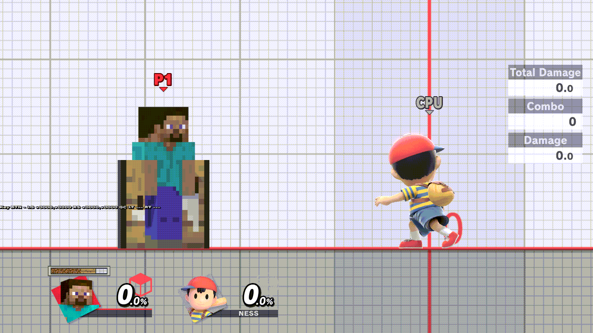
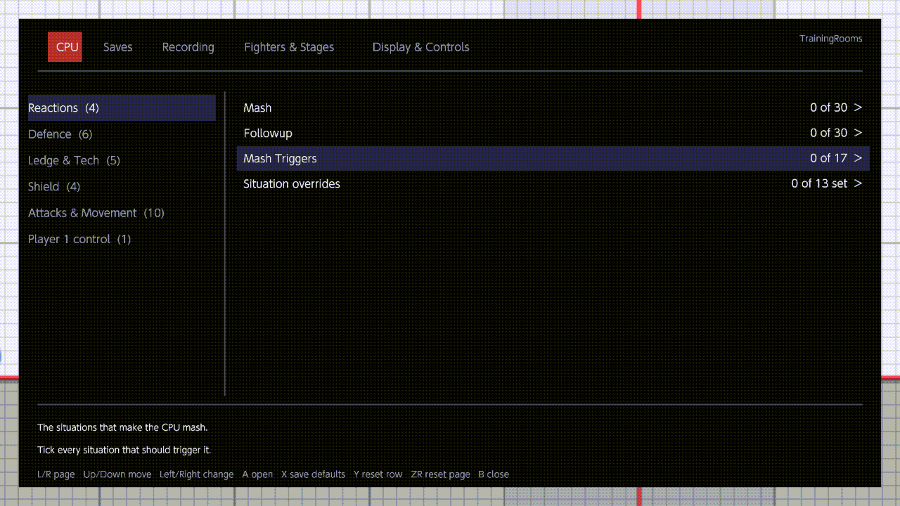
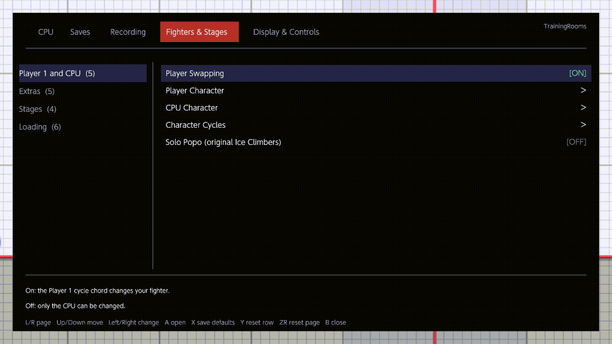
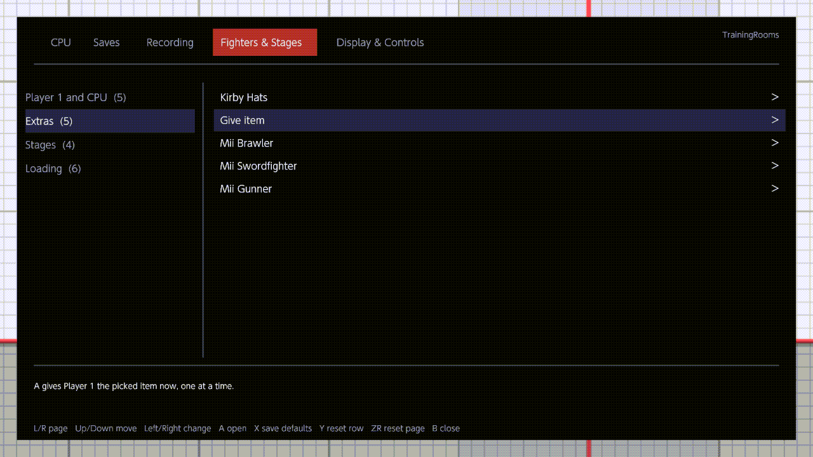
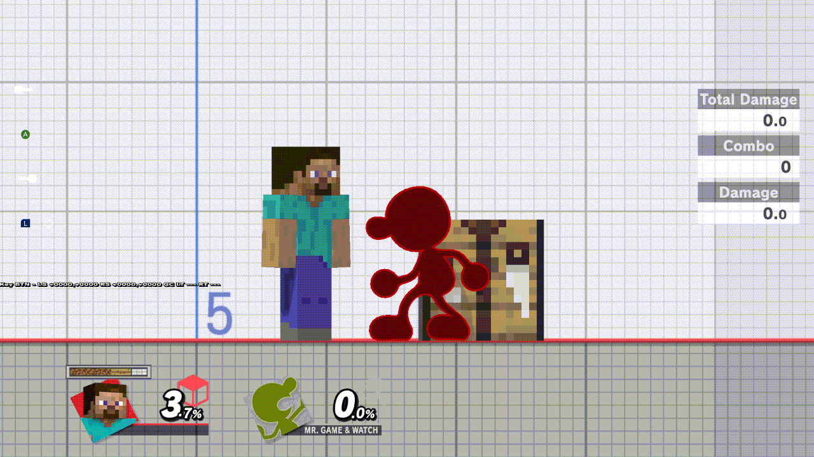
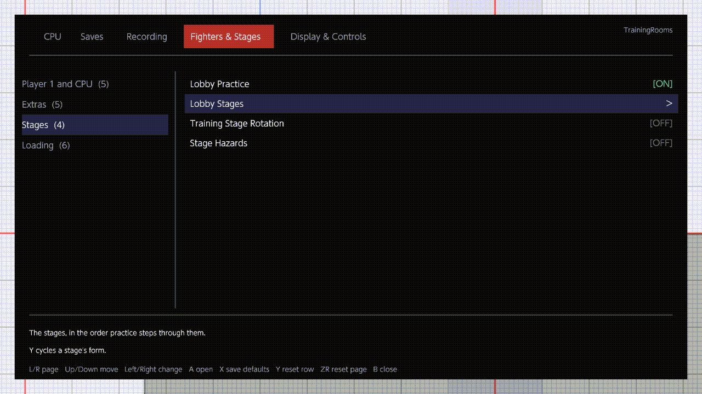

# Menu GIFs

Demonstration clips of the TrainingRooms menu, recorded for the operator's
review. All six are actual Eden footage (Eden-GIF's built-in recorder, whole
screen, 1280×720) from RC10 release boots on the Surface: runs `glm-gifs-04`
and `glm-gifs-05` on 2026-11-04Z, and the stage-grid clip from `glm-mods-10`
(same release NRO, SHA-256
`50d95130b34fc7ad2863953e47cd15aac55db4c37503328182a195484777de0b`, with the
card's ARCropolis `92171b2f…` pinned and the profile's Cosmic Destination
stage mod live, so the mod-aware loader's mod side is exercised). The
character grids draw the game's own stock icons (the native key builder's
`picture=0` waiting-room icon at the active role's costume), loaded at run
time through the game's mod-aware file-resource service — the same stock-icon
art the fork's menu showed, now read natively instead of baked (operator
decision 2026-11-03; SPEC-core-07 Q16 amendment). With ARCropolis pinned
(`glm-mods-10`) the stage grid still draws every thumbnail, but the character
grids came out blank: the roster stock-icon request does not survive
ARCropolis's presence (recorded 2026-11-04, under investigation).

Each clip is one continuous take, trimmed only at the ends and under 10 s
(game-speed timing untouched); the first, middle and last frames of every
published file were inspected before it was kept. The raw takes are retained
outside git under `/home/intpa/eden-runs/glm-gifs-0{4,5}/out/gifs/`. The
recording clip is full-motion gameplay, so it is kept at a lower frame rate
(≈3.3 fps) and palette to stay reviewable in git; the others keep the source
frame times.

*In Training, `B`+`Up` opens the menu and `R` steps the active tab through the
five pages — CPU · Saves · Recording · Fighters & Stages · Display & Controls —
then `B` closes it. 7.9 s. Eden, 2026-11-04Z, RC10 candidate, NRO `50d95130`.*

*CPU tab: `Down` to DI Direction, `A` opens the direction grid, `Right`+`A`
picks Out with weight ×1 — the row ends reading "Selected: Out ×1". 9.8 s.
Eden, 2026-11-04Z, RC10 candidate, NRO `50d95130`.*

*`R` steps to Fighters & Stages and Character Cycles opens: the grid draws each
fighter's own stock icon, loaded from the game at run time (the art the fork's
menu showed); `A` adds the focused fighter to the Player cycle order and the
rank badges appear (5. Mario, 6. Donkey Kong), `ZR` switches role. 8.9 s.
Eden, 2026-11-04Z, RC10 candidate, NRO `50d95130`.*

*Fighters & Stages → Lobby Stages stage grid: the thumbnails load at run time
through the game's mod-aware loader, and with ARCropolis pinned and Cosmic
Destination in `ultimate/mods` the Final Destination tile draws the mod's
nebula picture (matching the mod's decoded `stage_1_end.bntx`) while every
other tile shows stock; the cursor steps along page 1 and `A` adds Battlefield
to the rotation (rank 2 appears). 9.7 s. Eden, 2026-11-04Z, RC10 candidate,
NRO `50d95130`, ARCropolis `92171b2f`.*

*The recording side: with `ZR`+`Down` armed, Player 1's inputs are captured
(the input display and the fight show the recorded window), and `ZR`+`Up`
plays them back under the "Input Recording — Playback" notice. 9.9 s, ≈3.3 fps.
Eden, 2026-11-04Z, RC10 candidate, NRO `50d95130`.*

*The page keys the hint line names: `X` save defaults, `Y` reset row,
`ZR` reset page, pressed on the Display & Controls page whose rows were
already at their defaults, so no value moves; the keys and the hint are the
clip's subject. 9.8 s. Eden, 2026-11-04Z, RC10 candidate, NRO `50d95130`.*

Not published: a defaults take with a visible `Y` reset (the CPU page's DI row
holding the CPU clip's pick) — the menu reopens on the page of the previous
close, and none of the recorded takes landed on a page that still held a
non-default value; the raw takes are retained with the runs.
