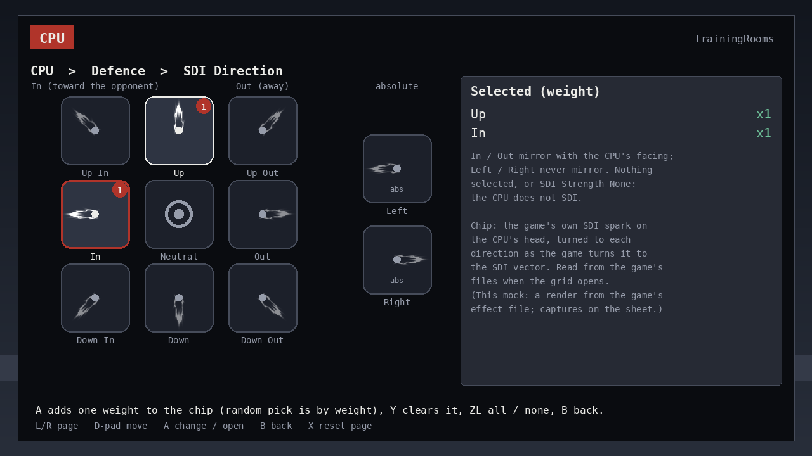
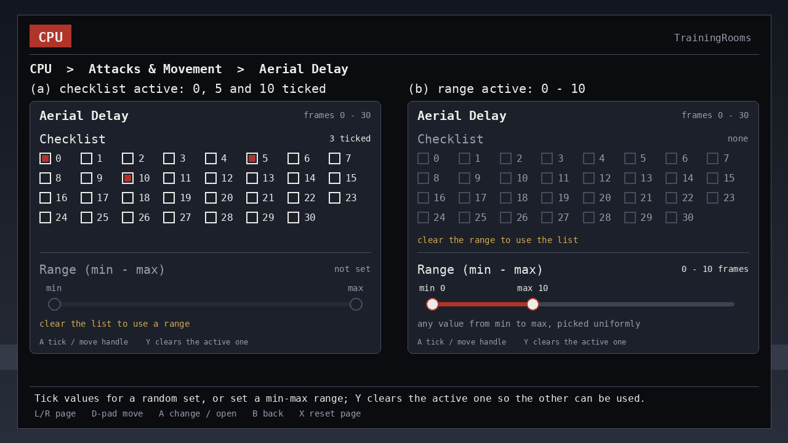
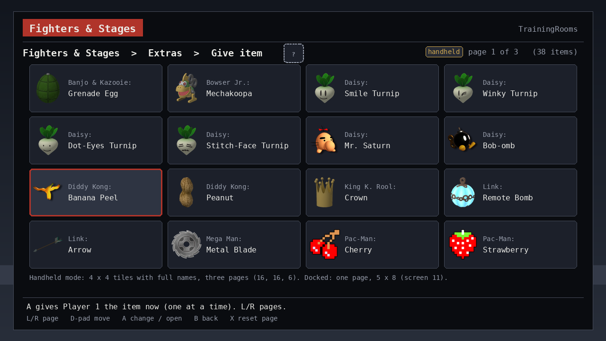
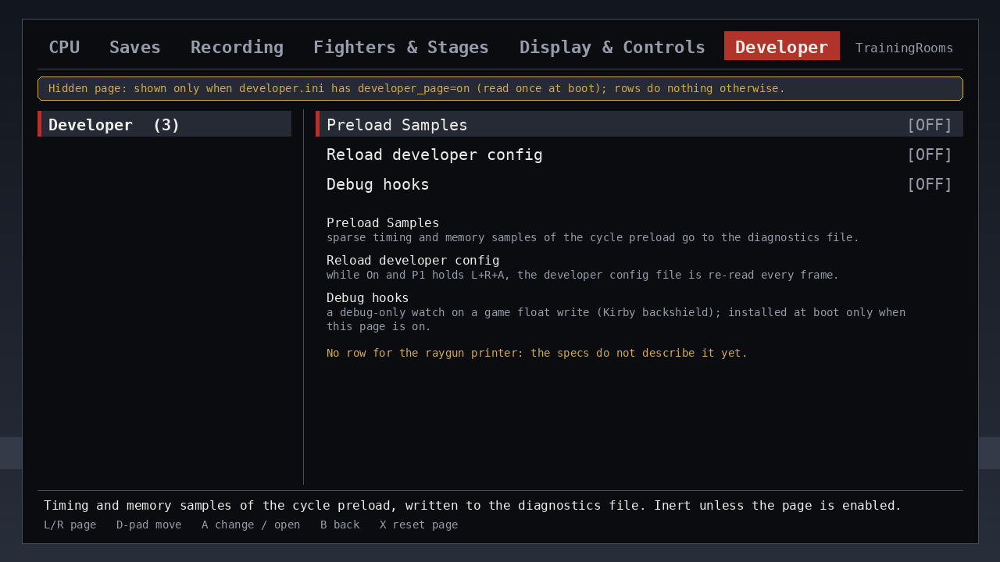

# TrainingRooms menu — proposal v10 (approved with the operator's answers)

Proposal v10, 2026-11-01. Source of truth: [`MENU-DRAFT.md`](../MENU-DRAFT.md) (draft 9: every item, option list and default, taken from the shipped C116.1 menu definition and the operator's answers). Screens below are rendered mockups in the in-game overlay look (1280×720, `tools/render_menu_mockup.py`, files in [`menu-mockup/`](menu-mockup/)). The operator approved the proposal on 2026-11-01 with the answers below, and implementation may begin.

**Every decision, one picture each, with the answer or the recommendation: [`DECISIONS.md`](DECISIONS.md)** (menu questions 1–18 below, plus the import, behaviour and product choices from the specs).

**What changed from v9 (the operator's answers, 2026-11-01):**

- **New rows.** *Respawn invincibility* (toggle, Off) on Saves, after *Auto-load on death*; *Settings override playback* (advanced toggle, Off) in Recording › Playback; a sixth page, **Developer**, hidden unless `developer.ini` has `developer_page=on`, with *Preload Samples* (moved from *Loading*) and the rebuilt developer-only rows.
- **Rows removed or changed.** *Item on load (older saves)* is gone (the first-boot import converts older saves once). *Menu shortcut 1 / 2* are editable (they open the chord editor and the menu writes `button_config.ini`). The seven delay rows (Aerial Delay, Fast Fall Delay, Throw Delay, Pummel Delay, Ledge Delay, OoS Offset, Reaction Time) offer a checklist **and** a min–max range in one popup, one at a time.
- **Grids.** The item grid is one 5 × 8 page when docked and three 4 × 4 pages in handheld mode; the stage grid stays 4 × 4. The SDI chips draw the spark's longer white streaks.
- **Behaviour, no new row.** SDI not set means no SDI; a playing recording wins over the CPU settings unless the new advanced row is On; a changed SDI Direction or Shield Tilt applies at the next CPU frame; the import also copies `replay_captures/` in full and both INI files.
- **Screens.** Updated: [02 Saves](menu-mockup/02-saves.png), [03 Recording](menu-mockup/03-recording.png), [05 Display & Controls](menu-mockup/05-display-controls.png), [11 item grid, docked](menu-mockup/11-item-grid.png); new: [18 item grid, handheld](menu-mockup/18-item-grid-handheld.png), [19 delay popup](menu-mockup/19-delay-popup.png), [20 Developer page](menu-mockup/20-developer.png).
- **Decisions** (the last section) now lists the answers and what is still open: question 5, B11, and two confirmations.

**v9 (new evidence, still standing; was "What changed from v8"):** the **SDI spark is captured**: a white spiky burst with a ring outline on the CPU's head, pointing along the SDI vector (Up: a crown of spikes above the head; In: the same shape lying sideways). The DI streak is confirmed to turn with the DI-corrected launch. The **DI and SDI chips** on 01, 09, 16 and the new **SDI grid (17)** are now **renders made from the game's own effect file**, one still per effect turned to each direction. The chip sheet shows crops of the real captures beside them as the check. New **question 18**: in the fork, a changed SDI Direction applies only at the next Training reset, and the menu does not say so. Facts: `specs/SPEC-core-07-assets-inventory.md` §4.6, `specs/SPEC-cpu-02` question 9; sources: `menu-mockup/index.md`.

**v8:** the visuals are identified. **DI** is the game's system effect `sys_vector` (a blue streak with white sparkle lines, turned to the DI-corrected launch angle); **SDI** is a different effect, `sys_hitstop_spark` (a white spark on the head per SDI input frame). Screens 01, 09 and 16 now draw the **DI chips from a real crop of the streak** in a capture, turned to each direction as the game turns the effect; the **SDI chips are the neutral placeholder** until an SDI capture exists. Airdodge Direction and Shield Tilt keep the arrows (question 17, unchanged). The operator's Final Destination mod replaces all four stage UI slots; the game's stage select follows it and the fork's baked grid does not (question 13's rule stands). Facts and remaining unknowns: `specs/SPEC-core-07-assets-inventory.md` §4.5–4.6; crop provenance: `menu-mockup/index.md`.

**v7 (still standing):** the DI and SDI direction chips show the game's own DI / SDI visual, read from the game's files at run time, like the stage thumbnails; nothing is drawn after it or baked.

**v6 (still standing):** the screens carry no origin tags (`upstream` / `ours`); origin is internal, and the *Visual sources* table below and `PROVENANCE.md` are the internal record.

**v5 (still standing) — what changed from v4 (the operator's review):**

- The **item grid** shows **the fork's own 38 item icons** (`scripts/item-icons/assets/icon-00..37.png`, made from the game's item files), copied unchanged and pinned by sha256 in [`menu-mockup/index.md`](menu-mockup/index.md). The stand-in glyphs are gone.
- **Stage thumbnails are read at run time, never baked.** Each tile draws the stage's own game UI texture (`ui/replace[_patch]/stage/stage_1/stage_1_<name_id>.bntx`), read through the mod-aware file view when the page opens. That is the same file a stage mod replaces, so a mod that changes a stage's icon (for example a Final Destination replacement) shows in the grid. The fork bakes 115 stock thumbnails into its layout archive instead, so mods never show there. The contract, the candidate load routes and the unknowns are in `specs/SPEC-core-07-assets-inventory.md` §4.5. The stage-grid mockup still shows captures of the stock thumbnails, and its caption says so.
- **Question 13 is answered** by the two points above. New **question 16**: should fighter portraits follow the stage rule?

**v4 (still standing):** Kirby Hats, Solo Popo and Character items show one neutral **placeholder** chip (their final icons are designed once the functionality is settled); the portrait grid shows the real fighter icons, cropped from captures of the fork's own grid.

**v3 (still standing):** the fork's grid pickers where they fit, with a small preview on each page row; **DI / SDI / Airdodge Direction / Shield Tilt** as a **direction grid** (3×3 chips In · Neutral · Out across, Up · – · Down down, relative to the opponent, plus absolute Left / Right; a chip carries the weight for the random pick; Shield Tilt takes one chip); the item grid has **38** named items (`character_items.rs` `ITEM_NAMES`).

Everything else from v2 stands: 5 pages (v10: plus the hidden Developer page), dropdowns for single choices, checklists for sets (v10: and a range on the delay rows), sliders for ranges, the three sub-screen editors. v10 row count: 91 visible rows with the standalone pilot installed, 92 without it (recounted from the draft tables; the earlier "76" did not match them; arithmetic in `MENU-DRAFT.md` §2). Setting ids do not change, so existing settings files load as they are.

**Already decided (operator, 2026-11-01):** MIT with the handle as holder; storage moves to `sd:/ultimate/TrainingRooms/` (one-time import of the old folder proposed); the CPU-pilot plugin owns "CPU plays P1" and has its own page, so this menu does not repeat it.

## Visual sources: what carries over, what is new

The clean room may carry over everything the fork wrote (`PROVENANCE.md` §B) and nothing upstream drew (§C: the 42 `src/static/img/*.svg` menu icons and `layout.arc` are unlicensed upstream artwork, listed one by one in `specs/SPEC-core-07-assets-inventory.md`). `di_state.svg`, `sdi_state.svg`, `air_dodge_dir.svg` and `shield_tilt.svg` are upstream files and are never copied. Since v7 the DI and SDI chips use the game's own DI / SDI visual instead, read from the player's game files at run time (`SPEC-core-07` §4.6); Airdodge and Shield Tilt use the clean room's own arrows.

| Visual | Status | Fork source (file:line, stage M5i) | In the clean room |
| --- | --- | --- | --- |
| Portrait roster grid: 13 columns × 7 rows (6 full rows + a centred 9-cell row = 87 cells), P1 red / CPU blue order badges, ZR role switch, S marks for Solo Popo, PT / Aegis form preview on X, the All cell | **ours, carry over** | model `training_mod_tui/src/roster_grid.rs:8-14` (COLUMNS, ROWS, CELLS) and `:103-200` (GRID order); native panel `src/training/ui/roster_grid.rs:43-56` (`roster_icon_XX`, `roster_p_N`, `roster_c_N`, `roster_all_*`, cursor, title, name, help, role, solo marks), colours `:9-11` | same grid; the fork keeps 89 stock-icon PNGs in `scripts/roster-grid/assets/` (`sources.json`: SmashWiki copies, sha256 each) and builds them into its patched `layout.arc`; question 16 is decided: the plugin reads each portrait at run time like the stage thumbnails (text tile as the fallback; one more development probe); the review screens still show the stock icons |
| Stage thumbnail grid: pages of 4 × 4, All first, rotation rank badges, Y cycles Normal / Omega / Battlefield, L / R page | **ours, carry over** | `training_mod_tui/src/stage_menu.rs:5-7` (PAGE_ROWS 4 × `NX_SUBMENU_COLUMNS` 4), `:52-58` (All + 117 stages = 8 pages); native panel `src/training/ui/stage_grid.rs:20-30` (`stage_icon_N`, `stage_tile_N`, `stage_label_N`, `stage_rank_N`, `stage_all_icon`); list `training_mod_consts/src/lobby_stages.rs:13` | same grid, **thumbnails read at run time**: each tile draws the stage's own game UI texture through the mod-aware file view, so stage mods show; nothing baked or committed (SPEC-core-07 §4.5). The fork instead bakes 115 stock thumbnails (`scripts/stage-grid/assets/`, decoded from the `stage_1` textures) into its `layout.arc`, so its grid never shows a mod |
| Item grid: 38 named items with the game's item pictures, turnip faces included | **ours, carry over** | `training_mod_consts/src/character_items.rs:5-18` (`ITEM_NAMES`), icons `src/training/ui/menu.rs:403` (`item_icon_NN`), give action `src/common/menu.rs:387-394` | v10: the fork's two 4 × 8 pages are replaced by one 5 × 8 page when docked and three 4 × 4 pages in handheld mode (question 14, decided), with **the fork's own 38 item icons** (`scripts/item-icons/assets/`, `sources.json`: native `item_0` UI icons for Mr. Saturn, Bob-omb and Banana Peel, renders of the item's own game model for the rest) |
| Direction option list (Out, Up Out, Up, Up In, In, Down In, Down, Down Out, Neutral, Left, Right; weighted multi-select) | behaviour **upstream → clean-roomed** (`specs/SPEC-cpu-02`, table §2) | option values `training_mod_consts/src/options.rs`; weights = `training_mod_tui/src/containers/toggle.rs:5-9` (`value`, `max`) | the **direction grid** (new control); DI and SDI chips show the game's own DI / SDI visual, read at run time (v7; SPEC-core-07 §4.6); Airdodge and Shield Tilt chips are the clean room's own arrows |
| DI / SDI direction visual | **game asset, read at run time** | none: the fork and upstream only steer the stick (`src/training/directional_influence.rs`, `sdi.rs`) and request no DI / SDI effect | DI `sys_vector` / SDI `sys_hitstop_spark` in `effect/system/common/ef_common.eff` (v8); the chips read the emitter textures and colours from the player's game files when the grid opens; never committed or baked; unreadable → the clean room's arrow. The mockup's two chip renders (made from the stock effect file) and its DI / SDI capture crops are review material only (v9) |
| Menu icons for DI, SDI, Airdodge, Shield Tilt, Character item | **upstream artwork, replace** | `src/static/img/{di_state,sdi_state,air_dodge_dir,shield_tilt,character_item}.svg` (PROVENANCE §C; SPEC-core-07 rows 35, 38, 42, 68, 71) | not used; replaced by the direction chips and the character-items placeholder |
| Kirby Hats, Solo Popo, Character items row chips | **new, open** | — (the fork marks these rows with text only) | a neutral placeholder (`tools/render_menu_mockup.py` `chip_placeholder`) until the final icons are designed, once the functionality is settled |
| Mockup crops `menu-mockup/captures/` (87 fighter cells, 15 stage cells) and item copies `captures/items/` (38) | **game-asset captures and fork icon copies, review only** | captures of the fork's grids: `docs/feature-walkthroughs/kirby-grid.png`, `stage-rotation.png` and two Eden grabs; byte copies of the fork's `scripts/item-icons/assets/icon-NN.png` (`menu-mockup/index.md`) | shown in this review only; never part of the plugin or its release (`PROVENANCE.md` §C, review-mockup note). The stage crops stand in for the run-time thumbnails |
| Mii lists (saved Miis, replay Miis, Add New…) | **ours, carry over** | `training_mod_tui/src/mii_menu.rs` | stay lists: saved Miis have no stock portrait; the fork's exact bust can sit beside each entry where it exists (question 15) |

## Opening and navigating

| Action | Input |
| --- | --- |
| Open / close the menu | `B + D-pad Up` (always), or a shortcut from `button_config.ini` (editable under Display & Controls › Controls; the menu writes the file) |
| Change page | `L` / `R` (the hidden Developer page is in the ring only when `developer.ini` enables it) |
| Move | D-pad or stick; the left column is the page's groups, the right pane the selected group's items |
| Change a value | `A` on a toggle flips it; on a dropdown `◂` / `▸` cycle the value in place and `A` opens the list (question 2, decided); on a checklist `A` ticks the focused entry; on a delay row `A` opens the popup with the checklist and the range (`Y` clears the active one); `A` on a grid, chip row or editor opens its sub-screen |
| In a grid | D-pad moves the cursor (rows wrap); `A` adds / removes (order grids number the pick), `ZR` switches P1 ↔ CPU order, `Y` cycles the stage form or marks Solo Popo, `X` previews a PT / Aegis form, `L` / `R` page the stage grid and the handheld item grid (docked, the item grid is one page) |
| In a direction grid | D-pad moves between the chips; `A` adds one weight to the chip, `Y` clears it, `ZL` all / none; Shield Tilt: `A` selects the one chip |
| Back | `B` (closes a sub-screen first) |
| Reset the page to defaults | `X` |
| Help | a two-line panel at the bottom for the focused item (question 10, decided) |

## Control legend

| Shown as | Meaning | Today |
| --- | --- | --- |
| `[ON]` / `[OFF]` | toggle | toggle |
| `<  value  >` | dropdown: one choice; `◂`/`▸` cycle, or open the list | a "ToggleSingle" list where exactly one row is on |
| `n of N selected  >` | checklist: a set; random among the selected where the feature randomizes | a "ToggleMultiple" list |
| `n selected  >` or `min – max  >` | **multi-select + range** (the seven delay rows): one popup with a checklist and a min–max range; the one in use greys the other; `Y` clears it | a "ToggleMultiple" list |
| `|=====---|  0 - 150 %` | slider: a range | slider |
| `<  8  >` | number | single-choice list of numbers |
| `n selected  >` + nine dots | **direction grid**: the lit dots are the chosen chips; opens the 3×3 grid | a 11-row "ToggleMultiple" list |
| portrait tile(s) + `>` | **portrait grid**: the fork's roster grid; order grids show the first badges | the fork's grid |
| stage tile(s) + `>` | **stage grid**: the fork's stage pages; the first ordered stages are previewed | the fork's grid |
| placeholder chip + `>` | **item grid** behind *Give item*; **Kirby Hats** grid behind *Kirby Hats* | the fork's grid |
| placeholder chip + `[OFF]` | Solo Popo toggle | toggle |
| `…  >` | editor / list: opens a sub-screen (v10: also the two *Menu shortcut* rows, which open the chord editor) | a submenu |
| `advanced` on a group | collapsed by default on the console | — |

## Chips

| Chip | What it shows | Where |
| --- | --- | --- |
| Kirby Hats | placeholder: dashed rounded square, label `HATS` | the *Kirby Hats* row and the hat grid's header |
| Solo Popo | placeholder, label `POPO` | the *Solo Popo (original Ice Climbers)* row |
| Character items | placeholder, label `ITEMS` | the *Give item* row and the item grid's header |
| Direction chips | DI: the game's DI streak; SDI: the game's SDI spark on the head, v10: with longer white streaks, closer to a capture; each turned to the direction (v9: renders made from the game's effect file on the screens, crops of captures beside them on this sheet; the plugin reads the effect at run time). Airdodge and Shield Tilt: a bold stroke from the centre with an arrowhead. Neutral is a ring; Left / Right carry `abs` | the direction grids; the DI and SDI rows preview their selected chips, the others the nine dots |

The three placeholders mark where an icon goes and nothing more: the final icons are open and will be designed once the functionality is settled. At row size (34 px) a placeholder shows `?` instead of its label.

## Page 1 · CPU

Everything that changes what the CPU does, in the order a player thinks about a situation: reactions, defence, ledge and tech, shield, attacks and movement. The screen shows the *Defence* group with its direction grids.

| Group | Items (control) |
| --- | --- |
| Reactions | Mash (checklist, 13 actions) · Followup (checklist, 13) · Mash Triggers (checklist, 17 situations) · **Situation overrides** (editor, replaces the 13-row Override tab) |
| Defence | **Airdodge / DI / SDI Direction** (direction grids, weighted) · SDI Strength, Clatter Strength (dropdowns: None, Normal, Medium, High) · Dodge Staling (toggle) |
| Ledge & Tech | Ledge Options (checklist, 10 incl. Playback Slot 1–5) · Ledge Delay (checklist or range, 0–300 by 10) · Tech / Mistech Options (checklists, 4 each) · Hide Tech Animations (toggle) |
| Shield | Shield (dropdown: None, Infinite, Hold, Constant) · **Shield Tilt** (direction grid, one chip) · OoS Offset (checklist or range, 0–30 hits) · Reaction Time (checklist or range, 0–30 frames) |
| Attacks & Movement | Attack Angle (checklist) · Throw (checklist: None, Forward, Back, Up, Down) · Throw / Pummel Delay (checklist or range, 0–150 by 5) · Falling Aerials, Full Hop, Fast Fall (dropdowns: Yes, No, Random) · Aerial / Fast Fall Delay (checklist or range, 0–30) · Crouch (toggle) |
| *(hidden unless the CPU-pilot plugin is absent)* | P1 CPU Control (toggle) · P1 CPU Level (dropdown 1–9) — the fallback; with the pilot present one info row says "P1 control: CPU pilot plugin (its own menu)" (question 11) |

### Sub-screen · Direction grid

The nine relative chips sit as the stick does: *In* is toward the opponent and *Out* away (the game mirrors the angle when the player stands on the CPU's other side, `SPEC-cpu-02` §2); *Left* and *Right* are absolute and never mirror. A selected chip carries its weight in the corner (upstream's counts: the random pick is weighted); the legend lists the selection. Nothing selected means the CPU does not interfere. The same grid serves SDI Direction, Airdodge Direction and Shield Tilt (one chip). In the plugin the DI and SDI chips show the game's own DI / SDI direction visual, read when the grid opens. This screen shows the DI streak rendered from the game's effect file and turned per direction, as the game turns the effect to the launch angle (v9, `SPEC-core-07` §4.6).

The SDI grid has the same layout. Each chip is the game's SDI spark, centred on the CPU's head and turned to the SDI vector (rendered from the effect file; the chip sheet shows the captured Up and In sparks beside the rendered chips). SDI Strength None, or no chip selected, means the CPU does not SDI. In the fork a changed SDI Direction applied only at the next Training reset; question 18 is decided (v10): the clean room follows the fork's later rule, so a changed SDI Direction or Shield Tilt applies at the next CPU frame with a new roll that holds until the next reset or the next change of that row. The SDI chips in v10 draw the spark's white streaks longer (question 17).

### Sub-screen · Situation overrides

Pick the situation in the dropdown (13: ledge getups, tech, clatter, tumble, hitstun, parry, shieldstun, footstool, landing, trump), tick the actions for it. The page row shows "n of 13 set".

### Popup · Delay rows (checklist and range)

The seven delay rows (Aerial Delay, Fast Fall Delay, Throw Delay, Pummel Delay, Ledge Delay, OoS Offset, Reaction Time) open one popup with two controls over the same values: the checklist of today's semantics (the CPU picks one ticked value, weighted) and a min–max range (the CPU picks any step value from min to max, uniform). A ticked checklist greys the range, a set range greys the checklist, and `Y` clears the active one. A saved file without a range loads as a checklist, so existing settings keep their meaning. The three slot sets (Randomize Slots, Button slots, Save-state slots) keep the checklist only; this is one of the two confirmations still to ask.

## Page 2 · Saves

Positions and damage: the save-state rules and the named setups built on them.

| Group | Items (control) |
| --- | --- |
| Save states | Save States (toggle) · Slot (dropdown 1–5) · Randomize Slots (checklist 1–5) · Mirroring (dropdown: None, Alternate, Random) · Auto-load on death (toggle) · **Respawn invincibility** (toggle, Off; new in v10, greyed while Auto-load on death is On) · Player / CPU damage on load (dropdowns: Default, Save State, Random) · Player / CPU damage range (sliders 0–150 %, greyed unless Random) · Buffs on load (checklist, 12) |
| Setup library | Save setup to library… (editor: name entry) · Setup library (list; `A` binds + restores, `Y` binds) |

## Page 3 · Recording

Inputs the CPU plays back: numbered recordings, playback rules, and the named-macro and replay tools that feed the same slots.

| Group | Items (control) |
| --- | --- |
| Recording | Record Slot (dropdown 1–5) · Trigger (dropdown: Button Combination, Save State Load) · Duration (dropdown 60–600 frames by 30) · Crop trailing neutral (toggle) |
| Playback | Button slots (checklist 1–5) · Hitstun timing (dropdown: As Hitstun Ends, As Hitstop Ends, As Hitstop Begins) · Save-state slots (checklist 1–5) · Mash interrupts playback (toggle) · Loop (toggle) · **Settings override playback** (advanced toggle, Off; new in v10: Off means a playing recording wins over the CPU's DI, SDI, air-dodge, tech and throw settings, On restores upstream's rule) |
| Named macros | Source (dropdown: Numbered Slots, Named Library) · Ask before switching fighter (toggle) · Named library (list) · Save slot to library… (editor) · Edit placement (editor) · Replay window (editor) · Replay capture (toggle, new in the menu; question 7, decided) |

## Page 4 · Fighters & Stages

Who is on screen and where: swaps, cycles, hats, items, Miis, the stage rows, and (collapsed) the loading machinery that makes swaps fast. Three screens, one per group, because this page carries the grids.

| Group | Items (control) |
| --- | --- |
| Player 1 and CPU | Player Swapping (toggle) · Player Character, CPU Character (portrait grids; the row shows the chosen portrait) · Character Cycles (two-role portrait grid; the row previews the P1 and CPU orders with their badges; `ZR` switches role; Solo Popo marks edited here) · Solo Popo (original Ice Climbers) (toggle with a placeholder chip) |
| Extras | Kirby Hats (two-role portrait grid; placeholder chip) · Give item (item grid, 38 items: one page docked, three pages handheld; placeholder chip) · Mii Brawler / Swordfighter / Gunner (lists: saved Miis, replay Miis, Add New…) |
| Stages | Lobby Practice (toggle) · Lobby Stages (stage grid; the row previews the first ordered stages) · Training Stage Rotation (toggle) · Stage Hazards (toggle) |
| Loading *(advanced)* | Cycle Preload (dropdown Off, 1–5) · Preload (dropdown: Fighters, Hats, Both) · Ready Fighters (number, default 8) · Ready Fighter Bodies (dropdown: Off, 2, 3) · Group Swap (toggle) · **Swap groups** (checklist of the 7 switches; entries grey with the reason when a dependency is off). *Preload Samples* moved to the Developer page (question 8) |

### Sub-screen · Character Cycles (portrait grid)

The fork's roster grid as shipped: 13 columns, six full rows and a centred last row ending in *ALL*; red badges number the P1 order, blue the CPU order; `ZR` switches which order `A` edits; the red *S* on Ice Climbers is the Solo Popo mark; `X` previews the Pokémon Trainer and Pyra / Mythra forms. *Player Character* and *CPU Character* open the same grid as a one-shot picker (no badges). The portraits are the real fighter icons, cropped from captures of the fork's own grid (sources in `menu-mockup/index.md`); badges, tiles and labels are drawn by the mockup.

### Sub-screen · Kirby Hats

The same grid with the placeholder chip in the header: the badges are the hat order per role; Kirby takes the next hat in that order on each hat cycle.

### Sub-screen · Give item (item grid)

Docked (question 14, B): one page of 5 × 8 tiles holds all 38 items, with short names. Each tile shows the fork's item icon (the real files, copied unchanged; sources in `menu-mockup/index.md`), the item and its owner. `A` gives Player 1 the item at once.

Handheld (the console's operation mode when the grid opens): three pages of 4 × 4 tiles (16, 16 and 6 items) with the full names; `L` / `R` page. The stage grid below keeps its 4 × 4 paging; that is the second confirmation still to ask.

### Sub-screen · Lobby Stages (stage grid)

4 × 4 thumbnails per page, 8 pages for All + 117 stages; *All (listed order)* is the first tile. Red badges number the rotation order, the tag at the top right is the form (`N` normal, `Ω` omega, `BF` battlefield), `Y` cycles it on the focused stage. Training Stage Rotation uses this order. In the plugin each thumbnail is the stage's own game UI texture, read when the page opens, so a stage mod's picture shows (a stage that cannot be read shows a text tile, like *Waiting Room*); nothing is baked. The mockup shows captures of the stock thumbnails from the fork's own stage grid in their place, and the All icon from the same capture.

### Sub-screen · Swap groups

## Page 5 · Display & Controls

What is drawn and which buttons do what; nothing here changes what the CPU does.

| Group | Items (control) |
| --- | --- |
| On screen | HUD, Hitbox Visualization, Frame Advantage (toggles) · Input Display (dropdown: Off, Smash Inputs, Raw Inputs, Status Only) · Group inputs by status (toggle) · Input Delay (number 0–30 frames) |
| Controls | **Button chords** (editor, replaces the Button Config tab) · L+R+A Reset (toggle) · **Menu shortcut 1 / 2** (editors, v10: they open the chord editor, the menu writes `button_config.ini`, the new chord applies at once; question 9, decided) · Permanent shortcut (info: `B + D-pad Up`, fixed) |

### Sub-screen · Button chords

Six rows; defaults ZL+D-pad Down (save), ZL+D-pad Up (load), ZR+D-pad Down (record), ZR+D-pad Up (playback), ZL+D-pad Right (cycle player), ZL+D-pad Left (cycle CPU). Hold one button and press the others to re-bind; a one-button chord is allowed. The two *Menu shortcut* rows on the page use the same entry rule (hold one, press the others) and write their result to `button_config.ini`.

## Page 6 · Developer (hidden)

Measurement and development aids that no player needs. The page is hidden, and its rows do nothing, unless `sd:/ultimate/TrainingRooms/developer.ini` has `developer_page=on` (read at boot; a missing file or any other value hides it). It ships in the normal build, so capture and test runs need no diag build. The operator's card and the Eden test profiles enable it.

| Group | Items (control) |
| --- | --- |
| Developer | Preload Samples (toggle, moved from *Loading*) · Reload developer config (toggle) · Debug hooks (toggle); all Off by default. The last two are rebuilt from the descriptions of the upstream developer-only code (`specs/SPEC-core-01` §6); the code itself is not copied |

## On-screen indicators (outside the menu)

What the plugin shows while you play, unchanged in meaning from the fork unless noted:

| Indicator | Where | Meaning |
| --- | --- | --- |
| Frame advantage number | above the player | frames of advantage after a hit on shield / a hit (On screen › Frame Advantage) |
| Hitbox / hurtbox shapes | on the fighters | red attack, yellow hurtbox, grab and shield colours as the game's debug palette (On screen › Hitbox Visualization) |
| Input display | bottom corner | last inputs as Smash inputs or raw buttons, optionally grouped by status |
| Swap notice | centre | "Loading…" while a fighter swap or group build runs; it disappears when the swap is ready. A refused warm swap falls back to the normal reload without a notice (the log says why) |
| CPU stock icon | HUD | shows the CPU's current fighter **in the costume it wears** (fixed in C116.1; carried over) |
| Save-state flash | screen edge | brief flash on save / load |
| Practice-stage card | waiting room | the stage grid while Lobby Practice is on |
| Install line | `sd:/ultimate/TrainingRooms/practice-diagnostics.log` (not on screen) | one line at boot: version, sites checked, authoritative groups, anything skipped |

## Decisions

Illustrated, with options, recommendation, cost and the answer: [`DECISIONS.md`](DECISIONS.md). The operator answered on 2026-11-01 (late evening ET); the numbering is unchanged.

### Answered 2026-11-01

1. **Pages:** five, as recommended, plus the hidden Developer page (question 8).
2. **Dropdown input:** as recommended (`◂`/`▸` cycle in place; `A` opens the list).
3. **Random-among-a-set delays:** both. The seven delay rows offer the checklist and a min–max range in one popup, one at a time; using one greys the other, and `Y` clears the active one.
4. **Sub-screens** for Situation overrides, Button chords and Swap groups: as recommended.
6. **Item on load (older saves):** dropped; the first-boot import converts older saves once.
7. **Replay capture in the menu:** as recommended (add the toggle).
8. **Preload Samples:** a hidden Developer page (shipped, enabled by `developer.ini`, enabled on the operator's own card), instead of the diag build.
9. **Menu shortcuts:** editable in the menu (option B); the menu writes `button_config.ini`.
10. **Help text:** as recommended (two-line panel).
11. **P1 CPU fallback when the pilot plugin is absent:** as recommended (the two fallback rows).
12. **Direction grid weights:** as recommended (weight digit on a selected chip).
13. ~~**Grid picture source**~~ — *answered (v5):* stage thumbnails are read at run time from each stage's own game UI texture, so stage mods show, and are never baked or committed (SPEC-core-07 §4.5). The item grid uses the fork's own 38 item icons.
14. **Grid paging:** denser items (option B): docked, one page of 5 × 8; handheld, three pages of 4 × 4. The stage grid keeps 4 × 4 (to confirm).
15. **Mii rows:** as recommended (busts where they exist).
16. **Fighter portraits and mods:** as recommended (read at run time, text tile as the fallback).
17. **DI / SDI visual:** as recommended (DI and SDI chips only), with the SDI spark's white streaks drawn longer.
18. **When a CPU setting change takes effect:** follow the fork (option A): a changed SDI Direction or Shield Tilt applies at the next CPU frame.

The other decisions on the page [`DECISIONS.md`](DECISIONS.md) were answered too: S1 (import details: as recommended, except that `replay_captures/` is imported in full), S2 (corrupt settings file: keep a copy, load field by field), B1 (plugin name `training_rooms`), B2 (log a panic, no pop-up), B3 (inject another mod's HUD layout anyway), B4 (CPU settings on the CPU only; recording refused while an AI drives P1), B5 (the recording wins by default; the advanced row *Settings override playback* restores upstream's rule), B6 (one state per fighter), B7 (In / Out toward the opponent everywhere), B8 (the behaviour batch is accepted, except that SDI not set means no SDI and the respawn line becomes the *Respawn invincibility* toggle), B9 (upstream developer-only code lives on the Developer page; `parking_lot` is used directly), B10 (reuse the README GIFs that show no menu).

### Still open

- **Question 5, first page on open:** the last page used (today's behaviour) or always CPU? Not answered; the working default is the last page used.
- **B11, ledge options changed while the CPU is already on the ledge** (also true of the fork): re-roll on a menu change, like SDI, or apply on the next ledge grab? Not answered; the working default is the recommendation (re-roll on change).
- **Confirmation (question 3):** the three slot sets (Randomize Slots, Button slots, Save-state slots) keep the checklist only, because a range of slots is a run of ticks. Is that right?
- **Confirmation (question 14):** the stage grid keeps 4 × 4 paging; the denser choice was about the items. Is that right?

Answered earlier: license holder = handle; storage root = `sd:/ultimate/TrainingRooms/`; grids and item / stage visuals reused where they fit; direction grid for DI / SDI; the portrait grid shows the real fighter icons in the review screens; Kirby Hats, Solo Popo and character items use a placeholder until their final icons are designed (v4); the item grid uses the fork's own item icons and the stage grid reads each stage's game UI texture at run time, so stage mods show (question 13, v5); the screens carry no origin tags (v6); the DI and SDI chips show the game's own DI / SDI visual, read at run time (v7).