# TrainingRooms menu — proposal v5 for review

Proposal v5, 2026-11-01. Source of truth: [`MENU-DRAFT.md`](../MENU-DRAFT.md) (draft 5: every item, option list and default, taken from the shipped C116.1 menu definition). Screens below are rendered mockups in the in-game overlay look (1280×720, `tools/render_menu_mockup.py`, files in [`menu-mockup/`](menu-mockup/)). Nothing is built until a version is approved.

**What changed from v4 (the operator's review):**

- The **item grid** shows **the fork's own 38 item icons** (`scripts/item-icons/assets/icon-00..37.png`, made from the game's item files), copied unchanged and pinned by sha256 in [`menu-mockup/index.md`](menu-mockup/index.md). The stand-in glyphs are gone.
- **Stage thumbnails are read at run time, never baked.** Each tile draws the stage's own game UI texture (`ui/replace[_patch]/stage/stage_1/stage_1_<name_id>.bntx`), read through the mod-aware file view when the page opens. That is the same file a stage mod replaces, so a mod that changes a stage's icon (for example a Final Destination replacement) shows in the grid. The fork bakes 115 stock thumbnails into its layout archive instead, so mods never show there. The contract, the candidate load routes and the unknowns are in `specs/SPEC-core-07-assets-inventory.md` §4.5. The stage-grid mockup still shows captures of the stock thumbnails, and its caption says so.
- **Question 13 is answered** by the two points above. New **question 16**: should fighter portraits follow the stage rule?

**v4 (still standing):** Kirby Hats, Solo Popo and Character items show one neutral **placeholder** chip (their final icons are designed once the functionality is settled); the portrait grid shows the real fighter icons, cropped from captures of the fork's own grid.

**v3 (still standing):** the fork's grid pickers where they fit, with a small preview on each page row; **DI / SDI / Airdodge Direction / Shield Tilt** as a **direction grid** (3×3 chips In · Neutral · Out across, Up · – · Down down, relative to the opponent, plus absolute Left / Right; a chip carries the weight for the random pick; Shield Tilt takes one chip); the item grid has **38** named items (`character_items.rs` `ITEM_NAMES`).

Everything else from v2 stands: 5 pages, 76 rows, dropdowns for single choices, checklists for sets, sliders for ranges, the three sub-screen editors. Setting ids do not change, so existing settings files load as they are.

**Already decided (operator, 2026-11-01):** MIT with the handle as holder; storage moves to `sd:/ultimate/TrainingRooms/` (one-time import of the old folder proposed); the CPU-pilot plugin owns "CPU plays P1" and has its own page, so this menu does not repeat it.

## Visual sources: what carries over, what is new

The clean room may carry over everything the fork wrote (`PROVENANCE.md` §B) and nothing upstream drew (§C: the 42 `src/static/img/*.svg` menu icons and `layout.arc` are unlicensed upstream artwork, listed one by one in `specs/SPEC-core-07-assets-inventory.md`). The operator's "use the assets for SDI and DI" therefore means the *idea* of those icons: `di_state.svg`, `sdi_state.svg`, `air_dodge_dir.svg` and `shield_tilt.svg` are upstream files and are redrawn, not copied.

| Visual | Status | Fork source (file:line, stage M5i) | In the clean room |
| --- | --- | --- | --- |
| Portrait roster grid: 13 columns × 7 rows (6 full rows + a centred 9-cell row = 87 cells), P1 red / CPU blue order badges, ZR role switch, S marks for Solo Popo, PT / Aegis form preview on X, the All cell | **ours, carry over** | model `training_mod_tui/src/roster_grid.rs:8-14` (COLUMNS, ROWS, CELLS) and `:103-200` (GRID order); native panel `src/training/ui/roster_grid.rs:43-56` (`roster_icon_XX`, `roster_p_N`, `roster_c_N`, `roster_all_*`, cursor, title, name, help, role, solo marks), colours `:9-11` | same grid; the fork keeps 89 stock-icon PNGs in `scripts/roster-grid/assets/` (`sources.json`: SmashWiki copies, sha256 each) and builds them into its patched `layout.arc`; whether portraits are instead read at run time like the stage thumbnails is question 16 |
| Stage thumbnail grid: pages of 4 × 4, All first, rotation rank badges, Y cycles Normal / Omega / Battlefield, L / R page | **ours, carry over** | `training_mod_tui/src/stage_menu.rs:5-7` (PAGE_ROWS 4 × `NX_SUBMENU_COLUMNS` 4), `:52-58` (All + 117 stages = 8 pages); native panel `src/training/ui/stage_grid.rs:20-30` (`stage_icon_N`, `stage_tile_N`, `stage_label_N`, `stage_rank_N`, `stage_all_icon`); list `training_mod_consts/src/lobby_stages.rs:13` | same grid, **thumbnails read at run time**: each tile draws the stage's own game UI texture through the mod-aware file view, so stage mods show; nothing baked or committed (SPEC-core-07 §4.5). The fork instead bakes 115 stock thumbnails (`scripts/stage-grid/assets/`, decoded from the `stage_1` textures) into its `layout.arc`, so its grid never shows a mod |
| Item grid: 38 named items with the game's item pictures, turnip faces included | **ours, carry over** | `training_mod_consts/src/character_items.rs:5-18` (`ITEM_NAMES`), icons `src/training/ui/menu.rs:403` (`item_icon_NN`), give action `src/common/menu.rs:387-394` | same 4 × 8 pages (`NX_SUBMENU_ROWS` 8) with **the fork's own 38 item icons** (`scripts/item-icons/assets/`, `sources.json`: native `item_0` UI icons for Mr. Saturn, Bob-omb and Banana Peel, renders of the item's own game model for the rest) |
| Direction option list (Out, Up Out, Up, Up In, In, Down In, Down, Down Out, Neutral, Left, Right; weighted multi-select) | behaviour **upstream → clean-roomed** (`specs/SPEC-cpu-02`, table §2) | option values `training_mod_consts/src/options.rs`; weights = `training_mod_tui/src/containers/toggle.rs:5-9` (`value`, `max`) | the **direction grid** (new control); chips are new vector art |
| Menu icons for DI, SDI, Airdodge, Shield Tilt, Character item | **upstream artwork, replace** | `src/static/img/{di_state,sdi_state,air_dodge_dir,shield_tilt,character_item}.svg` (PROVENANCE §C; SPEC-core-07 rows 35, 38, 42, 68, 71) | not used; replaced by the direction chips and the character-items placeholder |
| Kirby Hats, Solo Popo, Character items row chips | **new, open** | — (the fork marks these rows with text only) | a neutral placeholder (`tools/render_menu_mockup.py` `chip_placeholder`) until the final icons are designed, once the functionality is settled |
| Mockup crops `menu-mockup/captures/` (87 fighter cells, 15 stage cells) and item copies `captures/items/` (38) | **game-asset captures and fork icon copies, review only** | captures of the fork's grids: `docs/feature-walkthroughs/kirby-grid.png`, `stage-rotation.png` and two Eden grabs; byte copies of the fork's `scripts/item-icons/assets/icon-NN.png` (`menu-mockup/index.md`) | shown in this review only; never part of the plugin or its release (`PROVENANCE.md` §C, review-mockup note). The stage crops stand in for the run-time thumbnails |
| Mii lists (saved Miis, replay Miis, Add New…) | **ours, carry over** | `training_mod_tui/src/mii_menu.rs` | stay lists: saved Miis have no stock portrait; the fork's exact bust can sit beside each entry where it exists (question 15) |

## Opening and navigating

| Action | Input |
| --- | --- |
| Open / close the menu | `B + D-pad Up` (always), or a shortcut from `button_config.ini` (shown read-only under Display & Controls) |
| Change page | `L` / `R` |
| Move | D-pad or stick; the left column is the page's groups, the right pane the selected group's items |
| Change a value | `A` on a toggle flips it; on a dropdown `◂` / `▸` cycle the value (question 2: or `A` opens the list); on a checklist `A` ticks the focused entry; `A` on a grid, chip row or editor opens its sub-screen |
| In a grid | D-pad moves the cursor (rows wrap); `A` adds / removes (order grids number the pick), `ZR` switches P1 ↔ CPU order, `Y` cycles the stage form or marks Solo Popo, `X` previews a PT / Aegis form, `L` / `R` page the item and stage grids |
| In a direction grid | D-pad moves between the chips; `A` adds one weight to the chip, `Y` clears it, `ZL` all / none; Shield Tilt: `A` selects the one chip |
| Back | `B` (closes a sub-screen first) |
| Reset the page to defaults | `X` |
| Help | one line at the bottom for the focused item (question 10: or a two-line panel) |

## Control legend

| Shown as | Meaning | Today |
| --- | --- | --- |
| `[ON]` / `[OFF]` | toggle | toggle |
| `<  value  >` | dropdown: one choice; `◂`/`▸` cycle, or open the list | a "ToggleSingle" list where exactly one row is on |
| `n of N selected  >` | checklist: a set; random among the selected where the feature randomizes | a "ToggleMultiple" list |
| `|=====---|  0 - 150 %` | slider: a range | slider |
| `<  8  >` | number | single-choice list of numbers |
| `n selected  >` + nine dots | **direction grid**: the lit dots are the chosen chips; opens the 3×3 grid | a 11-row "ToggleMultiple" list |
| portrait tile(s) + `>` | **portrait grid**: the fork's roster grid; order grids show the first badges | the fork's grid |
| stage tile(s) + `>` | **stage grid**: the fork's stage pages; the first ordered stages are previewed | the fork's grid |
| placeholder chip + `>` | **item grid** behind *Give item*; **Kirby Hats** grid behind *Kirby Hats* | the fork's grid |
| placeholder chip + `[OFF]` | Solo Popo toggle | toggle |
| `…  >` | editor / list: opens a sub-screen | a submenu |
| small `upstream` / `ours` tag | origin: a clean-roomed upstream feature, or our own code carried over | — |
| `advanced` on a group | collapsed by default on the console | — |

## Chips

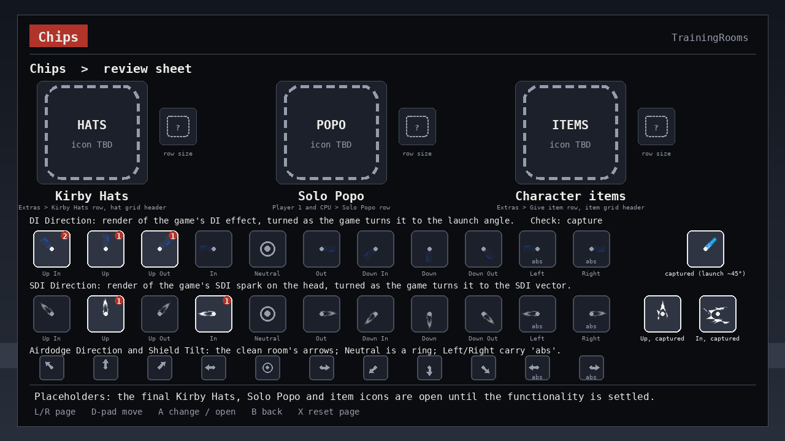

| Chip | What it shows | Where |
| --- | --- | --- |
| Kirby Hats | placeholder: dashed rounded square, label `HATS` | the *Kirby Hats* row and the hat grid's header |
| Solo Popo | placeholder, label `POPO` | the *Solo Popo (original Ice Climbers)* row |
| Character items | placeholder, label `ITEMS` | the *Give item* row and the item grid's header |
| Direction chips | a bold stroke from the centre with an arrowhead; Neutral is a ring; Left / Right carry `abs` | the direction grids and the nine-dot row previews |

The three placeholders mark where an icon goes and nothing more: the final icons are open and will be designed once the functionality is settled. At row size (34 px) a placeholder shows `?` instead of its label.

## Page 1 · CPU

Everything that changes what the CPU does, in the order a player thinks about a situation: reactions, defence, ledge and tech, shield, attacks and movement. The screen shows the *Defence* group with its direction grids.

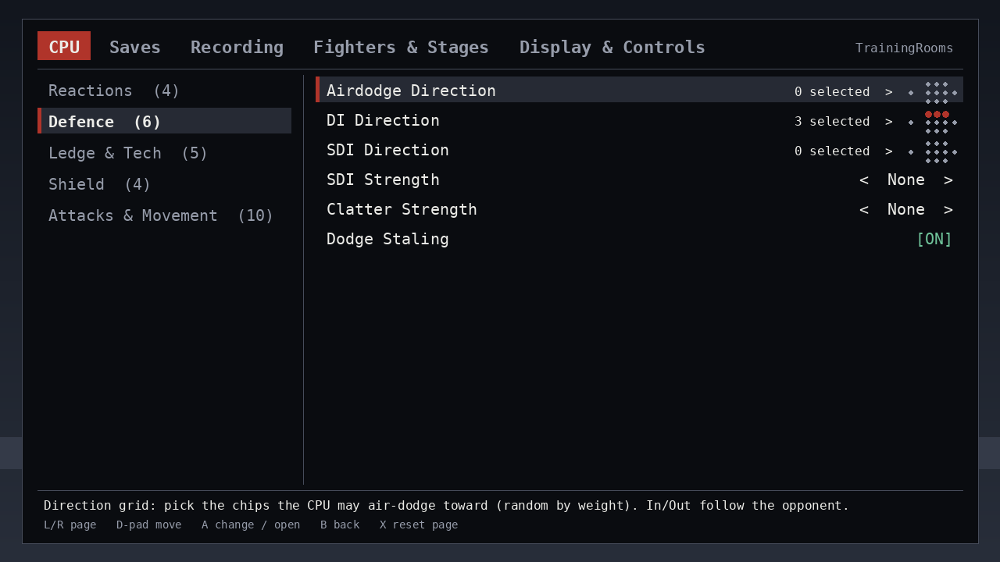

| Group | Items (control) |
| --- | --- |
| Reactions | Mash (checklist, 13 actions) · Followup (checklist, 13) · Mash Triggers (checklist, 17 situations) · **Situation overrides** (editor, replaces the 13-row Override tab) |
| Defence | **Airdodge / DI / SDI Direction** (direction grids, weighted) · SDI Strength, Clatter Strength (dropdowns: None, Normal, Medium, High) · Dodge Staling (toggle) |
| Ledge & Tech | Ledge Options (checklist, 10 incl. Playback Slot 1–5) · Ledge Delay (checklist 0–300 by 10) · Tech / Mistech Options (checklists, 4 each) · Hide Tech Animations (toggle) |
| Shield | Shield (dropdown: None, Infinite, Hold, Constant) · **Shield Tilt** (direction grid, one chip) · OoS Offset (checklist 0–30 hits) · Reaction Time (checklist 0–30 frames) |
| Attacks & Movement | Attack Angle (checklist) · Throw (checklist: None, Forward, Back, Up, Down) · Throw / Pummel Delay (checklists 0–150 by 5) · Falling Aerials, Full Hop, Fast Fall (dropdowns: Yes, No, Random) · Aerial / Fast Fall Delay (checklists 0–30) · Crouch (toggle) |
| *(hidden unless the CPU-pilot plugin is absent)* | P1 CPU Control (toggle) · P1 CPU Level (dropdown 1–9) — the fallback; with the pilot present one info row says "P1 control: CPU pilot plugin (its own menu)" (question 11) |

### Sub-screen · Direction grid

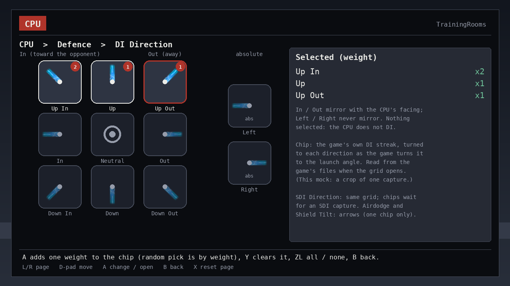

The nine relative chips sit as the stick does: *In* is toward the opponent and *Out* away (the game mirrors the angle when the player stands on the CPU's other side, `SPEC-cpu-02` §2); *Left* and *Right* are absolute and never mirror. A selected chip carries its weight in the corner (upstream's counts: the random pick is weighted); the legend lists the selection. Nothing selected means the CPU does not interfere. The same grid serves SDI Direction, Airdodge Direction and Shield Tilt (one chip).

### Sub-screen · Situation overrides

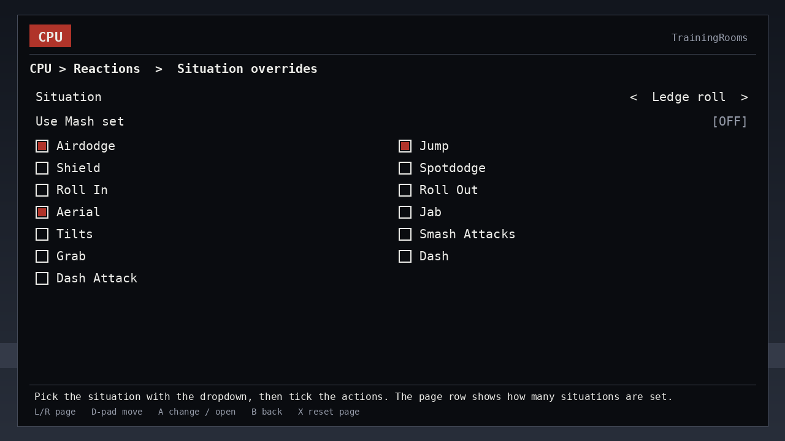

Pick the situation in the dropdown (13: ledge getups, tech, clatter, tumble, hitstun, parry, shieldstun, footstool, landing, trump), tick the actions for it. The page row shows "n of 13 set".

## Page 2 · Saves

Positions and damage: the save-state rules and the named setups built on them.

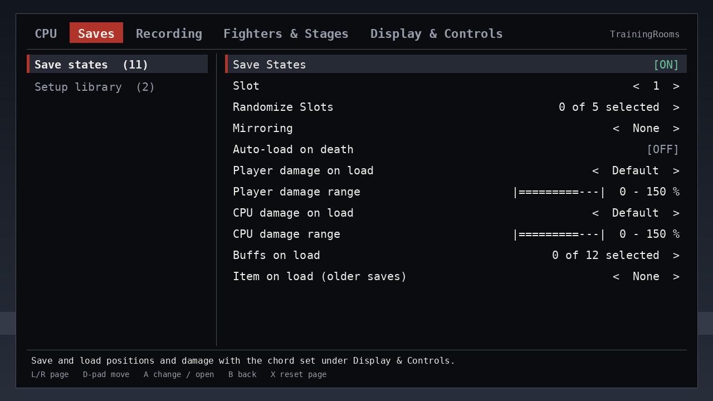

| Group | Items (control) |
| --- | --- |
| Save states | Save States (toggle) · Slot (dropdown 1–5) · Randomize Slots (checklist 1–5) · Mirroring (dropdown: None, Alternate, Random) · Auto-load on death (toggle) · Player / CPU damage on load (dropdowns: Default, Save State, Random) · Player / CPU damage range (sliders 0–150 %, greyed unless Random) · Buffs on load (checklist, 12) · Item on load (older saves) (dropdown, 17; question 6) |
| Setup library | Save setup to library… (editor: name entry) · Setup library (list; `A` binds + restores, `Y` binds) |

## Page 3 · Recording

Inputs the CPU plays back: numbered recordings, playback rules, and the named-macro and replay tools that feed the same slots.

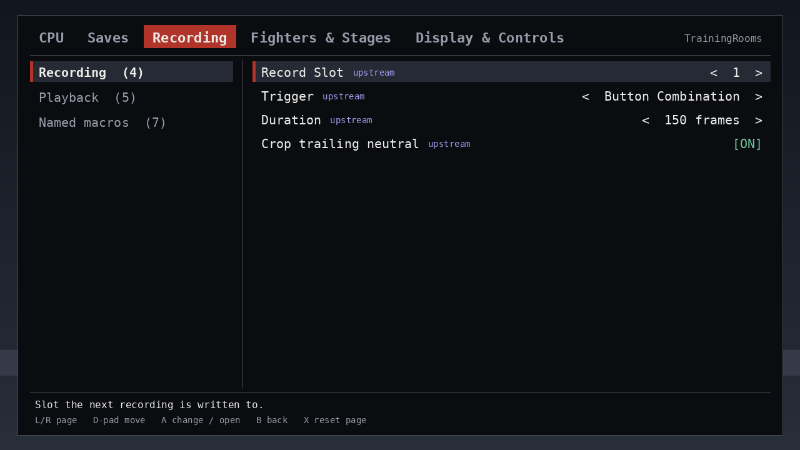

| Group | Items (control) |
| --- | --- |
| Recording | Record Slot (dropdown 1–5) · Trigger (dropdown: Button Combination, Save State Load) · Duration (dropdown 60–600 frames by 30) · Crop trailing neutral (toggle) |
| Playback | Button slots (checklist 1–5) · Hitstun timing (dropdown: As Hitstun Ends, As Hitstop Ends, As Hitstop Begins) · Save-state slots (checklist 1–5) · Mash interrupts playback (toggle) · Loop (toggle) |
| Named macros | Source (dropdown: Numbered Slots, Named Library) · Ask before switching fighter (toggle) · Named library (list) · Save slot to library… (editor) · Edit placement (editor) · Replay window (editor) · Replay capture (toggle, new in the menu; question 7) |

## Page 4 · Fighters & Stages

Who is on screen and where: swaps, cycles, hats, items, Miis, the stage rows, and (collapsed) the loading machinery that makes swaps fast. Three screens, one per group, because this page carries the grids.

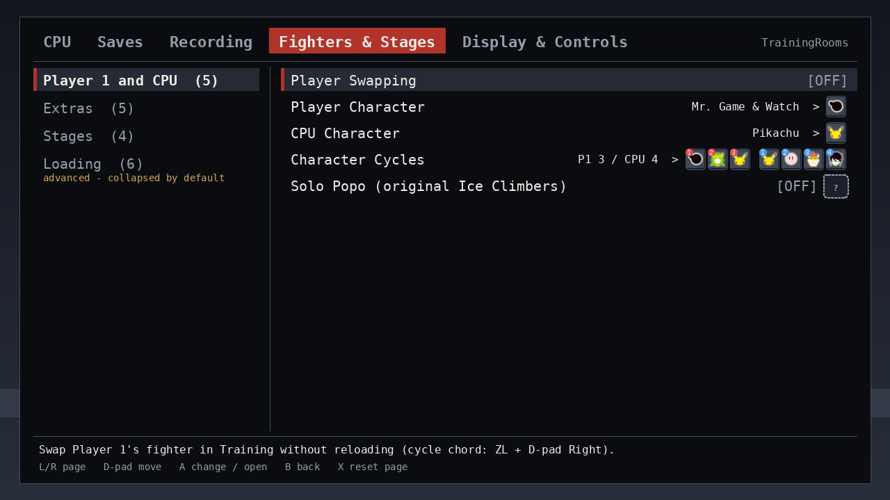

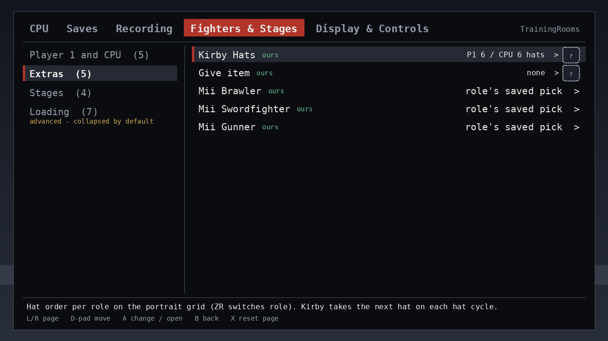

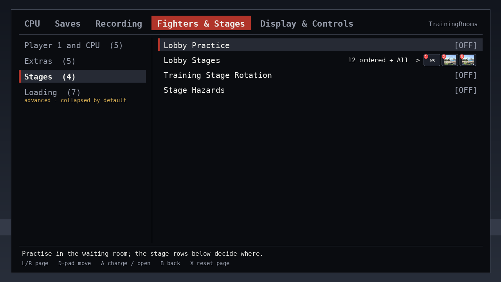

| Group | Items (control) |
| --- | --- |
| Player 1 and CPU | Player Swapping (toggle) · Player Character, CPU Character (portrait grids; the row shows the chosen portrait) · Character Cycles (two-role portrait grid; the row previews the P1 and CPU orders with their badges; `ZR` switches role; Solo Popo marks edited here) · Solo Popo (original Ice Climbers) (toggle with a placeholder chip) |
| Extras | Kirby Hats (two-role portrait grid; placeholder chip) · Give item (item grid, 38 items; placeholder chip) · Mii Brawler / Swordfighter / Gunner (lists: saved Miis, replay Miis, Add New…) |
| Stages | Lobby Practice (toggle) · Lobby Stages (stage grid; the row previews the first ordered stages) · Training Stage Rotation (toggle) · Stage Hazards (toggle) |
| Loading *(advanced)* | Cycle Preload (dropdown Off, 1–5) · Preload (dropdown: Fighters, Hats, Both) · Ready Fighters (number, default 8) · Ready Fighter Bodies (dropdown: Off, 2, 3) · Group Swap (toggle) · **Swap groups** (checklist of the 7 switches; entries grey with the reason when a dependency is off) · Preload Samples (toggle; question 8) |

### Sub-screen · Character Cycles (portrait grid)

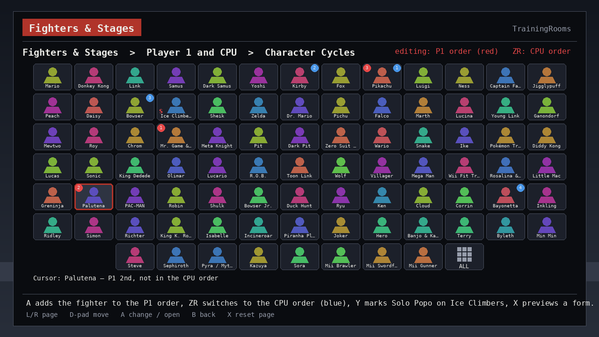

The fork's roster grid as shipped: 13 columns, six full rows and a centred last row ending in *ALL*; red badges number the P1 order, blue the CPU order; `ZR` switches which order `A` edits; the red *S* on Ice Climbers is the Solo Popo mark; `X` previews the Pokémon Trainer and Pyra / Mythra forms. *Player Character* and *CPU Character* open the same grid as a one-shot picker (no badges). The portraits are the real fighter icons, cropped from captures of the fork's own grid (sources in `menu-mockup/index.md`); badges, tiles and labels are drawn by the mockup.

### Sub-screen · Kirby Hats

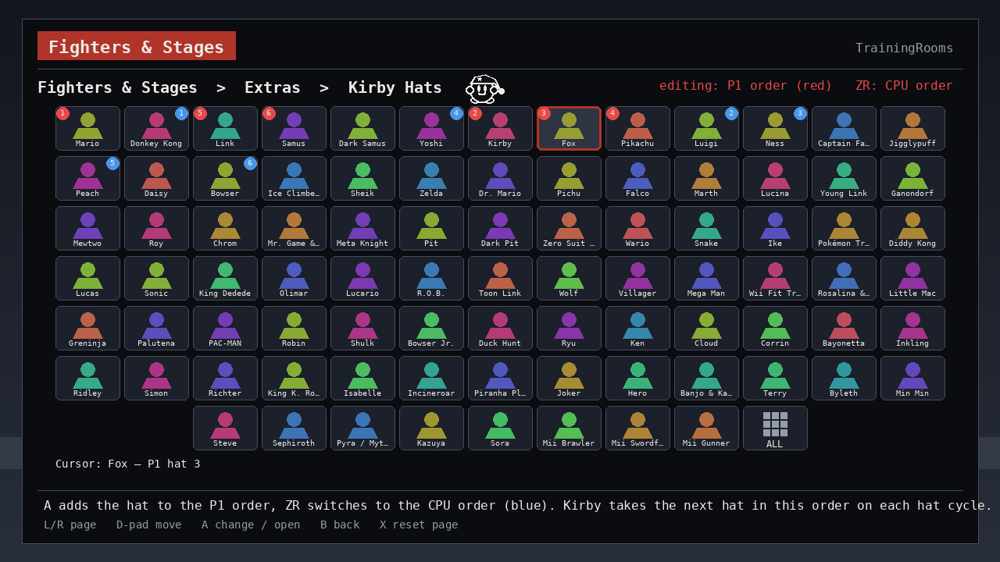

The same grid with the placeholder chip in the header: the badges are the hat order per role; Kirby takes the next hat in that order on each hat cycle.

### Sub-screen · Give item (item grid)

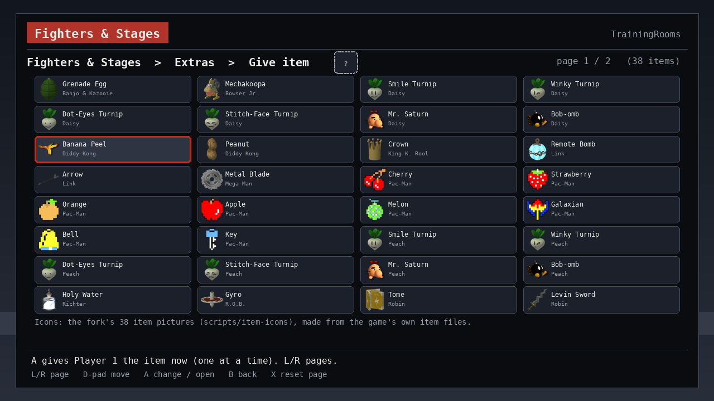

4 × 8 tiles per page, two pages for the 38 items; each tile shows the fork's item icon (the real files, copied unchanged; sources in `menu-mockup/index.md`), the item and its owner. `A` gives Player 1 the item at once.

### Sub-screen · Lobby Stages (stage grid)

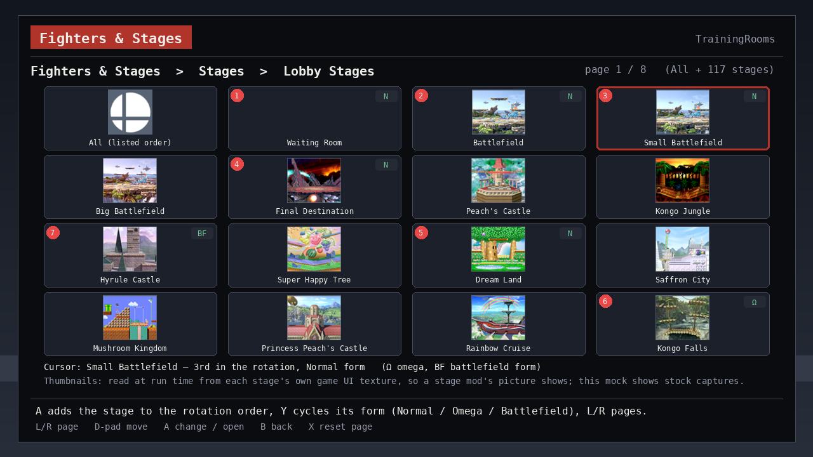

4 × 4 thumbnails per page, 8 pages for All + 117 stages; *All (listed order)* is the first tile. Red badges number the rotation order, the tag at the top right is the form (`N` normal, `Ω` omega, `BF` battlefield), `Y` cycles it on the focused stage. Training Stage Rotation uses this order. In the plugin each thumbnail is the stage's own game UI texture, read when the page opens, so a stage mod's picture shows (a stage that cannot be read shows a text tile, like *Waiting Room*); nothing is baked. The mockup shows captures of the stock thumbnails from the fork's own stage grid in their place, and the All icon from the same capture.

### Sub-screen · Swap groups

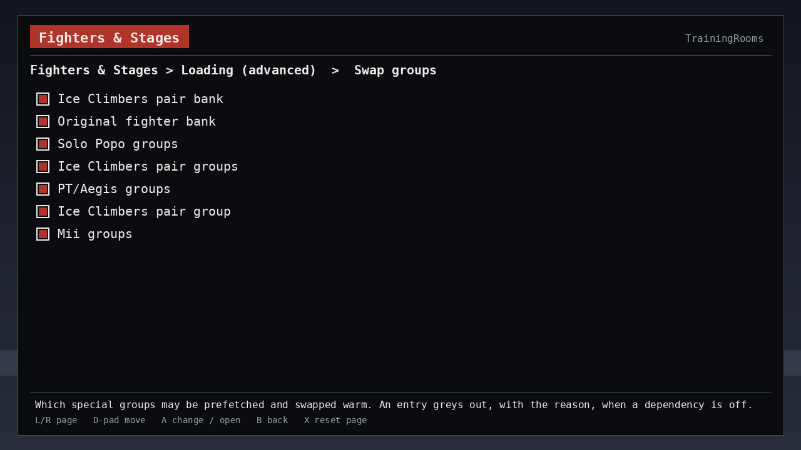

## Page 5 · Display & Controls

What is drawn and which buttons do what; nothing here changes what the CPU does.

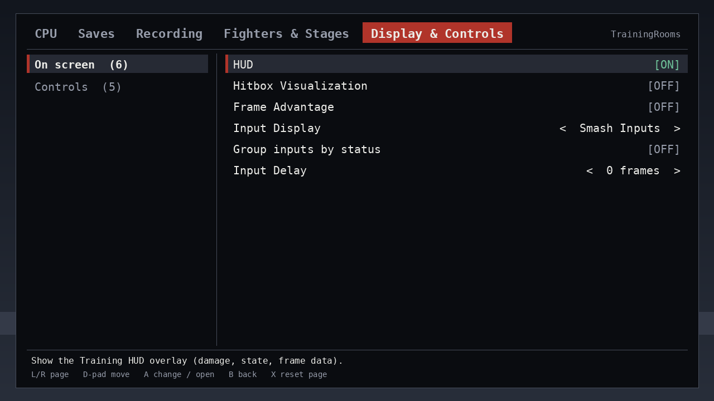

| Group | Items (control) |
| --- | --- |
| On screen | HUD, Hitbox Visualization, Frame Advantage (toggles) · Input Display (dropdown: Off, Smash Inputs, Raw Inputs, Status Only) · Group inputs by status (toggle) · Input Delay (number 0–30 frames) |
| Controls | **Button chords** (editor, replaces the Button Config tab) · L+R+A Reset (toggle) · Menu shortcut 1 / 2 (info, from `button_config.ini`; question 9) · Permanent shortcut (info: `B + D-pad Up`) |

### Sub-screen · Button chords

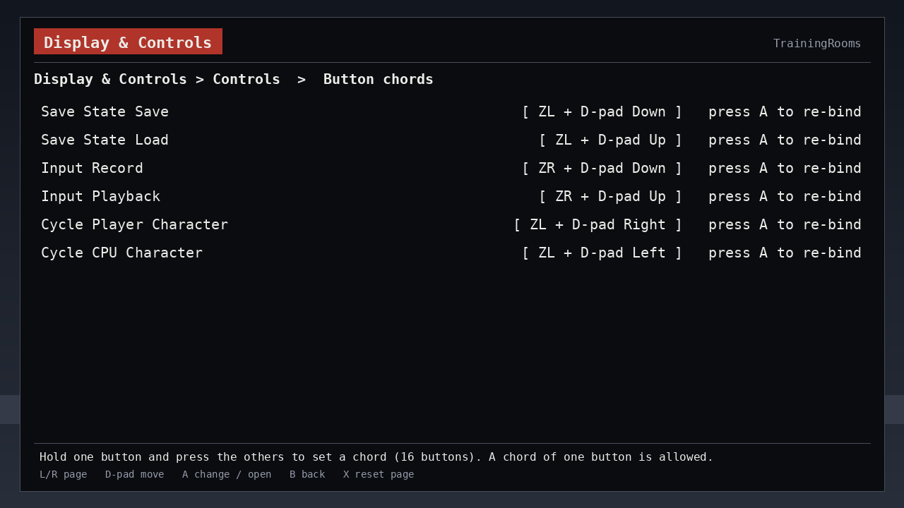

Six rows; defaults ZL+D-pad Down (save), ZL+D-pad Up (load), ZR+D-pad Down (record), ZR+D-pad Up (playback), ZL+D-pad Right (cycle player), ZL+D-pad Left (cycle CPU). Hold one button and press the others to re-bind; a one-button chord is allowed.

## On-screen indicators (outside the menu)

What the plugin shows while you play, unchanged in meaning from the fork unless noted:

| Indicator | Where | Meaning |
| --- | --- | --- |
| Frame advantage number | above the player | frames of advantage after a hit on shield / a hit (On screen › Frame Advantage) |
| Hitbox / hurtbox shapes | on the fighters | red attack, yellow hurtbox, grab and shield colours as the game's debug palette (On screen › Hitbox Visualization) |
| Input display | bottom corner | last inputs as Smash inputs or raw buttons, optionally grouped by status |
| Swap notice | centre | "Loading…" while a fighter swap or group build runs; it disappears when the swap is ready. A refused warm swap falls back to the normal reload without a notice (the log says why) |
| CPU stock icon | HUD | shows the CPU's current fighter **in the costume it wears** (fixed in C116.1; carried over) |
| Save-state flash | screen edge | brief flash on save / load |
| Practice-stage card | waiting room | the stage grid while Lobby Practice is on |
| Install line | `sd:/ultimate/TrainingRooms/practice-diagnostics.log` (not on screen) | one line at boot: version, sites checked, authoritative groups, anything skipped |

## Decisions for you

1. **Pages:** these five, or four (fold Display & Controls into Saves), or six (split Stages & Lobby out of Fighters & Stages)?
2. **Dropdown input:** `◂`/`▸` cycle in place (fast, easy to bump), or `A` must open the list?
3. **Random-among-a-set delays** (aerial / fast-fall / throw / pummel / ledge delay, OoS offset, reaction time, randomize slots, playback slots): keep as checklists (today's semantics) or a min–max "random in range" slider (simpler, changes the semantics)?
4. **Sub-screens** for Situation overrides, Button chords and Swap groups (as drawn), or rows on the page?
5. **First page on open:** the last page used (today) or always CPU?
6. **Item on load (older saves):** keep for pre-snapshot saves, or drop and migrate those saves once on import?
7. **Replay capture in the menu:** add the toggle (writes `replay_capture.ini`, mirrors the Deluxe page row) or keep it INI/Deluxe-only?
8. **Preload Samples:** shipped under Loading (advanced), or `diag` build only?
9. **Menu shortcuts:** read-only from the INI (as drawn) or editable here with the INI as the file of record?
10. **Help text:** one line as today, or a two-line panel?
11. **P1 CPU fallback when the pilot plugin is absent:** show the hidden group (as proposed), INI-only, or drop it?
12. **Direction grid weights:** show the weight digit on a selected chip (upstream's counts, today's semantics, as drawn) or plain on/off chips with a uniform random pick?
13. ~~**Grid picture source**~~ — *answered (v5):* stage thumbnails are read at run time from each stage's own game UI texture, so stage mods show, and are never baked or committed (SPEC-core-07 §4.5). The item grid uses the fork's own 38 item icons. Fighter portraits: question 16.
14. **Grid paging:** items 4 × 8 per page (two pages) and stages 4 × 4 (eight pages) as the fork does, or denser pages so the items fit on one screen?
15. **Mii rows:** lists as drawn, with the fork's exact bust thumbnail beside each saved Mii where one exists, or text only?
16. **Fighter portraits and mods:** should the portrait grid follow the stage rule (read each fighter's own UI portrait from the game at run time, so character and costume mods show), or keep a fixed set of stock icons as the fork does?

Answered: license holder = handle; storage root = `sd:/ultimate/TrainingRooms/`; grids and item / stage visuals reused where they fit; direction grid for DI / SDI; the portrait grid shows the real fighter icons; Kirby Hats, Solo Popo and character items use a placeholder until their final icons are designed (v4); the item grid uses the fork's own item icons and the stage grid reads each stage's game UI texture at run time, so stage mods show (question 13, this v5).
