# Recording

Recording is save states, macros, chains, combos, and sequences. A save state only warps. A macro is a recording of inputs, and a chain is a macro made of macros. Each role has one active macro, and that role's Play chord plays it. Combos and sequences are what you drill. They have no chord.

Two layers are easy to mix up, so this page keeps them apart.

What a press does in a match on this branch: Load warps the save and starts nothing. The runtime asks the recorder what a finished load should do, and that answer is nothing. Play on CPU (ZR + D-pad Up) is still the older playback chord. It plays a recording slot, or the named library when that source is selected. It does not call the new per-role machine. Record (ZR + D-pad Down) is still the older record chord. Play on Player 1 (ZR + D-pad Left) and the recording pop-up (ZR + D-pad Right) are recognized as chords. Nothing in the match consumes those two requests yet.

What the new machine does, in `src/model/playback.rs` and the library: the rest of this page, except the sentences marked as the pop-up, the Recording page, and the file screens. Those screens are still being built. The pictures are full-screen captures, 1280 wide, under 10 seconds, one behaviour each, and [MEDIA.md](MEDIA.md) is the list.

Files live under `sd:/ultimate/TrainingRooms/`. A macro, a chain, a combo, a sequence, and a save state are separate files. Renaming either end of a connection keeps it, because the connection stores the file's id.

## Save states only warp

Save (ZL + D-pad Down) writes the one bound save. Load (ZL + D-pad Up) warps both fighters to that save and starts nothing. It does not start a macro or a chain. One save is bound at a time, for both roles, because a save restores both fighters.

Auto-load on death only warps to the bound save. If none is bound, it does nothing. Mirroring, damage on load, and buffs still apply to that warp.

A save has no role and no chain. The old checklist that played a recording because a state loaded is not part of this machine.

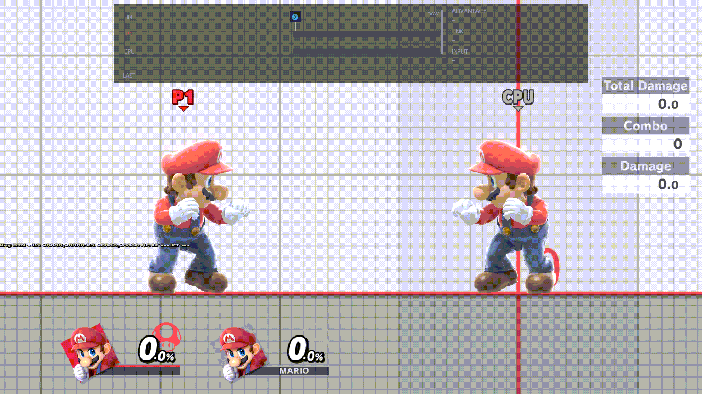

## Recording a macro, and its start save

Record is ZR + D-pad Down. Stopping the recording keeps the inputs as a named macro. The recording also writes a save state named with the macro, "`name` · start", and the macro stores that file's id. The Start save switch defaults to On.

On means the role's Play chord warps to that save once, before the first pass, then plays. Off plays from where the fighters are and keeps the connection, so turning it On again warps there the next time you play. A macro that never had a start save has no switch. Replays and migrated slots are like that: Play starts where the fighters already are.

If the connected start save was deleted, playback skips the warp and shows "No start save. This macro plays from where the fighters are." A macro that never had one does not show that sentence.

When you record, the new macro is the most recently used of its kind. Each kind keeps five of those, the most recently used first. A sixth use drops the least recent out of that five. It stays on the card.

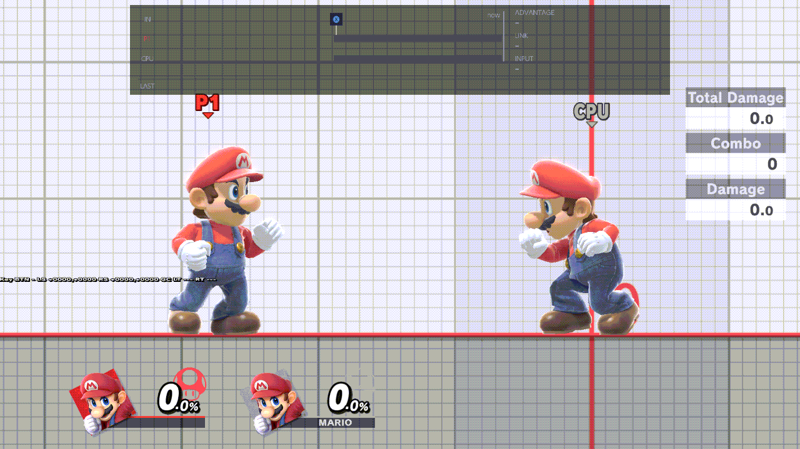

## Set active, and the Play chords

Each role has one active macro. It is either a recording or a chain. Set active for Player 1 replaces Player 1's previous one. Set active for the CPU replaces the CPU's. The two roles do not share an active macro.

| Chord | Default | What it does |
| --- | --- | --- |
| Save | ZL + D-pad Down | Writes the bound save. |
| Load | ZL + D-pad Up | Warps to the bound save. Starts nothing. |
| Record | ZR + D-pad Down | Records. The pop-up's role says who is recorded, once that window exists. |
| Play on Player 1 | ZR + D-pad Left | Plays Player 1's active macro, or stops it if it is already playing. |
| Play on CPU | ZR + D-pad Up | Plays the CPU's active macro, or stops it. This chord was Input Playback. |
| Recording pop-up | ZR + D-pad Right | Opens the pop-up. The window itself is still being built. |

Both Play chords may be on at once. They do not share a machine: Player 1 and the CPU can play at the same time. A chain does not use that. Its macros play one after another.

If that role has no active macro, its Play chord does nothing. With the Start save switch On, and the file still there, the chord warps to the start save once as it enters play, then plays the inputs. A later pass does not warp.

Mash interrupts playback, when that option is On, stops the macro that role is playing. A chain stops as that one macro.

The old per-slot playback chords are not added.

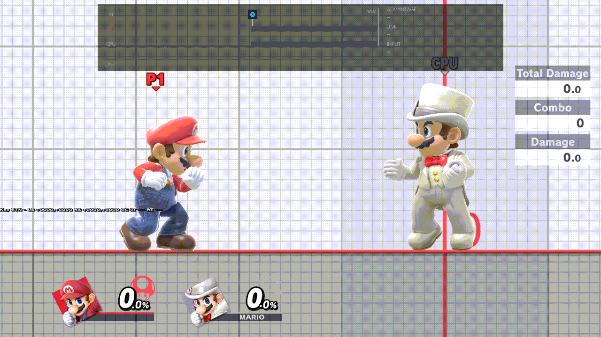

## The loop

The loop belongs to the role, not to a file. Player 1 and the CPU each keep their own count. The counts are infinite, 1, 2, 3, 5, and 10. A new index uses 1. An old Loop On becomes infinite, and Loop Off, or a missing loop row, becomes 1.

The Play chord warps to the start save once, before the first pass, when the switch is On. Every later pass plays on from where the fighters are. The loop never warps back. A recording and a chain follow the same rule. Infinite keeps going. A finite count plays the macro, or the whole chain, that many times.

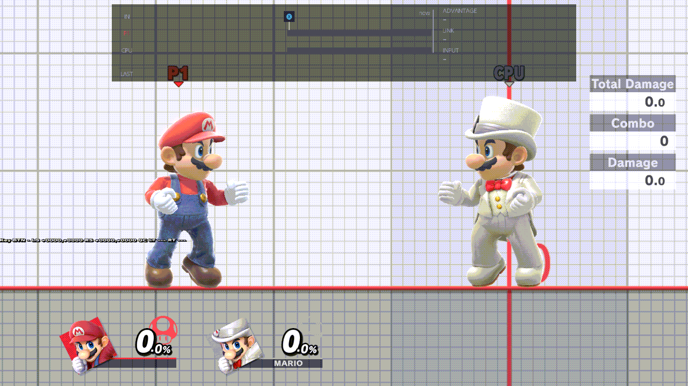

## Chains

A chain is a file in the macro list: an ordered list of recordings, numbered 1, 2, 3. It cannot contain a chain. The picker lists recordings only, so a chain is never a step of another chain.

A chain starts where its first macro starts, at that macro's start save. The chain has its own Start save switch, On by default. On warps there once when the Play chord starts the chain. Off plays from where the fighters are. The macros inside the chain do not use their own start saves, whatever those switches say. If macro 1 has no start save, the chain has none.

The role it is set active for is the role whose Play chord plays it. The macros play in order, from where the fighters are after that one warp. With a loop, the chain repeats as one unit: 1, 2, 3, then 1 again. No pass warps back.

An empty chain plays nothing. A chain whose recordings have all been deleted plays nothing. There is no extra sentence for either case. R in the numbered picker removes a number, including the last one, so the list may be empty. A adds the next number. A on a tile that already has a number does nothing. B is done. It is the Character Cycles picker, except that the last number can come off.

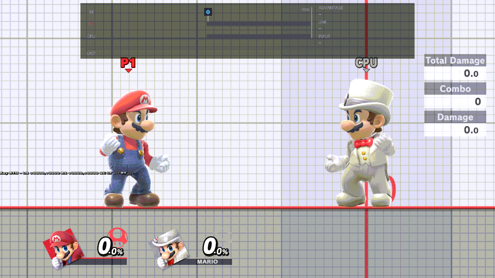

## Combos

Save last combo, on today's Recording › Combos row, keeps the last combo the frame strip saw and makes it the drill. The file is the combo's links and presses. Any fighter can practise it. The format is in [COMBOS.md](COMBOS.md).

A combo counts when its recorded presses are there, with the same direction, in order, and within the on-time tolerance, and the move that comes out is the recorded move. TRUE is not required. A link that is not a true combo still counts. TRUE stays on the helper bar as information.

A different move does not count, even when the buttons, the direction, and the timing match. That attempt drops. An attempt also drops on a missing press, a press outside the tolerance, or the exchange ending before the step. The exchange ends 20 frames after the CPU can act again, or on a shielded hit. A gap of 20 frames still belongs to the exchange. A gap of 21 opens a new one, so the step drops. A single combo's best stays the most true links in one attempt. The streak follows the count above, so a non-true link can still extend the streak.

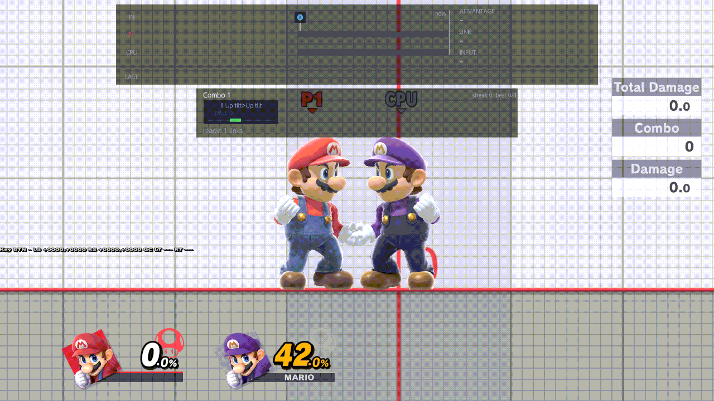

Make combo, on a macro's or a chain's own screen, plays that file once on Player 1 from its start save and keeps the links as a new combo. <!-- verify: rr-6 -->
The file you made it from stays. <!-- verify: rr-6 -->
The new combo becomes one of the five most recently used, and the drill does not change. <!-- verify: rr-6 -->
If that start save was deleted, the load is skipped and the missing-start sentence shows. <!-- verify: rr-6 -->
A chain's Make combo warps to the chain's start save and plays the whole chain once. <!-- verify: rr-6 -->

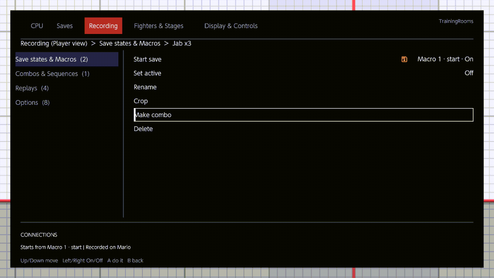

Crop on a combo keeps a range of links and saves a new combo. <!-- verify: rr-6 -->
The original stays. <!-- verify: rr-6 -->
Crop on a macro uses the replay window's In and Out and saves a new named macro. <!-- verify: rr-6 -->
On that crop screen, L and R move the handles, and B returns to the file. <!-- verify: rr-6 -->
A chain has no Crop, because it has no frames of its own. <!-- verify: rr-6 -->

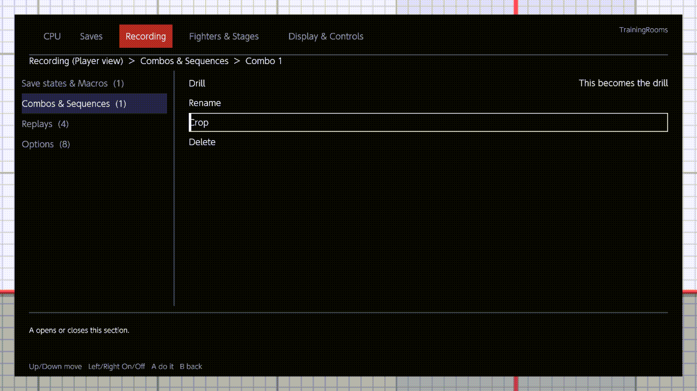

There is no chord for a combo. Choosing Drill makes it the one drill.

## Sequences and the one drill

A sequence is an ordered list of combo files. It stores each combo's id. Rename a combo and the sequence shows the new name. Delete a combo and the sequence skips that step. An empty sequence drills nothing.

The helper drills one thing. Drilling a sequence replaces a drilled combo, and drilling a combo replaces a drilled sequence. A numbered row inside a sequence drills that combo alone, with that combo's own streak, and the sequence file stays.

The bar under the frame strip is the combo helper's bar with a sequence header and a row for the sequence's combos. A finished sequence adds one to the streak, and best is the highest streak. A drop sends the sequence back to combo 1 and the streak to 0. Best is kept. TRUE is shown and is not required, including between the combos of a sequence. The same grade as a single combo decides each step: the presses, the direction, the order, the tolerance, and the move.

The picker is the same numbered picker as a chain, including R removing the last number.

## The pop-up

The pop-up is one window over the match. <!-- verify: rr-6 -->
It owns the buttons while it is open, and B closes it without changing the selection. <!-- verify: rr-6 -->
The title is at the top, then Player | CPU, and L or R switches role. <!-- verify: rr-6 -->
Under the role, two tabs switch with ZL or ZR: Save states & Macros, and Combos & Sequences. <!-- verify: rr-6 -->
The CPU view has only Save states & Macros, and it has no tab control. <!-- verify: rr-6 -->
Each tab is two stacked sections, and each section scrolls on its own while its header stays. <!-- verify: rr-6 -->
ZL + Up or ZL + Down pages the section the cursor is in, by whole rows. <!-- verify: rr-6 -->
Left and Right move between the two sections. <!-- verify: rr-6 -->
The five most recently used sit in a thin green outline, most recent first, and the rest of the library is under a hairline. <!-- verify: rr-6 -->
The Connections panel on the right spells out the connections of the row under the cursor. <!-- verify: rr-6 -->
A view shows only that role's active macro, that role's loop, and that role's connections. <!-- verify: rr-6 -->
The bound save is a green row in both views. <!-- verify: rr-6 -->
A white border and a white bar are the cursor, which is a different mark from the green fill. <!-- verify: rr-6 -->

A on a save binds it to Save and Load. <!-- verify: rr-6 -->
A on a macro or a chain sets it active for the role in view. <!-- verify: rr-6 -->
A on a combo or a sequence drills it. <!-- verify: rr-6 -->
X cycles the loop, and only while the cursor is in Macros. <!-- verify: rr-6 -->
Y does nothing on this window. <!-- verify: rr-6 -->

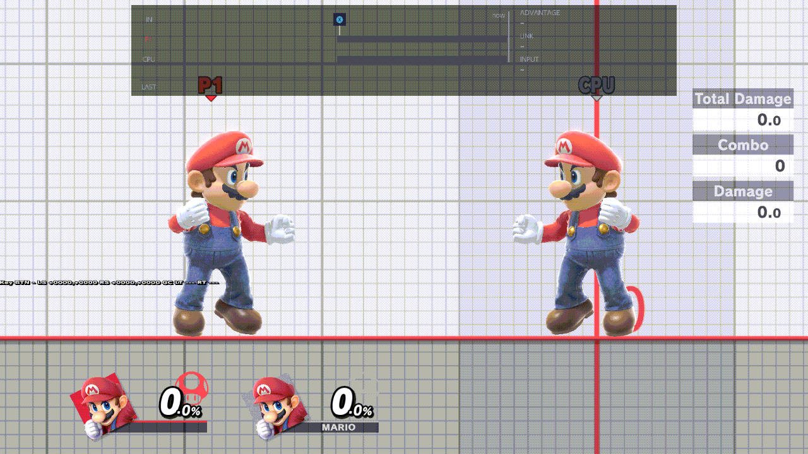

The orange floppy chip is the save state a macro starts at. <!-- verify: rr-6 -->
It is grey when that macro's Start save switch is Off. <!-- verify: rr-6 -->
The same orange floppy marks the Save states header. <!-- verify: rr-6 -->
A chain row shows a chain mark and the count of its macros. <!-- verify: rr-6 -->
With the cursor on a chain, its macros wear 1, 2, 3 at the left edge. <!-- verify: rr-6 -->
+ New chain is the last row under Macros, and + New sequence is the last row under Sequences. <!-- verify: rr-6 -->
Each opens the numbered picker and then the Switch keyboard. <!-- verify: rr-6 -->

## The Recording page

The Recording page in the menu uses the same stacked sections and the same Connections panel. <!-- verify: rr-6 -->
The left column is Save states & Macros, Combos & Sequences, Replays, and Options. <!-- verify: rr-6 -->
There is no tab switch on the page, because that column lists the groups. <!-- verify: rr-6 -->
ZR switches Player and CPU, because L and R change the menu page, as they do on every other page. <!-- verify: rr-6 -->
The CPU view hides Combos & Sequences. <!-- verify: rr-6 -->
A opens the file's own screen. <!-- verify: rr-6 -->
On a save, Bind to Save / Load is that screen's first row. <!-- verify: rr-6 -->
X cycles the loop only when the cursor is in Macros, and X does not save defaults. <!-- verify: rr-6 -->
B closes the menu. <!-- verify: rr-6 -->

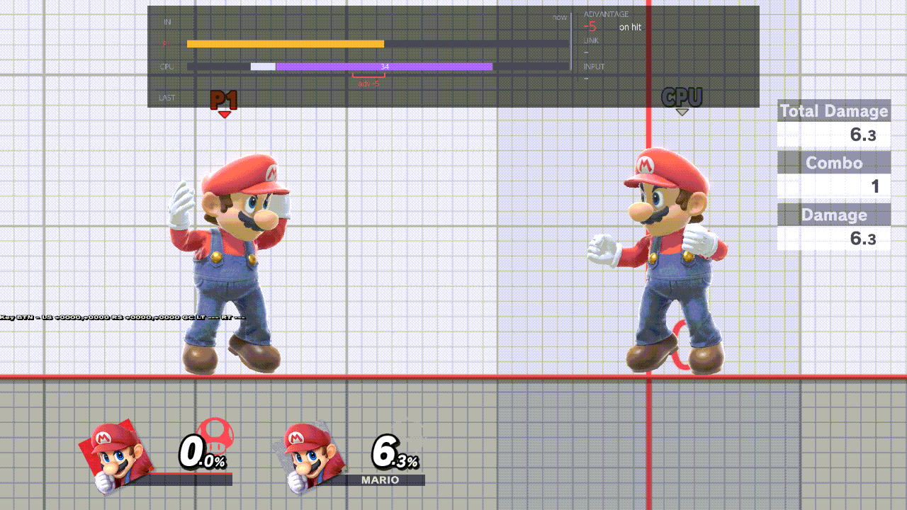

The old Recording and Saves rows leave this page. <!-- verify: rr-6 -->
Their setting ids stay, so an old settings file still loads. <!-- verify: rr-6 -->
What leaves the page is the slot number, Randomize slots, Record Slot, Trigger, the Duration dropdown, button slots, the save-state playback checklist, Source, and per-slot playback. <!-- verify: rr-6 -->
The file cap stays, and a long recording is not refused. <!-- verify: rr-6 -->
Replays and Options keep Replay capture, the replay window, Crop trailing neutral, Hitstun timing, Mash interrupts playback, and the loop's list of counts. <!-- verify: rr-6 -->
Respawn on platform stays under Fighters & Stages › Stages. <!-- verify: rr-6 -->

### A file's own screen

The breadcrumb reads Recording, then the role in view, then the file's name. <!-- verify: rr-6 -->
Set active is one row, for the role in view: On for that role, or Off. <!-- verify: rr-6 -->
Left and Right turn it On or Off. <!-- verify: rr-6 -->
On makes this file that role's active macro. <!-- verify: rr-6 -->

A macro's rows are Start save, Set active, Rename, Crop, Make combo, and Delete. <!-- verify: rr-6 -->
A chain's rows are Start save, Set active, Edit chain, Rename, Make combo, and Delete, and it has no Crop. <!-- verify: rr-6 -->
A combo's rows are Drill, Made from, Rename, Crop, and Delete. <!-- verify: rr-6 -->
A save's rows are Bind to Save / Load, Duplicate, Rename, and Delete. <!-- verify: rr-6 -->
A sequence's rows are Drill sequence, a numbered row for each combo, Edit combos, Rename, and Delete. <!-- verify: rr-6 -->
A on a numbered combo drills that combo alone. <!-- verify: rr-6 -->

Rename uses the Switch keyboard, with a 48-character limit. <!-- verify: rr-6 -->
B cancels and keeps the old name. <!-- verify: rr-6 -->
Empty OK on a new file keeps Macro N, Chain N, Combo N, Save N, or Sequence N. <!-- verify: rr-6 -->
In a waiting room the keyboard stays closed, and a new file keeps that N name until you rename it in Training. <!-- verify: rr-6 -->
The combo's Connections panel lists each link, its two moves, and whether it was recorded TRUE. <!-- verify: rr-6 -->
The helper still says link for those hits. <!-- verify: rr-6 -->
The word sequence is the file of combos, and the word chain is only the compound macro. <!-- verify: rr-6 -->

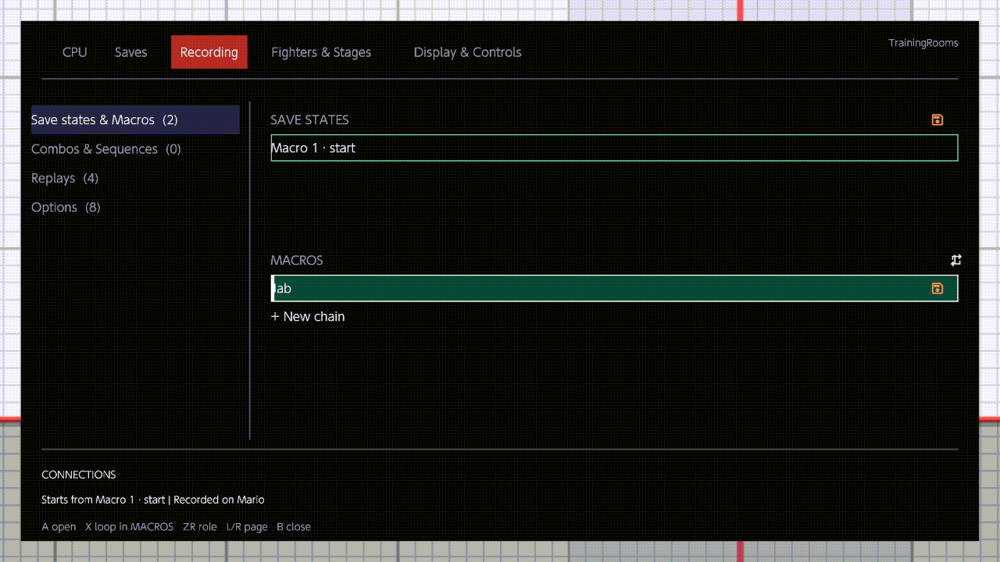

## Fighter Mismatch

The prompt already exists. Its title is Fighter Mismatch. The cursor starts on Keep current fighter. The other row is Switch to recorded fighter. Keep plays the inputs on the fighter you have. Switch loads the recorded fighter. Nothing is hidden or refused because the fighter differs. The recorded fighter is information. A sequence may mix fighters.

For a chain, that prompt is asked once, when the Play chord starts the chain, and only if macro 1 was recorded on a different fighter. Switch changes to macro 1's recorded fighter. Macros 2 and later never ask and never switch. They play on the character you have after that prompt. Load never asks, because Load never starts a chain. The chain's prompt has no list of macros.

The playback machine on this branch does not ask the prompt. The sentence above is the redesign's rule for when a chain starts. Confirm it on the build that wires the prompt into Play.

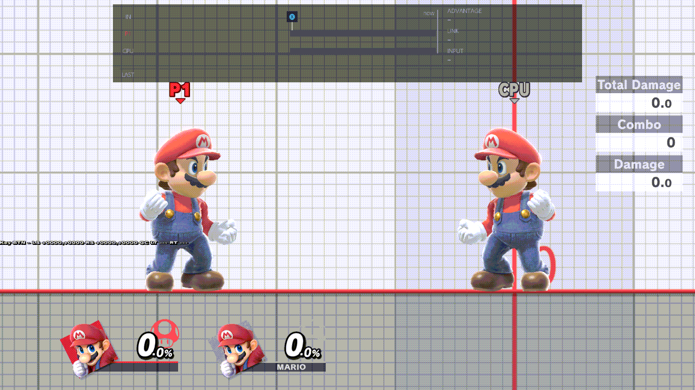

## Migration of the old slots

The first time this library is built, empty slots are skipped. A recording slot that holds inputs becomes a macro named `Slot N (YYYY-MM-DD)`, using the date the migration runs and the slot's number starting at 1. Those macros have no start save, so they have no Start save switch, and they play from where the fighters are. No chain is built from them.

A save index that holds a save becomes one file, both fighters, with the same `Slot N (date)` name. The slot the Save and Load chords were using becomes the bound save. An empty index is skipped.

`macros/selected.txt`, when it names a file that is there, becomes Player 1's active macro. The CPU has no active macro until you set one. The old "play a recording when a state loads" row is not turned into a chain.

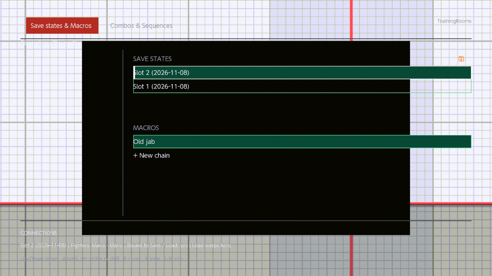

## Where the rules come from

The playback machine, the files, the grades, the chords, and the migration are `src/model/playback.rs`, `src/model/library/`, `src/model/combo.rs`, `src/model/drill.rs`, `src/model/chords.rs`, and `src/model/library/migrate.rs` on this branch. The screens are revision 8.2 of the recording redesign. Sentences marked `verify: rr-6` are the pop-up, the Recording page, and the file screens, written ahead of that slice.
