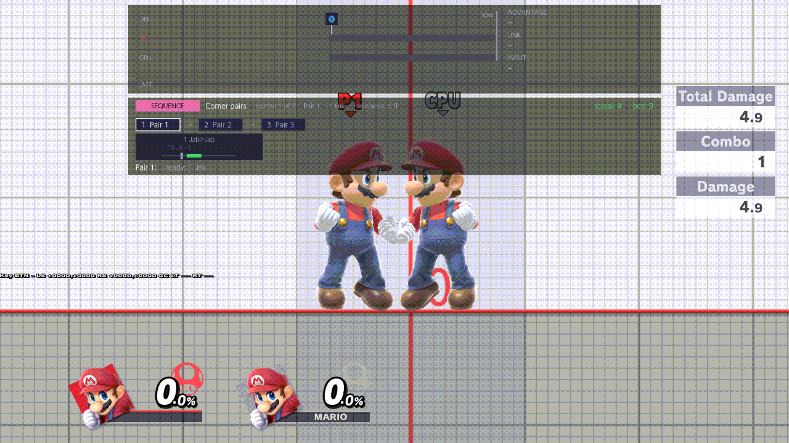

# 0.2.0-rc.6

Notes for players. 0.2.0-rc.5 was withdrawn before it ran on players' consoles, so this is the build after
`0.2.0-rc.3.1`. Everything [RELEASE-NOTES-rc5.md](RELEASE-NOTES-rc5.md) lists is in it, with the changes below. How to
use recording is [RECORDING.md](RECORDING.md), the Mii pages are [MII.md](MII.md), and the pictures are the list in
[MEDIA.md](MEDIA.md).

## New

### Sequence drilling

rc.5 let you build and edit sequences, but not drill them. rc.6 drills them.

- A sequence is an ordered list of combos. Drill sequence, or A on a sequence in the pop-up, makes it the one drill.
  Drilling a sequence replaces a drilled combo, and drilling a combo replaces a drilled sequence.
- The bar under the frame strip is the combo helper's bar with a sequence header and a row for the sequence's combos:
  SEQUENCE, the name, combo k of n, the current combo, its links and the tolerance, and the streak and best. Done
  combos are green with a check, the current one is white, and the later ones are grey.
- Combo 2 follows combo 1 inside the same exchange. The link that joins them is shown on the strip and is not graded,
  but the move it lands must be combo 2's first move. The CPU may act for up to 20 frames between the combos. Each
  combo is graded the same way as a single drilled combo: the input events, the direction, the order, the tolerance
  and the move. TRUE and drift are shown, not graded.
- A finished sequence adds one to the streak, and best is the highest streak. A drop sends the sequence back to combo
  1 and the streak to 0, and best is kept. A different move after the joining link, the exchange ending before the
  next combo, and a save-state load or scene change in the middle of a sequence are drops too.
- The streak and best are saved in the sequence file. The menu shows the same numbers as the bar, and they stay after
  you leave Training.
- A numbered row inside a sequence drills that combo alone, with that combo's own streak. The sequence file stays.
- A deleted combo is skipped. An empty sequence drills nothing. Every combo of a sequence is drilled, however many it
  has.

The sequence bar is taller than the combo bar, so notices sit 56 layout units (about 37 pixels at 1280×720) lower
than in rc.5, under either bar.

### Save last combo

*+ Save last combo…* is the first row of COMBOS, on the Recording page and in the pop-up's Combos & Sequences tab. It
saves the last combo the frame strip saw, with its input events, and makes it the drill. A opens the keyboard for its
name. An empty name, or an online waiting room where the keyboard does not open, gives it the next Combo N name. A
local-wireless waiting room opens the keyboard. With no link on the strip yet it says so and writes nothing. rc.5 had
lost this row.

### The recording pop-up as drawn

The pop-up now matches the agreed drawing:

- the title Recording with the role tabs (L Player, CPU R) and the page tabs as outlined boxes;
- a count beside each section header, on a dark band with the kind's mark: the orange floppy for SAVE STATES, and a
  blue, purple or pink square for MACROS, COMBOS and SEQUENCES;
- a dim line under each file: a save's fighters, "Recorded on" and the fighter, or a chain's or a sequence's steps;
- a red number badge for a row's place in the chain or sequence under the cursor;
- CONNECTIONS as their own column on the right: the row under the cursor with its kind's pill, the joined files in
  boxes, then plain lines;
- a footer that says what A does there ("A bind", "A set active   X loop", "A drill");
- everything inside the black panel, including the loop counts and the highlight.

A drilled combo, like a bound save or an active macro, moves to the top of its list.

### Fighters load hot

- **At Training entry.** Each role's start-up window of fighters is ready when Training starts. The Kirby hats of your
  cycles are loaded at entry too, as many as memory allows; rc.5 loaded the first hat only when you asked for it. On
  the console a hat change took 7–23 ms, the first one included.
- **The rest in the background.** After Training loads, the other groups of your cycles are built in the background
  while you play. The fighters on screen stay. Once the notice reads Ready or All loaded, switching into a group took
  about 50–70 ms in Eden, for Player 1 and for the CPU.
- **Mii groups.** A Mii group is built on the game's worker instead of the game thread. In Eden the game thread's
  longest pause during such a build was 34 ms (183 ms for the first Mii build after boot); the old build paused it at
  every Mii build, 141 ms on the console. Leaving a Mii for the fighters it replaced takes about 45–115 ms; in rc.5 it
  was a full reload of 4–6 seconds, and the next visit to the Mii built it again. Going back to the Mii is a warm
  switch too, about 50 ms.
  - Mii groups are built in the background too, so the first switch into a Mii is warm, and leaving a Mii is warm to
    any built group. TODO-PROOF: hot lane, the final pass's item-3 Mii session (`xps-i3-mii`); until it reports, the
    rc.6 candidate's text was "the first switch into a Mii still builds it: 0.3–1.1 s in Eden".
- Ice Climbers, Pokémon Trainer and Pyra/Mythra groups are built in the background too, also in a session that starts
  on one of them. The background build now waits only while Kirby is on screen, and for a second Mii group while a Mii
  is on screen (see Known issues). TODO-PROOF: workers A and B, the final pass's item-3 sessions on the Surface and the
  XPS (`p23/rc6-bg-ic`, `p23/rc6-bg-pt`, X6).
- Going back to an Ice Climbers (normal pair), Pokémon Trainer or Pyra/Mythra original while its group is on is a warm
  switch now; it used to reload. Going back to a Solo Popo or Mii original still reloads.
- The notice counts what is loading: "Loading 4/10", then "Ready 10/10" or "All loaded".
- Fighters past the ready budget still load when you switch to them, as before.

### A cycle change takes effect at once

Changing Player 1's or the CPU's Character Cycles in Training takes effect when the menu closes. The new fighters are
built in the background right away, the same way. The notice goes from Loading to Ready (in Eden, 14 s after a Player 1
change and 4 s after a CPU change). After a change, the first switches into the new fighters took 47–70 ms in Eden,
also after a second change made while the first was still loading.

- **Fighters that left the cycle** stay loaded until you next open Training's pause menu, which frees them. Until then,
  a fighter loaded with them that the new cycle still has stays warm to switch to.
- **If the new fighters need their room,** the old ones are freed at once instead: only as many as needed, and first
  those the new cycle no longer has. The game pauses for a moment while they go (0.15–0.26 s for two fighters in
  Eden). The memory they free comes back over the next second or two, and the new fighters wait for it rather than
  free more. Fighters the new cycle still uses are freed only if there still isn't room after that. You never need to
  open the pause menu for a change to load.
- The CPU seats that No. of CPUs raises (below) follow the new CPU cycle too.
- TODO-PROOF: the last candidate's `surface-i3-pf` with the docs lane's rows (`rows-pf-x6-settle`, judged by the
  rule: `x6-fit` frees nothing; `x6-cc` frees `[3, 5]`, waits for its memory, and frees the group that keeps DK and
  Link warm only if the room still lacks, never showing "waiting for memory"). Branch proofs `pp-rel-2`,
  `pp-settle-1`; `p23/rc6-preload-priority` `2c4774cd`, whose two-quiet-pass settle awaits the operator.
- TODO-PROOF: hot lane, the longest pause while the background build runs after a cycle change (the target is at most
  4 frames), from the final pass's item-3 sessions.
- TODO-PROOF: hot lane, a cycle press made while that build runs is held or served, never refused; and the fighter on
  screen stays when it leaves the cycle, until you switch away (the final pass's item-3 sessions).

### No. of CPUs: the seats are the next fighters

Raising No. of CPUs from 1 to 3 brings in the CPU cycle's next two fighters as CPUs 2 and 3, already on the first
raise. A Mii in those seats is the exact saved Mii, outfit and hat included. With three CPUs up, and after a raise
and a drop, the Mii classes stay in both cycles and load.

The two seats count in the Fighters notice. A seat that waits for memory shows as "… waiting for memory" there, and
it loads once memory is free (in Eden, "Loaded 1/5 · swap both to load 3 more (1 waiting for memory)", then
"Loaded 2/5 …").

### Mii editor: "Same as ‹name›, nothing new saved"

A Save in the Mii editor that matches a Mii you already saved still saves nothing new and uses that Mii, as before.
It now says so: "Same as ‹saved name›, nothing new saved". A changed name alone counts as the same Mii.

### The waiting room remembers its partners

In a local-wireless room or Quickplay's waiting area, the game's own menu sets Training partners (how many CPUs) and the
CPU action. When you change them, they're saved with the mod's settings. The next time you enter a waiting room, they're
set before the CPUs appear. With nothing saved, the game's defaults stand (Automatic, Attack).

### CPU Level

CPU › Level › **CPU Level** sets the CPUs' level: Off (the default) or Lv 1–9. It's saved with the other settings. Off
leaves the game's own level everywhere.

- **In Training,** Lv N replaces Training's own CPU level, the one the CPU (Lv. n) behavior plays at. Training's own
  level is the one set on the character select, and the pause menu keeps showing it.
  - If the two differ when Training starts, a small notice says so once, for example "CPU level: Lv 7 from
    TrainingRooms (Training menu: Lv 3)".
  - Changing CPU Level during the session takes effect at once, with no second notice. The next entry into Training
    checks again.
- **In the waiting room's practice** (local-wireless rooms and Quickplay's waiting area), the training partners play at
  Lv N, with no notice.
- **In a match,** nothing changes.

## Fixed

- **Save, Load and Auto-load use the bound save.** In rc.5 they used the old save-state slot file, whatever the pop-up
  showed as bound. Save writes the bound save, and Load and Auto-load on death warp to it. With nothing bound,
  Auto-load does nothing.
- **CONNECTIONS.** A combo's connections list its links with their moves and input events. In rc.5 they were empty. A
  shared combo file with any allowed name now stays the drill.
- **Make combo** stores the macro's input events, and it saves only the exchange its own playback made. With no hit it
  writes nothing, where rc.5 saved the exchange before it. TODO-PROOF: the candidate's `yoga-cov` row
  `cov-make-combo-no-hit` (it passed on `e39479df` in `covrec-nohit1`; the menu worker it runs through changed since).
- **Mash interrupts playback** stops the CPU's macro, including a macro from the library. The CPU's mash does not stop
  Player 1's macro. In rc.5 the mash never stopped a library macro.
- **A setup restore** only moves the fighters. It writes no save file, and the next Load goes back to the bound save.
- **Edit placement** edits the active macro of the role in view, or a chain's first macro. Write over stores the
  offset in that file, Keep holds it until the game closes, and New saves a copy. Play warps to the start save with
  the offset. In rc.5 the row refused with "Load a macro and restore a Training state first".
- **Momentum** on Edit placement works. With "Keep recorded speed" Play starts the playing role with the speed it had
  when Record started; with "Start at rest" it starts from standstill. Play used to ignore the key.
- **A start save is where the recording started.** It used to hold the fighters where the recording stopped
  (`rr_host::service_at` at `9438039`), so a moving macro warped to its end.
- **Y in the Setup library** binds a setup without restoring it, and Load then goes to the setup until another save is
  bound or the bound save changes. Neither A nor Y writes a save file.
- **Edit combos, Edit chain and Delete** are written to the card. In rc.5 only a save state's Delete was.
- **The exact Mii.** Switch on a CPU macro recorded on an exact Mii loads that Mii: its look, specials, colour, voice,
  outfit and hat. rc.5 loaded the class's default Mii. A Mii from a replay has no ID and no name of its own; it is
  loaded as your saved Mii with the same look, or else under the name "New Mii".
- **Replay window.** The clip editor is drawn, a capture's Mii track no longer stays on "Reading recorded Mii...",
  its Fighter Mismatch question is shown, and Switch loads the exact Mii.
- **Notice plates.** Each dark plate is drawn under the notice texts, so a body's plate no longer covers the lower
  half of the header.
- **Crashes and hangs:**
  - going back to the original fighter from a group of fighters could make the game call through a null pointer, and
    the game then hung on Quit Training;
  - a Mii in a No. of CPUs seat was loaded without its Mii and read null memory every frame;
  - after a scene change, a group switch could bring in the wrong fighter and leave the CPU cycle stuck on "Wait for
    the character swap to finish";
  - with heavy fighters in the cycles and little memory left, a switch could use more memory than there was, and the
    game crashed (seen in Eden). A switch now brings along only the next fighters that fit in memory. The others load
    when you switch to them;
  - the menu and the game could wait on each other for ever while a macro was being named, freezing the game. This
    was found by checking the code, not in a test run, and it is fixed.
- **No heap use in the game's hooks** when the CPU-as-Player 1 fallback runs, that is, without the standalone pilot
  plugin. rc.5 allocated there.
- **P1 CPU Control in an online match.** Without the standalone pilot plugin, P1 CPU Control now plays Player 1 in an
  online match. Before, it worked only in Training: in a Quickplay match Player 1 stood still, and the game dropped the
  console for inactivity. TODO-PROOF: the merged candidate's final Quickplay boot (branch proof `rc6-bg-qp6`).
- **Lobby Items Off in Quickplay's waiting area.** Off now also stops the waiting room's timed item drops. In rc.5 they
  kept coming with the row Off, one every 10–13 s. Items already out are still removed once when you turn it Off, and
  On brings items back. In local-wireless rooms the game spawns no items at all.

## Known issues

- **The game can freeze when the menu closes (rare).** In Eden it happened four times: once in Training after a
  diagnostic CPU-cycle reload with Cycle Preload Off, and three times in Quickplay's waiting area while paging through
  the menu (in the two longest loops, after 36 and 38 clean closes in a row). Other loops of the same steps closed the
  menu cleanly. While the game was frozen, none of this mod's code was running; the game's own code was busy. The
  cause isn't found yet. The macro-naming freeze fixed above is a different problem.
- **Waiting for memory.** When memory is short, a group or a CPU seat can stay "waiting for memory". The Fighters
  notice says so, for example "Loaded 9/10 (1 waiting for memory)". That fighter still loads when you switch to it,
  the normal (slower) way.
- **Kirby.** While Player 1 or the CPU is Kirby, groups that aren't built yet wait; built groups stay ready. A session
  that starts on Kirby builds its other groups after the first switch away from Kirby. Leaving a Kirby that holds a
  copy ability reloads, as in rc.3.1.
- **Two Mii groups for one player.** The game keeps one Mii per player. With two Mii groups in one player's cycle, the
  second is built in the background only after that player leaves the first Mii.
- **A Training reset can pause for a moment.** Now and then a Training reset pauses the game for 0.14–0.23 s (seen in
  Eden). The pause is in the game's own reset, not in this mod's loading.

## Corrections to the rc.5 notes

- "Save last combo still saves the combo you landed": rc.5 had no row for it. rc.6 has it, above.
- "A named macro can carry the exact Mii it was recorded on": rc.5 loaded the class default. rc.6 loads the exact Mii,
  above.
- "Drilling a sequence comes in the next build": that is this build.
