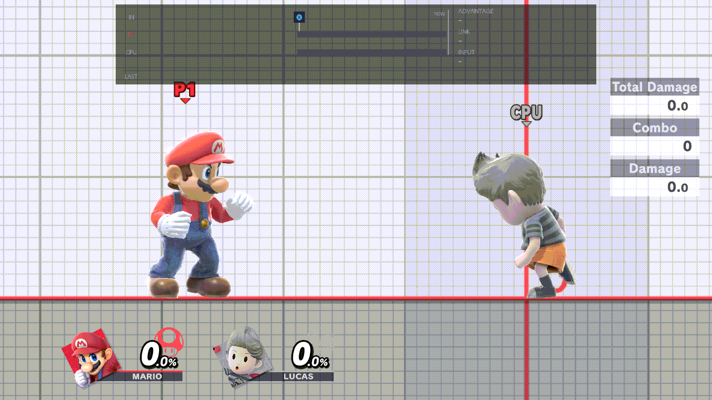
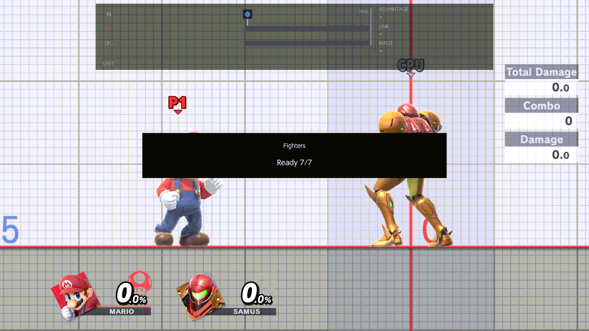

# rc.8 (draft)

Notes for players. rc.8 is the internal name; the release's version name is set when it ships. This is a draft: it
lists the two new chords. The other rc.8 changes are added by their owners
before the build ships. How to use recording is [RECORDING.md](RECORDING.md), the frame strip is
[FRAME-STRIP.md](FRAME-STRIP.md), and the pictures are the list in [MEDIA.md](MEDIA.md).

## New

### Input display chord: R + D-pad Down

- Turns the input display (the frame strip) on and off without opening the menu, in Training and in the waiting-room
  practice.
- A notice says "Input display" and On or Off.
- It changes the same setting as Display & Controls › Input Display: the menu shows the same value afterwards, and the
  choice is saved.

### Game speed chord: hold R + D-pad Up

- **Where Training shows it:** the pause menu's Other Settings › Speed, and the HUD's stopwatch.

- Hold the chord and a small "Game speed" pop-up shows the current speed between two D-pad arrows.
- While you hold it, D-pad Left and Right step one speed at a time. The steps stop at the slowest and fastest speeds
  instead of wrapping around.
- Let go and the pop-up closes. The speed stays.
- While you hold the chord, no other chord fires, and the chord's buttons and D-pad Left / Right don't reach the game.
  The rest of Player 1's controller still does, so you can keep moving.
- **In Training:** 1/4, 1/2, 2/3, x1 and x1.5, Training's own speeds.
  - The chord sets the same Speed setting as the game's pause menu. The pause menu shows the speed you chose, and a
    speed chosen in the pause menu is where the pop-up starts.
  - 1 Frame stays in the pause menu. While Training is on 1 Frame, the pop-up shows "1 Frame", and the first step goes
    from x1.
- **In the waiting-room practice:** 1/4, 1/2, 2/3, x1 and x1.5, local only.
  - Only your practice changes speed. The room's timers and the other player stay at normal speed.
  - Each practice session starts at x1.
- **Never in a match:** the chord never changes a Quickplay or online match, and a match always starts at normal speed.

### Both chords

- They're two new rows of Display & Controls › Button chords: "Input display" and "Game speed".
- They can be changed or cleared like the other chords.
- R is Z on a GameCube controller.
