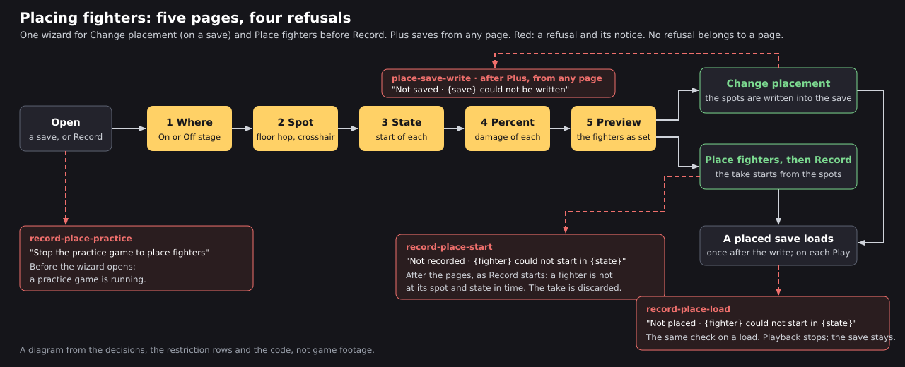

# Restrictions

Every user-facing refusal a branch adds cites one approved row here with `// restriction: <ID>` on its line or one of
the 3 above it (playbook `docs/CHECKLIST.md`, the "cites an approved restriction" row; `compliance.py --base`).

The table is one list, in the order the rows were approved. By subsystem:

- **Placing fighters:** `record-place-practice`, `record-place-start`, `record-place-load`, `place-save-write`
- **Clip editor and replays:** `clip-cut-here-order`, `clip-no-second-fighter`, `clip-fighter-swap-wait`, `clip-fighter-refused`, `clip-fighter-by-kind`, `scrub-point-not-standable`, `replay-preview-fighter`, `replay-mii-metadata`, `replay-mii-loader-build`
- **Combos, drills and recordings:** `drill-capacity`, `combo-capacity`, `combo-file-size`, `combos-training-only`, `combo-save-wait-load`, `combo-name-online-default`, `chain-recordings-only`, `macro-start-save-missing`, `playback-slot-empty`, `drill-preview-rerecord`
- **Save states and settings:** `state-export-invalid-settings`, `save-load-off`, `save-load-empty`, `save-load-busy`, `save-load-player-cpu`, `save-load-deluxe-page`, `save-load-gamecube-triggers`, `save-load-not-ready`
- **Fighters, stages and loading:** `mii-class-unavailable`, `preload-wait-memory`, `preload-wait-pool`, `preload-failed-and-waiting`, `custom-stage-missing`, `character-swap-busy`, `hide-cpu-play`
- **Mash out:** `MASH-R2-NO-END`, `MASH-R2-NO-SAVING`, `M3-T2-NATIVE-EPOCH`, `MASH-M1-MISMATCH`, `mashout-not-mashable`, `mashout-blizzard-practice`, `mashout-ganon-tech`, `M3-READER-GUARD`, `MASH-NATIVE-SLOT`, `MASH-NATIVE-END`, `MASH-RIDLEY-FIXTURE`, `mashout-sora-prep`, `MASH-TROLLEY-FLOOR`
- **Tech practice:** `tech-wizard-preview-blocked`, `tech-wizard-preview-unavailable`, `tech-surface-unavailable-after-rebuild`, `tech-hit-damage-multiplier-unavailable`, `tech-calibration-unmeasured`, `tech-native-observation-unavailable`
- **Parry practice:** `parry-practice-start-save-missing`, `parry-practice-macro-missing`, `parry-practice-no-recording`, `parry-mash-ignored`
- **Practice games:** `btt-projectile-guard`, `edge-juggle-cpu-playback-busy`, `edge-juggle-start-over-stage`, `edge-juggle-stage-unread`, `edge-juggle-start-no-floor`, `edge-juggle-no-open-ledge`, `edge-juggle-juggler-start`, `edge-juggle-player-no-floor`

*Placing fighters: the five pages and the four refusals.*

| ID | Message | Why | Approved |
| --- | --- | --- | --- |
| `record-place-practice` | `Stop the practice game to place fighters` | A running practice game owns the fighters, so placement does not open over it. | Operator record-placement design, R1 handoff |
| `record-place-start` | `Not recorded · {fighter} could not start in {state}` | A placed recording does not start if readiness or the final placement check fails. | Operator record-placement design, R1 handoff |
| `record-place-load` | `Not placed · {fighter} could not start in {state}` | Playback is stopped if the requested start cannot be synchronized; its save is retained. | Operator record-placement design, R1 handoff |
| `place-save-write` | `Not saved · {save} could not be written` | Change placement writes the save file on the worker. If the file is gone or the card refuses the write, nothing is loaded and both fighters are put back where they stood. | tr-primary-2, 2026-11-25 15:23:38Z (placement design, ask 2) |
| `clip-cut-here-order` | "Playhead is past Out: set Out first" / "Playhead is at or before In: set In first" | In the clip editor, L and R set In and Out at a moved playhead. A playhead at or after Out cannot become In, and one at or before In cannot become Out: the handles are never swapped or reordered, and nothing changes. | tr-primary-2, 2026-11-26 00:31:52Z (free playhead, point 3) and 00:45:28Z (the two texts) |
| `clip-no-second-fighter` | "This take has no second fighter." | A fighter toggle needs a recorded fighter for that role; a one-track take has no second fighter to load. | operator 2026-11-26 about 14:07Z (the line approved with SM3 A; tr-primary-2, inbox 14:06:58Z) |
| `clip-fighter-swap-wait` | "Wait for the character swap to finish." | A second toggle or preview waits until the current fighter switch settles or is cancelled. | the decided SM3 design, 2026-11-26 (`docs/DECISIONS.md`: one load at a time) |
| `clip-fighter-refused` | "The roster refused the fighter switch" | The loader declined the requested switch. The editor stops waiting when it receives the refusal; an accepted switch still waits for the requested body to settle. | tr-primary-2, 2026-11-26 21:20:57Z (SM3 admission reply) |
| `clip-fighter-by-kind` | (none: a behaviour) | The clip editor's fighter toggle loads by fighter kind for Player 1 and the CPU in both directions. The take's recorded costume is not restored, and a Mii Fighter may load as another Mii of that kind. | lane docs-tutorials, 2026-11-26 (P5b part C; place-t1a, inbox 20:12:53Z). Player 1 by kind is in the decided SM3 design; the CPU and the costume are not yet ruled |
| MASH-R2-NO-END | Escaped · {elapsed}f · fastest {fastest}f (no grade: this hold never ends on its own) | Native no-input escape is infinite and no verified deadline exists, so S has no finite denominator; no best/streak entry. | primary R2, 2026-11-15 |
| MASH-R2-NO-SAVING | Escaped · {elapsed}f · Mashing can't shorten this hold | F equals the no-input duration, including Robin at damage >=120; no best/streak entry. | primary R2, 2026-11-15 |
| M3-T2-NATIVE-EPOCH | Capture restarted · no grade | During Held, only a native seed published by the guarded main+0x639d44 observer for a Bury down throw replaces the clock. Every other Held restart and every Result restart remains unscored. A late-seed result is explicitly labelled from the throw's clatter start; all bounds, elapsed ticks and carried latches originate in that observed seed. | primary approved t2 design/guard exception and conditional grading, 2026-11-16 |
| MASH-M1-MISMATCH | Model mismatch · {elapsed}f · fastest {fastest}f (no grade); invalid bounds variant; Observation incomplete · no grade; Native model unavailable · no grade; Attacker unavailable; Position unavailable; Native tick observation unavailable for this hold; Move sequence unavailable; Move status unavailable | An escape below the exact optimum, inconsistent or incomplete observations, an invalid solver seed, or invalid setup values cannot produce a native-model grade. Diagnose with no tolerance, invented timeout or fallback score. These messages inventory the same fail-closed paths; they add no scene/fighter restriction. | primary M1/R2/M3, 2026-11-15 |
| `tech-wizard-preview-blocked` | "Start blocked / outside bounds — adjust values" | The preview reports rejection by the existing shared planner for these values. It adds no admission check; the actual launch retains the same stage geometry and bounds checks. | primary 2026-11-17 14:03Z explicitly requires strict admission; operator-approved wizard preview forwarded by primary 13:02Z |
| `tech-wizard-preview-unavailable` | "Preview unavailable" | A missing selected-point/configuration or fresh native planning input cannot supply a path. The preview reports that absence; the actual launch retains its existing native-read requirements. | standing native availability contract forwarded by primary 2026-11-16 18:13Z (unavailable is not false); operator's live multiplier/fail-closed ruling forwarded 2026-11-17 00:45Z; approved wizard preview forwarded 13:02Z |
| `state-export-invalid-settings` | `state_export set refused issues={issues}` (diag log; the bridge replies `refused reason=invalid_settings`) | The test-only hardware bridge's whole-settings request is applied only when the file reads with no issue, so a malformed request changes no live or saved settings (boot recovery is unchanged). | primary 2026-11-17 22:37Z (Astra review 2: an invalid set is rejected before any side effect); for operator review |
| `parry-practice-start-save-missing` | "Can't start: its start save was deleted" (`src/model/rr_host.rs` `PARRY_START_SAVE_MISSING`) | Parry practice plays the CPU's macro from its start save; a saved practice follows its macro's link, and a deleted save means its attempts can't start from the same place, so Play refuses. | Approved 2026-11-17 18:15Z, as recommended (DESIGN rev 2 §5.3, Q1 and Q5) |
| `parry-practice-macro-missing` | "Can't start: its macro was deleted" (`src/model/rr_host.rs` `PARRY_MACRO_MISSING`) | The practice's CPU macro no longer opens, so there is nothing to replay. | operator 2026-11-17 18:15Z, the same (Q1) |
| `parry-practice-no-recording` | "No CPU recording yet: open the Recording pop-up (ZR+Right) and choose CPU, then ZR+Down records and ZR+Down stops" (`src/model/rr_host.rs` `PARRY_NO_RECORDING`) | Play on CPU with Parry practice On has no active CPU macro; the notice explains the existing recording flow. | operator 2026-11-17 18:15Z, the same (Q1) |
| `parry-mash-ignored` | (none: a behaviour) | While Parry practice is On, a CPU mash does not stop the parry replay (`Mash interrupts playback` is ignored), so every pass delivers the recorded move. | Approved 2026-11-17 18:15Z, as recommended (DESIGN rev 2 Q3) |
| `tech-surface-unavailable-after-rebuild` | "Selected surface unavailable after rebuild" / "Selected surface no longer exists" | A bounded collision rediscovery must recover a live line with the selected geometry. A missing or still inactive line cannot receive a launch; choose another point. | primary 2026-11-17 04:38Z, explicit reset recovery with the strict dead-line guard and a specific genuinely-gone failure; for operator review |
| `tech-hit-damage-multiplier-unavailable` | "Hit damage unavailable" | Visible added percent must convert through a fresh positive finite native multiplier; missing or invalid values cannot supply a base damage or a placement. | operator 2026-11-17, selected visible-percent option A and explicitly required fail closed if the native multiplier is unavailable |
| `btt-projectile-guard` | "Projectile detection unavailable" | The optional projectile native boundary failed a guard; its row is unavailable while BTT melee and Hitbox remain installed. The saved On/Off value is retained. | primary 2026-11-16, explicit isolated-boundary ruling; for operator review |
| `drill-capacity` | "Drill too long: keep it to 16 steps" | Input drills share the existing combo bounds (LINKS × STEPS); overflow saves nothing. | operator 2026-11-15, keep 16 for rc.15 |
| `combo-capacity` | "Combo too long: keep it to 16 links" | Hit combos share the same unit bound; an overfull exchange saves nothing. | operator 2026-11-15, keep 16 for rc.15 |
| `combo-file-size` | `file is {bytes} bytes (maximum {max})` (`StoreError::FileTooLarge`, unchanged) | Worker-side combo/drill reads allow `LINKS * 4096` bytes (64 KiB at 16 units), retaining the old 4 KiB/unit budget; larger files still refuse. | primary 2026-11-15, following the operator's 16-unit decision |
| `mii-class-unavailable` | `"{label} - unavailable"` (`src/editors/roster.rs`) | A greyed Mii tile: the role has no Mii of that class it can load (`docs/MII.md` row 17; the fork's behaviour). | Approved 2026-11-05, one of four approved together |
| `mashout-not-mashable` | `"{label} - not mashable"` (`src/model/ui/screens.rs` `list_option`, Mash out move list) | A move whose native escape can't be reached by mashing: 120 K. Rool (operator), 89 DK Cargo and 96 Whip (native a = 0, mashing doesn't shorten the hold), 90 Ganondorf aerial side-B (native end before any escape at the max faithful window W = 26, both cadences). Evidence: run `rc15-capture-c5ebb248-surface-1`, `OUTCOMES.md`. Shown greyed; never confirmable or rolled by Random. | Approved 2026-11-17 for row 120: greyed out and unselectable, labelled not mashable. Extended to rows 89, 90 and 96 at 14:00Z on native evidence, and confirmed about 14:07Z |
| `mashout-blizzard-practice` | `"Sora's Blizzard re-freezes outlast the escape · practice only, no grade"` (`src/model/mashout/moves.rs` `practice_only`; Mash out notice) | 116 Sora Ice magic (Blizzard) stays selectable and runs as practice, never graded. The M3 Set observer and the G1/G2 replay work (5 re-freeze Sets applied bit-exactly), but S1 cannot close: Sora is still in SPECIAL_N2 when the hold ends, and the last shard-generation frame is not byte-provable (compiled generate sites, no frame/count/status gate). Evidence: run `rc15-sora116-g2pair-xps-6`, `sora116-g2-pair-xps/harvest-6/`. | Option (b) of the 08:37Z review; approved 2026-11-18 about 11:28Z |
| `mashout-ganon-tech` | (routing, no refusal text) `src/model/mashout/moves.rs` `tech_graded`: row 121 "Flame Choke (tech)" | Mash out row 121, Ganondorf's grounded Flame Choke, is graded by the Tech practice grader (on time / early / late, the tech kind, a best), not by mash speed. It is the only such row, a documented exception. The slam ends in the ordinary ground-contact tech decision (PASSIVE / PASSIVE_FB / DOWN after CATCHED_AIR_END_GANON; trace `ganon-tech-research-yoga-2`, `artifacts/rc15-mashout/ganon-tech/research/RESEARCH.md`). | Approved 2026-11-18 about 15:00Z: the tech grader, for this one exception |
| `replay-preview-fighter` | "Preview fighter is not available" (`src/model/macro_ui/replay_target.rs`) | The capture's fighter kind is not one the roster can load, so there is nothing to preview or switch to. | Approved 2026-11-05, one of four approved together |
| `replay-mii-metadata` | "Recorded Mii metadata is unavailable" (`src/model/macro_ui/replay_target.rs`) | The capture's Mii could not be resolved, so Switch cannot load that exact Mii; Keep still plays the inputs. | Approved 2026-11-05, one of four approved together |
| `replay-mii-loader-build` | "Replay Mii loading is unavailable in this build" (`src/model/macro_ui/replay_target.rs`) | No build since rc.10 shows it: the `mii-ordinary-cpu-alpha` switch was removed in rc.10 and every build has the Mii loader. The string stays for a build without it. | Approved 2026-11-05, one of four approved together |
| `combos-training-only` | "Combos work in Training" (retired; the string is gone from `src/`) | superseded by combos-lobby in rc.5. The waiting-scene return is gone. | retired 2026-11-06; was operator 2026-11-05, for rc.5 only |
| `combo-save-wait-load` | "Wait for the practice fighters to finish loading" (`src/runtime/ui/combos.rs`, and since rc.14 `src/runtime/ui/layouts.rs`) | The combo list and Break the Targets' Saved layouts list open only once the practice fighters have loaded (the panel is not up yet). | Approved 2026-11-05 for the combo list, one of two approved together. The same limit on Saved layouts (rc.14) awaits review |
| `combo-name-online-default` | (retired; the refusal is gone from `src/`) | rc.14: Quickplay's room opens the name keyboard as a local-wireless room does. A match that starts while it is open closes it and applies nothing; back in the same room it reopens with what was typed. | Retired 2026-11-15 by order; it had been approved 2026-11-05 as option A |
| `preload-wait-memory` | `" ({} waiting for memory)"` (Cycle Preload notice, `cycle_preload_policy.rs` `CacheText`) | An extra group whose prefetch start found too little process headroom is held and retried, not failed; the notice names what it waits for (P-HOT, `LANE-HOT-SLOTS-REPORT.md` §8). A No. of CPUs seat (entry 2 or 3 at one CPU) whose load memory refused counts the same way (primary reading F9-SEAT-NOTICE, 2026-11-08; `hat_slots::with_seats` on `p23/rc6-open-fixes`) | Approved 2026-11-05, one of two approved together |
| `preload-wait-pool` | `" ({} waiting for pool space)"` (Cycle Preload notice, `cycle_preload_policy.rs` `CacheText`) | The same hold when the fighter pool has too few free bodies after its reserve (P-HOT §8) | Approved 2026-11-05, one of two approved together |
| `preload-failed-and-waiting` | `" ({} failed, {} waiting for {})"` (Cycle Preload notice, `cycle_preload_policy.rs` `CacheText`) | Failed and held groups at once, in one bracket (P-HOT §8) | Approved 2026-11-05, one of two approved together |
| `chain-recordings-only` | (none) | a chain inside a chain would need a loop check | operator 2026-11-06, revision 8 Q13 |
| `macro-start-save-missing` | No start save. This macro plays from where the fighters are. | the connected start file was deleted | operator 2026-11-06, revision 3 answer 3 |
| `save-load-off` | "Save States is Off (Saves page)" (`src/model/state/refused.rs` `SAVE_STATES_OFF`) | A Save or Load chord with Saves › Save States Off; before rc.12 it did nothing, silently, and fired later when the row went On. rc.14: Saves › Save setup here... gives the same notice with Save States Off (it takes the fighters where they stand, as Save does; `setup_transaction.rs` `Refusal::Off`) | Decided 2026-11-13 13:29Z: every refused or ignored Save or Load shows a readable notice; awaits review. Save setup here was added to rc.14 on 2026-11-14 about 18:07Z (SL4, S7) with Save's refusals; its design was approved the same day |
| `save-load-empty` | "Nothing is saved here yet: Save first, or bind a save" (`refused.rs`) | Load with nothing bound ([Recording guide](guide/recording.md#save-states-only-warp)) | the same |
| `save-load-busy` | "A load is already being placed" / "A setup is being placed: save (load) again after it" (`refused.rs`) | A load, setup, preview or Play warp is being placed; the press would cut it | the same |
| `save-load-player-cpu` | "A CPU drives Player 1: take Player 1 back to load" (`refused.rs`) | Load takes Player 1's own body; while the game's own CPU operator drives Player 1 (`is_operation_cpu`) no body takes it. CPU Pilot drives inputs only, so its Load is placed (SPEC-state-01 §8; logged `save_state loaded … p1_pilot=true`, rc.12 smoke row e) | the same |
| `save-load-deluxe-page` | "Online Deluxe's open page uses this button: close it to save (load)" (`refused.rs`) | A chord moved onto a D-pad button Online Deluxe's open page acts on (C4, narrowed in rc.12) | the same |
| `save-load-gamecube-triggers` | "Both triggers are Online Deluxe's L + R: hold one of them" (`refused.rs`) | C3: both GameCube triggers are Deluxe's L + R | the same |
| `save-load-not-ready` | "Save states have not started in this match yet" (`refused.rs`) | The save-state step's game values are not resolved yet at the match's start | the same |
| `playback-slot-empty` | "This Playback Slot is empty: pick its macro on the Recording page" (`src/model/recording.rs` `PlayRefusal::SlotEmpty`) | The CPU picked a Playback Slot no macro fills (rc.12 TR1: slots are filled from a macro's page); replaces "Record into this slot first" | Approved 2026-11-13 (DECISIONS TR1: the slots are to be fixed so that they work); awaits review |
| `hide-cpu-play` | "The CPU is hidden: turn Hide CPU Off first" and "The CPU is hidden during this game" (`src/model/cpu/hide.rs` `refusal`) | Play on CPU feeds a recording to the CPU's controller, and a hidden CPU takes no action, so the press would do nothing (SPEC-eggsercise V2.6, edges table) | Approved 2026-11-14 about 15:55Z, option a: Play on CPU stays refused while Hide CPU is On, with the first notice of this row |
| `custom-stage-missing` | `"Custom stage missing: {name}"` (`src/model/stages/custom_stages.rs` `missing_notice`) | rc.14: a custom stage the lists or the Direct choice name was deleted in Stage Builder; the list falls back to a normal stage (the Waiting Room) and says which stage is gone. | operator 2026-11-15 ~02:10Z (relayed by the primary: the fallback notice approved) |

| `M3-READER-GUARD` | "Mash out unavailable" (`model/mashout/admission.rs`, runtime Mash reader admission) | A required native reader/setup guard or installed prerequisite is unavailable. No native seed read or grade is attempted. | primary 2026-11-15, READER-GUARD-REQUEST approval: fail CLOSED and host-test it |

| `MASH-NATIVE-SLOT` | "Mash out unavailable" | Exact FighterControl start/end slot guard, ownership or readback failed. Foreign pointers are preserved; no seed or score is admitted. Also the M3 clatter-write observer's Set (+0x90) and Add (+0x98) slots: every `arm` refusal (not the owner thread, wrong phase, already armed, foreign slot, page check, unverified common module, P1 Control not on the FighterControl vtable). | primary 2026-11-16, T2 interposer design PASS and combined implementation ruling; Set/Add extension approved by devin-primary 20:56Z 2026-11-17, FOR OPERATOR REVIEW |
| `MASH-NATIVE-END` | "Move ended before escape · no grade" | Shown when the game itself ends the hold (e.g. Ridley's drag hits a ledge) before any escape; no grade is given because no escape happened. | primary 2026-11-16, Ridley native-end root outcome ruling |
| `MASH-RIDLEY-FIXTURE` | "Stage direction unavailable · no grade" | The guarded native camera-centre reference is unavailable, so the stage-relative placement direction cannot be chosen faithfully: Ridley's centreward drag setup and, since 2026-11-17, Zero Suit Samus's Flip placement toward the stage interior (artifacts/rc15-mashout/flip108-e051-ally-canonical/GEN11-DIAGNOSIS.md). | primary 2026-11-16, centreward Ridley fixture correction; Flip widening mashout-opus-review 2026-11-17T12:38Z (OPUS-REVIEW-flip108-direction.md), logged for operator |
| `mashout-sora-prep` | "Setup hit you · no grade" (`runtime/features/mashout.rs`, Sora Ice magic Blizzard arm) | A preparatory Fire/Thunder cast changed P1's damage or left a live Fire/Thunder article, so the Blizzard attempt would not start from the user's fixture (OPUS-REVIEW-sora116-45c1f9d6 F2 (a)). Backstop to the away-facing preparation. | primary 2026-11-17 (Sora116 F2 notice/ID), FOR OPERATOR REVIEW |
| `MASH-TROLLEY-FLOOR` | "Trolley needs more stage floor · no grade" | Row 97 Place requires the guarded native level collision line under P1 to support both fighters and the cart through the P1 capture window, with one unit past the widest observed P1 hurt extent. Missing guards, pass-through, moving or insufficiently long floor refuse the setup before either fighter is moved. | Approved 2026-11-18 11:28Z with the rest of that batch; row 97's floor notice |
| `character-swap-busy` | "Wait for the character swap to finish" (shared ordinary CPU Cycle and generic roster notice) | A detected Cycle is consumed while an existing character request is pending or active; it must not replace that request. Admission remains unchanged. | primary 2026-11-16, FS04 explicit fix authorization relayed by parent root |
| `tech-calibration-unmeasured` | "Perfect · timing unavailable" (`src/model/tech/session.rs`) | A confirmed native tech is a success; an unmeasured press-frame calibration supplies no offset or average sample. | primary 2026-11-16, forwarded native reader ruling: calibration stays explicitly unavailable until measured; never zero |

| `tech-native-observation-unavailable` | Grading unavailable (not counted) | Missing native status/input/timing observations cannot establish a miss or zero timing; repeat the same setup uncounted. | primary 2026-11-16, retained exact decision snapshot and unavailable-is-not-false requirements |
| `edge-juggle-cpu-playback-busy` | "Stop CPU playback before starting this drill" | Guard the Edge and Juggler yield to a pending or active Recording-page CPU playback and its buffered frames. The ordinary Play on CPU toggle remains available to stop a loop. | Primary tr-primary-2, 2026-11-20 v3 task, explicitly permits refusing Start while library playback owns the CPU. |
| `edge-juggle-start-over-stage` | "Pick a point off the stage" | A Guard the Edge start over the stage or in it is not an off-stage recovery. A start under the stage is refused unless Under the stage is On. The point is checked against the stage's lines one frame after A. | Approved 2026-11-22 (DECISIONS GJ2: A is refused over or under the stage). A start under the stage is allowed by an option since 2026-11-25 |
| `edge-juggle-stage-unread` | "The stage could not be read" | Guard the Edge and Juggler take their stage from the stage's own lines at Start. When those cannot be read on that frame, the drill does not start and the menu reads Start again. | tr-primary-2 2026-11-25 18:06:32Z (texts approved); operator 2026-11-25 ~17:05Z (the off-stage rule in this build) |
| `edge-juggle-start-no-floor` | "Stand on the stage to start this drill" | The drill starts from the floor Player 1 stands on. With no solid floor under Player 1 (over a gap, in the air off stage) there is none to start from. | tr-primary-2 2026-11-25 18:06:32Z |
| `edge-juggle-no-open-ledge` | "This floor has no ledge to guard" | Guard the Edge needs an end of Player 1's floor with open air beside it: air with nothing to stand on beneath, inside the blast lines. A floor whose ends meet a wall, a step, or run out past the blast line has none. Juggler needs no ledge. | tr-primary-2 2026-11-25 18:06:32Z (wording changed from "no ledge with open air") |
| `edge-juggle-juggler-start` | "Pick a point over the stage or beside it" | Juggler's CPU spot is over a floor or platform, or in open air beside the stage. A spot under the stage, inside it or outside the blast lines is not a juggle. | tr-primary-2 2026-11-25 17:11:49Z and 18:06:32Z |
| `edge-juggle-player-no-floor` | "Pick a point above a floor" | Player 1 starts standing, so its point needs a floor at or below the crosshair. The crosshair does not leave a floor: a move with none under it is not kept. The refusal shows when the floor under the point is gone at A, such as a platform that moved away; the floor read stays the card build's. | tr-primary-2 2026-11-22 ~23:00Z ruling 2 (a visible refusal instead of a silent A; the operator may overrule); tr-primary-2 2026-11-23 20:11:55Z (the unseen cursor past a floor's end is removed) |
| `drill-preview-rerecord` | "Re-record to preview" | A drill recorded before takes were kept, a crop, or a drill Make combo made has no recorded inputs of its own to play. | tr-primary-2 2026-11-23 18:05:17Z ruling 5 ("old drills say 'Re-record to preview'") |
| `scrub-point-not-standable` | "Can't stand there on this stage." | While a clip's frame is shown in the clip editor, each fighter is put where the recording had it, moved so the target fighter's first shown frame sits where it stands now. A point inside this stage's ground or a wall, or outside the camera's limits or the blast lines, is not a place to put a body: that fighter stays where it is and the key line says so. The other fighter is still shown. | tr-primary-2 2026-11-26 00:08Z (a body that would land in the blast zone or inside a wall is not moved, and the line says so) and 10:27:48Z (the text) |
