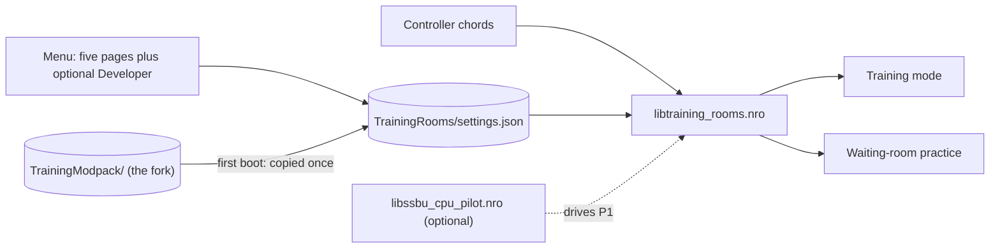
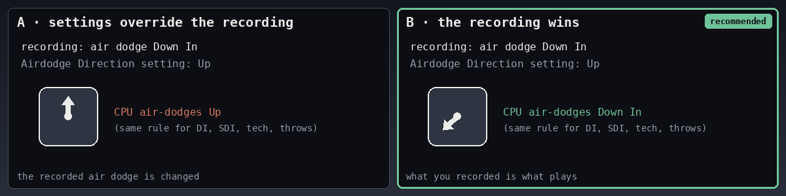
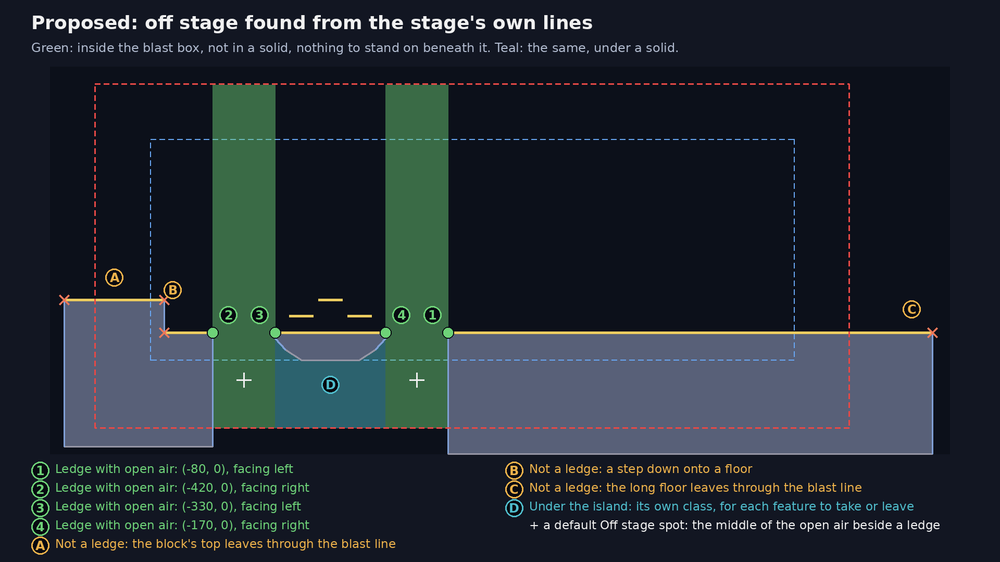

# Technical notes

How TrainingRooms works in Training and waiting rooms; see [Media](MEDIA.md) for clip provenance and [release history](CURRENT-RELEASE.md#earlier-releases) for earlier builds.

<video src="https://git.syntaxbyexample.com/intpa/TrainingRoomsForUltimate/media/blob/4ec5bff51d1c512e252fbb8e6788fc6adc32cdcc" autoplay muted loop playsinline controls></video>

*Menu tour and hitbox checklist* [Open the clip](media/rc14-menu-tour.mp4)

| Capture detail | Dated observation |
| --- | --- |
| Capture | Eden, 2026-11-15, rc.14 `17e50cd0`. |
| Diagnostic NRO | `addcdd7e` (log lines only). |
| Footer | 0.2.0-rc.14 · rc14 17e50cd0. |
| Setup | Training, Mario versus Palutena, overlays clear. |
| Menu tour | CPU → Saves → Recording → Fighters & Stages → Display & Controls. |
| Checklist | Hitbox Visualization. A selected Hitboxes, Grab boxes and Hurtboxes. |
| Help | “Tick what to draw.” |
| Windboxes | “Hits that push or pull without hitstun.” |
| Launch angles | “Where each hit sends.” |
| Result | Yellow hurtbox pills on both fighters. Mario’s neutral air showed red at 1/4 speed. |
| Edits | [Capture and cut details](MEDIA.md). |

## Install

For the plugins and their install path, see [Getting started](guide/getting-started.md#installing).

| Detail | Decision record |
| --- | --- |
| First-boot import | [Decision of 2026-11-01](DECISIONS.md). |
| Published replay captures | Copied in the background without a size cap. Unfinished staging folders are skipped. |
| Blocking copies | Files over 8 MiB are skipped. Originals and existing destination files remain intact. |

## Controls

| To check | Where to look |
| --- | --- |
| Move between pages or edit a value | [Menu navigation](guide/using-the-menu.md) |
| Look up an action's factory binding | [Button chords](menu/display-and-controls.md#button-chords) |
| Find a control that cannot be rebound | [Fixed controls](guide/controls.md#fixed-buttons) |
| Identify the running build | [Read the menu footer](CURRENT-RELEASE.md#which-build-is-mine) |

Build tag in the menu footer <video src="https://git.syntaxbyexample.com/intpa/TrainingRoomsForUltimate/media/blob/f35a747760aa9795cefaa3aef17e370d05655af9" autoplay muted loop playsinline controls></video> [Open the clip](media/rc11-footer-tag.mp4) · [Capture record, 2026-11-12](MEDIA.md)

## Features in detail

| Footage | Recording details |
| --- | --- |
| Default take | Eden, 2026-11-05, 0.2.0-rc.1 release NRO `706c993f`. |
| Exceptions | RC10 and takes naming a different build. |
| Provenance | [Media index](MEDIA.md). |

### Hitboxes and grab boxes

<video src="https://git.syntaxbyexample.com/intpa/TrainingRoomsForUltimate/media/blob/5d5806e6352e36af05081590daa383c688c2f98f" autoplay muted loop playsinline controls></video>

*Hitboxes and hurtboxes during a neutral air* [Open the clip](media/rc14-hitbox.mp4)

| Capture detail | Dated observation |
| --- | --- |
| Capture | Eden, 2026-11-15, rc.14 `17e50cd0`. |
| Diagnostic NRO | `addcdd7e` (log lines only). |
| Footer | 0.2.0-rc.14 · rc14 17e50cd0. |
| Setup | Training, overlays clear. |
| Menu | Display & Controls › Hitbox Visualization. |
| Help | “Tick what to draw.” |
| Windboxes | “Hits that push or pull without hitstun.” |
| Launch angles | “Where each hit sends.” |
| Selection | A ticked Hitboxes, Grab boxes and Hurtboxes. B returned. |
| Training | Both fighters showed yellow hurtbox pills. |
| Speed | R + D-pad Up stepped to 1/4. |
| Attack | Mario’s short-hop neutral air stayed red over one second. The strip lane turned red. |
| Edits | [Capture and cut details](MEDIA.md). |

TrainingRooms draws fighter and projectile hitboxes with its own panes, projects them with the game camera at layout time, and draws capsules as single pills; see the [colour legend](menu/display-and-controls.md#colour-legend).

| Detail | Decision record |
| --- | --- |
| Design | [Capsule decision, 2026-11-14](DECISIONS.md). |
| Left and middle | A row of discs represented each capsule. |
| Right | One pill represented each capsule. |

| Strength and spot | Mechanism |
| --- | --- |
| Rank | `src/model/spots.rs::knockback` ranks launch; damage breaks ties, not angle. |
| Current frame | `classify` marks weaker active hitboxes Sour and stronger ones Sweet. |
| Earlier peak | `classify` marks a weaker phase Late; indistinguishable hitboxes have no label. |
| Attribution | `attribute` checks the game's recorded slot against received damage and knockback. |

### Frame strip

See the [frame strip guide](guide/frame-strip.md) for the lanes and readouts, and [Media](MEDIA.md) for the rc.5 clips.

<video src="https://git.syntaxbyexample.com/intpa/TrainingRoomsForUltimate/media/blob/8bc5c548137a4ab83ddf533d683ccf7ebb2d7ae6" autoplay muted loop playsinline controls></video>

*2026-11-11 · [Capture record](MEDIA.md)* [Open the clip](media/rc8-input-display-chord.mp4)

| Topic | Details |
| --- | --- |
| Frame-strip setting | The [binding](menu/display-and-controls.md#button-chords) and [Input Display row](menu/display-and-controls.md#input-display) share one saved value. |

| Topic | Details |
| --- | --- |
| Display model | `src/model/frame_strip.rs` supplies lanes, chips, freeze, readouts, stick row and C-stick arrow. |
| Timing | The same model implements the 20-frame rule. |
| References | [Frame strip](guide/frame-strip.md) · [Specification](../specs/SPEC-input-06-frame-strip.md). |

| Strip detail | Mechanism |
| --- | --- |
| Link | `Tracker::on_hit`: hit minus CPU free frame; TRUE without a number when timing is unknown. |
| Input | `Tracker::on_hit` subtracts Player 1's first actionable frame from the follow-up press. |
| Step | `src/model/strip_scroll.rs::stepped` moves 15 columns per step. |
| Repeat | `Scroll::poll` repeats after 18 held polls, then every six. |
| Ownership | An open scroll hides its hold and direction buttons from the game. |

### Game speed

<video src="https://git.syntaxbyexample.com/intpa/TrainingRoomsForUltimate/media/blob/86bc241d83bc39b2ac5a1aee96b2f9e15f23b665" autoplay muted loop playsinline controls></video>

*Compare the same forward smash at x1 and 1/4 speed* [Open the clip](media/rc11-game-speed.mp4)

| Capture detail | Dated observation |
| --- | --- |
| Capture | Eden, 2026-11-13, rc.11 `0c628724`. |
| Diagnostic NRO | `bd0bc61b` (log lines only). |
| Setup | Mario walked from the reset spot and forward-smashed Ridley at x1. |
| Speed | Holding R + D-pad Up, D-pad Left stepped through x1, 2/3, 1/2 and 1/4. |
| Repeat | The stopwatch read 1/4. The same approach and smash took about four times longer. |
| Log | `[GameSpeed] … speed=1/4`. |
| Edits | [Capture and cut details](MEDIA.md). |

The [speed control](guide/game-speed.md) stops at either end of the list rather than wrapping.

| Where | What the chord does |
| --- | --- |
| Held chord | Blocks other chords. The game receives neither its buttons nor D-pad Left/Right. |
| Other inputs | Player 1 can still move. |
| Training speed | The pop-up shares Other Settings › Speed: 1 Frame, 1/4, 1/2, 2/3, x1, x1.5. |
| Frame-step boot check | Passing enables 1 Frame immediately left of 1/4. Failing skips it. |
| Advance | Release the chord, then press ZL (L on a GameCube controller). |
| Stopwatch | Visible at every speed except x1. |
| Waiting-room practice | Starts at x1. All available speeds affect practice, including 1 Frame. |
| Room timers and peer | Continue at normal speed. |
| A Quickplay or online match | It never changes one: a match always starts at normal speed. |
| Standalone CPU pilot | The speed chord still works while the pilot drives Player 1. |
| Pilot input | Waiting-room practice receives one pilot input per game update, including at x1.5. |

| Frame step | Mechanism |
| --- | --- |
| Hold | `src/model/lobby_speed.rs::FrameStep::poll` runs waiting-room practice continuously after 18 held polls. |
| Priority | The speed chord, another input owner, or busy room UI blocks stepping. |
| Hook | `src/runtime/features/game_speed.rs::frame_step_poll` publishes requests for the waiting-area task. |

<video src="https://git.syntaxbyexample.com/intpa/TrainingRoomsForUltimate/media/blob/b8908852fc9c93984c0a88a9076d2a394f260fa8" autoplay muted loop playsinline controls></video>

*2026-11-11 · [Capture record](MEDIA.md)* [Open the clip](media/rc8-speed-hud-fixed.mp4)

| Topic | Details |
| --- | --- |
| Bindings | Display & Controls › Button chords lists Input display and Game speed. |
| Editing | Both can be changed or cleared. |
| L held | Each waits unless its edited chord includes L. |
| Factory bindings | Leave the L + R + D-pad Online Deluxe overlays available. |

| Topic | Details |
| --- | --- |
| Online Deluxe 0.10.5 or later | TrainingRooms yields a chord when Deluxe uses that D-pad input. |
| Pages with rows | Settings, Window Options, Plugins and individual plugin pages. |

| Deluxe uses its D-pad | When |
| --- | --- |
| Deluxe moves a row with D-pad Up/Down | Only when none of ZL, ZR, R and L is held |
| And changes a value with D-pad Left/Right | Only while ZR (without ZL) is held |

| Beside Deluxe's open page | What happens |
| --- | --- |
| ZR + Right on its CPU Pilot page | So it no longer also opens the Recording pop-up |
| ZR + Left (Play on Player 1) | Waits too |
| Save, Load, Record, Playback, cycles, Input display | These factory chords work beside Deluxe’s open page. |
| Before rc.12 | All D-pad chords waited. Save and Load were unavailable beside an open page. |
| Its Performance view | Doesn't stop any chord, and the menu shortcuts still work |
| A Save or Load press that doesn't happen | Says why in a notice (Saves › Save States) |
| GameCube controller | Both triggers together count as Deluxe’s L + R. |
| Both triggers | ZL/ZR chords, Input display and Game speed wait. A single trigger still works. |

### Combos, in short

| Action | Behavior |
| --- | --- |
| Save | Recording › Combos & Sequences › *+ Save last combo…* saves a combo you landed. |
| Drill | The helper grades each link. Sequences drill their combos in order. |
| Files | Small JSON files in `sd:/ultimate/TrainingRooms/combos/` support editing, copying between cards and sharing. |
| Fighters | Any fighter can practise a saved combo. |
| Reference | [Sharing guide](guide/combos.md) · [File format and clip](#combos-the-clip-and-the-files). |

### CPU reactions

<video src="https://git.syntaxbyexample.com/intpa/TrainingRoomsForUltimate/media/blob/f78ea125d955343759eb6e721ae3b74e5cb03358" autoplay muted loop playsinline controls></video>

*Compare downward and upward DI* [Open the clip](media/rc13-di.mp4)

| Capture detail | Dated observation |
| --- | --- |
| Capture | Eden, 2026-11-14, rc.13 `7d7b74c9`. |
| Diagnostic NRO | `134636ef…` (log lines only). |
| Run | `gna-r13b-yoga-1`, Mario against Donkey Kong. Hardware was untested for this candidate. |
| Start | CPU loaded at 80% with DI Down. Mario’s forward smash launched low (19.0%). |
| Menu | CPU › Defence › DI Direction showed Down ×1 fully tinted; others dim. |
| Change | Y cleared Down. A picked Up. |
| Repeat | Same load and smash launched high (19.2%). |
| Edits | [Capture and cut details](MEDIA.md). |

| Topic | Details |
| --- | --- |
| CPU reactions | DI, SDI, air dodge, shield tilt, mash, ledge, tech and throw. |
| DI comparison | The same hit launches along different paths with Down and Up. |

<video src="https://git.syntaxbyexample.com/intpa/TrainingRoomsForUltimate/media/blob/070bd785610ec2f84383985757f699021f9ba217" autoplay muted loop playsinline controls></video>

*Select DI and SDI directions* [Open the clip](media/rc13-di-sdi-chips.mp4)

| Capture detail | Dated observation |
| --- | --- |
| Capture | Eden, 2026-11-14, rc.13 `7d7b74c9`. |
| Diagnostic NRO | `134636ef…` (log lines only). |
| Run | `gna-r13b-yoga-1`. Hardware was untested for this candidate. |
| Start | CPU › Defence › DI Direction showed zero selected. |
| Grid | A opened on Neutral. All chips were dim. |
| Pick | Cursor on Up, then A. Selected showed “Up x1”, and Up gained full tint. |
| Repeat | SDI Direction showed the same selection behavior. |
| Edits | [Capture and cut details](MEDIA.md). |

| Topic | Details |
| --- | --- |
| Direction chips | The artwork uses the game’s DI line and SDI streak. |
| Weight | Each A press adds weight to the selected direction. |
| In and Out | Relative to the player, on either side of the CPU. |

| Detail | Decision record |
| --- | --- |
| Design | [DI chip decision](DECISIONS.md#rc13-di-lines-di-chips-like-the-game-s-blue-di-indicator-rc-13-item-2-e1-x1). |
| Panels | Mock-up, then Eden captures: empty DI, Down ×1, SDI and a fivefold Down enlargement. |
| Result | rc.13 retained the thinner, dimmer lines. |

If you choose a [CPU Level](menu/cpu.md#cpu-level) that differs from Training's own level, a notice shows both once per Training session.

<video src="https://git.syntaxbyexample.com/intpa/TrainingRoomsForUltimate/media/blob/1d5dbf5953e66f662b5b81f074d6f2ccea6ac16d" autoplay muted loop playsinline controls></video>

*Set CPU Level and compare the Training menu* [Open the clip](media/rc11-cpu-level.mp4)

| Capture detail | Dated observation |
| --- | --- |
| Capture | Eden, 2026-11-13, rc.11 `0c628724`. |
| Diagnostic NRO | `bd0bc61b` (log lines only). |
| Menu | CPU › Level › CPU Level changed from Off to 7. |
| Character select | Donkey Kong’s CPU card read “CPU Lv. 3”. |
| Training notice | “Lv 7 from TrainingRooms (Training menu: Lv 3)”. |
| Log | One judged line and one notice. |
| Training behavior | Stop changed to CPU (Lv. 3). Donkey Kong took Mario from 0% to 28%. |
| Edits | [Capture and cut details](MEDIA.md). |

### Save states and respawn

<video src="https://git.syntaxbyexample.com/intpa/TrainingRoomsForUltimate/media/blob/0ead466c8fee675bdbef80d4f47a36745e236dfc" autoplay muted loop playsinline controls></video>

*Save and restore both fighters* [Open the clip](media/rc10-save-load.mp4)

| Capture detail | Dated observation |
| --- | --- |
| Capture | Eden, 2026-11-12, rc.10 `32ee7595`. |
| Diagnostic NRO | `79922abe`. |
| Run | `docs-rd12-32ee7595`, `fx-save-load`. |
| Save | Mario stepped left. ZL + D-pad Down showed “Saved Slot 1”. |
| Attack | Mario walked back and forward-smashed Mewtwo to 10%. |
| Load | ZL + D-pad Up restored both positions and Mewtwo’s 0%. Nothing played. |
| Log | `state saved slot=1`, `state load_request`, `state placed`. No playback line. |
| Edits | [Capture and cut details](MEDIA.md). |

<video src="https://git.syntaxbyexample.com/intpa/TrainingRoomsForUltimate/media/blob/a967e585ecafebde5f40d33d7043d51e11440a1a" autoplay muted loop playsinline controls></video>

*2026-11-27 · [Capture record](MEDIA.md)* [Open the clip](media/rc7-respawn-on.mp4)

| Topic | Details |
| --- | --- |
| Saves | Bind one named state to Save and Load; set mirroring and damage on load. |
| Respawn on platform | Fighters & Stages › Stages selects the revival platform or instant respawn. |

| Detail | Decision record |
| --- | --- |
| Design | [TR5, 2026-11-13](DECISIONS.md). |
| Middle panel | rc.11 ignored Respawn on platform when Save States was Off. |
| Choice | Since rc.12, the row works whether Save States is On or Off. |

### Recording and playback

| Action | Behavior |
| --- | --- |
| Load | A save-state load warps the fighters. Playback requires a separate action. |
| Play | Each role’s chord plays its active recording or chain. Later loops skip the warp. |
| Recording page | Y has no action in the main lists. |
| MACROS | X cycles the selected role’s loop count. |
| Drills | X requests a Player 1 preview when the saved take has inputs. |
| Priority | Queued or running Player 1 playback takes precedence over the preview. |
| Controls | [Recording guide](guide/recording.md) · [Page and pop-up controls](menu/recording.md#the-page-and-its-pop-up). |

For the current priority rule, see [Settings override playback](menu/recording.md#settings-override-playback).

| Detail | Decision record |
| --- | --- |
| Design | [B5, 2026-11-01](DECISIONS.md). |
| Choice B | Playback follows the recording. An advanced setting enables choice A. |

| Part | Where |
| --- | --- |
| The playback machine, the files, the grades, the chords and the migration | `src/model/playback.rs`, `src/model/library/`, `src/model/combo.rs`, `src/model/drill.rs`, `src/model/chords.rs` and `src/model/library/migrate.rs` |
| The pop-up, the Recording page and the file screens | `src/model/recording_menu.rs` and `src/model/ui/frame.rs` |
| Record, Play and the pop-up chord | Are applied in `src/model/rr_host.rs` |
| The start save | Keeps the recorded fighter's facing and speed in `note_record_start` (`rr_host.rs`) |
| [Mash interrupts playback](menu/recording.md#mash-interrupts-playback) | `recorder.rs::interrupt_playback` checks Parry practice before forwarding `note_mash`. |
| Placement picker | Change placement and Place fighters before Record share `Wizard` in `src/model/record_place.rs`. |
| Fighter frames | `src/runtime/features/record_place.rs`. |
| Placement floors | `tech::floors` supplies traced floors for `src/model/floor_hop.rs`. |
| Off stage | `off_stage_spot` uses the rules in `src/model/stage_geometry.rs`. |
| Saving placement | In `rr_host.rs`, `active_placement_ids` finds the macro and start save; `commit_placement` writes the edit. |
| Replay window | Capture loads and [fighter switches](DECISIONS.md#toggle-load-wait) use `REPLAY_LOADING`: neutral Player 1 input, unblocked roster. |
| Replay fighter mismatch | A chain checks its first macro (`screen=mismatch ask=macro1`). |
| Replay Mii | `src/model/mii_install.rs::installable` supplies a configuration the game can load. |
| [Named setup actions](guide/save-states.md#using-a-setup) | `Pane::leads_to` in `src/editors/setups.rs` distinguishes opening, restoring and binding; `src/model/state/setup_transaction.rs` validates the restore. |
| Setup files | `src/model/state/setup.rs` defines the format. Saving creates a file. |
| Renaming | `save_name` in `src/editors/setups.rs` updates the existing file and preserves its ID. |
| Setup menus | `src/runtime/ui/setups.rs` and `src/editors/setups.rs` handle the library screens; `src/runtime/features/states/setups.rs` takes the snapshot. |
| Pop-up layout | `src/model/ui/panes.rs` defines the layout. |
| File divider | `src/model/recording_menu.rs::section_view` divides after five files when more exist, except in RECORDINGS. |
| Counting | Leading action rows do not count as files. |

| Scrub data | Mechanism |
| --- | --- |
| Positions | `src/model/macros/positions.rs` stores both fighters in `<id>.pos`, bound to macro ID and inputs. |
| Playback sampling | `rr_host.rs::open_play_track` samples matching fighters from frame zero, excluding chains. |
| Backfill | `PlayTrack::write_wanted` can replace a shorter recorded track with a longer partial playback. |
| Pose upgrade | A full playback can add poses without replacing complete, move-less recorded positions. |
| Crop | `ClipEditor::export_selection` retains the selected macro frames and their tracked positions. |
| Origin | `scrub_track.rs::deltas` subtracts the selected fighter's position at the anchor frame from both tracks. |
| Poses | `scrub_pose.rs::{asked_of,decide}` needs an available animation, matching fighter kind and held body. |
| Marks | `src/model/macros/recording.rs::ActionMark` stores move, variant and side-attack angle. |
| Naming | `clip_panel.rs::saved_namer` uses recorded fighter identity, including saved Mii specials. |
| Older takes | `clip_marks.rs::Marks::from_recording` falls back to input marks without valid saved actions. |

| Playback detail | Mechanism |
| --- | --- |
| Trim | `src/model/trim.rs::Trim::window`: global trim affects recording; file trim selects playback frames. |
| Delay | `rr_host.rs::owe_delay` waits once before first input, not on loop passes. |
| Preview | Editor previews and CPU Playback slots do not use the Play delay. |
| Tolerance | `src/model/combo.rs::Grade::worst` applies the selected tolerance and held-input band. |
| Clip window | `src/model/macros/window.rs::Window` bounds handles; `clip_panel.rs::export_selection` applies the selection. |
| Legacy slots | `src/model/library/migrate.rs::migrate` converts nonempty live slots once, separately from card import. |

*PC5: change the shared save or copy it. Design, not footage.*

| Shared placement | Mechanism |
| --- | --- |
| Copy from a macro | `rr_host.rs::copy_placed` copies the save and relinks only the requesting macro. |
| Copy from the save | The new save is unlinked; existing macros keep the original. |

*PC6: moving the save preserves the offset. Design diagram.*

| Start save | Mechanism |
| --- | --- |
| Warp | `rr_host.rs::warp_pair` applies the macro offset to its role before restoring the pair. |
| Momentum | `rr_host.rs::play_start_speed` chooses the speed; `recording_host.rs::apply_start_speed` applies it before the first input. |

*Q7: the menu shares the replay setting. Design, not footage.*

| Replay capture | Mechanism |
| --- | --- |
| Archive | `src/runtime/macros/replay_store.rs::archive` uses `sd:/ultimate/TrainingRooms/replay_captures/`. |
| Miis | `SharedCaptureArchive::save_with_miis` stores available replay Mii data with the capture. |
| Preference | `replay_capture.ini` seeds the preference shared by the menu and Online Deluxe. |

| Topic | Details |
| --- | --- |
| Earlier replay window check | `cov-replay-window` passed on `646a5f0d`. |
| Earlier Mii install checks | `cov-named-mii` and `int-named-mii-twice`. |

<video src="https://git.syntaxbyexample.com/intpa/TrainingRoomsForUltimate/media/blob/657f7f6a4c04fb4385fe5bb88f245e868fb08293" autoplay muted loop playsinline controls></video>

*Record Player 1 and play the take on CPU* [Open the clip](media/rc10-record-play-cpu.mp4)

| Capture detail | Dated observation |
| --- | --- |
| Capture | Eden, 2026-11-12, rc.10 `32ee7595`. |
| Diagnostic NRO | `79922abe`. |
| Run | `docs-rd12-32ee7595`, `fx-record-play-cpu`, take 3. |
| Record | ZR + D-pad Down started and stopped Mario’s jab, dash and forward smash. |
| CPU play | ZR + D-pad Up warped both fighters to the recording’s start save. |
| Result | Mewtwo replayed the dash and forward smash in the recorded direction. |
| Cut selection | The harness set the CPU’s pop-up pick in `recording-index.json`. |
| Reason | Recording activates the new macro only for the recorded role. |
| Cut question | Fighter Mismatch → Keep. |
| Log | `screen=recording role=player recording=1`, then `=0`. |
| Playback log | `screen=playback role=cpu warp=1`, `[RecordingHost] start_observed slot=1`, then CPU status changes. |
| Edits | [Capture and cut details](MEDIA.md). |

<video src="https://git.syntaxbyexample.com/intpa/TrainingRoomsForUltimate/media/blob/1d69754bebe29138b080af5a98ef5b760db35de2" autoplay muted loop playsinline controls></video>

*2026-11-11 · [Capture record](MEDIA.md) · [Recording guide](guide/recording.md)* [Open the clip](media/rc7-record.mp4)

| Action | Behavior |
| --- | --- |
| Record | The take stores Player 1’s inputs as received, including a standalone CPU pilot’s. |
| P1 CPU Control | TrainingRooms’ own controller continues playing through recording. |
| Play on Player 1 | “P1 is controlled by an AI: Play on Player 1 is off”. |
| Waiting-room Quick Reset | “P1 is controlled by an AI: Quick Reset is off”. |
| Input | The pilot retains Player 1’s input. |

### Combos: the clip and the files

<video src="https://git.syntaxbyexample.com/intpa/TrainingRoomsForUltimate/media/blob/13d21b6ded5d72996a6763a6dabb66bc2d267a7c" autoplay muted loop playsinline controls></video>

*2026-11-11 · [Capture record](MEDIA.md)* [Open the clip](media/rc7-combo-helper.mp4)

| Topic | Details |
| --- | --- |
| Saving and drilling | [Recording guide](guide/recording.md#combos). |
| Sequence card | The [corner card](DECISIONS.md#compact-strip-layout) stacks up to three combos. |
| Link cells | Individual links appear below the strip. |

| Topic | Details |
| --- | --- |
| Guide and specification | [Combo files](guide/combos.md) · [SPEC-input-07](../specs/SPEC-input-07-combo-helper.md). |
| Drill selection | `src/model/library/hot.rs` persists it in `recording-index.json`. |
| Import | On reopening, `rr_runtime.rs` checks the combo folder for changes and passes the refreshed catalog to the menu. |
| Fighter Mismatch | `ask_drill` in `src/model/rr_host.rs` handles the prompt. |

| Combo file | Format | Rules |
| --- | --- | --- |
| Codec | `src/model/combo_record.rs::{from_value,to_value}` reads and writes JSON objects. | Maximum 64 KiB. |
| Location | `sd:/ultimate/TrainingRooms/combos/<id>.json`; filename is the persistent ID. | `shareable_id`: 1–64 characters; no leading dot, surrounding spaces, controls or FAT-invalid characters. |
| Name | Up to 48 characters; missing or blank names use the filename. | Optional `recorded_on` names the fighter and can trigger the mismatch prompt. |
| Versions | 1: hit combo; 2: drill; 3: hit with aims; 4: drill with aims. | Missing `schema_version` means 1. |
| Root | Hit combos have `links`; drills have `kind: input_drill` and `input_steps`. | 1–16 links or steps. |
| Identity | Optional `recorded_fighter`: nonzero `ui_chara` (1–10 hex digits) and four `specials`. | Each special is 0–2; invalid identity becomes absent. |
| Source | Optional `made_from`, `take` and drill `trim`. | `take` names the owned macro; trim is `start`, `end`, `both` or `off`. |
| Hit link | `from`, `to`, `verdict`, and `steps` or `events`; optional `window`, `spot`, `drift`. | Window is a pair of frame numbers. |
| Verdict | `kind` is `true` or `drop`. | `link` is nullable only for `true`. |
| Endpoints | `from`, `to` | Use the [accepted move keys](guide/combos.md#name-the-moves-in-a-link). |
| Descriptions | `from_shown`, `to_shown`: optional `of`, `angle`, `variant`, `move`. | Both describe a hit link; angle is `up`/`down`, variant 0–31. |
| Exact move | A hit description's `move` extends an `other` endpoint. | Final Smash uses `other` plus `move: final_smash`, never a bare endpoint. |
| Steps | At most four `button`, `aim`, `offset` objects; required without `events`. | Buttons: `attack`, `special`, `jump`, `shield`, `grab`; aims: `neutral`, `up`, `down`, `side`. |
| Hit offsets | Frames from Player 1's first actionable frame after this link's first hit. | Negative offsets mean buffered inputs. |
| Both arrays present | The decoder uses `events` but still validates `steps`. | Malformed legacy steps invalidate the file. |
| Events | At most 12 per link; each has `kind`, `dir`, `offset`. | Kinds: `press`, `release`, `cstick`, `flick`; `aim` requires version 3 or 4. |
| Event fields | Press/release use `button`; flick uses `flick`; aim uses `part` 1 or 2. | Flick values: `fast_fall`, `dash`, `tap_jump`. |
| Directions | `neutral`, `forward`, `forward_up`, `up`, `back_up`. | `back`, `back_down`, `down`, `forward_down`; relative to facing. |
| Spot and drift | `spot` is `sweet`, `sour` or `late`; `drift` uses a direction. | Unknown spot becomes absent; drift is display-only. |
| Drill steps | Each has 1–12 events; descriptions require `move`. | Offsets start at zero and never decrease across steps. |
| Release | Optional `hold` is nonnegative; drill releases may contain boolean `reacted`. | Without `reacted`, older held releases use the legacy hold-band rule. |
| Travel | Drill aim, special press and C-stick events can carry `path`. | Eight integer coordinate pairs, each component −127 to 127. |
| With a path | `heading` and `distance` are required; optional `stick` requires `angle` and `deflection`. | Angles: 0 to below 360 degrees; distance nonnegative; deflection 0–100 percent. |
| Entry | Optional `entry_x`, `entry_y`, `entry_change` describe travel entry velocity. | Both coordinates are required together. |
| Compatibility | An unsupported version or unrecognized endpoint skips the entire file, not just the link. | Rename preserves unknown top-level, link, step and event fields. |

| Scoring | Specification |
| --- | --- |
| Model | [Action model](DECISIONS.md#action-model) describes scoring, reacted releases, joins and recovery. |
| Spot | `summarize` compares spots only when matching is enabled and the reference has a spot. |

*SP4: a saved spot can affect the grade. Design, not footage.*

<video src="https://git.syntaxbyexample.com/intpa/TrainingRoomsForUltimate/media/blob/42a8345eed3afe5d5842008cd1ed4fb229d18c7f" autoplay muted loop playsinline controls></video>

*2026-11-11 · [Capture record](MEDIA.md)* [Open the clip](media/rc7-sequence-drill.mp4)

### Fighters, cycles and Kirby hats

<video src="https://git.syntaxbyexample.com/intpa/TrainingRoomsForUltimate/media/blob/bca6f494f2f914709de37012e74c86ec555be46f" autoplay muted loop playsinline controls></video>

*Set a cycle order; Cycle Player switches to Donkey Kong* [Open the clip](media/rc11-cycle-switch.mp4)

| Capture detail | Dated observation |
| --- | --- |
| Capture | Eden, 2026-11-13, rc.11 `0c628724`. |
| Diagnostic NRO | `bd0bc61b` (log lines only). |
| Setup | Player Swapping On; Ryu was the Training opponent, outside the cycle. |
| Grid | Red badges ordered Player 1’s fighters. Blue badges ordered the CPU’s. |
| Player 1 | Mario 0, Donkey Kong 1, Link 2, Ness 3. |
| Switch | Successive ZL + D-pad Right presses selected Donkey Kong, Link and Ness. |
| Framing | Each fighter stood clear of the notice. |
| Edits | [Capture and cut details](MEDIA.md). |

| Topic | Details |
| --- | --- |
| Role settings | [Player Swapping and Character Cycles](menu/fighters-and-stages.md#player-1-and-cpu). |
| Preloading | [Loading controls](menu/fighters-and-stages.md#loading). |
| Cycle chords | Wait while the menu owns input or another shortcut is pending. |

| When | What happens |
| --- | --- |
| Training starts | Each role starts with the fighters its preload settings allow |
| During practice | Eligible groups build in the background within the Ready Fighters limit. |
| Historical timing | [rc.6 Eden measurements](https://git.syntaxbyexample.com/intpa/TrainingRoomsForUltimate/src/commit/f2378a22adf98748f0e7445062c0626686eef932/docs/RELEASE-NOTES.md#release-notes-rc6--fighters-load-hot) timed ready switches at 50–70 ms. |
| A cycle changes in Training | Preloading starts for eligible newcomers; they are not necessarily ready on that frame |
| Fighters leave a cycle | Retired groups are freed when you next open the pause menu. |
| Memory pressure | Newcomers needing their room force immediate release and a brief pause. |
| You leave a Mii for a group already built | A warm switch, not a reload |
| Kirby active | The build waits while the game handles Kirby’s copy-loading step. |
| Bank-managed copy loading | Kirby alone permits the build. |
| Mii active | A second Mii group waits. |
| Other groups | Wait until the loader identifies the ordinary fighter group replaced by the Mii. |
| No. of CPUs is raised | The CPU cycle's next fighters come in, a saved Mii included |

| Topic | Details |
| --- | --- |
| Eligibility | `src/model/swap/body_bank.rs::background_build_eligible` checks target identity and support for paired fighters. |
| Kirby | `src/runtime/roster/native_body_bank.rs::live_kirby_gate` supplies the Kirby check. |

| Loading | Mechanism |
| --- | --- |
| Items | `src/runtime/roster/character_items.rs::on_frame` prepares fighter resources before granting non-common items. |
| Common items | `common_item` exempts Bob-ombs, Mr. Saturns and bananas from that preparation. |
| Ready Fighters | `src/model/swap/body_bank.rs::GroupBudget` includes both active fighters in the shared body budget. |
| Admission | `body_bank/memory.rs::admit` reserves estimated load costs and headroom before discretionary loads. |
| Cold targets | One-body cold targets load over budget and `cold_left` releases them after departure. |
| Cold transition | A cold-to-cold switch can temporarily load two bodies over budget. |
| Shrink | `shrink_release` frees the farthest group first, CPU first on ties. |
| Hats | `src/model/preload/hat_slots.rs::budgeted` budgets hat-only targets separately; matching fighter targets share. |

| Swap group | Keeps ready | Greyed when |
| --- | --- | --- |
| Ice Climbers pair bank | Pair and one additional fighter in the role's window. | Ready Fighter Bodies is not 3. |
| Original fighter bank | Eligible starting fighter; Miis and Solo Popo reload. | Never. |
| Solo Popo groups | Solo Popo in detached groups. | Group Swap is Off. |
| Ice Climbers pair groups | Detached groups while the pair leads the window. | Group Swap or pair bank is Off. |
| PT / Aegis groups | Pokémon Trainer and Pyra / Mythra as complete groups. | Group Swap is Off. |
| Ice Climbers pair group | The pair as its own detached group. | Group Swap or pair bank is Off. |
| Mii groups | One Mii group per role. | Group Swap is Off. |

| Group policy | Mechanism |
| --- | --- |
| Capacity | Pokémon Trainer needs three bodies; Aegis needs two, allocated whole. |
| Original eligibility | `original_form_bankable`: paired Climbers need pair bank; PT and Aegis need native groups. |
| Menu gates | `src/model/menu/mod.rs::swap_entry_grey` checks the conditions above. |
| Defaults | `src/model/preload/cycle_preload_config.rs` enables all seven entries. |

<video src="https://git.syntaxbyexample.com/intpa/TrainingRoomsForUltimate/media/blob/020fa5d092472f535f640bbe279d831337fbcf97" autoplay muted loop playsinline controls></video>

*2026-11-27 · [Capture record](MEDIA.md)* [Open the clip](media/rc7-kirby-hats.mp4)

Kirby hats change with a chord, for Player 1 or the CPU.

### Mii fighters

| Topic | Details |
| --- | --- |
| Saved Miis | Fighters & Stages › Extras lists Mii Brawler, Swordfighter and Gunner choices per role. |
| Role | ZR switches between Player and CPU. |
| Reference | [Mii fighters](#mii). |

| In the list | Result |
| --- | --- |
| *Add New…* | Opens Smash's own Mii Fighter editor from Training |
| Save a new configuration | Creates a new Mii and leaves the others untouched |
| Leave without saving | Creates nothing |
| Save a Mii you already have | Saves nothing new and says "Same as ‹saved name›, nothing new saved" |

<video src="https://git.syntaxbyexample.com/intpa/TrainingRoomsForUltimate/media/blob/c3d4734b71405db3708eb4835042c920b251ef41" autoplay muted loop playsinline controls></video>

*Save an unchanged Mii* [Open the clip](media/rc6-mii-same.mp4)

| Capture | Dated observation |
| --- | --- |
| [2026-11-10 recording](MEDIA.md) | Add New… opened a copy from the three-entry Mii Brawler list. |
| Save | Saving immediately showed the notice "Same as 格斗, nothing new saved". |
| Files | Every Mii file stayed byte-identical. |

<video src="https://git.syntaxbyexample.com/intpa/TrainingRoomsForUltimate/media/blob/dcc4a26703433cc45df63ac6d9d779ad5a8150bf" autoplay muted loop playsinline controls></video>

*The Mii Brawler list: the saved Mii and Add New…* [Open the clip](media/rc7-mii-editor.mp4)

| Capture detail | Dated observation |
| --- | --- |
| Capture | Eden, 2026-11-10, rc.7 `7d720c68`. |
| Diagnostic NRO | `a45ba951` (log lines only). |
| Add | Add New… opened Smash’s Mii editor. |
| Edit | Neutral Special 2 and Side Special 2, then Save. |
| List | The Mii Brawler list gained “4. 格斗 [2211]”. |
| Select | A picked it and moved the “>” marker. |
| Training | Player 1 became that Mii Brawler. B used its new neutral special. |
| File check | Exactly one new Mii file was written. |
| Edits | [Capture and cut details](MEDIA.md). |

### Stages

<video src="https://git.syntaxbyexample.com/intpa/TrainingRoomsForUltimate/media/blob/afe6bc6e8801e38a325100bfed0fac9086280716" autoplay muted loop playsinline controls></video>

*2026-11-27 · [Capture record](MEDIA.md)* [Open the clip](media/rc11-change-stage.mp4)

| Row (Fighters & Stages › Stages) | What it does |
| --- | --- |
| Change Stage | Y picks the form. Closing the menu applies the stage in Training or waiting-room practice. |
| Lobby Stages | With Lobby Practice On, Rotation orders new rooms. Direct uses one selected stage. |
| Training Stage Rotation | Factory Off. When enabled, Training opens on the selected stage. |
| Subsequent entries | Returning through character select advances Rotation, including when Lobby Stages uses Direct. |

<video src="https://git.syntaxbyexample.com/intpa/TrainingRoomsForUltimate/media/blob/e9f940e46cbd61bc1e9405c5cf353ab49dba1306" autoplay muted loop playsinline controls></video>

*2026-11-27 · [Capture record](MEDIA.md)* [Open the clip](media/rc11-lobby-stages.mp4)

<video src="https://git.syntaxbyexample.com/intpa/TrainingRoomsForUltimate/media/blob/d8f15216496edf205e35751151489d6519a9144f" autoplay muted loop playsinline controls></video>

*Enter Training on the first rotation stage* [Open the clip](media/rc11-stage-rotation.mp4)

| Capture detail | Dated observation |
| --- | --- |
| Capture | Eden, 2026-11-13, rc.11 `0c628724`. |
| Diagnostic NRO | `bd0bc61b` (log lines only). |
| Setup | Mario versus Donkey Kong on the Training stage, CPU’s character-select coin pinned. |
| Lobby Stages | Big Battlefield ranked first, Battlefield second. |
| Rotation | Fighters & Stages › Training Stage Rotation changed from Off to On. |
| Re-entry | Same two fighters selected. Training opened on Big Battlefield, held without a notice. |
| Edits | [Capture and cut details](MEDIA.md). |

*[T3 stage design](DECISIONS.md)*

| Practice geometry | Mechanism |
| --- | --- |
| Drill floor | `src/model/edge_juggle.rs::start_stage` uses the floor run under Player 1. |
| Guard ledges | The drill requires at least one run end with open air. |
| Egg floors | `eggs.rs::Run::spawn` weights usable floor spans by horizontal width. |
| Egg height | An airborne start adds up to 25 units above that target's grounded height. |
| Egg zones | `src/model/egg_zone.rs::Stage::read` uses the run under camera center. |
| Zone boxes | `Zone::rect` insets each side's rectangle by the target radius. |
| Zone clipping | `Stage::contains` rejects solids and checks underside, other floors and outline clearance. |
| Off-stage bounds | Open air stops at another solid or the blast boundary; `Stage::contains` validates points. |
| Hidden CPU | `eggs.rs::choices` selects the disc when CPU page Hide CPU is On. |
| Training CPU behavior | `cpu_level.rs::step_drill_panel` can briefly open stock pause for Control or non-CPU transitions. |
| Waiting-room opponent | `step_drill_partner` changes only the first partner's behavior, restoring it on Stop without pausing. |
| Tech Auto start | `tech::solver::Aim` plans zero-stick flight; early collisions or out-of-bounds paths reject candidates. |
| Ceiling contact | `Aim::at` rejects ceiling contact unless the predicted vertical velocity is upward. |

### Waiting rooms

<video src="https://git.syntaxbyexample.com/intpa/TrainingRoomsForUltimate/media/blob/30189becdf072b0e392036b7b9b64f97404d43e2" autoplay muted loop playsinline controls></video>

*2026-11-10 · [Capture record](MEDIA.md)* [Open the clip](media/rc6-waiting-partners.mp4)

<video src="https://git.syntaxbyexample.com/intpa/TrainingRoomsForUltimate/media/blob/630b8a0b33bdb11a316671bc895b8dfdffca1dfe" autoplay muted loop playsinline controls></video>

*Restore two waiting-room partners on re-entry* [Open the clip](media/rc11-waiting-reentry.mp4)

| Capture detail | Dated observation |
| --- | --- |
| Capture | Eden, 2026-11-13, rc.11 `0c628724`. |
| Diagnostic NRO | `bd0bc61b` (log lines only). |
| Room | Local Wireless guest, Eden host, `docs-ldn2-0c628724`, Lobby Practice On. |
| Change | Plus opened the game’s panel. Training Partners went from 1 to 2, Behavior Stop. |
| Re-entry | Guest confirmed Yes to leave, requested the host’s next room and received approval. |
| Result | Two partners stood still on entry. |
| Log | `[LobbyPersist] entry saved=Saved { partners: Some(2), behavior: Some(1) }`. |
| Edits | [Capture and cut details](MEDIA.md). |

| In a waiting room | Rule |
| --- | --- |
| Lobby Practice | Fighters & Stages › Stages enables the menu in local wireless and Quickplay waiting rooms. |
| Preference | Factory On. A saved Off persists. |
| Training partners and CPU action | What you set in the game's own waiting-room menu is remembered for the next room |
| The partners' level | CPU › Level › CPU Level |
| Leave Quickplay before a match | Close the TrainingRooms menu so Plus reaches the game. |
| Separate QuickPlay cancel fix plugin | During the recorded check, Pause › Leave Battle remained available briefly after joining. |

The following observations are from Quickplay waiting-room checks with CPU Pilot 0.2.3 (`libssbu_cpu_pilot.nro`).

| With the pilot driving Player 1 | What happens |
| --- | --- |
| Arming | From its CPU Pilot page, as in Training |
| On screen | The practice shows no `CPU Lv` tag |
| When a match was found | The pilot kept Player 1 in the match |
| Record, Play and Quick Reset | See [recording with an AI](#recording-with-an-ai). |
| Game speed | The pilot does not disable the practice speed chord. [Waiting-room speed and frame step](guide/game-speed.md#in-the-waiting-rooms) |

<video src="https://git.syntaxbyexample.com/intpa/TrainingRoomsForUltimate/media/blob/cdf3c9da3f21117f9aed081e3f833faf96725e64" autoplay muted loop playsinline controls></video>

*Save and drill a waiting-room combo* [Open the clip](media/rc11-lobby-combos.mp4)

| Capture detail | Dated observation |
| --- | --- |
| Capture | Eden, 2026-11-13, rc.11 `0c628724`. |
| Diagnostic NRO | `bd0bc61b` (log lines only). |
| Room | Local Wireless guest, Eden host, `docs-ldn2-0c628724`, Lobby Practice On. |
| Reference | Sheik jabbed the Mario partner twice. The strip showed LAST: DROP +3. |
| Save | Recording › Combos & Sequences › *+ Save last combo…* added Sheik’s Combo 1. |
| Drill | A activated it. The room’s helper bar showed Combo 1. |
| Attempt | Two jabs linked: TRUE −1, “1 of 1 true”. |
| Framing | The strip was enlarged along the bottom and the result held. |
| Edits | [Capture and cut details](MEDIA.md). |

<video src="https://git.syntaxbyexample.com/intpa/TrainingRoomsForUltimate/media/blob/a4614fb22ff749a71bdd4382d3e94fb8a917a45c" autoplay muted loop playsinline controls></video>

*Enable hurtboxes during waiting-room practice* [Open the clip](media/rc14-waiting-menu.mp4)

| Capture detail | Dated observation |
| --- | --- |
| Capture | Eden, 2026-11-15, rc.14 `400e2c69`. |
| Diagnostic NRO | `99feb831` (log lines only). |
| Footer | 0.2.0-rc.14 · rc14 400e2c69. |
| Room | Local Wireless guest, Eden host. The waiting room was this boot’s first practice. |
| Menu | Display & Controls › Hitbox Visualization showed 0 of 6. |
| Select | Ticking Hurtboxes in the checklist changed the count to 1 of 6. |
| Practice | Closing the menu showed hurtbox pills on both fighters. |
| Edit | The opening second on the CPU page came from a separate recording. |
| Edits | [Capture and cut details](MEDIA.md). |

### Menu navigation

<video src="https://git.syntaxbyexample.com/intpa/TrainingRoomsForUltimate/media/blob/61b027dcd056674641fb86ceeed5a1a217319a59" autoplay muted loop playsinline controls></video>

*2026-11-05 · [Capture record](MEDIA.md)* [Open the clip](media/menu-section-jump.mp4)

For section jumps, reopening and page resets, see [Using the menu](guide/using-the-menu.md#open-change-and-close).

### The Developer page

| Topic | Details |
| --- | --- |
| Location | Developer follows Display & Controls when enabled. |
| Boot preference | `sd:/ultimate/TrainingRooms/developer.ini`, read once at boot. |
| Enable | Set `developer_page=on` once. Surrounding spaces and letter case are accepted. |
| Gate | An unreadable or invalid file, missing key or duplicate key hides Developer (N1). |
| Factory behavior | All three settings start Off. Hidden rows are inactive. |

| Row | What it does |
| --- | --- |
| Preload Samples | Writes sparse timing and memory samples of preloads to the diagnostics file. |
| Reload developer config | Hold L+R+A on Player 1 in Training. A worker reads the queued `dev.json` reload. |
| Debug hooks | Turns on the debug watch on the Kirby backshield work float. |

### Menu shortcuts and replay capture

<video src="https://git.syntaxbyexample.com/intpa/TrainingRoomsForUltimate/media/blob/5ecdd4bac2b07e7a8dc8f5be43cf40e122bb29ef" autoplay muted loop playsinline controls></video>

*Rebind and use a menu shortcut* [Open the clip](media/rc11-menu-shortcut.mp4)

| Capture detail | Dated observation |
| --- | --- |
| Capture | Eden, 2026-11-13, rc.11 `0c628724`. |
| Diagnostic NRO | `bd0bc61b` (log lines only). |
| Menu | Display & Controls › Menu shortcut 1 initially read Minus. |
| Capture | A opened the chord editor. X started capture. |
| Bind | Holding ZL with D-pad Up gave “ZL + D-pad Up”. A confirmed. |
| Log | `button_config.ini written`. |
| Training | Minus did nothing. The log contained no `[Ui] menu opened` for Minus. |
| New chord | Mario shielded while ZL was held. D-pad Up opened the menu. |
| Edits | [Capture and cut details](MEDIA.md). |

See [Menu shortcuts](menu/display-and-controls.md#menu-shortcuts) for the editable and permanent bindings.

| Detail | Decision record |
| --- | --- |
| Design | [Q9, 2026-11-01](DECISIONS.md#q9-menu-shortcuts). |
| Left | Rejected read-only design, marked “recommended” in the mock-up. |
| Right | Confirming a rebound shortcut applies it immediately and writes `button_config.ini`. |

<video src="https://git.syntaxbyexample.com/intpa/TrainingRoomsForUltimate/media/blob/25c1b8af31c55a11d91e6868c5fb0099d08a24c2" autoplay muted loop playsinline controls></video>

*Crop a replay and play its Mii Gunner track* [Open the clip](media/rc11-replay-window.mp4)

| Capture detail | Dated observation |
| --- | --- |
| Capture | Eden, 2026-11-13, rc.11 `0c628724`. |
| Diagnostic NRO | `bd0bc61b` (log lines only). |
| Fixture | 180-frame Mario versus Mii Gunner capture prepared before the take. |
| Open | Recording › Replays › Replay window opened the Mario track. |
| Crop | On the Gunner track, L/R cropped to 13–170. |
| Save | A saved “Named Macro · Saved Gunner jabs”. |
| Play on CPU | Fighter Mismatch → Switch to recorded fighter reloaded the capture’s Mii Gunner. |
| Result | “Saved Mii applied”. The Gunner played the cropped inputs; the CPU lane filled. |
| Edits | [Capture and cut details](MEDIA.md). |

<video src="https://git.syntaxbyexample.com/intpa/TrainingRoomsForUltimate/media/blob/4ab4a9371e63dc0f67d259186a1ecc3e44ca1277" autoplay muted loop playsinline controls></video>

*Check replay capture in TrainingRooms and Online Deluxe* [Open the clip](media/rc11-replay-capture.mp4)

| Capture detail | Dated observation |
| --- | --- |
| Capture | Eden, 2026-11-13, rc.11 `0c628724`. |
| Diagnostic NRO | `bd0bc61b` (log lines only). |
| Menu | Recording › Replays › Replay capture changed from [OFF] to [ON]. |
| Training | L + R + Down opened the card’s Online Deluxe overlay at top right. |
| Overlay | Player Info showed “Training Rooms › Replay capture On”. |
| Framing | The middle of the clip enlarged the overlay. |
| Card configuration | Player Info was normally hidden. The take enabled it, then restored the setting. |
| Edits | [Capture and cut details](MEDIA.md). |

The *Replay capture* row and the Online Deluxe overlay show the same setting.

## Status

| Release | Details |
| --- | --- |
| [Current release](CURRENT-RELEASE.md) | Installed build, rc.16 changes and known issues. |

## Build

| Reference | Contents |
| --- | --- |
| [Building TrainingRooms](BUILD.md) | Host checks, toolchains and Switch builds. |
| [Handoff](../HANDOFF.md) | Acceptance results. |

## License and provenance

| Topic | Record |
| --- | --- |
| License | [MIT](../LICENSE). |
| Inspiration | [UltimateTrainingModpack](https://github.com/jugeeya/UltimateTrainingModpack), distributed without a published license. |
| Clean-room design | Features were specified from observable behavior, independently of upstream code, layouts and artwork. |
| Dependencies and earlier project code | [Provenance](../PROVENANCE.md) and [carry-over](../CARRY-OVER.md). |

| Topic | Details |
| --- | --- |
| Development | This project was developed with AI assistance. |
| Affiliation | Unofficial fan project, independent of Nintendo and without Nintendo endorsement. |

## Miis: what came over from the fork

TrainingRooms ports the fork’s Mii code from M5q (`parked-reuse175/refactor/stages/m5q/stage`).

The pkg6 carry records (`docs/provenance/pkg6-carry-manifest.json`, [pkg6 carry ledger](../tools/provenance-data/pkg6-carry-ledger.txt), checked by
`python3 -I tools/carry_pkg6.py verify`) name the fork file behind every carried file and every exact-text change.
This page is the parity checklist of 2026-11-05 (branch `p23/mii-editor`). "Fork" paths are relative to the M5q
stage; "Here" paths to this repository.

The native editor ran on the fork's builds. In this repository the rows below have host tests, and the rc.6 Eden rows
that ran them are listed under [Eden, rc.6](#mii--eden-rc-6).

### Checklist

| # | Behaviour | Fork | Here | Status |
| --- | --- | --- | --- | --- |
| 1 | [Open the native Mii editor](#mii--mii-1) | `src/mii_editor_bridge/mod.rs` `request`, `editor_origin.rs` `admit` | `src/runtime/mii/mii_editor_bridge/mod.rs:146` `request`, `editor_origin.rs:14`; `NATIVE_EDITOR_AVAILABLE = true` (`src/model/mii_root/mii_menu.rs:12`) | present |
| 2 | [Choose a starting template](#mii--mii-2) | `training_mod_tui/src/mii_menu.rs:337-352`, `native_default.rs` | `mii_menu.rs:311` `editor_seed`, `native_default.rs` | present |
| 3 | [Open the editor after changing a role](#mii--mii-3) | `training_mod_tui/src/containers/app.rs:923-931`, `src/common/menu.rs:483-491` | `src/editors/mii.rs` `close_for`, `src/runtime/mii/menu_handoff.rs` (editor request before the catalog close) | **ported 2026-11-05** |
| 4 | [Save a new or identical Mii](#mii--mii-4) | `src/mii_editor_bridge/mod.rs:592-645` `edit_decide` | `mii_editor_bridge/mod.rs:632` `edit_decide`; post-save check `save_ready_for_return` `:728`, `catalog_read` `:755` | present |
| 5 | [Name a Mii](#mii--mii-5) | `src/mii_editor_bridge/name_keyboard.rs` | `mii_editor_bridge/name_keyboard.rs:153`, `src/model/mii/inline_keyboard.rs` | present |
| 6 | [Resume an interrupted edit](#mii--mii-6) | `connected.rs`, `resume_adapter.rs`, `ui_resume.rs`, `*_resume.rs` | the same files under `src/runtime/mii/mii_editor_bridge/` (`connected.rs:298/341` → `resume_adapter.rs:413` `try_auto_return` → `mod.rs:221` `resume_checkpoint`); `src/model/mii_root/resume.rs` | present |
| 7 | [Leave without saving](#mii--mii-7) | `mod.rs` `editor_parent`, `training_state`; `connected.rs` `owner.reenter` | `mod.rs:501` `editor_parent`, `:345` `training_state`; `connected.rs` | present |
| 8 | Local Wireless waiting practice greys Headgear, Outfit, Colour, Voice and Random in the editor | `settings_resume.rs:128-133` | `settings_resume.rs:129-134` | present |
| 9 | [Use a saved Mii as a template](#mii--mii-8) | `mii_menu.rs:337`, `editor_row.rs:1` | same | same (absent in both) |
| 10 | [Restore an interrupted session](#mii--mii-9) | `resume_adapter.rs:281-311`, `connected.rs:239-246` | same | present |
| 11 | [Import replay Miis](#mii--mii-10) | `src/live_replay.rs:339-371`, `src/mii_replay.rs:146-245` | `src/runtime/macros/live_replay.rs:514` `copy_record`, `src/runtime/mii/mii_replay.rs` | present |
| 12 | [Match a captured Mii to the catalog](#mii--mii-11) | `training_mod_mii/src/inventory.rs:5-16`, `draft.rs:119-131,170-177` | `src/model/mii/inventory.rs`, `src/model/mii/draft.rs:122` `insert` | present |
| 13 | [Store and list replay Miis](#mii--mii-12) | `draft_store.rs:6-7`, `inventory.rs:298-309` | `src/model/mii/draft_store.rs:9`, `src/model/mii/draft.rs:8`, `inventory.rs` | present (the folder is TrainingRooms') |
| 14 | Each role saves a choice per class. See the reload rules below. | `mii_menu.rs`, `selection.rs:186-252` | `src/model/mii_root/mii_menu.rs`, `src/editors/mii.rs`, `src/model/mii/selection.rs` | present (one list per class, ZR switches the role: the decided menu) |
| 15 | A portrait pick in Player/CPU Character drops that role's Mii reload from the same opening | `app.rs:522-531` | `src/editors/mii.rs` `close_for` (`picked`), `src/runtime/ui/worker.rs` `begin_close` | **ported 2026-11-05** |
| 16 | [Recover other preferences after a bad entry](#mii--mii-13) | `training_mod_consts/src/menu_json.rs:17-37` | `src/model/compat/menu.rs` `mii_preferences_of` | **ported 2026-11-05** |
| 17 | [Number and admit Mii cycle tiles](#mii--mii-14) | `app.rs:563-685,745-800`, `src/training/ui/roster_grid.rs:197-206,304-308` | `src/editors/roster.rs` `MiiTiles`, `roster_badges`; `src/editors/mii.rs` `tiles`; `src/model/swap/cycle_members.rs`; `src/runtime/ui/view.rs` (greyed tint) | **ported 2026-11-05**; fixed by P-CYCLE |
| 18 | Cycles load the chosen Mii; preloaded helpers and the body bank carry it | `training_mod_consts/src/mii_cycle.rs`, `mii_managed_helper.rs` | `src/model/swap/mii_cycle.rs`, `src/runtime/mii/mii_managed_helper.rs` | present |
| 19 | [Display the selected portrait](#mii--mii-15) | `mii_hud_portrait.rs` | `src/runtime/mii/mii_hud_portrait.rs` | present |
| 20 | [Keep the selected Mii across transitions](#mii--mii-16) | `character_lifecycle.rs`, `mii_ordinary_*` | same files under `src/runtime/` | present |
| 21 | With no Mii catalog for an opening the fork showed no Mii pages | `app.rs:287-301` | the pages stay and say "Mii lists open in Training and in waiting practice." (`menu_app::no_catalog`) | differs (the decided menu keeps its rows) |

**Open the native Mii editor**

- **Add New** opens Smash's own Mii Fighter editor from Training, Quickplay or Local Wireless waiting practice

**Choose a starting template**

- Add New starts from a copy of the role's Player choice, else the first saved Mii of the class, else the game's default

**Open the editor after changing a role**

- Add New with a Player/CPU choice made in the same opening: the choice stays saved, its reload is dropped, the editor opens alone

**Save a new or identical Mii**

- **Save** makes a new native Smash Mii: only a fresh draft reaches the game's allocator (a new slot); a saved ID never enters, so no saved Mii or protected original is overwritten;
- an identical configuration reuses the saved one and says so: the notice "Same as ‹saved name›, nothing new saved" names the matched saved Mii (decision C, 2026-11-08; a rename alone is identical, row 12); refused when the catalog is incomplete or holds 99 files

**Name a Mii**

- **Name**: the editor's Name row uses the shared inline keyboard (10 UTF-16 units; empty Enter cancels; one keyboard lease shared with the macro keyboard)

**Resume an interrupted edit**

- **Interrupted editor**: a match starting in Quickplay/Local Wireless while editing keeps the confirmed draft and the exact screen (Settings row, Name text and caret, Headgear/Outfit/Colour/Voice cursors, Specials picks, Test), in memory only; returning to the same lobby resumes it without saving

**Leave without saving**

- **Leaving**: B / Exit Without Saving / Cancel discards the draft and creates nothing; the copied Mii never changes; Training (or the lobby's practice fighter and Ready card) comes back

**Use a saved Mii as a template**

- **Edit an existing Mii**: the fork has none (a saved Mii is only a template; the game's own saved-Mii page is cancelled)

**Restore an interrupted session**

- **Restore** in the fork means resuming an interrupted editor (row 6) and re-entering practice after Exit Without Saving (row 7); there is no "revert a Mii"

**Import replay Miis**

- **Replay Miis**: with replay capture on, Save Replay stores the match's Mii data; entering Training or waiting practice imports it

**Match a captured Mii to the catalog**

- Matching: two Miis are the same when class, look (CharInfo without its create ID and name), the four specials, colour, voice, outfit and hat match; names never count. Identical to a saved native Mii: that one is used and nothing is stored. Otherwise added once to the modpack library as "Replay Brawler/Swordfighter/Gunner";
- the same capture again adds no copy

**Store and list replay Miis**

- Replay Miis are modpack-only (`sd:/ultimate/TrainingRooms/mii-presets.json`, up to 256, never written to Smash's Mii list); a replay Mii is listed after the saved ones, and one equal to a saved Mii is hidden

**Recover other preferences after a bad entry**

- Stored Mii choices are read one by one: a bad entry or an unknown field leaves the other choices

**Number and admit Mii cycle tiles**

- Mii tiles in Character Cycles, the portrait picks and Kirby Hats: a class with no admitted Mii for that role is greyed and refuses A ("… - unavailable"); admitted Mii tiles take their cycle number; the role's original Mii takes the grey 0 only without a numbered place.
- **P-CYCLE (2026-11-05):** the CPU cycle's numbers are its walkers' own list (`engine::swap::cycle_members`: All and the ranks, with the Mii classes the CPU Mii owner admits; All includes them, numbered), so a greyed class never cycles and every cycled class is numbered;
- the 0 is the runtime's slot 0 (the scene's original), not the saved pick

**Display the selected portrait**

- HUD portraits show the chosen Mii (Training, the Local Wireless CPU icon, the Quickplay CPU); the Ready card keeps the real-match fighter

**Keep the selected Mii across transitions**

- The exact Mii is kept across L+R+A, save-state loads, swaps, stage changes and a same-lobby return

The Brawler, Swordfighter and Gunner lists grey out each role's character-select Mii.

- Closing the menu reloads the active CPU or a cycled Player when the changed selection resolves to a different Mii of the live class.
- The original Player keeps the character-select Mii until a later cycle.

### Kept different on purpose, or not carried

| Editor behavior | TrainingRooms difference |
| --- | --- |
| Trace file | Only diagnostic builds write `mii-editor-last.json`; every fork build wrote it. |
| Menu input | The editor also waits for the game's pause and native waiting-room menus (`captures_input`). |

- **Replay Window retry and exact-Mii named macros: ported 2026-11-05**, with the rest of the RC's frozen recording
  workflows, by order: first the fork's Replay Window retry and exact-Mii named macros, then Switch CPU to
  recorded fighter, Setup library and Edit placement. The RC flag `ADVANCED_RECORDING_WORKFLOWS` and its gates are
  gone: the fork's code runs as it did.
  - **Replay window** (Recording › Replays › Replay window): choosing a capture's Mii track retries a missed import (the
    track's target is "not resolved" until the window resolves the recorded Mii,
    `engine::macro_ui::replay_target::clip_target`), then Switch loads that exact Mii on the CPU. An ordinary track's
    Switch loads its fighter. rc.6: the capture's import runs while the window waits for it (`Owners::REPLAY_LOADING`,
    `src/model/input_delay.rs`); the window's own Fighter Mismatch question is drawn (cov-rest `66a9a53`, `2891eaa`).
  - **Recorded macros:** since rc.5 every macro is a named file ([Recording guide](guide/recording.md#fighter-mismatch)). A CPU macro recorded on
    an exact Mii asks Fighter Mismatch, and Switch loads that exact Mii (cov-rest `cbe961a`); one recorded on another
    ordinary fighter loads that fighter. Keep plays on the current CPU.
  - **A Mii without its own ID and name** (one from a replay keeps CharInfo bytes `0x00..0x26` zero): the CPU install
    writes the saved native Mii with the same look (row 12), or else the Mii with an ID made from its look and the name
    "New Mii". The game's own Mii setup binds no Mii resource for a CharInfo without them, and the body then read null
    memory (cov-rest `f2298ee`, `src/model/mii_install.rs` `installable`).
  - **Edit placement** and the **Setup library** returned in that port. Edit placement changed the active macro's
    offset until [Change placement](guide/recording.md#change-placement-and-the-replay-window) replaced it on 2026-11-25.
- **Capture commit:** the game hook posts a save event to the 1,024-slot replay mailbox. The worker passes the committed capture to the writer.
- **Not carried:** the fork's diagnostic Mii probes and observers (listed in the manifest's `not_carried`); the two
  Lua helper tests (`lua_helpers/tests/*.lua`; they need a Lua 5.3 interpreter, not a cargo test); and the fork test
  `training_mod_mii/tests/source_provenance.rs`, whose subjects are runtime files that a host test could only include
  from a test module, which the size counter would then count as test code.
- **Fork tests carried 2026-11-05:** `replay185_headgear` (`tests/mii_replay185_headgear.rs`), `ldn_backend` and
  `quickplay_backend` (lib test modules in `src/model/mii_fork_tests/`).

### Guards

| Mii editor check | Evidence or result |
| --- | --- |
| Functions hooked or called | Exact 64-byte rows in `src/model/seams/native_seams/rows_a2.rs`, groups `mii_editor_bridge` and Mii. |
| Owned 13.0.5 ELF | `compared_rows_match_the_owned_elf` checks the rows. |
| Installation | `install::run` requires every editor preflight row to pass. |
| Colour selector on resume | The port added `mii_editor_bridge.called_376d990`; the fork had no guard there. |

### Mii groups and seats in rc.6

| Group | Construction in rc.6 |
| --- | --- |
| Mii | Task worker, like an ordinary group (`async_build_eligible`, `src/model/swap/body_bank.rs:842`). |
| Native groups and pairs | Pokémon Trainer, Aegis and Ice Climbers retained the 2026-11-02 synchronous-build restriction. |

- **Warm exit:** leaving a Mii group for the window it displaced is a warm exchange; the Mii switch's publication is
  put back in the settle tick (`plan_mii_exit`, `src/runtime/roster/native_body_bank.rs:1677`). Mii groups are built
  in the background too (`p23/rc6-hot-slots-mii`). On the candidate `b04856b2`, `final-yoga-i3-mii-b04856b2-r2` 19/19:
  - P1's first switch into its background-built Mii group was `group-warm` in 72 ms, and later ones in 49–50 ms. The
    CPU's took 47 ms.
  - Every exit from the Mii was `warm-exit`, in 47–51 ms: to P1's original (Mario), to Fox's built group, and to the
    CPU's original.
  - Beside the live Mii window, `final-yoga-i3-x6-b04856b2-r2` 14/14 built Pokémon Trainer, Samus and (once Samus's
    group slot was freed) the Ice Climbers pair in the background. Its lap left the Mii warm in 80 ms, to Link.
- **No. of CPUs seats:** a seat member keeps its exact-Mii configuration, so a Mii seat loads through the Mii helper
  (`seat_load`, `src/model/parked_entries.rs:272`), and the seats park at one CPU whatever the plan lists
  (`parked_seat`, `:284`). A promoted seat parked again gets its Mii proof re-recorded only when its identity is
  unchanged.
- **Portrait first:** a Mii press waits while that role's HUD portrait renders on a helper, and a seat load holds back
  while a portrait waits for one (`Blocker::Portrait`, `src/model/swap/source_load.rs:164`;
  `seat_load_waits`, `src/model/parked_entries.rs:361`). The press runs after the render; it is not dropped.

### Eden, rc.6

| Rows above | Eden row | Run (build) | Result |
| --- | --- | --- | --- |
| 1, 2, 4, 7 | `cr-mii-exit`, `cr-mii-identical`, `cr-mii-changed`: no save on exit, the saved Mii reused, one new `mii_<id>.bin` | `covrest-16` (`1f6285c`) | pass |
| 4 | [Verify rename-only Save](#mii--mii-17) | `covrest-07` (`f5a73c0`) | pass |
| 5 | `cr-mii-name-test`: the Name keyboard and Test | `covrest-07` (`f5a73c0`) | pass |
| 6 | [Verify an interrupted name edit](#mii--mii-18) | `covrest-pair-y3` (`8e50b22`) | pass |
| 11, 12 | `cov-replay-window`: the capture's Mii track asks, and Switch loads the recorded Mii | `covrest-yoga-04` (`cbe961a`) | pass |
| Recorded macros | `cov-named-mii`: a CPU macro recorded on an exact Mii, Switch loads it, 0 Unmapped | `covrest-yoga-04` (`cbe961a`) | pass |
| 14, 17, 18 | `cr-cpu-cycle-list`, `cr-player-cycle-list`: the Mii classes load in both cycles | `covrest-16` (`1f6285c`) | pass |
| 18, seats | [Verify CPU seats and cycle membership](#mii--mii-19) | `covrest-09` (`f98813b`), `covrest-14` (`0c4b48b`) | pass |
| 20 | `cr-p2-lra-mii`: Player 2 controls a Mii CPU, after L+R+A too | `covrest-16` (`1f6285c`) | pass |
| Async build, warm exit | `me-p1-lap`, `me-cpu-lap`: every press applied, one Mii build per role, the exit 50–114 ms | `rc6-hot-xps6` (`d6a485f`) | pass |

**Verify rename-only Save**

- `cr-mii-rename-same`: a rename-only Save reuses the saved Mii and shows "Same as ‹name›, nothing new saved"

**Verify an interrupted name edit**

- `p00`–`p07` and the resume rows: a match starts while the editor is open in a Local Wireless room; the editor comes back with the typed name

**Verify CPU seats and cycle membership**

- `cr-f9-raise-again`, `cr-f9-mii-cycles`: a Mii seat loads the saved Mii; the classes stay in both cycles after a raise and a drop

Each run above used a diagnostic build of the named commit on 2026-11-08; see `artifacts/phase23/rc6-eden/<run>/` and `artifacts/phase23/rc6-item3-re/`.

The `covrest-yoga-04` and `covrest-pair-y3` builds carry cov-rest commits that reach the rc.6 candidate with the
cov-rest merge. The final pass ran these rows again on the candidate `646a5f0d` (2026-11-09), and they passed:
`cov-replay-window` and `cov-named-mii` in `yoga-cov` (41/41), and `p00`–`p07` with the editor and resume rows
(`p07-guest-editor`, `p11-guest-resume`, `p12-guest-leave-editor`) in `yoga-pair` (17/17).

## Indexed article seam — 2026-11-15

| Contract | Value |
| --- | --- |
| Game | 13.0.5, main build ID `21450c647b8c5940ed5b68218ea128fd3c5d597d` |
| Called site | `article_get_from_no` at main+`0x2092e10`. The plugin leaves its instructions intact. |
| ABI | `extern "C" fn(usize, i32, i32) -> usize` |
| Arguments | Live module accessor, article kind, zero-based ordinal |
| Result | Nullable `Article*` |
| Enumeration | Visit consecutive matching-kind entries in the current ring until the first null. |
| Active count | Uses a different predicate from indexed lookup. |
| Guard | 64 bytes from [the Hitbox site table](../data/tables/sites_hitbox.SITES.tsv) |
| Guard SHA256 | `f586a4f0204ceacc5e6ac31d8ce7f08dffa773fda367e5a1fd71a698ceec0fd4` |
| Owned ELF SHA256 | `0789f0a4ae9652f335eca5eabc7df3e58b0954012a0bebdea374f317706536c2` |
| Guard file offset | `0x2093e10` |

| Runtime check | Effect |
| --- | --- |
| Boot | The game version and build ID must pass. |
| Native call | `state_natives::at` checks the offset grant before calling. An unavailable getter returns zero. |
| Callers | Hitbox and Break the Targets projectile tracking both require this site. |
| Wrapper cost | The wrapper adds no allocation or lock. |

| Evidence from 2026-11-15 | Scope |
| --- | --- |
| `artifacts/rc15-article-hurt/NATIVE-ABI.md` | Symbol, dispatch, pointer return and ordinal derivation |
| Card scan | Across 19 NROs, no detected references to the thunk, concrete getter or virtual slot. |
| Scan coverage | Constants and MOVZ/MOVK construction only. |
| Scan limits | Other constructions and later plugins remain outside that scan. Install-time guards remain required. |
| `core06_site_guards` | Pins the site row and Hitbox dependency. |
| `core06_rows_match_the_owned_elf` | With the owned ELF present, compares all 64 guard bytes and checks the exported symbol. |
| XPS gate | Both tests passed for `6def8553` on 2026-11-15. |
| Runtime coverage | Rendering and object lifecycle were outside that gate. |
