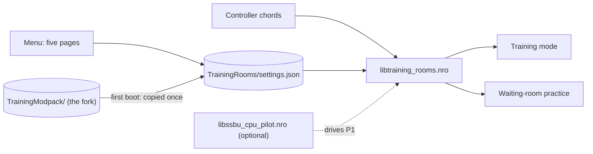
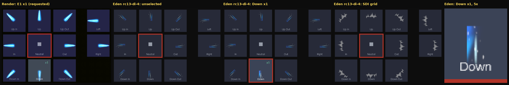
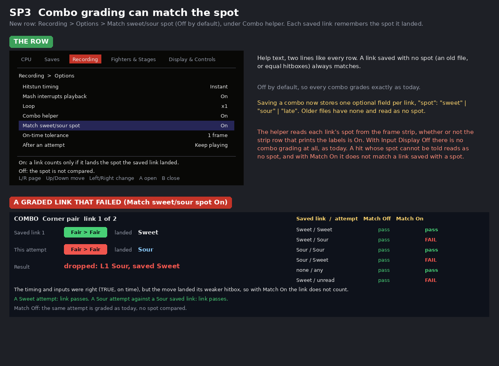
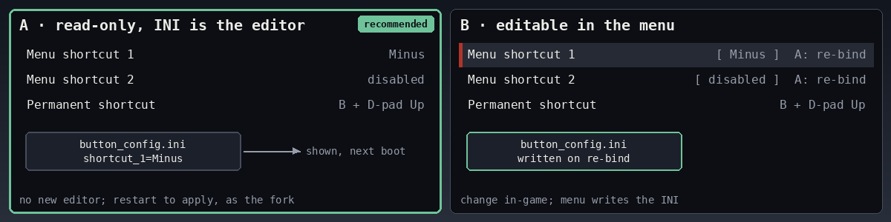

# Technical notes

How TrainingRooms works in Training and waiting rooms; see [Media](MEDIA.md) for clip provenance and [release history](CURRENT-RELEASE.md#earlier-releases) for earlier builds.

**Clip** [`rc14-menu-tour.gif`](media/rc14-menu-tour.gif): The TrainingRooms menu: the five pages, then Hitbox Visualization's checklist with Hitboxes, Grab boxes and Hurtboxes ticked, and a neutral air's hitbox

*Eden, 2026-11-15, rc.14 `17e50cd0` (diag NRO `addcdd7e`, footer 0.2.0-rc.14 · rc14 17e50cd0, log lines only), Training, Mario vs Palutena with nothing drawn; the menu on CPU, then Saves,
Recording, Fighters & Stages and Display & Controls; Hitbox Visualization opens a checklist (its help line: Tick what to draw. Windboxes: hits that push or pull without hitstun. Launch angles: where each hit sends.), A ticks Hitboxes, Grab boxes and Hurtboxes; back in Training
both fighters' hurtboxes are yellow pills; at 1/4 speed Mario's neutral air shows its red hitbox. Cuts inside are listed in [MEDIA.md](MEDIA.md).*

## Install

For the plugins and their install path, see [Getting started](guide/getting-started.md#installing).

*The first-boot import decision of 2026-11-01. Published replay captures are copied in the background with no size
cap; unfinished capture staging folders are skipped. Files in the blocking part are skipped if larger than 8 MiB.
The originals stay in place, and an existing destination file is never overwritten. [Decisions](DECISIONS.md)*

## Controls

See [menu navigation](guide/using-the-menu.md), [factory chords](menu/display-and-controls.md#button-chords), [fixed controls](guide/controls.md#fixed-buttons) and [build identification](CURRENT-RELEASE.md#which-build-is-mine).

**Clip** [`rc11-footer-tag.gif`](media/rc11-footer-tag.gif): the menu opens on two pages whose key hints end with `0.2.0-rc.6 · rc11 0c628724`

*Eden, 2026-11-12, rc.11 `0c628724` as shipped (diag NRO `bd0bc61b`), `docs-rd18-0c628724` `fx-footer-tag`: Training,
the menu on Fighters & Stages, R to Display & Controls, the menu closes. The tag is read from the frames (it isn't
logged). The cut is listed in [MEDIA.md](MEDIA.md).*

## Features in detail

Clips are Eden footage of the 0.2.0-rc.1 release NRO `706c993f`, recorded 2026-11-05, except those marked RC10 or with
their own build; see [MEDIA.md](MEDIA.md).

### Hitboxes and grab boxes

**Clip** [`rc14-hitbox.gif`](media/rc14-hitbox.gif): Hitbox Visualization's checklist with Hitboxes, Grab boxes and Hurtboxes ticked; the hurtboxes as pills; at 1/4 speed a neutral air's red hitbox, held

*Eden, 2026-11-15, rc.14 `17e50cd0` (diag NRO `addcdd7e`, footer 0.2.0-rc.14 · rc14 17e50cd0, log lines only), Training with nothing drawn; Display & Controls › Hitbox Visualization opens a checklist
(its help line: Tick what to draw. Windboxes: hits that push or pull without hitstun. Launch angles: where each hit sends.), A ticks Hitboxes, Grab boxes and Hurtboxes, B goes back; in Training the yellow hurtbox pills cover both fighters; R + D-pad Up steps the speed to 1/4, and Mario's short-hop
neutral air keeps its red hitbox on screen for over a second (the frame strip's lane turns red with it). Cuts inside are listed in [MEDIA.md](MEDIA.md).*

TrainingRooms draws fighter and projectile hitboxes with its own panes, projects them with the game camera at layout time, and draws capsules as single pills; see the [colour legend](menu/display-and-controls.md#colour-legend).

*The mock-up behind the rc.13 decision (2026-11-14): the left and middle panels are a capsule as a row of discs, the
right panel is the same capsules as one pill each. [Decisions](DECISIONS.md)*

| Strength and spot | Mechanism |
| --- | --- |
| Rank | `src/model/spots.rs::knockback` ranks launch; damage breaks ties, not angle. |
| Current frame | `classify` marks weaker active hitboxes Sour and stronger ones Sweet. |
| Earlier peak | `classify` marks a weaker phase Late; indistinguishable hitboxes have no label. |
| Attribution | `attribute` checks the game's recorded slot against received damage and knockback. |

### Frame strip

The input display (Display & Controls › Input Display) is a strip at the top of the screen: the last second of
Player 1 and the CPU, a chip for each new button, and ADVANTAGE, LINK, and INPUT for the last exchange. ADVANTAGE is
the CPU's first actionable frame minus yours. Plus means you act first. [FRAME-STRIP.md](guide/frame-strip.md)
is how to read the lanes, the stick row, and the readouts. The rc.5 clips are listed in
[MEDIA.md](MEDIA.md).

**Clip** [`rc8-input-display-chord.gif`](media/rc8-input-display-chord.gif): R + D-pad Down hides the frame strip, then shows it again

*Eden, 2026-11-11, the rc.8 integration head `d3eeac81` (diag NRO `9f8afc66`, log lines only): a jab on the frame
strip; R + D-pad Down, "Input display · Off", and the next jab draws no strip; R + D-pad Down again, "Input display ·
On", and the jab draws on it. Cuts inside are listed in [MEDIA.md](MEDIA.md).*

The [Input display binding](menu/display-and-controls.md#button-chords) and [menu row](menu/display-and-controls.md#input-display) share one saved setting.

Where the frame strip code is (moved here from the [Frame strip](guide/frame-strip.md) guide): the lanes, chips, freeze, readouts, the stick row, the C-stick arrow and the 20-frame rule are what `src/model/frame_strip.rs` draws, as specified in `specs/SPEC-input-06-frame-strip.md`.

| Strip detail | Mechanism |
| --- | --- |
| Link | `Tracker::on_hit`: follow-up hit minus CPU free frame; unknown if no free frame is available. |
| Input | `Tracker::on_hit` subtracts Player 1's first actionable frame from the follow-up press. |
| Step | `src/model/strip_scroll.rs::stepped` moves 15 columns per step. |
| Repeat | `Scroll::poll` repeats after 18 held polls, then every six. |
| Ownership | An open scroll hides its hold and direction buttons from the game. |

### Game speed

**Clip** [`rc11-game-speed.gif`](media/rc11-game-speed.gif): The same forward smash at x1, then, after R + D-pad Up steps the speed to 1/4, about four times slower

*Eden, 2026-11-13, rc.11 `0c628724` (diag NRO `bd0bc61b`, log lines only), in Training: from the same reset spot Mario
walks in and forward-smashes Ridley at x1; R + D-pad Up held, the pop-up steps x1 → 2/3 → 1/2 → 1/4 with D-pad Left;
the HUD's stopwatch reads 1/4; the same walk-in and smash play about four times slower. The log has
`[GameSpeed] … speed=1/4`. Cuts inside are listed in [MEDIA.md](MEDIA.md).*

The [speed control](guide/game-speed.md) stops at either end of the list rather than wrapping.

| Where | What the chord does |
| --- | --- |
| While you hold the chord | No other chord fires, and the chord's buttons and D-pad Left / Right don't reach the game. The rest of Player 1's controller still does, so you can keep moving. |
| **In Training** | The pop-up and Other Settings › Speed use the same setting: 1 Frame, 1/4, 1/2, 2/3, x1 or x1.5. In rc.15, when the frame-step checks pass at boot, Left from 1/4 selects 1 Frame and Right from 1 Frame selects 1/4. Release the chord and press ZL to advance one frame (L on a GameCube controller). If the checks fail, the pop-up skips 1 Frame. The stopwatch appears away from x1 and goes away at x1. |
| **In the waiting-room practice** | The same speeds, including 1 Frame when available, affect only your practice. The room's timers and the other player stay at normal speed. Each practice starts at x1. |
| A Quickplay or online match | It never changes one: a match always starts at normal speed. |
| **With the standalone CPU pilot** driving Player 1 | The chord works the same way. In the waiting-room practice the pilot still gets one input per game update at every speed, x1.5 included, so its inputs are never doubled. |

| Frame step | Mechanism |
| --- | --- |
| Hold | `src/model/lobby_speed.rs::FrameStep::poll` runs waiting-room practice continuously after 18 held polls. |
| Priority | The speed chord, another input owner, or busy room UI blocks stepping. |
| Hook | `src/runtime/features/game_speed.rs::frame_step_poll` publishes requests for the waiting-area task. |

**Clip** [`rc8-speed-hud-fixed.gif`](media/rc8-speed-hud-fixed.gif): Hold R + D-pad Up, Right: the stopwatch reads x1.5; Left back to x1: it goes away

*Eden, 2026-11-11, the rc.8 head `3f9d61dd` (diag NRO `61533917`, log lines only), in Training: x1 with no
stopwatch; R + D-pad Up held, Right, and the stopwatch reads x1.5; held again, Left back to x1, and it goes away.*

Both chords are rows of Display & Controls › Button chords ("Input display" and "Game speed"), editable and clearable
like the others. They wait while L is held unless the edited chord itself includes L; the default chords therefore
leave Online Deluxe's L + R + D-pad overlay chords alone.

With Online Deluxe 0.10.5 or later, a chord doesn't fire while Deluxe's window shows a page with rows (Settings, Window
Options, Plugins or a plugin's own page) if Deluxe uses its D-pad there.

| Deluxe uses its D-pad | When |
| --- | --- |
| Deluxe moves a row with D-pad Up/Down | Only when none of ZL, ZR, R and L is held |
| And changes a value with D-pad Left/Right | Only while ZR (without ZL) is held |

| Beside Deluxe's open page | What happens |
| --- | --- |
| ZR + Right on its CPU Pilot page | So it no longer also opens the Recording pop-up |
| ZR + Left (Play on Player 1) | Waits too |
| The other factory chords (Save and Load, Record, Playback, the cycles, Input display) | Work beside the open page (rc.12; before, every D-pad chord waited, and Save and Load did nothing while the page stayed open) |
| Its Performance view | Doesn't stop any chord, and the menu shortcuts still work |
| A Save or Load press that doesn't happen | Says why in a notice (Saves › Save States) |
| On a GameCube controller | Deluxe's L + R is both triggers: the ZL/ZR chords and the two chords above don't fire while both triggers are held, and one trigger works as before |

### Combos, in short

*+ Save last combo…* (Recording › Combos & Sequences) saves a combo you landed, and the combo helper grades your next
attempts against it, link by link. A sequence of combos is drilled the same way, one combo after another. Each saved
combo is a small JSON file in `sd:/ultimate/TrainingRooms/combos/`. You can edit it, copy it to another card or share
it, and any fighter can practise it; see the [sharing guide](guide/combos.md) or the [file format and clip](#combos-the-clip-and-the-files).

### CPU reactions

**Clip** [`rc13-di.gif`](media/rc13-di.gif): DI Down, then DI Up from the menu (the blue chips): the same forward smash launches the CPU low, then high. Eden, rc.13 (untested on hardware)

*Eden, 2026-11-14, rc.13 candidate `7d7b74c9` (diag NRO `134636ef…`, log lines only; rc.13 is untested on hardware), run
`gna-r13b-yoga-1`, Mario vs Donkey Kong; the CPU loads at 80% with DI Direction Down and takes Mario's forward smash
(19.0%) on a low line; CPU › Defence › DI Direction: the grid shows Down x1 at full tint and the other chips dim, Y clears
Down, A picks Up; the same load and smash (19.2%) launch it high. Cuts inside are listed in [MEDIA.md](MEDIA.md).*

DI, SDI, air dodge, shield tilt, mash, ledge, tech and throw options on the CPU page. Above: the same hit with DI Down
and with DI Up.

**Clip** [`rc13-di-sdi-chips.gif`](media/rc13-di-sdi-chips.gif): DI Direction from nothing picked to Up ×1, then SDI Direction the same. Eden, rc.13 (untested on hardware)

*Eden, 2026-11-14, rc.13 candidate `7d7b74c9` (diag NRO `134636ef…`, log lines only; rc.13 is untested on hardware), run
`gna-r13b-yoga-1`, the CPU page's Defence section: DI Direction reads 0 selected; A opens the grid on Neutral, every chip
dim; the cursor to Up, A, and "Up x1" under Selected with the Up chip at full tint; then SDI Direction the same way. Cuts
inside are listed in [MEDIA.md](MEDIA.md).*

The direction chips show the game's own DI line and SDI streak; each A adds weight to a chip. *In* and *Out* are
relative to you, on either side of the CPU.

*Left to right: design mock-up; DI with no direction picked; DI with Down picked once; SDI; and a 5× enlargement
of Down. The last four panels are from Eden. The thinner, dimmer lines are the look kept for rc.13.
[DI chip decision](DECISIONS.md#rc13-di-lines-di-chips-like-the-game-s-blue-di-indicator-rc-13-item-2-e1-x1)*

*CPU Level* (CPU › Level: Off, or Lv 1–9) replaces Training's own CPU level. When the two differ as Training starts, a
notice says so once.

**Clip** [`rc11-cpu-level.gif`](media/rc11-cpu-level.gif): CPU Level set from Off to Lv 7; the CPU card at Lv. 3; the notice names both levels; the CPU fights at Lv 7

*Eden, 2026-11-13, rc.11 `0c628724` (diag NRO `bd0bc61b`, log lines only), CPU › Level › CPU Level from Off to 7 in the menu; the character select's CPU card
(Donkey Kong) reads CPU Lv. 3; in Training the notice reads "Lv 7 from TrainingRooms (Training menu: Lv 3)" (one
judged line and one notice in the log); Training's CPU Behavior goes from Stop to CPU (Lv. 3), and Donkey Kong fights
Mario from 0% to 28%. Cuts inside are listed in [MEDIA.md](MEDIA.md).*

### Save states and respawn

**Clip** [`rc10-save-load.gif`](media/rc10-save-load.gif): Save at a new spot, a smash sends the CPU away, then Load puts both fighters back

*Eden, 2026-11-12, rc.10 `32ee7595` (diag NRO `79922abe`), `docs-rd12-32ee7595`
`fx-save-load`: Mario steps left and ZL + D-pad Down saves ("Saved Slot 1"); he walks back and forward-smashes Mewtwo
(10%); ZL + D-pad Up puts both where Save was pressed, Mewtwo at 0%, and nothing plays. The log: `state saved slot=1`,
`state load_request`, `state placed`, no playback line. The cut is listed in [MEDIA.md](MEDIA.md).*

**Clip** [`rc7-respawn-on.gif`](media/rc7-respawn-on.gif): Respawn on platform turned On, then a fall off the stage: back on the revival platform

*Eden, 2026-11-11, rc.7 `722525a5` as shipped (diag NRO `cfec85c7`, log lines only): Fighters & Stages › Stages ›
Respawn on platform from Off to On; Player 1 runs off the left side and is KO'd; Player 1 comes back on the revival
platform at the top. Cuts inside are listed in [MEDIA.md](MEDIA.md).*

Named save states (one bound to Save and Load at a time), mirroring and damage on load (Saves page). *Respawn on platform* (Fighters & Stages ›
Stages) chooses between the game's respawn platform (above) and the instant respawn.

*Design picture of decision TR5 (2026-11-13), not footage. Its middle panel shows rc.11, where the row was ignored
with Save States Off. B was decided: since rc.12 the row works whatever Save States says. [Decisions](DECISIONS.md)*

### Recording and playback

A save state only warps, and Load starts nothing. Each role has one active macro, a recording or a chain, and
that role's Play chord plays it without warping back on later loops. In the Recording page's main lists, Y does
nothing. X cycles the selected role's loop count in MACROS. On a drill with a saved, nonempty take, X requests
a preview on Player 1. It does not interrupt a Play already queued or running for Player 1.
The [Recording guide](guide/recording.md) is how to use it. The pop-up and the Recording page are in that doc.
What rc.6 changes is [RELEASE-NOTES-rc6.md](RELEASE-NOTES-rc6.md).

While a macro plays on the CPU, the recording wins over the CPU's DI, SDI, air-dodge, tech and throw settings.
The advanced row [Settings override playback](menu/recording.md#settings-override-playback), Off by default, turns
that round.

*Design picture of decision B5 (2026-11-01), not footage: B, the recording wins, with the advanced row for A.
[Decisions](DECISIONS.md)*

Where the recording code is (moved here from the Recording guide; named by function, not line, because the lines move):

| Part | Where |
| --- | --- |
| The playback machine, the files, the grades, the chords and the migration | `src/model/playback.rs`, `src/model/library/`, `src/model/combo.rs`, `src/model/drill.rs`, `src/model/chords.rs` and `src/model/library/migrate.rs` |
| The pop-up, the Recording page and the file screens | `src/model/recording_menu.rs` and `src/model/ui/frame.rs` |
| Record, Play and the pop-up chord | Are applied in `src/model/rr_host.rs` |
| The start save | Keeps the recorded fighter's facing and speed in `note_record_start` (`rr_host.rs`) |
| Momentum | Is `play_start_speed` (`rr_host.rs`) and `apply_start_speed` (`src/runtime/features/recording_host.rs`) |
| Mash interrupts playback | Stops the CPU's macro through `note_mash` and the `MASH` flag in `rr_host.rs` |
| Placement picker | Change placement and Place fighters before Record share `Wizard` in `src/model/record_place.rs`. The fighter-frame code is in `src/runtime/features/record_place.rs`. |
| Placement on and off stage | `tech::floors` supplies traced floors for `src/model/floor_hop.rs`. Switching to Off stage uses `off_stage_spot` and the rules in `src/model/stage_geometry.rs`. |
| Saving and applying placement | In `rr_host.rs`, `commit_placement` writes the edited fields, `active_placement_ids` finds the active macro and its start save, and `warp_pair` applies the macro's offset. |
| Replay window | `Owners::REPLAY_LOADING` in `src/model/input_delay.rs` lets a capture load without blocking its own request. It is not the visible editor's fighter-switch gate. |
| Replay fighter mismatch | A chain checks its first macro (`screen=mismatch ask=macro1`). For a replay Mii, `installable` in `src/model/mii_install.rs` supplies a configuration the game can load. |
| [Named setup actions](guide/save-states.md#using-a-setup) | `Pane::leads_to` in `src/editors/setups.rs` distinguishes opening, restoring and binding; `src/model/state/setup_transaction.rs` validates the restore. |
| Setup files | `src/model/state/setup.rs` defines the format. Saving creates a new file; renaming updates the existing file and keeps its ID (`save_name` in `src/editors/setups.rs`). |
| Setup menus | `src/runtime/ui/setups.rs` and `src/editors/setups.rs` handle the library screens; `src/runtime/features/states/setups.rs` takes the snapshot. |
| Pop-up layout | `src/model/ui/panes.rs` defines the layout. `section_view` in `src/model/recording_menu.rs` puts the divider after the fifth file when more than five are listed, except in RECORDINGS. Leading action rows do not count as files. |

| Scrub data | Mechanism |
| --- | --- |
| Positions | `src/model/macros/positions.rs` stores both fighters in `<id>.pos`, bound to macro ID and inputs. |
| Playback sampling | `rr_host.rs::open_play_track` samples matching fighters from frame zero, excluding chains. |
| Backfill | `PlayTrack::write_wanted` can replace a shorter recorded track with a longer partial playback. |
| Pose upgrade | A full playback can add poses without replacing complete, move-less recorded positions. |
| Crop | `ClipEditor::export_selection` retains the selected macro frames and their tracked positions. |
| Origin | `scrub_track.rs::deltas` subtracts the selected fighter's position at the anchor frame from both tracks. |
| Poses | `scrub_pose.rs::{asked_of,decide}` needs an available animation, matching fighter kind and held body. |
| Marks | `src/model/macros/recording.rs::ActionMark` stores move, variant and side-attack angle. |
| Naming | `clip_panel.rs::saved_namer` uses recorded fighter identity, including saved Mii specials. |
| Older takes | `clip_marks.rs::Marks::from_recording` falls back to input marks without valid saved actions. |

| Playback detail | Mechanism |
| --- | --- |
| Trim | `src/model/trim.rs::Trim::window`: global trim affects recording; file trim selects playback frames. |
| Delay | `rr_host.rs::owe_delay` waits once before first input, not on loop passes. |
| Preview | Editor previews and CPU Playback slots do not use the Play delay. |
| Tolerance | `src/model/combo.rs::Grade::worst` applies the selected tolerance and held-input band. |
| Clip window | `src/model/macros/window.rs::Window` bounds handles; `clip_panel.rs::export_selection` applies the selection. |
| Legacy slots | `src/model/library/migrate.rs::migrate` converts nonempty live slots once, separately from card import. |

*PC5: change the shared save or copy it. Design, not footage.*

| Shared placement | Mechanism |
| --- | --- |
| Copy from a macro | `rr_host.rs::copy_placed` copies the save and relinks only the requesting macro. |
| Copy from the save | The new save is unlinked; existing macros keep the original. |

*PC6: moving the save preserves the offset. Design diagram.*

| Start save | Mechanism |
| --- | --- |
| Warp | `rr_host.rs::warp_pair` applies the macro offset to its role before restoring the pair. |
| Momentum | `play_start_speed` supplies recorded or zero speed after the warp, before first input. |

*Q7: the menu shares the replay setting. Design, not footage.*

| Replay capture | Mechanism |
| --- | --- |
| Archive | `src/runtime/macros/replay_store.rs::archive` uses `sd:/ultimate/TrainingRooms/replay_captures/`. |
| Miis | `SharedCaptureArchive::save_with_miis` stores available replay Mii data with the capture. |
| Preference | `replay_capture.ini` seeds the preference shared by the menu and Online Deluxe. |

Earlier replay checks: `cov-replay-window` passed on `646a5f0d`; the Mii install checks were `cov-named-mii` and
`int-named-mii-twice`. These are historical checks, not preview-build results.

**Clip** [`rc10-record-play-cpu.gif`](media/rc10-record-play-cpu.gif): Record on Player 1, then Play on CPU: the CPU does the recorded moves

*Eden, 2026-11-12, rc.10 `32ee7595` (diag NRO `79922abe`), `docs-rd12-32ee7595` `fx-record-play-cpu` (take 3): ZR + D-pad
Down records Mario's jab, dash and forward smash, ZR + D-pad Down stops; ZR + D-pad Up warps both fighters to the
recording's start save, and Mewtwo plays the same inputs (a dash and a forward smash in the recorded direction). Two
things are cut out: the CPU's pick of the new recording (the pop-up's pick, made in `recording-index.json` by the
harness: Record makes the new macro active for the recorded role only) and the Fighter Mismatch question (Keep). The
log: `screen=recording role=player recording=1`/`=0`, `screen=playback role=cpu warp=1`, `[RecordingHost]
start_observed slot=1`, then the CPU's status changes. The windows are listed in [MEDIA.md](MEDIA.md).*

**Clip** [`rc7-record.gif`](media/rc7-record.gif): Record on Player 1: an empty library, two jabs, then Macro 1 and its start save

*Eden, 2026-11-11, rc.7 `722525a5` as shipped (diag NRO `cfec85c7`, log lines only): the pop-up lists no saves and no macros; Record
on Player 1 and two jabs; the pop-up then lists "Macro 1" (Recorded on Mario) and its start save "Macro 1 · start".
Playback is shown in the [Recording guide](guide/recording.md). Cuts inside are listed in [MEDIA.md](MEDIA.md).*

While an AI drives Player 1, for example the standalone CPU pilot, Record works (changed 2026-11-25): the take holds
Player 1's inputs as the game receives them, the AI's included, and TrainingRooms' own P1 CPU Control keeps playing
through the take. Play on Player 1 and the waiting room's Quick Reset are refused ("P1 is controlled by an AI: Play
on Player 1 is off", "… Quick Reset is off"), and Player 1's input is left to the pilot.

### Combos: the clip and the files

**Clip** [`rc7-combo-helper.gif`](media/rc7-combo-helper.gif): The combo helper grading a drilled combo: Combo 1, jab → jab, TRUE −5, on time

*Eden, 2026-11-11, rc.7 `722525a5` as shipped (diag NRO `cfec85c7`, log lines only): the pop-up's COMBOS with Combo 1
(jab → jab) drilled; the jabs; the bar under the frame strip grades the attempt: TRUE −5, on time. Cuts inside are
listed in [MEDIA.md](MEDIA.md).*

*+ Save last combo…*, the first row of COMBOS on the Recording page and in the recording pop-up, keeps your last combo
as a file and makes it the drill. With *Combo helper* On, a bar under the frame strip grades each attempt link by link:
whether the recorded inputs came, in order and on time, and whether the same move came out. A true combo is shown,
not required. Drilling a sequence adds a header and a row of its combos to that bar.

Where the combo code is (moved here from the [Combo files](guide/combos.md) guide): the spec is
[SPEC-input-07](../specs/SPEC-input-07-combo-helper.md). The drill is kept in `recording-index.json`, the recording
index (`src/model/library/hot.rs`). The menu re-reads the combo folder each time it opens, so a copied-in file needs no
restart (`src/model/recording_menu.rs`). A combo drill's Fighter Mismatch question is `ask_drill` in
`src/model/rr_host.rs`.

| Combo file | Format | Rules |
| --- | --- | --- |
| Codec | `src/model/combo_record.rs::{from_value,to_value}` reads and writes JSON objects. | Maximum 64 KiB. |
| Location | `sd:/ultimate/TrainingRooms/combos/<id>.json`; filename is the persistent ID. | `shareable_id`: 1–64 characters; no leading dot, surrounding spaces, controls or FAT-invalid characters. |
| Name | Up to 48 characters; missing or blank names use the filename. | Optional `recorded_on` names the fighter and can trigger the mismatch prompt. |
| Versions | 1: hit combo; 2: drill; 3: hit with aims; 4: drill with aims. | Missing `schema_version` means 1. |
| Root | Hit combos have `links`; drills have `kind: input_drill` and `input_steps`. | 1–16 links or steps. |
| Identity | Optional `recorded_fighter`: nonzero `ui_chara` (1–10 hex digits) and four `specials`. | Each special is 0–2; invalid identity becomes absent. |
| Source | Optional `made_from`, `take` and drill `trim`. | `take` names the owned macro; trim is `start`, `end`, `both` or `off`. |
| Hit link | `from`, `to`, `verdict`, and `steps` or `events`; optional `window`, `spot`, `drift`. | Window is a pair of frame numbers. |
| Verdict | `kind` is `true` or `drop`. | `link` is nullable only for `true`. |
| Endpoints 1 | `jab`, `dash_attack`, `side_tilt`, `up_tilt`, `down_tilt`. | `side_smash`, `up_smash`, `down_smash`, `aerial`, `other`. |
| Endpoints 2 | `neutral_special`, `side_special`, `up_special`, `down_special`. | `grab`, `throw`, `ledge_attack`, `getup_attack`, `trip_attack`. |
| Descriptions | `from_shown`, `to_shown`: optional `of`, `angle`, `variant`, `move`. | Both describe a hit link; angle is `up`/`down`, variant 0–31. |
| Exact move | A hit description's `move` extends an `other` endpoint. | Final Smash uses `other` plus `move: final_smash`, never a bare endpoint. |
| Steps | At most four `button`, `aim`, `offset` objects; required without `events`. | Buttons: `attack`, `special`, `jump`, `shield`, `grab`; aims: `neutral`, `up`, `down`, `side`. |
| Hit offsets | Frames from Player 1's first actionable frame after this link's first hit. | Negative offsets mean buffered inputs; `events` takes precedence over `steps`. |
| Events | At most 12 per link; each has `kind`, `dir`, `offset`. | Kinds: `press`, `release`, `cstick`, `flick`; `aim` requires version 3 or 4. |
| Event fields | Press/release use `button`; flick uses `flick`; aim uses `part` 1 or 2. | Flick values: `fast_fall`, `dash`, `tap_jump`. |
| Directions | `neutral`, `forward`, `forward_up`, `up`, `back_up`. | `back`, `back_down`, `down`, `forward_down`; relative to facing. |
| Spot and drift | `spot` is `sweet`, `sour` or `late`; `drift` uses a direction. | Unknown spot becomes absent; drift is display-only. |
| Drill steps | Each has 1–12 events; descriptions require `move`. | Offsets start at zero and never decrease across steps. |
| Release | Optional `hold` is nonnegative; drill releases may contain boolean `reacted`. | Without `reacted`, older held releases use the legacy hold-band rule. |
| Travel | Drill aim, special press and C-stick events can carry `path`. | Eight integer coordinate pairs, each component −127 to 127. |
| With a path | `heading` and `distance` are required; optional `stick` requires `angle` and `deflection`. | Angles: 0 to below 360 degrees; distance nonnegative; deflection 0–100 percent. |
| Entry | Optional `entry_x`, `entry_y`, `entry_change` describe travel entry velocity. | Both coordinates are required together. |
| Compatibility | An unsupported version or unrecognized endpoint skips the entire file, not just the link. | Rename preserves unknown top-level, link, step and event fields. |

| Scoring | Specification |
| --- | --- |
| Model | [Action model](design/action-model.md) describes scoring, reacted releases, joins and recovery. |
| Spot | `summarize` compares spots only when matching is enabled and the reference has a spot. |

*SP4: a saved spot can affect the grade. Design, not footage.*

**Clip** [`rc7-sequence-drill.gif`](media/rc7-sequence-drill.gif): Drill a sequence: combo 1, then combo 2, then a drop back at combo 1

*Eden, 2026-11-11, rc.7 `722525a5` as shipped (diag NRO `cfec85c7`, log lines only): combo 1 lands, combo 2
starts, then a wrong move (up tilt) drops the sequence back to combo 1.* See [MEDIA.md](MEDIA.md).

### Fighters, cycles and Kirby hats

**Clip** [`rc11-cycle-switch.gif`](media/rc11-cycle-switch.gif): Character Cycles: the order badges, then each press of the cycle chord switches Player 1 in that order

*Eden, 2026-11-13, rc.11 `0c628724` (diag NRO `bd0bc61b`, log lines only), Player Swapping On; the grid's red badges number Player 1's order (Mario 0, Donkey
Kong 1, Link 2, Ness 3) and the blue ones the CPU's; in Training against Ryu (outside the cycle), each press of
ZL + D-pad Right switches Player 1 to Donkey Kong, Link, then Ness, each standing clear of the notice. Cuts inside are listed in [MEDIA.md](MEDIA.md).*

| Cycle chord | Rule |
| --- | --- |
| Both | Step through your own order of fighters for that role (red for Player 1, blue for the CPU), drawn with the game's stock icons |
| The CPU's | Does not require Player Swapping. Neither cycle chord switches a fighter while the menu owns the input or another shortcut is pending |
| Player 1's | Works only while Fighters & Stages › Player Swapping is On. It's Off at first |

With [fighter preloading](menu/fighters-and-stages.md#loading) enabled, eligible fighters load before you switch.
With Cycle Preload Off, the fighter loads when you switch instead.

| When | What happens |
| --- | --- |
| Training starts | Each role starts with the fighters its preload settings allow |
| While you play | Eligible groups build in the background within the Ready Fighters limit. In the [rc.6 Eden measurements](RELEASE-NOTES-rc6.md#fighters-load-hot), switching into a ready group took about 50–70 ms; this was not a preview-build timing |
| A cycle changes in Training | Preloading starts for eligible newcomers; they are not necessarily ready on that frame |
| Fighters leave a cycle | They are freed when you next open the pause menu, or right away if the new ones need their room (a brief pause) |
| You leave a Mii for a group already built | A warm switch, not a reload |
| Kirby is on screen | The build waits if the game still handles Kirby's copy-loading step. Kirby alone does not block it when the fighter bank handles that step |
| A Mii is on screen | A second Mii group waits. Other groups also wait if the loader has not identified the ordinary fighter group the Mii replaced |
| No. of CPUs is raised | The CPU cycle's next fighters come in, a saved Mii included |

`background_build_eligible` in `src/model/swap/body_bank.rs` also checks the target group's identity and the
support needed for paired fighters. `live_kirby_gate` in `src/runtime/roster/native_body_bank.rs` supplies the Kirby check.

| Loading | Mechanism |
| --- | --- |
| Items | `src/runtime/roster/character_items.rs::on_frame` prepares fighter resources before granting non-common items. |
| Common items | `common_item` exempts Bob-ombs, Mr. Saturns and bananas from that preparation. |
| Ready Fighters | `src/model/swap/body_bank.rs::GroupBudget` includes both active fighters in the shared body budget. |
| Admission | `body_bank/memory.rs::admit` reserves estimated load costs and headroom before discretionary loads. |
| Cold targets | One-body cold targets load over budget and `cold_left` releases them after departure. |
| Cold transition | A cold-to-cold switch can temporarily load two bodies over budget. |
| Shrink | `shrink_release` frees the farthest group first, CPU first on ties. |
| Hats | `src/model/preload/hat_slots.rs::budgeted` budgets hat-only targets separately; matching fighter targets share. |

| Swap group | Keeps ready | Greyed when |
| --- | --- | --- |
| Ice Climbers pair bank | Pair and one additional fighter in the role's window. | Ready Fighter Bodies is not 3. |
| Original fighter bank | Eligible starting fighter; Miis and Solo Popo reload. | Never. |
| Solo Popo groups | Solo Popo in detached groups. | Group Swap is Off. |
| Ice Climbers pair groups | Detached groups while the pair leads the window. | Group Swap or pair bank is Off. |
| PT / Aegis groups | Pokémon Trainer and Pyra / Mythra as complete groups. | Group Swap is Off. |
| Ice Climbers pair group | The pair as its own detached group. | Group Swap or pair bank is Off. |
| Mii groups | One Mii group per role. | Group Swap is Off. |

| Group policy | Mechanism |
| --- | --- |
| Capacity | Pokémon Trainer needs three bodies; Aegis needs two, allocated whole. |
| Original eligibility | `original_form_bankable`: paired Climbers need pair bank; PT and Aegis need native groups. |
| Menu gates | `src/model/menu/mod.rs::swap_entry_grey` checks the conditions above. |
| Defaults | `src/model/preload/cycle_preload_config.rs` enables all seven entries. |

**Clip** [`rc7-kirby-hats.gif`](media/rc7-kirby-hats.gif): Player 1's Kirby: the hat chord twice, two hats in turn

*Eden, 2026-11-11, rc.7 `722525a5` as shipped (diag NRO `cfec85c7`, log lines only): Player 1 is a plain Kirby; the hat
chord gives Falco's hat, and again Sheik's.*

Kirby hats change with a chord, for Player 1 or the CPU.

### Mii fighters

Each Mii class (Fighters & Stages › Extras › Mii Brawler, Swordfighter, Gunner) lists your saved Miis per role; ZR switches
Player and CPU. More: [MII.md](MII.md).

| In the list | Result |
| --- | --- |
| *Add New…* | Opens Smash's own Mii Fighter editor from Training |
| Save a new configuration | Creates a new Mii and leaves the others untouched |
| Leave without saving | Creates nothing |
| Save a Mii you already have | Saves nothing new and says "Same as ‹saved name›, nothing new saved" |

**Clip** [`rc6-mii-same.gif`](media/rc6-mii-same.gif): Add New, then Save with the copy unchanged: nothing new is saved

*Eden, 2026-11-10, rc.6 `e6501ac6` (diag NRO `c1b9f694`, log lines only): the Mii Brawler list (three Miis), Add
New…, Smash's Mii editor on a copy of the class's Mii, Save at once. Back in Training, the notice reads "Same as 格斗,
nothing new saved". The row checked that every Mii file stayed byte-identical. Cuts inside are listed in
[MEDIA.md](MEDIA.md).*

**Clip** [`rc7-mii-editor.gif`](media/rc7-mii-editor.gif): Add New, two new specials, Save: the new Mii is listed, picked, and played

*Eden, 2026-11-10, rc.7 `7d720c68` (diag NRO `a45ba951`, log lines only): Add New… opens Smash's Mii editor. Neutral
Special 2 and Side Special 2, then Save. The Mii Brawler list gains "4. 格斗 [2211]"; A picks it and the "> " moves to
it. In Training, Player 1 is that Mii Brawler, and B is its new neutral special. The row checked that exactly one new
Mii file was written. Cuts inside are listed in [MEDIA.md](MEDIA.md).*

### Stages

**Clip** [`rc11-change-stage.gif`](media/rc11-change-stage.gif): Change Stage: A on Battlefield (Ω), then the stage morph to Battlefield Ω

*Eden, 2026-11-13, rc.11 `0c628724` (diag NRO `bd0bc61b`, log lines only), Mario vs Ryu on the training stage; the Change Stage grid with Battlefield (Ω) picked,
A; "Practice Stage · Stage requested"; the static 2.8 s wait before the morph is cut; then the whole morph to
Battlefield Ω (`[PracticeStageRequest] native_complete`) and its "Stage ready" notice. Cuts are listed in [MEDIA.md](MEDIA.md).*

| Row (Fighters & Stages › Stages) | What it does |
| --- | --- |
| Change Stage | Goes to the stage you pick when the menu closes, in Training and in waiting-room practice. Y picks its form first |
| Lobby Stages | Rotation sets the order for new waiting rooms; Direct uses the single stage you pick instead. Both apply to waiting rooms with Lobby Practice On |
| Training Stage Rotation | Off by default. When On, Training opens on the stage you picked, then advances through the Rotation list when you return through character select, even if Lobby Stages is set to Direct |

**Clip** [`rc11-lobby-stages.gif`](media/rc11-lobby-stages.gif): Lobby Stages: A on Battlefield adds it as number 2

*Eden, 2026-11-13, rc.11 `0c628724` (diag NRO `bd0bc61b`, log lines only), Fighters & Stages ›
Lobby Stages; the grid with 1. Big Battlefield; the cursor to Battlefield, A, and the tile reads "2. Battlefield". Cuts inside are listed in [MEDIA.md](MEDIA.md).*

**Clip** [`rc11-stage-rotation.gif`](media/rc11-stage-rotation.gif): Training Stage Rotation from Off to On; the next Training entry, the same fighters, opens on Big Battlefield

*Eden, 2026-11-13, rc.11 `0c628724` (diag NRO `bd0bc61b`, log lines only), Mario vs Donkey Kong (the CPU's character-select coin pinned) on the training stage;
Lobby Stages ranks 1. Big Battlefield and 2. Battlefield; Fighters & Stages › Training Stage Rotation from Off to On;
back through the character select (the same two fighters), Training opens on Big Battlefield, held with no notice. Cuts inside are listed in [MEDIA.md](MEDIA.md).*

*Design picture of decision T3, not footage. [Decisions](DECISIONS.md)*

| Practice geometry | Mechanism |
| --- | --- |
| Drill floor | `src/model/edge_juggle.rs::start_stage` uses the floor run under Player 1. |
| Guard ledges | The drill requires at least one run end with open air. |
| Egg floors | `eggs.rs::Run::spawn` weights usable floor spans by horizontal width. |
| Egg height | An airborne start adds up to 25 units above that target's grounded height. |
| Egg zones | `src/model/egg_zone.rs::Stage::read` uses the run under camera center. |
| Zone boxes | `Zone::rect` insets each side's rectangle by the target radius. |
| Zone clipping | `Stage::contains` rejects solids and checks underside, other floors and outline clearance. |
| Off-stage bounds | Open air stops at another solid or the blast boundary; `Stage::contains` validates points. |
| Hidden CPU | `eggs.rs::choices` selects the disc when CPU page Hide CPU is On. |
| Training CPU behavior | `cpu_level.rs::step_drill_panel` can briefly open stock pause for Control or non-CPU transitions. |
| Waiting-room opponent | `step_drill_partner` changes only the first partner's behavior, restoring it on Stop without pausing. |
| Tech Auto start | `tech::solver::Aim` plans zero-stick flight; early collisions or out-of-bounds paths reject candidates. |
| Ceiling contact | `Aim::at` rejects ceiling contact unless the predicted vertical velocity is upward. |

### Waiting rooms

**Clip** [`rc6-waiting-partners.gif`](media/rc6-waiting-partners.gif): Training Partners 1 to 2 in a Quickplay waiting room: a second partner drops in

*Eden, 2026-11-10, rc.6 `e6501ac6` (diag NRO `c1b9f694`, log lines only), a Quickplay room hosted in Eden: one partner
standing; the game's own waiting-room menu, Training Partners 1, Right to 2; a second partner drops in, and both stand
(Training Partner Behavior: Stop).*

**Clip** [`rc11-waiting-reentry.gif`](media/rc11-waiting-reentry.gif): Training Partners 2 and Stop in one room; leave; the next room starts with two partners, standing still

*Eden, 2026-11-13, rc.11 `0c628724` (diag NRO `bd0bc61b`, log lines only), the guest of a Local Wireless room hosted in Eden (`docs-ldn2-0c628724`), Lobby Practice On: in the room, Plus opens the game's panel: Training Partners 1 → 2, Behavior Stop; the
guest leaves the room (Yes) and rejoins the host's next room (the host's approval); it opens with two partners
standing still. The log: `[LobbyPersist] entry saved=Saved { partners: Some(2), behavior: Some(1) }` on entry. Cuts inside are listed in [MEDIA.md](MEDIA.md).*

| In a waiting room | Rule |
| --- | --- |
| The menu | Works in local wireless and Quickplay waiting rooms when Fighters & Stages › Stages › Lobby Practice is On. On is the default; a saved Off stays Off |
| Training partners and CPU action | What you set in the game's own waiting-room menu is remembered for the next room |
| The partners' level | CPU › Level › CPU Level |
| Leaving a Quickplay room before the match | Close the TrainingRooms menu so Plus reaches the game. The separate QuickPlay cancel fix plugin keeps Pause › Leave Battle available for a few seconds after you join |

With the CPU pilot plugin 0.2.3 (`libssbu_cpu_pilot.nro`), the pilot can also drive Player 1 in Quickplay's
waiting-room practice:

| With the pilot driving Player 1 | What happens |
| --- | --- |
| Arming | From its CPU Pilot page, as in Training |
| On screen | The practice shows no `CPU Lv` tag |
| When a match is found | The pilot keeps Player 1 in the match |
| Record | Records Player 1's inputs as the game receives them, including the pilot's inputs |
| Refused in waiting-room practice | Play on Player 1 and Quick Reset (L + R + A) |
| Game speed | The pilot does not disable the practice speed chord. [Waiting-room speed and frame step](guide/game-speed.md#in-the-waiting-rooms) |

**Clip** [`rc11-lobby-combos.gif`](media/rc11-lobby-combos.gif): Save last combo in a Local Wireless waiting room, then the helper bar drills it and grades a try

*Eden, 2026-11-13, rc.11 `0c628724` (diag NRO `bd0bc61b`, log lines only), the guest of a Local Wireless room hosted in Eden (`docs-ldn2-0c628724`), Lobby Practice On: Sheik's jab > jab on the Mario partner (the strip's LAST: DROP +3); Recording ›
Combos & Sequences, *+ Save last combo…* adds Combo 1 (recorded on Sheik); A drills it; back in the room the helper
bar shows Combo 1; the next jab > jab links: TRUE −1, "1 of 1 true", held (the strip zoomed along the bottom). Cuts inside are listed in [MEDIA.md](MEDIA.md).*

**Clip** [`rc14-waiting-menu.gif`](media/rc14-waiting-menu.gif): In a Local Wireless waiting room, the menu on Display & Controls, Hitbox Visualization with Hurtboxes ticked, and both practice fighters drawn as yellow pills

*Eden, 2026-11-15, rc.14 `400e2c69` (diag NRO `99feb831`, footer 0.2.0-rc.14 · rc14 400e2c69, log lines only), the guest of a Local Wireless room hosted
in Eden, the waiting room as the boot's first practice: the menu on Display & Controls, Hitbox Visualization 0 of 6; its checklist, Hurtboxes ticked (1 of 6); the menu closes and both practice
fighters show their hurtboxes as pills. The first second (the CPU page) is a separate recording cut in. Cuts inside are listed in [MEDIA.md](MEDIA.md).*

### Menu navigation

**Clip** [`menu-section-jump.gif`](media/menu-section-jump.gif): ZL + Down jumps through the CPU page's sections

*Eden, 2026-11-05, `p23/menu-nav` diag NRO `1273c29f`, the navigation code rc.3 merged.*

For section jumps, reopening and page resets, see [Using the menu](guide/using-the-menu.md#open-change-and-close).

### The Developer page

A sixth page, after Display & Controls, for testing the plugin itself. It shows only when
`sd:/ultimate/TrainingRooms/developer.ini` holds exactly one `developer_page=on` line (read once at boot; anything
else keeps it hidden, decision N1). While it's hidden its rows do nothing. All three start Off:

| Row | What it does |
| --- | --- |
| Preload Samples | Writes sparse timing and memory samples of preloads to the diagnostics file. |
| Reload developer config | While On, holding L + R + A on Player 1 re-reads the developer config file every frame. |
| Debug hooks | Turns on the debug watch on the Kirby backshield work float. |

### Menu shortcuts and replay capture

**Clip** [`rc11-menu-shortcut.gif`](media/rc11-menu-shortcut.gif): Menu shortcut 1 changed from Minus to ZL + D-pad Up, which then opens the menu

*Eden, 2026-11-13, rc.11 `0c628724` (diag NRO `bd0bc61b`, log lines only): Display & Controls › Menu shortcut 1 reads
Minus; A opens the chord editor, X starts the capture, ZL held with D-pad Up gives "ZL + D-pad Up", A confirms
(`button_config.ini written`); back in Training, Minus opens nothing (no `[Ui] menu opened`), and ZL held (Mario
shields) with D-pad Up opens the menu. Cuts inside are listed in [MEDIA.md](MEDIA.md).*

Menu shortcut 1 and Menu shortcut 2 can be changed in the menu. B + D-pad Up is permanent.

*Left (A, marked “recommended”): the rejected read-only design. Right (B): the design chosen on 2026-11-01.
Confirm a new shortcut in the menu and it applies at once; the menu writes `button_config.ini`.
[Shortcut decision Q9](DECISIONS.md#q9-menu-shortcuts)*

**Clip** [`rc11-replay-window.gif`](media/rc11-replay-window.gif): A capture cropped in the Replay window and saved; played on the CPU, which becomes the recorded Mii Gunner and replays the moves

*Eden, 2026-11-13, rc.11 `0c628724` (diag NRO `bd0bc61b`, log lines only): Recording › Replays › Replay window opens a
capture (Mario vs Mii Gunner, 180 frames; a test fixture made before the clip) on the Mario track; the Mii Gunner
track; L/R crop it to 13–170; A saves it as a macro ("Named Macro · Saved Gunner jabs"); Play on CPU asks Fighter
Mismatch, Switch to recorded fighter reloads the CPU as the capture's Mii Gunner ("Saved Mii applied"), and the
Gunner plays the cropped inputs (the CPU lane fills). Cuts inside are listed in [MEDIA.md](MEDIA.md).*

**Clip** [`rc11-replay-capture.gif`](media/rc11-replay-capture.gif): Replay capture turned On in the menu, then the same setting On in the Online Deluxe overlay (zoomed)

*Eden, 2026-11-13, rc.11 `0c628724` (diag NRO `bd0bc61b`, log lines only), with the card's Online Deluxe: Recording ›
Replays › Replay capture from [OFF] to [ON]; back in Training, L + R + Down opens the Online Deluxe overlay at the top
right (shown enlarged in the middle of the clip), and its Player Info page reads "Training Rooms › Replay capture On".
The card's Deluxe config hides that page; the take showed it for the clip and hid it again. Cuts inside are listed in
[MEDIA.md](MEDIA.md).*

The *Replay capture* row and the Online Deluxe overlay show the same setting.

## Status

See [Current release](CURRENT-RELEASE.md) for the installed build, changes and known issues in rc.15.

## Build

See [Building TrainingRooms](BUILD.md) for the host checks, toolchains and Switch builds, or the [handoff](../HANDOFF.md) for acceptance results.

## License and provenance

MIT ([LICENSE](../LICENSE)). This is a clean-room implementation inspired by the Training Modpack
([jugeeya/UltimateTrainingModpack](https://github.com/jugeeya/UltimateTrainingModpack)), which publishes no license:
its features were re-specified from observable behaviour and none of its code, layouts or artwork is used. Code
carried over from this project's own earlier fork and all dependencies are recorded in [PROVENANCE.md](../PROVENANCE.md)
and [CARRY-OVER.md](../CARRY-OVER.md).

This project was developed with the assistance of AI. It is an unofficial fan project, not affiliated with or
endorsed by Nintendo.
