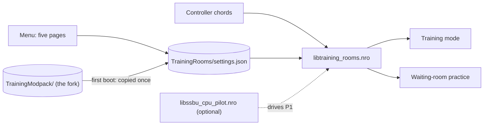

# Technical notes

The detail behind the [README](../README.md): how TrainingRooms is installed and built, how each feature behaves, and
where every clip in the README was recorded (build, commit and what the run checked). Release notes are the
`RELEASE-NOTES-rc*.md` files in this folder: rc.5, rc.6, rc.8 and rc.9 (rc.7, rc.10 and rc.11 have none).

Practice tools for Training mode and the online waiting rooms of Super Smash Bros. Ultimate 13.0.5, as a Skyline plugin.

**Clip** [`rc7-menu-tour.gif`](media/rc7-menu-tour.gif): The TrainingRooms menu: the five pages, then Hitbox Visualization turned On

*Eden, 2026-11-11, rc.7 `722525a5` as shipped (diag NRO `cfec85c7`, log lines only; release NRO `b6e60bb9`): Training,
the menu on CPU, then Saves, Recording, Fighters & Stages and Display & Controls; Hitbox Visualization is turned On, and
back in Training yellow shapes cover both fighters. Cuts inside are listed in [MEDIA.md](MEDIA.md).*

## Install

Put the NRO at `atmosphere/contents/01006A800016E000/romfs/skyline/plugins/libtraining_rooms.nro`, next to
`libnro_hook.nro`, which it needs (`libparam_hook.nro` is the usual companion; this build doesn't call it). **Never
install it together with `libtraining_modpack.nro`.**
Settings and saves live in `sd:/ultimate/TrainingRooms/`. On first boot, settings, save states and recordings from the
Training Modpack fork's `sd:/ultimate/TrainingModpack/` are imported once by copying.



## Controls

| Action | Default chord |
| --- | --- |
| Open the menu | B + D-pad Up (always), or Minus (menu shortcut 1, editable) |
| Save state / load state | ZL + D-pad Down / ZL + D-pad Up |
| Record / Play on CPU | ZR + D-pad Down / ZR + D-pad Up |
| Play on Player 1 / recording pop-up | ZR + D-pad Left / ZR + D-pad Right |
| Cycle the CPU / Player 1 fighter | ZL + D-pad Left / ZL + D-pad Right |
| Input display on / off | R + D-pad Down |
| Game speed: hold, then D-pad Left / Right; release to close | R + D-pad Up |
| Kirby hat: Player 1 / CPU | Special + L3 / Special + R3 |
| Reset the training room | L + R + A |

R is Z on a GameCube controller.

Game speed shows a small pop-up while the chord is held. In Training it steps through the game's own speeds (1/4, 1/2,
2/3, x1, x1.5) and sets Training's Speed setting, so the Training menu shows the same value. In the waiting-room
practice it offers the same five speeds, only for that practice; a match always starts at normal speed (rc.8; the
details are under Game speed below).

The first time Training opens on a new install, TrainingRooms also shows six reminders: Welcome, Open Menu, Save State, Load State, Input Record and Input Playback. A later launch leaves those reminders off. The chords in the table stay available.

In the menu: L/R change page, ZL + Up/Down jumps to the previous or next section, A edits, Y resets a row, X saves the
current values as defaults, B goes back. Each page ends with *Reset page to defaults*, which asks first. The menu reopens
where you left it. The chords are edited on Display & Controls › Button chords.

The key hints at the foot of every page end with the build tag: the version, then the build name and the commit the NRO
was built from, for example `0.2.0-rc.6 · rc11 0c628724` (rc.8 to rc.10 builds read `rc8` to `rc10`). A build from
uncommitted changes adds `-dirty`.

**Clip** [`rc11-footer-tag.gif`](media/rc11-footer-tag.gif): the menu opens on two pages whose key hints end with `0.2.0-rc.6 · rc11 0c628724`

*Eden, 2026-11-12, rc.11 `0c628724` as shipped (diag NRO `bd0bc61b`), `docs-rd18-0c628724` `fx-footer-tag`: Training,
the menu on Fighters & Stages, R to Display & Controls, the menu closes. The tag is read from the frames (it isn't
logged). The cut is listed in [MEDIA.md](MEDIA.md).*

## Features in detail

Clips are Eden footage of the 0.2.0-rc.1 release NRO `706c993f`, recorded 2026-11-05, except those marked RC10 or with
their own build; see [MEDIA.md](MEDIA.md).

### Hitboxes and grab boxes

**Clip** [`rc7-hitbox.gif`](media/rc7-hitbox.gif): Hitbox Visualization turned On, then a forward smash

*Eden, 2026-11-11, rc.7 `722525a5` as shipped (diag NRO `cfec85c7`, log lines only): Training with nothing drawn;
Display & Controls › Hitbox Visualization from Off to On; back in Training yellow shapes cover both fighters, and
Player 1's forward smash sends the CPU from 6.3% to 24.8%.*

Hitbox Visualization (Display & Controls) draws the fighters' hurtboxes (yellow), hitboxes and grab boxes. Since rc.3
every fighter sphere is the plugin's own disc, so none is ever missing, even with two large fighters; projectiles keep
the game's effect spheres, and the discs trail the camera by one to two frames while it pans.

### Frame strip

The input display (Display & Controls › Input Display) is a strip at the top of the screen: the last second of
Player 1 and the CPU, a chip for each new button, and ADVANTAGE, LINK, and INPUT for the last exchange. ADVANTAGE is
the CPU's first actionable frame minus yours. Plus means you act first. [FRAME-STRIP.md](guide/frame-strip.md)
is how to read the lanes, the stick row, and the readouts. The rc.5 clips are listed in
[MEDIA.md](MEDIA.md).

**Clip** [`rc8-input-display-chord.gif`](media/rc8-input-display-chord.gif): R + D-pad Down hides the frame strip, then shows it again

*Eden, 2026-11-11, the rc.8 integration head `d3eeac81` (diag NRO `9f8afc66`, log lines only): a jab on the frame
strip; R + D-pad Down, "Input display · Off", and the next jab draws no strip; R + D-pad Down again, "Input display ·
On", and the jab draws on it. Cuts inside are listed in [MEDIA.md](MEDIA.md).*

R + D-pad Down turns the input display on and off without opening the menu, in Training and in the waiting-room
practice. A notice says "Input display" and On or Off. The menu's Input Display row shows the same value, and the
choice is saved.

### Game speed

**Clip** [`rc8-game-speed-chord.gif`](media/rc8-game-speed-chord.gif): Hold R + D-pad Up: the Game speed pop-up steps to 1/2, then 1/4; the jabs slow down; the pause menu shows Speed 1/4

*Eden, 2026-11-11, the rc.8 integration head `d3eeac81` (diag NRO `9f8afc66`, log lines only), in Training: a jab at
x1; R + D-pad Up held, the pop-up reads x1, then 2/3 and 1/2 with D-pad Left; a jab at 1/2; held again, 1/4; a jab at
1/4; the pause menu's Other Settings shows Speed 1/4, and the HUD's stopwatch reads 1/4. Cuts inside are listed in
[MEDIA.md](MEDIA.md).*

Hold R + D-pad Up and a small "Game speed" pop-up shows the current speed between two D-pad arrows. While you hold
it, D-pad Left and Right step one speed at a time; the steps stop at the slowest and fastest speeds instead of wrapping
around. Let go and the pop-up closes; the speed stays.

- While you hold the chord, no other chord fires, and the chord's buttons and D-pad Left / Right don't reach the game.
  The rest of Player 1's controller still does, so you can keep moving.
- **In Training** the speeds are Training's own: 1/4, 1/2, 2/3, x1 and x1.5. The chord sets the same Speed setting as
  the game's pause menu (Other Settings › Speed), so the pause menu and the HUD's stopwatch show the speed you chose, and a speed chosen in the pause menu is where the
  pop-up starts. 1 Frame stays in the pause menu: while Training is on 1 Frame, the pop-up shows "1 Frame", and the
  first step goes from x1.
  The stopwatch appears as soon as you step away from x1 and goes away when you step back to x1.

  **Clip** [`rc8-speed-hud-fixed.gif`](media/rc8-speed-hud-fixed.gif): Hold R + D-pad Up, Right: the stopwatch reads x1.5; Left back to x1: it goes away

  *Eden, 2026-11-11, the rc.8 head `3f9d61dd` (diag NRO `61533917`, log lines only), in Training: x1 with no
  stopwatch; R + D-pad Up held, Right, and the stopwatch reads x1.5; held again, Left back to x1, and it goes away.*
- **In the waiting-room practice** the speed is local: 1/4, 1/2, 2/3, x1 and x1.5 change only your practice, while the
  room's timers and the other player stay at normal speed. Each practice session starts at x1.
- It never changes a Quickplay or online match: a match always starts at normal speed.
- **With the standalone CPU pilot** driving Player 1, the chord works the same way. In the waiting-room practice the
  pilot still gets one input per game update at every speed, x1.5 included, so its inputs are never doubled.
  <!-- R14 (worker B's r14bc-eca14e4b pair): keep this line only if R14 passes on the final head. -->

Both chords are rows of Display & Controls › Button chords ("Input display" and "Game speed"), editable and clearable
like the others. They don't fire while L is held, so Online Deluxe's L + R + D-pad overlay chords leave them alone.

With Online Deluxe 0.10.5 or later, no chord that uses the D-pad fires while Deluxe's window shows a page with rows
(Settings, Window Options, Plugins or a plugin's own page, whose rows use D-pad Up/Down and ZR + Left/Right), so
ZR + Right on its CPU Pilot page no longer also opens the Recording pop-up. Its Performance view doesn't stop them,
and the menu shortcuts still work. On a GameCube controller, Deluxe's L + R is both triggers: the ZL/ZR chords and the
two chords above don't fire while both triggers are held, and one trigger works as before.

### Combos

*+ Save last combo…* (Recording › Combos & Sequences) saves a combo you landed, and the combo helper grades your next
attempts against it, link by link. A sequence of combos is drilled the same way, one combo after another. Each saved
combo is a small JSON file in `sd:/ultimate/TrainingRooms/combos/`. You can edit it, copy it to another card or share
it, and any fighter can practise it; [COMBOS.md](guide/combos.md) describes the format. The clip is under Combos
below.

### CPU reactions

**Clip** [`rc7-di-up.gif`](media/rc7-di-up.gif): No DI, then DI Up from the menu: the same forward smash launches the CPU higher

*Eden, 2026-11-11, rc.7 `722525a5` as shipped (diag NRO `cfec85c7`, log lines only): the CPU loads at 80% (CPU damage
on load, Random Value 80–80) and takes Player 1's forward smash with no DI; CPU › Defence › DI Direction gets Up; the
same load and forward smash launch the CPU on a steeper line, higher at the same moment after the hit. Cuts inside
are listed in [MEDIA.md](MEDIA.md).*

DI, SDI, air dodge, shield tilt, mash, ledge, tech and throw options on the CPU page. Above: the same hit with no DI
and with DI Up.

**Clip** [`di-sdi-chips.gif`](media/di-sdi-chips.gif): The DI and SDI direction grids

The direction chips show the game's own DI line and SDI streak; each A adds weight to a chip. *In* and *Out* are
relative to you, on either side of the CPU.

*CPU Level* (CPU › Level: Off, or Lv 1–9) replaces Training's own CPU level. When the two differ as Training starts, a
notice says so once.

**Clip** [`rc7-cpu-level-notice.gif`](media/rc7-cpu-level-notice.gif): Training's CPU card at Lv. 3; in Training, the notice names both levels

*Eden, 2026-11-11, rc.7 `b3678dfe` (diag NRO `9dfc784c`, log lines only): CPU Level is Lv 7. The character select's CPU
card reads CPU Lv. 3; in Training the notice reads "Lv 7 from TrainingRooms (Training menu: Lv 3)". Cuts inside are
listed in [MEDIA.md](MEDIA.md).*

### Save states and respawn

**Clip** [`rc10-save-load.gif`](media/rc10-save-load.gif): Save at a new spot, a smash sends the CPU away, then Load puts both fighters back

*Eden, 2026-11-12, rc.10 `32ee7595` (diag NRO `79922abe`), `docs-rd12-32ee7595`
`fx-save-load`: Mario steps left and ZL + D-pad Down saves ("Saved Slot 1"); he walks back and forward-smashes Mewtwo
(10%); ZL + D-pad Up puts both where Save was pressed, Mewtwo at 0%, and nothing plays. The log: `state saved slot=1`,
`state load_request`, `state placed`, no playback line. The cut is listed in [MEDIA.md](MEDIA.md).*

**Clip** [`rc7-respawn-on.gif`](media/rc7-respawn-on.gif): Respawn on platform turned On, then a fall off the stage: back on the revival platform

*Eden, 2026-11-11, rc.7 `722525a5` as shipped (diag NRO `cfec85c7`, log lines only): Fighters & Stages › Stages ›
Respawn on platform from Off to On; Player 1 runs off the left side and is KO'd; Player 1 comes back on the revival
platform at the top. Cuts inside are listed in [MEDIA.md](MEDIA.md).*

Named save states (one bound to Save and Load at a time), mirroring and damage on load (Saves page). *Respawn on platform* (Fighters & Stages ›
Stages) chooses between the game's respawn platform (above) and the instant respawn.

### Recording and playback

A save state only warps, and Load starts nothing. Each role has one active macro, a recording or a chain, and
that role's Play chord plays it without warping back on later loops. On the Recording page, Y does nothing and
X cycles the loop only while the cursor is in Macros.
[RECORDING.md](guide/recording.md) is how to use it. The pop-up and the Recording page are in that doc.
What rc.6 changes is [RELEASE-NOTES-rc6.md](RELEASE-NOTES-rc6.md).

**Clip** [`rc10-record-play-cpu.gif`](media/rc10-record-play-cpu.gif): Record on Player 1, then Play on CPU: the CPU does the recorded moves

*Eden, 2026-11-12, rc.10 `32ee7595` (diag NRO `79922abe`), `docs-rd12-32ee7595` `fx-record-play-cpu` (take 3): ZR + D-pad
Down records Mario's jab, dash and forward smash, ZR + D-pad Down stops; ZR + D-pad Up warps both fighters to the
recording's start save, and Mewtwo plays the same inputs (a dash and a forward smash in the recorded direction). Two
things are cut out: the CPU's pick of the new recording (the pop-up's pick, made in `recording-index.json` by the
harness: Record makes the new macro active for the recorded role only) and the Fighter Mismatch question (Keep). The
log: `screen=recording role=player recording=1`/`=0`, `screen=playback role=cpu warp=1`, `[RecordingHost]
start_observed slot=1`, then the CPU's status changes. The windows are listed in [MEDIA.md](MEDIA.md).*

**Clip** [`rc7-record.gif`](media/rc7-record.gif): Record on Player 1: an empty library, two jabs, then Macro 1 and its start save

*Eden, 2026-11-11, rc.7 `722525a5` as shipped (diag NRO `cfec85c7`, log lines only): the pop-up lists no saves and no macros; Record
on Player 1 and two jabs; the pop-up then lists "Macro 1" (Recorded on Mario) and its start save "Macro 1 · start".
Playback is shown in [RECORDING.md](guide/recording.md). Cuts inside are listed in [MEDIA.md](MEDIA.md).*

While an AI drives Player 1, for example the standalone CPU pilot, Record is refused, from the chord and from the
pop-up: the notice reads "P1 is controlled by an AI: recording is off", and nothing is recorded. A recording that is
already running can always be stopped. Play on Player 1 and the waiting room's Quick Reset are refused the same way
("… Play on Player 1 is off", "… Quick Reset is off"), and Player 1's input is left to the pilot.

### Combos

**Clip** [`rc7-combo-helper.gif`](media/rc7-combo-helper.gif): The combo helper grading a drilled combo: Combo 1, jab → jab, TRUE −5, on time

*Eden, 2026-11-11, rc.7 `722525a5` as shipped (diag NRO `cfec85c7`, log lines only): the pop-up's COMBOS with Combo 1
(jab → jab) drilled; the jabs; the bar under the frame strip grades the attempt: TRUE −5, on time. Cuts inside are
listed in [MEDIA.md](MEDIA.md).*

*+ Save last combo…*, the first row of COMBOS on the Recording page and in the recording pop-up, keeps your last combo
as a file and makes it the drill. With *Combo helper* On, a bar under the frame strip grades each attempt link by link:
whether the recorded inputs came, in order and on time, and whether the same move came out. A true combo is shown,
not required. Drilling a sequence adds a header and a row of its combos to that bar.

**Clip** [`rc7-sequence-drill.gif`](media/rc7-sequence-drill.gif): Drill a sequence: combo 1, then combo 2, then a drop back at combo 1

*Eden, 2026-11-11, rc.7 `722525a5` as shipped (diag NRO `cfec85c7`, log lines only): combo 1 lands, combo 2
starts, then a wrong move (up tilt) drops the sequence back to combo 1.* See [MEDIA.md](MEDIA.md).

### Fighters, cycles and Kirby hats

**Clip** [`rc6-cycle-switch.gif`](media/rc6-cycle-switch.gif): Character Cycles: the order badges, then each press of the cycle chord switches Player 1 in that order

*Eden, 2026-11-10, rc.6 `e6501ac6` (diag NRO `c1b9f694`, log lines only): the grid's red badges number Player 1's
order (Mario 0, Mii Brawler 1, Mii Swordfighter 2, Mii Gunner 3, Link 4). In Training, each press of the cycle chord
switches Player 1 from Mii Gunner to Link, back to Mario, then to Mii Brawler. Cuts inside are listed in
[MEDIA.md](MEDIA.md).*

Cycle chords step through your own order of fighters per role (red for Player 1, blue for the CPU), drawn with the
game's stock icons. The CPU's chord always works; Player 1's works only while Fighters & Stages › Player Swapping is On
(it's Off at first).

The fighters of your cycles load hot. Each role's first window of fighters is ready when Training starts, and the
other groups are built in the background while you play; once the notice reads Ready or All loaded, a switch into a
group took about 50–70 ms in Eden. Changing a cycle in Training builds the new fighters the same way, at once. The
fighters that left it are freed when you next open the pause menu, or right away if the new ones need their room (a
brief pause). Leaving a Mii for the fighters it replaced is a warm switch, not a reload. The background build
waits only while Kirby is on screen, and for a second Mii group while a Mii is on screen
(`background_build_eligible`, `src/model/swap/body_bank.rs:852`). Raising No. of CPUs brings in the CPU cycle's next
fighters, a saved Mii included.

**Clip** [`rc7-kirby-hats.gif`](media/rc7-kirby-hats.gif): Player 1's Kirby: the hat chord twice, two hats in turn

*Eden, 2026-11-11, rc.7 `722525a5` as shipped (diag NRO `cfec85c7`, log lines only): Player 1 is a plain Kirby; the hat
chord gives Falco's hat, and again Sheik's.*

Kirby hats change with a chord, for Player 1 or the CPU.

### Mii fighters

Each Mii class (Fighters & Stages › Mii Brawler, Swordfighter, Gunner) lists your saved Miis per role (ZR switches
Player and CPU). *Add New…* opens Smash's own Mii Fighter editor from Training. Saving creates a new Mii and leaves the
others untouched, and leaving without saving creates nothing. Saving a Mii you already have saves nothing new and says
"Same as ‹saved name›, nothing new saved". See [MII.md](MII.md).

**Clip** [`rc6-mii-same.gif`](media/rc6-mii-same.gif): Add New, then Save with the copy unchanged: nothing new is saved

*Eden, 2026-11-10, rc.6 `e6501ac6` (diag NRO `c1b9f694`, log lines only): the Mii Brawler list (three Miis), Add
New…, Smash's Mii editor on a copy of the class's Mii, Save at once. Back in Training, the notice reads "Same as 格斗,
nothing new saved". The row checked that every Mii file stayed byte-identical. Cuts inside are listed in
[MEDIA.md](MEDIA.md).*

**Clip** [`rc7-mii-editor.gif`](media/rc7-mii-editor.gif): Add New, two new specials, Save: the new Mii is listed, picked, and played

*Eden, 2026-11-10, rc.7 `7d720c68` (diag NRO `a45ba951`, log lines only): Add New… opens Smash's Mii editor. Neutral
Special 2 and Side Special 2, then Save. The Mii Brawler list gains "4. 格斗 [2211]"; A picks it and the "> " moves to
it. In Training, Player 1 is that Mii Brawler, and B is its new neutral special. The row checked that exactly one new
Mii file was written. Cuts inside are listed in [MEDIA.md](MEDIA.md).*

### Stages

**Clip** [`rc7-change-stage.gif`](media/rc7-change-stage.gif): Change Stage: Battlefield, Y for its Ω form, and Training reloads there

*Eden, 2026-11-11, rc.7 `722525a5` as shipped (diag NRO `cfec85c7`, log lines only): Training; Fighters & Stages ›
Change Stage, the cursor from Waiting Room to Battlefield [N], Y gives [Ω], A; "Practice Stage · Stage requested"; and
Training reloads on Battlefield Ω. Cuts inside are listed in [MEDIA.md](MEDIA.md).*

*Change Stage* (Fighters & Stages › Stages) goes to the stage you pick when the menu closes, in Training and in
waiting-room practice; Y picks its form first.

**Clip** [`menu-stages.gif`](media/menu-stages.gif): Stage grid

Pick the stages and their order for Training rotation and waiting-room practice. *RC10, 2026-11-04, NRO
`50d95130`: the grid only.*

**Clip** [`rc7-lobby-stages-rotation.gif`](media/rc7-lobby-stages-rotation.gif): Lobby Stages ranks two stages; with Training Stage Rotation On, the next Training entry goes to Big Battlefield

*Eden, 2026-11-10, rc.7 `7d720c68` (diag NRO `a45ba951`, log lines only): Lobby Stages ranks 1. Waiting Room and
2. Big Battlefield, and Training Stage Rotation is On. From Training on the training stage, back through the character
select, Training opens on Big Battlefield. Cuts inside are listed in [MEDIA.md](MEDIA.md).*

### Waiting rooms

**Clip** [`rc6-waiting-partners.gif`](media/rc6-waiting-partners.gif): Training Partners 1 to 2 in a Quickplay waiting room: a second partner drops in

*Eden, 2026-11-10, rc.6 `e6501ac6` (diag NRO `c1b9f694`, log lines only), a Quickplay room hosted in Eden: one partner
standing; the game's own waiting-room menu, Training Partners 1, Right to 2; a second partner drops in, and both stand
(Training Partner Behavior: Stop).*

**Clip** [`rc6-waiting-reentry.gif`](media/rc6-waiting-reentry.gif): The next room starts with the two partners and Stop

*The same run, the next room: it fades in with the two remembered partners, standing still.*

The same menu works while you wait in an online or local room, once Fighters & Stages › Lobby Practice is On (it's Off
at first). The Training partners and CPU action you set in the
game's own waiting-room menu are remembered for the next room, and CPU › Level › CPU Level sets the partners' level.

With the CPU pilot plugin 0.2.3 (`libssbu_cpu_pilot.nro`), the pilot can also drive Player 1 in Quickplay's
waiting-room practice. Arm it from its CPU Pilot page as in Training. The practice shows no `CPU Lv` tag, and when a
match is found the pilot keeps Player 1 in the match. The lobby tools above work beside it, Record, Play on Player 1
and Quick Reset are refused while it drives, and the Game speed chord works at every speed.

To leave a Quickplay room before the match starts (the game's Pause › Leave Battle, which the QuickPlay cancel fix
plugin keeps open for a few seconds after you join), close the TrainingRooms menu first: while it is open, Plus
doesn't reach the game.

**Clip** [`rc6-lobby-combos.gif`](media/rc6-lobby-combos.gif): Save last combo in a Local Wireless waiting room, then the helper bar drills it there

*Eden, 2026-11-10, rc.6 `e6501ac6`, the guest of a Local Wireless room hosted in Eden: jab into jab in the waiting
room; Recording › Combos & Sequences, *+ Save last combo…*; COMBOS lists "Lobby jabs, recorded on Sheik"; back in the
room, the helper bar drills it. Cuts inside are listed in [MEDIA.md](MEDIA.md).*

**Clip** [`waiting-menu.gif`](media/waiting-menu.gif): The menu in a Local Wireless waiting room

*Eden, 2026-11-05, 0.2.0-rc.1 (release NRO `706c993f…`), a Local Wireless room hosted in Eden: the menu opens on its
last page and R steps to CPU and Saves. The menu only.*

### Menu navigation

**Clip** [`menu-section-jump.gif`](media/menu-section-jump.gif): ZL + Down jumps through the CPU page's sections

ZL + Up/Down jumps between a page's sections (in popup lists, a screenful). The menu reopens on the page and row you
left. ZR no longer resets a page: each page ends with *Reset page to defaults*, which asks first. *Eden, 2026-11-05,
`p23/menu-nav` diag NRO `1273c29f`, the navigation code rc.3 merged.*

### The Developer page

A sixth page, after Display & Controls, for testing the plugin itself. It shows only when
`sd:/ultimate/TrainingRooms/developer.ini` holds exactly one `developer_page=on` line (read once at boot; anything
else keeps it hidden, decision N1). While it's hidden its rows do nothing. All three start Off:

| Row | What it does |
| --- | --- |
| Preload Samples | Writes sparse timing and memory samples of preloads to the diagnostics file. |
| Reload developer config | While On, holding L + R + A on Player 1 re-reads the developer config file every frame. |
| Debug hooks | Turns on the debug watch on the Kirby backshield work float. |

### Menu shortcuts and replay capture

**Clip** [`rc7-menu-shortcut.gif`](media/rc7-menu-shortcut.gif): Menu shortcut 1 changed from Minus to ZL + D-pad Up, which then opens the menu

*Eden, 2026-11-11, rc.7 `722525a5` as shipped (diag NRO `cfec85c7`, log lines only): Display & Controls › Menu
shortcut 1 reads Minus; A opens the chord editor, X starts the capture, ZL held with D-pad Up gives "ZL + D-pad Up", A
confirms; back in Training, ZL + D-pad Up opens the menu. Cuts inside are listed in [MEDIA.md](MEDIA.md).*

Menu shortcuts are changed in the menu and work at once.

**Clip** [`rc6-replay-window.gif`](media/rc6-replay-window.gif): A capture opened in the Replay window: its Mii goes to the CPU

*Eden, 2026-11-10, rc.6 `e6501ac6` (diag NRO `c1b9f694`, log lines only): Recording › Replays › Replay window lists a capture
(Mario vs Mii Gunner, 180 frames), A opens it in the Replay window, Fighter Mismatch offers the recorded fighter, and
Switch reloads the CPU as the capture's Mii Gunner ("Saved Mii applied"). The capture is a test fixture, made before
the clip. Cuts inside are listed in [MEDIA.md](MEDIA.md).*

**Clip** [`rc7-replay-capture.gif`](media/rc7-replay-capture.gif): Replay capture turned On in the menu, then the same setting On in the Online Deluxe overlay

*Eden, 2026-11-11, rc.7 `722525a5` as shipped (diag NRO `cfec85c7`, log lines only), with Online Deluxe 0.10.1: Recording
› Replays › Replay capture from [OFF] to [ON]; back in Training, L + R + Down opens the Online Deluxe overlay at the
top right, and its plugins page reads "Training Rooms › Replay capture On". Cuts inside are listed in
[MEDIA.md](MEDIA.md).*

The *Replay capture* row and the Online Deluxe overlay show the same setting.

## Status

The newest build is **rc.11** (`0c628724`): the menu footer reads `0.2.0-rc.6 · rc11 0c628724`. The version number
has stayed `0.2.0-rc.6` since rc.6; the build name after it (rc8, rc9, rc10, rc11) tells the builds apart. rc.11 moves
TrainingRooms' own threads off core 0 and hides the frame strip while a waiting room's own menu is open; rc.10 is a code
reduction with no change in behaviour.

[0.2.0-rc.6](https://git.syntaxbyexample.com/intpa/TrainingRoomsForUltimate/releases/tag/v0.2.0-rc.6) follows
0.2.0-rc.3.1: 0.2.0-rc.5 was withdrawn before players ran it, and there is no separate 0.2.0-rc.4. What it changes is
[RELEASE-NOTES-rc6.md](RELEASE-NOTES-rc6.md), on top of [RELEASE-NOTES-rc5.md](RELEASE-NOTES-rc5.md).
The builds after it, rc.8 and rc.9, are in [RELEASE-NOTES-rc8.md](RELEASE-NOTES-rc8.md) and
[RELEASE-NOTES-rc9.md](RELEASE-NOTES-rc9.md): rc.9 fixes the shortcut conflicts with Online Deluxe, the CPU
pilot and imgui_smash.

**0.2.0-rc.3** (2026-11-05) is the previous console test build. It adds to rc.2:
- the **frame strip** input display, replacing the 15-row input log;
- **Change Stage**: a row that switches the stage now, in Training and in waiting rooms;
- **menu navigation**: ZL + Up/Down jumps sections, the menu reopens where you left it, ZR no longer resets a page by
  accident, and *Reset page to defaults* asks first;
- **own hitbox discs** for every fighter sphere, never refused (projectiles keep the effect spheres; the discs trail
  the camera by one to two frames, a known limit).

rc.2 added the pause-helper fix, the Solo Popo mark placement and the Kirby hat-request endings. Limitations kept from
the fork are listed in [Differences from the fork](DIFFERENCES-FROM-THE-FORK.md); planned work is in the
[ROADMAP](ROADMAP.md). 0.1.0 crashes at console boot; use the newest build, [0.2.0-rc.6](https://git.syntaxbyexample.com/intpa/TrainingRoomsForUltimate/releases/tag/v0.2.0-rc.6).

## Build

```powershell
cargo test --all-targets
cargo skyline build --release
```

The NRO is `target/aarch64-skyline-switch/release/libtraining_rooms.nro`. Toolchains, the diagnostic build and the
layout recipe: [BUILD.md](BUILD.md). Current acceptance state: [HANDOFF.md](../HANDOFF.md).

## License and provenance

MIT ([LICENSE](../LICENSE)). This is a clean-room implementation inspired by the Training Modpack
([jugeeya/UltimateTrainingModpack](https://github.com/jugeeya/UltimateTrainingModpack)), which publishes no license:
its features were re-specified from observable behaviour and none of its code, layouts or artwork is used. Code
carried over from this project's own earlier fork and all dependencies are recorded in [PROVENANCE.md](../PROVENANCE.md)
and [CARRY-OVER.md](../CARRY-OVER.md).

This project was developed with the assistance of AI. It is an unofficial fan project, not affiliated with or
endorsed by Nintendo.
