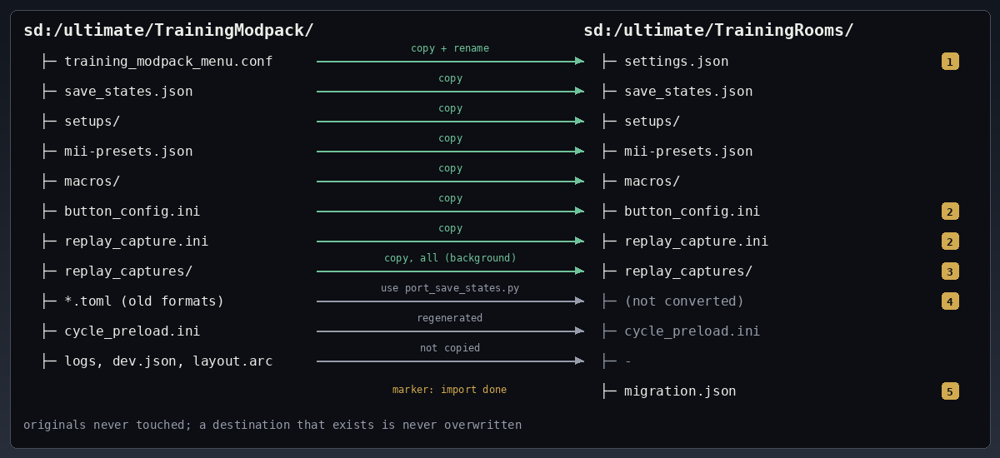
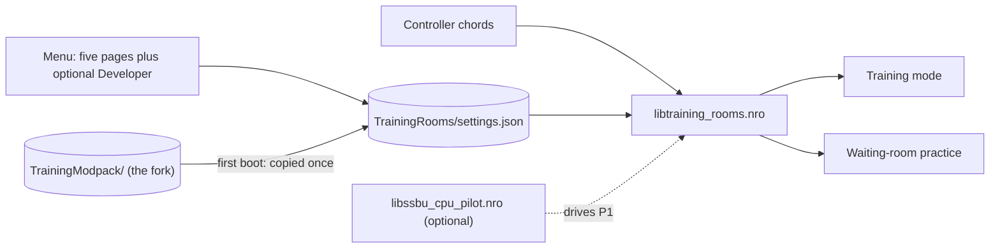
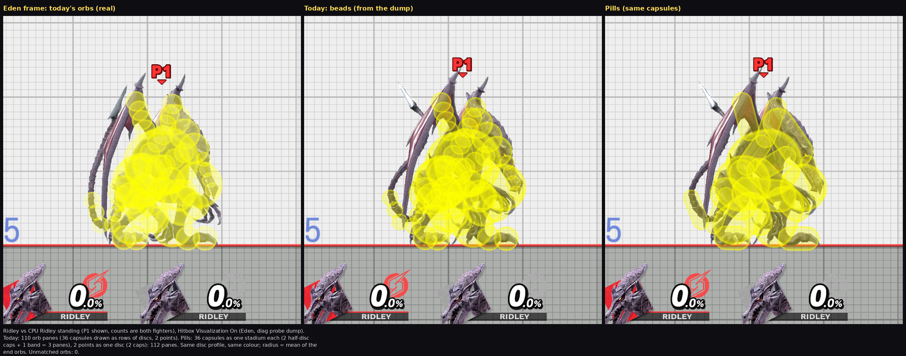
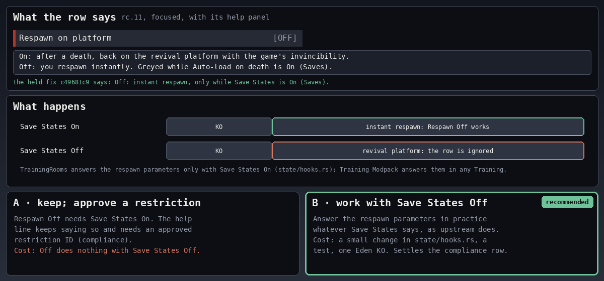
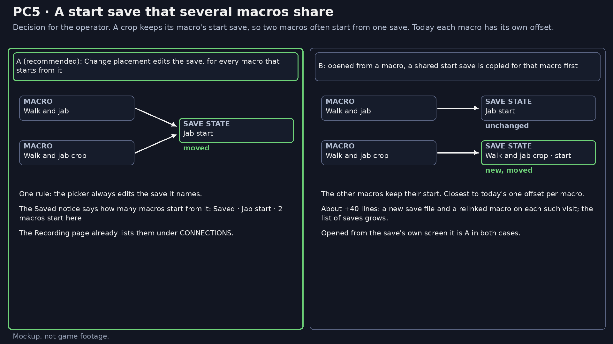
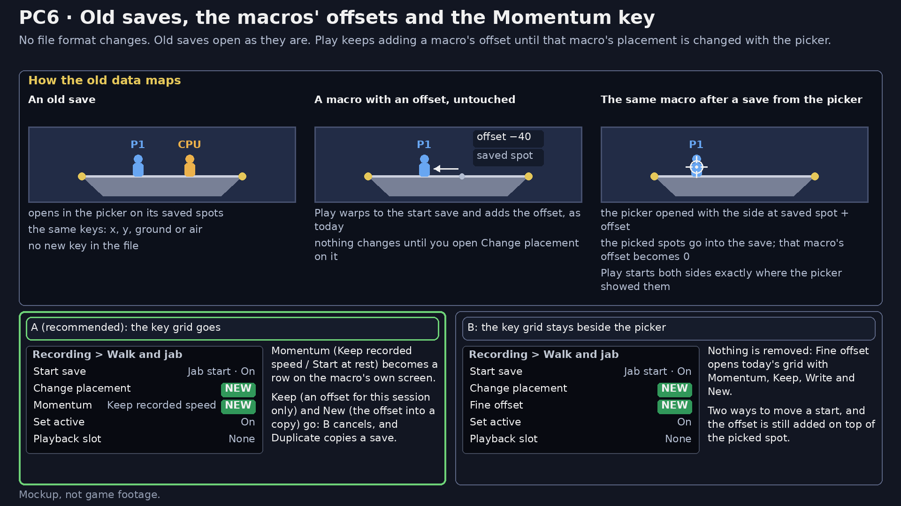
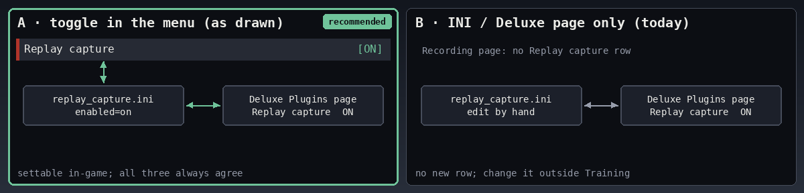

# Technical notes

How TrainingRooms works in Training and waiting rooms; see [Media](MEDIA.md) for clip provenance and [release history](CURRENT-RELEASE.md#earlier-releases) for earlier builds.

[Menu tour and hitbox checklist](media/rc14-menu-tour.gif)

| Capture detail | Dated observation |
| --- | --- |
| Capture | Eden, 2026-11-15, rc.14 `17e50cd0`. |
| Diagnostic NRO | `addcdd7e` (log lines only). |
| Footer | 0.2.0-rc.14 · rc14 17e50cd0. |
| Setup | Training, Mario versus Palutena, overlays clear. |
| Menu tour | CPU → Saves → Recording → Fighters & Stages → Display & Controls. |
| Checklist | Hitbox Visualization. A selected Hitboxes, Grab boxes and Hurtboxes. |
| Help | “Tick what to draw.” |
| Windboxes | “Hits that push or pull without hitstun.” |
| Launch angles | “Where each hit sends.” |
| Result | Yellow hurtbox pills on both fighters. Mario’s neutral air showed red at 1/4 speed. |
| Edits | [Capture and cut details](MEDIA.md). |

## Install

For the plugins and their install path, see [Getting started](guide/getting-started.md#installing).

| Detail | Decision record |
| --- | --- |
| First-boot import | [Decision of 2026-11-01](DECISIONS.md). |
| Published replay captures | Copied in the background without a size cap. Unfinished staging folders are skipped. |
| Blocking copies | Files over 8 MiB are skipped. Originals and existing destination files remain intact. |

## Controls

[Build tag in the menu footer](media/rc11-footer-tag.gif)

See [menu navigation](guide/using-the-menu.md), [factory chords](menu/display-and-controls.md#button-chords), [fixed controls](guide/controls.md#fixed-buttons) and [build identification](CURRENT-RELEASE.md#which-build-is-mine).

*2026-11-12 · [Capture record](MEDIA.md)*

## Features in detail

| Footage | Recording details |
| --- | --- |
| Default take | Eden, 2026-11-05, 0.2.0-rc.1 release NRO `706c993f`. |
| Exceptions | RC10 and takes naming a different build. |
| Provenance | [Media index](MEDIA.md). |

### Hitboxes and grab boxes

[Hitboxes and hurtboxes during a neutral air](media/rc14-hitbox.gif)

| Capture detail | Dated observation |
| --- | --- |
| Capture | Eden, 2026-11-15, rc.14 `17e50cd0`. |
| Diagnostic NRO | `addcdd7e` (log lines only). |
| Footer | 0.2.0-rc.14 · rc14 17e50cd0. |
| Setup | Training, overlays clear. |
| Menu | Display & Controls › Hitbox Visualization. |
| Help | “Tick what to draw.” |
| Windboxes | “Hits that push or pull without hitstun.” |
| Launch angles | “Where each hit sends.” |
| Selection | A ticked Hitboxes, Grab boxes and Hurtboxes. B returned. |
| Training | Both fighters showed yellow hurtbox pills. |
| Speed | R + D-pad Up stepped to 1/4. |
| Attack | Mario’s short-hop neutral air stayed red over one second. The strip lane turned red. |
| Edits | [Capture and cut details](MEDIA.md). |

TrainingRooms draws fighter and projectile hitboxes with its own panes, projects them with the game camera at layout time, and draws capsules as single pills; see the [colour legend](menu/display-and-controls.md#colour-legend).

| Detail | Decision record |
| --- | --- |
| Design | [Capsule decision, 2026-11-14](DECISIONS.md). |
| Left and middle | A row of discs represented each capsule. |
| Right | One pill represented each capsule. |

| Strength and spot | Mechanism |
| --- | --- |
| Rank | `src/model/spots.rs::knockback` ranks launch; damage breaks ties, not angle. |
| Current frame | `classify` marks weaker active hitboxes Sour and stronger ones Sweet. |
| Earlier peak | `classify` marks a weaker phase Late; indistinguishable hitboxes have no label. |
| Attribution | `attribute` checks the game's recorded slot against received damage and knockback. |

### Frame strip

See the [frame strip guide](guide/frame-strip.md) for the lanes and readouts, and [Media](MEDIA.md) for the rc.5 clips.

[Hide and restore the frame strip](media/rc8-input-display-chord.gif)

*2026-11-11 · [Capture record](MEDIA.md)*

| Topic | Details |
| --- | --- |
| Frame-strip setting | The [binding](menu/display-and-controls.md#button-chords) and [Input Display row](menu/display-and-controls.md#input-display) share one saved value. |

| Topic | Details |
| --- | --- |
| Display model | `src/model/frame_strip.rs` supplies lanes, chips, freeze, readouts, stick row and C-stick arrow. |
| Timing | The same model implements the 20-frame rule. |
| References | [Frame strip](guide/frame-strip.md) · [Specification](../specs/SPEC-input-06-frame-strip.md). |

| Strip detail | Mechanism |
| --- | --- |
| Link | `Tracker::on_hit`: hit minus CPU free frame; TRUE without a number when timing is unknown. |
| Input | `Tracker::on_hit` subtracts Player 1's first actionable frame from the follow-up press. |
| Step | `src/model/strip_scroll.rs::stepped` moves 15 columns per step. |
| Repeat | `Scroll::poll` repeats after 18 held polls, then every six. |
| Ownership | An open scroll hides its hold and direction buttons from the game. |

### Game speed

[Compare the same forward smash at x1 and 1/4 speed](media/rc11-game-speed.gif)

| Capture detail | Dated observation |
| --- | --- |
| Capture | Eden, 2026-11-13, rc.11 `0c628724`. |
| Diagnostic NRO | `bd0bc61b` (log lines only). |
| Setup | Mario walked from the reset spot and forward-smashed Ridley at x1. |
| Speed | Holding R + D-pad Up, D-pad Left stepped through x1, 2/3, 1/2 and 1/4. |
| Repeat | The stopwatch read 1/4. The same approach and smash took about four times longer. |
| Log | `[GameSpeed] … speed=1/4`. |
| Edits | [Capture and cut details](MEDIA.md). |

The [speed control](guide/game-speed.md) stops at either end of the list rather than wrapping.

| Where | What the chord does |
| --- | --- |
| Held chord | Blocks other chords. The game receives neither its buttons nor D-pad Left/Right. |
| Other inputs | Player 1 can still move. |
| Training speed | The pop-up shares Other Settings › Speed: 1 Frame, 1/4, 1/2, 2/3, x1, x1.5. |
| Frame-step boot check | Passing enables 1 Frame immediately left of 1/4. Failing skips it. |
| Advance | Release the chord, then press ZL (L on a GameCube controller). |
| Stopwatch | Visible at every speed except x1. |
| Waiting-room practice | Starts at x1. All available speeds affect practice, including 1 Frame. |
| Room timers and peer | Continue at normal speed. |
| A Quickplay or online match | It never changes one: a match always starts at normal speed. |
| Standalone CPU pilot | The speed chord still works while the pilot drives Player 1. |
| Pilot input | Waiting-room practice receives one pilot input per game update, including at x1.5. |

| Frame step | Mechanism |
| --- | --- |
| Hold | `src/model/lobby_speed.rs::FrameStep::poll` runs waiting-room practice continuously after 18 held polls. |
| Priority | The speed chord, another input owner, or busy room UI blocks stepping. |
| Hook | `src/runtime/features/game_speed.rs::frame_step_poll` publishes requests for the waiting-area task. |

[Speed indicator at x1.5 and x1](media/rc8-speed-hud-fixed.gif)

*2026-11-11 · [Capture record](MEDIA.md)*

| Topic | Details |
| --- | --- |
| Bindings | Display & Controls › Button chords lists Input display and Game speed. |
| Editing | Both can be changed or cleared. |
| L held | Each waits unless its edited chord includes L. |
| Factory bindings | Leave the L + R + D-pad Online Deluxe overlays available. |

| Topic | Details |
| --- | --- |
| Online Deluxe 0.10.5 or later | TrainingRooms yields a chord when Deluxe uses that D-pad input. |
| Pages with rows | Settings, Window Options, Plugins and individual plugin pages. |

| Deluxe uses its D-pad | When |
| --- | --- |
| Deluxe moves a row with D-pad Up/Down | Only when none of ZL, ZR, R and L is held |
| And changes a value with D-pad Left/Right | Only while ZR (without ZL) is held |

| Beside Deluxe's open page | What happens |
| --- | --- |
| ZR + Right on its CPU Pilot page | So it no longer also opens the Recording pop-up |
| ZR + Left (Play on Player 1) | Waits too |
| Save, Load, Record, Playback, cycles, Input display | These factory chords work beside Deluxe’s open page. |
| Before rc.12 | All D-pad chords waited. Save and Load were unavailable beside an open page. |
| Its Performance view | Doesn't stop any chord, and the menu shortcuts still work |
| A Save or Load press that doesn't happen | Says why in a notice (Saves › Save States) |
| GameCube controller | Both triggers together count as Deluxe’s L + R. |
| Both triggers | ZL/ZR chords, Input display and Game speed wait. A single trigger still works. |

### Combos, in short

| Action | Behavior |
| --- | --- |
| Save | Recording › Combos & Sequences › *+ Save last combo…* saves a combo you landed. |
| Drill | The helper grades each link. Sequences drill their combos in order. |
| Files | Small JSON files in `sd:/ultimate/TrainingRooms/combos/` support editing, copying between cards and sharing. |
| Fighters | Any fighter can practise a saved combo. |
| Reference | [Sharing guide](guide/combos.md) · [File format and clip](#combos-the-clip-and-the-files). |

### CPU reactions

[Compare downward and upward DI](media/rc13-di.gif)

| Capture detail | Dated observation |
| --- | --- |
| Capture | Eden, 2026-11-14, rc.13 `7d7b74c9`. |
| Diagnostic NRO | `134636ef…` (log lines only). |
| Run | `gna-r13b-yoga-1`, Mario against Donkey Kong. Hardware was untested for this candidate. |
| Start | CPU loaded at 80% with DI Down. Mario’s forward smash launched low (19.0%). |
| Menu | CPU › Defence › DI Direction showed Down ×1 fully tinted; others dim. |
| Change | Y cleared Down. A picked Up. |
| Repeat | Same load and smash launched high (19.2%). |
| Edits | [Capture and cut details](MEDIA.md). |

| Topic | Details |
| --- | --- |
| CPU reactions | DI, SDI, air dodge, shield tilt, mash, ledge, tech and throw. |
| DI comparison | The same hit launches along different paths with Down and Up. |

[Select DI and SDI directions](media/rc13-di-sdi-chips.gif)

| Capture detail | Dated observation |
| --- | --- |
| Capture | Eden, 2026-11-14, rc.13 `7d7b74c9`. |
| Diagnostic NRO | `134636ef…` (log lines only). |
| Run | `gna-r13b-yoga-1`. Hardware was untested for this candidate. |
| Start | CPU › Defence › DI Direction showed zero selected. |
| Grid | A opened on Neutral. All chips were dim. |
| Pick | Cursor on Up, then A. Selected showed “Up x1”, and Up gained full tint. |
| Repeat | SDI Direction showed the same selection behavior. |
| Edits | [Capture and cut details](MEDIA.md). |

| Topic | Details |
| --- | --- |
| Direction chips | The artwork uses the game’s DI line and SDI streak. |
| Weight | Each A press adds weight to the selected direction. |
| In and Out | Relative to the player, on either side of the CPU. |

| Detail | Decision record |
| --- | --- |
| Design | [DI chip decision](DECISIONS.md#rc13-di-lines-di-chips-like-the-game-s-blue-di-indicator-rc-13-item-2-e1-x1). |
| Panels | Mock-up, then Eden captures: empty DI, Down ×1, SDI and a fivefold Down enlargement. |
| Result | rc.13 retained the thinner, dimmer lines. |

If you choose a [CPU Level](menu/cpu.md#cpu-level) that differs from Training's own level, a notice shows both once per Training session.

[Set CPU Level and compare the Training menu](media/rc11-cpu-level.gif)

| Capture detail | Dated observation |
| --- | --- |
| Capture | Eden, 2026-11-13, rc.11 `0c628724`. |
| Diagnostic NRO | `bd0bc61b` (log lines only). |
| Menu | CPU › Level › CPU Level changed from Off to 7. |
| Character select | Donkey Kong’s CPU card read “CPU Lv. 3”. |
| Training notice | “Lv 7 from TrainingRooms (Training menu: Lv 3)”. |
| Log | One judged line and one notice. |
| Training behavior | Stop changed to CPU (Lv. 3). Donkey Kong took Mario from 0% to 28%. |
| Edits | [Capture and cut details](MEDIA.md). |

### Save states and respawn

[Save and restore both fighters](media/rc10-save-load.gif)

| Capture detail | Dated observation |
| --- | --- |
| Capture | Eden, 2026-11-12, rc.10 `32ee7595`. |
| Diagnostic NRO | `79922abe`. |
| Run | `docs-rd12-32ee7595`, `fx-save-load`. |
| Save | Mario stepped left. ZL + D-pad Down showed “Saved Slot 1”. |
| Attack | Mario walked back and forward-smashed Mewtwo to 10%. |
| Load | ZL + D-pad Up restored both positions and Mewtwo’s 0%. Nothing played. |
| Log | `state saved slot=1`, `state load_request`, `state placed`. No playback line. |
| Edits | [Capture and cut details](MEDIA.md). |

[Respawn on the platform after a KO](media/rc7-respawn-on.gif)

*2026-11-11 · [Capture record](MEDIA.md)*

| Topic | Details |
| --- | --- |
| Saves | Bind one named state to Save and Load; set mirroring and damage on load. |
| Respawn on platform | Fighters & Stages › Stages selects the revival platform or instant respawn. |

| Detail | Decision record |
| --- | --- |
| Design | [TR5, 2026-11-13](DECISIONS.md). |
| Middle panel | rc.11 ignored Respawn on platform when Save States was Off. |
| Choice | Since rc.12, the row works whether Save States is On or Off. |

### Recording and playback

| Action | Behavior |
| --- | --- |
| Load | A save-state load warps the fighters. Playback requires a separate action. |
| Play | Each role’s chord plays its active recording or chain. Later loops skip the warp. |
| Recording page | Y has no action in the main lists. |
| MACROS | X cycles the selected role’s loop count. |
| Drills | X requests a Player 1 preview when the saved take has inputs. |
| Priority | Queued or running Player 1 playback takes precedence over the preview. |
| Controls | [Recording guide](guide/recording.md) · [Page and pop-up controls](menu/recording.md#the-page-and-its-pop-up). |

For the current priority rule, see [Settings override playback](menu/recording.md#settings-override-playback).

| Detail | Decision record |
| --- | --- |
| Design | [B5, 2026-11-01](DECISIONS.md). |
| Choice B | Playback follows the recording. An advanced setting enables choice A. |

| Part | Where |
| --- | --- |
| The playback machine, the files, the grades, the chords and the migration | `src/model/playback.rs`, `src/model/library/`, `src/model/combo.rs`, `src/model/drill.rs`, `src/model/chords.rs` and `src/model/library/migrate.rs` |
| The pop-up, the Recording page and the file screens | `src/model/recording_menu.rs` and `src/model/ui/frame.rs` |
| Record, Play and the pop-up chord | Are applied in `src/model/rr_host.rs` |
| The start save | Keeps the recorded fighter's facing and speed in `note_record_start` (`rr_host.rs`) |
| [Mash interrupts playback](menu/recording.md#mash-interrupts-playback) | `recorder.rs::interrupt_playback` checks Parry practice before forwarding `note_mash`. |
| Placement picker | Change placement and Place fighters before Record share `Wizard` in `src/model/record_place.rs`. |
| Fighter frames | `src/runtime/features/record_place.rs`. |
| Placement floors | `tech::floors` supplies traced floors for `src/model/floor_hop.rs`. |
| Off stage | `off_stage_spot` uses the rules in `src/model/stage_geometry.rs`. |
| Saving placement | In `rr_host.rs`, `active_placement_ids` finds the macro and start save; `commit_placement` writes the edit. |
| Replay window | Capture loads and [fighter switches](design/toggle-load-wait/DESIGN.md) use `REPLAY_LOADING`: neutral Player 1 input, unblocked roster. |
| Replay fighter mismatch | A chain checks its first macro (`screen=mismatch ask=macro1`). |
| Replay Mii | `src/model/mii_install.rs::installable` supplies a configuration the game can load. |
| [Named setup actions](guide/save-states.md#using-a-setup) | `Pane::leads_to` in `src/editors/setups.rs` distinguishes opening, restoring and binding; `src/model/state/setup_transaction.rs` validates the restore. |
| Setup files | `src/model/state/setup.rs` defines the format. Saving creates a file. |
| Renaming | `save_name` in `src/editors/setups.rs` updates the existing file and preserves its ID. |
| Setup menus | `src/runtime/ui/setups.rs` and `src/editors/setups.rs` handle the library screens; `src/runtime/features/states/setups.rs` takes the snapshot. |
| Pop-up layout | `src/model/ui/panes.rs` defines the layout. |
| File divider | `src/model/recording_menu.rs::section_view` divides after five files when more exist, except in RECORDINGS. |
| Counting | Leading action rows do not count as files. |

| Scrub data | Mechanism |
| --- | --- |
| Positions | `src/model/macros/positions.rs` stores both fighters in `<id>.pos`, bound to macro ID and inputs. |
| Playback sampling | `rr_host.rs::open_play_track` samples matching fighters from frame zero, excluding chains. |
| Backfill | `PlayTrack::write_wanted` can replace a shorter recorded track with a longer partial playback. |
| Pose upgrade | A full playback can add poses without replacing complete, move-less recorded positions. |
| Crop | `ClipEditor::export_selection` retains the selected macro frames and their tracked positions. |
| Origin | `scrub_track.rs::deltas` subtracts the selected fighter's position at the anchor frame from both tracks. |
| Poses | `scrub_pose.rs::{asked_of,decide}` needs an available animation, matching fighter kind and held body. |
| Marks | `src/model/macros/recording.rs::ActionMark` stores move, variant and side-attack angle. |
| Naming | `clip_panel.rs::saved_namer` uses recorded fighter identity, including saved Mii specials. |
| Older takes | `clip_marks.rs::Marks::from_recording` falls back to input marks without valid saved actions. |

| Playback detail | Mechanism |
| --- | --- |
| Trim | `src/model/trim.rs::Trim::window`: global trim affects recording; file trim selects playback frames. |
| Delay | `rr_host.rs::owe_delay` waits once before first input, not on loop passes. |
| Preview | Editor previews and CPU Playback slots do not use the Play delay. |
| Tolerance | `src/model/combo.rs::Grade::worst` applies the selected tolerance and held-input band. |
| Clip window | `src/model/macros/window.rs::Window` bounds handles; `clip_panel.rs::export_selection` applies the selection. |
| Legacy slots | `src/model/library/migrate.rs::migrate` converts nonempty live slots once, separately from card import. |

*PC5: change the shared save or copy it. Design, not footage.*

| Shared placement | Mechanism |
| --- | --- |
| Copy from a macro | `rr_host.rs::copy_placed` copies the save and relinks only the requesting macro. |
| Copy from the save | The new save is unlinked; existing macros keep the original. |

*PC6: moving the save preserves the offset. Design diagram.*

| Start save | Mechanism |
| --- | --- |
| Warp | `rr_host.rs::warp_pair` applies the macro offset to its role before restoring the pair. |
| Momentum | `rr_host.rs::play_start_speed` chooses the speed; `recording_host.rs::apply_start_speed` applies it before the first input. |

*Q7: the menu shares the replay setting. Design, not footage.*

| Replay capture | Mechanism |
| --- | --- |
| Archive | `src/runtime/macros/replay_store.rs::archive` uses `sd:/ultimate/TrainingRooms/replay_captures/`. |
| Miis | `SharedCaptureArchive::save_with_miis` stores available replay Mii data with the capture. |
| Preference | `replay_capture.ini` seeds the preference shared by the menu and Online Deluxe. |

| Topic | Details |
| --- | --- |
| Earlier replay window check | `cov-replay-window` passed on `646a5f0d`. |
| Earlier Mii install checks | `cov-named-mii` and `int-named-mii-twice`. |

[Record Player 1 and play the take on CPU](media/rc10-record-play-cpu.gif)

| Capture detail | Dated observation |
| --- | --- |
| Capture | Eden, 2026-11-12, rc.10 `32ee7595`. |
| Diagnostic NRO | `79922abe`. |
| Run | `docs-rd12-32ee7595`, `fx-record-play-cpu`, take 3. |
| Record | ZR + D-pad Down started and stopped Mario’s jab, dash and forward smash. |
| CPU play | ZR + D-pad Up warped both fighters to the recording’s start save. |
| Result | Mewtwo replayed the dash and forward smash in the recorded direction. |
| Cut selection | The harness set the CPU’s pop-up pick in `recording-index.json`. |
| Reason | Recording activates the new macro only for the recorded role. |
| Cut question | Fighter Mismatch → Keep. |
| Log | `screen=recording role=player recording=1`, then `=0`. |
| Playback log | `screen=playback role=cpu warp=1`, `[RecordingHost] start_observed slot=1`, then CPU status changes. |
| Edits | [Capture and cut details](MEDIA.md). |

[Record two jabs into a new macro](media/rc7-record.gif)

*2026-11-11 · [Capture record](MEDIA.md) · [Recording guide](guide/recording.md)*

| Action | Behavior |
| --- | --- |
| Record | The take stores Player 1’s inputs as received, including a standalone CPU pilot’s. |
| P1 CPU Control | TrainingRooms’ own controller continues playing through recording. |
| Play on Player 1 | “P1 is controlled by an AI: Play on Player 1 is off”. |
| Waiting-room Quick Reset | “P1 is controlled by an AI: Quick Reset is off”. |
| Input | The pilot retains Player 1’s input. |

### Combos: the clip and the files

[Grade a two-jab combo](media/rc7-combo-helper.gif)

*2026-11-11 · [Capture record](MEDIA.md)*

| Topic | Details |
| --- | --- |
| Saving and drilling | [Recording guide](guide/recording.md#combos). |
| Sequence card | The [corner card](design/compact-strip-layout.md) stacks up to three combos. |
| Link cells | Individual links appear below the strip. |

| Topic | Details |
| --- | --- |
| Guide and specification | [Combo files](guide/combos.md) · [SPEC-input-07](../specs/SPEC-input-07-combo-helper.md). |
| Drill selection | `src/model/library/hot.rs` persists it in `recording-index.json`. |
| Import | `src/model/recording_menu.rs` rereads the combo folder on opening, including files copied in. |
| Fighter Mismatch | `ask_drill` in `src/model/rr_host.rs` handles the prompt. |

| Combo file | Format | Rules |
| --- | --- | --- |
| Codec | `src/model/combo_record.rs::{from_value,to_value}` reads and writes JSON objects. | Maximum 64 KiB. |
| Location | `sd:/ultimate/TrainingRooms/combos/<id>.json`; filename is the persistent ID. | `shareable_id`: 1–64 characters; no leading dot, surrounding spaces, controls or FAT-invalid characters. |
| Name | Up to 48 characters; missing or blank names use the filename. | Optional `recorded_on` names the fighter and can trigger the mismatch prompt. |
| Versions | 1: hit combo; 2: drill; 3: hit with aims; 4: drill with aims. | Missing `schema_version` means 1. |
| Root | Hit combos have `links`; drills have `kind: input_drill` and `input_steps`. | 1–16 links or steps. |
| Identity | Optional `recorded_fighter`: nonzero `ui_chara` (1–10 hex digits) and four `specials`. | Each special is 0–2; invalid identity becomes absent. |
| Source | Optional `made_from`, `take` and drill `trim`. | `take` names the owned macro; trim is `start`, `end`, `both` or `off`. |
| Hit link | `from`, `to`, `verdict`, and `steps` or `events`; optional `window`, `spot`, `drift`. | Window is a pair of frame numbers. |
| Verdict | `kind` is `true` or `drop`. | `link` is nullable only for `true`. |
| Endpoints | `from`, `to` | Use the [accepted move keys](guide/combos.md#name-the-moves-in-a-link). |
| Descriptions | `from_shown`, `to_shown`: optional `of`, `angle`, `variant`, `move`. | Both describe a hit link; angle is `up`/`down`, variant 0–31. |
| Exact move | A hit description's `move` extends an `other` endpoint. | Final Smash uses `other` plus `move: final_smash`, never a bare endpoint. |
| Steps | At most four `button`, `aim`, `offset` objects; required without `events`. | Buttons: `attack`, `special`, `jump`, `shield`, `grab`; aims: `neutral`, `up`, `down`, `side`. |
| Hit offsets | Frames from Player 1's first actionable frame after this link's first hit. | Negative offsets mean buffered inputs; `events` takes precedence over `steps`. |
| Events | At most 12 per link; each has `kind`, `dir`, `offset`. | Kinds: `press`, `release`, `cstick`, `flick`; `aim` requires version 3 or 4. |
| Event fields | Press/release use `button`; flick uses `flick`; aim uses `part` 1 or 2. | Flick values: `fast_fall`, `dash`, `tap_jump`. |
| Directions | `neutral`, `forward`, `forward_up`, `up`, `back_up`. | `back`, `back_down`, `down`, `forward_down`; relative to facing. |
| Spot and drift | `spot` is `sweet`, `sour` or `late`; `drift` uses a direction. | Unknown spot becomes absent; drift is display-only. |
| Drill steps | Each has 1–12 events; descriptions require `move`. | Offsets start at zero and never decrease across steps. |
| Release | Optional `hold` is nonnegative; drill releases may contain boolean `reacted`. | Without `reacted`, older held releases use the legacy hold-band rule. |
| Travel | Drill aim, special press and C-stick events can carry `path`. | Eight integer coordinate pairs, each component −127 to 127. |
| With a path | `heading` and `distance` are required; optional `stick` requires `angle` and `deflection`. | Angles: 0 to below 360 degrees; distance nonnegative; deflection 0–100 percent. |
| Entry | Optional `entry_x`, `entry_y`, `entry_change` describe travel entry velocity. | Both coordinates are required together. |
| Compatibility | An unsupported version or unrecognized endpoint skips the entire file, not just the link. | Rename preserves unknown top-level, link, step and event fields. |

| Scoring | Specification |
| --- | --- |
| Model | [Action model](design/action-model.md) describes scoring, reacted releases, joins and recovery. |
| Spot | `summarize` compares spots only when matching is enabled and the reference has a spot. |

*SP4: a saved spot can affect the grade. Design, not footage.*

[Drill two combos in sequence](media/rc7-sequence-drill.gif)

*2026-11-11 · [Capture record](MEDIA.md)*

### Fighters, cycles and Kirby hats

[Cycle Player 1 through three fighters](media/rc11-cycle-switch.gif)

| Capture detail | Dated observation |
| --- | --- |
| Capture | Eden, 2026-11-13, rc.11 `0c628724`. |
| Diagnostic NRO | `bd0bc61b` (log lines only). |
| Setup | Player Swapping On; Ryu was the Training opponent, outside the cycle. |
| Grid | Red badges ordered Player 1’s fighters. Blue badges ordered the CPU’s. |
| Player 1 | Mario 0, Donkey Kong 1, Link 2, Ness 3. |
| Switch | Successive ZL + D-pad Right presses selected Donkey Kong, Link and Ness. |
| Framing | Each fighter stood clear of the notice. |
| Edits | [Capture and cut details](MEDIA.md). |

| Topic | Details |
| --- | --- |
| Role settings | [Player Swapping and Character Cycles](menu/fighters-and-stages.md#player-1-and-cpu). |
| Preloading | [Loading controls](menu/fighters-and-stages.md#loading). |
| Cycle chords | Wait while the menu owns input or another shortcut is pending. |

| When | What happens |
| --- | --- |
| Training starts | Each role starts with the fighters its preload settings allow |
| During practice | Eligible groups build in the background within the Ready Fighters limit. |
| Historical timing | [rc.6 Eden measurements](RELEASE-NOTES-rc6.md#fighters-load-hot) timed ready switches at 50–70 ms. |
| A cycle changes in Training | Preloading starts for eligible newcomers; they are not necessarily ready on that frame |
| Fighters leave a cycle | Retired groups are freed when you next open the pause menu. |
| Memory pressure | Newcomers needing their room force immediate release and a brief pause. |
| You leave a Mii for a group already built | A warm switch, not a reload |
| Kirby active | The build waits while the game handles Kirby’s copy-loading step. |
| Bank-managed copy loading | Kirby alone permits the build. |
| Mii active | A second Mii group waits. |
| Other groups | Wait until the loader identifies the ordinary fighter group replaced by the Mii. |
| No. of CPUs is raised | The CPU cycle's next fighters come in, a saved Mii included |

| Topic | Details |
| --- | --- |
| Eligibility | `src/model/swap/body_bank.rs::background_build_eligible` checks target identity and support for paired fighters. |
| Kirby | `src/runtime/roster/native_body_bank.rs::live_kirby_gate` supplies the Kirby check. |

| Loading | Mechanism |
| --- | --- |
| Items | `src/runtime/roster/character_items.rs::on_frame` prepares fighter resources before granting non-common items. |
| Common items | `common_item` exempts Bob-ombs, Mr. Saturns and bananas from that preparation. |
| Ready Fighters | `src/model/swap/body_bank.rs::GroupBudget` includes both active fighters in the shared body budget. |
| Admission | `body_bank/memory.rs::admit` reserves estimated load costs and headroom before discretionary loads. |
| Cold targets | One-body cold targets load over budget and `cold_left` releases them after departure. |
| Cold transition | A cold-to-cold switch can temporarily load two bodies over budget. |
| Shrink | `shrink_release` frees the farthest group first, CPU first on ties. |
| Hats | `src/model/preload/hat_slots.rs::budgeted` budgets hat-only targets separately; matching fighter targets share. |

| Swap group | Keeps ready | Greyed when |
| --- | --- | --- |
| Ice Climbers pair bank | Pair and one additional fighter in the role's window. | Ready Fighter Bodies is not 3. |
| Original fighter bank | Eligible starting fighter; Miis and Solo Popo reload. | Never. |
| Solo Popo groups | Solo Popo in detached groups. | Group Swap is Off. |
| Ice Climbers pair groups | Detached groups while the pair leads the window. | Group Swap or pair bank is Off. |
| PT / Aegis groups | Pokémon Trainer and Pyra / Mythra as complete groups. | Group Swap is Off. |
| Ice Climbers pair group | The pair as its own detached group. | Group Swap or pair bank is Off. |
| Mii groups | One Mii group per role. | Group Swap is Off. |

| Group policy | Mechanism |
| --- | --- |
| Capacity | Pokémon Trainer needs three bodies; Aegis needs two, allocated whole. |
| Original eligibility | `original_form_bankable`: paired Climbers need pair bank; PT and Aegis need native groups. |
| Menu gates | `src/model/menu/mod.rs::swap_entry_grey` checks the conditions above. |
| Defaults | `src/model/preload/cycle_preload_config.rs` enables all seven entries. |

[Change Kirby’s copy hat twice](media/rc7-kirby-hats.gif)

*2026-11-11 · [Capture record](MEDIA.md)*

Kirby hats change with a chord, for Player 1 or the CPU.

### Mii fighters

| Topic | Details |
| --- | --- |
| Saved Miis | Fighters & Stages › Extras lists Mii Brawler, Swordfighter and Gunner choices per role. |
| Role | ZR switches between Player and CPU. |
| Reference | [Mii fighters](MII.md). |

| In the list | Result |
| --- | --- |
| *Add New…* | Opens Smash's own Mii Fighter editor from Training |
| Save a new configuration | Creates a new Mii and leaves the others untouched |
| Leave without saving | Creates nothing |
| Save a Mii you already have | Saves nothing new and says "Same as ‹saved name›, nothing new saved" |

[Save an unchanged Mii](media/rc6-mii-same.gif)

| Capture | Dated observation |
| --- | --- |
| [2026-11-10 recording](MEDIA.md) | Add New… opened a copy from the three-entry Mii Brawler list. |
| Save | Saving immediately showed the notice "Same as 格斗, nothing new saved". |
| Files | Every Mii file stayed byte-identical. |

[Create a Mii with two new specials](media/rc7-mii-editor.gif)

| Capture detail | Dated observation |
| --- | --- |
| Capture | Eden, 2026-11-10, rc.7 `7d720c68`. |
| Diagnostic NRO | `a45ba951` (log lines only). |
| Add | Add New… opened Smash’s Mii editor. |
| Edit | Neutral Special 2 and Side Special 2, then Save. |
| List | The Mii Brawler list gained “4. 格斗 [2211]”. |
| Select | A picked it and moved the “>” marker. |
| Training | Player 1 became that Mii Brawler. B used its new neutral special. |
| File check | Exactly one new Mii file was written. |
| Edits | [Capture and cut details](MEDIA.md). |

### Stages

[Change to Battlefield Ω](media/rc11-change-stage.gif)

*2026-11-13 · [Capture record](MEDIA.md)*

| Row (Fighters & Stages › Stages) | What it does |
| --- | --- |
| Change Stage | Y picks the form. Closing the menu applies the stage in Training or waiting-room practice. |
| Lobby Stages | With Lobby Practice On, Rotation orders new rooms. Direct uses one selected stage. |
| Training Stage Rotation | Factory Off. When enabled, Training opens on the selected stage. |
| Subsequent entries | Returning through character select advances Rotation, including when Lobby Stages uses Direct. |

[Add Battlefield to the lobby rotation](media/rc11-lobby-stages.gif)

*2026-11-13 · [Capture record](MEDIA.md)*

[Enter Training on the first rotation stage](media/rc11-stage-rotation.gif)

| Capture detail | Dated observation |
| --- | --- |
| Capture | Eden, 2026-11-13, rc.11 `0c628724`. |
| Diagnostic NRO | `bd0bc61b` (log lines only). |
| Setup | Mario versus Donkey Kong on the Training stage, CPU’s character-select coin pinned. |
| Lobby Stages | Big Battlefield ranked first, Battlefield second. |
| Rotation | Fighters & Stages › Training Stage Rotation changed from Off to On. |
| Re-entry | Same two fighters selected. Training opened on Big Battlefield, held without a notice. |
| Edits | [Capture and cut details](MEDIA.md). |

*[T3 stage design](DECISIONS.md)*

| Practice geometry | Mechanism |
| --- | --- |
| Drill floor | `src/model/edge_juggle.rs::start_stage` uses the floor run under Player 1. |
| Guard ledges | The drill requires at least one run end with open air. |
| Egg floors | `eggs.rs::Run::spawn` weights usable floor spans by horizontal width. |
| Egg height | An airborne start adds up to 25 units above that target's grounded height. |
| Egg zones | `src/model/egg_zone.rs::Stage::read` uses the run under camera center. |
| Zone boxes | `Zone::rect` insets each side's rectangle by the target radius. |
| Zone clipping | `Stage::contains` rejects solids and checks underside, other floors and outline clearance. |
| Off-stage bounds | Open air stops at another solid or the blast boundary; `Stage::contains` validates points. |
| Hidden CPU | `eggs.rs::choices` selects the disc when CPU page Hide CPU is On. |
| Training CPU behavior | `cpu_level.rs::step_drill_panel` can briefly open stock pause for Control or non-CPU transitions. |
| Waiting-room opponent | `step_drill_partner` changes only the first partner's behavior, restoring it on Stop without pausing. |
| Tech Auto start | `tech::solver::Aim` plans zero-stick flight; early collisions or out-of-bounds paths reject candidates. |
| Ceiling contact | `Aim::at` rejects ceiling contact unless the predicted vertical velocity is upward. |

### Waiting rooms

[Add a waiting-room training partner](media/rc6-waiting-partners.gif)

*2026-11-10 · [Capture record](MEDIA.md)*

[Restore two waiting-room partners on re-entry](media/rc11-waiting-reentry.gif)

| Capture detail | Dated observation |
| --- | --- |
| Capture | Eden, 2026-11-13, rc.11 `0c628724`. |
| Diagnostic NRO | `bd0bc61b` (log lines only). |
| Room | Local Wireless guest, Eden host, `docs-ldn2-0c628724`, Lobby Practice On. |
| Change | Plus opened the game’s panel. Training Partners went from 1 to 2, Behavior Stop. |
| Re-entry | Guest confirmed Yes to leave, requested the host’s next room and received approval. |
| Result | Two partners stood still on entry. |
| Log | `[LobbyPersist] entry saved=Saved { partners: Some(2), behavior: Some(1) }`. |
| Edits | [Capture and cut details](MEDIA.md). |

| In a waiting room | Rule |
| --- | --- |
| Lobby Practice | Fighters & Stages › Stages enables the menu in local wireless and Quickplay waiting rooms. |
| Preference | Factory On. A saved Off persists. |
| Training partners and CPU action | What you set in the game's own waiting-room menu is remembered for the next room |
| The partners' level | CPU › Level › CPU Level |
| Leave Quickplay before a match | Close the TrainingRooms menu so Plus reaches the game. |
| Separate QuickPlay cancel fix plugin | During the recorded check, Pause › Leave Battle remained available briefly after joining. |

The following observations are from Quickplay waiting-room checks with CPU Pilot 0.2.3 (`libssbu_cpu_pilot.nro`).

| With the pilot driving Player 1 | What happens |
| --- | --- |
| Arming | From its CPU Pilot page, as in Training |
| On screen | The practice shows no `CPU Lv` tag |
| When a match was found | The pilot kept Player 1 in the match |
| Record, Play and Quick Reset | See [recording with an AI](#recording-with-an-ai). |
| Game speed | The pilot does not disable the practice speed chord. [Waiting-room speed and frame step](guide/game-speed.md#in-the-waiting-rooms) |

[Save and drill a waiting-room combo](media/rc11-lobby-combos.gif)

| Capture detail | Dated observation |
| --- | --- |
| Capture | Eden, 2026-11-13, rc.11 `0c628724`. |
| Diagnostic NRO | `bd0bc61b` (log lines only). |
| Room | Local Wireless guest, Eden host, `docs-ldn2-0c628724`, Lobby Practice On. |
| Reference | Sheik jabbed the Mario partner twice. The strip showed LAST: DROP +3. |
| Save | Recording › Combos & Sequences › *+ Save last combo…* added Sheik’s Combo 1. |
| Drill | A activated it. The room’s helper bar showed Combo 1. |
| Attempt | Two jabs linked: TRUE −1, “1 of 1 true”. |
| Framing | The strip was enlarged along the bottom and the result held. |
| Edits | [Capture and cut details](MEDIA.md). |

[Enable hurtboxes during waiting-room practice](media/rc14-waiting-menu.gif)

| Capture detail | Dated observation |
| --- | --- |
| Capture | Eden, 2026-11-15, rc.14 `400e2c69`. |
| Diagnostic NRO | `99feb831` (log lines only). |
| Footer | 0.2.0-rc.14 · rc14 400e2c69. |
| Room | Local Wireless guest, Eden host. The waiting room was this boot’s first practice. |
| Menu | Display & Controls › Hitbox Visualization showed 0 of 6. |
| Select | Ticking Hurtboxes in the checklist changed the count to 1 of 6. |
| Practice | Closing the menu showed hurtbox pills on both fighters. |
| Edit | The opening second on the CPU page came from a separate recording. |
| Edits | [Capture and cut details](MEDIA.md). |

### Menu navigation

[Jump between CPU menu sections](media/menu-section-jump.gif)

*2026-11-05 · [Capture record](MEDIA.md)*

For section jumps, reopening and page resets, see [Using the menu](guide/using-the-menu.md#open-change-and-close).

### The Developer page

| Topic | Details |
| --- | --- |
| Location | Developer follows Display & Controls when enabled. |
| Boot preference | `sd:/ultimate/TrainingRooms/developer.ini`, read once at boot. |
| Enable | Set `developer_page=on` once. Surrounding spaces and letter case are accepted. |
| Gate | An unreadable or invalid file, missing key or duplicate key hides Developer (N1). |
| Factory behavior | All three settings start Off. Hidden rows are inactive. |

| Row | What it does |
| --- | --- |
| Preload Samples | Writes sparse timing and memory samples of preloads to the diagnostics file. |
| Reload developer config | Hold L+R+A on Player 1 in Training. A worker reads the queued `dev.json` reload. |
| Debug hooks | Turns on the debug watch on the Kirby backshield work float. |

### Menu shortcuts and replay capture

[Rebind and use a menu shortcut](media/rc11-menu-shortcut.gif)

| Capture detail | Dated observation |
| --- | --- |
| Capture | Eden, 2026-11-13, rc.11 `0c628724`. |
| Diagnostic NRO | `bd0bc61b` (log lines only). |
| Menu | Display & Controls › Menu shortcut 1 initially read Minus. |
| Capture | A opened the chord editor. X started capture. |
| Bind | Holding ZL with D-pad Up gave “ZL + D-pad Up”. A confirmed. |
| Log | `button_config.ini written`. |
| Training | Minus did nothing. The log contained no `[Ui] menu opened` for Minus. |
| New chord | Mario shielded while ZL was held. D-pad Up opened the menu. |
| Edits | [Capture and cut details](MEDIA.md). |

See [Menu shortcuts](menu/display-and-controls.md#menu-shortcuts) for the editable and permanent bindings.

| Detail | Decision record |
| --- | --- |
| Design | [Q9, 2026-11-01](DECISIONS.md#q9-menu-shortcuts). |
| Left | Rejected read-only design, marked “recommended” in the mock-up. |
| Right | Confirming a rebound shortcut applies it immediately and writes `button_config.ini`. |

[Crop a replay and play its Mii Gunner track](media/rc11-replay-window.gif)

| Capture detail | Dated observation |
| --- | --- |
| Capture | Eden, 2026-11-13, rc.11 `0c628724`. |
| Diagnostic NRO | `bd0bc61b` (log lines only). |
| Fixture | 180-frame Mario versus Mii Gunner capture prepared before the take. |
| Open | Recording › Replays › Replay window opened the Mario track. |
| Crop | On the Gunner track, L/R cropped to 13–170. |
| Save | A saved “Named Macro · Saved Gunner jabs”. |
| Play on CPU | Fighter Mismatch → Switch to recorded fighter reloaded the capture’s Mii Gunner. |
| Result | “Saved Mii applied”. The Gunner played the cropped inputs; the CPU lane filled. |
| Edits | [Capture and cut details](MEDIA.md). |

[Check replay capture in TrainingRooms and Online Deluxe](media/rc11-replay-capture.gif)

| Capture detail | Dated observation |
| --- | --- |
| Capture | Eden, 2026-11-13, rc.11 `0c628724`. |
| Diagnostic NRO | `bd0bc61b` (log lines only). |
| Menu | Recording › Replays › Replay capture changed from [OFF] to [ON]. |
| Training | L + R + Down opened the card’s Online Deluxe overlay at top right. |
| Overlay | Player Info showed “Training Rooms › Replay capture On”. |
| Framing | The middle of the clip enlarged the overlay. |
| Card configuration | Player Info was normally hidden. The take enabled it, then restored the setting. |
| Edits | [Capture and cut details](MEDIA.md). |

The *Replay capture* row and the Online Deluxe overlay show the same setting.

## Status

| Release | Details |
| --- | --- |
| [Current release](CURRENT-RELEASE.md) | Installed build, rc.15 changes and known issues. |

## Build

| Reference | Contents |
| --- | --- |
| [Building TrainingRooms](BUILD.md) | Host checks, toolchains and Switch builds. |
| [Handoff](../HANDOFF.md) | Acceptance results. |

## License and provenance

| Topic | Record |
| --- | --- |
| License | [MIT](../LICENSE). |
| Inspiration | [UltimateTrainingModpack](https://github.com/jugeeya/UltimateTrainingModpack), distributed without a published license. |
| Clean-room design | Features were specified from observable behavior, independently of upstream code, layouts and artwork. |
| Dependencies and earlier project code | [Provenance](../PROVENANCE.md) and [carry-over](../CARRY-OVER.md). |

| Topic | Details |
| --- | --- |
| Development | This project was developed with AI assistance. |
| Affiliation | Unofficial fan project, independent of Nintendo and without Nintendo endorsement. |
