# Recording redesign — revision 8.3

Revision 7 records the operator's answers to every question (2026-11-06): pins are dropped, the hot five are the most recently used, and Q8 drills combos without requiring them to be true. This is the implementation spec.

Revision 7.1 applies the operator's answer to the two proposed details: one role per view, as in Character Cycles, and the bound save green in both views.

Revision 7.2 redraws the pictures that were stale, records three small decisions, and amends Q1: the picker removes a number with R, as Character Cycles does (operator 2026-11-06).

Revision 8 applies the operator's answers of 2026-11-06. A save state only warps. A chain is a compound macro, a file in MACROS, and each role has one active macro. The loop never warps back. An orange floppy chip marks the save state a macro starts at, and "conversion" is now called "sequence". Two new questions, Q12 and Q13, are decided: A.

Revision 8.1 calls a connection between files a connection. The combo helper still says link for its hits, and the combo's panel lists each one with its two moves and whether it was recorded TRUE. The operator signed off: "yes have grok do both and then we are green to implement".

Revision 8.2 records the operator's answers to the implementation questions. A different move does not count. R removes the last number, so a chain or a sequence may be empty. Switch / Keep for a chain is asked only for macro 1. Auto-load on death only warps to the bound save. The operator: "1. No. 2. agreed. 3. this should only apply to the first macro. if it's the second macro then it just keeps the same character. 4. agreed".

Revision 8.3 records the inputs a combo link stores. A link records presses and releases, the C-stick, and stick flicks, up to 12 events, and drift is shown as information only. The operator: "yes do it, show drift as info only".

Phase 1 screens. Nothing here is built. The pop-up sits on a real Training frame, `artifacts/phase23/overlay-investigation/frames/fix-tr-training.png` (Steve and Villager on Battlefield). The menu pictures are redrawn on the real rc.1 Recording page (`eden-runs/tr-p23-docs-capture-03`). Names and lengths are examples, and every picture uses the same example files. The first picture shows them.

Every question is decided, and the pictures use the decided answers. Each question keeps its A | B picture next to the picture it concerns, for the record.

## The thirteen decisions

| Q | Question | Answer | See |
| --- | --- | --- | --- |
| 1 | How you number a chain or a sequence | A: name tiles; A gives the next number, R takes it off, including the last, so the list may be empty | [Q1](#q1-how-you-number-a-chain-or-a-sequence-decided-a) |
| 2 | Which role plays a chain | Decided: the role it is set active for, with that role's Play chord | [Q2](#q2-which-role-plays-a-chain-decided) |
| 3 | What loop does with a chain | A: the whole chain repeats as one unit, and no pass warps back | [Q3](#q3-what-loop-does-with-a-chain-decided-a) |
| 4 | When Switch / Keep appears for a chain | A, amended: once, when its Play chord starts the chain, and only for macro 1 | [Q4](#q4-when-switch-keep-appears-for-a-chain-decided-a) |
| 5 | How the two lists sit in the Combos & Sequences tab | A: sequences on top, combos below, each with its own scroll | [Q5](#q5-how-the-two-lists-sit-in-the-combos-sequences-tab-decided-a) |
| 6 | Hot sequences | A: five hot, the most recently used first | [Q6](#q6-hot-sequences-decided-a) |
| 7 | What the sequence file stores | A: a reference to each combo file, in order | [Q7](#q7-what-the-sequence-file-stores-decided-a) |
| 8 | A drop, and what completes the sequence | Restart at combo 1; true not required | [Q8](#q8-a-drop-and-what-completes-the-sequence-decided) |
| 9 | One drill at a time | A: a sequence and a combo replace each other as the drill | [Q9](#q9-one-drill-at-a-time-decided-a) |
| 10 | Side by side, or stacked | Decided: stacked, with the Connections panel | [Q10](#q10-side-by-side-or-stacked-decided-stacked) |
| 11 | Which buttons move | A: ZL / ZR change the tab; Left / Right move between the sections | [Q11](#q11-which-buttons-move-decided-a) |
| 12 | Where a chain starts | A: where its macro 1 starts, at macro 1's start save | [Q12](#q12-where-a-chain-starts-decided-a) |
| 13 | Can a chain contain a chain | A: no; the chain picker lists recordings only | [Q13](#q13-can-a-chain-contain-a-chain-decided-a) |

## What connects to what

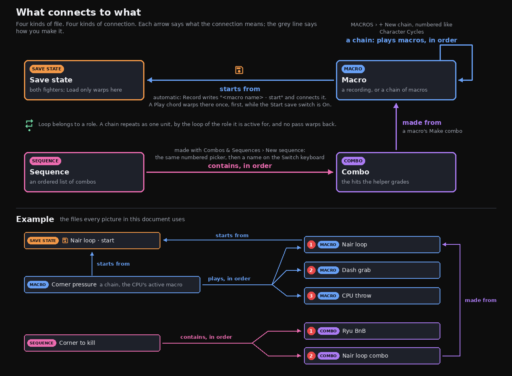

*Top: the four kinds of file and the four connections. Bottom: the example. The chain Corner pressure is the CPU's active macro. The CPU's Play chord warps to its start save, Nair loop · start, then plays Nair loop, Dash grab and CPU throw, in that order. Nair loop starts from the same save when it is played on its own. Corner to kill drills Ryu BnB, then Nair loop combo, and Nair loop combo was made from Nair loop.*

There are four kinds of file: a save state, a macro (a recording, or a chain of macros), a combo, and a sequence.

| Connection | From → to | How it is made | Where you see it |
| --- | --- | --- | --- |
| Start save | macro → its save state, "Nair loop · start". Start save: the save state this macro starts at. Its Play chord warps there once, before the first pass, while its Start save switch is On, the default. Off plays from where the fighters are and keeps the connection. A chain's start save is its macro 1's ([Q12](#q12-where-a-chain-starts-decided-a)); the macros in a chain do not use their own. A macro without a start save is normal: its Play chord plays it on that role from wherever the fighters are. Replays and the old slots have none. | Automatic, when you record | The macro row: the orange floppy chip before the save's name, grey when the switch is Off. The save row: a "start save" tag with the floppy, while a macro that starts there is under the cursor. The Connections panel. |
| Chain | chain → an ordered list of macros 1, 2, 3 | MACROS › + New chain, the last row under the macros: the numbered picker, as in Character Cycles, then a name on the Switch keyboard. Edit chain on the chain's own screen changes it. | The chain row: the chain mark with the count, and the floppy chip with its start save. With the cursor on the chain, its macros wear 1, 2, 3 at their left edge. The Connections panel lists 1 → 2 → 3. |
| Sequence | sequence → an ordered list of combos | Combos & Sequences › + New sequence, the same numbered picker, then a name on the Switch keyboard | The sequence row: "Ryu BnB → Nair loop combo". The Connections panel. |
| Made from | combo ← the macro it was made from | A macro's Make combo | The combo row: a small "from Nair loop". The Connections panel. |

Every connection is a file id, so renaming either end keeps it.

## How to read a list

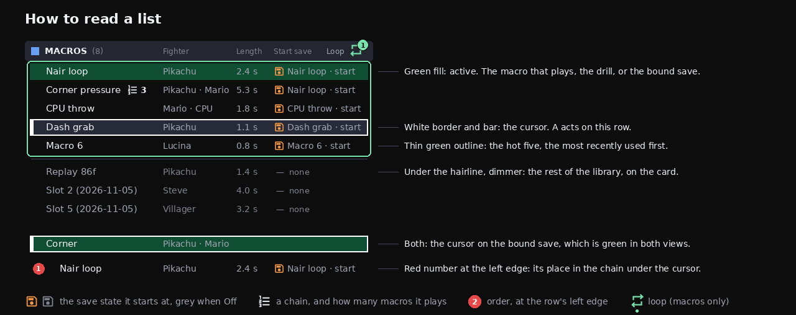

*Green fill is active. A white border with a white bar on the left is the cursor. When the cursor is on the active row, both show. The thin green outline is the hot five, the most recently used first. A red number sits at a row's left edge. Corner pressure is a chain: its chain mark and count, 3, follow its name. The marks along the bottom are the floppy chip (grey when its switch is Off), the chain mark, the order badge, and the loop.*

- **Green fill: active.** The macro that plays for the role in view, a recording or a chain; the combo or sequence being drilled; or the save that Save and Load use. The bound save is green in both role views, because a save has no role.
- **White border and bar: the cursor.** A acts on this row. It is a different mark from the green fill, so the two never look alike.
- **Thin green outline: the hot set.** At most five per kind: the five most recently used, the most recent first. Used means selected (bound or set active), played, drilled or recorded.
- **Under the hairline, dimmer:** the rest of the library, on the card.
- **Red number, at the row's left edge:** its place in the chain or the sequence under the cursor, the badge Character Cycles uses. With the cursor on a macro, every chain that plays it wears the macro's number. It never sits next to the chain mark or the floppy chip. In the picker, A adds the next number. R removes one, including the last, and the later numbers close up; A on a tile that already has a number does nothing. A chain or a sequence may be empty. An empty chain plays nothing, and an empty sequence drills nothing, with no new sentence.
- **Chain mark and count:** a chain, and how many macros it plays. Only a MACROS row has it.
- **Orange floppy chip: the save state this macro starts at.** It is Material Symbols `save`. It sits before the start save's name on a macro or chain row, on a save row's "start save" tag, on the Start save row of a macro's and a chain's own screen, and in the Connections panel's "starts from" line. It is grey when the Start save switch is Off. The same orange floppy marks the SAVE STATES section header; the other headers keep their square.
- **Gold outline** in the step-by-step strips only: a mockup mark for "new". It is not part of the product.

## The loop mark

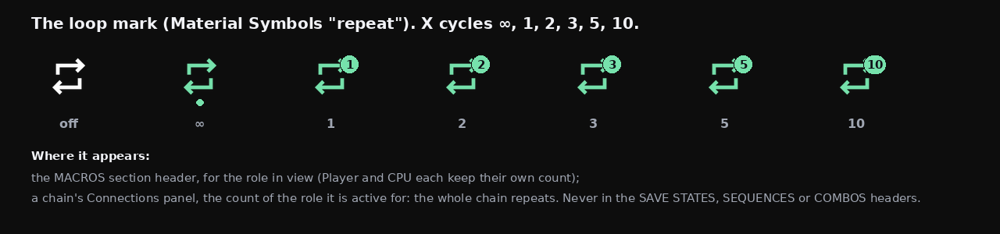

*Off is white. ∞ is green with a dot under it. A count is green with the number in a badge. X cycles ∞, 1, 2, 3, 5, 10. The list is the Options row.*

The loop belongs to the role, not to a section and not to a file. Player and CPU each keep their own count. **Decided.** It appears in two places only: the MACROS section header, for the role in view, and a chain's Connections panel, when the chain is active, as the count of the role it is active for. The chain repeats as one unit, and no pass warps back to the start save ([Q3](#q3-what-loop-does-with-a-chain-decided-a)).

How the product would draw it: as a texture in our own layout archive. The layout builder can embed one. `tools/layout-builder` (branch `p23/rc5-candidate`) already appends textures to the stock `timg/__Combined.bntx`: the 38 item icons from `assets/item-icons` through `import_png_file`, and the generated hitbox orb disc through `import_dds`. Picture panes bind those textures, and the panes' vertex colours tint them, which covers white for off and green for on. The builder reads PNG and DDS, not SVG, so the SVG would be turned into a PNG first. A native game icon that fits: not checked. The floppy chip would be drawn the same way.

Icons: Google Material Symbols `repeat`, `save`, `link` and `format_list_numbered`, from https://github.com/google/material-design-icons, Apache License 2.0. The copies, their source paths, and the licence text are in [icons/](icons/).

## Pop-up

The pop-up is one window over the match, so its size can be judged against the fighters. It owns the buttons while it is open, the way the menu does. B closes it.

- **Top:** the title, then Player | CPU. L or R switches role. The selected role is the menu's red tab.
- **Tabs, under the role:** Save states & Macros, and Combos & Sequences. CPU has only the first.
- **Two sections, stacked.** Each scrolls on its own, by whole rows, and its header stays. The hot five stay in a green outline, the most recently used first, and the library sits under a hairline.
- **The Connections panel, on the right,** spells out the connections of the row under the cursor as a small diagram: the start save, the macros of a chain, the chains that number a macro, the macros that start from a save, the combos made from it, or the order of a sequence, with the loop, the binding, and the streak and best.
- **One role per view,** as in Character Cycles: a view shows only its role's active macro (the green row), its loop count (one loop chip in the MACROS header) and its Connections.
- **Binding:** A on a save binds it to Save / Load. A save has no role: one save is bound at a time, its row is green in both views, and Load only warps there. On the Recording page, A opens the save's screen instead, where Bind to Save / Load is the first row.
- **Footer:** the buttons for the section the cursor is in.

### A save under the cursor

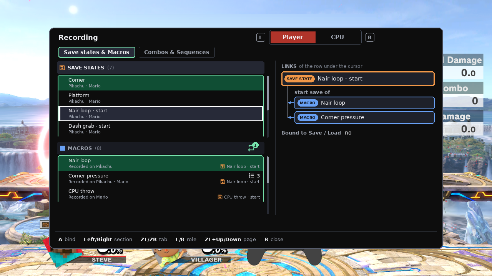

*The Player view, with the cursor on Nair loop · start. Corner is the bound save, so its row is green. Load warps there and starts nothing. The Connections panel says that Nair loop · start is the start save of Nair loop and of the chain Corner pressure, and "Bound to Save / Load: no". A save has no chain and no role.*

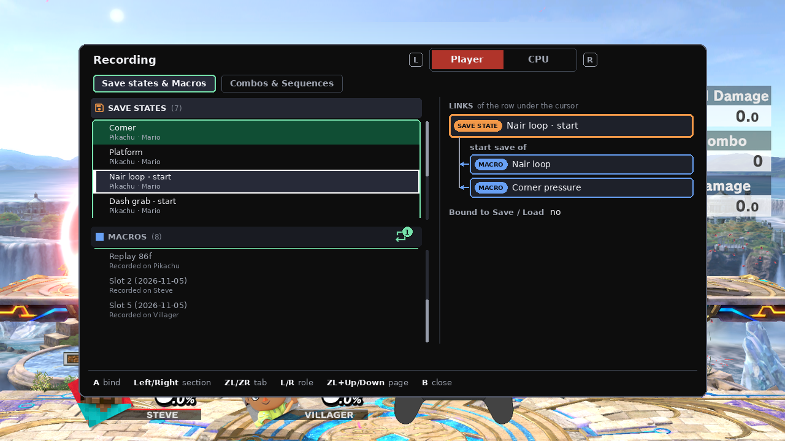

*The same window and the same files. MACROS has scrolled to its end: the hairline, then Replay 86f and the two migrated slots, Slot 2 and Slot 5. SAVE STATES has not scrolled. Both headers stay, including the loop chip, both scrollbars show, and every row that shows is whole.*

### A macro under the cursor

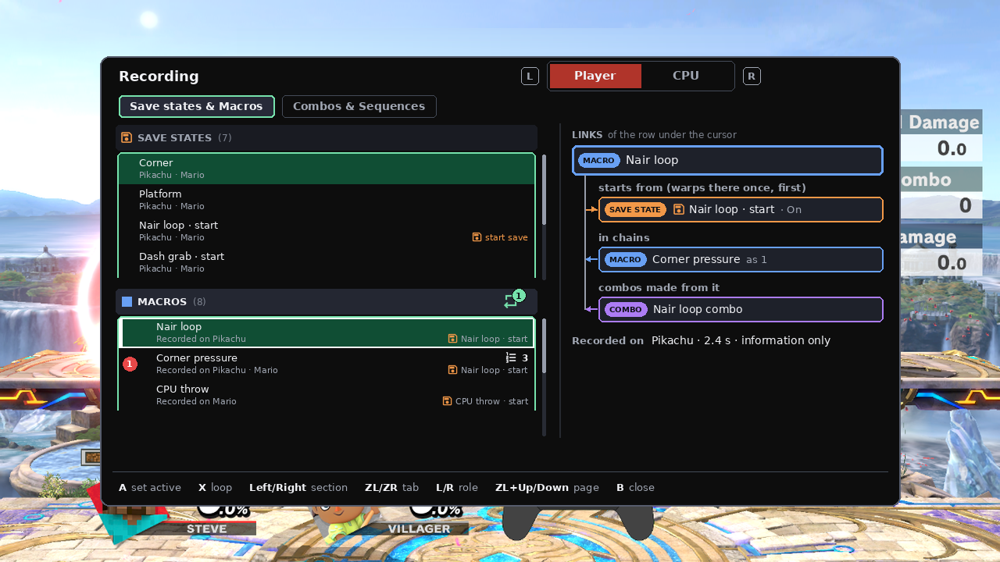

*The Player view. Nair loop is Player 1's active macro, so its row is green with the white border. The chain Corner pressure wears 1 at its left edge, because it plays this macro first. Nair loop · start wears the "start save" tag with the floppy chip. The Connections panel: Nair loop starts from Nair loop · start, with the switch On, and warps there once, first. It is 1 in Corner pressure, Nair loop combo was made from it, and the recorded fighter, Pikachu, is information only.*

A row with no start save, such as Replay 86f, has no floppy chip. That is normal: its Play chord plays it from where the fighters are, and its Connections panel says "no start save · plays from where the fighters are".

### A chain under the cursor, in the CPU view

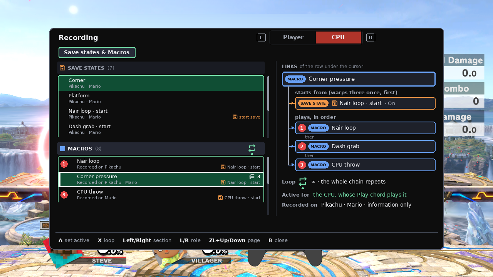

*The CPU view has one tab. The chain Corner pressure is the CPU's active macro, green, with the cursor on it. Its macros wear 1, 2 and 3 at their left edge; the list itself is in the order they were last used. Its row shows the chain mark with 3, and the floppy chip with Nair loop · start. The Connections panel: it starts from Nair loop · start and warps there once, then plays Nair loop, Dash grab and CPU throw in order. The CPU's loop ∞ repeats the whole chain, and the CPU's Play chord plays it. Corner is green here too, the one bound save. The footer has no tab button, because there is nothing to switch to.*

A chain is a macro made of macros: a file in MACROS, with its macros in order. + New chain, the last row under MACROS, makes one with the numbered picker ([Q1](#q1-how-you-number-a-chain-or-a-sequence-decided-a)) and a name on the Switch keyboard. Like any macro, it has a start save with its Start save switch, On by default. It is set active for a role on its own screen, or with A in the pop-up, and that role's Play chord plays it. Its macros play one after another from where the fighters are; their own start saves are not used. It is hot by the same rule as every macro.

### Q2 · Which role plays a chain — decided

The role it is set active for, with that role's Play chord. Set active "On · CPU" on the chain's own screen, or A on the chain in the pop-up's CPU view, makes it the CPU's active macro. Each role has one active macro, a recording or a chain. The CPU no longer has one thing on Load and another on its Play chord. The macro files' recorded role is information only, like the recorded fighter.

The operator, restating the model:

> So under this new proposal you have a save state that only warps. A macro/chain that optionally starts from one save state? And one chord for each since a chain is just a compound macro

The primary asked: "One active macro per role. The CPU can't have a chain on Load and a separate macro on its Play chord at the same time anymore. You'd pick one as its active macro. Is that OK?" The operator: "Yes to 1". Operator, 2026-11-06.

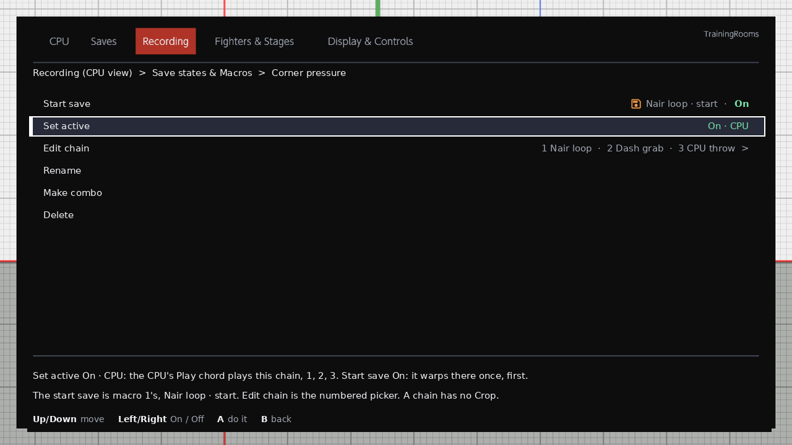

*The chain's own screen in the CPU view. Set active is On · CPU, so the CPU's Play chord plays Corner pressure.*

### Q3 · What loop does with a chain — decided: A

The chain is one unit. It plays 1, 2, 3, then starts again at 1, as many times as the loop count says; ∞ keeps going. That is the setup → follow-up → reset rhythm you practise. The count is the loop of the role the chain is active for.

No pass warps back. The Play chord warps to the start save once, before the first pass, when the Start save switch is On; every later pass plays on from where the fighters are. A recording follows the same rule.

Operator, 2026-11-06. The start save part, from revision 8: the primary asked "Loop and the start save: should each loop pass warp back to the start save?", and the operator answered "no to 2".

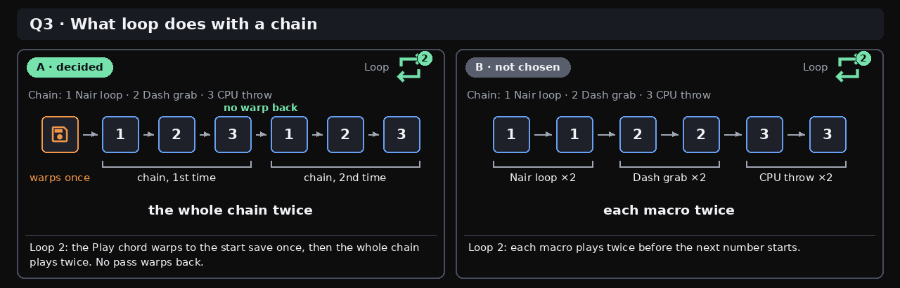

### Q12 · Where a chain starts — decided: A

A chain starts where its macro 1 starts: at macro 1's start save, shown on the chain row with the floppy chip. To change it, reorder the chain, or save over that file; there is no new screen. If macro 1 has no start save, the chain has none and plays from where the fighters are. The chain's own Start save switch decides whether its Play chord warps there.

Operator, 2026-11-06: "I agree with your answers to q12 and q13".

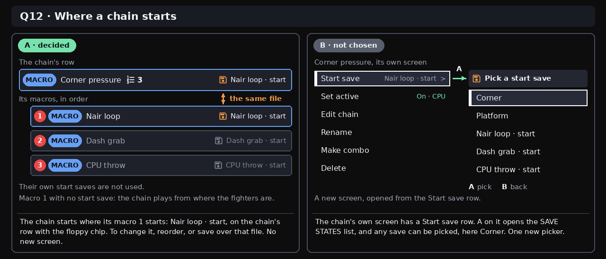

### Combos and sequences

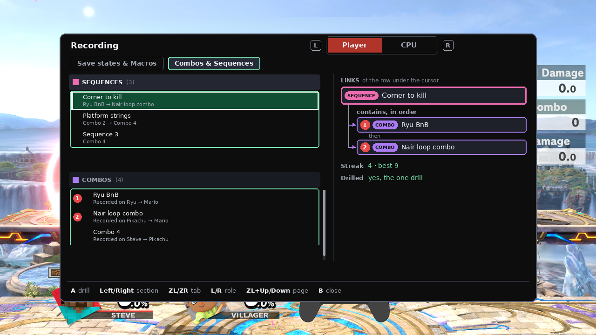

*Combos & Sequences, stacked: SEQUENCES on top, COMBOS below. Corner to kill is the drill. Its two combos wear 1 and 2 at their left edge. The Connections panel lists them in order, with the streak and the best. Neither section has a loop mark.*

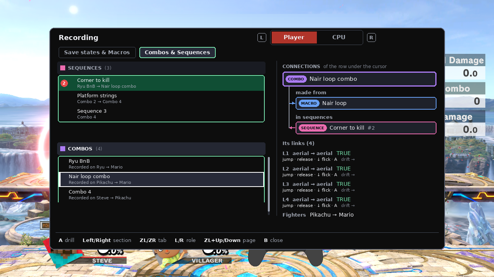

*The cursor is on Nair loop combo. Corner to kill wears 2 at its left edge, because that combo is its second step. The Connections panel says Nair loop combo was made from Nair loop and is number 2 in Corner to kill. The panel lists each link, its two moves, and whether it was recorded TRUE, then that link's events, for example "jump · release · ↓ flick · A", and drift as information ("drift →"). It reads the combo file's own `links`. A step counts when those events are there, of the same kind and direction, in order and within the tolerance, and the move that comes out is the recorded move. The operator: "yes do it, show drift as info only". Recorded on names both fighters, and it does not hide the row.*

### Q5 · How the two lists sit in the Combos & Sequences tab — decided: A

Sequences on top, combos below, each with its own scroll, hot outline and library. The Connections panel lists the focused sequence's combos in order. Left and Right move between the two sections.

Operator, 2026-11-06.

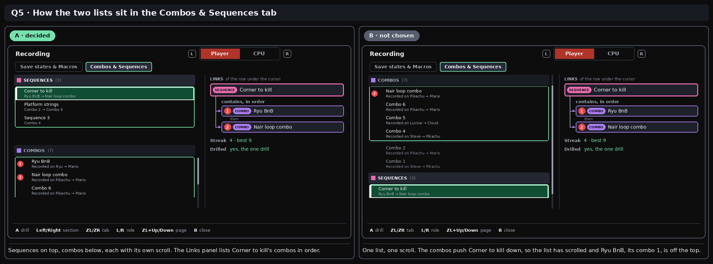

### Q6 · Hot sequences — decided: A

Up to five sequences sit at the top in the green outline, the most recently used first, exactly like macros, combos and saves. The rest are under the hairline, on the card. Drilling a sequence moves it into the hot five. It works the same everywhere and costs a few kilobytes.

Operator, 2026-11-06.

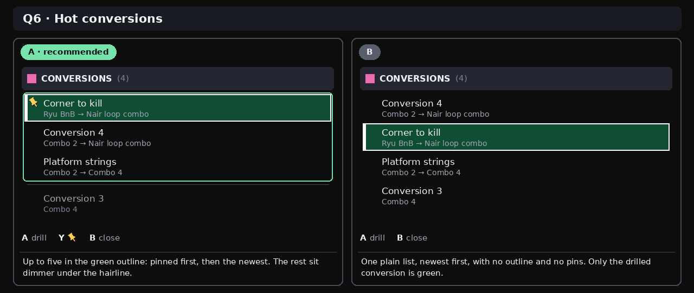

### Q10 · Side by side, or stacked — decided: stacked

The two sections of a tab sit one above the other, each with its own scroll, and the Connections panel on the right spells out the connections of the row under the cursor. The pop-up pictures in this doc are this layout.

Operator, 2026-11-06.

### Recorded on another fighter

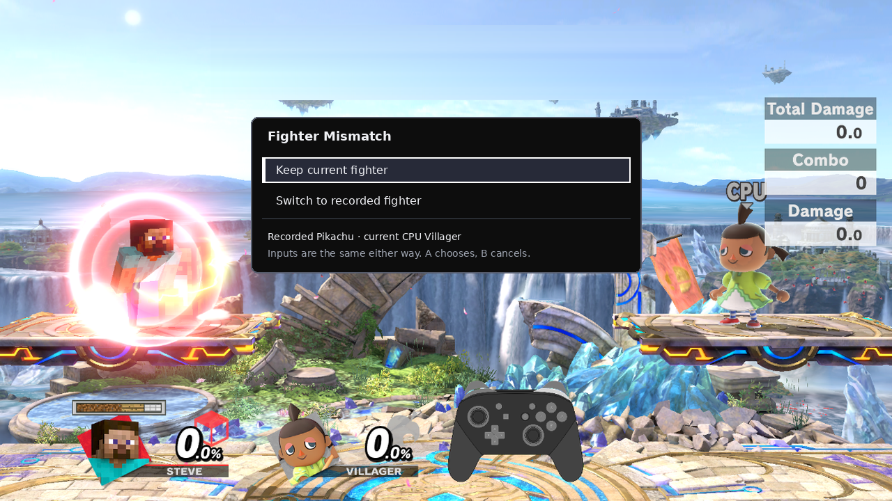

*The existing Fighter Mismatch screen. This frame is Steve and Villager, so the prompt names Villager, the CPU on screen. The operator's example is the same screen for a Pikachu macro practised on Palutena. Asked once, for the chain's first macro. Nothing is hidden or refused.*

### Q4 · When Switch / Keep appears for a chain — decided: A

One Fighter Mismatch prompt appears once, before the chain starts, when its role's Play chord starts it, and only if macro 1 was recorded on a different fighter. It is the existing single-macro prompt. Switch changes to macro 1's recorded fighter. Load never starts a chain, so Load never asks. Macros 2, 3 and later never ask and never switch. They play on the same character. The chain's prompt has no list of macros and no new text. Keep plays the inputs on the fighter you have now.

Operator, 2026-11-06. Amended the same day. The primary asked: "Switch / Keep when a chain mixes fighters. The prompt has a single "Switch to recorded fighter" button. Which fighter should Switch pick?" The operator: "this should only apply to the first macro. if it's the second macro then it just keeps the same character".

The picture's example: the CPU's Play chord (ZR + Up) starts the chain, the CPU is Palutena, and macro 1, Nair loop, was recorded on Pikachu. Macros 2 and 3 play on the same character; they never ask.

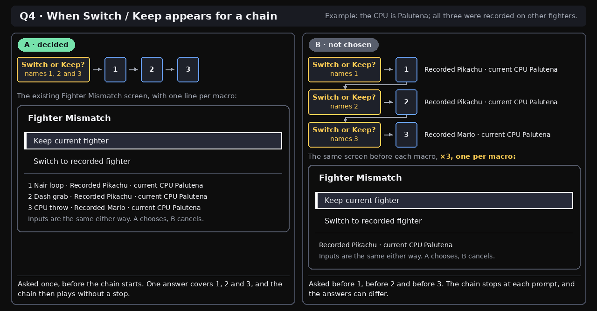

### Pop-up buttons

| Button | Save states | Macros | Sequences and combos |
| --- | --- | --- | --- |
| A | Bind to Save / Load | Set active for this role: a recording or a chain | Drill |
| X | — | Cycle the loop | — |
| Left / Right | Move to the other section | Move to the other section | Move to the other section |
| ZL / ZR | The other tab. Omitted when CPU has only one | same | same |
| ZL + Up / Down | Page this section | Page this section | Page this section |
| L / R | Player / CPU | Player / CPU | Player / CPU |
| Up / Down | Move inside this section | Move inside this section | Move inside this section |
| B | Close | Close | Close |

Checked against the current menu code (`src/model/menu/input.rs` and `mod.rs` on `p23/rc5-candidate`):

- ZL held is a modifier. A ZL press on its own reaches the menu only as a tap, sent on release when nothing else was pressed. ZL alone and ZL + Up / Down never fire together, so the tab switch and the page jump do not collide.
- These screens ignore ZL and ZR taps today. The checklists use a ZL tap for tick-all, and the roster grids use ZR for the role. Neither is on these screens.
- Left and Right cycle the value of a settings row. A library row has no value to cycle, so on these two sections Left and Right can move between them.
- L and R stay the role toggle here. On the Recording page they change the menu page, as they do on every other page.
- The menu's button list has no + today, and these screens no longer need one: Edit chain is a row on the chain's own screen, so the menu adapter needs no new button.
- Minus stays menu shortcut 1.
- Y is unused on these screens.

### Q11 · Which buttons move — decided: A

ZL / ZR change the tab. Left / Right jump between the upper and the lower section. Up / Down move inside a section, and ZL + Up / Down pages it. Each button has one job on this screen, and the footers show it.

Operator, 2026-11-06.

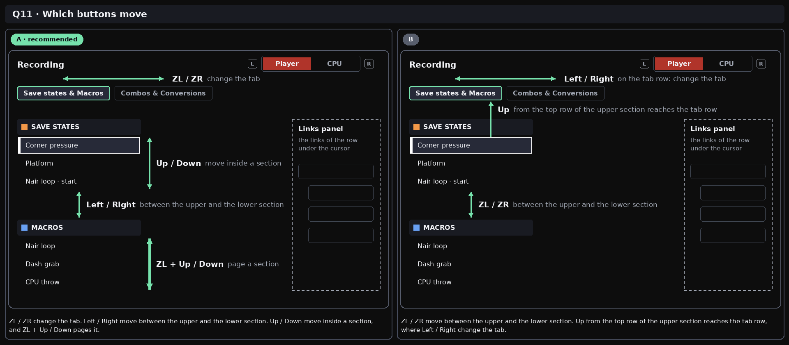

## Recording page

The same stacked sections and the Connections panel, inside the menu: the Connections panel fits beside the sections in the menu's content area. The left column is Save states & Macros, Combos & Sequences, Replays, Options; it lists the groups, so the page has no tab switch. One role per view, as in the pop-up: the Player | CPU toggle sits above the sections, and ZR switches it, as in Character Cycles, because L / R change the menu page. The CPU view has only Save states & Macros. A opens the file's own screen; on a save, Bind to Save / Load is that screen's first row. X cycles the loop when the cursor is in MACROS, as in the pop-up. ZL + Up / Down pages the section the cursor is in.

### Save states and macros

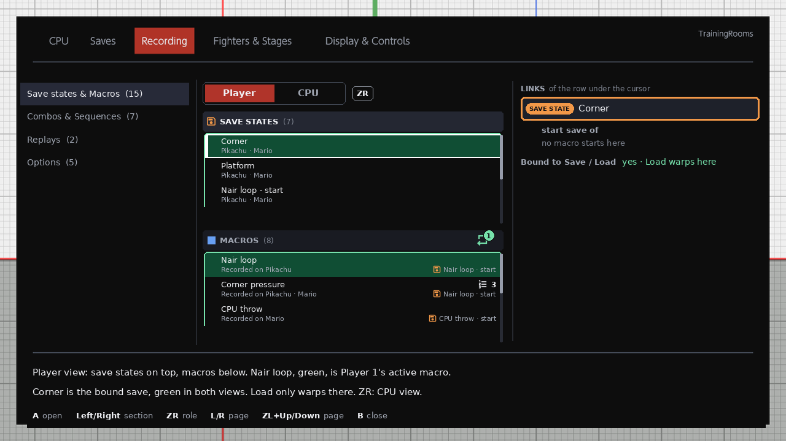

*The Player view. Saves on top, macros below, and the Connections panel of Corner, the bound save, on the right. No macro starts there, and "Bound to Save / Load: yes · Load warps here". Nair loop, green, is Player 1's active macro, and the MACROS header has Player 1's loop chip only. The chain Corner pressure is not green here: it is the CPU's active macro.*

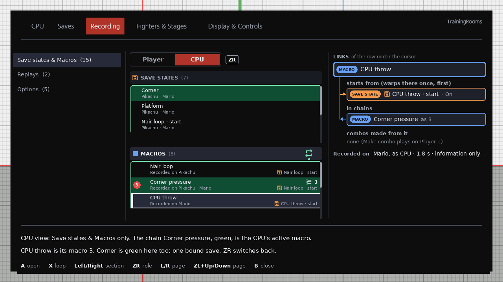

*The CPU view, after ZR. Only Save states & Macros. The chain Corner pressure, green, is the CPU's active macro, and the MACROS header has the CPU's loop chip, ∞. The cursor is on CPU throw, so Corner pressure wears 3 at its left edge, and the Connections panel says CPU throw is 3 in Corner pressure. Corner is green here too: there is one bound save.*

### Combos and sequences

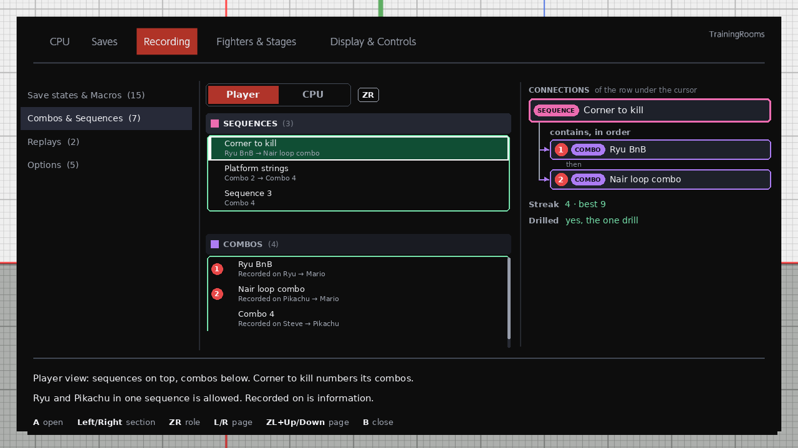

*The Player view. Sequences on top, combos below. Corner to kill numbers Ryu BnB and Nair loop combo, and its Connections panel lists them in order. The two fighters in one sequence are allowed.*

| Button | What it does |
| --- | --- |
| A | Open the file's own screen. On a save, Bind to Save / Load there binds it |
| X | Cycle the loop, when the cursor is in MACROS, as in the pop-up |
| Left / Right | Move to the other section |
| ZR | Player / CPU, as in Character Cycles |
| ZL + Up / Down | Page the section the cursor is in |
| L / R | Previous / next menu page |
| B | Close the menu |

Replays and Options keep revision 3's rows (see Each file's screen, and the other rules). The loop shows in Options only as the list of counts.

## How connections are made

Each strip is three steps in the menu's own style. The panels are drawn at full size, so the text stays readable.

### 1 · Record → start save

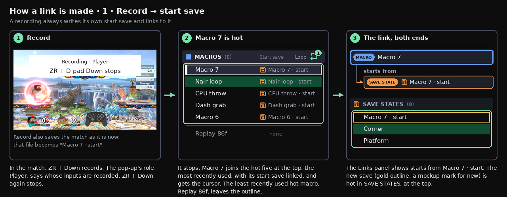

*Record also writes "Macro 7 · start" and connects it. When the recording stops, Macro 7 joins the hot five at the top, the most recently used. The least recently used hot macro, Replay 86f, leaves the outline. Its Connections panel shows starts from Macro 7 · start, and the new save is listed in SAVE STATES, at the top of its hot five.*

### 2 · Make a chain

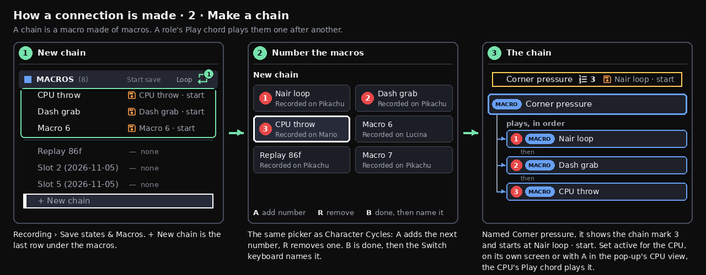

*Recording › Save states & Macros: + New chain is the last row under MACROS, as + New sequence is under SEQUENCES. The picker numbers Nair loop, Dash grab and CPU throw with the same buttons as Character Cycles, except that R also removes the last number: A adds the next number, R removes one, and B is done; the Switch keyboard then names it. The new row, Corner pressure (gold: new), shows the chain mark with 3 and the floppy chip with Nair loop · start, its macro 1's start save. Its Connections panel lists 1 → 2 → 3. Once it is set active for the CPU, on its own screen or with A in the pop-up's CPU view, the CPU's Play chord plays it.*

### Q1 · How you number a chain or a sequence — decided: A

Every recording in the library is a tile. A chain is not one ([Q13](#q13-can-a-chain-contain-a-chain-decided-a)). A on a tile gives it the next number. R takes a tile's number off, and the later numbers close up. A on a tile that already has a number does nothing, and B is done. It is exactly how Character Cycles orders fighters, so there is nothing new to learn. To change the order, take numbers off and put them back. The same picker numbers a sequence's combos.

Operator, 2026-11-06. Amended the same day, so that R removes, as in Character Cycles: "when it's ambiguous I would keep it consistent. We want to minimize the number of chords and have context determine what they do. So in this case I would have R supercede A if that's more intuitive".

Amended again in revision 8.2. R also removes the last number, so a chain or a sequence may be empty. The picker is Character Cycles' picker, except that it allows an empty list. An empty chain plays nothing, and an empty sequence drills nothing, with no new sentence. The primary asked: "R on the last number in the picker. Character Cycles won't let you remove its last fighter, because a cycle can't be empty. A chain or sequence can be empty (nothing plays), so I'd let R remove the last number too." The operator: "2. agreed".

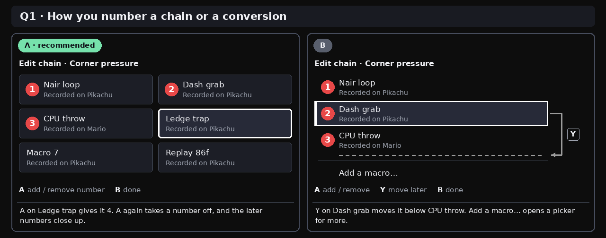

### Q13 · Can a chain contain a chain — decided: A

No. The chain picker lists recordings only, so a chain is never a step of another chain, and nothing needs a loop check. This is a restriction, and the operator approved it. It has no message, because the picker simply does not offer chains. Phase 2 records it in `docs/RESTRICTIONS.md` (see What leaves).

Operator, 2026-11-06: "I agree with your answers to q12 and q13".

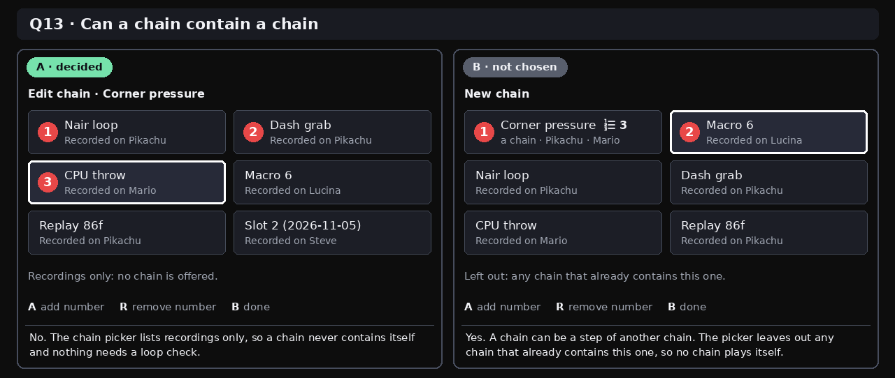

### 3 · Make combo from a macro

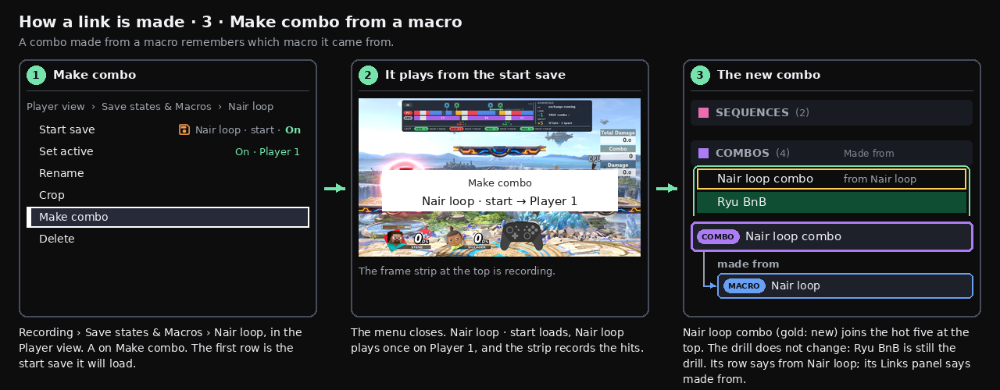

*Make combo loads the macro's start save and plays the macro once on Player 1 while the frame strip records. The new combo says "from Nair loop" in its row and "made from" in its Connections panel. The new combo joins the hot five; the drill does not change.*

Make combo on a chain works the same way, as on a recording: it warps to the chain's start save and plays the whole chain once on Player 1 while the frame strip records.

If the start save was deleted, the load is skipped and the approved sentence shows: "No start save. This macro plays from where the fighters are." The sentence is only for a start save that was deleted. A macro that never had one, such as a replay or an old slot, plays from where the fighters are without it. No connection uses the sentence that already exists: "No combo yet: land a hit and a follow-up first."

### 4 · Make a sequence

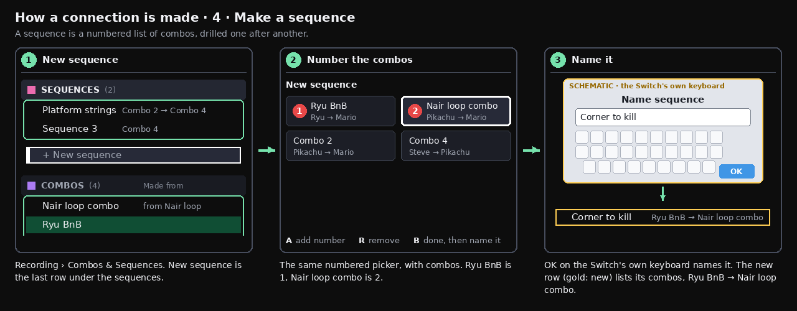

*+ New sequence is the last row under the sequences. The same numbered picker orders the combos. The Switch's own keyboard, drawn here as a labelled schematic, names it. The new row lists its combos.*

### Q7 · What the sequence file stores — decided: A

The sequence keeps a reference to each combo file, in order, the same kind of connection a macro has to its start save. Rename a combo and the sequence shows the new name. Delete a combo and the sequence skips that step. The sequence file stays tiny.

Operator, 2026-11-06.

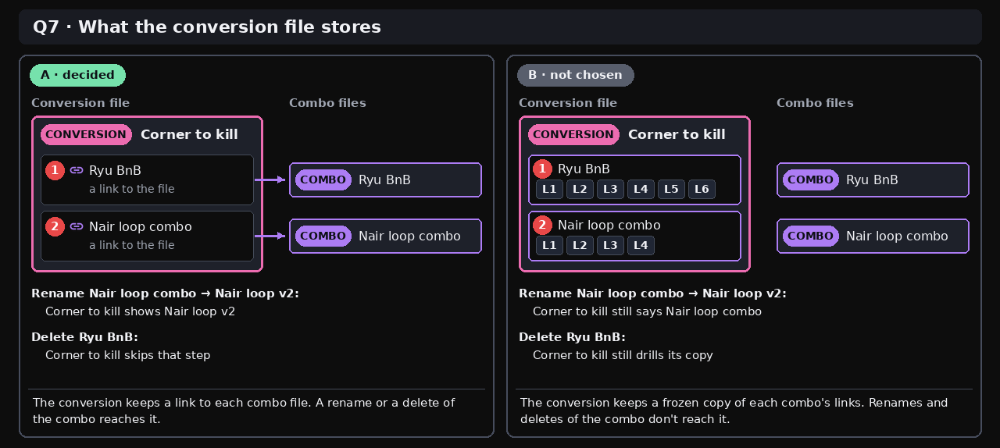

### 5 · Drill a sequence

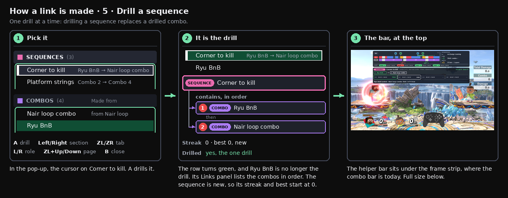

*A on Corner to kill makes it the drill and replaces the drilled combo, so there is one drill at a time. The bar appears at the top of the screen. Corner to kill is new, so its streak and best start at 0. The next picture shows the bar at full size, some attempts later.*

## The sequence drill bar

*Under the frame strip, where today's combo bar sits. "SEQUENCE · Corner to kill · combo 2 of 2". Ryu BnB is done, and Nair loop combo is the current combo. L1 is TRUE and L2 is now. Some attempts after strip 5, the sequence's streak is 4 and its best 9.*

The bar is the combo helper's bar with a sequence header and a row for the sequence's combos. TRUE, the current link, and the links still to come use the helper's own marks. Streak and best count only a finished sequence. A drop restarts the sequence at combo 1, with the streak back to 0 and best kept; the Q8 picture shows it.

**Grading, decided ([Q8](#q8-a-drop-and-what-completes-the-sequence-decided)); this changes the existing combo helper.** Today a combo attempt is clean only when every link is TRUE, every press is there, and every press is within the tolerance (`src/model/combo.rs`: `Grade::clean`, `Reason`). Clean no longer needs TRUE, for a combo drilled alone and for a sequence. A step counts when its recorded input events are there, of the same kind and direction, in order and within the tolerance, and the move that comes out is the recorded move. A link records button presses and releases, the C-stick, and stick flicks (fast-fall, dash, tap-jump), each timed from the first frame you could act, up to 12 events. Directions are relative to facing (forward or back, up, down, and the diagonals). Left and right are told apart, and a combo recorded facing right still grades facing left. That facing rule is the primary's design choice. Drift, the held stick between events, is recorded and shown as information and is never graded. A missing or extra-late event is a drop, as is a different move, or the exchange ending before the step. Older combo files (presses only) still load and grade on their presses as before. Nothing new is required of a shared file. The exchange ends 20 frames after the CPU can act again, or on a shielded hit, so the CPU may act in a gap for up to 20 frames and a longer gap is a drop. TRUE stays on the bar as information. The operator: "yes do it, show drift as info only".

### Q8 · A drop, and what completes the sequence — decided

A drop sends you back to combo 1 of the sequence, and the streak to 0; best is kept. Neither the sequence nor a combo has to be a true combo: the CPU may be able to act between the combos, or between two hits of one combo. This is for drilling things one after another. A step counts when you press its recorded buttons, with the same direction, in order and within the timing tolerance, and the move that comes out is the recorded move. A different move does not count, even when the presses match. A step drops on a missing press, a press outside the tolerance, a different move, or the exchange ending before the step. TRUE still shows on the bar, as information. It no longer decides whether a combo or a sequence counts. The exchange ends 20 frames after the CPU can act again, or on a shielded hit (the frame strip's `DROP_MAX`). So the CPU may act in a gap for up to 20 frames, and a longer gap is a drop. The primary asked: "Is that right? In particular: Should single combos also stop needing TRUE? Is a 20-frame allowance for the CPU acting the behaviour you want?" The operator: "that sounds right". The primary asked: "A different move with the same presses. Today the grader also fails a hit where the move came out different. Should that still count when the buttons, direction and timing are right?" The operator: "1. No."

Operator, 2026-11-06.

Amended in revision 8.3. A combo link records input events, not only presses: button presses and releases, the C-stick, and stick flicks (fast-fall, dash, tap-jump). Each event has its timing, counted from the first frame you could act. A link holds up to 12 events. Directions are relative to facing (forward or back, up, down, and the diagonals). Left and right are told apart, and a combo recorded facing right still grades facing left. That facing rule is the primary's design choice. A step counts when its recorded input events are there, of the same kind and direction, in order and within the tolerance, and the move that comes out is the recorded move. TRUE is still not required. A missing or extra-late event is a drop. Drift, the held stick between events, is recorded and shown as information. It is never graded. Older combo files (presses only) still load and grade on their presses as before. Nothing new is required of a shared file. Make combo and Save combo both record events. Save combo works from live play, because the strip already samples every frame. The operator asked: "if combos don't save inputs how do we know they were done properly? A nair loop for example that I record as a combo wouldn't that need the inputs? Otherwise it's just a glorified version of the combo counter in native training mode". The primary asked: "Should I do it? And should drift be shown only, as I suggest, or graded too?" The operator: "yes do it, show drift as info only".

Operator, 2026-11-07.

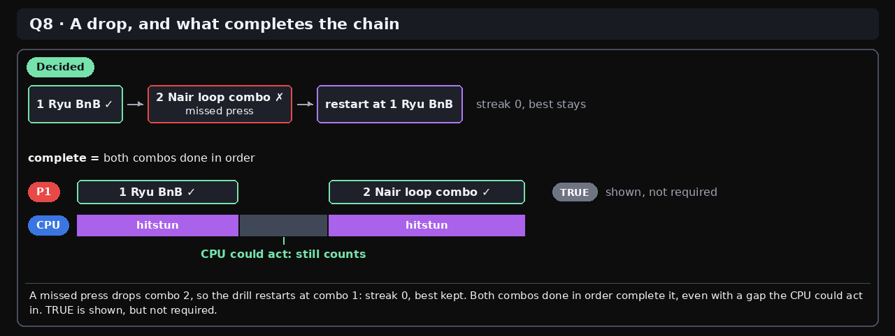

### Q9 · One drill at a time — decided: A

The helper drills one thing, a sequence or a single combo. A on one replaces the other, and the bar always shows what you are drilling. To work on one step, A on its numbered row inside the sequence drills that combo alone, with its own streak.

Operator, 2026-11-06.

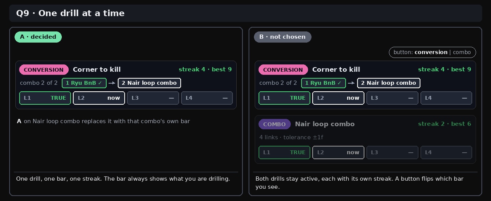

Drilling one combo from a sequence's numbered rows uses that combo's own streak and best and its normal bar, as today.

## Already decided

- One Recording page, plus one pop-up. Record follows the pop-up's role: Player records you, CPU records the CPU. **Decided.**
- Two tabs under the role toggle: Save states & Macros, and Combos & Sequences. CPU has only the first. The two sections in a tab are stacked and scroll on their own. **Decided.**
- The recorded fighter is information. The column reads Recorded on. Nothing filters, hides, greys, or refuses by fighter. A mismatch raises Switch / Keep, and Keep plays the inputs on the current fighter. A sequence may mix fighters. **Decided.**
- Hot memory is one minute resident per hot macro (3,600 frames, 28.8 KiB). Five hot macros are 144 KiB. A longer file still plays; the rest is read in 600-frame windows. The file cap stays 36,000 frames. No recording is refused for length. **Decided.**
- Loop counts are ∞, 1, 2, 3, 5, 10. X cycles them. The default is 1, and a loop that is On today becomes ∞. The list is the Options row. The loop belongs to the role. **Decided.**
- Player 1 and the CPU may play at the same time. A chain does not use that: its macros play one after another. **Decided.**
- Save states are named files that you bind for Save and Load. There is no slot number and no extra slot shortcut. **Decided.**
- A chain is an ordered list of macros, numbered 1, 2, 3…, kept in its own file in MACROS. A macro's start save, started by the role's Play chord, replaces the old "play a recording because a state loaded" checklist. Operator, 2026-11-06.
- A recording's start is its own save file, "<macro name> · start", and the macro stores that file's id. **Decided.**
- Five hot saves, the most recently used, by the same rule as every other kind. **Decided.**
- Save states are a section of the Save states & Macros tab, under both roles. The third Saves tab is rejected. **Decided.**
- The sentence "No start save. This macro plays from where the fighters are." is approved as `macro-start-save-missing`. It shows only when a macro's connected start save was deleted. **Decided.**
- A sequence is an ordered list of saved combos. You can drill one combo, or the sequence. **Decided.**
- Respawn on platform is under Fighters & Stages › Stages, not under save states. `p23/respawn-label` implements the move. **Decided.**
- Names use the Switch's own keyboard. **Decided.**
- The pop-up and the Recording page use the stacked layout: the two sections of a tab one above the other, each with its own scroll, and the Connections panel on the right for the row under the cursor ([Q10](#q10-side-by-side-or-stacked-decided-stacked)). Operator, 2026-11-06.
- A save state only warps. It restores both fighters, nothing more: Save (ZL + Down) writes the bound save, and Load (ZL + Up) warps to it. Load never starts a macro. A save has no role: Bind to Save / Load is On or Off. The operator: "So under this new proposal you have a save state that only warps. A macro/chain that optionally starts from one save state? And one chord for each since a chain is just a compound macro". Operator, 2026-11-06.
- One save state is bound at a time. The save list is shared by both roles, because a save restores both fighters. A on a save in the pop-up binds it; on the Recording page, A opens the save's screen, where Bind to Save / Load is the first row. Operator, 2026-11-06.
- A chain is a compound macro: a file in MACROS, made with + New chain, the last row under MACROS, and the numbered picker. Like any macro, it has a start save with its Start save switch, it is set active for a role on its own screen, and that role's Play chord plays it ([Q2](#q2-which-role-plays-a-chain-decided)). Its macros play one after another from where the fighters are; their own start saves are not used. Its own screen has Start save, Set active, Edit chain, Rename, Make combo and Delete, and no Crop. Its row has the name, the chain mark with the count, the floppy chip with its start save's name, and Recorded on with its macros' fighters. Operator, 2026-11-06.
- One active macro per role, a recording or a chain. The CPU no longer has one thing on Load and another on its Play chord. The operator: "Yes to 1". Operator, 2026-11-06.
- The loop never warps back. A Play chord warps to the start save once, before the first pass, when the switch is On; every later pass plays on from where the fighters are. One rule for a recording and a chain ([Q3](#q3-what-loop-does-with-a-chain-decided-a)). The operator: "no to 2". Operator, 2026-11-06.
- One role per view, as in Character Cycles: the pop-up and the Recording page show one role at a time, with that role's active macro, loop count and Connections. L / R switch the role in the pop-up; ZR switches it on the Recording page. The CPU view has only Save states & Macros. No role chips. The operator: "does it make more sense to show the CPU links, macros etc when the CPU view and the same for p1? Otherwise it's kind of confusing showing both at once. I think character cycles adopts this philosophy." Operator, 2026-11-06.
- The bound save is a green row in both role views. The operator: "The save state could just be green and be visiblenin both views?" Operator, 2026-11-06.
- The floppy chip, Material Symbols `save` in orange, means the save state this macro starts at. It sits before the start save's name on a macro or chain row, on a save row's "start save" tag, on the Start save row of a macro's and a chain's own screen, and in the Connections panel's "starts from" line. It is grey when the Start save switch is Off. The SAVE STATES section header has the same orange floppy, where it had an orange square; the other headers and the kind pills are unchanged. The operator: "I would have the orange square next to the save states be an orange save icon (floppy disk chip). And then have the chain chips be the same orange floppy disk chip so it's clear that we're talking about what save state the macro will start at". Operator, 2026-11-06.
- "Conversion" is now called "sequence", everywhere a player reads it. "Chain" means only the compound macro, and "sequence" means only the file kind: an ordered list of combos. The operator: "we should not use the word conversion and should call it sequence instead so we don't confuse people since "conversion" means other things in the gaming community". Operator, 2026-11-06.
- There is no chord for combos or sequences. Selecting one (A, Drill) makes it the drill. Operator, 2026-11-06.
- What you select, the chords run: the bound save state for Save and Load, and each role's active macro, a recording or a chain, for that role's Play chord, with or without its start save. Connections and sequences describe what happens when it runs. Operator, 2026-11-06.
- A macro without a start save is normal. Its Play chord plays it on that role from wherever the fighters are. Replays and the old slots have none. Operator, 2026-11-06.
- Start save On / Off on a macro and on a chain, default On. On: its Play chord warps to the start save once, then plays. Off: it plays from where the fighters are, and the connection stays. A macro with no start save has no switch. In a chain, only the chain's start save is used, whatever each macro's switch says. Operator, 2026-11-06.
- Pins are dropped. The hot five of each kind are the five most recently used, the most recent first. Used means selected (bound or set active), played, drilled or recorded. When a sixth is used, the least recently used leaves the outline and stays on the card under the hairline. Y is unused on these screens. Operator, 2026-11-06.
- Q1, Q3, Q4, Q5, Q6, Q7, Q9, Q11, Q12 and Q13 are A; Q8 is the operator's own answer. Each block above says what it means. Operator, 2026-11-06.
- When it is ambiguous, keep it consistent: few chords, with context deciding what they do. So the numbered picker (+ New chain, Edit chain, + New sequence, Edit combos) works as Character Cycles does: A gives the next number, R takes a number off and the later numbers close up, A on a numbered tile does nothing, and B is done. Inside the picker, R removes; the role toggle does not apply there, because the picker edits the file, whichever role it is active for. The operator: "when it's ambiguous I would keep it consistent. We want to minimize the number of chords and have context determine what they do. So in this case I would have R supercede A if that's more intuitive". Operator, 2026-11-06.
- A combo or a sequence counts when its recorded input events are there, of the same kind and direction, in order and within the tolerance, and the move that comes out is the recorded move. A link records presses and releases, the C-stick, and stick flicks (fast-fall, dash, tap-jump), up to 12 events, timed from the first frame you could act. Directions are relative to facing, the primary's design choice, so left and right are told apart and a combo recorded facing right still grades facing left. Drift is recorded and shown as information and is never graded. A missing or extra-late event is a drop. A different move does not count, even when the presses match, and a different move is a drop. TRUE is shown as information and is no longer a condition, for a combo drilled alone and for a sequence. This changes the existing combo helper (`Grade::clean`). The exchange ends 20 frames after the CPU can act again, or on a shielded hit, so the CPU may act in a gap for up to 20 frames and a longer gap is a drop. Confirmed: 'that sounds right'. Operator, 2026-11-06. The primary asked: "A different move with the same presses. Today the grader also fails a hit where the move came out different. Should that still count when the buttons, direction and timing are right?" The operator: "1. No." Operator, 2026-11-06. The operator: "yes do it, show drift as info only". Operator, 2026-11-07.
- On the Recording page, A opens the file's own screen; on a save, Bind to Save / Load is that screen's first row. In the pop-up, A still binds, sets active, or drills. The page footers read "A open". The operator, on the primary's recommendations: "go with your recommendations and redraw them". Operator, 2026-11-06.
- Make combo does not change the drill. The new combo joins the hot five at the top, because it was recorded, and the current drill stays the drill. "go with your recommendations and redraw them". Operator, 2026-11-06.
- A macro's own screen, and a chain's, has one Set active row, for the role in view: "On · Player 1" (or "On · CPU" in the CPU view) or "Off". Left / Right turn it On or Off; On makes this file that role's active macro, replacing the one before, and that role's Play chord plays it. "go with your recommendations and redraw them". Operator, 2026-11-06.
- A chain starts where its macro 1 starts: at macro 1's start save, shown on the chain row with the floppy chip. To change it, reorder, or save over that file; there is no new screen. If macro 1 has no start save, the chain has none and plays from where the fighters are ([Q12](#q12-where-a-chain-starts-decided-a)). The operator: "I agree with your answers to q12 and q13". Operator, 2026-11-06.
- A chain cannot contain a chain. The chain picker lists recordings only, so nothing needs a loop check. This is a restriction, approved by the operator ([Q13](#q13-can-a-chain-contain-a-chain-decided-a)): "I agree with your answers to q12 and q13". Operator, 2026-11-06.
- X cycles the loop on the Recording page too, when the cursor is in MACROS, as in the pop-up. The primary asked: "X on the Recording page: should X cycle the loop when the cursor is in MACROS, as it does in the pop-up?" The operator: "yes". Operator, 2026-11-06.
- Connections between files are called connections. The combo helper still says link for its hits: L1, "N links", "link 1 of 4". The operator: "yes have grok do both and then we are green to implement". Operator, 2026-11-06.
- The combo's Connections panel lists each link, its two moves, and whether it was recorded TRUE, for example "L1  aerial → aerial  TRUE". It reads the combo file's own `links`; nothing new is stored. The operator: "yes have grok do both and then we are green to implement". Operator, 2026-11-06.
- A different move does not count, even when the presses match. A step counts when its recorded input events are there, of the same kind and direction, in order and within the tolerance, and the move that comes out is the recorded move. A different move is a drop. TRUE is still not required. The primary asked: "A different move with the same presses. Today the grader also fails a hit where the move came out different. Should that still count when the buttons, direction and timing are right?" The operator: "1. No." Operator, 2026-11-06.
- R removes the last number too, so a chain or a sequence may be empty. The picker is Character Cycles' picker, except that it allows an empty list. An empty chain plays nothing, and an empty sequence drills nothing, with no new sentence. The primary asked: "R on the last number in the picker. Character Cycles won't let you remove its last fighter, because a cycle can't be empty. A chain or sequence can be empty (nothing plays), so I'd let R remove the last number too." The operator: "2. agreed". Operator, 2026-11-06.
- Switch / Keep for a chain is asked only for the chain's first macro. When a chain starts, the Fighter Mismatch prompt appears only if macro 1 was recorded on a different fighter. It is the existing single-macro prompt; Switch changes to macro 1's recorded fighter. Macros 2, 3 and later never ask and never switch. They play on the same character. The chain's prompt has no list of macros and no new text. The primary asked: "Switch / Keep when a chain mixes fighters. The prompt has a single "Switch to recorded fighter" button. Which fighter should Switch pick?" The operator: "this should only apply to the first macro. if it's the second macro then it just keeps the same character". Operator, 2026-11-06.
- Auto-load on death only warps to the bound save. It does nothing when no save is bound. Mirroring, damage on load and buffs still apply to that warp. The primary asked: "Auto-load on death. Today it can start a recording. Since Load starts nothing, I'd make it only warp to the bound save, and do nothing if no save is bound." The operator: "4. agreed". Operator, 2026-11-06.
- The primary recommended, and the operator did not object: migration skips empty slots, and the old slots' names use the date the migration runs; the loop's default is 1, and today's loop On becomes ∞; after the bound save is deleted, the next Save creates "Save N" and binds it; the current library selection (`macros/selected.txt`) becomes Player 1's active macro; a single combo's best stays as today. Primary's recommendation, 2026-11-06. No objection from the operator.
- A combo link records the input events that decide execution: button presses and releases, the C-stick, and stick flicks (fast-fall, dash, tap-jump), each timed from the first frame you could act, up to 12 events. Directions are relative to facing (forward or back, up, down, and the diagonals), the primary's design choice, so left and right are told apart and a combo recorded facing right still grades facing left. Drift, the held stick between events, is recorded and shown as information and is never graded. Older combo files (presses only) still load and grade on their presses as before. Nothing new is required of a shared file. Make combo and Save combo both record events. Save combo works from live play, because the strip already samples every frame. The operator asked: "if combos don't save inputs how do we know they were done properly? A nair loop for example that I record as a combo wouldn't that need the inputs? Otherwise it's just a glorified version of the combo counter in native training mode". The primary asked: "Should I do it? And should drift be shown only, as I suggest, or graded too?" The operator: "yes do it, show drift as info only". Operator, 2026-11-07.

## Each file's screen, and the other rules

These screens and rules come from revision 3, updated to the decisions above.

### A macro's own screen

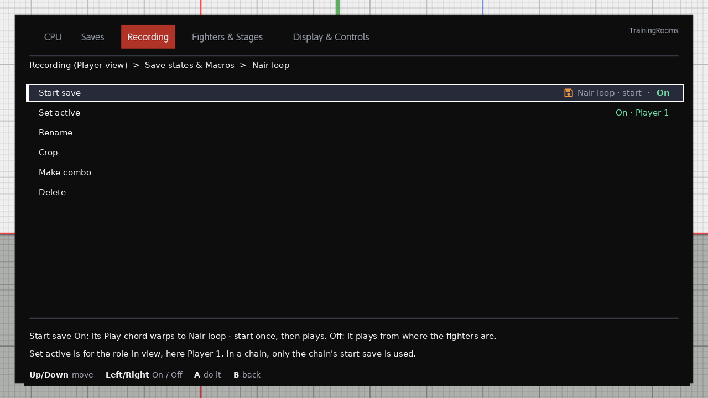

*The Player view. The first row is the start save the macro connects to, with the floppy chip and its switch, On. Set active is one row, for the role in view: On · Player 1.*

| Row | What it does |
| --- | --- |
| Start save | The file Record created, "Nair loop · start". The macro stores its id. Renaming that save keeps the connection. The switch is On or Off, with Left and Right, the same gesture as Set active; On is the default. On: the macro's Play chord warps to the start save once, then plays; a loop never warps back. Off: it plays from where the fighters are, and the connection stays, so On brings it back. A macro with no start save has no switch. In a chain, only the chain's start save is used, whatever this says. |
| Set active | On · <role> or Off: Left / Right set it for the role in view. On makes this file that role's active macro, replacing the one before; that role's Play chord plays it. |
| Rename | The Switch keyboard. Header "Name macro". Empty OK keeps the previous name. A new recording that was never renamed is Macro N. |
| Crop | In and Out, then a new file. This file stays. |
| Make combo | Play the file once on Player 1 from its start save, and keep the links as a new combo. This file stays. This is not a sequence. The new combo joins the hot five; the drill does not change. |
| Delete | Removes the file. A chain that numbered it closes the gap the next time that chain is opened. |

### A chain's own screen

*The CPU view. The first row is the chain's start save, Nair loop · start, its macro 1's, with the switch On. Set active is On · CPU, so the CPU's Play chord plays the chain. Q2 uses the same picture.*

| Row | What it does |
| --- | --- |
| Start save | Its macro 1's start save, "Nair loop · start" ([Q12](#q12-where-a-chain-starts-decided-a)). To change it, reorder the chain or save over that file. The switch is On or Off, with Left and Right; On is the default. On: the Play chord warps there once, then plays 1, 2, 3; a loop never warps back. Off: the chain plays from where the fighters are. If macro 1 has no start save, the chain has none and no switch. |
| Set active | On · <role> or Off, for the role in view, as on a macro's screen. On makes the chain that role's active macro, replacing the one before; that role's Play chord plays it. |
| Edit chain | The numbered picker, as in Character Cycles, except that R also removes the last number, so the chain may be empty: A gives the next number, R takes one off, B is done. An empty chain plays nothing, with no new sentence. It lists recordings only ([Q13](#q13-can-a-chain-contain-a-chain-decided-a)). |
| Rename | Header "Name chain". A new chain that was never renamed is Chain N. Online, the keyboard stays closed. |
| Make combo | Warp to the chain's start save, play the whole chain once on Player 1 while the frame strip records, and keep the links as a new combo. This file stays. |
| Delete | Removes the chain file. Its macros stay. |

A chain has no Crop: it has no frames of its own. A deleted macro leaves a gap that the chain closes the next time it is opened. A chain whose macros are all gone plays nothing. No new sentence is added for either case.

### A combo's own screen

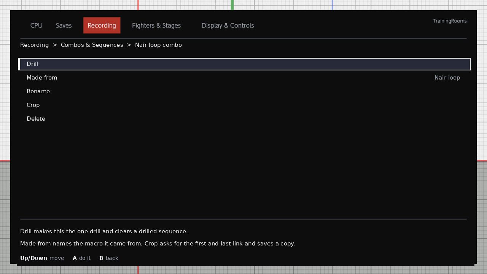

*Made from names the macro the combo came from.*

| Row | What it does |
| --- | --- |
| Drill | This becomes the one drill, and a drilled sequence is cleared. An attempt counts when its recorded input events are there, of the same kind and direction, in order and within the tolerance, and the move that comes out is the recorded move. A link holds up to 12 events: presses and releases, the C-stick, and stick flicks. Drift is shown as information and is never graded. A missing or extra-late event is a drop. A different move is a drop. TRUE is shown as information. A single combo's best stays as today. The operator: "yes do it, show drift as info only". |
| Made from | The macro it was made from, when there is one |
| Rename | Header "Name combo". Empty OK on a new combo is Combo N. Online, the keyboard stays closed and the name is Combo N. |
| Crop | First link and last link. A saves a new combo. This file stays. |
| Delete | Removes the file. A sequence that numbered it skips that step. |

### A save state's own screen

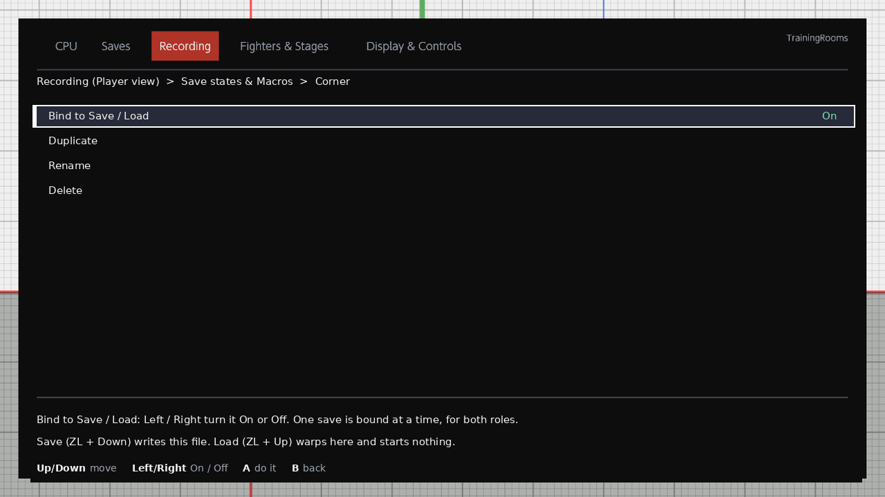

*Bind to Save / Load is On. A save has no chain and no role: it only warps.*

| Row | What it does |
| --- | --- |
| Bind to Save / Load | "On" or "Off": Left / Right turn it On or Off. On binds this save, and the one bound before is unbound; one save at a time, for both roles. The Save chord writes this file, and the Load chord warps here; Load starts nothing. The bound save is green in both views. |
| Duplicate | A new save file, a copy of this one. This file stays bound. |
| Rename | Header "Name save state". A new save that was never renamed is Save N. Online, the keyboard stays closed. |
| Delete | Removes the file. If it was bound, Load does nothing until a save is bound again. The next Save creates "Save N" and binds it. |

The Save chord overwrites the bound file. If nothing is bound yet, Save creates a file named Save N, binds it, and puts it in the hot list. Saving over "Nair loop · start" moves that macro's remembered start, because that is the file the macro points at. It moves the chain Corner pressure's start too, because its macro 1 is Nair loop.

### A sequence's own screen

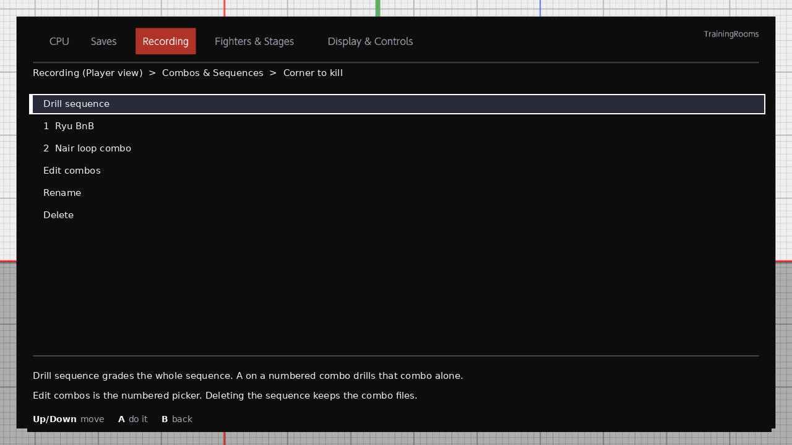

*Drill sequence grades the whole sequence. A numbered row drills that combo alone.*

| Row | What it does |
| --- | --- |
| Drill sequence | This becomes the one drill. The helper grades the whole sequence: each combo's input events, of the same kind and direction, in order and within the tolerance, and the move that comes out is the recorded move. Drift is shown as information and is never graded. A missing or extra-late event is a drop. A different move is a drop. TRUE is not required. The operator: "yes do it, show drift as info only". |
| 1, 2… | A drills that combo alone. The sequence file stays. |
| Edit combos | The numbered picker: A gives the next number, R takes one off, including the last, so the sequence may be empty |
| Rename | Header "Name sequence". A new one that was never renamed is Sequence N. Online, the keyboard stays closed. |
| Delete | Removes the sequence file. The combo files stay. |

A sequence stores combo ids in order ([Q7](#q7-what-the-sequence-file-stores-decided-a)). Renaming a combo keeps it in the sequence. A missing combo is skipped, and the numbers close up the next time the picker opens. An empty sequence drills nothing. No new sentence is added for either case. Sequences are hot by the same rule as every other kind ([Q6](#q6-hot-sequences-decided-a)).

### The keyboard

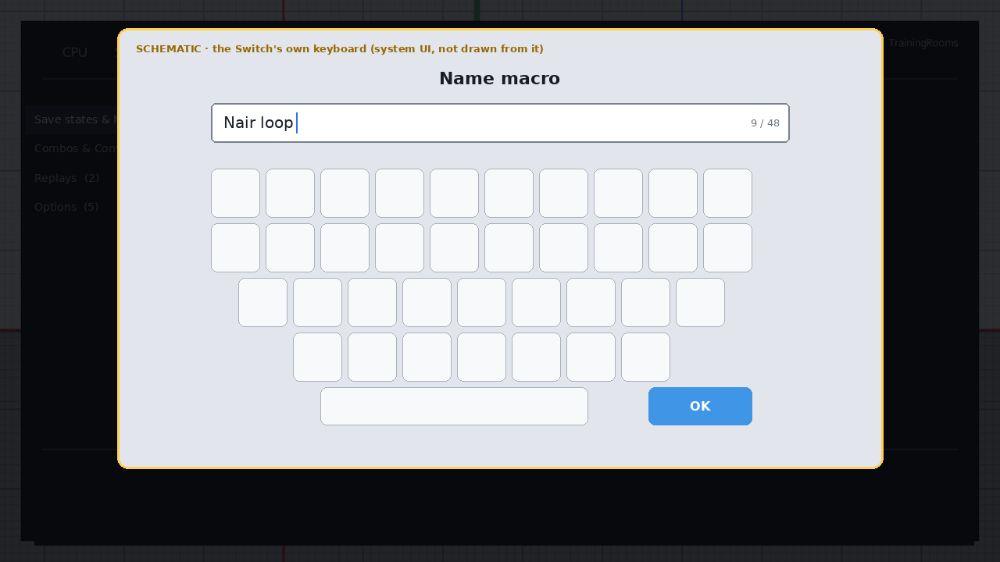

*A labelled schematic of the Switch's own keyboard, not a capture and not a TrainingRooms keyboard.*

Training passes the header, the current name, and a 48-character limit, and reads back what OK returns. B cancels and keeps the old name. The headers are "Name macro", "Name chain", "Name combo", "Name save state", and "Name sequence". Online, in a waiting room, the keyboard is not opened. A new file keeps Macro N, Chain N, Combo N, Save N, or Sequence N, and it can be renamed later in Training.

### Crop

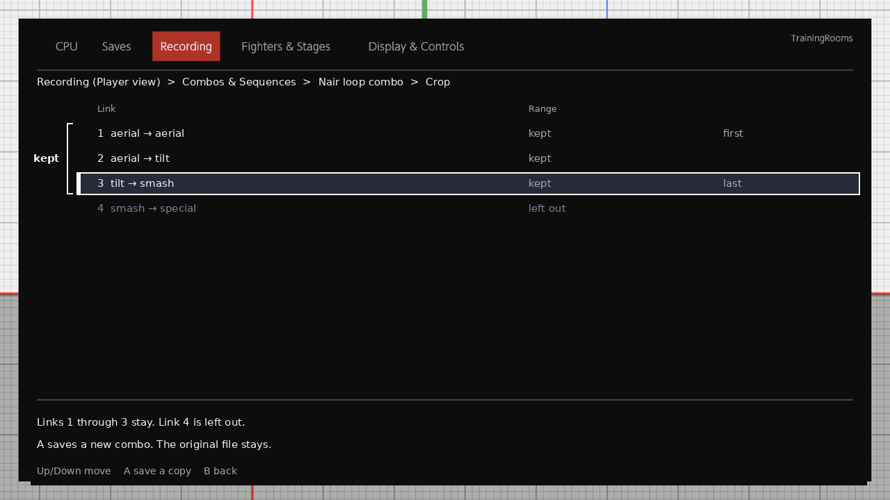

*A combo, by links. The bracket marks the range that is kept, and the link left out is dimmed. A saves a new combo, and the original stays.*

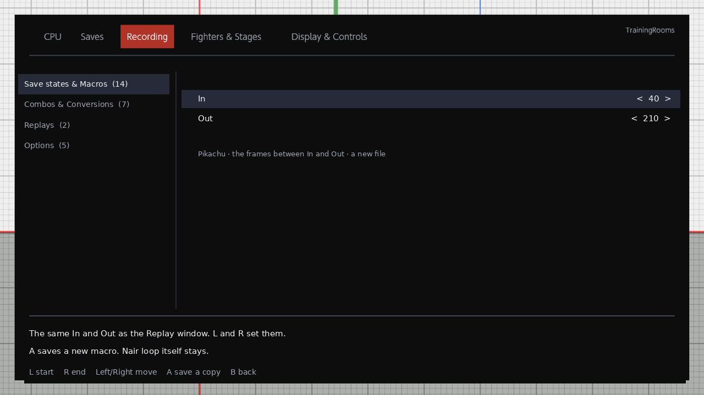

*A macro, by frames. In and Out are the Replay window's handles. A saves a new named file.*

On the crop screen, L and R set the handles; they do not change the menu page there. B returns to the file. A chain has no Crop.

### Replays and Options

| Row | What it does |
| --- | --- |
| Replay capture | On: saving a replay also keeps the inputs. This is the row that exists today. |
| Replay window | The existing window. Its In/Out crop saves a named macro into this library. A mid-action In walks back to idle or fall, at most two seconds. |
| Crop trailing neutral | On: idle frames at the end of a recording are dropped. |
| Hitstun timing | When playback starts after the CPU is hit. The choices stay the ones this row has today. |
| Mash interrupts playback | On: a mash stops a playing recording. |
| Loop counts | The list X cycles. **Decided:** ∞, 1, 2, 3, 5, 10. |
| Button chords | Record, the two Play chords, the pop-up, and Save and Load. |

### Shortcuts

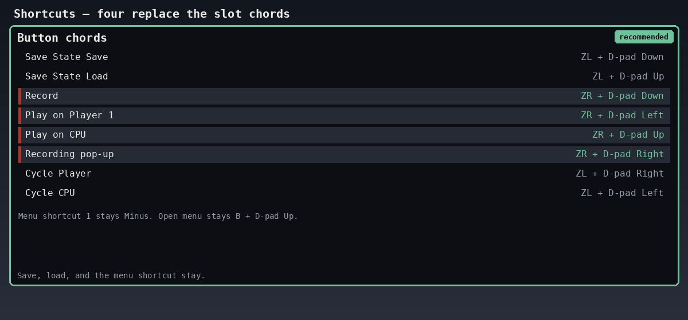

*The eight chords. All of them can be edited.*

| Chord | Default | Change from today |
| --- | --- | --- |
| Save | ZL + Down | Same chord. It writes the bound save file. |
| Load | ZL + Up | Same chord. It warps to the bound save. |
| Record | ZR + Down | Same chord. The pop-up's role says who is recorded. |
| Play on Player 1 | ZR + Left | Was unused. Toggles that role's active macro, a recording or a chain; with its Start save switch On, it warps there first, once. |
| Play on CPU | ZR + Up | Was Input Playback. Toggles that role's active macro, a recording or a chain; with its Start save switch On, it warps there first, once. |
| Recording pop-up | ZR + Right | Was unused. |
| Cycle Player | ZL + Right | Unchanged. |
| Cycle CPU | ZL + Left | Unchanged. |

Menu shortcut 1 stays Minus. Open menu stays B + Up. Both Play chords may be on at once. **Decided.** A chain finishes one macro, then starts the next.

### A chain, on its Play chord

A role's Play chord starts that role's active macro. When it is a chain, the chord warps to the chain's start save once, when its Start save switch is On ([Q12](#q12-where-a-chain-starts-decided-a)). The role then plays the chain's macros in order, from where the fighters are ([Q2](#q2-which-role-plays-a-chain-decided)). The macros' own start saves are not used, whatever their switches say. With a loop count, the chain repeats as one unit, 1, 2, 3, then 1, and no pass warps back ([Q3](#q3-what-loop-does-with-a-chain-decided-a)). Switch / Keep is asked only when macro 1 was recorded on a different fighter, once, when the chord starts the chain ([Q4](#q4-when-switch-keep-appears-for-a-chain-decided-a)). Switch changes to macro 1's recorded fighter. Macros 2 and later keep the same character and never ask. Keep plays the inputs on the current fighter. The chain file stores its macros' ids in order, and lists recordings only ([Q13](#q13-can-a-chain-contain-a-chain-decided-a)).

### Migration

- Migration skips empty slots. A recording slot that holds a recording becomes a named macro, "Slot N" plus the date the migration runs. The ones that remain start as the hot five. They have no start save, so they have no Start save switch, and they play from where the fighters are.
- Today's save slots are one slot index for both fighters. Migration skips an empty index. Each index that holds a save becomes one file, "Slot N" plus the date the migration runs, holding both fighters. They start hot. The slot the Save and Load chords were using becomes the bound save. No save starts with a chain, because a save has none.
- The current library selection (`macros/selected.txt`) becomes Player 1's active macro.
- Today's "play a recording when a state loads" checklist leaves. A macro's start save does that job, started by the role's Play chord. Nothing is turned into a chain automatically.
- Sequences and chains are new. There is nothing to migrate.
- The old Input Record and Input Playback chords become the new Record and Play on CPU chords. One notice, once: "Record, Play on Player 1, Play on CPU, and the recording pop-up replace Input Record and Input Playback."

### Memory

| What is resident | Size |
| --- | --- |
| One hot macro, one minute | 3,600 × 8 = 28,800 bytes |
| Five hot macros | 144,000 bytes |
| One file at the 36,000-frame cap | 288 KiB, not all resident |
| Five hot combos | A combo is at most 16 links, and a link holds up to 12 events: 16 × 12 = 192 events. A few kilobytes. |
| Five hot saves | Both fighters' position, damage, and charges, plus a Mii only when the save has one. Far under the macro budget. |
| Five hot sequences | A list of combo ids. A few kilobytes. |

### What leaves

- The slot number on the Saves page, and Randomize slots.
- Record Slot, Trigger, and the Duration dropdown. The file cap stays. Nothing is refused for being long.
- Button slots, and the save-state playback checklist. A macro's start save does its job, started by the role's Play chord.
- Source. The named library is the only list.
- Per-slot playback chords. They are not added.
- A single chained macro. A chain is a macro made of macros, in MACROS.

The Saves page keeps the on/off switch for the chords, mirroring, auto-load on death, damage on load, buffs, and the setup library. Setups stay a separate library from save states. Auto-load on death only warps to the bound save. It does nothing when no save is bound. Mirroring, damage on load and buffs still apply to that warp. The primary asked: "Auto-load on death. Today it can start a recording. Since Load starts nothing, I'd make it only warp to the bound save, and do nothing if no save is bound." The operator: "4. agreed". Operator, 2026-11-06.

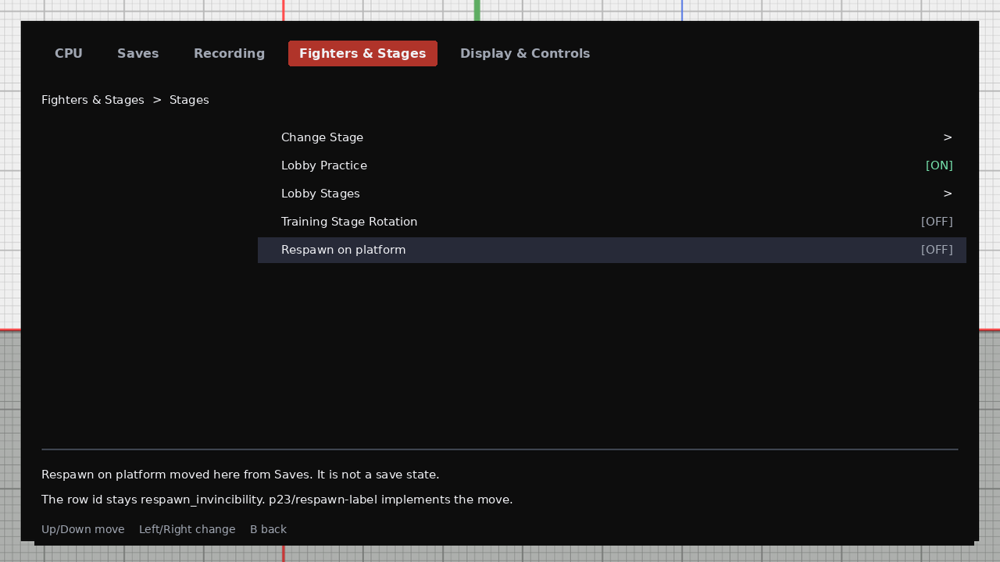

*Respawn on platform is under Fighters & Stages › Stages. The setting id stays `respawn_invincibility`.*

An empty recording still uses the existing "Recording was empty". Fighter mismatch keeps the Switch / Keep prompt, for macros, for combos, and, for a chain, only when its first macro was recorded on a different fighter. Lobby practice matches Training.

Only a deleted start save shows the approved sentence. A macro that never had a start save, or whose Start save switch is Off, plays from where the fighters are without it. Phase 2 adds these rows to `docs/RESTRICTIONS.md`, and marks the string `// restriction: macro-start-save-missing` and the chain picker's filter `// restriction: chain-recordings-only`:

| ID | Message | Why | Approved |
| --- | --- | --- | --- |
| `macro-start-save-missing` | No start save. This macro plays from where the fighters are. | The macro's connected start file was deleted. Playback continues from the current positions. | Operator, 2026-11-06, revision 3 answer 3 |
| `chain-recordings-only` | None: the chain picker does not list chains. | A chain inside a chain would need a loop check ([Q13](#q13-can-a-chain-contain-a-chain-decided-a)). | Operator, 2026-11-06, revision 8 Q13 |

No other new sentence is added. A long chain, a missing combo, an empty chain, and a chain whose macros are all gone do not get one.

## Pictures

- Menu chrome: the rc.1 Recording page, `eden-runs/tr-p23-docs-capture-03/out/c15-q7/b-021632Z-877073-q7-row.png`.
- Match: `artifacts/phase23/overlay-investigation/frames/fix-tr-training.png`. The old Input Playback notice in that frame is painted over with the sky beside it.
- Renderer: `tools/render_recording_redesign.py`. Its default run draws every picture this doc uses except revision 3's: the `r8-` pictures, the question pictures and `r5-switch-keep`. With `--q52` it draws only the question pictures. With `--r3` it draws the revision 3 pictures the repo keeps.
- Icons: Google Material Symbols (`repeat`, `save`, `link`, `format_list_numbered`), https://github.com/google/material-design-icons, Apache License 2.0. The copies and the licence are in [icons/](icons/). The renderer fills their path data with Pillow at 8× and downsamples. The colours, the dot, and the count badge are added by the renderer. `save` is new in revision 8; `link` stays for `q7-ab`, where it marks a sequence's reference to a combo file.
- Changed in revision 8.1: the panel header, the diagram, the strips and Q7's reference line say connection. Nair loop combo's four links are aerial → aerial, each recorded TRUE, on its Connections panel and on the crop screen.
- Changed in revision 8.2: `q4-ab`'s A side is one prompt for macro 1, Nair loop recorded on Pikachu with the CPU on Palutena, labelled "A · decided, amended", with the note "Macros 2 and 3 play on the same character; they never ask." The B side is unchanged. `r5-switch-keep` stays byte for byte; its caption says the prompt is asked once, for the chain's first macro.
- Changed in revision 8.3: `r8-popup-combo` lists each of Nair loop combo's four links as aerial → aerial, recorded TRUE, with the events "jump · release · ↓ flick · A" and drift as information ("drift →").
- Revision 8 redrew every picture with a save row, a start-save mark, a chain, or the old word, under `r8-` names. Renamed with `git mv`: `r4-links`, `r4-legend`, `r4-loop`, `r4-flow-record`, `r4-flow-chain` (now Make a chain), `r4-flow-make-combo` and `r4-flow-drill` to the same names with `r8-`; `r4-flow-conversion` to `r8-flow-sequence`, `r4-conversion-bar` to `r8-sequence-bar`, `r4-save-actions` and `r4-combo-actions` to `r8-`, `r4-conversion-actions` to `r8-sequence-actions`, `r6-macro-actions`, `r6-page-saves-macros`, `r6-page-combos`, `r6-popup-save`, `r6-popup-scrolled`, `r6-popup-macro`, `r6-popup-combo` and `r6-popup-cpu` to `r8-`, `r6-popup-conversion` to `r8-popup-sequence`, and `r7-page-cpu` to `r8-page-cpu`. New: `r8-chain-actions` (also Q2's picture), `q12-ab` and `q13-ab`. Redrawn under their names: `q1-ab`, `q3-ab`, `q4-ab`, `q5-ab`, `q6-ab`, `q7-ab`, `q8-decided`, `q9-ab`, `q11-ab` and `crop`. Removed: revision 3's `save-where`, which no page used and which showed the revision 3 model. Unchanged, byte for byte: `r5-switch-keep`, `respawn`, `shortcuts`, `keyboard`, `crop-macro` and `combo-from-macro`.
- Changed in revision 7.2: strips 2 to 5 (no Y in the pickers; the stacked Combos & Conversions tab with CONVERSIONS on top; Make combo keeps the drill; Nair loop combo stops being the drill), the three Recording page pictures ("A open"), the macro's own screen (one Set active row), the scrolled pop-up (seven files, scrolled to the end), and revision 3's `keyboard`, `crop` and `crop-macro` (the current groups; the crop's kept range is a bracket; the keyboard's background no longer shows a settings page's hints). With the Q1 amendment: `q1-ab`'s A side and the pickers in strips 2 and 4 read "A add number", "R remove". After review: the strips are reordered so that Make combo (now strip 3) comes before Make a conversion (now strip 4), which uses Nair loop combo; the file names stay. Strip 2's first panel is the pop-up, with its footer; the crop screens and the keyboard's background are file screens, full width with a breadcrumb. The five strips read as one story: each starts where the one before it ends (Corner pressure gets its chain in strip 2, SAVE STATES holds eight files after strip 1, and Ryu BnB is the drill until strip 5 drills Corner to kill). From the sweep: the loop mark's note names the SAVE STATES, CONVERSIONS and COMBOS section headers, and strip 5's Links panel keeps its Drilled line. The revision 3 pictures are drawn by `--r3`.
- New in revision 7.1: `RECORDING-REDESIGN-r7-page-cpu.png`, the Recording page's CPU view. Changed in revision 7.1: the pop-ups and pages with a bound save or an active macro, the legend, strips 1 and 2, the link diagram, and the save's own screen (one role per view, no role chips, Bind to Save / Load On · CPU). Removed in revision 7.1: `RECORDING-REDESIGN-r7-proposed.png`, with its section.
- New in revision 7: `RECORDING-REDESIGN-q8-decided.png`. Changed in revision 7: every picture with a list or an action screen (no thumbtack, no Pin row, no Y in the footers, the hot five by recency), and every question picture (the chips read "A · decided" and "B · not chosen"). Removed in revision 7: `RECORDING-REDESIGN-q8-ab.png`, which `q8-decided` replaces.
- New in revision 6: every `RECORDING-REDESIGN-r6-*.png`. Removed in revision 6: the revision 5 pop-up and page pictures, `q2-ab`, `q10-ab`, and revision 3's `macro-actions`.
- New in revision 5.2: the question pictures, `RECORDING-REDESIGN-qN-ab.png`, with A on the left and B on the right. Q5 and Q11 are 1920 pixels wide, so the whole pop-up fits; the others are 1280.
- From revision 5, `r5-switch-keep` stays. Kept from revision 4: the link diagram, the legend, the loop mark, the five strips, the conversion bar, and the combo, save, and conversion action screens. Kept from revision 3: `keyboard`, `crop`, `crop-macro`, `shortcuts`, `respawn`. Two unreferenced revision 3 pictures that still match, `combo-from-macro` and `save-where`, are left in place.

## Revision history

- **Revision 4.** The operator, 2026-11-06, on revision 3: "Its not clear from the images how linking happens, what's linked to what, and the loop is on pages where it doesnt apply." The link diagram came first, then one big window with groups and a Links panel, five step-by-step strips, the loop only on macros and chains, the conversion bar at the top, and Material Symbols icons.
- **Revision 5.** The operator, 2026-11-06, on revision 4: two tabs under Player | CPU, two sections that scroll on their own and sit side by side, links shown in place, and the recorded fighter as information only. The Recording page uses the same split.
- **Revision 5.1.** The primary's review: the scrolled pop-up keeps its headers and shows whole rows, Switch / Keep is the existing Fighter Mismatch screen, and the conversion strip says "Drilling now."
- **Revision 5.2.** Every question shown as A | B side by side, with more detail per option (operator 2026-11-06).
- **Revision 6.** The operator's 2026-11-06 answers: the stacked layout with the Links panel (Q10), the bound role plays the chain (Q2), one bound save at a time, and no chord for combos. The start save is explained, a macro gets a Start save On / Off switch, the order badges move to a row's left edge, and Q4's example is the operator's: the CPU is Palutena.
- **Revision 7.** The operator's answers to every question (2026-11-06): pins dropped, the hot five are the most recently used, Q1, Q3, Q4, Q5, Q6, Q7, Q9 and Q11 are A, and Q8 is the operator's own answer: restart at combo 1, true not required. The combo helper's grading drops the TRUE condition. Two proposed details, the binding row on the Recording page and one chip per meaning, were drawn for confirmation.
- **Revision 7.1.** The operator's answer to the proposed chips (2026-11-06): one role per view, as in Character Cycles, with ZR switching the role on the Recording page; the bound save is green in both views; no role chips. The proposal picture is removed, and the save's own screen binds with On · CPU or Off.
- **Revision 7.2.** Stale pictures redrawn, Q1 amended so that the picker removes a number with R, as in Character Cycles, and three decisions (operator 2026-11-06): A on the Recording page opens the file's own screen, Make combo does not change the drill, and a macro's own screen has one Set active row for the role in view. The whole doc and every picture were checked against the decided list, and the strips now read in order: Make combo is strip 3 and Make a conversion strip 4.
- **Revision 8.** The operator's answers of 2026-11-06. An outside proposal would have merged macros, combos and conversions into one type. The primary declined the full merge and recommended one part of it, and the operator agreed:
  - A save state only warps.
  - A chain is a compound macro in MACROS, with a start save, set active for a role like any macro.
  - One active macro per role ("Yes to 1").
  - The loop never warps back ("no to 2").
  - The orange floppy chip marks the save state a macro starts at and the SAVE STATES header.

  "Conversion" is now called "sequence", because, in the operator's words, "we should not use the word conversion and should call it sequence instead so we don't confuse people since "conversion" means other things in the gaming community".

  Superseded:
  - Revision 6's Q2, in which a save's chain was played by the role the save was bound under when Load ran it.
  - A save bound under a role.
  - Chain On / Off, Chain and Edit chain on a save, with the save's chain mark and the + button.
  - X on a save row, and Load starting anything.

  The new questions Q12 (where a chain starts) and Q13 (can a chain contain a chain) were decided A the same day: "I agree with your answers to q12 and q13".
  X cycles the loop on the Recording page too, when the cursor is in MACROS, as in the pop-up; the primary asked "X on the Recording page: should X cycle the loop when the cursor is in MACROS, as it does in the pop-up?" and the operator answered "yes".
  Q8's reading was confirmed, and the operator said "that sounds right".
- **Revision 8.1.** The operator, 2026-11-06: "yes have grok do both and then we are green to implement". Connections between files are called connections. The combo helper still says link for its hits, and the combo's panel lists each link with its two moves and TRUE. This is the operator's sign-off of the redesign.
- **Revision 8.2.** The operator, 2026-11-06, on the implementation questions: "1. No. 2. agreed. 3. this should only apply to the first macro. if it's the second macro then it just keeps the same character. 4. agreed". A different move does not count. R removes the last number, so a chain or a sequence may be empty. Switch / Keep for a chain is asked only for macro 1. Auto-load on death only warps to the bound save. The primary's five recommendations stand, with no objection: migration skips empty slots and names old slots with the date the migration runs; the loop's default is 1 and today's loop On becomes ∞; after the bound save is deleted, the next Save creates "Save N" and binds it; `macros/selected.txt` becomes Player 1's active macro; a single combo's best stays as today.
- **Revision 8.3.** The operator, 2026-11-07, asked: "if combos don't save inputs how do we know they were done properly? A nair loop for example that I record as a combo wouldn't that need the inputs? Otherwise it's just a glorified version of the combo counter in native training mode". The operator: "yes do it, show drift as info only". A combo link records presses and releases, the C-stick, and stick flicks, up to 12 events, facing-relative. Drift is recorded and shown as information and is never graded. Older files that store presses only still grade on those presses.
