# Recording redesign — revision 5

Phase 1 screens. Nothing here is built. The pop-up sits on a real Training frame, `artifacts/phase23/overlay-investigation/frames/fix-tr-training.png` (Steve and Villager on Battlefield). The menu pictures are redrawn on the real rc.1 Recording page (`eden-runs/tr-p23-docs-capture-03`). Names and lengths are examples, and every picture uses the same example files. The first picture shows them.

Where a choice is still open, the pictures use the recommendation (A). Each open question is a short **Your call** box next to the picture it concerns. The [index](#index) at the end links back to all eleven.

## Revision 5

The operator, 2026-11-06, on revision 4: keep what revision 4 got right, including the link diagram, the legend, the thumbtack, the link chip with the start save's name, and the loop chips. Change the window.

- **Two tabs**, under the Player | CPU toggle: Save states & Macros, and Combos & Conversions. A tab shows only its two lists. Under CPU, only Save states & Macros exists. There is no greyed second tab and no extra sentence. **Decided.**
- **The two sections scroll on their own.** Each keeps its hot outline, its pins, and its library under the hairline. The pictures put them side by side. Stacked, with the Links panel kept, is the other option ([Q10](#your-call--q10)).
- **Links show in place**, across the two columns. Focusing a save numbers its macros 1, 2, 3 and marks the macro whose start save it is. Focusing a conversion numbers its combos. Focusing a macro or a combo marks the save or the conversion that uses it. The loop for a chain, bound, made from, streak and best move to a short strip above the footer.
- **Recorded on is information.** Nothing filters, hides, greys, or refuses because of the fighter. A mismatch only raises the Switch / Keep prompt, and Keep plays those inputs on the fighter you have now. A conversion may mix fighters. Corner to kill stays a valid example. **Decided.**
- **The Recording page uses the same split.** The left column is Save states & Macros, Combos & Conversions, Replays, Options.
- Revision 4's link diagram, legend, loop mark, five strips, conversion bar, action screens, keyboard, crop, shortcuts, and respawn picture stay. Its pop-up and Recording-page pictures are replaced by the revision 5 ones.

## Revision 4

The operator, 2026-11-06, on revision 3: "the menu is a good start … Its not clear from the images how linking happens, what's linked to what, and the loop is on pages where it doesnt apply. The first draft you gave had a bigger window with groups and seemed more intuitive." Then: "the loop icon … should be drawn from an svg or something similar or native."

- **The link diagram comes first.** It shows four kinds of file and four kinds of link. Each arrow says what the link means and how you make it. Under it is the example every other picture uses.
- **One big window with groups.** The pop-up covers about 80 % of the screen. Every group is stacked in one scrollable list: MACROS, COMBOS & CONVERSIONS, SAVE STATES. The CPU role has MACROS and SAVE STATES only. Revision 3's row of section buttons is gone.
- **The Links panel.** The right side of the pop-up and of the Recording page writes out the links of the row under the cursor as a small diagram: the start save, the chains that play it, the combos made from it, the order of a chain or a conversion.
- **Five step-by-step strips** show how each link is made: record, chain a save, make a conversion, make a combo from a macro, drill a conversion.
- **Loop only on macros and chains.** The loop mark is in the MACROS group header and on a chained save's Links panel, where it means the whole chain. It is never on the combos, conversions, or save-state groups. X cycles it only in MACROS or on a chained save.
- **The conversion bar is at the top**, under the frame strip, where today's combo bar is.
- **ZL / ZR jump between groups.** ZL + Up / Down keeps the meaning it has in the menu today. See Pop-up buttons.
- **The icons are real SVGs.** The loop, the pin, the link and the chain marks are Google Material Symbols (Apache-2.0), filled from their path data. See The loop mark.
- **Conversions sit inside COMBOS & CONVERSIONS**, after the combos. Revision 3 recommended a separate section. Revision 5 puts conversions and combos in one tab as two sections, and leaves the remaining layout as [Q5](#your-call--q5).
- Revision 3's pop-up, page, file-screen, picker, load-notice, bar, loop and choices pictures are removed, because they showed the old layout or the old example. Its keyboard, shortcuts, macro actions, crop, and respawn pictures stay, under Unchanged from revision 3. Two unreferenced ones that still match, `combo-from-macro` and `save-where`, are left in place.

## What links to what

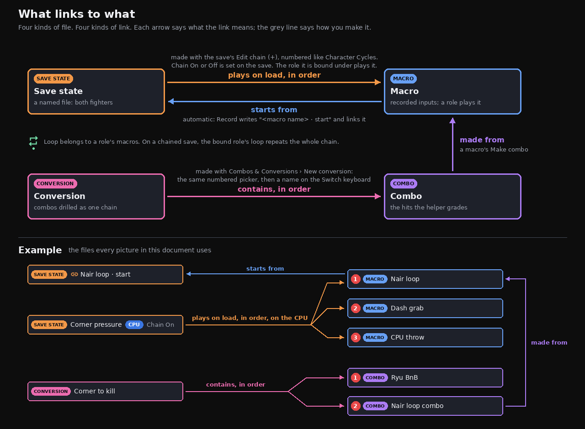

*Top: the four kinds of file and the four links. Bottom: the example. Load Corner pressure, and the save restores, then Nair loop plays on Player 1, Dash grab on Player 1, and CPU throw on the CPU. Nair loop starts from its own save. Corner to kill drills Ryu BnB, then Nair loop combo, and Nair loop combo was made from Nair loop.*

| Link | From → to | How it is made | Where you see it |
| --- | --- | --- | --- |
| Start save | macro → its save state, "Nair loop · start" | Automatic, when you record | The macro row: the link mark and the save's name. The Links panel. |
| Chain | save state → an ordered list of macros 1, 2, 3 | The save's Edit chain (+), a numbered picker like Character Cycles. Chain On or Off on the save. | The save row: the chain mark, the count, On or Off. The Links panel lists 1 → 2 → 3, each with its role. |
| Conversion | conversion → an ordered list of combos | Combos & Conversions › New conversion, the same numbered picker, then a name on the Switch keyboard | The conversion row: "Ryu BnB → Nair loop combo". The Links panel. |
| Made from | combo ← the macro it was made from | A macro's Make combo | The combo row: a small "from Nair loop". The Links panel. |

Every link is a file id, so renaming either end keeps it.

## How to read a list

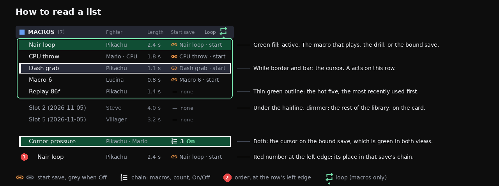

*Green fill is active. A white border with a white bar on the left is the cursor. When the cursor is on the active row, both show. The thin green outline is the hot five. The marks along the bottom are the pin, the start-save link, the chain, the order badge, and the loop.*

- **Green fill: active.** The macro that plays for this role, the combo or conversion being drilled, or the save that Save and Load use.
- **White border and bar: the cursor.** A acts on this row. It is a different mark from the green fill, so the two never look alike.
- **Thin green outline: the hot set.** At most five per kind. Pins come first, then the newest.
- **Under the hairline, dimmer:** the rest of the library, on the card.
- **Gold, tilted thumbtack:** pinned.
- **Red number:** the order, the badge Character Cycles uses. A adds the next number. A again removes it, and the later numbers close up.
- **Gold outline** in the step-by-step strips only: a mockup mark for "new". It is not part of the product.

## The loop mark

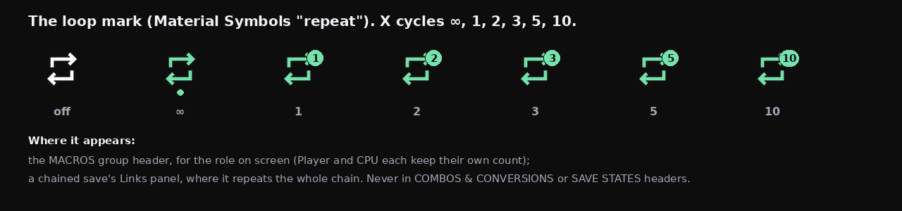

*Off is white. ∞ is green with a dot under it. A count is green with the number in a badge. X cycles ∞, 1, 2, 3, 5, 10. The list is the Options row.*

The loop belongs to the role, not to a group and not to a file. Player and CPU each keep their own count. **Decided.** It appears in two places only: the MACROS group header, and a chained save's Links panel, where the same count repeats the whole chain.

How the product would draw it: as a texture in our own layout archive. The layout builder can embed one. `tools/layout-builder` (branch `p23/rc5-candidate`) already appends textures to the stock `timg/__Combined.bntx`: the 38 item icons from `assets/item-icons` through `import_png_file`, and the generated hitbox orb disc through `import_dds`. Picture panes bind those textures, and the panes' vertex colours tint them, which covers white for off and green for on. The builder reads PNG and DDS, not SVG, so the SVG would be turned into a PNG first. A native game icon that fits: not checked.

Icons: Google Material Symbols `repeat`, `push_pin` (filled), `link` and `format_list_numbered`, from https://github.com/google/material-design-icons, Apache License 2.0. The copies, their source paths, and the licence text are in [icons/](icons/).

## Pop-up

The pop-up is one window over the match, so its size can be judged against the fighters. It owns the buttons while it is open, the way the menu does. B closes it.

- **Top:** the title, then Player | CPU. L or R switches role. The selected role is the menu's red tab.
- **Tabs, under the role:** Save states & Macros, and Combos & Conversions. CPU has only the first.
- **Two sections, side by side.** Each scrolls on its own. The hot five stay in a green outline, pins first, and the library sits under a hairline.
- **The strip above the footer** is the rest of that row's links: the loop for a whole chain, bound, made from, streak and best.
- **Footer:** the buttons for the section the cursor is in.

### A save under the cursor

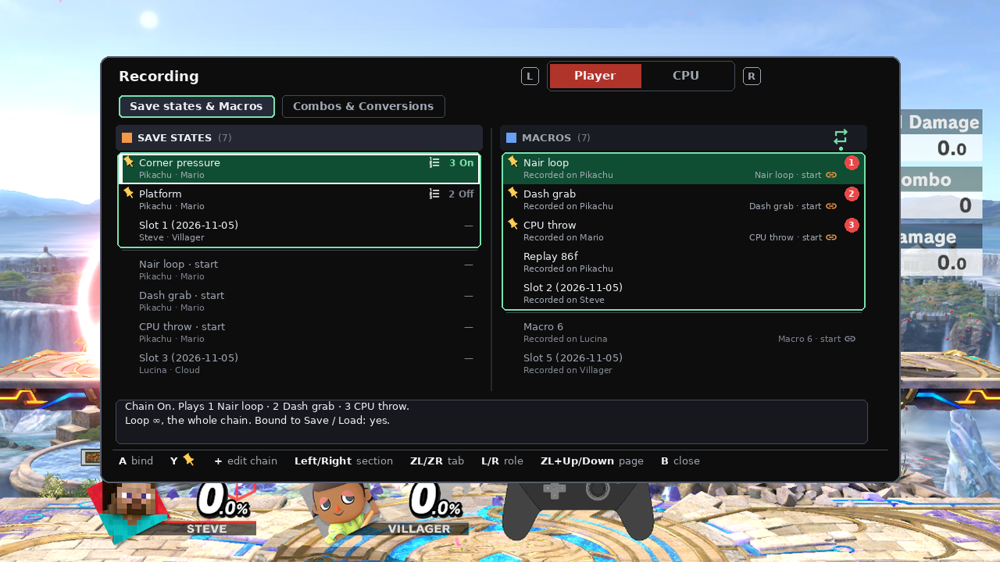

*Corner pressure is the bound save, and its chain is On. The macros in the other column wear 1, 2, and 3. The strip says the chain plays those three, and that ∞ repeats the whole chain.*

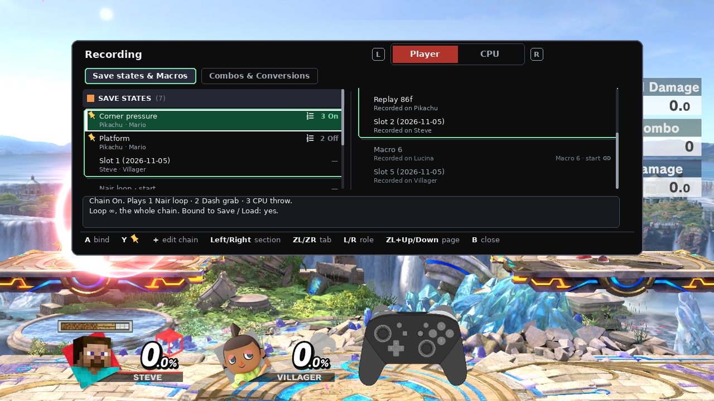

*Same cursor. The macro column has moved down to the library. The save column is still at Corner pressure.*

### A macro under the cursor

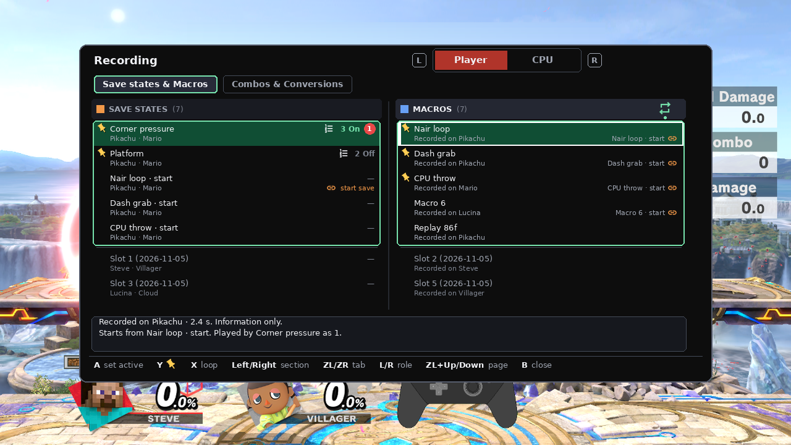

*Nair loop is the active macro, so the row is green with the white border. Corner pressure wears 1, because it plays this macro first. The link chip on the row is the start save's name, Nair loop · start. Recorded on Pikachu is information.*

A row with no start save, such as Replay 86f, has no link chip.

### Your call — Q2

**Which role a chained macro plays.** A, recommended: the role stored in the macro file. The pictures use that. Nair loop and Dash grab play on Player 1, and CPU throw plays on the CPU. B: the role tab that was open when the save loaded.

### Your call — Q3

**What loop does with a chain.** A, recommended: the chain is one unit, and the whole list repeats. The strip on the save picture says that. A chord Load uses the Player loop. A load from the CPU tab uses the CPU loop. B: each macro repeats by its own role's count before the next number. The A and B drawing is [below](#the-a-and-b-drawings).

### Combos and conversions

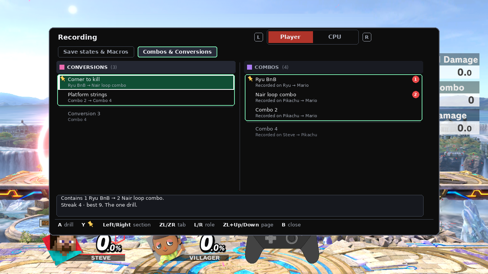

*Corner to kill is the drill. Its two combos wear 1 and 2. The strip has the streak and the best. Neither section has a loop mark.*

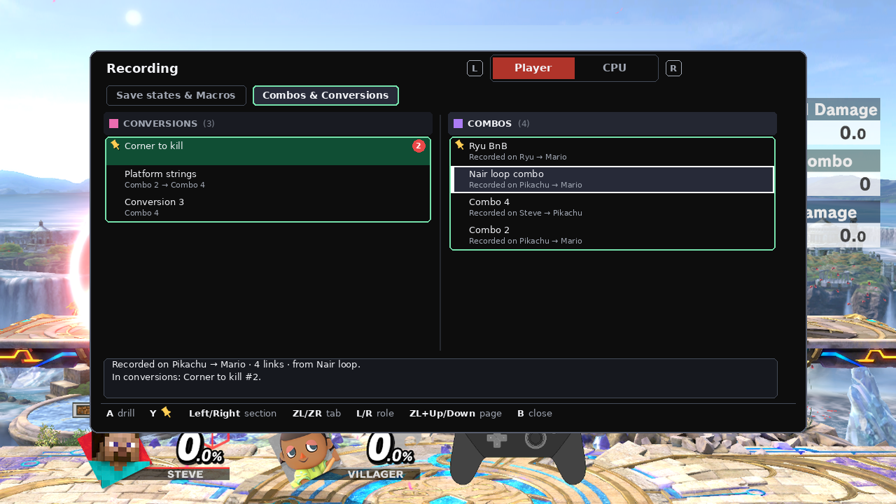

*The cursor is on Nair loop combo. Corner to kill wears 2, because that combo is its second step. Recorded on names both fighters, and it does not hide the row.*

### Your call — Q5

**How the two lists sit in this tab.** A, recommended: two sections that scroll on their own, conversions on the left and combos on the right, which is what these pictures use. B: one list, with the conversions after the combos, still inside this tab.

### Your call — Q6

**Hot conversions.** A, recommended: five hot, with the same pin and newest rules as macros and saves. The green outline in the picture is that. B: no hot list.

### CPU

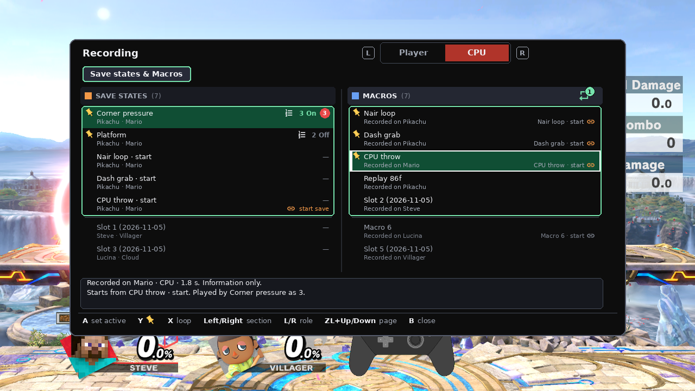

*One tab. CPU throw is the CPU's active macro, and the loop chip shows the CPU's own count, 1. The footer has no tab button, because there is nothing to switch to. The save list is the same library as on Player, because a save is both fighters.*

### The other layout

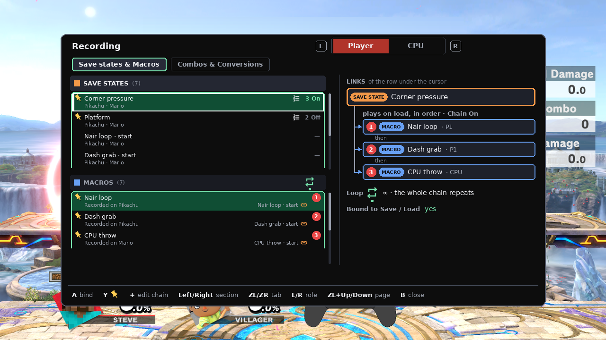

*B. The same tab, with the two sections one above the other, and revision 4's Links panel kept on the right.*

### Your call — Q10

**Side by side, or stacked.** A, recommended: side by side, and the links show as numbers and chips on the other column. The pictures above use A. B: stacked, with the Links panel, as in this picture.

### Recorded on another fighter

*Nair loop was recorded on Pikachu. The fighter now is Palutena. Keep plays the inputs on Palutena. Nothing is hidden or refused.*

### Your call — Q4

**When the prompt appears for a chain.** A, recommended: once, when the chain starts. It names every mismatched macro, and the answer covers the chain. B: ask at each mismatched macro. The recorded fighter stays information either way. The A and B drawing is [below](#the-a-and-b-drawings).

### Pop-up buttons

| Button | Save states | Macros | Conversions and combos |
| --- | --- | --- | --- |
| A | Bind to Save / Load | Set active for this role | Drill |
| Y | Pin or unpin | Pin or unpin | Pin or unpin |
| X | Cycle the loop, only when this save's chain is On | Cycle the loop | — |
| + | Edit chain | — | — |
| Left / Right | Move to the other section | Move to the other section | Move to the other section |
| ZL / ZR | The other tab. Omitted when CPU has only one | same | same |
| ZL + Up / Down | Page this section | Page this section | Page this section |
| L / R | Player / CPU | Player / CPU | Player / CPU |
| Up / Down | Move inside this section | Move inside this section | Move inside this section |
| B | Close | Close | Close |

Checked against the current menu code (`src/model/menu/input.rs` and `mod.rs` on `p23/rc5-candidate`):

- ZL held is a modifier. A ZL press on its own reaches the menu only as a tap, sent on release when nothing else was pressed. ZL alone and ZL + Up / Down never fire together, so the tab switch and the page jump do not collide.
- These screens ignore ZL and ZR taps today. The checklists use a ZL tap for tick-all, and the roster grids use ZR for the role. Neither is on these screens.
- Left and Right cycle the value of a settings row. A library row has no value to cycle, so on these two sections Left and Right can move between them.
- L and R stay the role toggle here. On the Recording page they change the menu page, as they do on every other page.
- The menu's button list has no + today, so Edit chain needs that one button added to the adapter.
- Minus stays menu shortcut 1.

### Your call — Q11

**Which buttons move.** A, recommended, and what the footers draw: ZL / ZR switch tabs, and Left / Right move between the two sections. Up / Down stay inside the section. ZL + Up / Down pages that section. B: ZL / ZR move between the two sections, the way revision 4 jumped groups, and Up from the top of a column reaches the tab row, where Left / Right change the tab.

## Recording page

The same two sections, inside the menu. The left column is Save states & Macros, Combos & Conversions, Replays, Options. L / R change the menu page. ZL / ZR switch the tab inside the selected group, when that group has two. ZL + Up / Down pages the section the cursor is in.

### Save states and macros

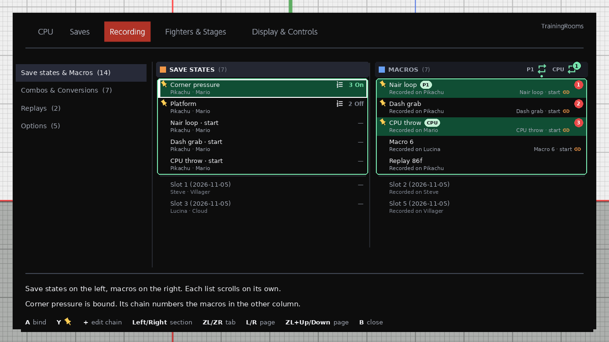

*Saves on the left, macros on the right. Corner pressure numbers the three macros. Both roles' loop chips are in the MACROS header, because this page shows both roles at once.*

### Combos and conversions

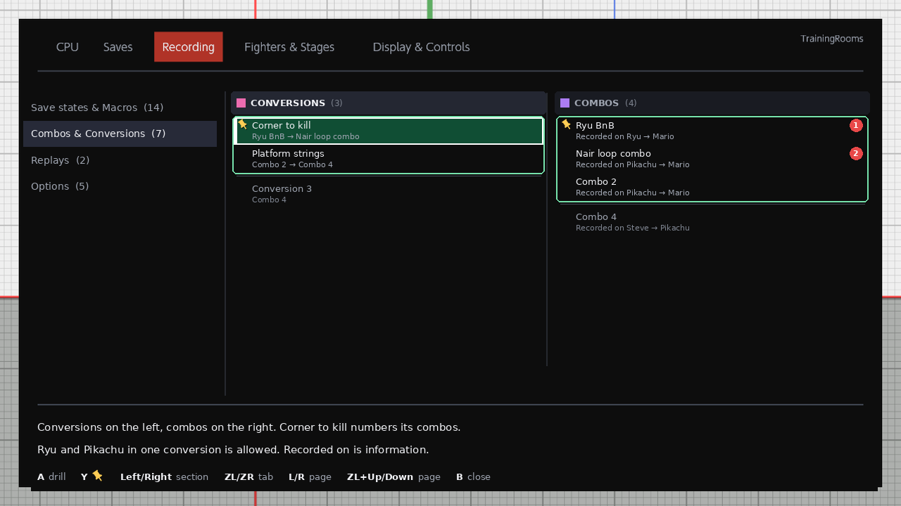

*Conversions on the left, combos on the right. Corner to kill numbers Ryu BnB and Nair loop combo. The two fighters in one conversion are allowed.*

| Button | What it does |
| --- | --- |
| A | Open the file's own screen |
| Y | Pin or unpin |
| + | Edit chain, on a save |
| Left / Right | Move to the other section |
| ZL / ZR | The other tab, inside Save states & Macros or Combos & Conversions |
| ZL + Up / Down | Page the section the cursor is in |
| L / R | Previous / next menu page |
| B | Close the menu |

Replays and Options keep revision 3's rows (see Unchanged from revision 3). The loop shows in Options only as the list of counts.

## How linking happens

Each strip is three steps in the menu's own style. The panels are drawn at full size, so the text stays readable.

### 1 · Record → start save

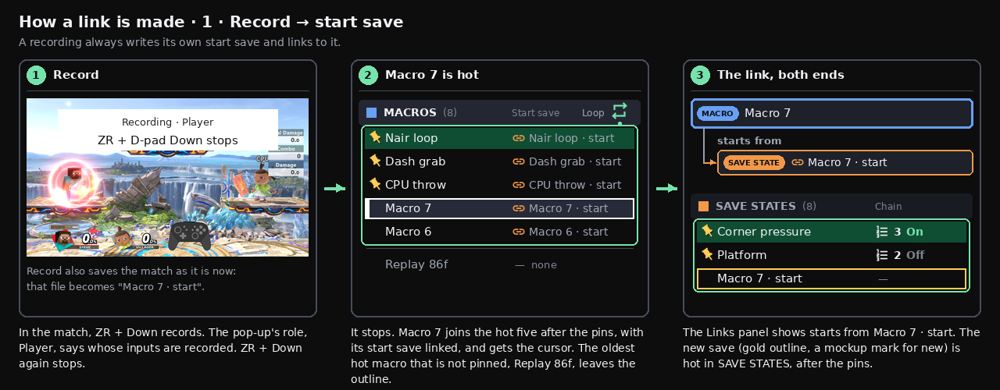

*Record also writes "Macro 7 · start" and links it. When the recording stops, Macro 7 joins the hot five after the pins. Its Links panel shows starts from Macro 7 · start, and the new save is listed in SAVE STATES.*

### 2 · Chain a save

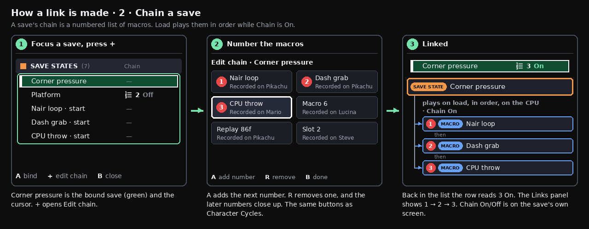

*+ on a save opens Edit chain. A numbers the macros, as Character Cycles does. Back in the list, the row reads 3 On, and the Links panel shows 1 → 2 → 3 with each macro's role.*

### Your call — Q1

**How you number them.** A, recommended: name tiles. A adds the next number, and A again removes it. The later numbers close up. It is the Character Cycles gesture, and it is what this strip draws. B: a list, and Y moves a file one place later.

### 3 · Make a conversion

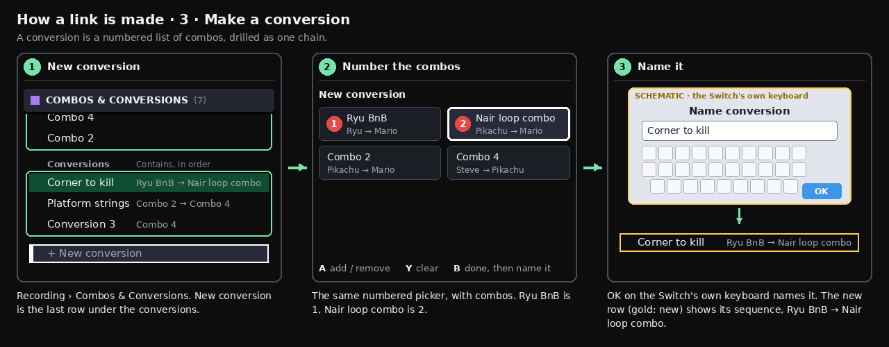

*New conversion is the last row under the conversions. The same numbered picker orders the combos. The Switch's own keyboard, drawn here as a labelled schematic, names it. The new row shows its sequence.*

### Your call — Q7

**What the conversion file stores.** A, recommended: the combo files' ids, in order. Renaming a combo keeps it in the conversion. B: a frozen copy of each combo's links.

### 4 · Make combo from a macro

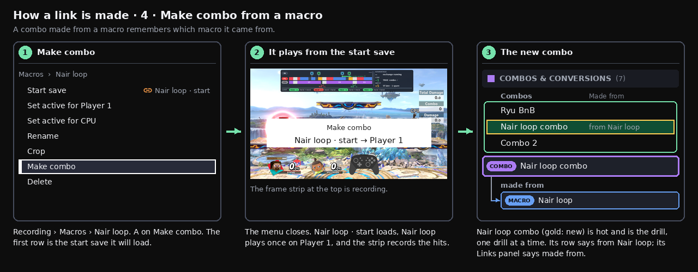

*Make combo loads the macro's start save and plays the macro once on Player 1 while the frame strip records. The new combo says "from Nair loop" in its row and "made from" in its Links panel.*

If the start save was deleted, the load is skipped and the approved sentence shows: "No start save. This macro plays from where the fighters are." No link uses the sentence that already exists: "No combo yet: land a hit and a follow-up first."

### 5 · Drill a conversion

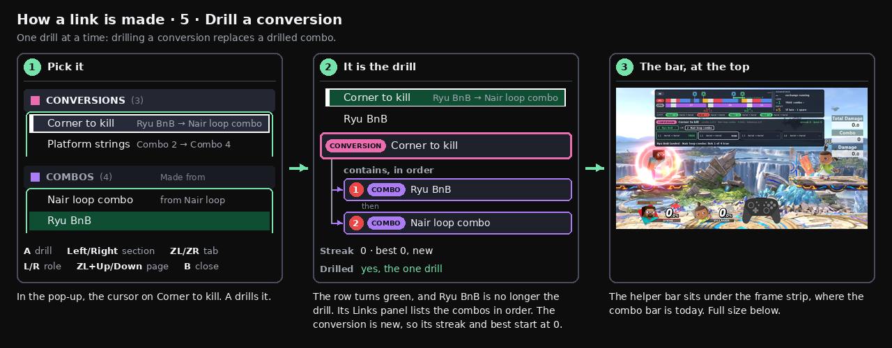

*A on Corner to kill makes it the drill and replaces the drilled combo, so there is one drill at a time. The bar appears at the top of the screen. The next picture shows it at full size.*

## The conversion drill bar

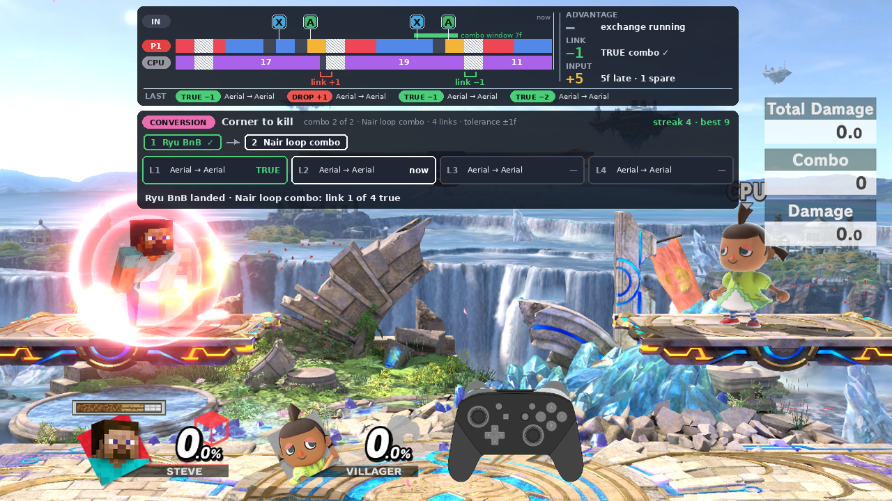

*Under the frame strip, where today's combo bar sits. "CONVERSION · Corner to kill · combo 2 of 2". Ryu BnB is done, and Nair loop combo is the current combo. L1 is TRUE and L2 is now. The streak and best are the conversion's.*

The bar is the combo helper's bar with a conversion header and a row for the combos in the chain. TRUE, the current link, and the links still to come use the helper's own marks. Streak and best count only a finished conversion. A drop is the helper's existing drop, on the link that failed. The picture restarts the conversion at combo 1, with the streak back to 0 and best kept.

### Your call — Q8

**A drop, and what completes the chain.** A, recommended: a drop restarts at combo 1. Complete means every combo, in order, with the CPU still in hitstun between them. The picture uses A. B: continue from the dropped combo, and back to back counts as complete. The A and B drawing is [below](#the-a-and-b-drawings).

### Your call — Q9

**One drill at a time.** A, recommended: a conversion and a combo replace each other as the drill. Drilling Corner to kill clears a drilled combo. B: both active, and a button picks the bar.

Drilling one combo from a conversion's numbered rows uses that combo's own streak and best and its normal bar, as today.

## The A and B drawings

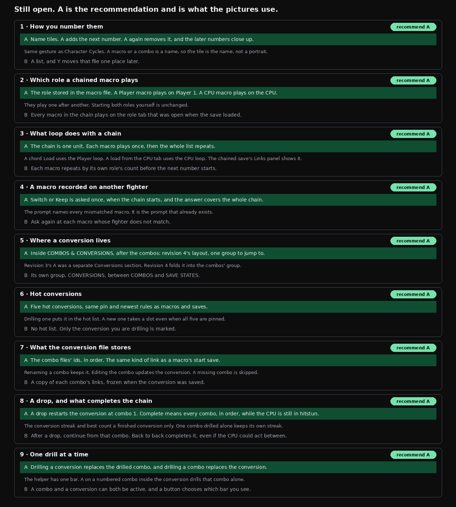

*Q1 through Q9, each as A and B. A is recommended, and it is what the pictures use.*

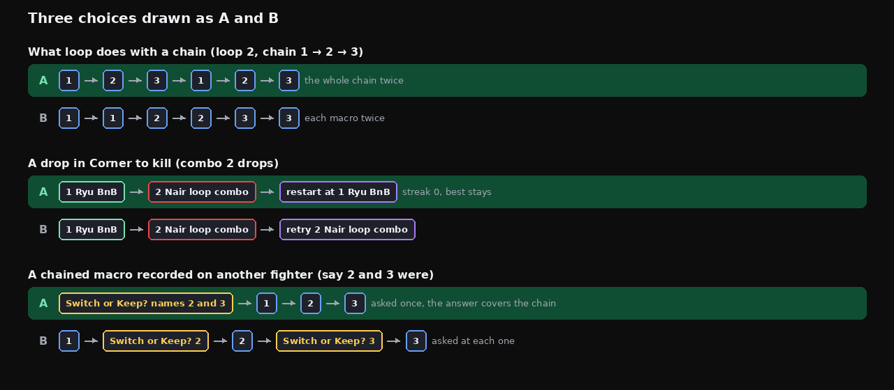

*Q3, the loop with a chain: A repeats the whole chain, B repeats each macro. Q8, a drop: A restarts at combo 1, B retries the dropped combo. Q4, a fighter mismatch: A asks once for the whole chain, B asks at each macro.*

## Already decided

- One Recording page, plus one pop-up. Record follows the pop-up's role: Player records you, CPU records the CPU. **Decided.**
- Two tabs under the role toggle: Save states & Macros, and Combos & Conversions. CPU has only the first. The two sections in a tab scroll on their own. Side by side or stacked is [Q10](#your-call--q10). **Decided.**
- The recorded fighter is information. The column reads Recorded on. Nothing filters, hides, greys, or refuses by fighter. A mismatch raises Switch / Keep, and Keep plays the inputs on the current fighter. A conversion may mix fighters. **Decided.**
- Hot memory is one minute resident per hot macro (3,600 frames, 28.8 KiB). Five hot macros are 144 KiB. A longer file still plays; the rest is read in 600-frame windows. The file cap stays 36,000 frames. No recording is refused for length. **Decided.**
- A new recording takes a hot slot even when all five are pinned. The oldest pin leaves the hot list and stays on the card. The same rule covers saves. **Decided.**
- Loop counts are ∞, 1, 2, 3, 5, 10. X cycles them. The list is the Options row. The loop belongs to the role. **Decided.**
- Player 1 and the CPU may play at the same time. A chain does not use that: its macros play one after another. **Decided.**
- Save states are named files that you bind for Save and Load. There is no slot number and no extra slot shortcut. **Decided.**
- A save's chain is an ordered list of macros, numbered 1, 2, 3…, with Chain On or Off on the save. Off keeps the numbers and Load only restores. It replaces the old "play a recording because a state loaded" checklist. **Decided.**
- A recording's start is its own save file, "<macro name> · start", and the macro stores that file's id. **Decided.**
- Five hot saves, with the same pin and newest rules. **Decided.**
- Save states are a group under both roles. The third Saves tab is rejected. **Decided.**
- The sentence "No start save. This macro plays from where the fighters are." is approved as `macro-start-save-missing`. **Decided.**
- A conversion is a chain of saved combos. You can drill one combo, or the conversion. **Decided.**
- Respawn on platform is under Fighters & Stages › Stages, not under save states. `p23/respawn-label` implements the move. **Decided.**
- Names use the Switch's own keyboard. **Decided.**

## Unchanged from revision 3

These screens and rules carry over. Where a picture is revision 3's, the left column in it still uses the older group names.

### A macro's own screen

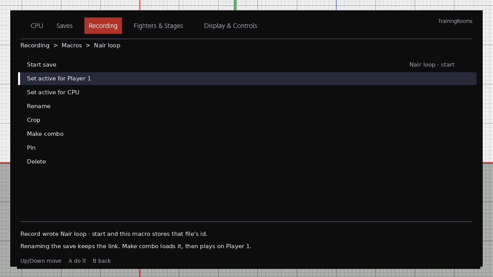

*Revision 3's picture. The first row is the start save the macro links to.*

| Row | What it does |
| --- | --- |
| Start save | The file Record created, "Nair loop · start". The macro stores its id. Renaming that save keeps the link. |
| Set active for Player 1 | Play on Player 1 toggles this file |
| Set active for CPU | Play on CPU toggles this file |
| Rename | The Switch keyboard. Header "Name macro". Empty OK keeps the previous name. A new recording that was never renamed is Macro N. |
| Crop | In and Out, then a new file. This file stays. |
| Make combo | Play the file once on Player 1 from its start save, and keep the links as a new combo. This file stays. This is not a conversion. |
| Pin | Thumbtack. Pins sort first inside the hot outline. |
| Delete | Removes the file. A chain that numbered it closes the gap the next time that chain is opened. |

### A combo's own screen

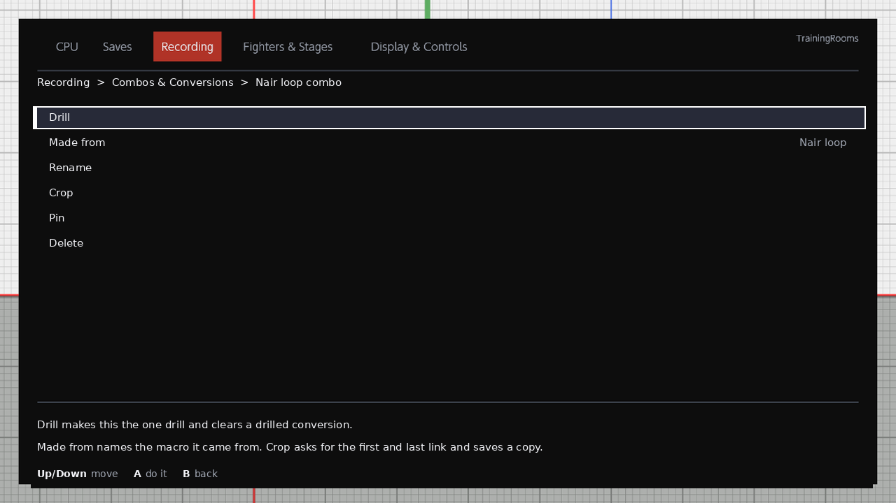

*Made from names the macro the combo came from.*

| Row | What it does |
| --- | --- |
| Drill | This becomes the one drill, and a drilled conversion is cleared |
| Made from | The macro it was made from, when there is one |
| Rename | Header "Name combo". Empty OK on a new combo is Combo N. Online, the keyboard stays closed and the name is Combo N. |
| Crop | First link and last link. A saves a new combo. This file stays. |
| Pin | Same hot rules as macros |
| Delete | Removes the file. A conversion that numbered it skips that step. |

### A save state's own screen

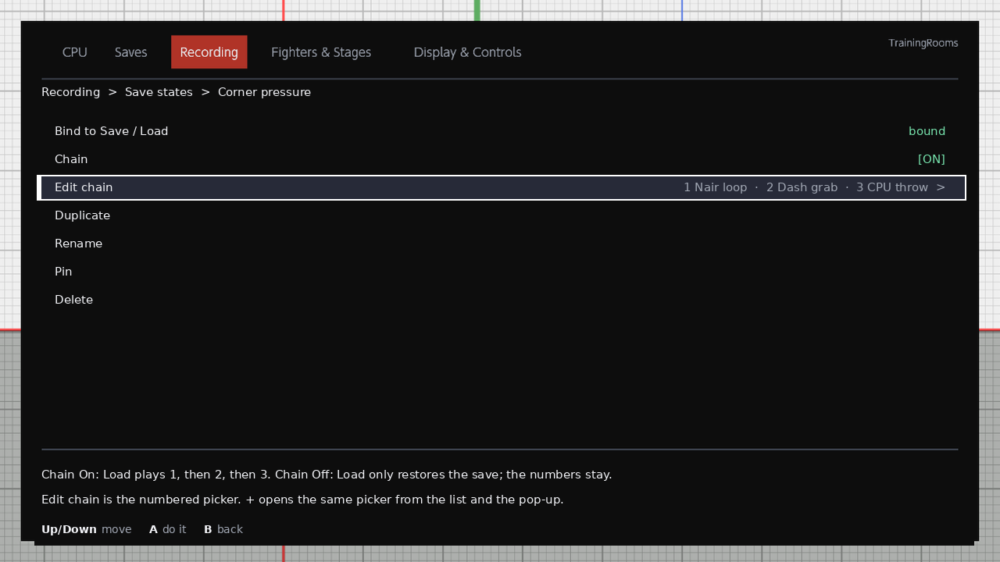

*Chain On, and Edit chain lists the numbers.*

| Row | What it does |
| --- | --- |
| Bind to Save / Load | The green row. The chords use this file. |
| Chain | On or Off, Left and Right. On: Load plays the numbered macros. Off: Load only restores the save. The numbers stay either way. |
| Edit chain | The numbered picker. + opens it from the list and the pop-up too. |
| Duplicate | A new save file, a copy of this one, including the numbers. This file stays bound. |
| Rename | Header "Name save state". A new save that was never renamed is Save N. Online, the keyboard stays closed. |
| Pin | Same hot rules as macros. |
| Delete | Removes the file. If it was bound, Save and Load do nothing until another is bound. |

The Save chord overwrites the bound file. If nothing is bound yet, Save creates a file named Save N, binds it, and puts it in the hot list. Saving over "Nair loop · start" moves that macro's remembered start, because that is the file the macro points at.

### A conversion's own screen

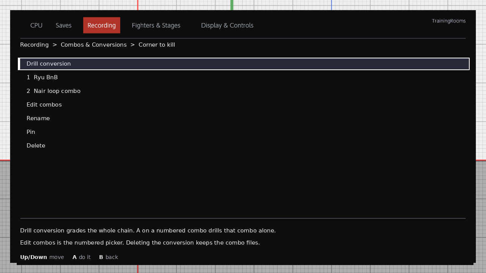

*Drill conversion grades the whole chain. A numbered row drills that combo alone.*

| Row | What it does |
| --- | --- |
| Drill conversion | This becomes the one drill. The helper grades the whole chain. |
| 1, 2… | A drills that combo alone. The conversion file stays. |
| Edit combos | The numbered picker |
| Rename | Header "Name conversion". A new one that was never renamed is Conversion N. Online, the keyboard stays closed. |
| Pin | Same hot rules ([Q6](#your-call--q6)) |
| Delete | Removes the conversion file. The combo files stay. |

A conversion stores combo ids in order ([Q7](#your-call--q7)). Renaming a combo keeps it in the conversion. A missing combo is skipped, and the numbers close up the next time the picker opens. An empty conversion drills nothing. No new sentence is added for either case.

### The keyboard

*A labelled schematic of the Switch's own keyboard, not a capture and not a TrainingRooms keyboard.*

Training passes the header, the current name, and a 48-character limit, and reads back what OK returns. B cancels and keeps the old name. The headers are "Name macro", "Name combo", "Name save state", and "Name conversion". Online, in a waiting room, the keyboard is not opened. A new file keeps Macro N, Combo N, Save N, or Conversion N, and it can be renamed later in Training.

### Crop

*A combo, by links. The outline is the range that is kept. A saves a new combo, and the original stays.*

*A macro, by frames. In and Out are the Replay window's handles. A saves a new named file.*

On the crop screen, L and R set the handles, not the group. B returns to the file.

### Replays and Options

| Row | What it does |
| --- | --- |
| Replay capture | On: saving a replay also keeps the inputs. This is the row that exists today. |
| Replay window | The existing window. Its In/Out crop saves a named macro into this library. A mid-action In walks back to idle or fall, at most two seconds. |
| Crop trailing neutral | On: idle frames at the end of a recording are dropped. |
| Hitstun timing | When playback starts after the CPU is hit. The choices stay the ones this row has today. |
| Mash interrupts playback | On: a mash stops a playing recording. |
| Loop counts | The list X cycles. **Decided:** ∞, 1, 2, 3, 5, 10. |
| Button chords | Record, the two Play chords, the pop-up, and Save and Load. |

### Shortcuts

*The eight chords. All of them can be edited.*

| Chord | Default | Change from today |
| --- | --- | --- |
| Save | ZL + Down | Same chord. It writes the bound save file. |
| Load | ZL + Up | Same chord. It loads that file, and plays the numbered macros when Chain is On. |
| Record | ZR + Down | Same chord. The pop-up's role says who is recorded. |
| Play on Player 1 | ZR + Left | Was unused. Toggles the player's active macro. |
| Play on CPU | ZR + Up | Was Input Playback. Toggles the CPU's active macro. |
| Recording pop-up | ZR + Right | Was unused. |
| Cycle Player | ZL + Right | Unchanged. |
| Cycle CPU | ZL + Left | Unchanged. |

Menu shortcut 1 stays Minus. Open menu stays B + Up. Both Play chords may be on at once. **Decided.** A chain finishes one macro, then starts the next.

### Chain, on a load

A Load of a save with Chain On restores the save, then plays its macros in order. Each macro plays on the role stored in its file ([Q2](#your-call--q2)). A macro recorded on a different fighter raises Switch / Keep, asked once when the chain starts ([Q4](#your-call--q4)). Keep plays the inputs on the current fighter. The list is stored on the save, not on the macros, and each save has its own list and its own On or Off.

### Migration

- Today's five recording slots become named macros, "Slot 1 (2026-11-05)" through "Slot 5". They are unpinned and start as the hot five. They have no start save.
- Today's five save slots are one slot index for both fighters. Each index becomes one file, "Slot N (2026-11-05)", holding both fighters. They start hot and unpinned. The slot the Save and Load chords were using becomes the bound save. None of them starts with a chain.
- Conversions are new. There is nothing to migrate.
- The old Input Record and Input Playback chords become the new Record and Play on CPU chords. One notice, once: "Record, Play on Player 1, Play on CPU, and the recording pop-up replace Input Record and Input Playback."

### Memory

| What is resident | Size |
| --- | --- |
| One hot macro, one minute | 3,600 × 8 = 28,800 bytes |
| Five hot macros | 144,000 bytes |
| One file at the 36,000-frame cap | 288 KiB, not all resident |
| Five hot combos | A combo is at most 16 links. A few kilobytes. |
| Five hot saves | Both fighters' position, damage, and charges, plus a Mii only when the save has one. Far under the macro budget. |
| Five hot conversions | A list of combo ids. A few kilobytes. |

### What leaves

- The slot number on the Saves page, and Randomize slots.
- Record Slot, Trigger, and the Duration dropdown. The file cap stays. Nothing is refused for being long.
- Button slots, and the save-state playback checklist.
- Source. The named library is the only list.
- Per-slot playback chords. They are not added.
- A single chained macro. The chain is the numbered list.

The Saves page keeps the on/off switch for the chords, mirroring, auto-load on death, damage on load, buffs, and the setup library. Setups stay a separate library from save states.

*Respawn on platform is under Fighters & Stages › Stages. The setting id stays `respawn_invincibility`.*

An empty recording still uses the existing "Recording was empty". Fighter mismatch keeps the Switch / Keep prompt, for macros, for combos, and once at the start of a chain. Lobby practice matches Training.

A deleted start save shows the approved sentence. Phase 2 adds this row to `docs/RESTRICTIONS.md` and marks the string `// restriction: macro-start-save-missing`:

| ID | Message | Why | Approved |
| --- | --- | --- | --- |
| `macro-start-save-missing` | No start save. This macro plays from where the fighters are. | The macro's linked start file was deleted. Playback continues from the current positions. | Operator, 2026-11-06, revision 3 answer 3 |

No other new sentence is added. A long chain, a missing combo, and an empty chain do not get one.

## Index

- [Q1](#your-call--q1) How you number a chain or a conversion.
- [Q2](#your-call--q2) Which role a chained macro plays.
- [Q3](#your-call--q3) What loop does with a chain.
- [Q4](#your-call--q4) When Switch / Keep appears for a chain.
- [Q5](#your-call--q5) Two sections in the combos tab, or one list.
- [Q6](#your-call--q6) Hot conversions.
- [Q7](#your-call--q7) What the conversion file stores.
- [Q8](#your-call--q8) A drop, and what completes the chain.
- [Q9](#your-call--q9) One drill at a time.
- [Q10](#your-call--q10) Side by side, or stacked.
- [Q11](#your-call--q11) Which buttons switch tabs and move between sections.

## Pictures

- Menu chrome: the rc.1 Recording page, `eden-runs/tr-p23-docs-capture-03/out/c15-q7/b-021632Z-877073-q7-row.png`.
- Match: `artifacts/phase23/overlay-investigation/frames/fix-tr-training.png`. The old Input Playback notice in that frame is painted over with the sky beside it.
- Renderer: `tools/render_recording_redesign.py`. It draws the revision 5 pictures and the revision 4 pictures that revision 5 kept. With `--r3` it draws revision 3's.
- Icons: Google Material Symbols (`repeat`, `push_pin`, `link`, `format_list_numbered`), https://github.com/google/material-design-icons, Apache License 2.0. The copies and the licence are in [icons/](icons/). The renderer fills their path data with Pillow at 8× and downsamples. The tilt, the colours, the dot, and the count badge are added by the renderer.
- New in revision 5: every `RECORDING-REDESIGN-r5-*.png`. Kept from revision 4: the link diagram, the legend, the loop mark, the five strips, the conversion bar, the choices drawings, and the combo, save, and conversion action screens. Kept from revision 3: `macro-actions`, `keyboard`, `crop`, `crop-macro`, `shortcuts`, `respawn`. Revision 4's pop-up and Recording-page pictures are removed, because the revision 5 pictures replace them.
