# Recording redesign — revision 3

Phase 1 screens. Nothing here is built. The menu pictures are redrawn on the real rc.1 Recording page (`eden-runs/tr-p23-docs-capture-03`, the same frame the combo-helper mockups used). The pop-up, the chain, combo-from-macro, and the conversion bar sit on a real Training frame: `artifacts/phase23/overlay-investigation/frames/fix-tr-training.png` (Steve and Villager on Battlefield). Names and lengths are examples.

Green is the recommendation on each question that is still open. The pictures use those recommendations. The other option for each one is in Still open.

## Revision 3

- **Hot save states. Decided.** Five hot saves, with the same pin and newest rules as macros. Binding a save puts it in the hot list. A new save takes a hot slot even when all five are pinned. The auto-created "<macro name> · start" files stay under the outline unless you pin or bind them.
- **Save states stay a section under both roles. Decided.** The third top tab named Saves is rejected.
- **The delete notice is approved.** "No start save. This macro plays from where the fighters are." Restriction id `macro-start-save-missing`, approved by the operator 2026-11-06. The row for `docs/RESTRICTIONS.md` is in What leaves. Phase 2 adds that row and the `// restriction: macro-start-save-missing` comment when the string is shown.
- **A chain is a numbered list of macros.** Loading a save whose chain is on plays 1, then 2, then 3, one after another. The numbers are the Character Cycles gesture: A adds the next number, A again removes it. The pictures use that.
- **A conversion is a numbered list of combos.** The operator's name. You can drill one combo, or drill the conversion and get feedback on the chain. The pictures use a Conversions section, five hot, a file of combo ids, one drill at a time, and a drop that restarts the conversion.

## Revision 2

Superseded where revision 3 says otherwise. The two items revision 2 left open are decided above.

- **The start save is a link. Decided.** Record writes a save named "<macro name> · start" and the macro stores that file's id. Sharing the macro means sharing both files. Renaming the save keeps the link, because the link is the id. Saving over that same file moves the remembered start. Deleting it leaves the macro playable from where the fighters are.
- **The delete notice** was waiting in revision 2. Revision 3 records the operator's yes.
- **Respawn on platform** leaves Saves. It is a row under Fighters & Stages › Stages. `p23/respawn-label` implements the move. The setting id stays `respawn_invincibility`.
- **The pin** is a tilted thumbtack: a flat head and a needle.
- **Where a save sits.** The pictures use a Save states section on both the Player tab and the CPU tab. The third tab was the other option. Revision 3 rejects it.
- **Hot save states** were open in revision 2. Revision 3 accepts five.

## Already decided

- One Recording page, plus one pop-up. Record follows the pop-up's role: Player records you, CPU records the CPU.
- Hot memory is one minute resident per hot macro (3,600 frames, 28.8 KiB). Five hot macros are 144 KiB. A longer file still plays; the rest is read in 600-frame windows. The file cap stays 36,000 frames. No recording is refused for length.
- A new recording takes a hot slot even when all five are pinned. The oldest pin leaves the hot list and stays on the card. The same rule now covers saves. The pictures use it for conversions too. That last part is the recommendation in Still open.
- Loop counts are ∞, 1, 2, 3, 5, 10. X cycles them. The list is the Options row.
- Player 1 and the CPU may play at the same time. A chain does not use that: its macros play one after another.
- Save states are named files. You pick one in the pop-up or on this page and bind it. Save and Load use that file. There is no slot number and no extra slot shortcut.
- A save's chain is an ordered list of macros, numbered 1, 2, 3… Chain is on or off for that save. When it is on, Load plays the list in order. When it is off, the numbers stay and Load only restores the save.
- The old "play a recording because a state loaded" checklist is this chain. It is not a separate toggle. Loading does not start a recording.
- Pins are a thumbtack. The active macro, the drilled combo or conversion, and the bound save are a green row. Hot items sit at the top inside an outline. Pinned items are first inside that outline.
- R moves between sections. Player: Macros, Combos, Conversions, Save states. CPU: Macros, Save states. Combos and Conversions are the player's drill, so the CPU tab skips both.
- Names use the Switch's own keyboard, the one TrainingRooms and the fork already open. This document draws it as a labelled schematic.
- A recording's start is its own save file, "<macro name> · start", and the macro stores that file's id. **Decided.**
- Respawn on platform is under Fighters & Stages › Stages, not under save states. **Decided.** The move itself is `p23/respawn-label`.
- Five hot saves. **Decided.**
- The third Saves tab is rejected. **Decided.**
- A conversion is the name for a chain of saved combos. You can practice one combo, or the conversion. **Decided.** How the screens do that is the recommendation below, and the other options are in Still open.

## How to read a list

- The **green row** is the one that is in force: the macro that plays, the combo or conversion being drilled, or the save Save and Load use.
- The **blue-gray row** with the white bar is the cursor. It can sit on a different row from the green one.
- A **gold thumbtack**, tilted, with a flat head and a needle, is pinned.
- The **green outline** is the hot set: at most five, pins first, then the newest. Everything under the outline is the rest of the library, on the card.
- A **red number** on a tile is the order, the same badge Character Cycles uses for the Player order. A adds the next number. A again removes it, and the later numbers close up.

## Pop-up

The pop-up is one panel over the match, so its size can be judged against the fighters. B closes it. It owns the buttons while it is open, the way the menu does.

L switches role (Player / CPU). R moves to the next section and wraps. A selects the row under the cursor: that macro becomes the active one for this role, that combo or conversion becomes the drill, or that save becomes the bound save. Y pins or unpins. X cycles the loop. ZL+Up and ZL+Down jump 12 rows, the same jump the menu uses, and they stop at the ends.

### Player, Macros

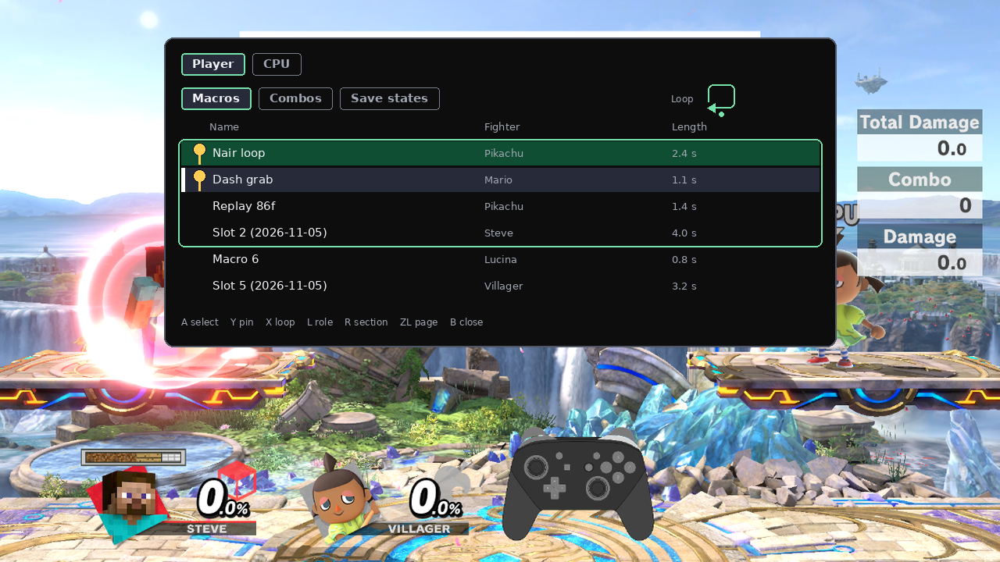

Nair loop is green, so Play on Player 1 toggles that file. Dash grab is the cursor, and it is pinned, so the thumbtack is on a row that is not the green one. Replay 86f and Slot 2 are hot and unpinned. Macro 6 and Slot 5 are on the card, outside the outline.

The loop mark here is "on": green, with a dot under it. That is ∞.

### Player, Combos

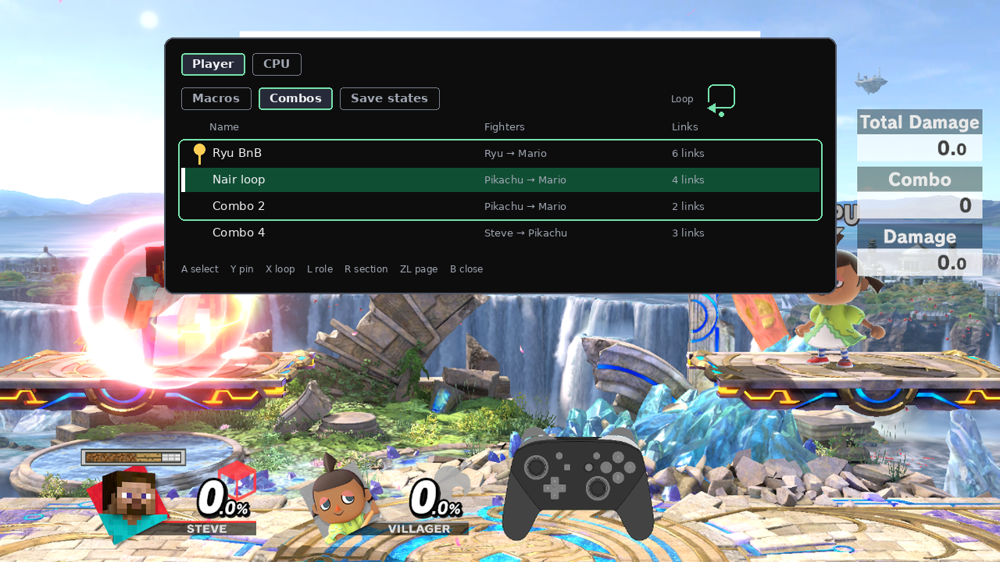

Ryu BnB is pinned, so it is above the other hot combos. Nair loop is the drill (green) when you are drilling that combo and not a conversion. Combo 2 is hot. Combo 4 is only on the card.

A on a combo row makes it the drill and clears a drilled conversion. There is one drill. The pictures use that. The other option is in Still open.

### Player, Conversions

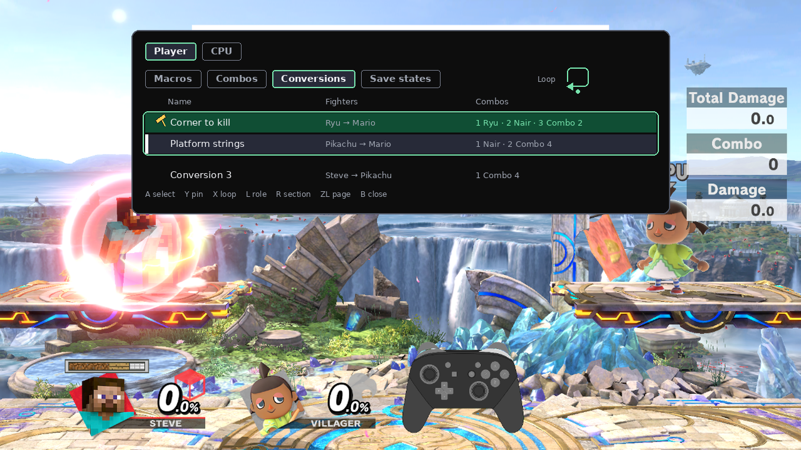

Corner to kill is the drilled conversion (green) and it is pinned. Its combos are 1 Ryu BnB, 2 Nair loop, 3 Combo 2. Platform strings is hot and is the cursor. Conversion 3 is on the card, outside the outline.

A on a conversion drills the whole chain. The CPU tab does not have this section.

### Player, Save states

Corner pressure is the bound save (green) and it is pinned. Its chain is on, so Load plays 1 Nair loop, then 2 Dash grab, then 3 Replay 86f. Platform is pinned, chain off, and it is the cursor. Slot 1 is hot. Under the outline, Nair loop · start and CPU throw · start are the files Record created. Slot 3 is the rest of the library.

A binds the cursor's save. The Save chord then writes that file. The Load chord restores it, and starts the numbered macros only when that row's chain is on.

The same chain is on the Recording page:

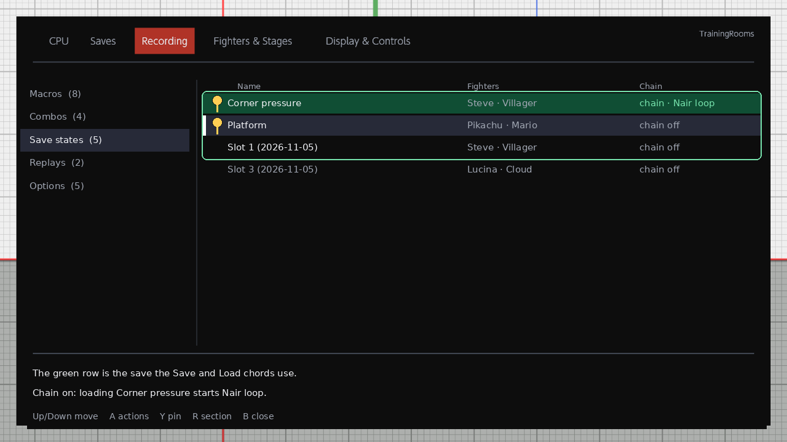

### CPU

CPU throw is the macro Play on CPU toggles. The loop mark is the count 1, in the middle of the icon. R from here goes to Save states and skips Combos and Conversions. The save list is the same library as on the Player tab. A save is the match, both fighters, not a per-role slot.

Record on this tab records the CPU's fighter. The new file becomes the CPU's active macro and enters the hot list. A chain can include that file. The pictures play it on the CPU, because that is the role stored in the file.

### Loop mark

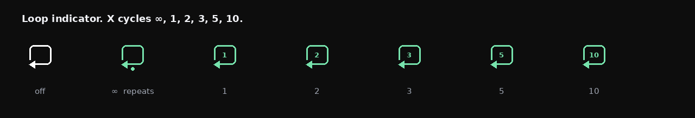

X cycles ∞, 1, 2, 3, 5, 10. Off is the white loop with no dot. ∞ is the green loop with the dot underneath. A count is the same green loop with the number in the middle. The loop belongs to the role tab, not to the section and not to the file. Each role remembers its own count. **Decided.**

On a chain, the pictures treat the list as one unit and use that count for the whole list. See Still open.

### Pop-up buttons

| Button | What it does |
| --- | --- |
| A | Make the cursor's row the active macro, the drill, or the bound save |
| Y | Pin or unpin that row |
| X | Cycle the loop |
| L | Player / CPU |
| R | Next section. Player: Macros, Combos, Conversions, Save states. CPU: Macros, Save states |
| ZL+Up / ZL+Down | Move 12 rows, stop at the ends |
| B | Close |

On the Recording page, R is the same section button (Macros, Combos, Conversions, Save states, Replays, Options). L/R no longer change the top-level page while that page is open. Up onto the tabs, then Left or Right, leaves Recording. The other pages keep L/R as the page change.

### Where the save list sits

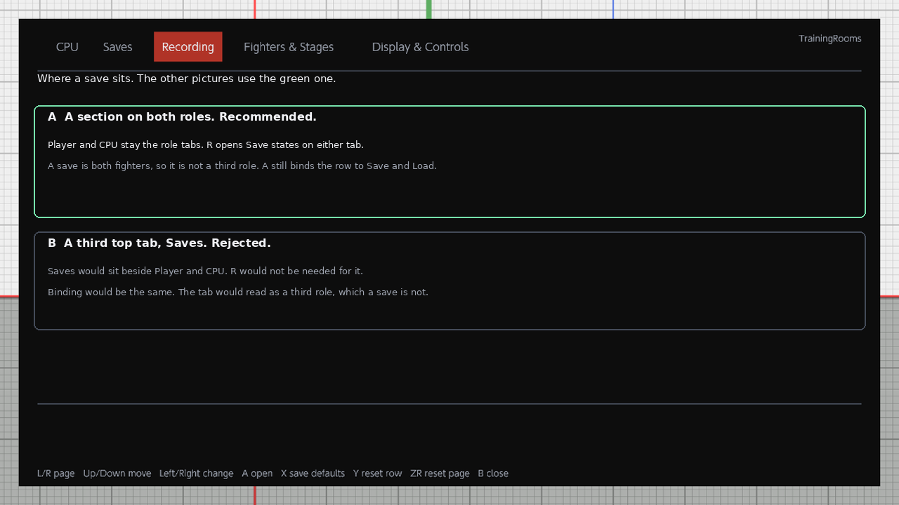

The pictures use A. Save states are a section on both role tabs, and A on a row binds it. B, a third top tab named Saves, is rejected. A save is both fighters, so it is not a third role.

## Recording page

The left column is the sections. R moves down that column from anywhere on the page. The right side is that section's list or its settings. The footer names R.

### Macros

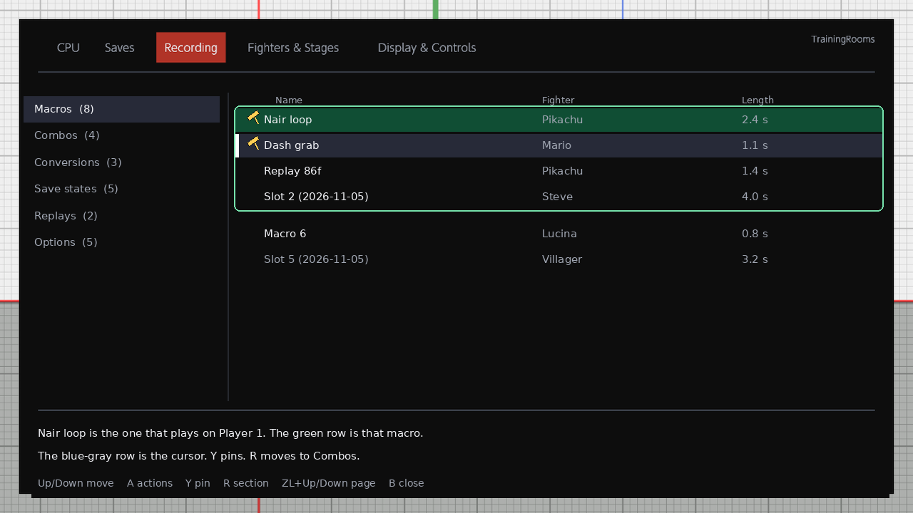

Same rules as the pop-up. A opens that file's actions.

| Button | What it does |
| --- | --- |
| A | Open the macro's actions |
| Y | Pin or unpin |
| R | Next section |
| ZL+Up / ZL+Down | Move 12 rows |
| B | Close the menu |

### Combos

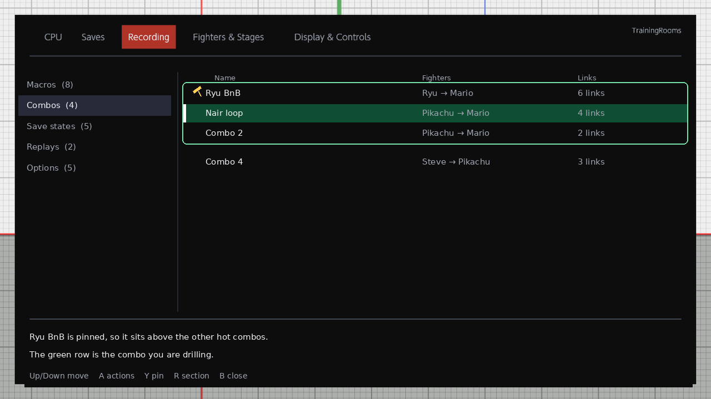

The outline is the hot five. Ryu BnB is pinned, so it is first. The green row is the drill when a single combo is the drill.

### Conversions

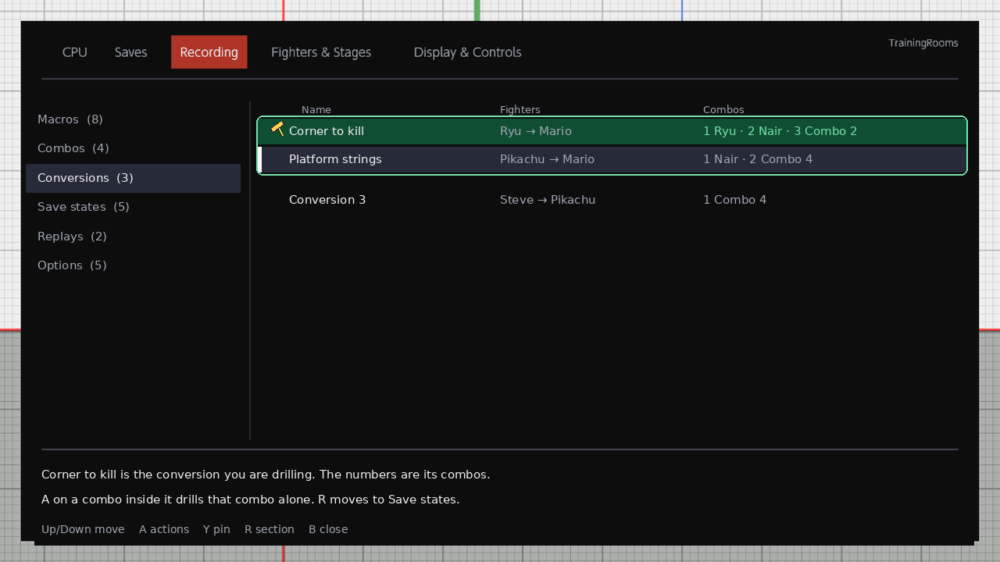

Corner to kill is pinned and is the drill. The Combos column is the numbered list. Platform strings is hot. Conversion 3 is outside the outline.

### Save states

The green row is the file Save and Load use. The Chain column is the numbers, so a chained save is visible without opening it. Under the outline, "Nair loop · start" and "CPU throw · start" are the files Record created. Each macro links to its own by id. They are not the bound save unless you bind one.

The Save chord overwrites the bound file. If nothing is bound yet, Save creates a file named Save N, binds it, and puts it in the hot list. Duplicate, on the file's own screen, writes a second file and leaves this one. Saving Corner pressure does not change Nair loop · start. Saving over Nair loop · start does, because that is the file the macro points at.

### Replays

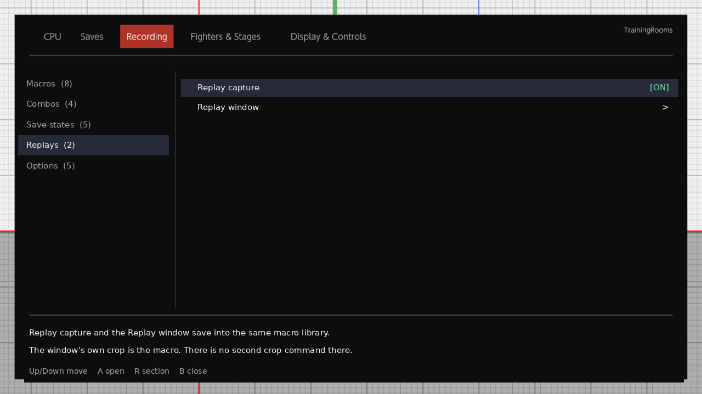

| Row | What it does |
| --- | --- |
| Replay capture | On: saving a replay also keeps the inputs. This is the row that exists today. |
| Replay window | The existing window. Its In/Out crop saves a named macro into this library. It does not grow a second Crop command. |

A replay export uses the snap the window already has: a mid-action In walks back to idle or fall, at most two seconds, and that neutral start is what the file stores.

### Options

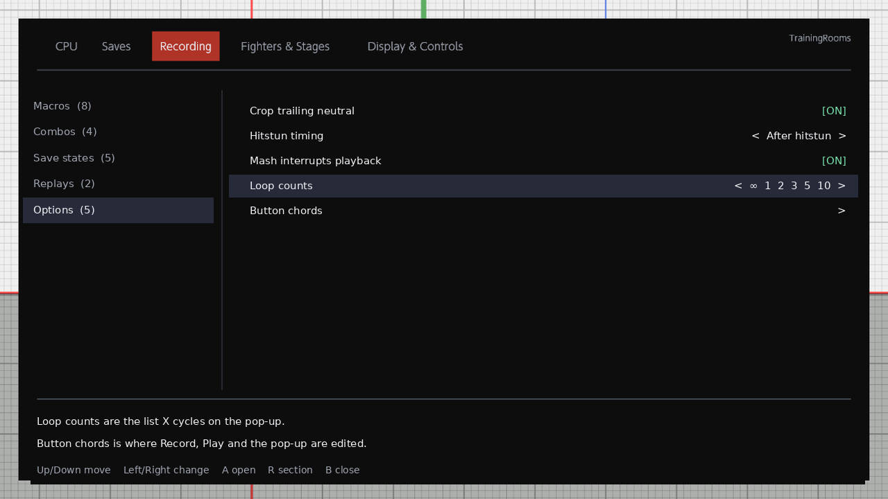

| Row | What it does |
| --- | --- |
| Crop trailing neutral | On: idle frames at the end of a recording are dropped. Off: the recording keeps them. |
| Hitstun timing | When playback starts after the CPU is hit. The choices stay the ones this row has today. |
| Mash interrupts playback | On: a mash stops a playing recording. |
| Loop counts | The list X cycles. **Decided:** ∞, 1, 2, 3, 5, 10. |
| Button chords | Record, the two Play chords, the pop-up, and Save and Load. |

## One file's actions

### A macro

| Row | What it does |
| --- | --- |
| Start save | The file Record created, "Nair loop · start". The macro stores its id. Renaming that save keeps the link. |
| Set active for Player 1 | Play on Player 1 toggles this file |
| Set active for CPU | Play on CPU toggles this file |
| Rename | The Switch keyboard. Header "Name macro". Empty OK keeps the previous name. A new recording that was never renamed is Macro N. |
| Crop | In and Out, then a new file. This file stays. |
| Make combo | Play the file once on Player 1 and keep the links. This file stays. This is not a conversion. |
| Pin | Thumbtack. Pins sort first inside the hot outline. |
| Delete | Removes the file from the library. A chain that numbered it closes the gap the next time that chain is opened. |

### A combo

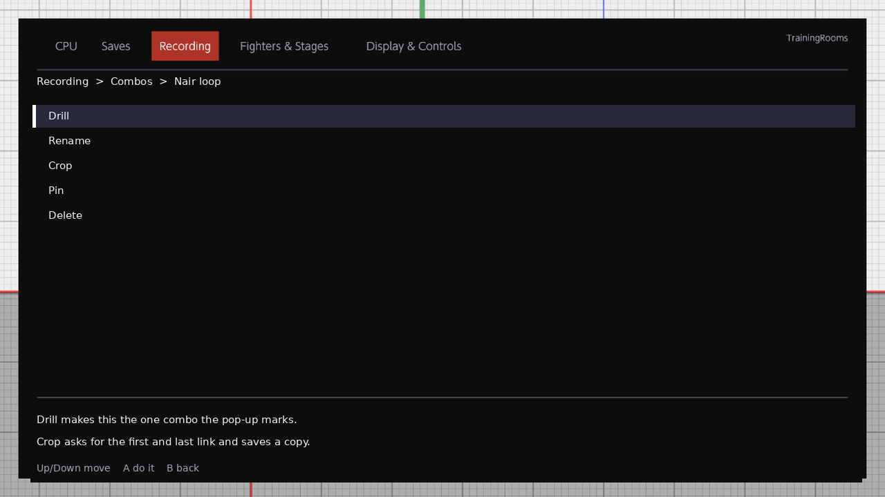

| Row | What it does |
| --- | --- |
| Drill | This becomes the one drill, and a drilled conversion is cleared |
| Rename | Header "Name combo". Empty OK on a new combo is Combo N. Online, the keyboard stays closed and the name is Combo N. |
| Crop | First link and last link. A saves a new combo. This file stays. |
| Pin | Same hot rules as macros |
| Delete | Removes the file. A conversion that numbered it skips that step. |

### A save state

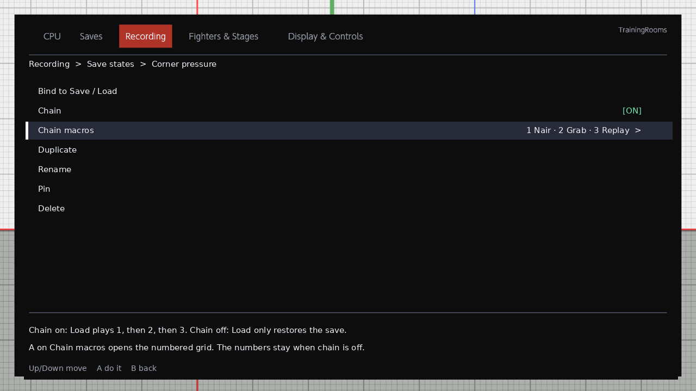

| Row | What it does |
| --- | --- |
| Bind to Save / Load | The green row. The chords use this file. |
| Chain | On or off, Left and Right. On: Load plays the numbered macros. Off: Load only restores the save. The numbers stay either way. |
| Chain macros | Opens the numbered grid. |
| Duplicate | A new save file, a copy of this one, including the numbers. This file stays bound. |
| Rename | Header "Name save state". A new save that was never renamed is Save N. Online, the keyboard stays closed. |
| Pin | Same hot rules as macros. |
| Delete | Removes the file. If it was bound, Save and Load do nothing until another is bound. |

### A conversion

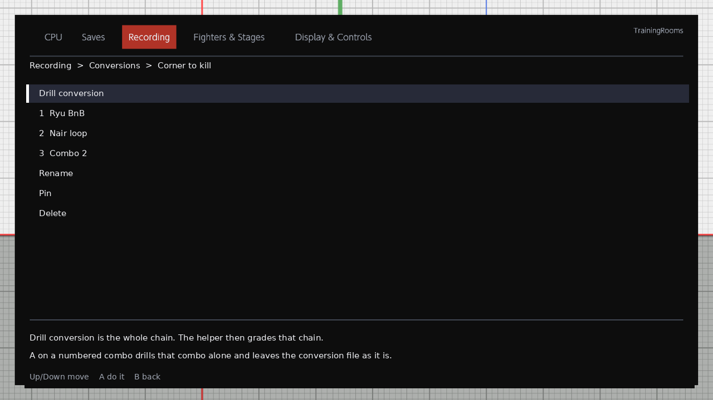

| Row | What it does |
| --- | --- |
| Drill conversion | This becomes the one drill. The helper grades the whole chain. |
| 1, 2, 3… | A drills that combo alone. The conversion file stays. |
| Rename | Header "Name conversion". A new one that was never renamed is Conversion N. Online, the keyboard stays closed. |
| Pin | Same hot rules, in the pictures. Still open as its own question. |
| Delete | Removes the conversion file. The combo files stay. |

## The chain picker

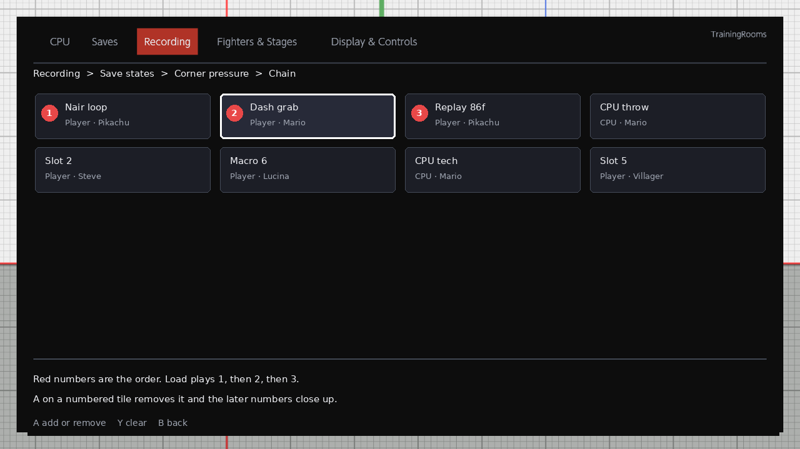

Corner pressure's chain. Nair loop is 1, Dash grab is 2 and is the cursor, Replay 86f is 3. CPU throw has no number, so Load does not play it. The red badge is the Character Cycles number. The tile is the macro's name and the role stored in the file, because a macro is not a portrait.

A on Dash grab again would remove 2, and Replay 86f would become 2. Y clears the numbers. Nothing is refused for a long list. The grid pages. There is no new sentence for an empty chain: Load restores the save and plays nothing.

The same grid, with combos, is the conversion picker. It is below.

## The keyboard

This is the system keyboard, drawn as a schematic because it is the Switch's own screen, not a TrainingRooms keyboard. Training passes the header, the current name, and a 48-character limit, and reads back what OK returns. B cancels and keeps the old name. The same screen names a macro, a combo, a save state, and a conversion. The header is the only difference: "Name macro", "Name combo", "Name save state", "Name conversion".

Online, in a waiting room, the keyboard is not opened. A new file keeps Macro N, Combo N, Save N, or Conversion N, and it can be renamed later in Training.

## Combo from macro

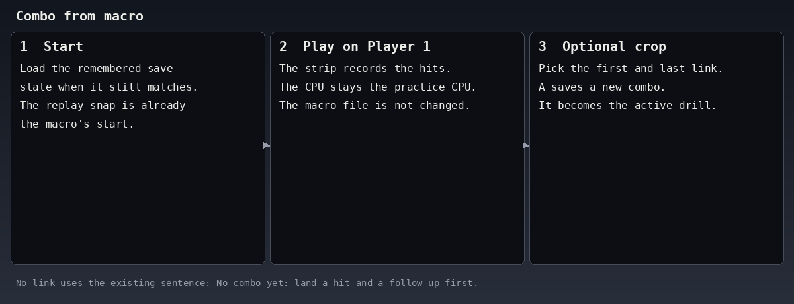

Make combo is a row on that macro. It makes one combo. It does not make a conversion, and it does not turn the macro file into links. CPU playback writes the CPU's controller, and the combo strip only records Player 1 hitting the CPU, so the pass plays the frames on Player 1.

1. Load the linked save, "Nair loop · start", when that file is still there. The playable start is the macro's own start, which a replay export has already snapped to idle or fall. If the file was deleted, skip the load, play from where the fighters are, and show "No start save. This macro plays from where the fighters are."
2. The menu closes. The file plays once on Player 1. The strip records the exchange that opens during the pass.
3. If you want a shorter combo, Crop then asks for the first and last link and saves a copy. The new combo becomes the drill and enters the hot list. The macro file is not written.

No link uses the sentence that already exists: "No combo yet: land a hit and a follow-up first."

## Crop

### A combo, by links

The outline is the kept range, first link through last link. Link 4 is outside it. A saves a new combo. The original stays, so it is the undo. Link offsets are already relative to each link's own start, so a link range stays valid. This is not a frame crop.

### A macro, by frames

In and Out are the Replay window's handles. L and R set them, Left and Right move the selected one. A saves a new named file. The original stays. On this screen L and R are those handles, not the section button. B returns to the macro.

## Shortcuts

| Chord | Default | Change from today |
| --- | --- | --- |
| Save | ZL + Down | Same chord. It writes the bound save file. |
| Load | ZL + Up | Same chord. It loads that file, and plays the numbered macros when chain is on. |
| Record | ZR + Down | Same chord. The pop-up's role says who is recorded. |
| Play on Player 1 | ZR + Left | Was unused. Toggles the player's active macro. |
| Play on CPU | ZR + Up | Was Input Playback. Toggles the CPU's active macro. |
| Recording pop-up | ZR + Right | Was unused. |
| Cycle Player | ZL + Right | Unchanged. |
| Cycle CPU | ZL + Left | Unchanged. |

Menu shortcut 1 stays Minus. Open menu stays B + Up. All eight rows can be edited here.

Both Play chords may be on at once. **Decided.** A chain does not start both at once. It finishes one macro, then starts the next.

## Chain, on a load

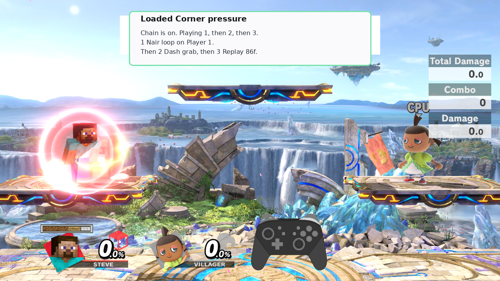

Load of Corner pressure, with chain on, restores the save and then plays 1 Nair loop on Player 1, then 2 Dash grab, then 3 Replay 86f. Each macro plays on the role stored in its file. Chain off restores the save and plays nothing. The list is stored on the save, not on the macros, and each save has its own list and its own on/off.

A chord Load uses the Player tab's loop count for the whole list. Each macro plays once per pass. When the last one finishes, the list starts again at 1 until that count is done. ∞ repeats the list until you stop it. A load started from the CPU tab of the pop-up uses the CPU tab's count instead. That is the recommendation. The other reading is in Still open.

A macro recorded on a different fighter uses the Switch / Keep prompt that already exists, asked once when the chain starts. The prompt names every mismatched macro, and the answer covers the whole chain. That is the recommendation.

This replaces the old checklist of "which slot plays after a load", and it replaces "start recording when a state loads".

## Conversion

A conversion file stores combo ids, in order, the same kind of link as a macro's start save. Renaming a combo keeps it in the conversion. Editing the combo updates the conversion, because the conversion does not keep its own copy of the links. A missing combo is skipped and the numbers close the next time the picker opens. No new sentence for that. An empty conversion drills nothing and shows no new sentence.

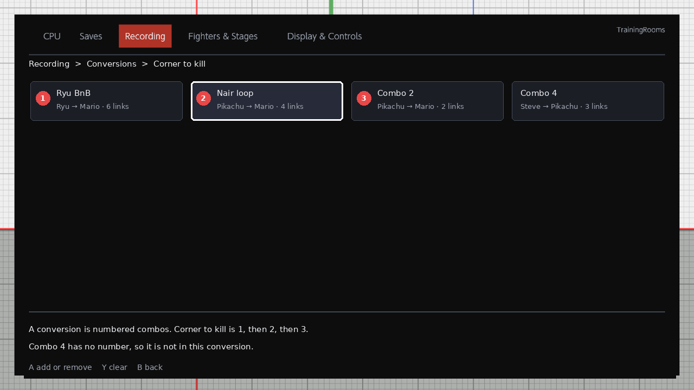

Corner to kill is 1 Ryu BnB, 2 Nair loop, 3 Combo 2. Combo 4 has no number. A and Y work the same way as the chain picker.

### The helper, during a conversion

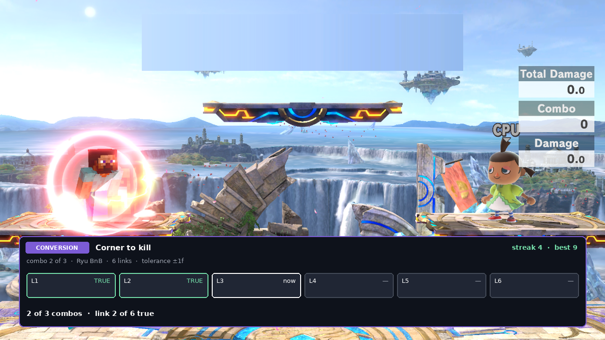

The bar is the combo helper's bar, with a conversion header. It names the conversion, which combo of the chain you are on, and that combo's links. TRUE, the current link, and the links still ahead use the helper's own marks. Streak and best on this bar are the conversion's. They count only a finished conversion.

### A drop, or the chain completed

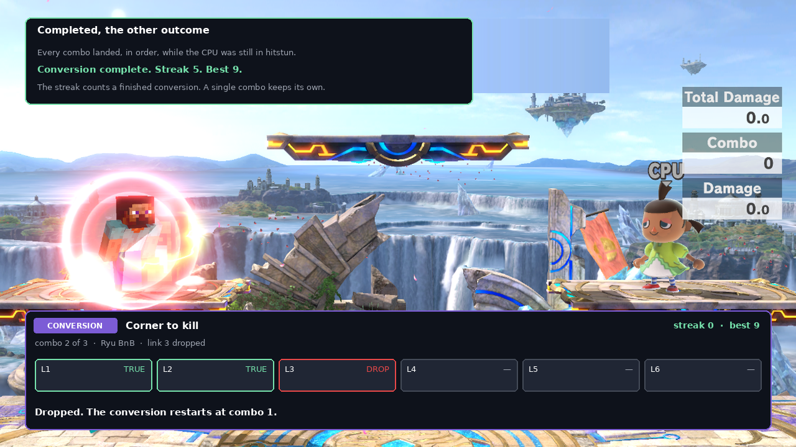

A drop is the helper's existing drop, on the link that failed, and the header names the combo. The pictures then restart the conversion at combo 1. The conversion streak goes back to 0. Best stays.

The other card is completion: every combo landed, in order, and the CPU was still in hitstun between one combo and the next. Streak becomes 5. Best stays 9 if 9 is higher.

Drilling one combo from the conversion's numbered rows uses that combo's own streak and best, and does not add to the conversion's. The helper is that combo's bar, as it is today.

Both of those outcomes are the recommendation. Still open has the other reading: continue from the dropped combo, and count a chain even when the CPU could act between combos.

## Migration

Today's five recording slots become named macros, "Slot 1 (2026-11-05)" through "Slot 5", unpinned, and they start as the hot five. Macros and combos that already have names stay as they are.

Today's five save slots are one slot index for both fighters (`save_states.json` keeps a player record and a CPU record at each index). Each index becomes one file, "Slot N (2026-11-05)", holding both fighters. They start hot and unpinned. The slot the Save and Load chords were using becomes the bound save. None of them start with a chain.

Conversions are new. There is nothing to migrate.

The old Input Record and Input Playback chords are the new Record and Play on CPU chords. One notice, once: "Record, Play on Player 1, Play on CPU, and the recording pop-up replace Input Record and Input Playback."

## Memory

A frame is 8 bytes.

| What is resident | Size |
| --- | --- |
| One hot macro, one minute | 3,600 × 8 = 28,800 bytes |
| Five hot macros | 144,000 bytes |
| One file at the 36,000-frame cap | 288 KiB, not all resident |
| Five files if they were fully resident | 1,440 KiB. Not the plan. |
| Five hot combos | A combo is at most 16 links. A few kilobytes. |
| Five hot saves | Each file is the two fighters' position, damage, and charges, plus a Mii only when the save has one. Far under the macro budget. |
| Five hot conversions | A list of combo ids. A few kilobytes. |

**Decided** for macros and for saves: five hot, one minute of a macro resident, stream the rest. Saves and conversions are small either way. Hot conversions are the recommendation in Still open.

## What leaves

- The slot number on the Saves page, and Randomize slots.
- Record Slot, Trigger, and the Duration dropdown. The file cap stays. Nothing is refused for being long.
- Button slots, and the save-state playback checklist.
- Source. The named library is the only list.
- Per-slot playback chords. They are not added.
- A single chained macro. The chain is the numbered list.

The Saves page keeps the on/off switch for the chords, mirroring, auto-load on death, damage on load, buffs, and the setup library. Setups stay a separate library from save states.

Respawn on platform is not on that Saves page and not on Recording › Options. It is under Fighters & Stages › Stages. The setting id stays `respawn_invincibility`. `p23/respawn-label` implements the move. This document only records where the row goes.

An empty recording still uses the existing "Recording was empty".

A deleted start save shows the approved sentence. Phase 2 adds this row to `docs/RESTRICTIONS.md` and marks the string `// restriction: macro-start-save-missing`:

| ID | Message | Why | Approved |
| --- | --- | --- | --- |
| `macro-start-save-missing` | No start save. This macro plays from where the fighters are. | The macro's linked start file was deleted. Playback continues from the current positions. | Operator, 2026-11-06, revision 3 answer 3 |

No other new sentence is added. A long chain, a missing combo, and an empty chain do not get one.

Fighter mismatch keeps the Switch / Keep prompt, for macros, for combos, and once at the start of a chain.

Lobby practice matches Training. The "Combos work in Training" sentence stays gone.

## Still open

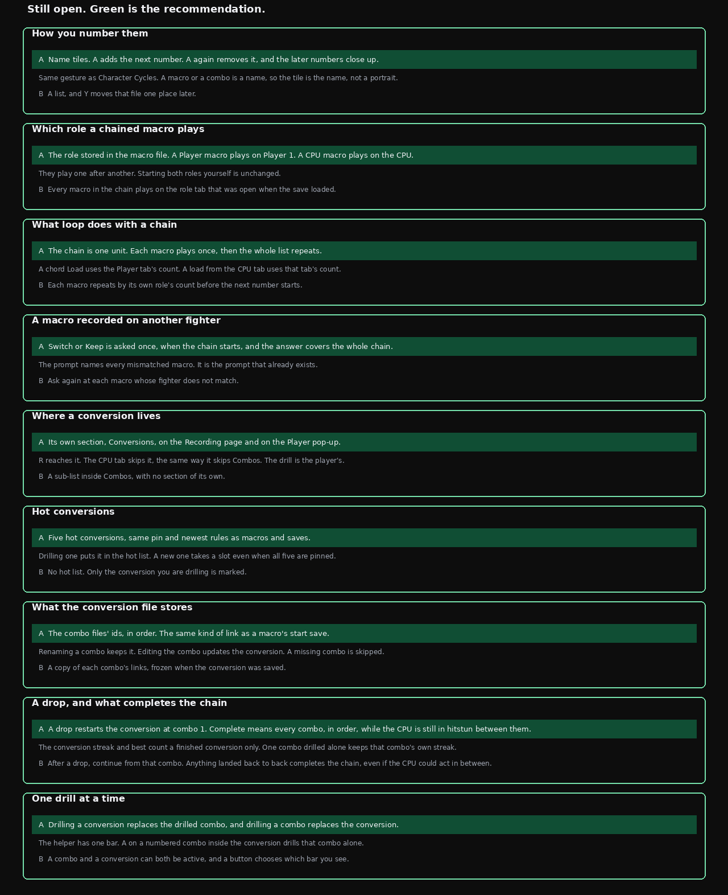

The pictures already use A for each of these. B is the other option.

### How you number them

**A, recommended.** Name tiles. A adds the next number. A again removes it, and the later numbers close up. Same gesture as Character Cycles. The tile is the name, because a macro or a combo is not a portrait.

**B.** A list, and Y moves that file one place later.

### Which role a chained macro plays

**A, recommended.** The role stored in the macro file. A Player macro plays on Player 1. A CPU macro plays on the CPU. They play one after another.

**B.** Every macro in the chain plays on the role tab that was open when the save loaded.

### What loop does with a chain

**A, recommended.** The chain is one unit. Each macro plays once, then the whole list repeats. A chord Load uses the Player tab's count. A load from the CPU tab uses that tab's count.

**B.** Each macro repeats by its own role's count before the next number starts.

### A macro recorded on another fighter

**A, recommended.** Switch or Keep is asked once, when the chain starts, and the answer covers the whole chain. The prompt is the one that already exists. It names every mismatched macro.

**B.** Ask again at each macro whose fighter does not match.

### Where a conversion lives

**A, recommended.** Its own section, Conversions, on the Recording page and on the Player pop-up. R reaches it. The CPU tab skips it.

**B.** A sub-list inside Combos, with no section of its own.

### Hot conversions

**A, recommended.** Five hot conversions, same pin and newest rules as macros and saves. Drilling one puts it in the hot list. A new one takes a slot even when all five are pinned.

**B.** No hot list. Only the conversion you are drilling is marked.

### What the conversion file stores

**A, recommended.** The combo files' ids, in order. Renaming a combo keeps it. Editing the combo updates the conversion. A missing combo is skipped.

**B.** A copy of each combo's links, frozen when the conversion was saved.

### A drop, and what completes the chain

**A, recommended.** A drop restarts the conversion at combo 1. Complete means every combo, in order, while the CPU is still in hitstun between them. The conversion streak and best count a finished conversion only. One combo drilled alone keeps that combo's own streak.

**B.** After a drop, continue from that combo. Anything landed back to back completes the chain, even if the CPU could act in between.

### One drill at a time

**A, recommended.** Drilling a conversion replaces the drilled combo, and drilling a combo replaces the conversion. The helper has one bar. A on a numbered combo inside the conversion drills that combo alone.

**B.** A combo and a conversion can both be active, and a button chooses which bar you see.

## Pictures

Menu chrome: the rc.1 Recording page, `eden-runs/tr-p23-docs-capture-03/out/c15-q7/b-021632Z-877073-q7-row.png`.

Match: `artifacts/phase23/overlay-investigation/frames/fix-tr-training.png`.

The keyboard is a schematic of the Switch's own keyboard. It is not a capture of that screen, and it is not a new TrainingRooms keyboard.

New in revision 3: `RECORDING-REDESIGN-chain-picker.png`, `RECORDING-REDESIGN-conversion-picker.png`, `RECORDING-REDESIGN-conversion-actions.png`, `RECORDING-REDESIGN-popup-conversions.png`, `RECORDING-REDESIGN-page-conversions.png`, `RECORDING-REDESIGN-conversion-bar.png`, `RECORDING-REDESIGN-conversion-drop.png`. The save row, the save pop-up, and the load notice were redrawn so the chain shows its numbers.
