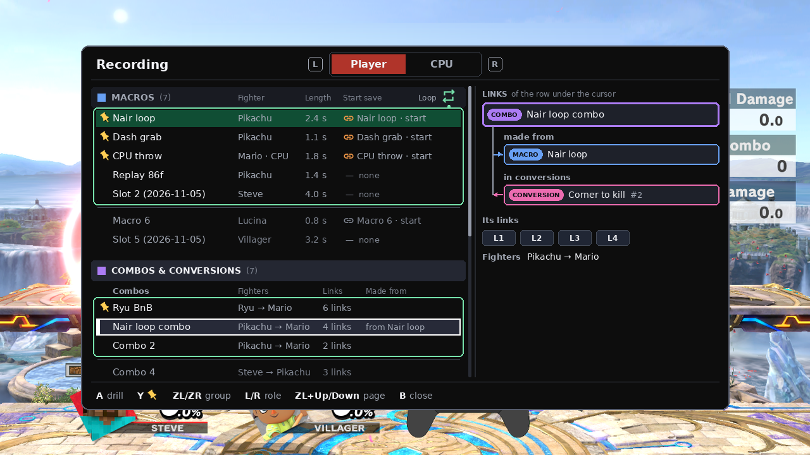
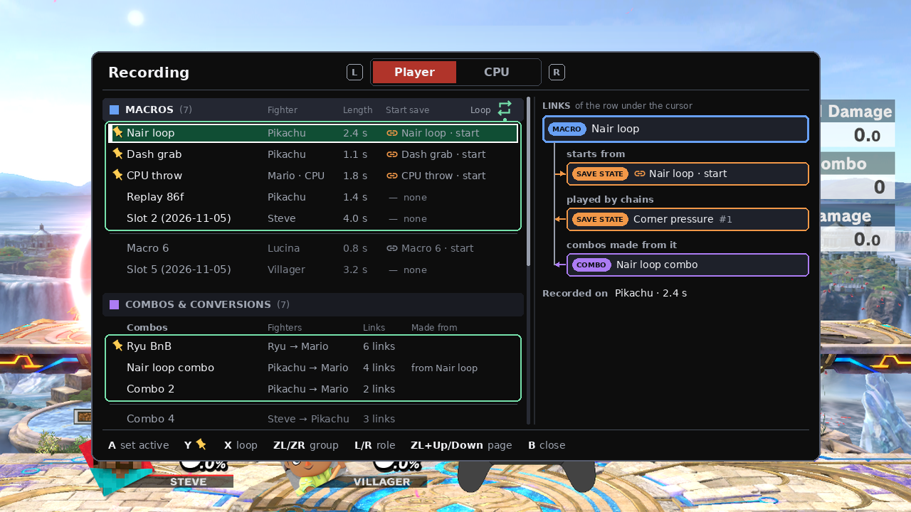
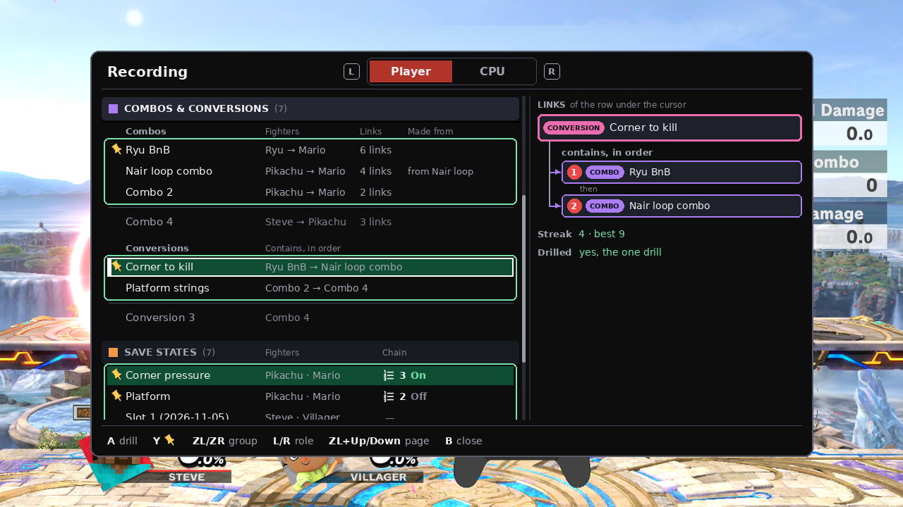
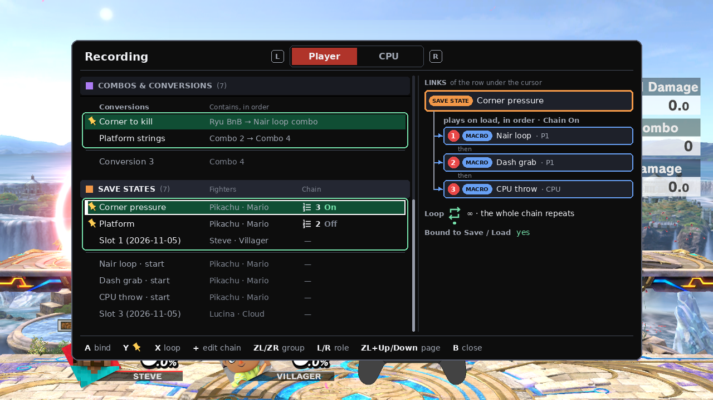
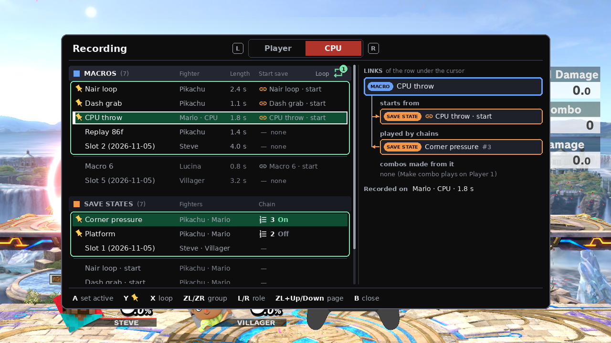
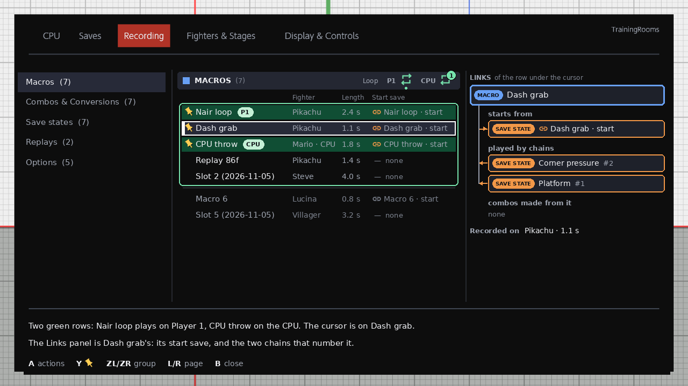
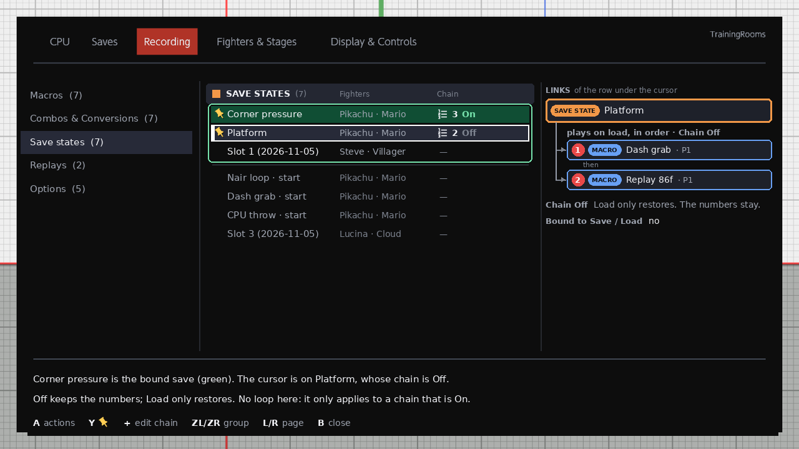

# Recording redesign — revision 4

Phase 1 screens. Nothing here is built. The pop-up sits on a real Training frame, `artifacts/phase23/overlay-investigation/frames/fix-tr-training.png` (Steve and Villager on Battlefield). The menu pictures are redrawn on the real rc.1 Recording page (`eden-runs/tr-p23-docs-capture-03`). Names and lengths are examples, and every picture uses the same example files. The first picture shows them.

Where a choice is still open, the pictures use the recommendation (A). The other option is under Still open.

## Revision 4

The operator, 2026-11-06, on revision 3: "the menu is a good start … Its not clear from the images how linking happens, what's linked to what, and the loop is on pages where it doesnt apply. The first draft you gave had a bigger window with groups and seemed more intuitive." Then: "the loop icon … should be drawn from an svg or something similar or native."

- **The link diagram comes first.** It shows four kinds of file and four kinds of link. Each arrow says what the link means and how you make it. Under it is the example every other picture uses.
- **One big window with groups.** The pop-up covers about 80 % of the screen. Every group is stacked in one scrollable list: MACROS, COMBOS & CONVERSIONS, SAVE STATES. The CPU role has MACROS and SAVE STATES only. Revision 3's row of section buttons is gone.
- **The Links panel.** The right side of the pop-up and of the Recording page writes out the links of the row under the cursor as a small diagram: the start save, the chains that play it, the combos made from it, the order of a chain or a conversion.
- **Five step-by-step strips** show how each link is made: record, chain a save, make a conversion, make a combo from a macro, drill a conversion.
- **Loop only on macros and chains.** The loop mark is in the MACROS group header and on a chained save's Links panel, where it means the whole chain. It is never on the combos, conversions, or save-state groups. X cycles it only in MACROS or on a chained save.
- **The conversion bar is at the top**, under the frame strip, where today's combo bar is.
- **ZL / ZR jump between groups.** ZL + Up / Down keeps the meaning it has in the menu today. See Pop-up buttons.
- **The icons are real SVGs.** The loop, the pin, the link and the chain marks are Google Material Symbols (Apache-2.0), filled from their path data. See The loop mark.
- **Conversions sit inside COMBOS & CONVERSIONS**, after the combos. Revision 3 recommended a separate section. Still open item 5 is updated.
- Revision 3's pop-up, page, file-screen, picker, load-notice, bar, loop and choices pictures are removed, because they showed the old layout or the old example. Its keyboard, shortcuts, macro actions, crop, and respawn pictures stay, under Unchanged from revision 3. Two unreferenced ones that still match, `combo-from-macro` and `save-where`, are left in place.

## What links to what

*Top: the four kinds of file and the four links. Bottom: the example. Load Corner pressure, and the save restores, then Nair loop plays on Player 1, Dash grab on Player 1, and CPU throw on the CPU. Nair loop starts from its own save. Corner to kill drills Ryu BnB, then Nair loop combo, and Nair loop combo was made from Nair loop.*

| Link | From → to | How it is made | Where you see it |
| --- | --- | --- | --- |
| Start save | macro → its save state, "Nair loop · start" | Automatic, when you record | The macro row: the link mark and the save's name. The Links panel. |
| Chain | save state → an ordered list of macros 1, 2, 3 | The save's Edit chain (+), a numbered picker like Character Cycles. Chain On or Off on the save. | The save row: the chain mark, the count, On or Off. The Links panel lists 1 → 2 → 3, each with its role. |
| Conversion | conversion → an ordered list of combos | Combos & Conversions › New conversion, the same numbered picker, then a name on the Switch keyboard | The conversion row: "Ryu BnB → Nair loop combo". The Links panel. |
| Made from | combo ← the macro it was made from | A macro's Make combo | The combo row: a small "from Nair loop". The Links panel. |

Every link is a file id, so renaming either end keeps it.

## How to read a list

*Green fill is active. A white border with a white bar on the left is the cursor. When the cursor is on the active row, both show. The thin green outline is the hot five. The marks along the bottom are the pin, the start-save link, the chain, the order badge, and the loop.*

- **Green fill: active.** The macro that plays for this role, the combo or conversion being drilled, or the save that Save and Load use.
- **White border and bar: the cursor.** A acts on this row. It is a different mark from the green fill, so the two never look alike.
- **Thin green outline: the hot set.** At most five per kind. Pins come first, then the newest.
- **Under the hairline, dimmer:** the rest of the library, on the card.
- **Gold, tilted thumbtack:** pinned.
- **Red number:** the order, the badge Character Cycles uses. A adds the next number. A again removes it, and the later numbers close up.
- **Gold outline** in the step-by-step strips only: a mockup mark for "new". It is not part of the product.

## The loop mark

*Off is white. ∞ is green with a dot under it. A count is green with the number in a badge. X cycles ∞, 1, 2, 3, 5, 10. The list is the Options row.*

The loop belongs to the role, not to a group and not to a file. Player and CPU each keep their own count. **Decided.** It appears in two places only: the MACROS group header, and a chained save's Links panel, where the same count repeats the whole chain.

How the product would draw it: as a texture in our own layout archive. The layout builder can embed one. `tools/layout-builder` (branch `p23/rc5-candidate`) already appends textures to the stock `timg/__Combined.bntx`: the 38 item icons from `assets/item-icons` through `import_png_file`, and the generated hitbox orb disc through `import_dds`. Picture panes bind those textures, and the panes' vertex colours tint them, which covers white for off and green for on. The builder reads PNG and DDS, not SVG, so the SVG would be turned into a PNG first. A native game icon that fits: not checked.

Icons: Google Material Symbols `repeat`, `push_pin` (filled), `link` and `format_list_numbered`, from https://github.com/google/material-design-icons, Apache License 2.0. The copies, their source paths, and the licence text are in [icons/](icons/).

## Pop-up

The pop-up is one window over the match, about 80 % of the screen, so its size can be judged against the fighters. It owns the buttons while it is open, the way the menu does. B closes it.

- **Top bar:** the title, Recording, and the role toggle, Player | CPU. L or R switches role. The selected role is the menu's red tab.
- **Left, the list (about 60 %):** every group, stacked, in one scrollable list. When the list scrolls, the current group's header stays at the top.
  - **MACROS:** Name, Fighter, Length, start save. The loop mark is in this header.
  - **COMBOS & CONVERSIONS** (Player only): the combos, then the conversions. A conversion row shows its sequence.
  - **SAVE STATES:** Name, Fighters, and the chain: the count and On or Off.
- **Right, the Links panel (about 40 %):** the row under the cursor and its links, drawn as a small diagram. The arrow points from the file that holds the link.
- **Footer:** the buttons for the group the cursor is in.

### Player, a combo under the cursor

*Nair loop is green: it is the Player's active macro. The cursor is on Nair loop combo, in a different group. The Links panel says that combo was made from Nair loop and is combo 2 of Corner to kill. Under that are its four links.*

### A macro under the cursor

*The cursor is on Nair loop, which is also the active macro, so the row is green with the white border. The Links panel: it starts from Nair loop · start, Corner pressure plays it as number 1, and Nair loop combo was made from it. It was recorded on Pikachu and is 2.4 s long.*

Replay 86f and the migrated Slot 2 show "— none" under start save. A replay export and a migrated slot have no start save, so the absence is visible in the row.

### A conversion under the cursor

*Corner to kill is the drill (green) and is pinned. It contains 1 Ryu BnB, then 2 Nair loop combo. The panel also shows its streak and best. COMBOS & CONVERSIONS has no loop mark.*

### A save under the cursor

*Corner pressure is the bound save (green) and its chain is On. On load, it plays 1 Nair loop on Player 1, then 2 Dash grab on Player 1, then 3 CPU throw on the CPU. The loop line says ∞ repeats the whole chain. Because this save has a chain that is On, the footer adds X loop. Platform's chain is Off: the numbers stay, and Load only restores. The start saves Record wrote sit under the outline.*

### CPU

*The CPU role has MACROS and SAVE STATES only. CPU throw is the CPU's active macro. The loop mark shows the CPU's own count, 1. CPU throw has no combos made from it, because Make combo plays on Player 1.*

Both roles list the same macro library and the same hot five. The role decides which row is green. Record on this role records the CPU's fighter. The new file becomes the CPU's active macro and enters the hot list. The save list is the same library as on Player, because a save is both fighters.

### Pop-up buttons

| Button | MACROS | COMBOS & CONVERSIONS | SAVE STATES |
| --- | --- | --- | --- |
| A | Set active for this role | Drill this combo or conversion | Bind to Save / Load |
| Y | Pin or unpin | Pin or unpin | Pin or unpin |
| X | Cycle the loop | — | Cycle the loop, only on a save whose chain is On |
| + | — | — | Edit chain |
| ZL / ZR | Previous / next group | Previous / next group | Previous / next group |
| ZL + Up / Down | 12 rows, stop at the ends | same | same |
| L / R | Player / CPU | Player / CPU | Player / CPU |
| B | Close | Close | Close |

Checked against the current menu code (`src/model/menu/input.rs` and `mod.rs` on `p23/rc5-candidate`):
- ZL held is a modifier, and the adapter turns ZL + Up / Down into a jump. A ZL press on its own reaches the menu only as a tap, sent on release when nothing else was pressed. So ZL alone and ZL + Up / Down never fire together.
- Pages and popup lists ignore ZL and ZR taps today. The checklists use a ZL tap for tick-all, and the roster grids use ZR for the role. Neither is on these screens.
- ZL + Up / Down keeps its present meaning: one window of 12 rows in a popup list, and the section jump on a menu page.
- The pair is therefore ZL / ZR alone for the groups, and ZL + Up / Down to page, with no conflict.
- The menu's button list has no + today, so Edit chain needs that one button added to the adapter.

## Recording page

The same model as the pop-up, in the menu. The left column is Macros, Combos & Conversions, Save states, Replays, Options. The main area is the selected group's list, with the hot outline at the top, the pins, and the active colour, and the same Links panel on the right. ZL / ZR move between the groups in the left column, as in the pop-up. L / R change the menu page again, as they do on every other page. Revision 3 had taken them away from this page for the section button. Up onto the tabs, then Left or Right, also leaves.

### Macros

*The page shows both roles at once. Nair loop is green with P1, and CPU throw is green with CPU. Both roles' loop marks are in the MACROS header. The cursor is on Dash grab, and the panel shows its start save and the two chains that number it.*

### Save states

*Corner pressure is the bound save. The cursor is on Platform, whose chain is Off, so its Links panel has no loop line. The SAVE STATES header never has one.*

| Button | What it does |
| --- | --- |
| A | Open the file's own screen |
| Y | Pin or unpin |
| + | Edit chain (Save states) |
| ZL / ZR | Previous / next group in the left column |
| L / R | Previous / next menu page |
| B | Close the menu |

Replays and Options keep revision 3's rows (see Unchanged from revision 3). The loop shows in Options only as the INI-backed list of counts.

## How linking happens

Each strip is three steps in the menu's own style. The panels are drawn at full size, so the text stays readable.

### 1 · Record → start save

*Record also writes "Macro 7 · start" and links it. When the recording stops, Macro 7 joins the hot five after the pins. Its Links panel shows starts from Macro 7 · start, and the new save is listed in SAVE STATES.*

### 2 · Chain a save

*+ on a save opens Edit chain. A numbers the macros, as Character Cycles does. Back in the list, the row reads 3 On, and the Links panel shows 1 → 2 → 3 with each macro's role.*

### 3 · Make a conversion

*New conversion is the last row under the conversions. The same numbered picker orders the combos. The Switch's own keyboard, drawn here as a labelled schematic, names it. The new row shows its sequence.*

### 4 · Make combo from a macro

*Make combo loads the macro's start save and plays the macro once on Player 1 while the frame strip records. The new combo says "from Nair loop" in its row and "made from" in its Links panel.*

If the start save was deleted, the load is skipped and the approved sentence shows: "No start save. This macro plays from where the fighters are." No link uses the sentence that already exists: "No combo yet: land a hit and a follow-up first."

### 5 · Drill a conversion

*A on Corner to kill makes it the drill and replaces the drilled combo, so there is one drill at a time. The bar appears at the top of the screen. The next picture shows it at full size.*

## The conversion drill bar

*Under the frame strip, where today's combo bar sits. "CONVERSION · Corner to kill · combo 2 of 2". Ryu BnB is done, and Nair loop combo is the current combo. L1 is TRUE and L2 is now. The streak and best are the conversion's.*

The bar is the combo helper's bar with a conversion header and a row for the combos in the chain. TRUE, the current link, and the links still to come use the helper's own marks. Streak and best count only a finished conversion. A drop is the helper's existing drop, on the link that failed. The pictures restart the conversion at combo 1, with the streak back to 0 and best kept. That is Still open item 8.

Drilling one combo from a conversion's numbered rows uses that combo's own streak and best and its normal bar, as today.

## Still open

*The nine choices revision 3 left open. A is recommended for each and is what the pictures use.*

*Loop with a chain: A repeats the whole chain, B repeats each macro. A drop: A restarts at combo 1, B retries the dropped combo. Fighter mismatch: A asks once for the whole chain, B asks at each macro.*

1. **How you number them.** A, recommended: name tiles. A adds the next number, and A again removes it. It is the Character Cycles gesture. B: a list, and Y moves a file one place later.
2. **Which role a chained macro plays.** A, recommended: the role stored in the macro file. B: the role tab that was open when the save loaded.
3. **What loop does with a chain.** A, recommended: the chain is one unit, and the whole list repeats. A chord Load uses the Player loop. A load from the CPU tab uses the CPU loop. B: each macro repeats by its own role's count before the next number.
4. **A macro recorded on another fighter.** A, recommended: the existing Switch / Keep prompt, asked once when the chain starts. It names every mismatched macro, and the answer covers the chain. B: ask at each mismatched macro.
5. **Where a conversion lives.** A, recommended: inside COMBOS & CONVERSIONS, after the combos, which is revision 4's layout. Revision 3 recommended a separate section. B: its own group, CONVERSIONS.
6. **Hot conversions.** A, recommended: five hot, with the same pin and newest rules as macros and saves. B: no hot list.
7. **What the conversion file stores.** A, recommended: the combo files' ids, in order. B: a frozen copy of each combo's links.
8. **A drop, and what completes the chain.** A, recommended: a drop restarts at combo 1. Complete means every combo, in order, with the CPU still in hitstun between them. B: continue from the dropped combo, and back to back counts as complete.
9. **One drill at a time.** A, recommended: a conversion and a combo replace each other as the drill. B: both active, and a button picks the bar.

## Already decided

- One Recording page, plus one pop-up. Record follows the pop-up's role: Player records you, CPU records the CPU. **Decided.**
- Hot memory is one minute resident per hot macro (3,600 frames, 28.8 KiB). Five hot macros are 144 KiB. A longer file still plays; the rest is read in 600-frame windows. The file cap stays 36,000 frames. No recording is refused for length. **Decided.**
- A new recording takes a hot slot even when all five are pinned. The oldest pin leaves the hot list and stays on the card. The same rule covers saves. **Decided.**
- Loop counts are ∞, 1, 2, 3, 5, 10. X cycles them. The list is the Options row. The loop belongs to the role. **Decided.**
- Player 1 and the CPU may play at the same time. A chain does not use that: its macros play one after another. **Decided.**
- Save states are named files that you bind for Save and Load. There is no slot number and no extra slot shortcut. **Decided.**
- A save's chain is an ordered list of macros, numbered 1, 2, 3…, with Chain On or Off on the save. Off keeps the numbers and Load only restores. It replaces the old "play a recording because a state loaded" checklist. **Decided.**
- A recording's start is its own save file, "<macro name> · start", and the macro stores that file's id. **Decided.**
- Five hot saves, with the same pin and newest rules. **Decided.**
- Save states are a group under both roles. The third Saves tab is rejected. **Decided.**
- The sentence "No start save. This macro plays from where the fighters are." is approved as `macro-start-save-missing`. **Decided.**
- A conversion is a chain of saved combos. You can drill one combo, or the conversion. **Decided.**
- Respawn on platform is under Fighters & Stages › Stages, not under save states. `p23/respawn-label` implements the move. **Decided.**
- Names use the Switch's own keyboard. **Decided.**

## Unchanged from revision 3

These screens and rules carry over. Where a picture is revision 3's, the left column in it still uses the older group names.

### A macro's own screen

*Revision 3's picture. The first row is the start save the macro links to.*

| Row | What it does |
| --- | --- |
| Start save | The file Record created, "Nair loop · start". The macro stores its id. Renaming that save keeps the link. |
| Set active for Player 1 | Play on Player 1 toggles this file |
| Set active for CPU | Play on CPU toggles this file |
| Rename | The Switch keyboard. Header "Name macro". Empty OK keeps the previous name. A new recording that was never renamed is Macro N. |
| Crop | In and Out, then a new file. This file stays. |
| Make combo | Play the file once on Player 1 from its start save, and keep the links as a new combo. This file stays. This is not a conversion. |
| Pin | Thumbtack. Pins sort first inside the hot outline. |
| Delete | Removes the file. A chain that numbered it closes the gap the next time that chain is opened. |

### A combo's own screen

*Made from names the macro the combo came from.*

| Row | What it does |
| --- | --- |
| Drill | This becomes the one drill, and a drilled conversion is cleared |
| Made from | The macro it was made from, when there is one |
| Rename | Header "Name combo". Empty OK on a new combo is Combo N. Online, the keyboard stays closed and the name is Combo N. |
| Crop | First link and last link. A saves a new combo. This file stays. |
| Pin | Same hot rules as macros |
| Delete | Removes the file. A conversion that numbered it skips that step. |

### A save state's own screen

*Chain On, and Edit chain lists the numbers.*

| Row | What it does |
| --- | --- |
| Bind to Save / Load | The green row. The chords use this file. |
| Chain | On or Off, Left and Right. On: Load plays the numbered macros. Off: Load only restores the save. The numbers stay either way. |
| Edit chain | The numbered picker. + opens it from the list and the pop-up too. |
| Duplicate | A new save file, a copy of this one, including the numbers. This file stays bound. |
| Rename | Header "Name save state". A new save that was never renamed is Save N. Online, the keyboard stays closed. |
| Pin | Same hot rules as macros. |
| Delete | Removes the file. If it was bound, Save and Load do nothing until another is bound. |

The Save chord overwrites the bound file. If nothing is bound yet, Save creates a file named Save N, binds it, and puts it in the hot list. Saving over "Nair loop · start" moves that macro's remembered start, because that is the file the macro points at.

### A conversion's own screen

*Drill conversion grades the whole chain. A numbered row drills that combo alone.*

| Row | What it does |
| --- | --- |
| Drill conversion | This becomes the one drill. The helper grades the whole chain. |
| 1, 2… | A drills that combo alone. The conversion file stays. |
| Edit combos | The numbered picker |
| Rename | Header "Name conversion". A new one that was never renamed is Conversion N. Online, the keyboard stays closed. |
| Pin | Same hot rules (Still open item 6) |
| Delete | Removes the conversion file. The combo files stay. |

A conversion stores combo ids in order (Still open item 7). Renaming a combo keeps it in the conversion. A missing combo is skipped, and the numbers close up the next time the picker opens. An empty conversion drills nothing. No new sentence is added for either case.

### The keyboard

*A labelled schematic of the Switch's own keyboard, not a capture and not a TrainingRooms keyboard.*

Training passes the header, the current name, and a 48-character limit, and reads back what OK returns. B cancels and keeps the old name. The headers are "Name macro", "Name combo", "Name save state", and "Name conversion". Online, in a waiting room, the keyboard is not opened. A new file keeps Macro N, Combo N, Save N, or Conversion N, and it can be renamed later in Training.

### Crop

*A combo, by links. The outline is the range that is kept. A saves a new combo, and the original stays.*

*A macro, by frames. In and Out are the Replay window's handles. A saves a new named file.*

On the crop screen, L and R set the handles, not the group. B returns to the file.

### Replays and Options

| Row | What it does |
| --- | --- |
| Replay capture | On: saving a replay also keeps the inputs. This is the row that exists today. |
| Replay window | The existing window. Its In/Out crop saves a named macro into this library. A mid-action In walks back to idle or fall, at most two seconds. |
| Crop trailing neutral | On: idle frames at the end of a recording are dropped. |
| Hitstun timing | When playback starts after the CPU is hit. The choices stay the ones this row has today. |
| Mash interrupts playback | On: a mash stops a playing recording. |
| Loop counts | The list X cycles. **Decided:** ∞, 1, 2, 3, 5, 10. |
| Button chords | Record, the two Play chords, the pop-up, and Save and Load. |

### Shortcuts

*The eight chords. All of them can be edited.*

| Chord | Default | Change from today |
| --- | --- | --- |
| Save | ZL + Down | Same chord. It writes the bound save file. |
| Load | ZL + Up | Same chord. It loads that file, and plays the numbered macros when Chain is On. |
| Record | ZR + Down | Same chord. The pop-up's role says who is recorded. |
| Play on Player 1 | ZR + Left | Was unused. Toggles the player's active macro. |
| Play on CPU | ZR + Up | Was Input Playback. Toggles the CPU's active macro. |
| Recording pop-up | ZR + Right | Was unused. |
| Cycle Player | ZL + Right | Unchanged. |
| Cycle CPU | ZL + Left | Unchanged. |

Menu shortcut 1 stays Minus. Open menu stays B + Up. Both Play chords may be on at once. **Decided.** A chain finishes one macro, then starts the next.

### Chain, on a load

A Load of a save with Chain On restores the save, then plays its macros in order. Each macro plays on the role stored in its file (Still open item 2). A macro recorded on a different fighter uses the Switch / Keep prompt that already exists, asked once when the chain starts (Still open item 4). The list is stored on the save, not on the macros, and each save has its own list and its own On or Off.

### Migration

- Today's five recording slots become named macros, "Slot 1 (2026-11-05)" through "Slot 5". They are unpinned and start as the hot five. They have no start save.
- Today's five save slots are one slot index for both fighters. Each index becomes one file, "Slot N (2026-11-05)", holding both fighters. They start hot and unpinned. The slot the Save and Load chords were using becomes the bound save. None of them starts with a chain.
- Conversions are new. There is nothing to migrate.
- The old Input Record and Input Playback chords become the new Record and Play on CPU chords. One notice, once: "Record, Play on Player 1, Play on CPU, and the recording pop-up replace Input Record and Input Playback."

### Memory

| What is resident | Size |
| --- | --- |
| One hot macro, one minute | 3,600 × 8 = 28,800 bytes |
| Five hot macros | 144,000 bytes |
| One file at the 36,000-frame cap | 288 KiB, not all resident |
| Five hot combos | A combo is at most 16 links. A few kilobytes. |
| Five hot saves | Both fighters' position, damage, and charges, plus a Mii only when the save has one. Far under the macro budget. |
| Five hot conversions | A list of combo ids. A few kilobytes. |

### What leaves

- The slot number on the Saves page, and Randomize slots.
- Record Slot, Trigger, and the Duration dropdown. The file cap stays. Nothing is refused for being long.
- Button slots, and the save-state playback checklist.
- Source. The named library is the only list.
- Per-slot playback chords. They are not added.
- A single chained macro. The chain is the numbered list.

The Saves page keeps the on/off switch for the chords, mirroring, auto-load on death, damage on load, buffs, and the setup library. Setups stay a separate library from save states.

*Respawn on platform is under Fighters & Stages › Stages. The setting id stays `respawn_invincibility`.*

An empty recording still uses the existing "Recording was empty". Fighter mismatch keeps the Switch / Keep prompt, for macros, for combos, and once at the start of a chain. Lobby practice matches Training.

A deleted start save shows the approved sentence. Phase 2 adds this row to `docs/RESTRICTIONS.md` and marks the string `// restriction: macro-start-save-missing`:

| ID | Message | Why | Approved |
| --- | --- | --- | --- |
| `macro-start-save-missing` | No start save. This macro plays from where the fighters are. | The macro's linked start file was deleted. Playback continues from the current positions. | Operator, 2026-11-06, revision 3 answer 3 |

No other new sentence is added. A long chain, a missing combo, and an empty chain do not get one.

## Pictures

- Menu chrome: the rc.1 Recording page, `eden-runs/tr-p23-docs-capture-03/out/c15-q7/b-021632Z-877073-q7-row.png`.
- Match: `artifacts/phase23/overlay-investigation/frames/fix-tr-training.png`. The old Input Playback notice in that frame is painted over with the sky beside it.
- Renderer: `tools/render_recording_redesign.py`. It draws the revision 4 pictures, and with `--r3` it draws revision 3's.
- Icons: Google Material Symbols (`repeat`, `push_pin`, `link`, `format_list_numbered`), https://github.com/google/material-design-icons, Apache License 2.0. The copies and the licence are in [icons/](icons/). The renderer fills their path data with Pillow at 8× and downsamples. The tilt, the colours, the dot, and the count badge are added by the renderer.
- New in revision 4: every `RECORDING-REDESIGN-r4-*.png`. Kept from revision 3: `macro-actions`, `keyboard`, `crop`, `crop-macro`, `shortcuts`, `respawn`.
