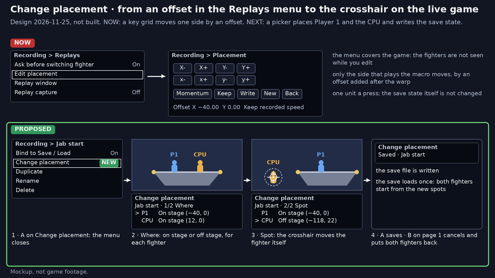
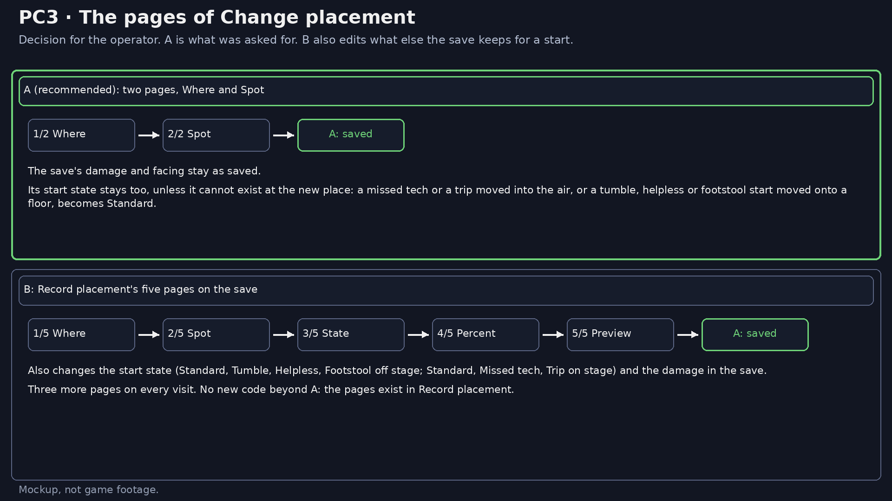

# Change placement: six choices

The 2026-11-25 proposal used the Break the Targets crosshair to edit a save directly, with separate Player 1 and CPU choices.

| Proposed step | Action |
| --- | --- |
| 1 | Open Change placement with A on the save screen. |
| 2 · Where | Choose On stage or Off stage for each fighter. |
| 3 · Spot | Move the fighter with the crosshair. |
| 4 | Press A to save, then load once. |

**Decided 2026-11-25, about 15:50Z.** Each section gives the outcome first. Green outlines mark the original recommendations. See [the decision record](../../DECISIONS.md) and [the Recording guide](../../guide/recording.md#change-placement-and-the-replay-window).

## PC1 · On stage: how the floor is chosen

**B was chosen.**

- **A (recommended then).** Move freely. Above a platform, stand on it. Moving below it selects the ground. The existing Record placement rule passed 19/19 emulator rows and needed no new code.
- **B.** Left/Right follow the current floor. Up/Down hop to the next floor. The proposal estimated 70 extra lines and dedicated tests. It had no emulator results at the time.

## PC2 · Where Change placement is opened

**All four entry points were kept.**

- **A (recommended then).** Open from a save, from a macro to edit its start save, or with X on a save in the in-game pop-up.
- **B.** Open only from a save or macro screen.
- Both proposals removed the Replays row. The decision kept it as a fourth route to the same picker.

## PC3 · How many pages

**Five pages were chosen.** + saves from any page.

- **A (recommended then).** Where and Spot only. Keep damage and facing. Change an impossible start state, such as a missed tech moved into the air, to Standard.
- **B.** Add three pages per visit to edit state and damage and preview the result, as in Record placement.

## PC4 · Record placement gets the same picker

**A was chosen.**

- **A (recommended then).** Both workflows share Where, live fighters and the game's magnifier. Redo the Record placement emulator checks and guide clip.
- **B.** Keep Record placement as a separate picker with different behavior.

## PC5 · A start save several macros share

**Users choose each time by default.** Advanced offers Prompt, Always change and Always copy.

- **A (recommended then).** Edit the shared save for every linked macro. The Saved notice names the count, for example “2 macros start here”.
- **B.** Create a new save each time and relink this macro alone. Estimated cost was 40 extra lines.

## PC6 · The old offset key grid

**A was chosen.**

- **A (recommended then).** Remove the key grid, Keep and New. Move Momentum to the macro screen. Show Offset when one exists. A clears it, B cancels placement and Duplicate copies a save.
- **B.** Keep the grid as Fine offset, giving two ways to move the start.
- **Correction, 2026-11-25 15:31Z.** The design lane corrected the diagram and text. Placement edits the save. The earlier diagram reset the macro offset to zero. Play adds the offset until the user clears it. Choosing a separate copy from a macro relinks that macro.
