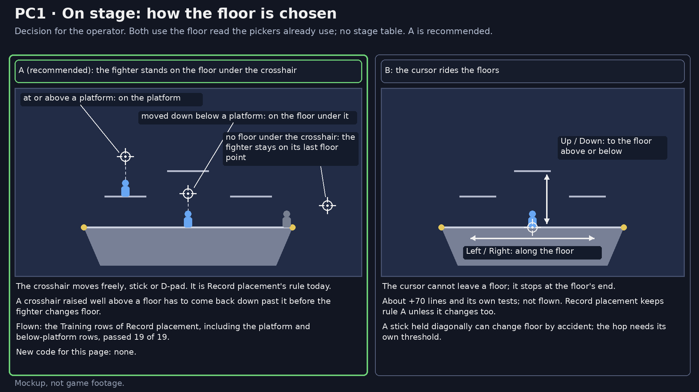
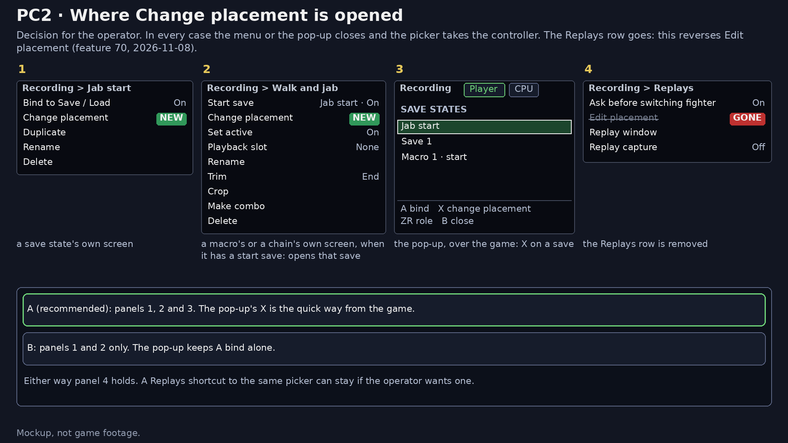
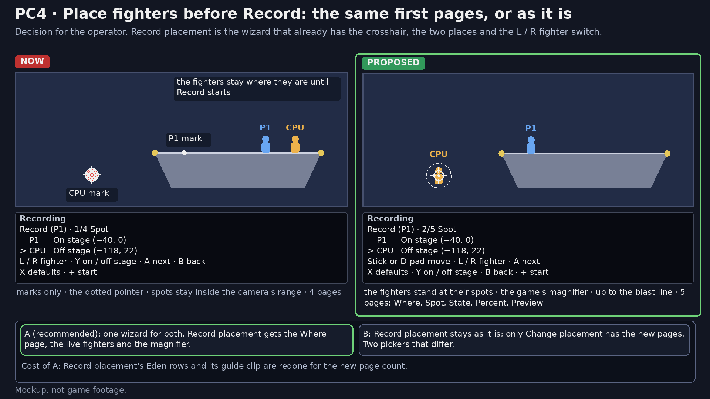
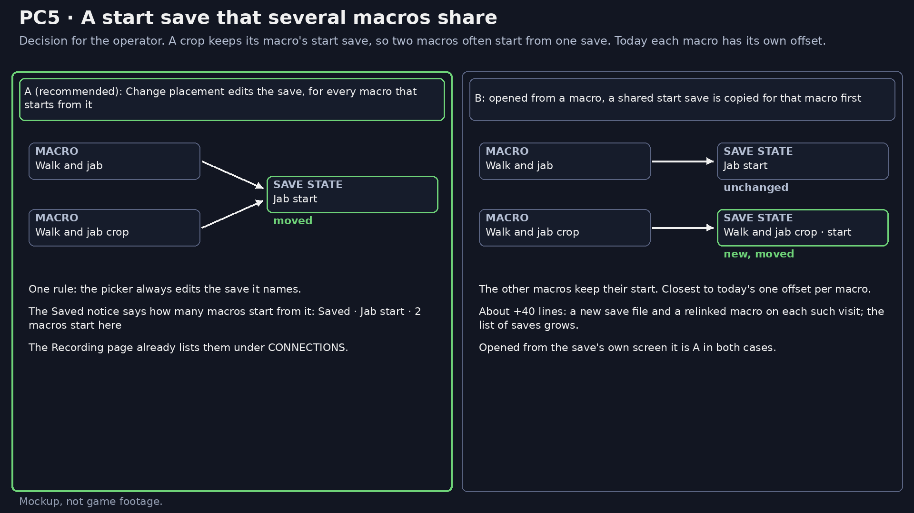
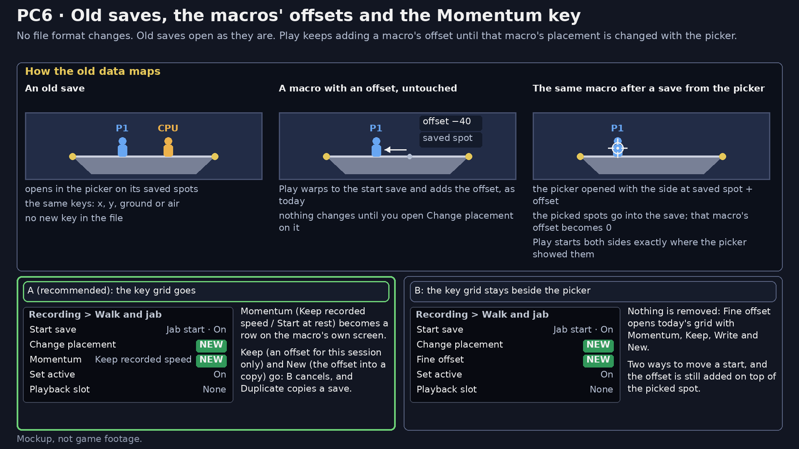

# Change placement: six choices

**Answered 2026-11-25 (about 15:50Z):** PC1 B; PC2 all four ways in (the Replays row stays and opens the same
picker); PC3 all five pages, with + saving from any page; PC4 A; PC5 a question each time, with an Advanced setting
(Prompt by default, Always change, Always copy); PC6 A. The decision record is in
[DECISIONS.md](../../DECISIONS.md), "Change placement: the crosshair, on the save itself". The alternatives below are
historical; see [the Recording guide](../../guide/recording.md#change-placement-and-the-replay-window) to use the picker.

Original design goals (2026-11-25):
- placement uses the Break the Targets crosshair;
- you pick Player 1 or the CPU;
- you choose On stage or Off stage;
- it edits the save state itself, not through the Replays menu.

Green outlines show the design lane's recommendations, not necessarily the choices that shipped.

*The proposed flow:*
1. A on Change placement in the save's own screen.
2. **Where:** On stage or Off stage, for each fighter.
3. **Spot:** the crosshair moves the fighter itself.
4. A saves the file, and the save loads once.

## PC1 · On stage: how the floor is chosen

| | Option | Cost |
| --- | --- | --- |
| **A** (lane recommends) | The crosshair moves freely. The fighter stands on whatever floor is under it: on a platform at or above it, on the ground once you move below it. This is Record placement's rule today, which passed 19 of 19 emulator rows. | No new code. |
| B | The cursor stays on a floor. Left and Right move along it, and Up and Down jump to the floor above or below. | About +70 lines and its own tests; not tried in the emulator yet. |

With A the crosshair would move down past the platform; B gave Up/Down a dedicated floor hop.

## PC2 · Where Change placement is opened (A recommended)

| | Option |
| --- | --- |
| **A** | Three ways in: a save's own screen, a macro's own screen (it opens that macro's start save), and X on a save in the pop-up over the game. |
| B | The save's and the macro's own screens only. |

Both proposals would have removed the Replays row. The final choice kept it as a fourth way in.

## PC3 · How many pages (A recommended)

| | Option |
| --- | --- |
| **A** | Two pages, Where and Spot. Damage and facing stay as saved. The start state changes only if it can't exist at the new spot: for example, a missed tech moved into the air becomes Standard. |
| B | Five pages: this also edits the start state and the damage, like Record placement. That is three more pages on every visit. |

## PC4 · Record placement gets the same picker (A recommended)

| | Option |
| --- | --- |
| **A** | One picker for both. Placing fighters before Record also gets the live fighters, the game's magnifier and the Where page. Its emulator checks and guide clip are redone. |
| B | Record placement stays as it is, so there are two pickers that behave differently. |

## PC5 · A start save several macros share (A recommended)

| | Option |
| --- | --- |
| **A** | Edit the shared save. Every macro that starts from it moves, and the Saved notice says how many (for example "2 macros start here"). |
| B | Copy the save for this macro. The other macros keep their start, and a new save file appears each time (about +40 lines). |

## PC6 · The old offset key grid (A recommended)

| | Option |
| --- | --- |
| **A** | The grid goes, and Momentum becomes a row on the macro's own screen. A macro that already has an offset shows it in a new Offset row, and A clears it. Keep and New go too: B cancels, and Duplicate copies a save. |
| B | The grid stays as "Fine offset". That gives two ways to move a start, and the offset is still added on top of the picked spot. |

Placement edits the save, not the macro's offset. Choosing a separate copy for a macro relinks that macro to the new save. Play still adds its old offset until you clear it.

*Updated 2026-11-25 15:31Z: the PC6 picture and text were corrected by the design lane. Earlier, a macro's offset became 0 after you used the picker; now it stays until you clear it.*
