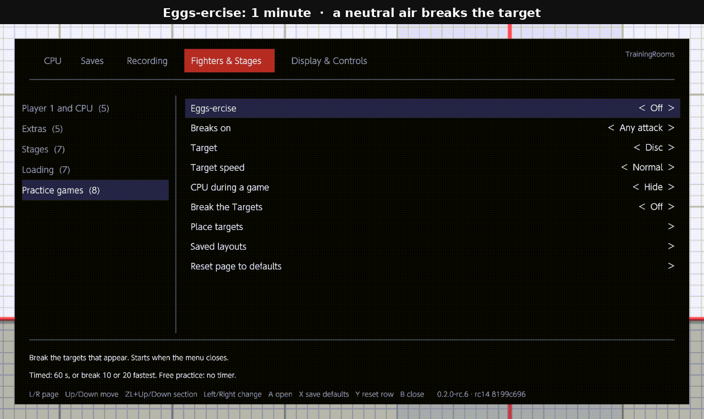
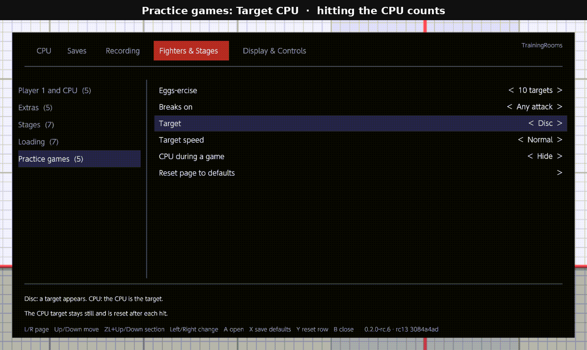

# rc.14 preview: targets (Eggs-ercise and Break the Targets)

Test-run footage from Eden, 2026-11-14. Untested on hardware.

## Newest takes (the rc.14 build, footer "rc14 8199c696", shot about 23:50Z)

The practice-game notice now sits in a band at the top. The Break the Targets takes on this build are being shot now,
and they will be added here.

**Eggs-ercise, 1 minute:** the menu sets Eggs-ercise to 1 minute. A neutral air breaks the target, and the count goes
from 0 to 1.

**Target speed (new):** the same run side by side, with Target speed set to Slow and to Fast. A Slow target drifts down
for about three seconds. A Fast one settles in about half a second.

## Earlier takes (the draft build)

These show the practice-game notice in the middle of the screen. In rc.14 it sits in the band at the top.

## Break the Targets

**Placing:** Fighters & Stages › Practice games › Place targets. The stage zooms out, and A places a target where the
cursor is (three placed here).

**A run:** the clock starts on your first input. Break all three: "Done! 3 in 0:04.08 (best 0:04.06)".

## Eggs-ercise

**1 minute:** break as many targets as you can before the clock runs out.

**10 targets:** a timed run to ten breaks, with your best kept: "Done! 10 in 0:17.25 (best 0:17.25)".

**Target: CPU:** the CPU is the target. Each hit counts, and the CPU resets to 0 % at a new spot.

