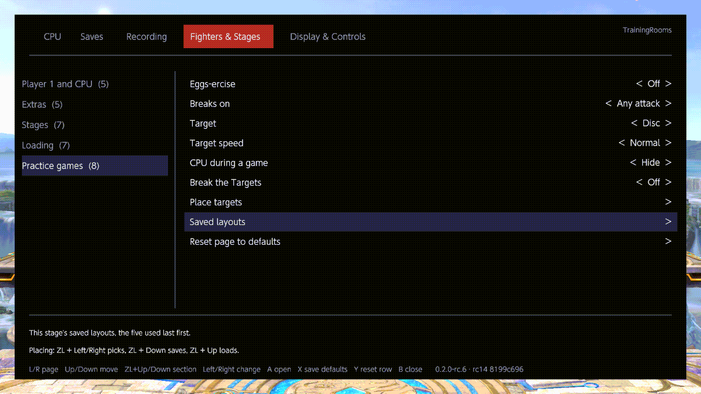
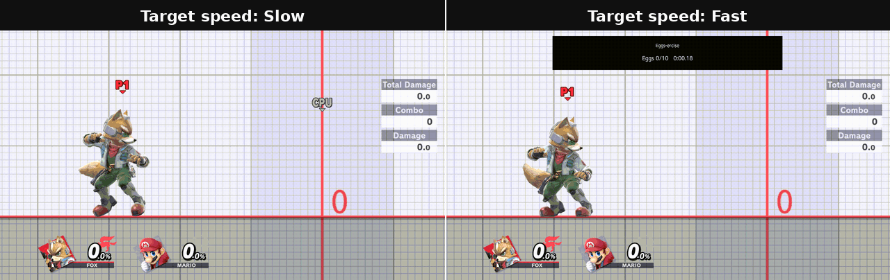
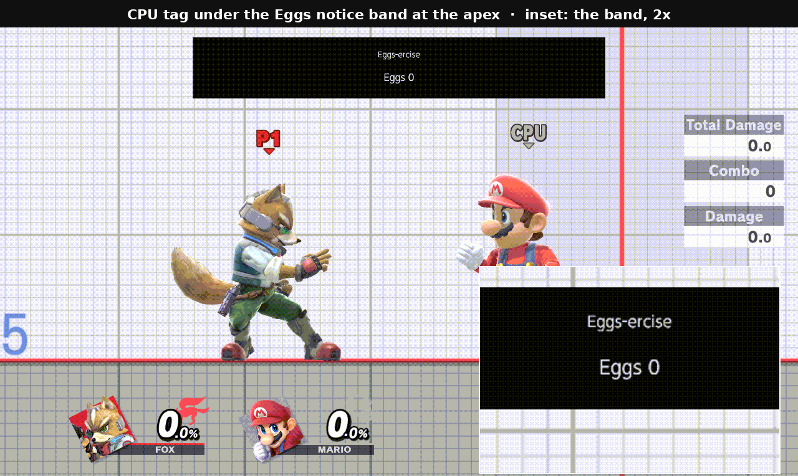
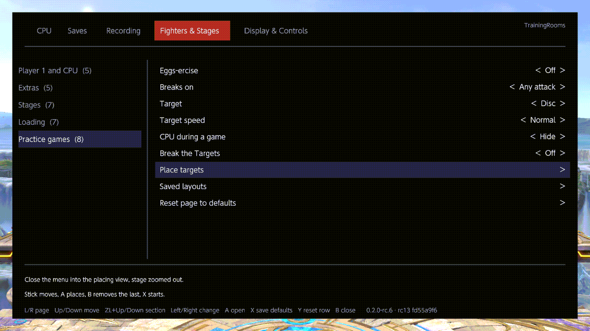
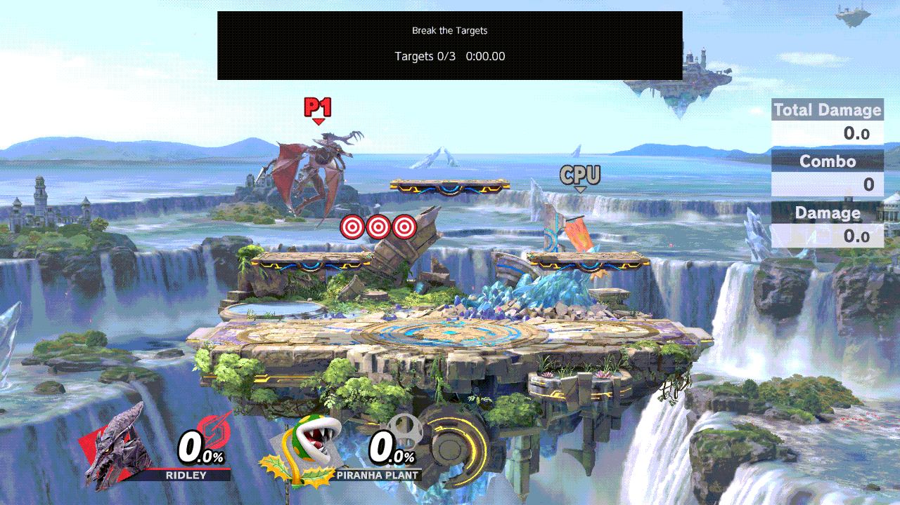

# rc.14 preview: targets (Eggs-ercise and Break the Targets)

Test-run footage from Eden, 2026-11-14. Untested on hardware.

## Newest takes (the rc.14 build, footer "rc14 8199c696", shot about 23:50Z)

In these takes, the practice-game notice occupied a band at the top.

**Superseded 2026-11-17 (rc15/notice-compact):** every notice, the practice games' included, is now one compact
box sized to its text, at the top left (16 px from the left and 8 px from the top at 1280 × 720). It wraps before it
reaches the frame strip, and it stacks under the Break the Targets chip while that shows. The top band and the centred
plates are gone. The box is still at the top, so the targets keep the middle of the screen.

**Break the Targets, saved layouts (new):** on Battlefield, three targets are placed, and ZL + Down saves them as
Layout 1. Y twice clears the stage. A second course is placed higher and saved as Layout 2. ZL + Right steps to the
other layout, and ZL + Up loads Layout 1: its three targets are back where the first course was.

**The layout list (new):** Practice games › Saved layouts lists this stage's layouts. The five used last come first,
outlined in green (Layout 7 to 3), and the rest follow (Layout 1, 2). A on a layout
opens its own screen (Load, Rename, Duplicate, Delete). Load turns Break the Targets on and puts its three targets on
the stage.

Re-shot on the list-padding build (footer "rc14 4f810d34"): the names now sit clear of the selection box and the green
outline, and "3 targets" clears the right edge.

**Eggs-ercise, 1 minute:** the menu sets Eggs-ercise to 1 minute. A neutral air breaks the target, and the count goes
from 0 to 1.

**Target speed (new):** the same run side by side, with Target speed set to Slow and to Fast. A Slow target drifts down
for about three seconds. A Fast one settles in about half a second.

**Target: CPU:** on 10 targets, the Target row is switched from Disc to CPU. Fox jabs the CPU three times and the notice
counts 1/10, 2/10, 3/10. After each counted hit the CPU is put back at a fresh spot at 0 %. No disc appears.

**10 targets:** Eggs-ercise goes from Off to 10 targets, and the clock counts up as Fox breaks them one by one (0/10, 3/10,
7/10, 9/10). The tenth stops it: "Done! 10 in 0:15.53 (best 0:15.53)". Shot on the list-padding build ("rc14 4f810d34").

**Break the Targets, placing:** Practice games › Place targets closes the menu into the zoomed-out placing view. The
crosshair moves, and A places three targets ("Place targets 3/10"). B removes the last one, and X starts at Ready with
the two left ("Targets 0/2 0:00.00").

**Break the Targets, a run:** at Ready the clock reads 0:00.00 and starts on the first input. Three breaks later it stops:
"Done! 3 in 0:04.73 (best 0:04.73)". Then it's Ready again, with every target back.

Coming before release: when the CPU is hidden, its floating "CPU" tag and its HUD panel will be hidden too, and these
clips will be re-shot. With Target set to CPU, the CPU will fly like the discs.

## CPU tag under the notice band at the apex (for decision)

Eden, 2026-11-15, the build where the CPU flies (diag `fa04daab`); cut from the existing take, no new run. The floating
CPU tag is drawn above the CPU's head. Near the top of a flight the head is under the Eggs-ercise notice band, so the
tag goes behind the band. Here Fox's short hop launches the CPU beside him: the tag shows while the CPU stands and as
it starts to rise, disappears behind the band for about 0.9 s at the top, and comes back with the hit (the band's count
goes to Eggs 1), then stays while the CPU falls to its next spot. The first flight, which puts the CPU high up, hides
its tag the same way for about 0.8 s. The CPU itself is never hidden, only its tag. The inset in the lower right is
the band area at 2x.

**Choice:** keep it as it is (the tag is gone for under a second at the top of a flight, the CPU stays in view, nothing
to change), or lower the CPU target's flight peak so its tag always stays clear of the band (the tag never hides, but
the CPU no longer flies exactly like the discs).

## Earlier takes (the draft build)

These show the practice-game notice in the middle of the screen. In rc.14 it sits in the band at the top.

## Break the Targets

**Placing:** Fighters & Stages › Practice games › Place targets. The stage zooms out, and A places a target where the
cursor is (three placed here).

**A run:** the clock starts on your first input. Break all three: "Done! 3 in 0:04.08 (best 0:04.06)".

## Eggs-ercise

**1 minute:** break as many targets as you can before the clock runs out.

**10 targets:** a timed run to ten breaks, with your best kept: "Done! 10 in 0:17.25 (best 0:17.25)".

**Target: CPU:** the CPU is the target. Each hit counts, and the CPU resets to 0 % at a new spot.

