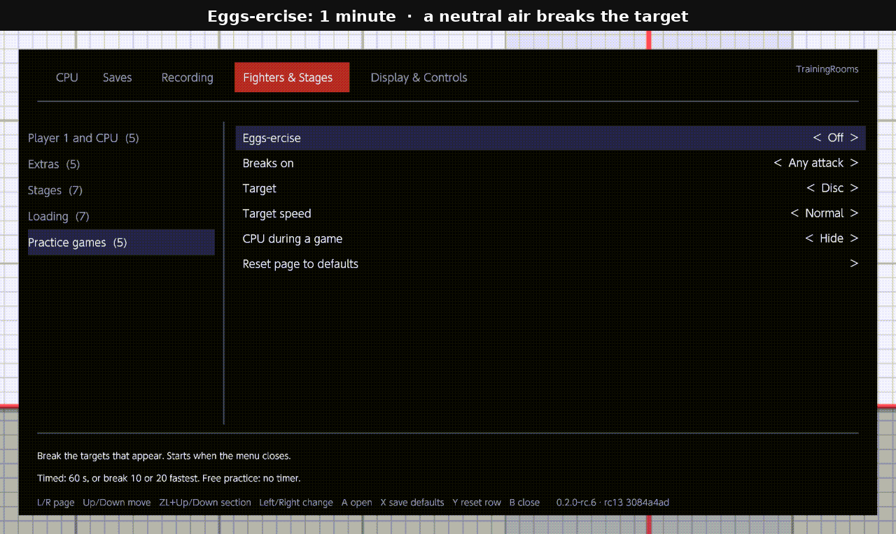
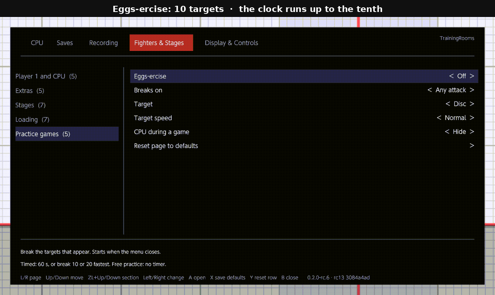

# rc.14 preview: targets (Eggs-ercise and Break the Targets)

Test-run footage from Eden, 2026-11-14. These are not the final docs GIFs: they still show the practice-game notice in
the middle of the screen, and in rc.14 it sits in a band at the top. The final GIFs are shot on the finished rc.14
build. Untested on hardware.

## Break the Targets

**Placing:** Fighters & Stages › Practice games › Place targets. The stage zooms out, and A places a target where the
cursor is (three placed here).

**A run:** the clock starts on your first input. Break all three: "Done! 3 in 0:04.08 (best 0:04.06)".

## Eggs-ercise

**1 minute:** break as many targets as you can before the clock runs out.

**10 targets:** a timed run to ten breaks, with your best kept: "Done! 10 in 0:17.25 (best 0:17.25)".

**Target: CPU:** the CPU is the target. Each hit counts, and the CPU resets to 0 % at a new spot.

