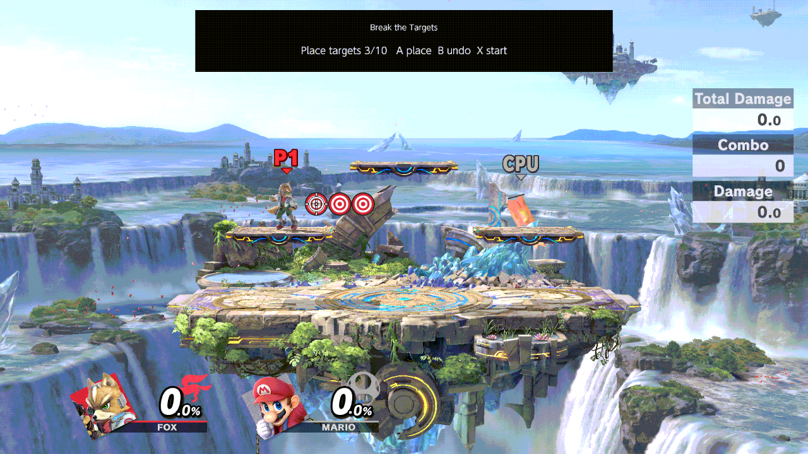
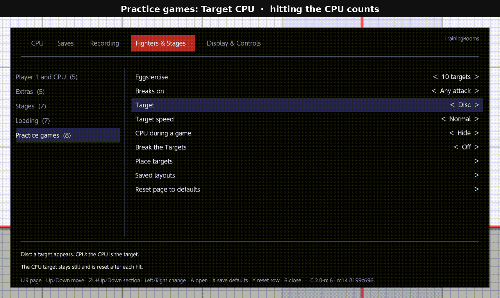
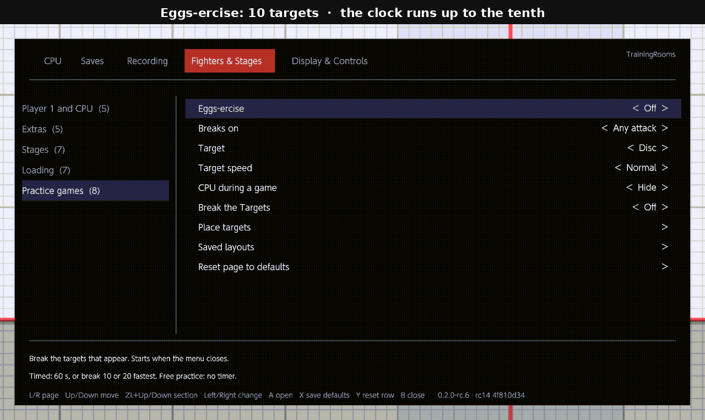
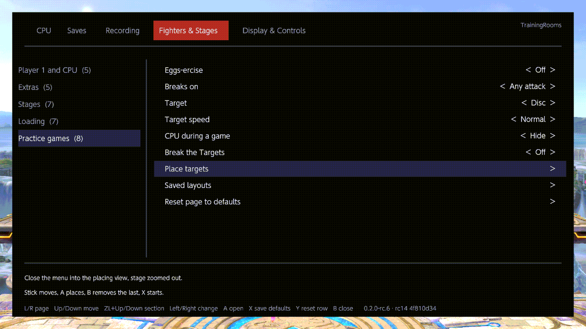
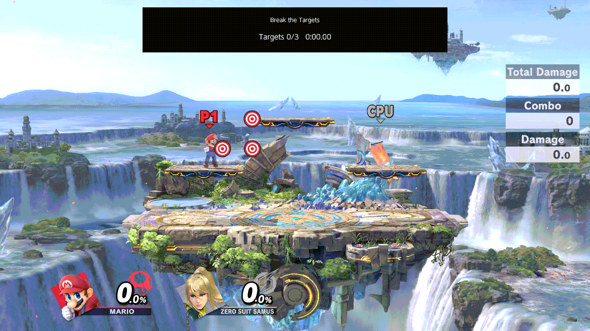

# rc.14 preview: targets (Eggs-ercise and Break the Targets)

- These 2026-11-14 Eden recordings document preview builds. The test did not include hardware.

## Newest takes (the rc.14 build, footer "rc14 8199c696", shot about 23:50Z)

- The preview used a full-width top band.
- On 2026-11-17, rc15/notice-compact replaced the band and earlier centred plates. All notices, including practice games, used a compact box sized to the text.
- At 1280 × 720 the box started 16 px from the left and 8 px from the top. It wrapped before the frame strip and stacked below the Break the Targets chip while visible, leaving the middle clear.

- **Save.** On Battlefield the player placed three targets and saved Layout 1 with ZL + Down.
- **Replace.** Y twice cleared the stage. The player placed a higher course and saved Layout 2.
- **Restore.** ZL + Right stepped to the other layout. ZL + Up loaded Layout 1, restoring its three original positions.

- **Layout list**

- Practice games › Saved layouts listed layouts for this stage. The five most recently used came first in green outlines (Layout 7 through 3), followed by Layouts 1 and 2.
- A opened Load, Rename, Duplicate and Delete for the selected layout. Load enabled Break the Targets and restored three targets.
- The reshoot on list-padding build `rc14 4f810d34` showed names clear of the selection box and green outline. “3 targets” cleared the right edge.

- **Eggs-ercise, 1 minute:** the menu sets Eggs-ercise to 1 minute. A neutral air breaks the target, and the count goes
from 0 to 1.

- **Target speed (new):** the same run side by side, with Target speed set to Slow and to Fast. A Slow target drifts down
for about three seconds. A Fast one settles in about half a second.

- **Target: CPU:** on 10 targets, the Target row is switched from Disc to CPU. Fox jabs the CPU three times and the notice
counts 1/10, 2/10, 3/10. After each counted hit the CPU is put back at a fresh spot at 0 %. No disc appears.

- **10 targets:** Eggs-ercise goes from Off to 10 targets, and the clock counts up as Fox breaks them one by one (0/10, 3/10,
7/10, 9/10). The tenth stops it: "Done! 10 in 0:15.53 (best 0:15.53)". Shot on the list-padding build ("rc14 4f810d34").

- **Break the Targets, placing:** Practice games › Place targets closes the menu into the zoomed-out placing view. The
crosshair moves, and A places three targets ("Place targets 3/10"). B removes the last one, and X starts at Ready with
the two left ("Targets 0/2 0:00.00").

- **Break the Targets, a run:** at Ready the clock reads 0:00.00 and starts on the first input. Three breaks later it stops:
"Done! 3 in 0:04.73 (best 0:04.73)". Then it's Ready again, with every target back.

- **After the preview.** On 2026-11-15 the CPU target adopted disc flight. The shipped hide setting also hides the floating CPU tag and HUD panel with the body. These clips remain the original takes.

## CPU tag at the top of a flight

- **Source.** Eden, 2026-11-15, diagnostic build `fa04daab` with CPU flight. The lower-right inset magnifies the band 2×. The clip came from the existing take.
- **Short hop.** Fox launched the CPU beside him. The tag was visible above the standing and rising CPU, then passed behind the band for about 0.9 s. It returned on the hit (Eggs 1) and stayed visible as the CPU fell to its next spot.
- **First flight.** Its higher launch hid the tag for about 0.8 s. The CPU itself stayed visible throughout both flights.
- **Alternatives.** Keep disc flight and the brief overlap, or lower the CPU's peak to keep the tag clear at the cost of matching disc flight.
- **Outcome.** The 2026-11-17 compact notice replaced the band involved in this choice. The CPU kept the discs' flight path.

- **Earlier takes (the draft build).** The earlier Eggs-ercise takes show the centred notice. Both Break the Targets takes below already show the top band.

## Break the Targets

- **Placing:** Fighters & Stages › Practice games › Place targets. The stage zooms out, and A places a target where the
cursor is (three placed here).

- **A run:** the clock starts on your first input. Break all three: "Done! 3 in 0:04.08 (best 0:04.06)".

## Eggs-ercise

- **1 minute:** break as many targets as you can before the clock runs out.

- **10 targets:** a timed run to ten breaks, with your best kept: "Done! 10 in 0:17.25 (best 0:17.25)".

- **Target: CPU:** the CPU is the target. Each hit counts, and the CPU resets to 0 % at a new spot.

