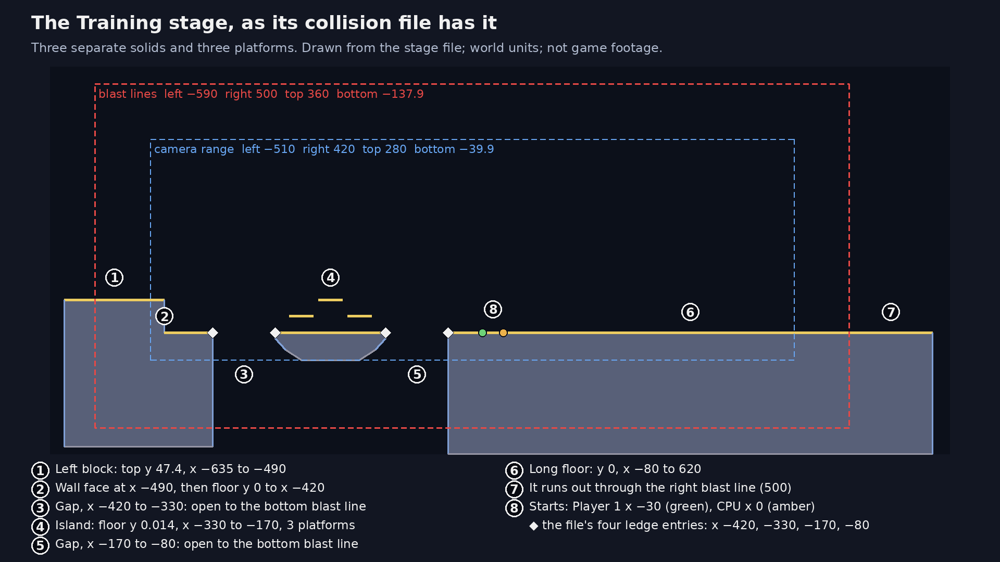
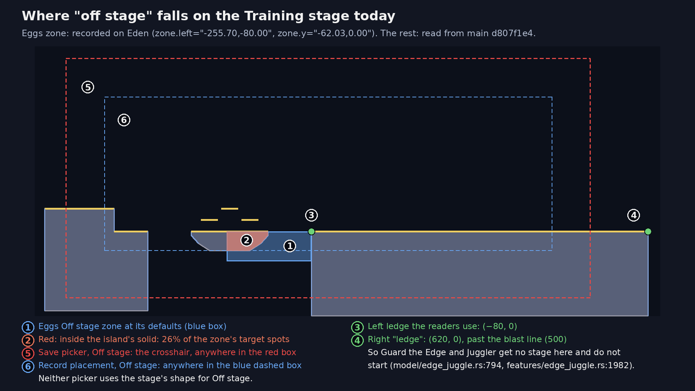
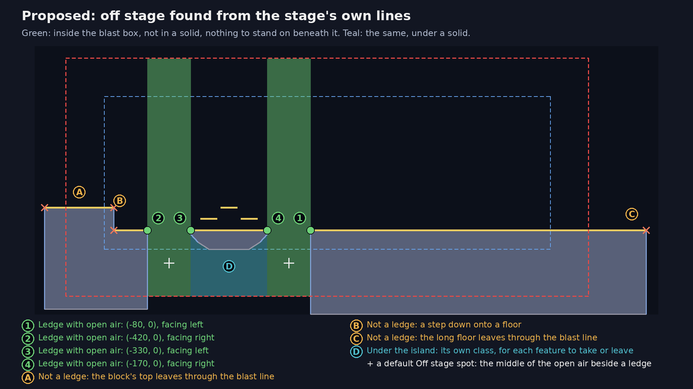

# The Training stage and "off stage": what is read today, and a rule to replace it

2026-11-25. For review; nothing here is built. It answers the note that the Training stage's tracing is off when
placement has to decide where off stage is. The pictures are diagrams drawn from the game's stage file and from the
plugin's own stage-reading code run on that file's lines. They are not game footage. The full findings, with the file
and log line behind each statement, are in the work folder (`artifacts/phase23/training-stage-tracing/FINDINGS.md`).

## 1. The stage

- The Training stage is **three separate solids**: a block with a wall on the left, a Battlefield-shaped island with
  three platforms, and a long floor on the right. The fighters start on the long floor.
- The block's top and the long floor both run out through the side blast lines. Nobody can fall off there.
- Air with nothing under it exists only in the two gaps beside the island (each 90 units wide) and under the island.
- The game's own stage file lists four ledges: one on each side of each gap.

## 2. What the plugin reads today

- Guard the Edge, Juggler and the eggs Off stage zone take "the stage" to be the one solid under the middle of the
  camera. On most stages that is the whole stage. On Training it is the long floor only.
- Tech traces the one solid Player 1 stands on, plus the platforms.
- Placement asks for the floor under one point, and finds every floor.

## 3. Where off stage falls today

- **Eggs, Off stage:** the zone starts at the long floor's left ledge and reaches into the island. About a quarter of
  its target spots are inside the island's solid. This was recorded on the emulator.
- **Guard the Edge and Juggler:** the long floor's right end is past the blast line, so no stage is made and the drill
  does not start. Read from the code; not flown for this review.
- **Placement, Off stage:** the fighter is put in the air wherever the crosshair is. The stage's shape is not used, so
  a fighter switched to Off stage stays in the air above the floor it stood on.

## 4. The proposed rule

One rule for every stage, with no list of stages:

- A point is **off stage** when it is inside the blast lines, not inside a solid, and there is nothing to stand on
  beneath it down to the bottom blast line.
- **Under a solid** (teal) is kept as its own class, so each feature can take it or leave it.
- A **ledge** is the end of a solid floor that has such open air beside it.
- A **default spot** (the white crosses) is the middle of the open air beside a ledge.

On Training this marks the two gaps and the same four ledges the stage file lists. The block's top, the step at the
wall and the long floor's far end are not ledges.

On Battlefield the rule marks the same area and the same two ledges as today.

## 5. Three choices

**Answered 2026-11-25 about 17:05Z:** T1 A; T2 an option in Guard the Edge to start the CPU under the stage (and one for
the CPU's midair jumps already used); T3 in this build. Recorded in `docs/DECISIONS.md`, "Off stage, found from the
stage's own lines".

The recommended option is A in each. They can be answered as, for example, `T1 A, T2 A, T3 A`.

| | Choice | A (recommended) | B |
| --- | --- | --- | --- |
| **T1** | Placement, when a fighter is switched to Off stage | It goes to the default spot of the nearest ledge with open air. The crosshair then moves freely, as now. | Off stage accepts only off-stage points; the air above a floor becomes a third place. More change to the picker. |
| **T2** | Under a solid (under the island, under Battlefield) | Placement accepts it; Guard the Edge keeps refusing it, as decided on 2026-11-22. | No feature accepts it. |
| **T3** | Guard the Edge, Juggler and the eggs Off stage zone | Move them to the same rule in a later build, so the drills work on Training and the zone stays out of the island. | Placement only; the other three stay as they are. |

## 6. Not shown

- Nothing was run on the emulator or the console for this review. The stage's shape, the ledges the readers find and
  the eggs zone come from earlier recorded runs; the rest is read from the code.
- The rule has no code and no test yet. Stages that move, and stages with no ledge that has open air, were not looked
  at.
