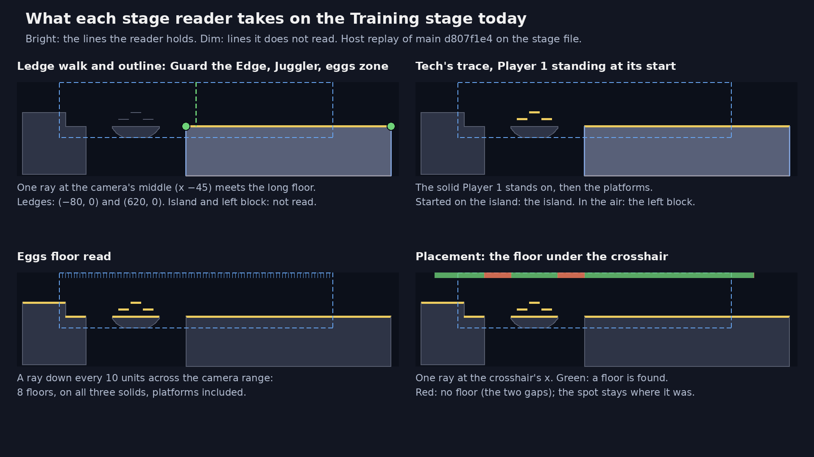
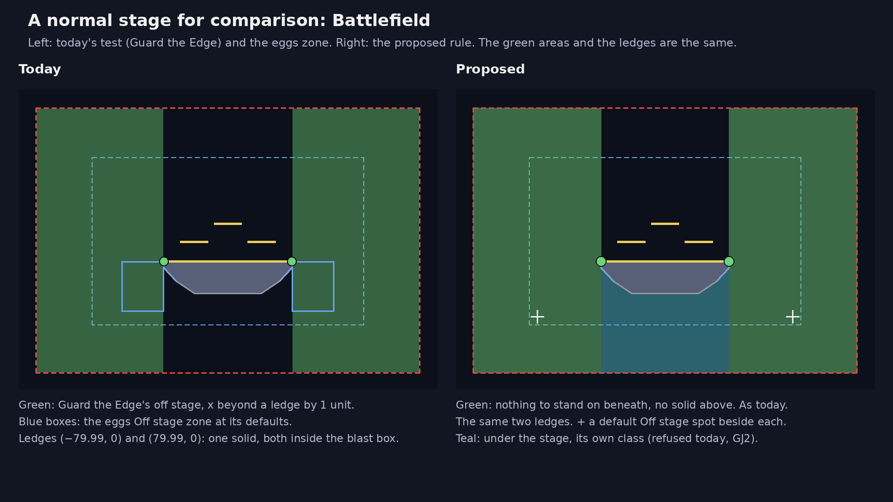

# How the Training stage's off-stage rule was chosen

This 2026-11-25 review used stage-file diagrams and plugin code. See [Technical notes](../../TECHNICAL.md#stages) for the implementation.

## 1. The stage

- Training has three solids: a left block with a wall, a Battlefield-shaped three-platform island, and a long right floor where fighters start.
- The block top and long floor cross the side blast lines. Fighters cannot fall there.
- Open air lies in the two 90-unit gaps and under the island.
- The stage file lists four ledges, two per gap.

## 2. What the readers saw before the change

- Guard the Edge, Juggler and the eggs Off stage zone used the solid under the middle of the camera.
  On Training that was the long floor only.
- Tech traced the solid under Player 1, plus the platforms.
- Placement queried the floor under each point and found all three floors.

## 3. Where the old rule put fighters and targets

- **Eggs, Off stage:** the zone reached from the long floor into the island; about a quarter of the recorded target
  spots fell inside the island's solid.
- **Guard the Edge and Juggler:** the long floor ended past the blast line, so neither drill had a valid stage.
  Code established this finding.
- **Placement, Off stage:** switching to Off stage left the fighter above its old floor. The crosshair did not use
  the stage's shape.

## 4. The proposed rule

The proposal used geometry on every stage:

- A point is **off stage** when it is inside the blast lines, not inside a solid, and there is nothing to stand on
  beneath it down to the bottom blast line.
- **Under a solid** (teal) is kept as its own class, so each feature can take it or leave it.
- A **ledge** is the end of a solid floor that has such open air beside it.
- A **default spot** (the white crosses) is the middle of the open air beside a ledge.

On Training this marks the two gaps and the same four ledges the stage file lists. It excludes the block top, wall step and far floor end.

Both rules marked the same area and two ledges on Battlefield.

### Three choices

| Choice | Original A (recommended) | Original B | Decided 2026-11-25, about 17:05Z |
| --- | --- | --- | --- |
| T1 · Switch to Off stage | Pick the nearest open-air ledge's default spot, then move freely. | Restrict Off stage to off-stage points. Make air above floors a third placement mode. | A. Preserve an already off-stage spot. |
| T2 · Under a solid | Allow placement. Keep the Guard the Edge refusal from 2026-11-22. | Exclude it from every feature. | Add Guard the Edge options for under-stage CPU starts and midair jumps already used. |
| T3 · Guard the Edge, Juggler and Off stage eggs | Adopt the shared rule later for all three. | Apply it only to placement. | Include all three so drills support Training and eggs avoid the island. |

[Read the dated decisions](../../DECISIONS.md).

### Evidence limits

- This review used no emulator or console. Earlier runs supplied the stage shape, detected ledges and egg zone. Code supplied the rest.
- Moving stages and stages without an open-air ledge were excluded.
