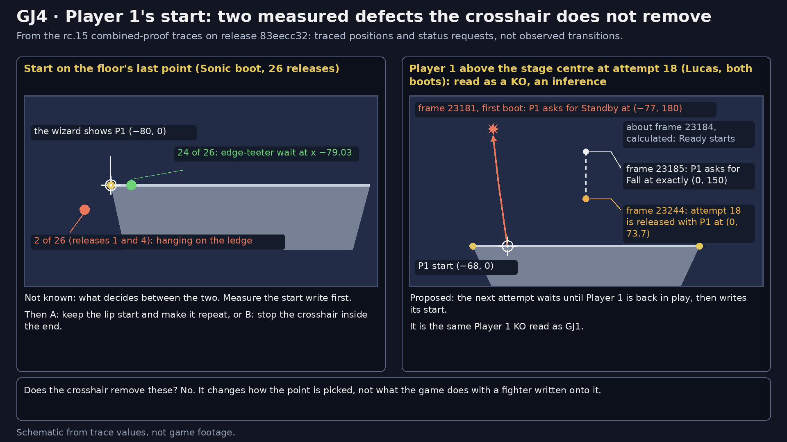

# Guard the Edge and Juggler: Player 1's start

*Two placement defects reconstructed from trace values.*

- The shipped placement rules apply to [Guard the Edge](../guide/guard-the-edge.md) and [Juggler](../guide/juggler.md).
- [Decisions](../DECISIONS.md) records GJ4 for placement and GJ1 for KO scoring.

## Measured cause

| Player 1 at the write | Releases | What followed |
| --- | ---: | --- |
| Edge-teeter wait | 19 | All teeter, at x −79.0256 |
| Hanging on the ledge | 2 | Both teeter |
| Landing (0x16) or status 0x50 | 2 | Both teeter |
| Wait inside at x −76.79 | 1 | Teeter |
| Wait inside at x −75.13 | 1 | Fall requested at x −81.9956 two frames into Ready, then ledge hang |
| First attempt, A came through as a jab on the point | 1 | Fall requested one frame into Ready, then ledge hang |

- On release `83eecc32`, Sonic's 26 Guard the Edge releases used the last point of Final Destination's main floor, x −79.9856.
- The original record identified the external trace as `artifacts/phase23/edge-juggle/evidence/cp1a-sonic-83ee-1/p1-before-release.txt`.

- Both falls began after Ready started. The trace omitted facing and speed, so it cannot establish the cause.
- The Lucas traces in GJ4 suggest a Player 1 KO. Standby preceded Fall at (0, 150), and the next release showed Player 1 falling.
- In Training a KO goes through Standby. A fighter on the rebirth platform goes through Rebirth.

### The teeter range (2026-11-23 rework)

- The game's `GroundModule::is_ottotto` checks the floor end the fighter faces at 0.86 + 0.1 + 0.1 = 1.06 units.
- Within that range it moves the fighter to 0.96 from the end.
- In fix-build flight `755d9936`, both hosts wrote x −78.9856 and rested at −79.025604 (−79.9856 + 0.96), status 126 in Training and 127 in the waiting room.

## Rule

| Placement case | Shipped rule |
| --- | --- |
| Player 1 is Dead, in Standby or in Rebirth | Wait. On restart, wake the CPU if placement held it asleep. |
| Player 1 damage | Preserve it between attempts. |
| Guard the Edge | Clamp the Player point 1.25 units inside each main-floor end. |
| Main floor narrower than 2.5 units | Use the midpoint. |
| Juggler | Keep the Player point without the inset. |
| Wizard and placement | Use the same rule for both. |

## Requirement trace

| Requirement clause | Design | Test |
| --- | --- | --- |
| The next attempt waits for a KO'd Player 1 | KO status restarts placement, waking a held CPU | `placement_waits_for_a_knocked_out_player`, `edge_juggle_waits_for_a_knocked_out_player` |
| Player 1 starts where the wizard shows it | Cursor and placement share the inset and narrow-floor midpoint | `guard_player_point_stops_outside_the_teeter_range_of_each_floor_end`, `a_main_floor_narrower_than_two_insets_keeps_the_player_on_its_middle`, `a_crosshair_below_a_platform_finds_the_floor_under_it` |
| The Preview prints where Player 1 will rest, not (−80, 0) | Player and Preview use the Player point after the cursor's inset | `guard_player_point_stops_outside_the_teeter_range_of_each_floor_end` |

Clauses are the decided GJ4 of `docs/DECISIONS.md` (2026-11-22); the item was ordered into the fix build on 2026-11-23.

## Limits and proof

| Case | Evidence or limit |
| --- | --- |
| Native teeter range | The 2026-11-23 design derived 1.06 from game code. |
| Flight criterion for 1.25 | Check standing Wait (status 0) at the written x on both ends. |
| Edge-teeter start | Guard the Edge excludes it. Juggler keeps its unclamped point. |
| KO after placement, during Ready | Outside the placement check. |
| Damage between attempts | Player 1 keeps it. |
