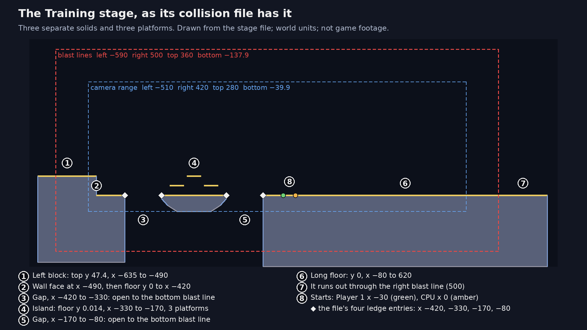

# Eggs-ercise: a moving path stays over its floor

Shipped behavior and settings are in the [Eggs-ercise guide](../guide/eggs-ercise.md).

- 2026-11-22 card report: with Moving paths checked, a target sometimes flies off the stage and stops where the fighter cannot get to it.



*Training stage floors from its collision file.*

- A target uses one floor, shown in yellow.
- Its moving path stays above that floor and clear of gaps.
- [Decisions](../DECISIONS.md) includes the stage pictures.

## Cause on the original build

| Original step | Bounds used |
| --- | --- |
| Spawn | One of the stage’s floors. |
| In view | Screen rectangle, clipped to the blast lines. |
| Whole stage | Camera rectangle, clipped to the blast lines. |
| Fit | Move the start until the path’s entire envelope fits. |
| Rest | Up to 180 units sideways (Galaxian) or about 74 below the start (Axe). |
| Clearance | Only Off stage carried the side used for an outline check. |

- The box caused the failure. The measured direction, scale and outline checks passed.

First failing position on main `7d962416`, from the first red run of `moving_paths_stay_over_the_stage` as it stood in `70ff45f4` (a floor from x −50 to 50 at height 0, a platform from −40 to −10 at height 30, the screen 137 units wide, the camera range ±100 and −60 to 90):

```text
left the stage: area 0 target 0 path 0 seed 0 tick 41: (-46.3392, 25.237444), floor from -50 to 50 at 0
```

- A probe of the same fixture (first target of seed 0; `probe-main.log` in `artifacts/phase23/eggs-paths-on-stage/`) has that Axe come to rest at (−62.7, −12.8) on main: 12.7 units past the ledge and 12.8 below the floor line.
- On Whole stage the Axe rests at (−93.1, −50.2) and the Galaxian at (−90.6, 3.7), 40.6 units past the ledge.

## The first fix and why it failed review

| 2026-11-22 review | Record |
| --- | --- |
| Candidate | `70ff45f4` bounded x by the outside ends of all usable floors. |
| Verdict | review-games-astra-3 rejected it at 14:58:57Z and 14:59:45Z. |

- **Rest over a gap.** With floors from −50 to −28 and from 25 to 50, seed 0's Boomerang is sampled on the left floor, started at x 19 and came back to rest there: over the gap, more than a target radius from either floor.
- **A flight held at one point.** A box of exactly no width was accepted. The flight was then scaled to nothing: a moving path was selected and the target did not move.
- **Different draws on a fallback.** When a target fell back to Pop up, the direction draw was skipped, so the targets after it drew differently. The note claimed the draws were unchanged.

The recorded failures on `70ff45f4` of the tests written for those findings:

```text
a_boomerang_rests_over_the_floor_it_appeared_over: the Boomerang started at [19.0, 4.0] and rests at [19.000002, 4.0], over no floor (floors from -50 to -28 and from 25 to 50)
moving_paths_keep_to_their_own_floor_across_a_gap: left its floor: tick 0: (-9.325935, 41.614426); area 0 target 0 path 0 seed 0, sampled at [-38.34481, 4.0], its floor from -50 to -28 at 0
moving_paths_stay_over_the_stage: left its floor: tick 57: (-40.001095, 39.169693); area 0 target 0 path 0 seed 27, sampled at [-28.171028, 34.0], its floor from -40 to -10 at 30
a_moving_path_with_exactly_no_room_pops_up: a box of no width: Pop up, not an Axe held at one point
a_moving_path_needs_room_only_on_the_axes_it_uses: assertion `left == right` failed: path 0 with room sideways and none above
a_pop_up_fallback_takes_the_same_random_draws_as_a_flight: assertion `left == right` failed: target 0: the Pop up fallback and the flight took different random draws
```

## The second fix and why it failed review

| 2026-11-22 review | Record |
| --- | --- |
| Candidate | `0e1e78f6` used the sampled floor and accepted any positive room on used axes. |
| Verdict | review-games-astra-3 cleared the first three findings, then rejected two stationary targets at 15:29:42Z. |

- **A flight scaled to nothing.** On a floor from x 32 to 64 at height 81.99999 the target rests at 85.99999, under a box top of 86 on Whole stage. That box is 0.0000076 units high.
- The Axe was fitted into it at a scale of 7 in 100 million; every step rounds away and the target stays at one point.
- **Pop up with no room to rise.** On a floor whose target sits exactly at the top of the box the path fell back to Pop up. Pop up's launch is lowered to fit under the top, so there it is 0 and the target does not move, whatever room the other floors have.

tr-primary-2 ruled on 2026-11-22 (15:46:34Z, option A of four): a path flies only where its box has at least 2 × `RADIUS` (8 units) of room on each axis it uses; among the 32 sampled spots one with room wins; Pop up only when none has it.

- The recorded failures on `0e1e78f6` of the tests written for that ruling:

```text
an_axe_with_a_hair_of_height_pops_up: an Axe in a box 0.0000076293945 high would be scaled to nothing and stay at one point: Pop up
a_path_that_needs_height_appears_over_a_floor_that_has_it: should fly over the floor with room: area 0 floor at 42 path 0 seed 0: sampled at [-2.167122, 46.0], the Boomerang at [-2.167122, 46.0]
a_moving_path_needs_a_target_width_of_room: assertion `left == right` failed: path 0 with 7 units of room sideways
a_spot_with_room_among_the_thirty_two_wins_and_pop_up_is_for_none: assertion `left == right` failed: seed 1 sampled at [-18.59807, 86.0]: an Axe over the short floor when one of its 32 spots is there, else Pop up
```

## Shipped fix

| Bound | Shipped on-stage limit |
| --- | --- |
| Left and right | One target radius inside each endpoint of the sampled floor. |
| Bottom | One radius above the higher endpoint of the sampled floor. |

- The top of the box and the blast cut are as before.
- The fit is unchanged: the start is moved and the flight is scaled until the whole envelope is inside the box, so a flight that needs more room than its floor has is flown smaller.
- The flight and its rest are therefore over the target's own floor at every tick, on any number of floors.

- **Room.** A path flies only in a box with at least 8 units of room (2 × `RADIUS`, one target wide) on each axis it uses: sideways for all four paths, and height for all but the Boomerang, which flies level.
- It is the measure the spawn already uses to decide whether a target may hang in the air; as a condition for a flight it is a new rule.
- It is a rule about room, not about travel. The fit scales a flight by the smaller of room ÷ envelope over the axes the path uses, and never above 1.
- With 8 units on each of them the scale is at least 8 ÷ the path's larger extent: 8/103 for the Axe, 8/180 for the Galaxian, 8/65 for the Boomerang, 8/56 for the Homing Missile.
- So a flight is never scaled to nothing. How far the target then travels depends on the path: a level Homing Missile in a box 8 units high travels about 7.7 units.

- **The spot.** The spawn draws its 32 candidate spots as before. A candidate whose floor gives the selected path that room now wins over one whose floor does not.
- Among candidates of the same kind the earlier rule decides: the one that falls least short of the gaps to the last target and to Player 1, the earliest drawn on a tie.
- With no path selected, or with room at every candidate, the choice is main's.

**Pop up.** Only when none of the 32 candidates has the room does this one target use Pop up, at the spot the earlier rule picks.

- **The start.** The fit puts the start of a flight where its whole envelope is inside the box.
- For a flight that goes left and is scaled by its width, rounding could put that start a float step past the box's right side: 0.000008 units in the test's fixture.
- The fit is main's, and neither earlier fix changed it. The first run of this fix's tests on the changed spawn showed it:

```text
a_flight_starts_inside_its_box: area 0 path 1 seed 0: starts at [46.000008, 5.26359], outside its box from [-46.0, 4.0] to [46.0, 52.42857]
a_path_that_needs_height_appears_over_a_floor_that_has_it: left its floor: tick 0: (46.000008, 5.26359); area 0 floor at 42 path 1 seed 0: sampled at [-39.32128, 5.26359], the Boomerang at [-2.167122, 46.0]
```

The on-stage spawn now holds the start inside the box after the fit.

- `0a372163` made that change in `Motion::new`, which also places Off stage flights, and said nothing else about them changed. review-games-astra-3 failed that on 2026-11-22 (16:37:02Z and 16:38:08Z).
- Off stage, a fitted start one float step past the zone's box fails the clearance check, and the target then starts at its drawn spot; with the start held inside the box the check passes.
- In the reviewer's fixture (zone settings 64, 0, 220, 173, Galaxian, seed 682) that moved the start 35.39 units, and with Player 1 near it the spawn went on to draw all 32 candidates instead of stopping at the first.
- So `Motion::new` is main's again, the hold is on the on-stage path only, and Off stage placement and draws are main's. The recorded failures on `0a372163` of the two tests written for that finding:

```text
an_off_stage_start_is_placed_as_on_main: assertion `left == right` failed: the fit starts a float step past the zone's box, so the target starts at its drawn spot: [-50.568626, -55.840355]
an_off_stage_spawn_takes_the_draws_it_took_on_main: assertion `left == right` failed: the first drawn spot is clear of Player 1 and ends the draws after three: [-50.568626, -69.81018], rng 0x2c4d2f4e
```

- Where is there no room?
- Sideways, a floor line the spawn accepts leaves more than 12 units unless a blast line cuts the box, so sideways room is missing only there and on the stand-in ground (below) of a spawn range under 16 units wide.
- Above, the target rests a radius above its floor and the box ends a radius under the screen's top (In view) or the camera range's top (Whole stage), or under the upper blast line where that is lower.
- So a floor less than 16 units under that top has no room for a path that uses height.

## Random draws

| Draw order | Operation |
| --- | --- |
| 1 | Generate all 32 on-stage candidates. |
| 2 | Choose among the candidates without advancing the generator. |
| 3 | Draw direction for every selected path except Homing Missile, including fallback. |

- On In view and Whole stage, with the same floors and view, a target takes the same draws as on main: its 32 candidate spots, then the direction draw of a path other than Homing Missile.
- What one candidate draws depends on its floor, as on main: where 8 units or more are free above the target it takes a coin and, on heads, a height.
- Choosing among the candidates takes no draw, and the direction draw is taken whether the target then flies or falls back to Pop up.
- So for the same candidates the sequence a seed gives depends neither on the room rule nor on the fallback.
- Off stage targets are placed and drawn by main's code, which is not changed.
- The sampled spot (`Run::egg`) is one of the same 32 candidates as on main. It is main's candidate when that one has room for the path, and otherwise the best candidate that has. Which candidate is best also depends on where the previous target was broken, and that can differ now because the flight differs.
- The displayed start (`egg_at`) is the sampled spot moved into the box by the fit. That was so before; with the smaller box it is moved more often and further.

## Limits and what is not shown

| Evidence | Scope |
| --- | --- |
| Host fixtures | Synthetic floors, platforms, gaps and narrow ranges. |
| Geometry | Each target sees its own floor line; higher obstructions lie outside that model. |

- **A Pop up target at the top of the box does not move.** Pop up's launch is lowered so that the target stays under the top of the box.
- On a floor whose target sits at that top there is nothing to rise into, and the target stays where it appeared.
- That is main's behaviour for every Pop up target on such a floor, with or without Moving paths, and it is not changed.
- A selected path now comes to it only when all 32 candidates are on floors without room for it.
- **A short floor with room can be missed.** The 32 candidates are drawn by floor length. Where the only floor with room is short beside the others, some targets draw no candidate on it and use Pop up. In the test's fixture (2 units of spawn span with room beside 80 without) that is 14 of the 32 seeds.
- **Off stage is main's.** There the fit can still start a flight a float step past the zone's box, and the clearance check then starts the target at its drawn spot. Holding that start inside the box would change where Off stage targets appear and how many candidates they draw, so it is not done here.
- **Each floor line stands alone.** The floors are the game's floor lines, without their kind and without their neighbours. On a floor made of several lines (a slope, a step) a target keeps to the one line it appeared over, so its flight is smaller there. Joining lines needs a rule for gaps and steps; none is approved.
- **Platforms give small flights.** A target that appears on a platform keeps over it. On a box 30 units wide a Galaxian is flown at one sixth of its size.
- **What is above the floor line is not read.** A target can pass through a platform above its floor. Solid ground, walls and ceilings inside the box are not known to the model.
- **The stand-in ground is unchanged.** When no floor line is usable (none read, or none inside the spawn range) the spawn range and the run's ground stand in for the floor, as they do for every target. A target put that way can be over no real ground, moving path or not.
- **Height is unchanged.** A flight may start and rest well above its floor: an Axe starts up to 80 units times its scale above the floor and comes down to it, and a Homing Missile climbs toward Player 1.
- **Original host evidence.** The host tests use made-up floors: one main floor with a platform, two floors with a gap, floors at and just under the top of the box alone and beside a floor with room, a short floor with room, and narrow ranges with no floor. The 2026-11-22 host report included no Eden run.

- The seeds named in `a_spot_with_room_among_the_thirty_two_wins_and_pop_up_is_for_none` come from `rare-room.py` (with the evidence in `artifacts/phase23/eggs-paths-on-stage/`): a separate arithmetic model of the generator and of the draws each candidate takes.
- It does not read the product code.

## Requirement trace

| Requirement clause | Design | Test |
| --- | --- | --- |
| Restrict moving paths to the stage | Inset the sampled floor line by one radius at both ends and above. | `moving_paths_stay_over_the_stage`, `moving_paths_keep_to_their_own_floor_across_a_gap` |
| Keep flight and rest over the sampled floor | Fit the flight envelope and hold its start and ticks inside. | `a_boomerang_rests_over_the_floor_it_appeared_over`, `moving_paths_keep_to_their_own_floor_across_a_gap`, `a_flight_starts_inside_its_box` |
| Reproduce the original defect (tr-primary-2, 2026-11-22 14:06:33Z) | The original host failure gives the first outside position. | `moving_paths_stay_over_the_stage` |
| Keep moving paths moving (2026-11-22 reviews, 14:58:57Z and 15:29:42Z) | Prefer sampled floors with eight units on each used axis. | `an_axe_with_a_hair_of_height_pops_up`, `a_path_that_needs_height_appears_over_a_floor_that_has_it`, `a_moving_path_with_exactly_no_room_pops_up` |
| Minimum room (tr-primary-2, 2026-11-22 15:46:34Z) | Require two target radii on each axis the path uses. | `a_moving_path_needs_a_target_width_of_room`, `a_moving_path_needs_room_only_on_the_axes_it_uses`, `a_moving_path_with_no_room_over_its_floor_pops_up` |
| Prefer any viable candidate among 32 (same ruling) | Use Pop up only if every candidate lacks room. | `a_spot_with_room_among_the_thirty_two_wins_and_pop_up_is_for_none`, `a_path_that_needs_height_appears_over_a_floor_that_has_it` |
| Keep Boomerang rest over its original floor, including separated floors | Fit to a single floor line from the sample through the last tick. | `a_boomerang_rests_over_the_floor_it_appeared_over`, `moving_paths_keep_to_their_own_floor_across_a_gap` (targets on both floors) |
| Preserve draws on fallback (14:58:57Z review, point 2) | Draw direction even when the selected moving path cannot fly. | `a_pop_up_fallback_takes_the_same_random_draws_as_a_flight`, `a_path_that_needs_height_appears_over_a_floor_that_has_it` |
| Preserve Off stage placement and draws (16:37:02Z and 16:38:08Z review) | Keep the original Off stage fit and clearance test. | `an_off_stage_start_is_placed_as_on_main`, `an_off_stage_spawn_takes_the_draws_it_took_on_main` |
