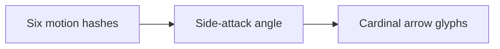
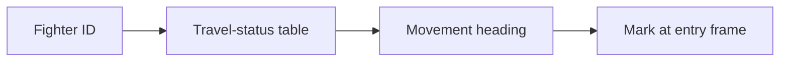
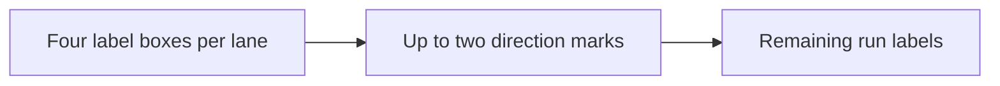

# Direction marks in the frame strip (design, 2026-11-23)

Superseded on 2026-11-24 by [the ACTION model](action-model.md): the travel table, `travel_status`, the fighter read
for aims and the check `the_travel_statuses_are_the_traces` are removed. The tables below record what this design used.

On 2026-11-23, F14 added Player 1's move direction to the existing frame strip in Training and waiting-room practice. The F14 design and requirement trace used base `152629cd`.

## Strip and font in F14

The strip names a move in LAST and LINK, but side tilts and smashes have the same name at every angle and a fighter's
own status is named `Move`. Four existing label boxes per lane show long runs or hit spots. LAST holds 24 UTF-16 units
and LINK 32; neither the panes nor the layout archive change.

The `nintendo64` font's character maps in
`artifacts/phase23/rc5-combined/glyphs/fonts-bfotf-{2c46f6bb68,2d24073d3a,2d58bc0c11}.cmap.txt`
include U+2190–U+2195 but not the diagonal arrows. Diagonals are written as two cardinal arrows, as in the drill list.
The motion names and hashes from `artifacts/enhancements/stage-assets/ParamLabels.csv` are:

| Motion | Hash | Angle |
| --- | --- | --- |
| `attack_s3_hi` | `0x0cba28ee97` | up |
| `attack_s3_s` | `0x0b7dd72b57` | level |
| `attack_s3_lw` | `0x0c244b16f0` | down |
| `attack_s4_hi` | `0x0c27ffd62e` | up |
| `attack_s4_s` | `0x0b78983dd2` | level |
| `attack_s4_lw` | `0x0cb99c2e49` | down |

## F14 design (superseded 2026-11-24)

The per-frame P1 sample reads `motion_kind` only for side tilt or side smash, behind `ANGLE_ON`, which boot sets only
when the CPU mash unit is usable. Behind `AIM_ON` (the Recording unit's `pos_x` and `pos_y` rows) and `p1_fighter`
(`KIND_ON`), it reads position while the fighter is in its travel status. A gate that is off leaves its field empty.

The travel table (`model::aim`) holds the ten fighters from F13 trace boot `f13-trace-0a17-1`, REPORT.md §1. Kinds
come from the game's `FIGHTER_KIND_*` constants. Each entry into the fighter's travel status is one part:

| Fighter | Kind | Travel status |
| --- | --- | --- |
| Pikachu | `0x08` | `0x1e1` |
| Pichu | `0x13` | `0x1e1` |
| Greninja | `0x35` | `0x1e7` |
| Palutena | `0x36` | `0x1e1` |
| Zelda | `0x11` | `0x1e3` |
| Sheik | `0x10` | `0x1e7` |
| Mewtwo | `0x19` | `0x1e6` |
| Fox | `0x07` | `0x1e1` |
| Falco | `0x14` | `0x1e2` |
| Wolf | `0x2f` | `0x1e1` |

In the trace, movement matched the direction the game used within one degree in every cast; the immediately preceding
stick sample did not give the direction Fox, Falco and Wolf flew. The travel count is not used.

- The tracker retains four `Aim { frame, dir }` marks.
- An angle transition marks the swing frame.
- A travel entry remembers its frame and position.
- The first later position at least one unit away supplies its nearest eight-way heading, marked on the entry frame.
- A motion restart inside travel is not another entry and keeps its name and directions.
- A travel that does not move produces no mark.
- A hit and a link hold a copy of their move's name and directions.
- A direction that arrives later (a heading known after the hit, a second part) reaches every copy of that move, and no other move's.
- Each action retains up to two directions and, for a recognized fighter-owned travel, the preceding special's name.
- Display fields do not change `Move`, action splitting, `Link.from`, `Link.to`, or verdicts.

- The newest two visible marks take the first two Player 1 lane label boxes, centred on their own frame.
- Startup and hitlag use dark ink.
- Other cells use light text.
- Existing run labels take the remaining boxes, and the CPU lane is unchanged.
- LAST and folded LINK append arrows to names.
- A line that does not fit drops spaces around `>` and before the arrows.
- The bridge publishes `strip.aims`, oldest first: only marks whose label box exists in the layout, and nothing on a stale or hidden pass.

Scrollback also publishes `strip.scroll` (columns behind) and `strip.back_ms` (frames behind in milliseconds).
Both are 0 on a live, hidden or stale pass.

Chips, the stick row, combo grading, saved combos, the drill list, pane capacities and the layout archive are
unchanged. No hook or native site is added; the angle and fighter reads use existing guarded rows.

## Risks and checks

- Arrow text can overhang a cell because its existing label box is wider than a cell.
- Two visible marks leave only two boxes for run lengths or hit spots.
- Unrecognized animation names do not receive an angle mark.
- Travel marks depend on the trace's statuses and motion, and the F14 design recorded no game run of that build.
- A ground travel shows the way the fighter went rather than the stick's direction.

Host checks: `angle_of_reads_the_angled_side_animations`,
`an_angled_side_tilt_marks_the_frame_its_swing_starts`, `a_level_side_tilt_marks_nothing`,
`a_buffered_second_swing_of_the_same_angle_marks_again`,
`heading_bins_a_movement_to_the_nearest_of_eight_directions`, `the_travel_statuses_are_the_traces`,
`each_entry_into_the_travel_status_marks_its_frame_with_the_way_it_moved`,
`a_link_keeps_both_moves_directions_and_the_special_a_travel_continues`,
`a_second_part_reaches_the_link_its_special_already_made`,
`the_lane_draws_each_mark_on_its_frame_in_a_label_box`, `marks_take_two_label_boxes_and_lengths_keep_the_rest`,
`the_bridge_reports_only_the_marks_whose_label_box_exists`,
`a_diagonal_is_written_as_its_two_cardinal_arrows`, `the_last_row_and_the_link_line_name_the_direction_beside_the_move`,
`a_long_pair_of_moves_drops_its_spaces_to_fit`, `strip_aims_reports_the_marks_drawn_on_the_last_pass`,
`the_runtime_reads_the_angle_and_the_travel_behind_their_gates`.
