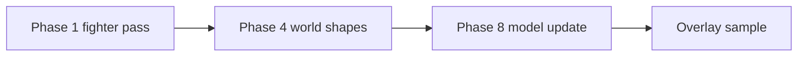
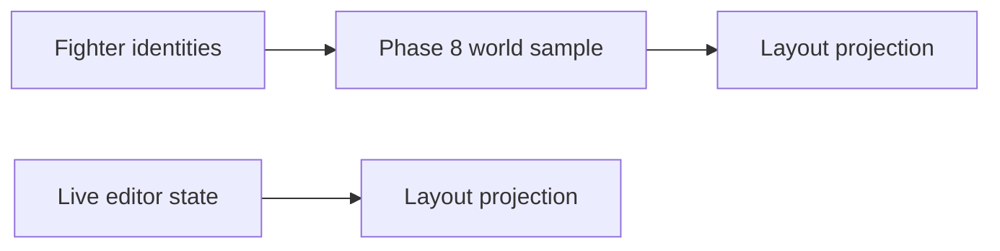
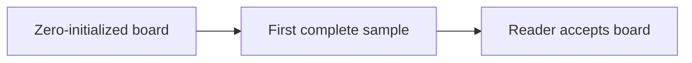
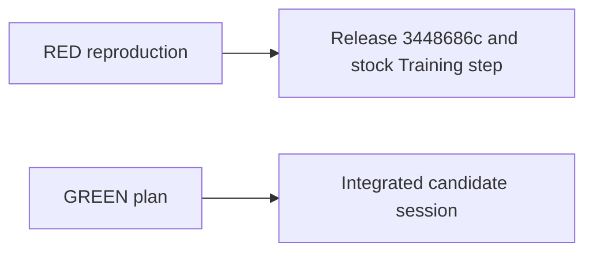

# Overlay frame sync

The shipped overlay projects the completed simulation frame. See [Display & Controls](../menu/display-and-controls.md).

## Native order

- The fighter pass runs in the stock phase-1 `BattleObjectManager::process_begin` task at `main+0x3ac660`.
- The stock HitModule updates its world shapes in phase 4 via `main+0x3ad3e0 → 0x3a8798 → 0x469dc0 → 0x468220`.
- The phase-8 `BattleObjectManager::process_end` uses the normal and alternate ModelModule paths at `main+0x3a8be0` and `main+0x3a8c50`.
- Both object walks complete before the native return.
- The hook on `main+0x3ade50` calls the stock task first.

## Sampling and placement

- The phase-1 caller queues fighter identities.
- At the phase-8 return, one sample validates those identities, rebuilds fighter and article geometry, and snapshots the practice pictures.
- It uses the existing joint transform, wind area geometry, and angle calculation.
- The layout callback at `main+0x375efa8` uses the render camera to project that sample.
- A skipped publication cannot supply a previous frame's combat or target geometry.
- A held simulation preserves the last completed pose while the camera can still update.

- The layout tick reads the live input-driven editor state and passes it through the same projection and pane writer.
- BTT placement shows cursor movement and edited targets before the next simulation step.
- After X confirms and A starts the run, the committed layout remains visible until phase 8 supplies the first active-target sample.
- Holding the board during the HUD read makes that handoff use one snapshot.
- The egg-zone wizard, Tech placement and Guard the Edge placement likewise read live editor state.
- BTT targets in play and moving Eggs-ercise discs come from the phase-8 sample.
- Egg and BTT camera feedback, practice gameplay, the Perfect recovery height probe, input and speed keep their original callbacks.

- The same phase-8 publication carries fighter anchors independently of the legend setting.
- The compact strip's `fighter_screen_anchors(layout_name)` reader yields a fighter ID, its sampled top joint and that point projected into the current HUD canvas.
- It requires a matching active scene, a current snapshot and a valid render projection.
- The reader is a readiness boundary: it returns no anchors until boot has installed the overlay unit, so a refused orb row turns the strip's fade off, leaves the strip drawn and reaches no overlay native from the UI pass.

## Overlay store ownership

| Path | Source | Acquisition and lifetime |
| --- | --- | --- |
| Fighter initialization | `src/runtime/features/reset_hub.rs`, `hitbox.rs` | Increment the fighter slot’s atomic generation. The worker leaves Store and board untouched. |
| Fighter CATCH | `hitbox.rs:1524–1580` | Stamp before reading shape. Under STORE, attach only if the lifetime still matches. |
| Fighter ATTACK | `hitbox.rs:1534–1538` | Defer geometry to the fighter pass. |
| Article ATTACK/CATCH | `hitbox.rs:1556–1580` | Track under ARTICLES. Command guards drop before the original call. |
| Four article wind commands | `hitbox.rs:1584–1629` | Track under ARTICLES. Release the guard before calling the original. |
| Rebound reset | `hitbox.rs:1634–1656` | Call original, read status, clear cached spheres under STORE. Board clearing uses try-lock. |
| Phase-8 overlay sampling | `hitbox.rs:1374,1658–1664` | Run the original task first, then try BOARD, STORE and ARTICLES. |

The combat-store and article mutexes are private to `src/runtime/features/hitbox.rs`. The coordinates are from the stock 13.0.5 image.

- The reset hub patches Fighter vtable slot `+0x30` at `main+0x4f80240` and runs the original `main+0x60dfa0` before retiring the cache.
- Stock virtual dispatch `main+0x656f88..0x656f94` reaches that slot from the task at `main+0x354a7dc` via `main+0x135dd70`, `main+0x14de860` and `main+0x656134`.
- Historical stock traces recorded 192 init calls, including 46 off main.
- In the Yoga Mii reset receipt, sequence 4099 reaches the exact slot on guest thread 113.
- The original init uses the same non-null accessor at `main+0x60f7c4..0x60f7c8`.
- This rules out keeping init's inherited Store acquisition under a single-thread assumption.

- Each native fighter object slot has a generation available before any plug-in cache bind.
- Stock lookup at `main+0x3ac58c` takes bits 16–27 of a category-0 ID as the slot and checks the full ID at `main+0x3ac648..0x3ac650`.
- The constructor stores capacity 24 at `main+0x14f4c98..0x14f4c9c`.
- The manager publishes this pool in category 0 at `main+0x14f55e4..0x14f55f4`.
- The counter table uses 24 atomic words.
- A stamp contains both the full ID and generation.

- Phase 8 stamps a fighter before reading native geometry and attaches that stamp to the cache, combat board record and compact-strip anchor.
- The HUD checks the stamp against the atomic generation when it reads the board or returns an anchor.
- A fresh stamp survives the worker's return.
- A retirement during a sample makes the earlier geometry and anchor ineligible on its next read, including when the board was held at retirement.
- Other fighter slots, articles and practice pictures retain their own publications.

- The cache drops records from a different native lifetime on rebind.
- A grab that was already inside the Store guard when init retired its lifetime can finish writing only to the old stamp.
- The next current-lifetime operation replaces it before using those records.
- Phase 8 reclaims retired sets even if their fighters have no new shapes.
- The accepted legacy command and rebound callers retain their own cache operations.
- The worker has no later callback that could erase a fresh publication.

- The layout worker at `main+0x375efa8` calls `draw_orbs` and `fighter_screen_anchors`.
- They only read `BOARD` for combat geometry.
- No UI callback or plugin-owned worker reaches `STORE` or `ARTICLES`.
- The early Perfect recovery measurement uses invocation-local scratch and does not acquire either lock.
- Diagnostic signature and census reads borrow the Store guard phase 8 already acquired.
- The lock regression follows the real init, phase-8 and early Perfect roots and checks that it detects an injected blocking acquisition on each.

- Stock `main+0x135ca00` invokes the registered phase callbacks synchronously through `main+0x137b4d0` or `main+0x137b5a0`.
- Exact RED observes phase 1, HitModule phase 4 and phase 8 on guest thread 80, with layout on guest thread 99.
- Historical records also put the observed ATTACK calls and two wind variants on thread 80.
- The stock task roots `main+0x353d514` and `main+0x37ccad8` can dispatch both wind scripts and worker init.
- They do not identify a unique thread.
- CATCH, rebound and the wind exports also have independent indirect entry from stock fighter modules.
- The archive contains 3,466 ATTACK entries and 20 stacks for the arg10 box and circle wind variants, all on the observed simulation thread.
- It contains no off-main observation for CATCH, rebound, plain-box wind or arg9-circle wind.
- The complete scheduling ownership of those callers remains unproven.
- The primary's 21:06Z ruling accepts this evidence for the intermediate build's inherited callbacks.
- The intermediate design required a lossless handoff from thread-owned state before rc.15.
- At the 2026-11-27 pin, the grab, article and rebound paths still take blocking locks.

## Board storage

- `BOARD` starts as the all-zero pattern, written as a zeroed initializer, so the linker keeps it in `.bss`.
- In `f6c81d24` the empty scene and the sixteen empty practice pictures were encoded with nonzero bytes.
- That moved the whole 45,800-byte object into initialized data and grew the NRO file by about 45 KB.
- The zero pattern is a valid sample that no reader accepts: `read_overlay_sample` is the only read path and requires the board's first completed frame, and the board's own zero pattern is `Board::new()`.

## Documented deviation: hook placement

- The phase-8 hook is a replace hook at the entry of `BattleObjectManager::process_end` (`main+0x3ade50`).
- The playbook asks for a hook after the prologue, or a call of the game function.
- The sample has to run after the stock task has returned, so the wrapper calls the stock task first, with its argument unchanged.
- The site has its exact 64-byte guard, and the dated card scan found no other plugin at it. tr-primary-2 kept this placement for the intermediate card on 2026-11-21 (21:47Z).
- The 2026-11-27 pin retains the entry hook and calls the stock task before sampling.

## Requirement trace

| Requirement clause | Design | Test |
| --- | --- | --- |
| Correct the previous-frame drawing across overlays | Phase-8 snapshot for attacks, grabs, hurtboxes, wind and angles, article geometry, and practice discs | `overlay_board_exposes_only_the_completed_simulation_frame` |
| Preserve the defined shapes and their draw rules | Use the shared world placement and HUD projection | `a_capsules_two_ends_are_one_orb`, `an_articles_wind_area_is_drawn_and_keeps_it_tracked`, `a_live_targets_hurtbox_is_its_picture_disc` |
| Keep editor input visible while the simulation is held | Draw live edits, then committed layout until the first active sample, then active targets. | `paused_editor_polls_update_pictures_without_advancing_the_world_sample` |
| Check the new native site and avoid blocking the game hook | Exact 64-byte guard and bounded acquisition | `core06_rows_match_the_owned_elf`, `overlay_sampling_and_perfect_height_do_not_wait_for_overlay_data` |
| Keep worker init nonblocking and preserve the current fighter publication | Stamp by native fighter slot before cache or pose reads and revalidate in the HUD | `delayed_worker_init_cannot_erase_a_fresh_overlay_sample`, `retirement_during_a_busy_board_invalidates_only_the_old_fighter`, `retirement_overlapping_first_bind_cannot_carry_an_old_grab_into_the_new_lifetime`, `core06_fighter_generations_use_the_stock_object_pool`, `overlay_sampling_and_perfect_height_do_not_wait_for_overlay_data` |
| Gate UI projection when the row owning `orb_world_to_screen` is poisoned or refused | `fighter_screen_anchors` is a readiness boundary owned by the overlay unit | `a_poisoned_row_disables_every_entry_point_that_can_reach_it_and_no_installed_one_calls_it`, `cross_needs_match_the_call_graph`, `every_boundary_checks_its_gate_first` |
| Make BOARD zero-initializable again | A zeroed initializer; every read requires the board's first frame | `the_overlay_board_starts_as_zero_bytes_that_no_reader_accepts` |

## Exact runtime evidence

The original RED reproduction used release `3448686c` with the stock Training step input. The plan assigned GREEN to the integrated candidate’s combined Eden session. The artifact ledger records the NRO identities, native and plugin traces, stills, and card scan.
