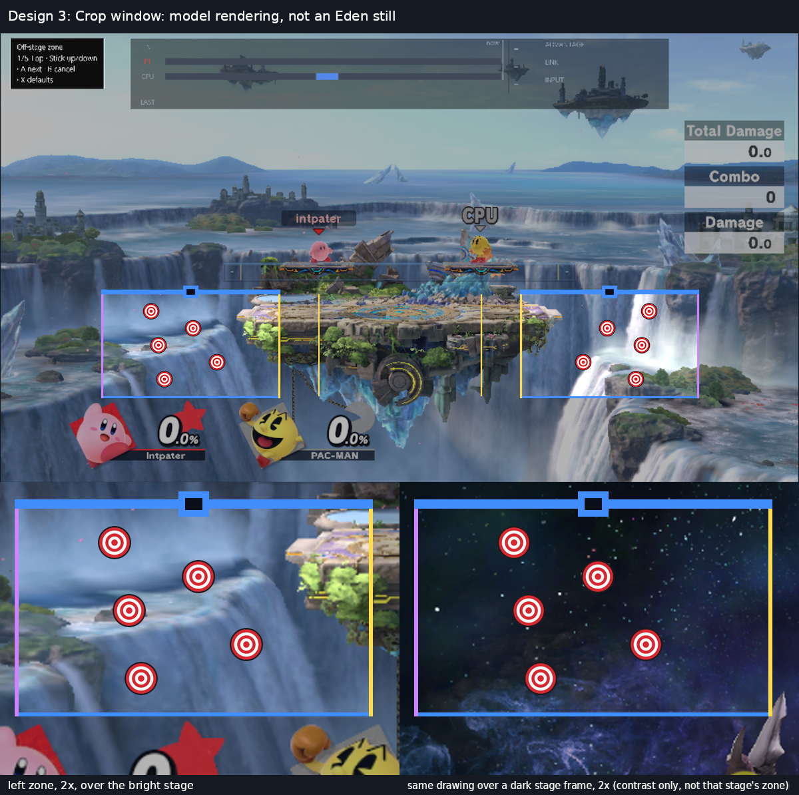

# rc.15 zone editor: crop window

The [Eggs-ercise guide](../guide/eggs-ercise.md) covers the shipped editor.

- On 2026-11-22, Design 3 replaced the editor's band guide without changing its five steps, buttons, notice text, zones, boundaries or wide camera.
- Blue edges mark Top and Bottom, yellow the Inner edge and purple the Outer edge; the active edge is thicker.
- The two-colour handle marks the boundary being adjusted, at the middle of its on-screen part; an edge with no on-screen part has no handle.
- The active edge must meet the canvas on both axes; touching only its border does not count. One yellow line per side marks the inner limit, replacing the dashes.
- Sample target pictures replace hatching and show places a target can appear. X at Preview now writes the notice again with the factory zone's numbers; before, the notice kept the old numbers.
- The overview inset remains when a zone extends out of view.

*Design 3 crop-window model.*

- [Decisions](../DECISIONS.md) includes the proving-boot still.

- The world view uses up to 19 rectangles: five dims, two limit lines, eight edges and four handle rectangles.
- The inset adds up to ten more limits and edges, for at most **29 of the 176 roster stripes**. These are existing menu rectangles, not added panes or textures.
- Up to **10 target pictures** use the practice picture pool. The inset backing and traced contour use at most **65 of the 172 orb bands**; the world guide no longer uses bands.
- The **170-pill cap** is unchanged.

- With the editor up and the menu closed, `view::Crop` hides the menu's panes, shows its container with only the crop rectangles, and restores the pane table's starting visibility on leave or re-resolution.
- The rectangles use `p::linear`; the dim ink is `[10, 15, 27, 140]`.

- The proving boot observed this draw order, back to front: the game's HUD, the plugin's orb bands and practice pictures, the menu rectangles, and the plugin's notice and frame strip.
- Consequently the HUD is dimmed outside the zones and clear inside. The inset's backing and contour are under the dim; its zone edges are opaque rectangles over it.
- When a zone's window grows over the inset's place, its backing and contour are not dimmed there, and the world view's edges cross it; the original spike did not demonstrate that overlap.
- A hole in the dim was considered but not taken: it would leave a pale patch in the dim and show Training's panel through it, with the same contour contrast.
- On a black background the dim reads lighter than the window: outside black becomes `(7, 7, 19)`, while the inside remains `(0, 0, 0)`.

- The inset's contour is still translucent bands, so it can be pale on a bright stage as today.
- Drawing it with turned menu rectangles could make it opaque; the 2026-11-22 design retained the band contour.

- The pane count and pill cap are pinned by `the_pane_table_keeps_the_count_the_game_loaded` and `the_orb_pools_keep_the_pill_cap`.
- The layout builder's `the_built_layouts_keep_the_counts_the_game_loaded` needs both stock archives and pins Training to 1,824 panes / 132 materials / 89 textures and Waiting to 1,710 / 85 / 137.
- It runs in `tools/layout-builder` with both stock archives (`UI_STOCK_FIXTURE`) when a recipe is rebuilt, not in the gate's test step.
- The gate's `the_committed_recipes_were_built_from_this_pane_table` ties the committed recipes to the pane table, so a recipe cannot change unseen. Any change to these counts needs a boot that reaches Training.

- The proving boot was `rc15-zone-crop-2a29baf4-yoga-1`, release `b53469ea190a68b34dd720b5c846be03a42a936dc9e046280ca7c27210b3cc49`, build `2a29baf4`.
- Its record is `/home/intpa/smash-training-lobby/artifacts/phase23/zone-editor-crop/boot1/RESULTS.md`.
- That boot tested the spike, not this implementation.
- A bright stage, the Inner, Outer and Preview steps, the inset's new appearance, a zone's window over the inset's place, Apply and console use fell outside that spike’s evidence.

## What the optional `tr.menu/1` test bridge reads

| Key | Meaning |
| --- | --- |
| `zone.step` | The current editor step, or empty when closed. |
| `zone.last` | Applied, cancelled, or empty; empty while editing. |
| `zone.stage` | The last stage opened in the editor, or -1 before opening. |
| `zone.bins` | The four edited settings, or empty when closed. |
| `zone.y` | The edited bottom and top, or empty when closed. |
| `zone.left` | The edited left zone, or empty when absent or closed. |
| `zone.right` | The edited right zone, or empty when absent or closed. |
| `zone.saved` | Stage settings after the worker commits Apply, or empty if none. |

## Requirement trace

| Requirement clause | Design | Test |
| --- | --- | --- |
| Keep the functionality: the zones | Everything outside the two zones is dimmed; each zone is a clear window. | `crop_window_dims_everything_outside_both_zones` `crop_window_with_one_side_or_a_zone_off_the_screen` |
| Show boundaries and the active edge | Four opaque edges per side; the active edge is thicker and has a handle. | `crop_window_edges_lie_outside_the_zone_and_the_active_one_is_thicker` `crop_window_puts_a_handle_on_the_boundary_the_step_moves` `crop_window_handles_require_the_active_edge_on_both_axes` |
| Distinguish inward and off-stage sides | Yellow marks inner, purple marks outer. One yellow line marks each inner limit. | `crop_window_marks_the_inner_limit_once_a_side` |
| Keep the inset view | Draw inset limits and edges after world rectangles; retain the backing and contour. | `crop_window_draws_the_inset_after_the_world_view` |
| Keep every function: where a target can appear (the hatching's) | Up to five sample targets a side, on the outward-connected part of each row. | `zone_samples_are_spots_a_target_can_appear_at` |
| Keep the editor's buttons | The controls are unchanged; at Preview, X also refreshes the notice when the zone changes. | `zone_wizard_polls_guard_edge_controls` `zone_wizard_writes_the_notice_again_when_x_resets_the_preview` |
| The test bridge reads the editor state | The snapshot carries the current step, bounds, settings and close outcome. | `the_zone_editor_snapshot_shows_open_values_and_closed_outcomes` `zone_editor_packing_round_trips_and_reserves_zero` `zone_cell_reads_complete_states_and_declines_an_in_progress_write` `the_bridge_reports_the_committed_zone_not_a_queued_apply` |
| Keep edges readable on bright and dark stages | Host tests check opaque colors. Bright/dark readability needs flight evidence. | `crop_window_edges_lie_outside_the_zone_and_the_active_one_is_thicker` `zone_overlay_dims_the_live_view_and_backs_the_inset_guide` |
| Reuse existing panes, textures and materials | Reuse 29 roster stripes; preserve the pane table and both archive counts. | `the_pane_table_keeps_the_count_the_game_loaded` `crop_stripes_are_matching_hidden_rectangles_under_the_same_parent` |
| The pill cap stays 170 | The orb pools are untouched. | `the_orb_pools_keep_the_pill_cap` |
| The menu comes back as it was (review 2026-11-22 19:00:21Z) | Leaving the window restores the pane table's starting visibility, also through a layout resolved again. | `the_crop_window_leaves_every_menu_pane_as_the_table_starts_it` `the_crop_window_is_put_back_when_the_layout_is_resolved_again` |

The builder also runs `the_built_layouts_keep_the_counts_the_game_loaded` when a recipe is rebuilt.
