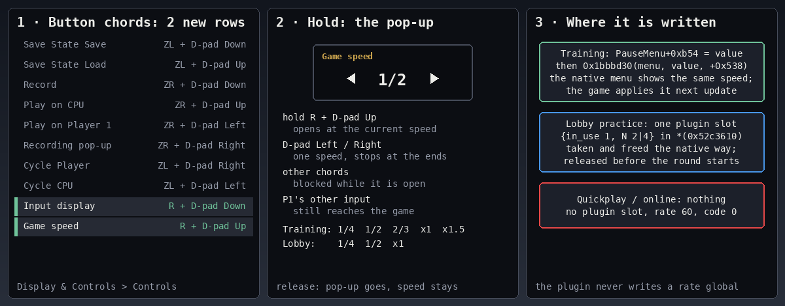

# rc.8 binds: the input display toggle and the game speed (design, 2026-11-11)

- **Scope:** rc.8 §1–§3 (`artifacts/phase23/TASK-rc8.md`).
- **Owner and branch:** the docs lane, branch `p23/rc8-binds` from `p23/rc7-final` `722525a5`.
- **Sources:**
  - QCF's static RE, `quickplay-cancel-fix-work/RESEARCH-rc8-speed.md` ("QCF §n" below);
  - this lane's own reads of the owned 13.0.5 main ELF (sha256 `0789f0a4…`), with `llvm-objdump-21`;
  - the plugin's source at `722525a5`.
- This is a design working file. Its requirement table quotes the operator's request clause by clause, as the
  completion checklist asks of a design report. The README and the user docs carry no quotes.

## 1. What exists today

- **The input display is the frame strip** (SPEC-input-06; operator decision INPUT-VIZ option A, 2026-11-05).
  - It's the settings row `input_display_strip` (`Off`, `Frame strip`; factory `Frame strip`), shown as "Input
    Display" on Display & Controls → On screen.
  - `hud_draw::draw` draws it in Training (`info_training`) and in the waiting-room practice (`info_waiting`, under
    `TrModPort`).
  - The runtime reads it from the published settings (`published::live().input_display`).
- **The binds are the chord rows** (SPEC-input-04):
  - Eight rows of 16-button arrays in `settings.json` (`model::factory` `DEFS`), listed in `options::CHORD_ROWS`.
  - They're edited in one screen, Display & Controls → Controls → "Button chords" (hold one button, press the others;
    X re-captures, Y empties, A confirms).
  - `model::chords` detects them on P1's controller poll. A chord passes when one of its buttons is held, the others
    are pressed on this poll, and at least one button is newly pressed; extra buttons don't disqualify it.
  - Nothing is raised while an input owner is active.
  - A passed chord's buttons are hidden from the game until each one is released.
  - `button_config.ini` holds only the two menu-opening shortcuts (N7). It isn't where binds live.
- **The conventions:**
  - Every chord is a shoulder button plus one D-pad direction: ZL for states and cycles, ZR for recording.
  - All eight ZL/ZR × Up/Down/Left/Right pairs are taken.
  - L doesn't exist on a GameCube pad (`chords::unusable_on` greys such a row). R is the GameCube Z.
- **A pop-up exists:** the notice slot `TrModDisp0` has standing notices (`notices::upsert(id, …)` / `notices::clear(id)`),
  drawn in Training and in the lobby practice by the same `hud_draw` tick.
- **The pause menu is reachable:** `cpu_level` already reads Training's pause menu through
  `[[[[[[main+0x52c3420]+8]]+0xb38]]+0x210]+8]+0x80` (seam row `cpu_level.training_rank_choice`). Its CPU Behavior and
  level are `+0xb4c`/`+0xb50`; the Speed is `+0xb54` beside them.

## 2. The native speed, checked against the ELF

QCF §1–§4 holds where this lane read it again. These sites were confirmed instruction by instruction:

| site | what the bytes say | used for |
| --- | --- | --- |
| `0x1bbacc0` (the menu setter) | `ldr w8,[x1]` the item (≤ 12, jump table `0x44f89dc`); `ldr x19,[x0,#8]` the menu; `ldr w20,[x2]` the value | QCF §6's first trace point is right: the entry's `[x1]`/`[x2]` as u32 are the item and the value |
| `.1bbaf10`–`.1bbaf2c` (item 7, value unchanged) | `add x21,x19,#0x538; …; str w20,[x19,#0xb54]; bl 0x1bbbd30(menu, value, menu+0x538)` | **the bind's Training write is this native path**: the store and the text, with no slide and no SE |
| `.1bbbb70`–`.1bbbbcc` (item 7, value changed) | text via `0x1bbbd30`, the slide `+0x558`/`+0x568`, `str w20,[x19,#0xb54]`, then SE `0x15_1ca6_c028` unless `[[0x532f8d0]+8]+0x191` is set | the menu's own change: not used (an SE with the menu closed) |
| `0x1bbbd30` (value → text) | `sub w8,w1,#2; cmp w8,#4; b.hi` (default `x1`), jump table `0x44f8a24`, `0x377a120(pane, label)` | called with the setter's own arguments |
| only 2 callers of `0x1bbbd30`: `.1bbaf2c`, `.1bbbb7c` | the menu never refreshes the Speed text by itself when it opens | why a bare store isn't enough |
| `.155b4a8`–`.155b5ec` (the speed code of `FUN_0155a000`, pause/resume side only; the bind repeats its writes) | applied value `x25+0x194` against `+0xb54`; on a change it frees the battle's slot (`{in_use 0, divisor 1}`, dirty `+0x40 = 1`, slot `0xff`) | the slot steps the lobby copies |
| `.155b654`, `.155b674`, `.155b864` | x1/1 Frame: code 0 and rate 60; 2/3: code 4, rate `0x78`; x1.5: code 6, rate `0xb4` | QCF's rate trace points are right |
| `.13e5500` (Training HUD) | ~~`ldr w9,[[hud+8]+0x80+0xb54]` every frame~~ **corrected 2026-11-11 (R1 defect, §3.6):** only in the HUD's menu state 6, never in play | ~~the speed icon refreshes itself~~ the bind runs this refresh itself |
| `0x1fca5c0` `BattleObjectSlow__rate_request_impl` | `ldr x0,[0x52c3610]`; `ldrb [x0,#0x40]` dirty → `0x14a2cd0` (max divisor over `{in_use, N}` at `+0x20..+0x3f`), else default byte `[0x52c5189]` | the lobby's slot takes effect through the game's own rate |
| **create** `.1345f74`–`.134601c` | only when `*(0x52c3610) == 0`: 0x48 bytes, all 16 slots `{0, 1}`, dirty 1 | **a new table has no slot in use** |
| **destroy** `.134d52c`–`.134d558` | `[0x523d138] = 1.0f`, the table freed, `*(0x52c3610) = 0`, in the same teardown that empties BattleObjectManager | the practice battle's table goes with the battle |

- **Corrections to QCF:**
  - **The lobby trace point.** QCF's `main+0x155b4bc` (register x8) records x8 *before* `ldr x8,[x20,#0xb38]` runs.
    Without a Training root, `.155b4b0 cbz` jumps past it. Use `main+0x155b4c0` (x8 = the Training object) plus a
    counter on `main+0x155b510` (the path with no Training object).
  - **The slow table** the rate code reads is `*(0x52c3610)`. The exported `lib::Singleton<app::BattleObjectSlow>::instance_`
    is at `0x52b8550` (QCF's index lists that), but no code read here uses it for the slots.
- **Still inferred** (each has an Eden check in §6):
  1. The native Left/Right order of the Speed item (QCF §1: no static table).
  2. The thread of `FUN_01559590` (QCF §3: the main loop, inferred).
  3. That battle objects advance by the slow rate (QCF §3: from the export's name).
  4. That the lobby battle has no Training object (QCF §5).
  5. That the practice battle's teardown runs before a match's table is created. Create reuses a live table: if the
     practice table outlived the round's start, a leftover slot would reach the match.

## 3. Decisions

Where a choice is the operator's, this takes the sensible default and states it. Nothing waits on a question.

1. **Two new chord rows** in the same "Button chords" editor, with no new screen:
   - "Input display" (`input_display_toggle`), default **R + D-pad Down**;
   - "Game speed" (`game_speed`), default **R + D-pad Up**.
   - Why: R is free on every controller (the GameCube's Z), and it makes a third family beside ZL (states, cycles)
     and ZR (recording): two buttons, one shoulder, one D-pad direction.
   - Both rows are editable and can be emptied, like the eight others. Their reset and old-file rules are the same.
2. **The input display bind** flips `input_display_strip` between `Off` and `Frame strip`.
   - The flip is a settings change through the menu worker, like a change in the menu: published at once and saved
     with the settings. The menu then shows the same value: one source of truth.
   - A short notice says "Input display: On" or "Off".
   - It works wherever the chords work: Training and the waiting-room practice.
3. **The speed bind is a hold:**
   - **Open:** the chord passes. The pop-up opens with the current speed.
   - **While open:**
     - D-pad Left/Right, newly pressed, steps one speed. It stops at the ends and doesn't wrap.
     - The chord's buttons and D-pad Left/Right are hidden from the game.
     - No other chord can fire (ZL + Left would otherwise cycle the CPU).
     - The rest of P1's input reaches the game, so P1 keeps moving.
   - **Close:** on the first poll where none of the chord's buttons is held, the pop-up goes away. The speed stays.
   - The press that opened it is never also a step.
4. **The pop-up** is the standing notice "Game speed", body `<D-pad Left glyph> 1/2 <D-pad Right glyph>` (the game
   font's own glyphs, `chords::glyph`).
   - It goes to the front at once (`notices::show_now`, new): `upsert` would wait behind a notice on screen.
   - It's updated on each step and cleared on release. A notice it covered comes back with the time it had left.
5. **The speeds and their order:**
   - **Training:** the five speeds Training offers: 1/4, 1/2, 2/3, x1, x1.5 (values 5, 4, 3, 1, 6).
     - **1 Frame is left to the native menu.** It's a pause-and-step mode with its own button, not a speed.
     - When Training is on 1 Frame, the pop-up shows "1 Frame", and the first step goes from x1's place.
   - **Waiting-room practice:** ~~1/4, 1/2, x1~~. **Superseded 2026-11-11 (rc.8 R2, `TASK-rc8.md` "SCOPE REOPENED"):**
     the same five as Training. 2/3 is a paced slot and x1.5 an extra world step, both local
     (`docs/design/rc8-lobby-speed.md`; QCF's Eden pairs `qcf-spd04y`/`qcf-spd05y`).
   - **The order** is slowest to fastest until the Eden trace of the native Left/Right (T1) is in. Then the Training
     list takes the native order.
6. **Training writes the game's own field, the native way:**
   - It stores `PauseMenu+0xb54`, then calls `0x1bbbd30(menu, value, menu+0x538)`. That's the setter's own
     unchanged-value path (`.1bbaf28`/`.1bbaf2c`): text, no slide, no SE.
   - It runs on the UI job thread in `info_training`'s tick, where the plugin's HUD draw already runs.
   - ~~It never writes the rate globals or a slot in Training; the game's apply does that on the next update.~~
     **Corrected 2026-11-11 (Eden `rc8b-train-1ecf920a-xps/out-diag6`, QCF's RE 09:12Z/09:18Z, the primary 10:12Z):**
     the game's speed code (`FUN_0155a000`, `.155b4a8`–`.155bbb8`) runs only on the pause/resume side. In closed-menu
     play its gate (`.155a08c`–`.155a0c4`) skips it: 0 hits in play, 137 with the menu open.
   - **So P1's next poll (a game thread) does the apply's writes itself** (`training_apply`, `model::game_speed::mode_apply`):
     - to the Training mode object, x25 there, found the way the game finds it on every update (`FUN_0135ca00`,
       `.135ca34`–`.135ca50`): `[[main+0x52c3910]]`'s registry (`FUN_015435c0`, a libc++ unordered_map) at key
       `0x1022590708`, used only when its vtable is `main+0x506fd10`.
       - Not key `0x1308abad79` (QCF's first reading): that one holds another object, vtable `main+0x5070380`, which the
         vtable check refused live (Eden `rc8b-train2-2c2ca140-xps/out-mode`). QCF corrected it at 11:16Z.
       - `out-key` showed the game's find for `0x1022590708` returning x25 (`0x11a757f618`, vtable
         `main+0x506fd10`), the same object its per-update step runs with.
       - No hook is needed.
     - the applied value `+0x194`; its old slot freed `{0, 1}`; the step clears (`main+0x52b92ec` bit 2,
       `[[main+0x53398d8]+8]`); the rate code `main+0x593b444` and updates `main+0x523d004` (2/3: 4/120, x1.5: 6/180,
       the others 0/60); a new slot `{1, N}` and `+0x1b4`; the table's dirty byte last.
     - Not while the game's pause menu is open (its own apply runs then), not in the state that makes the game apply 0,
       and never in the lobby.
     - The game's own apply later sees `+0xb54 == +0x194` and leaves it.
   - ~~Its icon and help line refresh themselves.~~ **The HUD speed indicator: corrected 2026-11-11** (the docs lane's
     GIFs `docs-rd10-eca14e4b`; the primary's 18:20Z made it an R1 defect for rc.8). After a step back to x1 the
     stopwatch kept the last label ("x1.5"), and a step away from x1 showed none.
     - **The game's refresh** (`.13e5500`–`.13e5544`) compares `+0xb54` with its shown flag at `D+0x231`. Any value but
       x1 plays `in_speed` (`menu+0x168`) and sets the flag; x1 plays `out_speed` (`menu+0x178`) and clears it.
       - `D` is the HUD's data object: the chain's `[[[[root+8]]+0xb38]]+0x210`, stored at `.13af80c`.
     - **It runs only in state 6** of that object's state machine (`.13e5470` at `D+0xa0`), the Training menu state
       the Speed is edited in. Play (state 5, `.13e5110`) never runs it, so a closed-menu store changed nothing on
       screen.
     - **The label** is the pane `menu+0x338`, which `0x1bbbd30` writes only for values 2–6. A step back to x1 left the
       last one showing.
     - **So the UI tick runs that refresh after its store and text** (`hud_icon`, `model::game_speed::hud_icon`): the
       same animation through `0x377aee0(anim, 1.0)` and the same flag. It runs only when the HUD object's
       `[[+8]+0x80]` is the menu the write went to. The next menu visit finds the flag right and does nothing.
     - The help line refreshes itself (`FUN_01bc0f30`, cursor on the Speed row).
   - When the pop-up opens, the bind reads `+0xb54`, so a value set in the native menu is where it starts.
7. **The lobby (waiting-room practice) owns one slot in the BattleObjectSlow table** (`*(0x52c3610)`):
   - **Take:** the first slot with `in_use 0` becomes `{1, N}` (N 2 or 4), and dirty `+0x40 = 1`. The native apply's
     take (`.155b684..`) does the same.
   - **Free:** `{0, 1}` and dirty `= 1` (`.155b5d8`–`.155b5e4`).
   - **When:** P1's frame step in the practice (`lobby::frame`), edge-triggered: only when the wanted speed differs
     from the one applied.
   - **The lobby speed starts at x1** in each new practice session. A round in between starts the next one at x1.
   - **The rate globals are never written.**
8. **Never online-affecting.** No Quickplay or online match may start with a plugin slot or a rate other than 60:
   - The slot is taken only while the lobby practice is live: the lobby engine active, the live mode words the waiting
     room, and the native waiting-room UI not busy.
   - **It's released on the first frame where that stops,** and on session clear. The match-found UI turns "busy" in
     the practice, before the round, and the practice keeps running frames then.
   - **A release writes only into the table it was taken from,** and only when the slot still holds `{1, N}`. The
     table pointer is kept at take. Once the scene has left the practice, the plugin writes nothing at all; the
     game's own teardown then owns the table.
     - **The release that matters** is the session clear on the practice P1's destroy (`97437d66`). A match found
       shows no busy edge (worker B 08:20Z), and that destroy comes while the mode words are still the waiting room,
       2.3 s before the match scene (Eden `rc8b-qp2-97437d66-xps`).
     - R8 (worker B 09:45Z): both `step` and the teardown release are drop-only outside the practice again. A match's
       table can reuse the practice table's block and hold the game's own `{1, N}` at our slot.
   - Training's speed is the game's own (decision 6). The native apply gives 0 to any battle without the Training
     object.
   - The Eden proof (§6) shows a Quickplay match starting with `[0x523d004] = 60`, code 0, and no slot in use, after
     the plugin's release line and the table's teardown.
9. **Guards:** a new seam group `game_speed` (`model::seams::native_seams::rows_game_speed`), generated from the owned
   ELF like `rows_cpu_level`.
   - **Code rows:** the setter's unchanged path, `0x1bbbd30`, the apply's read and free, the HUD read, the create and
     destroy, `rate_request` and the max-divisor function.
     - The HUD indicator fix adds four: `hud_icon_show` (`.13e5530`), `hud_state` (the state table, `.13af660`),
       `hud_data` (`str x20,[x19,#0x210]`, `.13af808`) and `anim_play` (`0x377aee0`, called). The card scan over the
       rc.7 card's 19 plugins finds no reference to any of them (`rc8-binds-gates/card-scan-game-speed-hud.txt`).
   - **Data rows:** the label table `0x44f8a24`.
   - It's authoritative, compared once at boot. Host tests decode every offset the runtime uses from the guarded
     words (the QCF pattern): `0xb38`, `0x210`, `0x80`, `0xb54`, `0x538`, `0x52c3610`, `+0x20`, `+0x40`, and the
     init's `{0, 1}` pattern.
   - **If any row fails, the speed bind is off** (its install line says so), and the display bind still works.
10. **No locks on a game path:** the new state is atomics, or `try_lock` used only by game threads.
    - The teardown release too (R8): if `LOBBY` is taken, it sets `RELEASE_PENDING`, and the next `lobby_frame` makes
      the release, still only in the practice.
    - The menu worker gets the display toggle as an atomic counter.
    - `lock_order` and `hook_locks` pass unchanged.
    - **No new hook.**

## 4. Requirement trace

| Operator clause | Design | Test |
| --- | --- | --- |
| "I would like to be able to bind bringing up the input display" | §3.1–3.2: the chord row `input_display_toggle`; its request flips `input_display_strip` through the menu worker | `the_ten_chords_keep_todays_defaults_and_add_two`, `input_display_chord_raises_its_request`, `display_toggle_flips_the_strip_row` |
| "and also a bind to decrease the speed" | §3.1, 3.3: the chord row `game_speed`, a hold that opens the speed pop-up; §3.6: the speed applied at once in Training (the game's own apply writes, done by the bind on P1's poll) | `the_ten_chords_keep_todays_defaults_and_add_two`, `hold_opens_on_the_chord_steps_on_left_right_and_closes_on_release`, `mode_apply_does_the_speed_codes_writes`, `registry_find_walks_the_games_map`, `game_speed_rows_decode_the_training_apply` |
| "(basically trace how the training mode does it as it has 3/4 1x etc)" | §2, §3.5–3.6: the native values 1..6 at `PauseMenu+0xb54` and its labels; there is no 3/4 (the slow speeds are 2/3, 1/2, 1/4) | `speeds_are_the_native_values_and_labels`, `game_speed_rows_decode_the_native_offsets` |
| "the idea is to be able to quickly change the speed perhaps if you want to practice it quickly" | §3.3: one combo, Left/Right while held, no menu | `hold_opens_on_the_chord_steps_on_left_right_and_closes_on_release` |
| "it would have a small menu pop up showing the speed" | §3.4: the standing notice "Game speed" with the speed between the D-pad glyphs | `popup_body_shows_the_speed_between_the_dpad_glyphs` |
| "you go left or right while holding the combo" | §3.3: newly pressed D-pad Left/Right steps, clamped; other chords blocked; the step buttons hidden | `training_steps_walk_the_speeds_and_stop_at_the_ends`, `hold_hides_the_chord_and_step_buttons_and_blocks_other_chords` |
| "and then it goes away" | §3.3: closes on the poll no chord button is held; the speed stays | `hold_opens_on_the_chord_steps_on_left_right_and_closes_on_release` |
| "in training it'll reflect in the training menu" | §3.6: `+0xb54` stored, then `0x1bbbd30(menu, value, menu+0x538)`, the setter's own unchanged-value path | `training_write_is_the_native_store_then_text`, `game_speed_rows_decode_the_native_offsets` |
| R1 defect (the primary 2026-11-11 18:20Z): "The HUD stopwatch staying on \"x1.5\" after the chord steps back to x1" | §3.6: after the store and text, the UI tick runs the game's indicator refresh (`hud_icon`): `out_speed` and the flag cleared at x1, `in_speed` and the flag set away from it | `hud_icon_shows_away_from_x1_and_hides_back_at_x1`, `hud_icon_matches_the_speed_after_every_step_from_either_flag`, `game_speed_rows_decode_the_hud_icon` |
| "and the lobby it will just work" | §3.7–3.8: a plugin slot `{1, N}` in the BattleObjectSlow table, the native take and free steps, released before any round | `slot_take_and_free_match_the_native_steps`, `lobby_offers_the_training_speeds`, `lobby_slot_is_released_outside_the_practice_and_never_written_elsewhere` |
| "can you make the speed up local too?" (§2b, owned by QCF) | §3.5, superseded by `docs/design/rc8-lobby-speed.md` (rc.8 R2): the lobby offers all five, 2/3 and x1.5 local | `lobby_offers_the_training_speeds` |

## 5. Code shape

- **`model::game_speed`** (pure, host-tested):
  - `Speed` (the native values and labels) and the two speed lists;
  - `step`;
  - `Hold`, the hold state machine;
  - the pop-up body;
  - `SlowTable`, the take and free steps over the 0x48-byte table;
  - `LobbySlot`, the edge-triggered keeper and its release rule.
- **`model::chords`:** the two rows, `Request::InputDisplay`, and the hold run beside the detector: open, block,
  hide, close.
- **`runtime::features::game_speed`:**
  - the seam gate;
  - the Training write in the `info_training` tick;
  - the lobby step from `lobby::frame`;
  - the pop-up through `notices`.
- **The menu worker** applies the display toggle (an atomic count from the poll) as a change of `input_display_strip`.
- **Size:** measured at the end and raised in its own commit, `approved_by` the operator's "raise as needed".

## 6. Eden proof (integration schedules it on the integrated build)

**Rows:**

- **Training:** hold the speed combo; the pop-up shows; Right, Left; release.
  - The native Training menu shows the value.
  - The trace `.155b5b8` shows the applied value; the HUD icon shows.
  - **R1 fix (2026-11-11):** x1.5 → x1 timed on a perf host with the GDB stub on (it runs at x1), and a GIF of the
    stopwatch shown at x1.5 and gone at x1.
- **Training:** the display combo hides and shows the strip.
- **Lobby (LDN pair, with host acceptance per `AGENTS.md`):**
  - 1/2, then 1/4: the trace at `0x1fca5d0` shows the plugin's `{1, 2}` / `{1, 4}`, and `[0x523d004]` stays 60;
  - the match found;
  - the release line, before the table's destroy (T5).
- **Quickplay:** the match starts with no slot in use, rate 60, code 0.
- **GIFs:** before → the combo → the visible result.

**Trace points** (persistent `trace.*`, points off in timed rows):

| id | point | settles |
| --- | --- | --- |
| T1 | `main+0x1bbacc0` entry, `[x1]` u32, `[x2]` u32 | the native Left/Right order (inferred 1) |
| T2 | `main+0x155b5b8` x8, x25; `main+0x374a124` x9 | the applied value; the rate the loop sees |
| T3 | `main+0x1fca5d0` x0, `[x0+0x20]` 32 bytes | the slots in use (the lobby's own, none at a match's start) |
| T4 | `main+0x155b4c0` x8; counters `main+0x155b510` | the lobby battle has no Training object (inferred 4) |
| T5 | counters `main+0x134601c` (create), `main+0x134d558` (destroy) | the teardown order (inferred 5) |
| T6 | `thread_id` at `main+0x155b5b8`, `main+0x13e5500`, the plugin's `lobby::frame` and `hud_draw::draw` | the threads (inferred 2), and that the Training text runs where the game's HUD reads the field |

## 7. Not in this change

- ~~2/3 and x1.5 in the lobby (QCF §2b).~~ In rc.8 after all (R2, `docs/design/rc8-lobby-speed.md`).
- 1 Frame from the bind.
- Any change to `button_config.ini`.
- **Overlap with worker A (§4/§6/§7):** A's `compat/menu.rs::PENDING` fix may touch the menu worker near the
  display toggle's consumer. This branch keeps its worker change to one call site and notes it for integration's
  merge.
