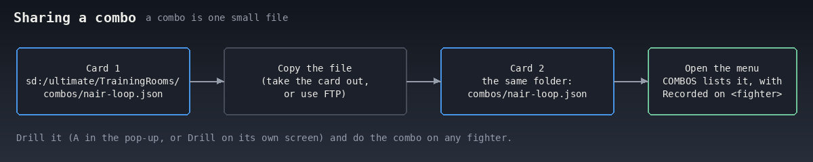

# Share a combo

## Copy a combo to another card

| Step | What to do |
|---|---|
| 1. Identify it | In **Recording → Combos & Sequences**, note the combo name and recorded fighter. |
| 2. Copy its file | Find the matching JSON under `sd:/ultimate/TrainingRooms/combos/`; copy just that file. |
| 3. Import it | Put it in the other card's `combos/` folder without overwriting a different combo. |
| 4. Practise | Reopen the menu, select the combo and choose **Drill**. No restart needed. |
| Different fighter? | Answer [Fighter Mismatch](recording.md#fighter-mismatch); keeping your fighter still lets you practise. |
| Need the file layout? | See [combo storage](../../specs/SPEC-input-07-combo-helper.md) and the [input grading rules](../design/action-model.md). |
