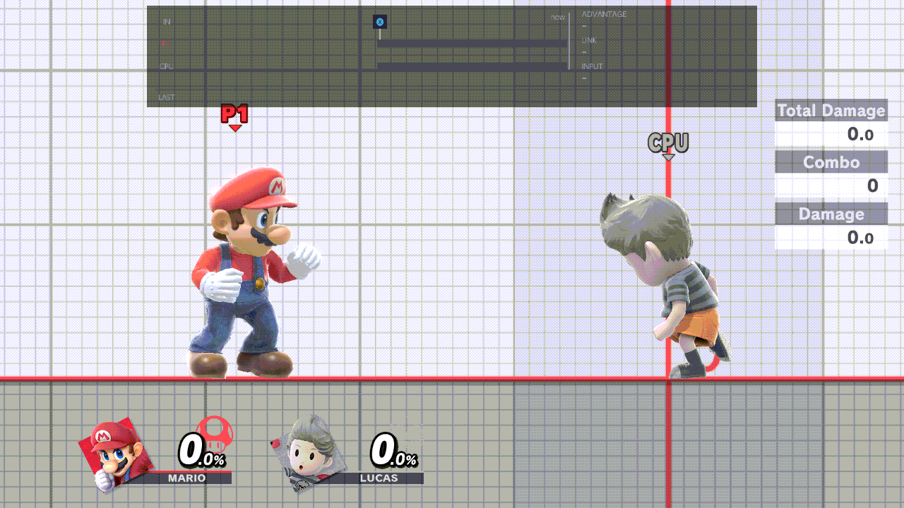

# Controls

Most of what TrainingRooms does while you practise is on a chord: hold one button and press the others. This page lists
every chord, its default and where to change it, then the fixed buttons, the GameCube controller and the cases where a
chord is held back.



## How chords work

- Hold one button of the chord, then press the others. A chord fires once per press; holding it doesn't repeat.
- Chords work in Training, and in a waiting room while Fighters & Stages ›
  [Lobby Practice](../menu/fighters-and-stages.md#lobby-practice) is On.
- They don't fire while a menu is open: this one, the game's pause menu, or the waiting room's own menu.
- The game doesn't see a chord's buttons while you hold them, so the ZR of a chord doesn't make you shield.
- [Input Delay](../menu/display-and-controls.md#input-delay) never delays a chord.

## The chords

| Default | What it does | Read more |
| --- | --- | --- |
| ZL + D-pad Down | Save State Save: saves a save state. | [Save states](save-states.md) |
| ZL + D-pad Up | Save State Load: loads it. | [Save states](save-states.md) |
| ZR + D-pad Down | Record: starts or stops a recording. | [Recording](recording.md) |
| ZR + D-pad Up | Play on CPU: plays the CPU's active recording, or stops it. | [Recording](recording.md) |
| ZR + D-pad Left | Play on Player 1: plays your active recording, or stops it. | [Recording](recording.md) |
| ZR + D-pad Right | Recording pop-up: opens it; B closes it (chords do nothing while it is open). | [The pop-up](recording.md#the-pop-up) |
| ZL + D-pad Right | Cycle Player: your next fighter. | [Fighter cycles](fighter-cycles.md) |
| ZL + D-pad Left | Cycle CPU: the CPU's next fighter. | [Fighter cycles](fighter-cycles.md) |
| R + D-pad Down | Input display: turns the frame strip on or off. | [Frame strip](frame-strip.md) |
| R + D-pad Up, held | Game speed: D-pad Left or Right changes the speed. | [Game speed](game-speed.md) |
| B + D-pad Up | Opens the menu. Fixed. | [Opening the menu](#opening-the-menu) |
| Minus | Opens the menu (Menu shortcut 1). | [Opening the menu](#opening-the-menu) |

The first ten are the rows of Display & Controls › [Button chords](../menu/display-and-controls.md#button-chords),
named as in the table. Some need a setting first:

- Save and load need Saves › Save States On. It is On by default.
- Cycle Player needs Fighters & Stages › [Player Swapping](../menu/fighters-and-stages.md#player-swapping) On. It is Off
  by default. Cycle CPU always works.

## Changing a chord

1. Open Display & Controls › Button chords and press A.
2. Choose a row and press A.
3. Press X, then let go of every button.
4. Hold the new chord: hold one button and press the others. Let go of everything to see it.
5. A keeps it. B cancels. Y empties it, which turns that action off (the row reads "disabled").
6. Close the menu. The new chord works from then on.

The editor doesn't stop two rows from sharing a chord. If they do, both actions happen. Y on the Button chords row
(on the page, not inside the editor) puts all ten back to your saved defaults.

## Opening the menu

- **B + D-pad Up** always opens the menu (the Permanent shortcut row). It can't be changed or turned off.
- **Menu shortcut 1** is Minus by default. **Menu shortcut 2** is disabled by default. Change them at Display & Controls
  › [Menu shortcut 1](../menu/display-and-controls.md#menu-shortcut-1) and
  [Menu shortcut 2](../menu/display-and-controls.md#menu-shortcut-2), with the same steps as a chord. A change works at
  once.
- A shortcut can't be B + D-pad Up, or the chord the other shortcut already has.
- If a shortcut includes Plus, that press doesn't also open the game's pause menu.

The two shortcuts are kept in `sd:/ultimate/TrainingRooms/button_config.ini`, not with the other settings. The menu
writes it, so *Reset page to defaults* leaves them alone. If the file can't be written, a notice says "Could not save
button_config.ini" and the change lasts until you close the game. You can also edit the file while the game is closed;
it is read when the game starts:

```ini
# B + DPad Up is always available. The menu edits this file; a change applies at once.
[menu]
shortcut_1=Minus
shortcut_2=disabled
```

Join buttons with `+`, as in `shortcut_2=ZL + DPAD_UP`. The names are A, B, X, Y, L, R, ZL, ZR, DPAD_UP, DPAD_DOWN,
DPAD_LEFT, DPAD_RIGHT, Plus, Minus, Left Stick Press and Right Stick Press. `disabled` (or `none`) turns a shortcut off.
A value that can't be read falls back to that shortcut's default.

## Fixed buttons

These can't be changed in the chord editor.

- **B + D-pad Up** opens the menu.
- **Kirby hats:** hold Special (B) with the left stick at rest and click the left stick: your Kirby takes the next hat
  in Fighters & Stages › [Kirby Hats](../menu/fighters-and-stages.md#kirby-hats). Click the right stick instead for
  the CPU's Kirby. More: [Fighter cycles](fighter-cycles.md).
- **L + R + A** resets. In Training it is the game's own reset. In a waiting room it puts both practice fighters back
  where they first stood. It can only be turned on or off, at Display & Controls ›
  [L+R+A Reset](../menu/display-and-controls.md#lra-reset) (On by default).

## GameCube controller

On a GameCube controller the plugin reads ZL as L, ZR as R and R as Z. It has no L button and no Minus.

- The defaults become L + D-pad Down / Up (save, load), R + D-pad (record, play, pop-up), L + D-pad Left / Right
  (cycles), Z + D-pad Down (input display) and Z + D-pad Up (game speed).
- Minus doesn't exist, so open the menu with B + D-pad Up. A chord that uses the L button or Minus can't be pressed.
- In the menu, Z turns the page. There is no button to turn back, but the pages wrap around. L + Up / Down jumps
  between sections.

## Online Deluxe

With the Online Deluxe plugin installed:

- While its window shows a settings page, a chord whose D-pad button Online Deluxe uses there does nothing; the press
  goes to Online Deluxe. That is D-pad Up or Down with none of ZL, ZR, R and L held, or D-pad Left or Right with ZR
  held (and not ZL). Of the default chords, only ZR + Left (Play on Player 1) and ZR + Right (Recording pop-up) wait;
  Save and Load, Record, Playback, the cycles and Input display work beside the open page. Its Performance and Debug
  views don't hold any back.
- B + D-pad Up and your menu shortcuts still open this menu.
- The Input display and Game speed chords don't fire while L is held, because Online Deluxe's L + R + D-pad Down
  contains R + D-pad Down. A chord of yours that uses L itself is not affected.
- On a GameCube controller, while both triggers are held (Online Deluxe's L + R there), chords with ZL or ZR, Input
  display and Game speed don't fire.

## When the CPU pilot plays Player 1

While an AI plays Player 1 (the CPU pilot), these are refused with a notice:

- Record: "P1 is controlled by an AI: recording is off".
- Play on Player 1: "P1 is controlled by an AI: Play on Player 1 is off".
- L + R + A in a waiting room: "P1 is controlled by an AI: Quick Reset is off".

More: CPU › [Player 1 control](../menu/cpu.md#player-1-control).
