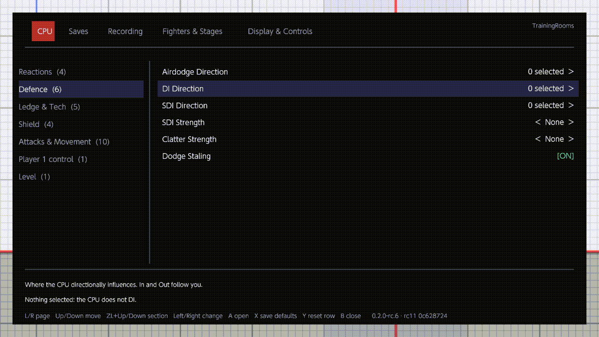

# CPU behaviour

The [CPU page](../menu/cpu.md) tells the training CPU what to do. This guide shows how its rows work together: what
makes the CPU act, which row it picks from, how the direction chips and the delays are read, and what each of the 30
actions does.

## Where the settings apply

- The CPU in Training. With Ice Climbers, Popo and Nana each follow the settings on their own.
- In a waiting room with [Lobby Practice](../menu/fighters-and-stages.md#lobby-practice) On, the first training
  partner. ([CPU Level](../menu/cpu.md#cpu-level) sets every partner.)
- Never Player 1, even when an AI plays Player 1 (see [Player 1 control](../menu/cpu.md#player-1-control)).

## Mash and Followup

[Mash](../menu/cpu.md#mash) is the CPU's main reaction, and [Followup](../menu/cpu.md#followup) is what comes right
after it.

- The CPU holds at most two actions: the first one and its follow-up. Both are picked at the same moment, when a
  situation starts: the first from Mash (or from an override), the follow-up from Followup.
- It presses the first action as soon as the game lets it, for example the first frame after hitstun. Once that
  action has started, the follow-up comes next, again as soon as it can.
- With several actions ticked in a row, the pick is random, and each ticked action has the same chance.
- The CPU picks once when a situation starts, not on every frame of it. A new situation replaces anything still
  waiting.
- The rows under Attacks & Movement are picked along with the action: [Attack Angle](../menu/cpu.md#attack-angle) for
  an angled attack; [Full Hop](../menu/cpu.md#full-hop), [Falling Aerials](../menu/cpu.md#falling-aerials) and
  [Aerial Delay](../menu/cpu.md#aerial-delay) for an aerial; [Fast Fall](../menu/cpu.md#fast-fall) for the fall
  after it.
- Emptying both Mash and Mash Triggers makes the CPU drop anything it was still about to do.

Example: Mash has Jump and Neutral Air, Followup has Air Dodge, and Mash Triggers has Hitstun. You jab the CPU. On
the first frame it can act, it jumps or does a neutral air (one of the two at random), then air dodges.

## Mash Triggers

[Mash Triggers](../menu/cpu.md#mash-triggers) are the situations in which the CPU uses Mash. Each one:

| Trigger | The CPU mashes |
| --- | --- |
| Hitstun | as soon as it can act after a hit (tumble is separate) |
| Tumble | as soon as it can act after a hard launch |
| Shieldstun | out of shield, once OoS Offset and Reaction Time allow |
| Parry | after it parries |
| Footstool | after you footstool it |
| Ledge Trump | after you take the ledge from it |
| Landing | when it lands |
| Clatter | as soon as it is free from a grab, a bury or another hold |
| Ledge Option | right after its ledge option from [Ledge Options](../menu/cpu.md#ledge-options) |
| Tech Option | after it techs or gets up |
| Mistech Option | after it gets up from a missed tech |
| Grounded | when it is on the ground |
| Airborne | when it is in the air |
| Distance: Close | when you are within 16 units of it |
| Distance: Mid | when you are within 37 units (Close included) |
| Distance: Far | when you are within 64 units (Close and Mid included) |
| Always | at any time |

How they combine:

- When several apply at once, the first in this order counts: a tech or getup (Tech Option), Clatter, Tumble,
  Hitstun, Parry, Footstool, Ledge Trump, Landing, then the general ones (Grounded, Airborne, the distances, Always).
- While the CPU is in one of the first eight, only that one counts. With Hitstun unticked, Always doesn't fire during
  hitstun; Hitstun doesn't fire during tumble.
- Grounded, Airborne, the distances and Always work as one situation. While any of them holds, the CPU mashes once.
  It mashes again after none of them held for a moment, or after something else happened in between (a hit, a reset).
- Shieldstun, Ledge Option and Mistech Option are moments: the CPU mashes right then.
- After a throw, the CPU always does its Mash action, whatever is ticked here.

## Situation overrides

[Situation overrides](../menu/cpu.md#situation-overrides) give one situation its own actions. When a situation has an
override, the CPU picks from it instead of Mash. Followup still follows.

| Situation | Override used | Otherwise Mash, if this trigger is ticked |
| --- | --- | --- |
| Hitstun | Hitstun | Hitstun |
| Tumble | Tumble | Tumble |
| Parry | Parry | Parry |
| Footstool | Footstool | Footstool |
| Ledge trump | Ledge Trump | Ledge Trump |
| Landing | Landing | Landing |
| Grabbed, buried or held | Clatter | Clatter |
| A tech or a getup | Tech Action | Tech Option; after a missed tech, Mistech Option too |
| Out of shield | Shieldstun (only with Shieldstun ticked) | Shieldstun |
| After a ledge getup | Ledge Neutral Getup, Ledge Roll, Ledge Jump or Ledge Attack | Ledge Option |
| After a throw | none | always Mash |
| Grounded, airborne, near you, always | none | Grounded, Airborne, the distances, Always |

- An override works even when its trigger is unticked. Shieldstun is the exception: it needs the Shieldstun trigger.
- The four ledge overrides follow the ledge option the CPU took from Ledge Options. With Ledge Options empty, the game
  runs the ledge and they aren't used.

Example: Mash has Jump, Mash Triggers keeps its defaults (Hitstun, Shieldstun, Tumble, Clatter), and the Hitstun
override has Up Special. Out of shield, out of tumble and out of a grab, the CPU jumps; out of hitstun, it does Up
Special.

## The 30 actions

Mash, Followup and every override offer the same 30 actions.

| Action | What the CPU does |
| --- | --- |
| Air Dodge | An air dodge in the air (Airdodge Direction aims it after a hit). On the ground, it shields. |
| Jump | A jump, or a double jump in the air. Full Hop picks a full or a short hop. |
| Shield | Shields, on the ground only; in the air it waits until it lands. |
| Spot Dodge | A spot dodge, also out of shield. |
| Roll Forwards, Roll Backwards | A roll, also out of shield. |
| Neutral Air, Forward Air, Back Air, Up Air, Down Air | The aerial; from the ground it jumps first. |
| Neutral Special, Side Special, Up Special, Down Special | The special move. |
| Forward Smash, Up Smash, Down Smash | The smash attack. Attack Angle angles the forward smash. |
| Jab | A jab, on the ground only; in the air it waits until it lands. |
| Forward Tilt, Up Tilt, Down Tilt | The tilt attack. Attack Angle angles the forward tilt. |
| Grab | A grab, also out of shield. [Throw](../menu/cpu.md#throw) decides what follows. |
| Dash | A dash. |
| Dash Attack | A dash, then a dash attack. |
| Playback Slot 1 to 5 | See below. |

### The Playback Slot actions

Playback Slot 1 to 5 are in Mash, Followup, the overrides and [Ledge Options](../menu/cpu.md#ledge-options). Each one
plays the recording held in one of five numbered recording slots, starting from where the CPU is.

You fill a slot from the library: on a macro's page (Recording page, MACROS, A), set **Playback slot** to Slot 1 to
5. One macro per slot; the slots are kept with the library, so they are back after a restart. A slot holds up to 600
frames (10 s): crop a longer macro first. The CPU plays the macro once, mirrored to the way it faces. In Mash, Followup
and the overrides, Recording › Options › [Hitstun timing](../menu/recording.md#hitstun-timing) decides when a
slot starts after the CPU is hit. A slot with no macro shows "This Playback Slot is empty: pick its macro on the
Recording page" and the CPU skips that action; its follow-up still comes.

To play a macro on demand instead, set it active for the CPU and press Play on CPU (ZR + D-pad Up): see
[Set active, and the Play chords](recording.md#set-active-and-the-play-chords).

## Direction chips

[Airdodge Direction](../menu/cpu.md#airdodge-direction), [DI Direction](../menu/cpu.md#di-direction),
[SDI Direction](../menu/cpu.md#sdi-direction) and [Shield Tilt](../menu/cpu.md#shield-tilt) use the same grid of
chips:

```text
Up In     Up        Up Out     Left
In        Neutral   Out        Right
Down In   Down      Down Out
```

- In points toward you and Out away from you, whichever side of the CPU you stand on. The grid always draws In on the
  left.
- Left and Right are fixed screen directions, whatever the positions.
- Neutral is the stick at rest: no DI or SDI that time, an air dodge in place, an untilted shield.
- The DI grid shows the game's DI line on each chip, and the SDI grid the game's SDI streak.

Weights: each A on a chip adds one weight, from x1 to x5, and a sixth press clears it. The CPU picks between the
selected chips by weight: with Up x3 and In x1 it picks Up three times out of four. Y clears the focused chip; ZL
selects every chip or clears them all. The help line lists the picks, such as "Selected: Up x3, In x1". Shield Tilt
takes one chip only: A selects it and clears the others.

| Row | When the direction is picked |
| --- | --- |
| DI Direction | for each hit, held for that hitstun |
| Airdodge Direction | for each hit in the air, held for that hitstun |
| SDI Direction | at each reset and right after you change the row; kept for every hit until then |
| Shield Tilt | read at each reset and right after you change the row |

SDI also needs [SDI Strength](../menu/cpu.md#sdi-strength), which is None at first.

<br>*The DI and SDI direction grids*

## Delay rows

Seven rows take a delay. Each holds either ticked values or a range.

| Row | Values | With nothing set | A new value is picked |
| --- | --- | --- | --- |
| [Ledge Delay](../menu/cpu.md#ledge-delay) | 0 to 300 frames, steps of 10 | no wait | for each ledge grab |
| [Throw Delay](../menu/cpu.md#throw-delay) | 0 to 150 frames, steps of 5 | it throws at once | for each grab |
| [Pummel Delay](../menu/cpu.md#pummel-delay) | 0 to 150 frames, steps of 5 | no pummels | for each grab |
| [Aerial Delay](../menu/cpu.md#aerial-delay) | 0 to 30 frames | no wait | with each aerial action |
| [Fast Fall Delay](../menu/cpu.md#fast-fall-delay) | 0 to 30 frames | it fast falls at once | as each fall starts |
| [OoS Offset](../menu/cpu.md#oos-offset) | 0 to 30 hits | it acts after the first hit | when it stands or is hit |
| [Reaction Time](../menu/cpu.md#reaction-time) | 0 to 30 frames | no wait | at each hit on its shield |

A on the row opens the delay pop-up. It has two ways to set the delay:

- **Tick values.** A ticks or unticks the value under the cursor; Left/Right step a column; ZL ticks every value. The
  CPU picks one of the ticked values at random, each with the same chance. A ticked 0 counts as a choice: for Pummel
  Delay it means pummel at once.
- **Set a range.** Move down past the values to Min and Max. A picks a handle up (a new range starts at 0 - 0),
  Left/Right move it one step, Up/Down ten steps, and A puts it down. Min can't pass Max. The CPU picks any step from
  Min to Max, each with the same chance; Min equal to Max is a fixed delay.

Only one of the two can hold a value. While values are ticked, the range is greyed ("Values are ticked: clear them
first (Y)"); while a range is set, the values are greyed ("A range is set: clear it first (Y)"). Y clears whichever
is set. On the page, the row reads "none", a count such as "3 selected", or a range such as "10 - 40".

## Recordings and the CPU settings

Two rows on the [Recording page](../menu/recording.md) decide what happens while a recording plays on the CPU:

- [Mash interrupts playback](../menu/recording.md#mash-interrupts-playback) (On at first): when a mash triggers, the
  recording stops and the CPU mashes. Off: the recording plays to its end.
- [Settings override playback](../menu/recording.md#settings-override-playback) (advanced, Off at first): while it is
  Off, the recording wins over DI Direction, SDI Direction, Airdodge Direction, Tech Options, Mistech Options and
  Throw. On: those settings act during the recording too.

The shield, the ledge options, Attack Angle, the aerial rows, Full Hop and Fast Fall always wait while a recording
plays.

## What a reset does

L+R+A (while [L+R+A Reset](../menu/display-and-controls.md#lra-reset) is On) and loading a save state reset Training.
For the CPU this means:

- anything it was about to do is dropped;
- a new SDI direction is picked, and Shield Tilt is read again;
- the next ledge grab and the next grab pick new delays.

Changing Ledge Options while the CPU hangs on the ledge, or Throw while it holds you, also makes it pick again at once.
