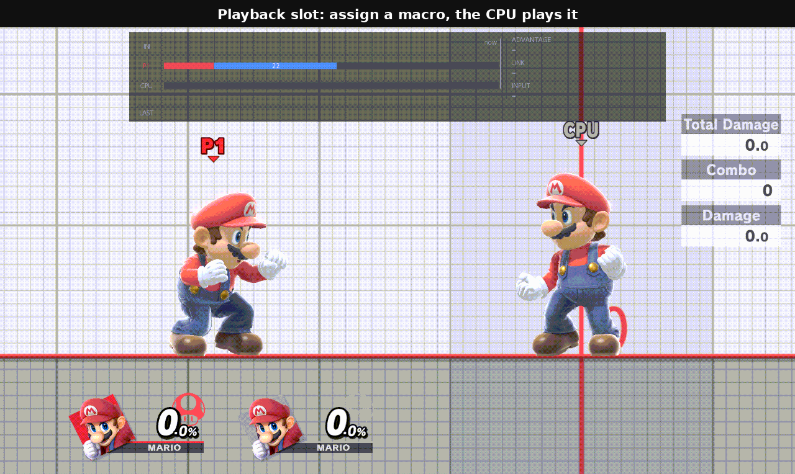
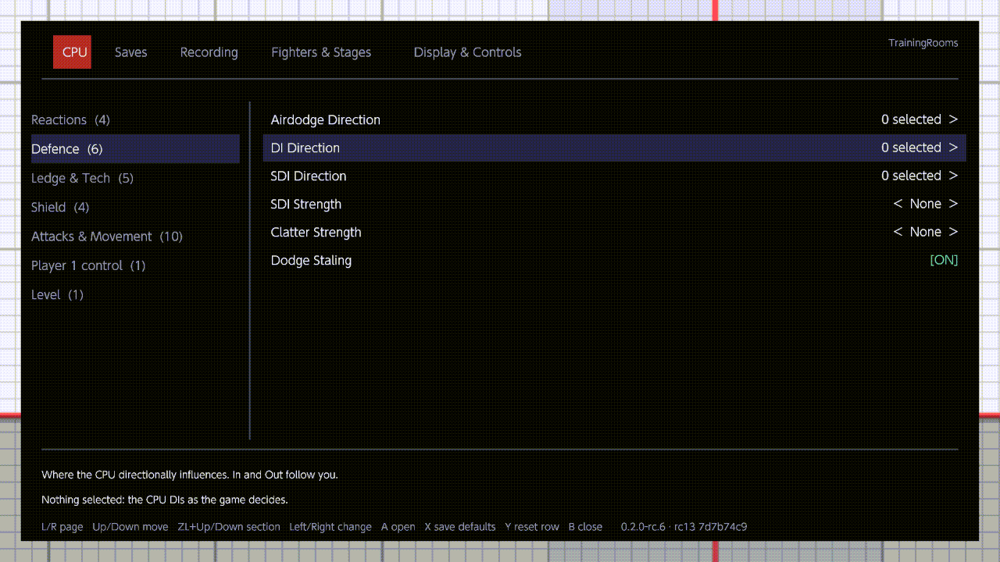
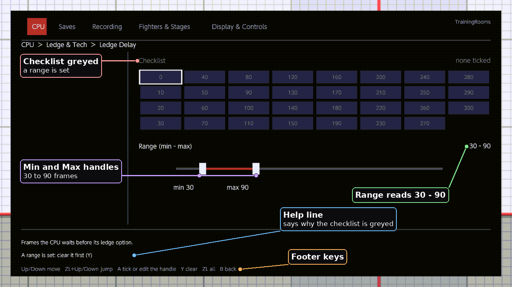

# CPU behaviour

The [CPU page](../menu/cpu.md) controls the training CPU. Its settings also apply to the first practice partner in a
waiting room with [Lobby Practice](../menu/fighters-and-stages.md#lobby-practice) On. Ice Climbers' Popo and Nana
follow them separately; they do not control Player 1, even with [Player 1 control](../menu/cpu.md#player-1-control) On.

<!-- CLIP: tut-cpu-shield.mp4 | CPU › Shield set to Hold → Mario jabs the CPU → it keeps its shield up -->
*Clip coming.*

## Mash and Followup

<!-- CLIP: tut-cpu-mash.mp4 | CPU › Mash set to Jab → Mario jabs the CPU → the CPU answers out of hitstun -->
*Clip coming.*

[Mash](../menu/cpu.md#mash) sets the CPU's first reaction; [Followup](../menu/cpu.md#followup) sets what comes next.
When a situation starts, the CPU picks both actions at once, at random from their ticked choices. It performs each as
soon as it can. A new situation replaces an action still waiting.

For example, tick Jump in Mash, Air Dodge in Followup and Hitstun in Mash Triggers: after you hit it, the CPU jumps
when it can, then air dodges. Attack Angle, Full Hop, Falling Aerials, Aerial Delay and Fast Fall also affect the
chosen action. Emptying both Mash and Mash Triggers drops any action still waiting.

## Mash Triggers

[Mash Triggers](../menu/cpu.md#mash-triggers) choose when Mash fires:

| Trigger | When |
| --- | --- |
| Hitstun / Tumble | After a hit / a hard launch; Hitstun does not include tumble. |
| Shieldstun / Parry | Out of shield / after a parry. |
| Footstool / Ledge Trump / Landing | After that event. |
| Clatter | After escape from a grab, bury or other hold. |
| Ledge Option / Tech Option / Mistech Option | After its ledge option, tech or getup, or missed-tech getup. |
| Grounded / Airborne | While on the ground / in the air. |
| Distance: Close / Mid / Far | Within 16 / 37 / 64 units; the ranges overlap. |
| Always | At any time. |

Tech/getup, Clatter, Tumble, Hitstun, Parry, Footstool, Ledge Trump and Landing take priority, in that order, over
general triggers. Grounded, Airborne, distance and Always repeat after both actions finish; the other situations pick
once when they begin. Shieldstun, Ledge Option and Mistech Option fire at their own moments. After a throw the CPU
uses Mash regardless of the triggers.

## Situation overrides

[Situation overrides](../menu/cpu.md#situation-overrides) replace Mash for their situation; Followup still follows.
An override works even with its trigger unticked, except Shieldstun needs the Shieldstun trigger. The four ledge
overrides follow the chosen [Ledge Option](../menu/cpu.md#ledge-options); if that list is empty, the game controls the
ledge instead.

For example, set Mash to Jump and the Hitstun override to Up Special: the CPU uses Up Special after hitstun, but
Jump in the other triggered situations.

## The 30 actions

Mash, Followup and the overrides use the same actions:

| Action | What the CPU does |
| --- | --- |
| Air Dodge | Air dodge; on the ground, shield. |
| Jump | Jump or double jump; Full Hop chooses full or short. |
| Shield | Shield on the ground; wait to land in the air. |
| Spot Dodge | Spot dodge, including out of shield. |
| Roll Forwards, Roll Backwards | Roll, including out of shield. |
| Neutral Air, Forward Air, Back Air, Up Air, Down Air | Aerial; jump first if grounded. |
| Neutral Special, Side Special, Up Special, Down Special | Special move. |
| Forward Smash, Up Smash, Down Smash | Smash attack; Attack Angle can angle the forward smash. |
| Jab | Jab on the ground; wait to land in the air. |
| Forward Tilt, Up Tilt, Down Tilt | Tilt attack; Attack Angle can angle the forward tilt. |
| Grab | Grab, including out of shield; Throw chooses what follows. |
| Dash | Dash. |
| Dash Attack | Dash, then attack. |
| Playback Slot 1 to 5 | See [Recording](../menu/recording.md#a-file-s-own-screen). |

### The Playback Slot actions

See [Recording](../menu/recording.md#a-file-s-own-screen) for the five playback-slot actions.

*A macro is assigned to Playback Slot 1 and played by the CPU.*

## Direction chips

<!-- CLIP: tut-cpu-di.mp4 | DI Direction Left, then Right → the same smash at the same damage sends the CPU to different places -->
*Clip coming.*

[DI Direction](../menu/cpu.md#di-direction), [SDI Direction](../menu/cpu.md#sdi-direction),
[Airdodge Direction](../menu/cpu.md#airdodge-direction) and [Shield Tilt](../menu/cpu.md#shield-tilt) use a grid.
In points toward you and Out away from you; Left and Right are fixed screen directions. Neutral is the stick at rest.

For DI, SDI and Airdodge Direction, each A on a chip adds weight from x1 to x5; the sixth clears it. The CPU picks
by weight. Y clears the focused chip; ZL selects all or clears all.

Shield Tilt takes one direction instead. Press A to select it, or A again to turn it off. Y or ZL clears the
selection even if the cursor is on a different chip. DI is picked per hit; Airdodge Direction per hit in the
air. SDI is picked at reset or a setting change and kept until the next pick. Shield Tilt is read at reset or a setting change.
SDI also needs [SDI Strength](../menu/cpu.md#sdi-strength).
The help line can read "Selected: Up x3, In x1".

*The DI and SDI direction grids.*

## Delay rows

| Row | Values | Nothing set | Picked |
| --- | --- | --- | --- |
| Ledge Delay | 0–300 frames, step 10 | No wait | Each ledge grab |
| Throw Delay | 0–150 frames, step 5 | Throws at once | Each grab |
| Pummel Delay | 0–150 frames, step 5 | No pummels | Each grab |
| Aerial Delay | 0–30 frames | No wait | Each aerial action |
| Fast Fall Delay | 0–30 frames | Fast falls at once | Each fall |
| OoS Offset | 0–30 hits | Acts after the first hit | When it stands or is hit |
| Reaction Time | 0–30 frames | No wait | Each shield hit |

Press A on a delay row. Tick values with A, or move to Min and Max and press A to move a handle. Left/Right move one
step and Up/Down ten. The CPU picks randomly from the ticked values or the range; only one method can hold a value.
Y clears it. Delays use game frames at every game speed; OoS Offset counts hits.

*A delay range set; the checklist is greyed.*

## Recordings and the CPU settings

See [Recording options](../menu/recording.md#options) for how recordings and CPU settings interact.

## What a reset does

L+R+A with [L+R+A Reset](../menu/display-and-controls.md#l-r-a-reset) On, or loading a save state, drops pending CPU
actions, picks SDI again and reads Shield Tilt again. The next ledge grab and grab pick new delays. Changing Ledge
Options while the CPU hangs, or Throw while it holds you, also makes it pick again.
